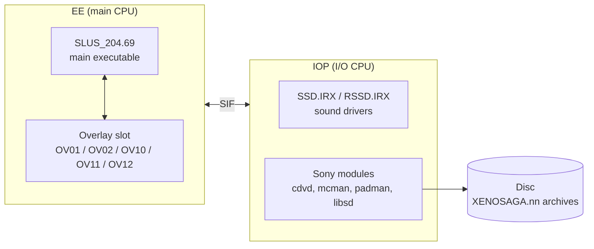
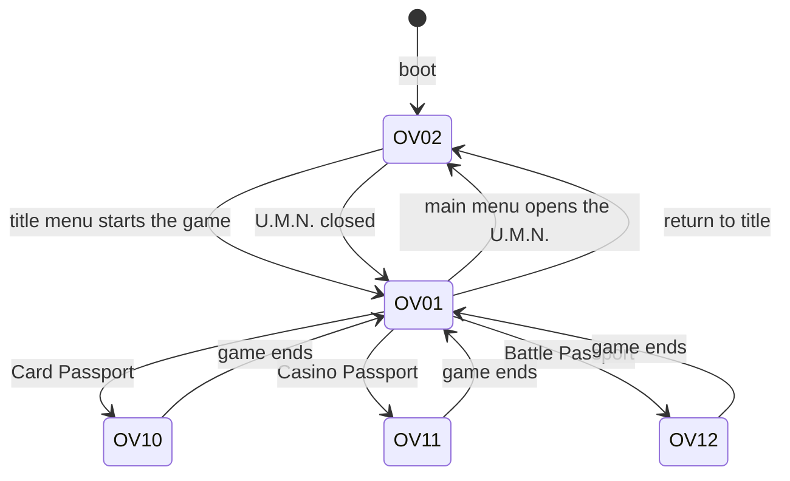
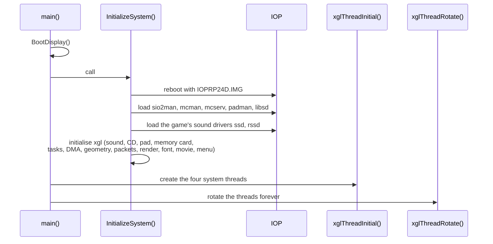
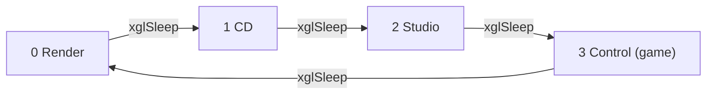
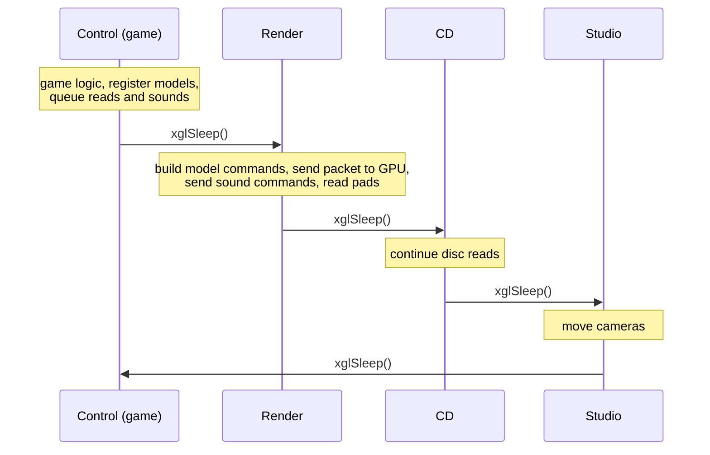
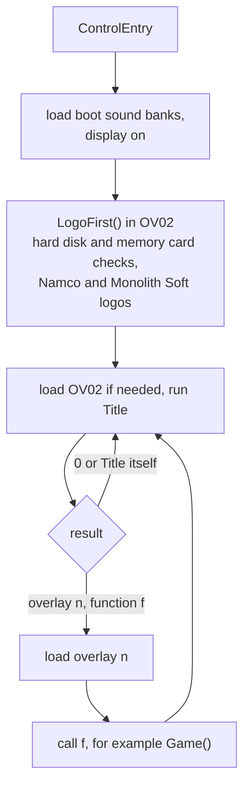
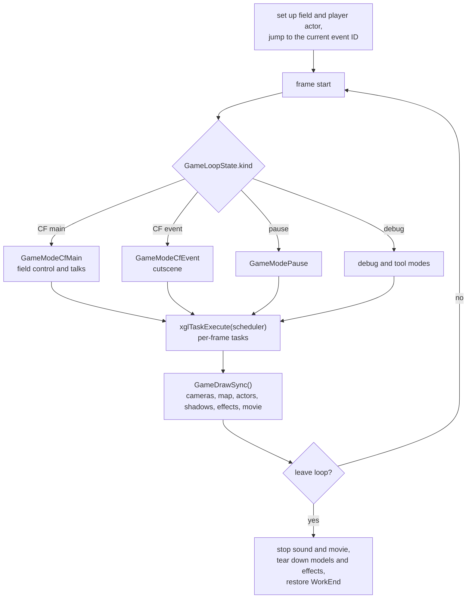
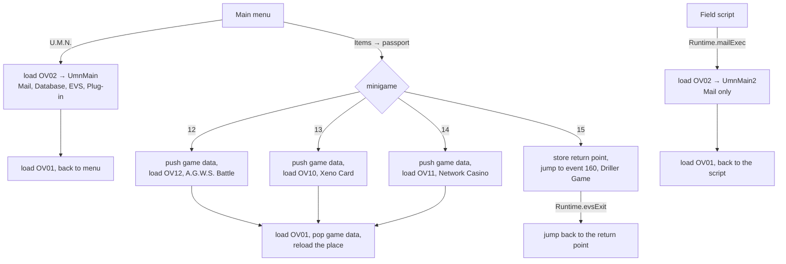
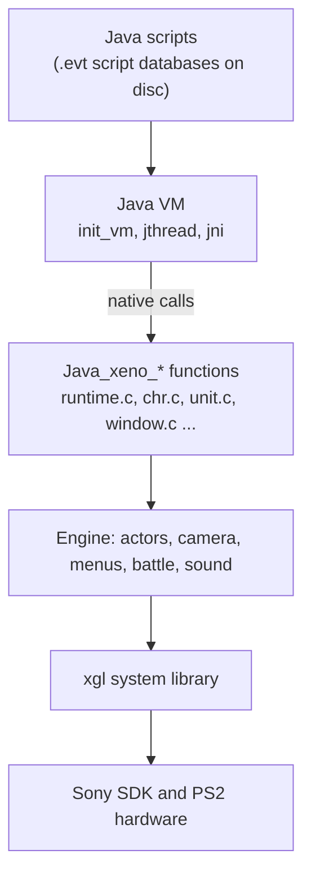
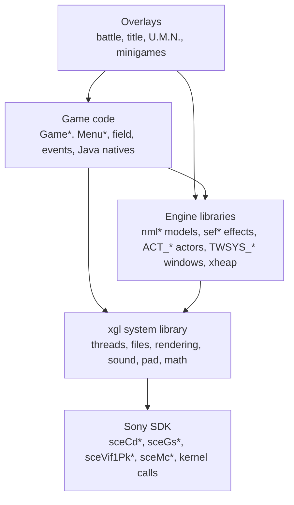

# Xenosaga Episode I — Game Architecture

*Xenosaga Episode I: Der Wille zur Macht* is a role-playing game by Monolith
Soft, published by Namco for the PlayStation 2 (Japan 2002, North America
2003). This source tree rebuilds the North American release, `SLUS-20469`.

This page gives the overall structure of the game. The pages linked below go
deeper into each part.

## Contents

This page covers the programs on the disc, the overlays, memory, start-up,
the system threads, the frame, the menus and minigames, the Java scripts and
the layers of the code. The other pages are grouped by area. The
[glossary](glossary.md) lists every term used across the pages, with a link
to the place where it is explained.

**Architecture**

| Page | Topics |
| --- | --- |
| [Memory management](architecture/memory.md) | The EE memory map, the work area and `WorkEnd`, the resource table, menu and minigame work areas, packet buffers, the scratchpad, IOP and GS memory |
| [Files and resources](architecture/files-and-resources.md) | The disc and its archive directory, from a path to bytes in memory, packed ARX files, the field resource system, file types |
| [Save data](architecture/save-data.md) | The save image and its blocks, new games, saving and loading, the save screen, thumbnails |
| [Runtime libraries](architecture/runtime-libraries.md) | The Sony SDK and C runtime code linked into the executable |
| [Rendering pipeline](architecture/rendering.md) | Video memory, packets, the VIF1/VU1/GIF path, textures, the order of drawing in a frame |
| [Audio](architecture/audio.md) | Sound on the EE side: banks, sequences, sound effects, voices, streams |
| [The IOP sound driver](architecture/iop-sound-driver.md) | `SSD.IRX` and `RSSD.IRX`: the sequencer, voices, sound memory and the remote calls |

**Scripting**

| Page | Topics |
| --- | --- |
| [The Java virtual machine](scripting/java-vm.md) | The interpreter, classes and script archives, objects, script threads, memory |
| [Native methods](scripting/natives.md) | The 401 native methods, grouped by Java class, and how they reach the engine |
| [Events and cutscenes](scripting/events.md) | Event IDs, scene resource scripts, talks and field triggers, event flags, message text |
| [Scenes, stages and time charts](scripting/scenes-and-timecharts.md) | `xeno.Stage` and `xeno.Scene` classes, the event frame, PlayControl and time charts, event cameras, moving actors and units |

**Engine libraries**

| Page | Topics |
| --- | --- |
| [xgl, the system library](libraries/xgl.md) | Threads, tasks, files, rendering, sound, controllers, memory cards, fonts, movies |
| [Math helpers](libraries/math.md) | Vectors, matrices, VU0 macro mode, the matrix stack, curves, splines, random numbers |
| [nml, the model library](libraries/nml.md) | Model data, model entries, packet building, the VU1 microcode, projected shadows, filters and fades |
| [sef, the visual effect system](libraries/sef.md) | Effect numbers and files, schedulers, keyframes, effect scripts, drawing, screen-wide effects |
| [Actors](libraries/actors.md) | The actor table, actor IDs, creating and updating actors |
| [Animation](libraries/animation.md) | Motion data, the motion clock, skeletons, look-at control, hair and cloth, ground height |
| [User interface and windows](libraries/ui-windows.md) | Text and fonts, message windows, the script window toolkit (TWSYS), script menus, sliders, list windows |

**Game systems**

| Page | Topics |
| --- | --- |
| [Boot and title screen](game/title-and-boot.md) | `main()`, the device checks, the logo movies, the title screen, new games, HDD install |
| [The field game](game/field.md) | The play session `Game()`, game modes, the frame loop, the camera, player control |
| [Maps and units](game/map-and-units.md) | Map loading, the collision mesh, map units, doors, traps, symbols, ladders |
| [Field enemies](game/field-enemies.md) | Enemy and NPC records, enemy AI, sight and hearing, starting a battle |
| [Main menu](game/main-menu.md) | Opening the menu, menu levels and memory, how a screen is built, items, Game Options, starting minigames |
| [Character growth](game/character-growth.md) | Points and experience, stats, Tech Attacks, Ether and the Ether tree, skills, A.G.W.S., party, shops |
| [U.M.N.](game/umn.md) | The network terminal: Mail, Database, EVS and Plug-ins |
| [Battle system](game/battle.md) | Encounters, the battle loop, turn order and AP, Tech Attacks, damage, status effects, Boost, Event Slot, enemy AI, the battle camera |
| [Battle effects](game/battle-effects.md) | The OV01 effect objects, their lifecycle and hit signal, the effect families, battle movies |
| [Debug tools and test programs](game/debug-tools.md) | Developer test programs, debug menus and what remains of them in the release |

**Minigames**

| Page | Topics |
| --- | --- |
| [Xeno Card](game/minigames/xeno-card.md) | The card game in OV10: card data, the play mat, turns, card effects, the computer opponent |
| [Network Casino](game/minigames/network-casino.md) | Slot Machines, Nine Reel, Poker, coin and prize exchange in OV11 |
| [Driller Game](game/minigames/driller-game.md) | The drill as a map unit on a field map, its phases, timer, containers and items |
| [A.G.W.S. Battle](game/minigames/agws-battle.md) | The robot fighting game in OV12: modes, the six A.G.W.S., weapons, controls, rounds, the CPU opponent |
| [The A.G.W.S. Battle engine](game/minigames/agws-battle-engine.md) | The OV12 engine: its object style, the `RgHeap` allocator, the battle manager, robots, shots, collision, the CPU AI, drawing |

**File formats**

| Page | Topics |
| --- | --- |
| [Models and textures](formats/models-and-textures.md) | LEX models, XTX texture sets, texture sets embedded in other files |
| [Skeletons and motion](formats/skeletons-and-motion.md) | JNT skeletons, FPK motion packs, FCV2 curve sets, CAM event cameras, battle motion files and their MTD trigger tables |
| [Maps and field data](formats/maps-and-field-data.md) | The map directory, map models, the `.id` collision and layout data, map think data, enemy presets, item boxes, battle stages |
| [Effect data](formats/effects.md) | The `.esd` effect scripts, the `.esp` effect packs, the effect name table, effect images and models |
| [Sound files](formats/sound.md) | SWD wave banks, SPU ADPCM, SED sound effects, SMD music, battle sound containers, VAG streams |
| [Movies, images and icons](formats/movies-images-and-icons.md) | PSS and IPU movies, JPEG pictures, the 3D memory card icons, `hdd.res`, save thumbnails |
| [Scripts and scene archives](formats/scripts-and-archives.md) | PDB volumes, Java class files, scene and resource volumes, scene resource scripts, `.a` scene archives |
| [Text, fonts and U.M.N. data](formats/text-and-fonts.md) | Character encoding, font control codes, MIF2 message tags, kanji and battle fonts, UML pages, U.M.N. texts |
| [Game data tables](formats/game-tables.md) | `batdat.bin`, the growth tables, shop lists, enemy AI programs, battle model packs |
| [Minigame data files](formats/minigame-data.md) | The data of Xeno Card, the Network Casino and A.G.W.S. Battle |

## 1. Programs on the disc

The game is split into several programs. The main executable stays in memory
the whole time. Five overlays share one slot of memory and are swapped in when
needed. Two sound drivers run on the second processor.

| File on disc | Source | Runs on | Contents |
| --- | --- | --- | --- |
| `SLUS_204.69` | `src/main/` | EE | Engine, field game, main menu, Driller Game, Java VM |
| `OV01.OVL` | `src/ov01/` | EE | Battle system and battle effects, game data tables used by the menus, camera and movie helpers used by field scripts |
| `OV02.OVL` | `src/ov02/` | EE | Boot logo, title screen, HDD install, U.M.N. screens |
| `OV10.OVL` | `src/ov10/` | EE | Xeno Card, the card game |
| `OV11.OVL` | `src/ov11/` | EE | Network Casino: Slot Machines (with the Nine Reel game), Poker, coin exchange |
| `OV12.OVL` | `src/ov12/` | EE | A.G.W.S. Battle, the robot fighting game |
| `IOP/SSD.IRX`, `IOP/RSSD.IRX` | `src/audio/` | IOP | Sound drivers |
| other files in `IOP/` | Sony | IOP | The IOP reboot image `IOPRP24D.IMG`, Sony's serial, memory card, controller and sound modules, and the hard disk and network drivers |

The PlayStation 2 has two main processors:

- The **EE** (Emotion Engine) is the main MIPS CPU. All game code runs here. It
  has two vector units (VU0 and VU1) and sends graphics to the **GS** (Graphics
  Synthesizer).
- The **IOP** (I/O Processor) is a second, smaller MIPS CPU. It owns the disc
  drive, memory cards, controllers and the sound chip. The EE sends it requests
  through **SIF** remote calls.

The game data (models, maps, textures, sound, scripts) is stored in the large
`XENOSAGA.nn` archive files. The file library (`xgl_cd`) finds files inside
them by name. The archives and the way each kind of data is loaded are
described in [architecture/files-and-resources.md](architecture/files-and-resources.md).
The two sound drivers have their own page,
[architecture/iop-sound-driver.md](architecture/iop-sound-driver.md), and the
game's side of sound is in [architecture/audio.md](architecture/audio.md).



## 2. Overlays

An overlay is a block of code and data loaded from disc on demand. All five
overlays are linked to run at the same address, `0x00A00000`, so only one of
them can be in memory at a time. `xglCdLoadOverlay(n)` loads
`cdrom0:\OVnn.OVL;1` into that slot. It does nothing when overlay `n` is
already loaded.

The main executable also carries its own copy of OV02, which the console loads
together with it at `0x00A00000`. The file library starts with overlay 2
marked as loaded, so the boot logo and the first title screen need no disc
read. Later visits to the title screen load `OV02.OVL` from the disc.

**OV01 is the resident overlay during play.** Battles can start at any moment
from the field, and the main menus read the game data tables (techniques,
weapons, items, character growth) through accessor functions that also live
in OV01. Field scripts use its camera and movie helpers too. So OV01 is kept
loaded, every other overlay is swapped in for a while, and OV01 is loaded
again afterwards.

| Overlay | Loaded by | Source |
| --- | --- | --- |
| OV02 | already in memory at boot (embedded copy), then the control thread every time the title screen runs again | `src/main/control_entry.c`, `src/main/xgl_cd.c` |
| OV01 | the title screen's result when a game starts, and every screen that returns to the field | `src/ov02/title.c`, `src/main/window_tex_load.c` |
| OV02 (U.M.N.) | the main menu's U.M.N. entry | `UmnInterface` in `src/main/window_tex_load.c` |
| OV10, OV11, OV12 | using a passport item from the main menu, or the script native `Runtime.minigameExec` | `src/main/window_tex_load.c`, `src/main/runtime.c` |

Code in an overlay calls the main executable freely. The main executable only
calls into an overlay through a few known entry points, right after loading
it. Each overlay has its own pages. OV01 is described in
[game/battle.md](game/battle.md) and [game/battle-effects.md](game/battle-effects.md),
OV02 in [game/title-and-boot.md](game/title-and-boot.md) and
[game/umn.md](game/umn.md), and the minigame overlays in
[Xeno Card](game/minigames/xeno-card.md),
[Network Casino](game/minigames/network-casino.md) and
[A.G.W.S. Battle](game/minigames/agws-battle.md). The diagram shows how the
overlay slot changes during a play session.



## 3. Memory map

The EE has 32 MiB of main memory. The lowest part belongs to the EE kernel.
The main executable is loaded at `0x00200000`, with its code first and then
its data. The system thread stacks sit just below it, between `0x001E5000`
and `0x001F8000`. The overlay slot starts
at `0x00A00000` and is followed by the game's work memory. The two GPU packet
buffers take the 4 MiB from `0x00C00000` to `0x01000000`.

```
0x00000000 ┌───────────────────────────────┐
           │ EE kernel                     │
0x001E5000 ├───────────────────────────────┤
           │ system thread stacks (grow ↓) │  xgl_thread.c
0x001F8000 ├───────────────────────────────┤
           │ (not used by game code)       │
0x00200000 ├───────────────────────────────┤
           │ main executable code          │
0x00338600 ├───────────────────────────────┤
           │ main executable data + BSS    │
0x0099D910 ├───────────────────────────────┤
           │ (unused)                      │
0x00A00000 ├───────────────────────────────┤
           │ overlay slot (one at a time)  │  xglCdLoadOverlay
0x00A80000 ├───────────────────────────────┤
           │ work memory (WorkEnd →)       │  control_entry.c
0x00C00000 ├───────────────────────────────┤
           │ GPU packet buffer 0 (2 MiB)   │  xgl_packet.c
0x00E00000 ├───────────────────────────────┤
           │ GPU packet buffer 1 (2 MiB)   │
0x01000000 ├───────────────────────────────┤
           │ upper memory (minigame heaps, │
           │ resources, battle stage)      │
0x02000000 └───────────────────────────────┘
```

**Work memory** is managed with a simple bump pointer, `WorkEnd`. A loader
places its data at `WorkEnd` and moves the pointer past it. Nothing is freed
one block at a time. Instead, a screen saves `WorkEnd` when it starts and puts
it back when it ends, which releases everything the screen loaded. `Game()`
in `src/main/game.c` does exactly this for a whole play session.

Script objects use their own heap, `xheap` (`src/main/xheap.c`). It is also a
bump allocator, but it can save its position in frames and drop back to a
saved frame, which frees everything allocated since then (see
[scripting/java-vm.md](scripting/java-vm.md#the-xheap-object-heap)).
All memory areas, including the upper memory and the memory of the IOP and
the GS, are described in [architecture/memory.md](architecture/memory.md).

## 4. Start-up

Start-up is in `src/main/control_entry.c`.

1. `main()` stores `argc` and `argv` and shows the boot display.
2. `InitializeSystem()` reboots the IOP with the replacement module image
   `IOPRP24D.IMG`, then loads the IOP modules. These are Sony's serial, memory
   card, controller and sound modules, followed by the game's own sound
   drivers `ssd` and `rssd`. It sets `WorkEnd` to `0x00A80000` and initialises
   every `xgl` subsystem.
3. `xglThreadInitial()` creates the four system threads.
4. `xglThreadRotate()` takes over the boot thread and never returns. From here
   on, the four system threads run the game.

Each step is described in more detail in
[game/title-and-boot.md](game/title-and-boot.md#1-from-main-to-the-control-thread).



## 5. The four system threads

The game does not rely on pre-emptive multitasking. It runs four EE threads in
a fixed **round-robin**. Each thread does one step of its work, then calls
`xglSleep()`. That call wakes the next thread in the list and puts the caller
to sleep. One full turn of the four threads makes one frame.

| # | Thread | Entry point | Work in each turn |
| --- | --- | --- | --- |
| 0 | Render | `xglRenderEntry` | Finish the frame's GPU packet and send it, send queued sound commands, read the controllers |
| 1 | CD | `xglCdControlThread` | Advance the current file read, refill the stream ring buffers from disc, handle power-off |
| 2 | Studio | `xglStudioEntry` | Update the cameras of every studio |
| 3 | Control | `ControlEntry` | The game itself: title, field, menus, battles, minigames |

The table is `asSystemThreadList` in `src/main/xgl_thread.c`. The control
thread has a 64 KiB stack and the other three have 4 KiB each.

Because only one thread runs at a time and each one gives up control on
purpose, the threads can share data without locks. It also makes game code
simple to write. Inside a game loop, `xglSleep()` simply means "wait for the
next frame". After the control thread, the turn goes back to the render
thread and the cycle starts again. The thread code is described in
[libraries/xgl.md](libraries/xgl.md#threads).



The sequence below shows one frame. During its turn the game runs its logic,
registers the models it wants drawn, writes a few draw commands of its own
into the current packet and queues disc reads and sound requests. On its
next turn the render thread turns the registered models into GPU commands,
finishes the packet and sends it, together with the queued sound commands.



How the frame's drawing is split between the threads, and how the packet
reaches the GS, is described in
[architecture/rendering.md](architecture/rendering.md#frames-across-the-threads).

## 6. From the title screen to the game

`ControlEntry` is the body of the control thread. It loads the boot sound
banks, waits for them to reach the sound chip and turns the display on. Then
`LogoFirst()` in OV02 runs once. It checks the optional hard disk and the
memory cards and shows a message when one of them needs attention, for
example an unformatted hard disk. After the checks it plays the two logo
movies, Namco first and then Monolith Soft. From then on the control thread
loops on the title screen. The whole sequence is described in
[game/title-and-boot.md](game/title-and-boot.md).

The title screen (`Title()` in OV02) returns one 32-bit value that encodes
where to go next:

- bits 0–23 hold the address of the next screen's function,
- bits 24–31 hold the overlay that screen needs.

For example, starting or continuing a game returns `0x01245C58`, which means
"load OV01, then call `Game()` at `0x00245C58`". When the title screen times
out, it returns the logo screen in OV02 instead, which plays the two logo
movies again. A result of 0 keeps the player on the title screen, for example
after a cancelled Continue. When the called function returns, for example
`Game()` after a game over, the loop asks for OV02 again and the title screen
reappears.



### The field game loop

`Game()` in `src/main/game.c` is the play session. It sets up the field
systems and creates the player actor. Then it jumps to the current event ID
(`GameLoopState.current_event_id`), which names either a place on the field or
a cutscene. The jump reads that place's scene resource script
(`data\scene\cfNNNN.txt` or `evNNNN.txt`), loads what it lists and starts the
place's Java script. A saved game resumes at its saved event and puts the
player back at the saved position. Then `Game()` runs one loop pass per frame:

1. Run the current game mode, chosen by `GameLoopState.kind`. The two main
   modes are field control (`GameModeCfMain`) and cutscenes
   (`GameModeCfEvent`). Field control covers walking around and also talks
   and other small scripted moments on the field. Only full cutscenes switch
   to the event mode. There are also a pause mode and several debug modes.
2. Run the frame's tasks with `xglTaskExecute(GameLoopState.scheduler)`.
3. Call `GameDrawSync()`. It updates the cameras, prepares the frame's
   scene (map, actors, shadows and units), advances the visual effects and
   the movie, then waits for the next frame. The effects themselves are drawn
   later by the render thread.
4. Leave the loop when a mode has set the leave flag.

Battles against field enemies run inside the field mode itself. When the
player touches a visible enemy, the enemy code raises a battle request in
`GameLoopState`. On its next pass `GameModeCfMain` saves the field state with
`Game_Data_Push`, calls the battle code in OV01 and waits until the battle is
over. The game mode is set to "battle" during that call, but `Game()` never
sees it, because control only comes back to the loop after the battle. Then
the field state is restored and the place's script hears about the result. A
lost battle ends the session with a game over, except in battles that the
story allows the party to lose. See
[game/field.md](game/field.md#battles-started-from-the-field) and
[game/field-enemies.md](game/field-enemies.md#starting-a-battle).

A game session ends when the player returns to the title screen or after a
game over. `Game()` then stops sound and movies, tears down models and
effects, restores `WorkEnd` and returns to `ControlEntry`. The field session
is described in full in [game/field.md](game/field.md).



## 7. Main menu, U.M.N. and minigames

The main menu (`src/main/window_tex_load.c`) has its own loop with one level
per screen: Items, Ether, Tech Attack, Skills, Characters, A.G.W.S., Battle
Formation, U.M.N. and Game Options. Opening the menu saves the field state
and closing it restores the field. The menu borrows memory from the field for
its textures and models, and it needs OV01, whose data tables it reads. See
[game/main-menu.md](game/main-menu.md).

The **U.M.N.** (Unus Mundus Network) is the in-game network terminal. Its
screens are in OV02, so choosing U.M.N. in the menu loads OV02, runs
`UmnMain()` and loads OV01 again when it closes. `UmnMain()` has five modes:
the top menu and the four services Mail, Database, EVS (the Environmental
Simulator) and Plug-in. Scripts can also open the mail screen alone with the
native `Runtime.mailExec`. That path calls `UmnMailMain`, which swaps in OV02
in the same way and runs `UmnMain2()`, a variant that shows only Mail. Work
that needs OV01, such as teaching KOS-MOS an ability from a mail, is stored
during the visit and applied after OV01 is back. See
[game/umn.md](game/umn.md).

The **minigames** start from the item screen, by using a passport item. A
passport only works while the player stands on an E.V.S. point, a special
save point marked on the map. The item screen returns a minigame number and
the menu runs it once it has closed. Scripts can also start the first three
minigames directly with the native `Runtime.minigameExec`.

| Number | Minigame | Passport | Code |
| --- | --- | --- | --- |
| 12 | A.G.W.S. Battle | Battle Passport | OV12 |
| 13 | Xeno Card | Card Passport | OV10 |
| 14 | Network Casino | Casino Passport | OV11 |
| 15 | Driller Game | Drill Passport | main executable (`src/main/init_drill.c`) |

The three overlay minigames share one pattern. Before the minigame runs, the
game pushes its state (`Game_Data_Push`) and resets the actors. The minigame
then uses the overlay slot and large parts of memory for itself. Afterwards
the game reloads OV01, pops the state (`Game_Data_Pop`) and reloads the
current place's resources, which the minigame has overwritten. The player is
back at the same spot.

The Driller Game works differently because it is a place on the field. The
menu closes normally, then the field mode stores a return point (the current
event ID and the player's position) and jumps to event 160, the drill's own
map. The drill is a map unit controlled by that map's script. When the player
leaves, the native `Runtime.evsExit` jumps back to the stored return point.



## 8. Game logic in Java

Most story and event logic is not written in C. The main executable contains a
small **Java virtual machine**:

| File | Role |
| --- | --- |
| `src/main/init_vm.c` | Start the VM, create the basic classes, and the bytecode interpreter (`virtualMachine`) |
| `src/main/init_class_db.c` | Read classes and keep the class table |
| `src/main/script.c` | Load the script databases (`.evt` files) and run talks and cutscenes |
| `src/main/jthread.c` | Script threads (`JThread`) and their waits |
| `src/main/find_native_method.c` | Link classes, create objects and arrays |
| `src/main/jni.c` | Bind and call native methods, heap marks, script threads |
| `src/main/xheap.c` | The heap for Java objects |

The compiled classes are not stored as separate `.class` files. They are
packed into **script databases** with the extension `.evt`. Two of them are
shared by the whole game (`data\system.evt` and `data\base.evt`), and every
place and cutscene has its own. A place's script is a class that extends
`xeno.Stage` and answers events such as talking to a character. A cutscene is
a class that extends `xeno.Scene` and plays the scene from its `play()`
method.

The scripts run as script threads (`JThread`) inside the VM. These are not
operating-system threads. They are records that hold a Java call stack, and
the VM runs them one after another on the control thread, once per frame. A
script that waits (for a number of frames, a window or an animation) simply
returns control and resumes on a later frame.

Scripts call the engine through **native methods**. Each native is a C function named after its Java method,
for example:

```c
/* Runtime.minigameExec(int) */
void Java_xeno_util_Runtime_minigameExec__I(JThread *thread, int *arguments);
```

The main executable defines 401 native methods. By Java class:

| Java class | Natives | Used for |
| --- | --- | --- |
| `xeno.Chr` | 98 | Characters: movement, look-at, motion |
| `xeno.Unit` | 71 | Map objects: position, rotation, motion, collision, visibility |
| `xeno.util.Runtime` | 68 | Game flow: battles, minigames, event flags, scene changes |
| `xeno.Camera` | 39 | Cameras: position, rotation, field of view, fog, spline paths |
| `xeno.Effect`, `xeno.Stage`, `xeno.Scene`, `xeno.Light`, `xeno.Movie`, `xeno.Sound` | 56 | Effects, map stage, scenes, lights, movies, sound |
| `xeno.util.Window`, `xeno.util.Menu` | 21 | Dialogue windows and menus |
| `xeno.PlayControl` | 12 | Playback of timed event sequences ("time charts") |
| `xeno.util.Toolkit`, `Format`, `Input`, `Spline`, `Layout` | 23 | Helpers, text formatting, controller input, curves, placing objects from the map layout data |
| `xeno.vm.System`, `Thread`, `Math` | 13 | The VM's own system, thread and math classes |

A native is a thin bridge. It reads its arguments from the Java call, then
calls ordinary engine code, which in turn uses `xgl` and the hardware. For
example, `Runtime.execBattle(int, int)` saves part of the field state, sets
the battle map and the monster set in OV01, runs the battle until it ends,
then rebuilds the actor scene, fades in and restores the saved state
(`src/main/runtime.c`). This is how a script starts a battle. Battles started
by touching an enemy on the field take another path, through the field mode
itself (see [section 6](#the-field-game-loop),
[game/field-enemies.md](game/field-enemies.md#starting-a-battle) and
[game/battle.md](game/battle.md)). The whole VM is described in
[scripting/java-vm.md](scripting/java-vm.md) and every native in
[scripting/natives.md](scripting/natives.md).



## 9. Layers

The code is organised in layers. Each layer uses the layers below it and is
not called by them.

| Layer | Examples | Notes |
| --- | --- | --- |
| Sony SDK | `sceCd*`, `sceGs*`, `sceVif1Pk*`, `sceMc*`, kernel calls | Sony's libraries, linked into the executable together with the C start-up code (crt0), the C library (newlib), the math library (fdlibm) and the compiler's runtime (libgcc). These 855 functions are kept as assembly and are not part of the recovered source. See [runtime libraries](architecture/runtime-libraries.md) |
| System library | `xgl*` | Threads, file reads, rendering, sound, controllers, math. See [libraries/xgl.md](libraries/xgl.md) |
| Engine libraries | `nml*` (models), `sef*` (effects), `ACT_*` (actors), `TWSYS_*` (windows), `xheap` | Built on top of `xgl`. See [nml](libraries/nml.md), [sef](libraries/sef.md), [actors](libraries/actors.md), [animation](libraries/animation.md), [windows](libraries/ui-windows.md) and [math](libraries/math.md) |
| Game code | `Game*`, `Menu*`, field, events, Java natives | Uses every layer below it. See [field](game/field.md), [main menu](game/main-menu.md) and [events](scripting/events.md) |
| Overlays | battle, title, U.M.N., minigames | Same layers, loaded on demand. See [section 2](#2-overlays) |



## Conventions

- File references are paths from the repository root, such as
  `src/main/xgl_cd.c`.
- Function and variable names are the ones used in the recovered source.
- When a statement is a likely reading of the code rather than a certainty,
  the text says so.
