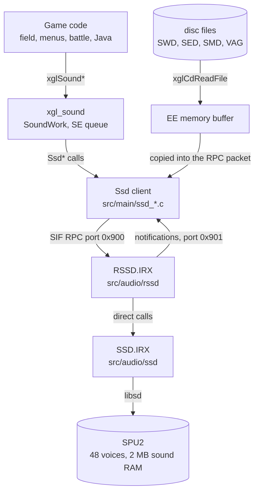
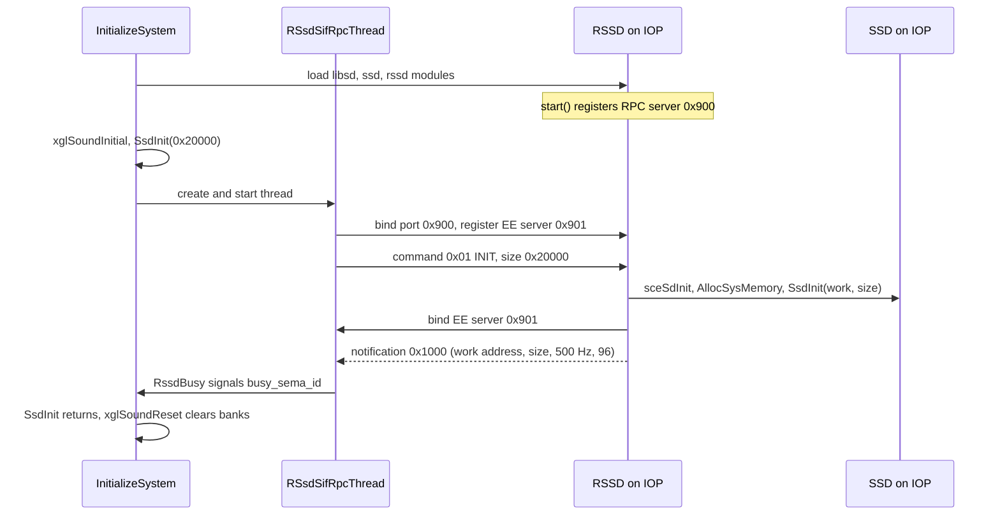
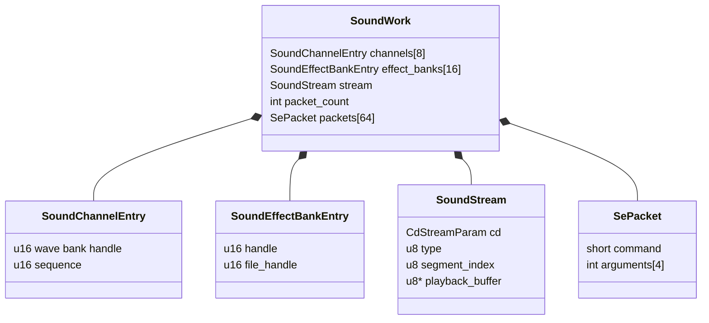
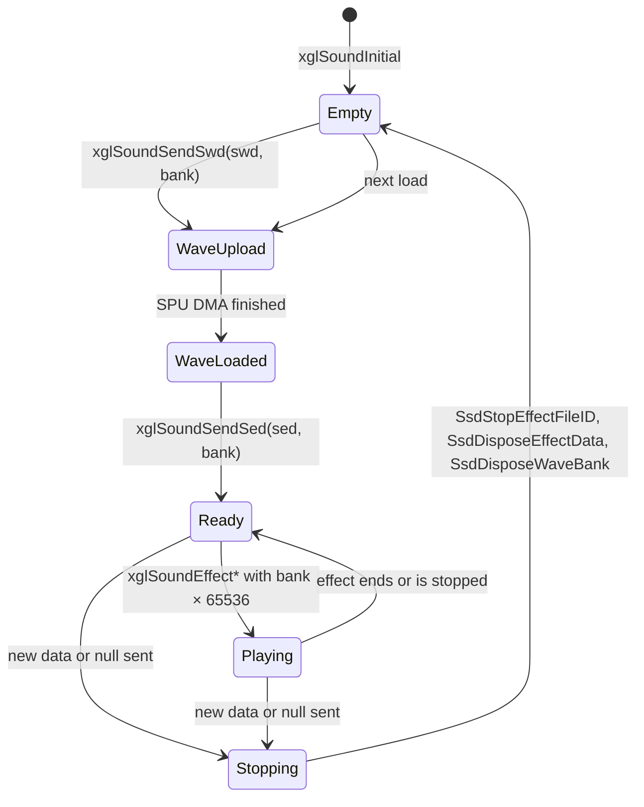
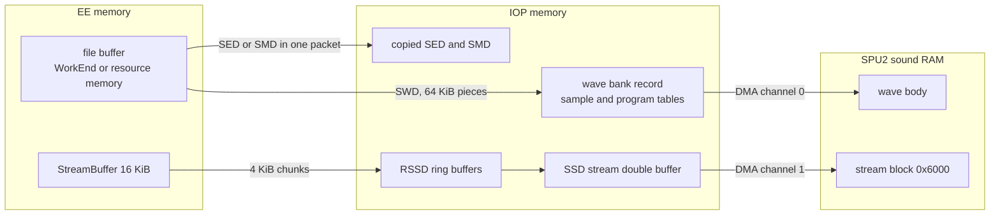
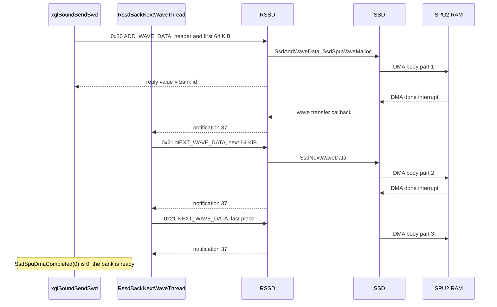
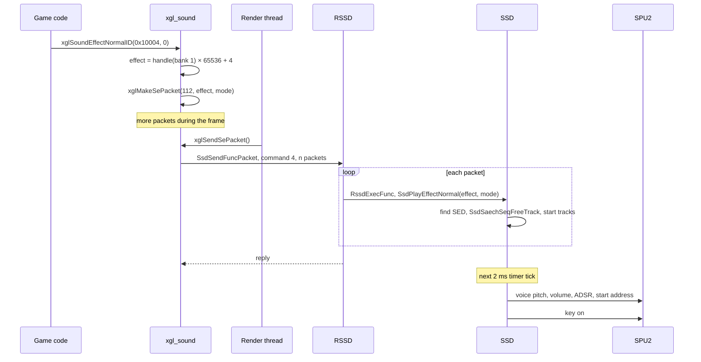
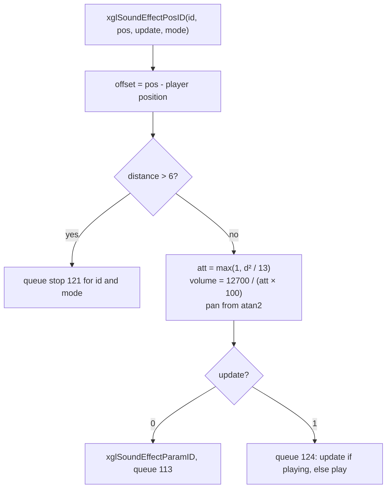
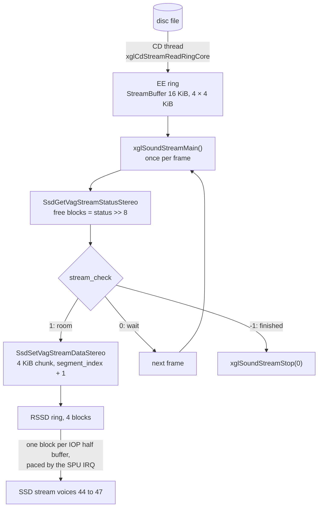

# Audio

Xenosaga Episode I plays music, sound effects, voice streams and movie sound
through two processors. The game code on the EE decides what to play, reads the
sound files from the disc and sends commands. A sound driver on the IOP turns
those commands into notes on the SPU2, the PlayStation 2 sound chip. The two
sides talk over SIF RPC, the remote procedure call link between the EE and the
IOP.

On the EE, the game uses the `xglSound*` functions of `src/main/xgl_sound.c`.
They sit on top of a thin client layer, the `Ssd*` functions of
`src/main/ssd_*.c`, which packs every request into an RPC packet. On the IOP,
two modules answer: `RSSD.IRX` receives the packets and `SSD.IRX` does the
actual sound work. The driver internals are described in
[The IOP sound driver](iop-sound-driver.md).

[← Back to the overview](../README.md)

## Contents

1. [Layers](#1-layers)
2. [Start-up](#2-start-up)
3. [The Ssd client and the RPC link](#3-the-ssd-client-and-the-rpc-link)
4. [SoundWork](#4-soundwork)
5. [Sound banks](#5-sound-banks)
6. [Sound file formats](#6-sound-file-formats)
7. [Loading sound data](#7-loading-sound-data)
8. [Music sequences](#8-music-sequences)
9. [Sound effects and the SE queue](#9-sound-effects-and-the-se-queue)
10. [Positional sound](#10-positional-sound)
11. [Streams](#11-streams)
12. [Java Sound natives](#12-java-sound-natives)
13. [Sound in the overlays](#13-sound-in-the-overlays)
14. [Output settings](#14-output-settings)
15. [Quirks in the code](#15-quirks-in-the-code)

## 1. Layers

Sound passes through five layers. The game code calls `xglSound*`. This layer
keeps the table of loaded banks and sequences (`SoundWork`), builds file paths,
queues sound effect commands and feeds audio streams. Below it, the `Ssd*`
client turns each request into a 32-byte RPC packet and sends it to the IOP
with `RssdCallFunc`. On the IOP, RSSD unpacks the packet and calls the matching
SSD function. SSD keeps sequences, effects and wave banks in IOP memory and
programs the SPU2 through Sony's `libsd` library.

| Layer | Processor | Files | Role |
| --- | --- | --- | --- |
| Game code | EE | field, menus, battle, overlays, Java natives | Asks for music, effects and streams |
| `xgl_sound` | EE | `src/main/xgl_sound.c`, `include/main/xgl_sound.h` | Banks, channels, SE queue, streams |
| `Ssd*` client | EE | `src/main/ssd_init.c`, `ssd_1.c` to `ssd_4.c`, `ssd_set.c` | RPC packets, waits for replies, wave uploads |
| RSSD | IOP | `src/audio/rssd/` | RPC server, calls into SSD, stream ring buffers, notifications to the EE |
| SSD | IOP | `src/audio/ssd/` | Sequencer, effects, voices, SPU memory, DMA, streams, reverb |

The diagram below shows the path of a request from the game to the sound chip,
and the data path of the sound files.



The SPU2 has two cores with 24 voices each, so 48 voices in total, and 2 MB of
its own sound RAM. A voice plays ADPCM sample data from that RAM. The SPU2
cannot read EE memory, so every wave must first be copied into sound RAM by
DMA. That is why loading a sound bank is a two-step job: read the file into EE
memory, then send it to the IOP, which moves the samples into sound RAM.

## 2. Start-up

Sound starts in `InitializeSystem` (`src/main/control_entry.c`). It loads the
IOP modules with `xglCdSifLoadModule`. After the memory card and controller
modules it loads `libsd` (Sony's sound library), then `ssd` and then `rssd`.
When RSSD starts, its `start` function creates two IOP threads and registers
the RPC server on port `0x900`. Then `InitializeSystem` calls
`xglSoundInitial()`.

`xglSoundInitial` calls `SsdInit(0x20000)`. The argument is the size of the
work area that the IOP driver will allocate for itself
(`SOUND_DRIVER_WORK_BYTES`). The EE `SsdInit` (`src/main/ssd_init.c`) fills
`RssdWork`, creates two semaphores and starts two EE threads, both at priority
6 with 16 KiB stacks:

- `RSsdSifRpcThread` binds the RPC client to the IOP server, registers the EE
  RPC server on port `0x901` and then runs `sceSifRpcLoop` forever. This loop
  receives the messages that the IOP sends back.
- `RssdBackNextWaveThread` sleeps until a wave transfer finishes and then sends
  the next piece of a large wave bank (see
  [section 7](#7-loading-sound-data)).

Before the RPC loop starts, `RssdInitIop` sends command `0x01` (INIT) with the
work size. On the IOP, `RssdInit` initializes `libsd`, allocates the work area,
starts SSD over it and binds its own client to the EE server. It then sends
notification `0x1000` back. The EE handler `RssdBusy` stores the values of that
notification and signals the semaphore that `SsdInit` waits on. The init
notification carries the IOP address and size of the work area and the word
`0x6001f4`. Its low half, 500, is stored as `sample_rate` and is the driver tick
rate in Hz that `SsdGetTimeCode` uses. Its high half, 96, is probably the
number of sequencer ticks per beat (the IOP default is also 96).

The sequence below shows this handshake.



After `SsdInit`, `xglSoundInitial` points the stream ring at its 16 KiB static
`StreamBuffer`, marks all eight channels and all sixteen effect banks as empty
(`0xFFFF`) and calls `xglSoundReset`. `xglSoundReset` sends "no data" to every
slot, prepares the CD stream used by audio streams and empties the SE queue.

The first sounds come in `ControlEntry`, the body of the control thread. Before
the boot logo it loads two banks into the new driver:

1. `xglSoundLoadEffect("REGIST", WorkEnd, 0)` loads
   `data\sound\sed\REGIST.SWD` and `REGIST.SED` into effect bank 0. This bank
   holds the system and menu sounds, for example decide (1), cancel (2), cursor
   (3) and buzzer (5) from `include/shared.h`.
2. `xglSoundLoadSwd("sed\\REGIST2", WorkEnd)` reads
   `data\sound\sed\REGIST2.SWD`, and `SsdAddWaveData` sends it as a bare wave
   bank. It is not stored in any `SoundWork` slot, so the xgl layer never
   replaces it, and it stays at its fixed sound RAM address `0x1E0000` for the
   whole game. Its bank id is `0x0100` and it holds seven samples. No effect
   file of its own goes with it. Instead, effects 9, 33, 34, 35, 56 and 58 of
   `REGIST.SED` switch their tracks to bank `0x0100` with the WaveBankType
   command (`0xAB`, see
   [The IOP sound driver](iop-sound-driver.md#event-format)) and play its
   samples from there. The file layouts are in
   [Sound files](../formats/sound.md#swd-wave-banks).

`ControlEntry` waits with `SsdSpuDmaCompleted` until the samples are in sound
RAM, then turns the display on and loads the title overlay. The wider boot
flow is in the [overview](../README.md#4-start-up) and
[Title and boot](../game/title-and-boot.md).

## 3. The Ssd client and the RPC link

Every `Ssd*` function on the EE has the same shape. It fills a request record
with up to four argument words, sets or clears a flag in `RssdWork.flags`, and
calls `RssdCallFunc(command, request, data, size)`. The command numbers are
those of the IOP driver, listed in
[The IOP sound driver](iop-sound-driver.md#3-the-rpc-protocol).

`RssdCallFunc` (`src/main/ssd_init.c`) works step by step:

1. It waits on `sema_id`, so only one call is in flight at a time.
2. It copies the request into the aligned client buffer, writes the command
   and the data size, and copies the optional data after the 32-byte header.
   The total, rounded up to 16 bytes, may not exceed `0x10020` bytes (a header
   plus 64 KiB of data). A larger call prints an error and fails.
3. It flushes the data cache and calls `sceSifCallRpc` in no-wait mode with the
   callback `RssdSifRpcCallback`.
4. It then spins in `RssdFuncCallCompleted(1)` until the callback clears the
   pending flag. So every call is synchronous in practice.

The IOP writes its answer into the same 32-byte header and sends it back.
`RssdSifRpcCallback` copies it into `RssdWork.response` and signals the
semaphore. Callers read the answer with `SsdGetResultValue(&value)`. It returns
a negative number while a call is pending or after an error reply, and
otherwise stores the reply's `value` word. The xgl layer always uses the same
idiom after a call:

```c
SsdAddEffectData(sed);
do {
} while (SsdGetResultValue(&result) < 0);
```

`SsdGetResultParam` copies the whole 32-byte reply instead. It is used when the
answer has several words, for example the per-channel stream status.

The IOP can also call the EE. RSSD sends these calls to the EE server on port
`0x901`, and `RssdSifRpcServer` on the EE handles them:

| Command | Name in the code | EE handler | Meaning |
| --- | --- | --- | --- |
| 10 | `RSSD_SERVER_STREAM_END` | `stream_end_callback`, once per set bit 0 to 3 | A stream channel ran out of data |
| 27 | `RSSD_SERVER_SPU_READ` | `RssdSpuRead` | One block of a sound RAM read-back arrived |
| 37 | `RSSD_SERVER_NEXT_WAVE` | `RssdBackgroundNextWave` | A wave transfer to sound RAM finished |
| 218 | `RSSD_SERVER_SAMPLE_DMA` | `sample_dma_callback` | A sampling transfer finished |
| 219 | `RSSD_SERVER_SAMPLE_KEYOFF` | `sample_keyoff_callback` | A sampling voice stopped |
| 4096 | `RSSD_SERVER_BUSY` | `RssdBusy` | The driver finished initializing |
| other | | `server_callback` | Anything else, if a callback is set |

The setters for these callbacks (`SsdSetStreamEndCallback`,
`SsdSetServerCallback`, `SsdSetSampleDmaCallback` and others) exist, but no
game code outside the client files calls them. In the game, only the busy,
next-wave and SPU-read messages do real work.

`RssdWork` (`RssdWorkFlags` in `include/main/ssd_init.h`) holds the state of the
client. The important fields are:

| Field | Meaning |
| --- | --- |
| `flags` | Bit 0 ready, bit 1 busy, bit 2 a wave upload to sound RAM is running, bit 3 a call is pending, bit 5 a result flag the wrappers set or clear before each call |
| `response` | Copy of the last 32-byte reply |
| `server_buffer`, `rpc_server`, `rpc_queue` | The EE RPC server for messages from the IOP |
| `rpc_thread_id`, `next_wave_thread_id` | The two EE sound threads |
| `sema_id`, `busy_sema_id` | Call lock and start-up handshake |
| `spu_bytes_remaining`, `spu_write_ptr`, `wave_id` | State of a wave upload in several pieces |
| `sample_rate` | 500, the driver tick rate |

`src/main/ssd_4.c` also contains an EE copy of a 64-byte-aligned memory manager
(`SsdInitMemoryManager`, `SsdNewMemoryPtr`, with an arena head tagged `"MTOP"`)
and `SsdCopyMemory`. Only `SsdCopyMemory` is used by the client. No game code
calls the memory manager.

## 4. SoundWork

`SoundWork` (`struct SoundWork` in `include/main/xgl_sound.h`) is the single
table the xgl layer keeps. It is a 0x8A4-byte global with four parts.

| Field | Size | Meaning |
| --- | --- | --- |
| `channels[8]` | 8 × 4 bytes | Sequence channels. Each entry holds a wave bank handle (first halfword) and a sequence handle |
| `effect_banks[16]` | 16 × 4 bytes | Effect banks. `handle` is the wave bank handle, `file_handle` the effect data (SED) handle |
| `stream` | 0x40 bytes | The CD stream of audio stream 0 and its playback state |
| `packet_count`, `packets[64]` | 4 + 0x800 bytes | The SE queue: up to 64 queued 32-byte command packets |

A handle is the 16-bit id that the IOP driver returns when data is added.
`0xFFFF` (`SOUND_HANDLE_NONE`) means the slot is empty. The xgl layer never
keeps pointers to IOP data. It only remembers these ids and gives them back in
later commands.

The class diagram below shows the parts of `SoundWork` and their fields.



`SoundStream` is a union with the CD layer's `CdStreamParam`. The CD layer uses
the first ring of the stream. The sound layer stores its own playback state
(`type`, `segment_index`, `playback_buffer`) in the bytes of the unused second
ring at offset `0x30`. `type` is 0 (none), 1 (PCM), 2 (stereo VAG) or 3 (mono
VAG, called "multi" in the code).

## 5. Sound banks

An effect bank is a pair of files with the same name: an SWD file with the wave
samples and an SED file with the effect programs. Bank `n` is used through
sound IDs of the form `(n << 16) | index`. A sequence channel is a slot for one
sequence (SMD) with its own wave bank. Most sequences the field loads are not
music but map ambience: 103 of the 115 SMD files on the disc are short
environment sequences that hold one long looped note of the map's
environment bank (see [section 8](#8-music-sequences)). The table below lists
how the game assigns the sixteen effect banks.

| Bank | Content | Loaded by |
| --- | --- | --- |
| 0 | `REGIST`, system and menu sounds | `ControlEntry` at boot. Never unloaded by the game |
| 1 | `REGISTCF`, common field sounds such as traps (`TRAP_SE_*` = `0x1000x`) | `GameCFSoundReload` in `src/main/game.c`. Battle and Network Casino load their own data here, Xeno Card empties it |
| 2 | Leader footsteps, a name like `SO_<foot>` built by `RES_GetLeaderSeName` | `GameCfPlayerLoadResource` in `src/main/look_at_player.c`. Battle and the minigames reuse it (`MINIBAT`, `Minicard`, casino) |
| 3 | Map environment sounds, named by the `loadse` resource command | `command_loadse` in `src/main/res_get_path.c`, `GameCFSoundMenuReload` |
| 4 to 11 | Enemy and NPC sounds, one bank per `enese` or `npcse` entry | `command_enenpcse`. `RES_GetEnemySeBank` returns `0x40000 + slot × 0x10000` |
| 12 to 15 | No call site in the recovered code loads these banks | |

Inside a battle the banks change meaning (see [section 13](#13-sound-in-the-overlays)).
The battle start (`src/ov01/entry_first_init.c`) clears banks 1 to 14 and stops
everything playing from bank 0.

The eight sequence channels are numbered 0 to 7. Channel 0 is the main music
channel used by `xglSoundSequenceNormal` and the battle and minigame music.
`loadsmd` can fill several channels at once, one per name. The U.M.N. uses
channel 4 for its own music.

A bank goes through a simple life cycle. `xglSoundSendSwd` and
`xglSoundSendSed` always free the old content first: they stop the effects of
that bank (`SsdStopEffectFileID`), dispose the old effect data and wave bank,
and only then add the new data. Sending a null pointer just empties the slot.
The state diagram below shows the life of one effect bank.



The field game swaps banks when it changes mode. `GameCFSoundPurge` runs when
`Game()` ends and in `Game_Data_Push`, which saves the field state before
another mode takes over. It empties the eight sequence channels, bank 1,
banks 2 and 3 and the enemy banks. `GameCFSoundReload` runs when `Game()`
starts and in `Game_Data_Pop`. It empties the channels and the field banks and
loads `REGISTCF` into bank 1 again. Both also change the
[segment allocation modes](#segment-allocation-modes).

`GameCFSoundMenuPurge` and `GameCFSoundMenuReload` are used around the main
menu and the U.M.N. The purge always stops the enemy sounds and frees banks 8
to 11. With mode 1 (the U.M.N.) it also empties bank 3 and stops the sequence
channels that are playing, remembering them in a bit mask. The reload empties
channel 4, loads the map environment bank 3 and the enemy banks 8 to 11 again,
and restarts the remembered channels unless a U.M.N. simulation or the Driller
Game is active.

### Segment allocation modes

The IOP places a wave bank in sound RAM at an address taken from the SWD
header. A segment allocation mode tells the driver to treat that header
address as the start of a series of segments of a given size, and to put the
bank in the first segment that has room. `SsdSetSegmentAllocMode(address,
size)` adds such a rule and `SsdResetSegmentAllocMode(address)` removes it.
The field uses two of them. In the field, `GameCFSoundReload` sets
`(0x70000, 0x10000)` and removes `0xA8000`. When the field sound is purged,
`GameCFSoundPurge` does the opposite. This probably lets enemy banks of
different maps share the same area of sound RAM without fixed addresses. The
addresses in the files fit this reading. All 61 enemy, NPC and party "C" banks
in `data\sound\sed\` name `0x70000` in their header, so in the field they fill
64 KiB segments upward from there. 117 wave banks inside the battle
containers name `0xA8000`, the rule that is active while the field sound is
purged, which is probably the battle's own segment area. A segment rule also
wins over the "dynamic address" flag of a bank, so the eight loose banks that
set that flag (`CF_JR`, `CF_KOS`, `CF_SHION`, `CF_Z8`, `DUMMY_C`, `NPC_F`,
`NPC_M`, `WOO_C`, all at `0x70000`) are placed by the segment rule in the
field. The allocator itself is described in
[The IOP sound driver](iop-sound-driver.md#5-memory).

## 6. Sound file formats

All sound files of the driver share a common start. Word 0 is a four-character
signature, word 1 (offset 4) is a checksum, word 2 (offset 8) is the size of
the file in bytes, the 16-bit word at offset `0x0C` is a format version
(`0x0250` in every file on the disc, never read), and the 16-bit word at
offset `0x0E` is the file id. When it loads a music or effect file, the IOP
adds up all its 32-bit words over that size and refuses the file if the sum is
not zero (`SsdCheckData`, `SsdGetCheckSum` in `src/audio/ssd/ssd_err.c`). The
checksum word is chosen to make the sum zero. Wave banks carry the same
checksum, but `SsdAddWaveData` never checks it. Ten wave banks inside the
battle containers have a wrong checksum and load anyway. The byte layouts of
every sound file, with the values found on the disc, are in
[Sound files](../formats/sound.md). This section gives the parts the code
works with.

| Type | Extension | Signature | Directory | Content | Where it ends up |
| --- | --- | --- | --- | --- | --- |
| Wave bank | `.SWD` | `swdm` | `data\sound\sed\`, `data\sound\smd\`, `data\yamamoto\snd\smd\` | ADPCM samples, sample table, program table | Samples in sound RAM, tables in IOP memory |
| Effect data | `.SED` | `seds` | `data\sound\sed\` | Effect programs, one or more tracks each | Copied whole into IOP memory |
| Music sequence | `.SMD` | `smdm` | `data\sound\smd\`, `data\yamamoto\snd\smd\` | Tracks of note and control events | Copied whole into IOP memory |
| VAG stream | `.vdm`, `.vds` | | `data\sound\vda\` (archive groups 10 and 20), `data\yajima\` | Mono (`vdm`) or stereo (`vds`) ADPCM audio without a header | Streamed through rings, never loaded whole |
| PCM stream | | | | Raw samples interleaved in 512-byte runs per channel | Streamed by AutoDMA, not used by the game |
| Battle SE container | `.bin` | | `data\yamamoto\snd\sed\` | One to five SED and SWD pairs behind a small offset header | Split by `src/ov01/snd.c`, each pair sent as a bank |

### SWD wave bank

An SWD file starts with a 0x40-byte header (`SsdWaveFileHeader` in
`src/audio/ssd/ssd_wave.c`), then a list of chunks, then the sample body.

```
SWD file
+0x00  u32 signature "swdm"
+0x04  u32 checksum     not checked for wave banks
+0x08  u32 file size
+0x0C  u16 version      0x0250, never read
+0x0E  u16 file id      always equal to bank_id
+0x10  u16 flags        bit 0: the SPU address is a minimum, not fixed
+0x12  u16 bank_id      id of the wave bank in the driver
+0x14  u8  sample_count
+0x15  u8  program_count
+0x20  u32 spu_address  preferred address in sound RAM (0 = any)
+0x24  u32 body_size    bytes of ADPCM data
+0x28  u32 body_offset  where the body starts in the file
+0x40  chunks: u16 type, u16 size, 12 bytes, payload
         type 3 = sample table, type 4 = program table, type 0 = end
...    ADPCM body (body_size bytes)
```

Flag bit 0 matters only when no segment allocation mode is registered for the
header's address, because `SsdSpuWaveMalloc` checks the segment rules first
(see [Segment allocation modes](#segment-allocation-modes)).

Each sample record (`SsdWaveSample`, 32 bytes) gives the offset of the sample
in the body, a loop word, a default volume and pan, a base pitch, the two ADSR
envelope words of the SPU2 voice and a 16-character name. The loop word never
reaches the SPU2. The driver computes a loop address from it at key-on, but no
code writes that address to the voice (`SsdSetVoiceLoopStartAddress` has no
caller). A sample loops through the flags of its own ADPCM packets instead,
which mark the loop start and the jump back. A volume of 0 marks an empty
slot, and more than half of the records on the disc are such empty slots.
Programs are instruments for music: they split the key range into zones that
point at samples (see
[The IOP sound driver](iop-sound-driver.md#10-midi-devices-channels-and-voices)).
The record and packet layouts are in
[Sound files](../formats/sound.md#sample-records).

The wave bank id comes from the file. If a bank with the same id is already
loaded, the driver keeps the old one and returns its id again. A few banks on
the disc share an id with a bank of different content (for example
`KM_PRO03` and `KM_PRO04`, or `GUNO022C` and `GUNO023C`), so they cannot be
resident at the same time.

### SED effect data

An SED file (`SsdEffectData` in `include/ssd/ssd_sec.h`) holds a table of effect
programs.

```
SED file
+0x00  u32 signature "seds" (0x73646573)
+0x08  u32 file size
+0x0E  u16 file_id      the upper half of the effect id
+0x1A  u16 effect_count
+0x1C  u16 bank_id      wave bank whose samples the effects play
+0x20  char[16]         project file name of the authoring tool ("regist.sav"), never read
+0x30  u32 next         link to the next loaded set, 0 in the file
+0x34  u16 effect_offsets[effect_count]  byte offsets from the file start, 0 = no effect

effect entry (SsdEffectEntry)
+0x00  u8  flags        0x04 restart stops every instance, 0x20 use tracks 0 to 23
+0x01  u8  volume
+0x02  u8  priority
+0x03  u8  track_count
+0x08  u16 track_offsets[track_count]   offsets of each event stream
```

An effect is a small sequence: each of its tracks is a stream of note and
control events, played on its own voice. So one effect can play a chord or a
layered sound. The effect tracks use the commands of the music tracks, but a
shorter note event of three bytes whose duration is also the wait before the
next event (see [The IOP sound driver](iop-sound-driver.md#event-format)). A
track normally plays samples of the bank named at `0x1C`. The WaveBankType
command can switch it to any other loaded wave bank, which is how the system
sounds of `REGIST.SED` reach `REGIST2.SWD`. The entry layout and the effect
commands found on the disc are in
[Sound files](../formats/sound.md#sed-effect-files).

### SMD music sequence

An SMD file (`SsdMusicData` in `include/ssd/ssd_musc.h`) holds one sequence:
a piece of music or a map's ambience loop.

```
SMD file
+0x00  u32 signature "smdm"
+0x08  u32 file size
+0x0E  u16 file_id           sequence id in the driver
+0x10  8 bytes               authoring date and time, never read
+0x18  u8  priority
+0x19  u8  options           bit 0 / bit 1: program the reverb of core 0 / core 1
+0x1C  u16 bank              wave bank of the instruments
+0x1E  u8  track_count
+0x1F  u8  channel_priority
+0x21  u8  voice range first / master note
+0x22  u8  voice range last / master pan
+0x23  u8  reverb_mode, +0x24 reverb_depth, +0x25 delay, +0x26 feedback
+0x27  u8  midi_channel_count (0 = count from the tracks)
+0x28  chunks: u16 type, u16 size, payload
         type 2 = metadata, type 3 = one track, type 4 = patch table, type 0 = end
```

A track chunk names its MIDI channel and holds its event stream. The event
format and the opcode table are in
[The IOP sound driver](iop-sound-driver.md#9-the-sequencer). The metadata
chunk holds five strings (title, game, composer, studio and a comment) that
the driver stores but never reads. No file on the disc has a patch chunk.
The full header, the track chunks and the music found on the disc are in
[Sound files](../formats/sound.md#smd-music-files).

### VAG and PCM streams

Stream files are not loaded into memory. The CD layer reads them through a ring
buffer and the sound layer passes 4 KiB pieces to the IOP. VAG is the SPU2's
ADPCM format, made of 16-byte blocks with a header halfword (coding and loop
flags) and the packed samples. The stream files have no header at all. A
`.vds` stereo file interleaves its two channels in 1 KiB blocks, left then
right, which is the block size the driver expects
(`RSSD_VAG_INTERLEAVE_SIZE`). A `.vdm` mono file is one channel in a single
run. Each channel ends with an end packet and a terminator packet, except in
the sixteen `s195xxx.vds` field sounds, which were encoded as loops. The
driver rewrites the loop flags at the edges of each 1 KiB block anyway, so to
the game every stream is alike. The layouts are in
[Sound files](../formats/sound.md#vag-streams). The Java native `streamPlay`
and the game over screen use VAG streams. The PCM path exists in the driver
and in `xglSoundStreamOpenPcm`, but no game code opens a PCM stream.

The flowchart below shows where each kind of data lives once it is loaded.



## 7. Loading sound data

The xgl layer has two kinds of load functions. The `xglSoundLoad*` functions
read files from the disc and send them. The `xglSoundSend*` functions send data
that is already in EE memory.

| Function | What it does |
| --- | --- |
| `xglSoundLoadSwd(name, buffer)` | Reads `data\sound\<name>.SWD` into `buffer` |
| `xglSoundLoadEffect(name, buffer, bank)` | Reads `data\sound\sed\<name>.SWD`, sends it to `bank`, waits for the SPU DMA, then reads `<name>.SED` into the same buffer and sends it. A null name empties the bank |
| `xglSoundLoadRequestSmd(name, buffer)` | Same for music: `data\sound\smd\<name>.SWD` into channel 0's wave bank, then `<name>.SMD` into channel 0, then starts it at volume 127 |
| `xglSoundSendSwd(swd, bank)` | Replaces a wave bank. A negative `bank` selects the wave bank of sequence channel `-1 - bank` |
| `xglSoundSendSed(sed, bank)` | Replaces the effect data of an effect bank |
| `xglSoundSendSmd2(smd, channel)` | Replaces the sequence of a channel. `xglSoundSendSmd` uses channel 0 |
| `xglSoundSendEffect(swd, sed, bank)` | `SendSwd`, wait for the SPU DMA, `SendSed` |

Because `xglSoundLoadEffect` reuses one buffer for both files, it must wait
until the wave samples have left EE memory before it reads the SED over them.
`SsdSpuDmaCompleted(0)` returns the "wave upload running" bit of `RssdWork`, and
the callers spin on it.

Many loads come from map resource scripts. The resource commands `loadse`,
`loadsmd`, `enese` and `npcse` (`src/main/res_get_path.c`, see
[Files and resources](files-and-resources.md)) read the files either from an
archive already in memory (`arcfileaddr`) or from the disc with the formats
`data\sound\sed\%s.SWD`, `data\sound\sed\%s.SED` and `data\sound\smd\%s.SMD`.

- `loadse foot, env, music` sets the leader footstep name (bank 2 is loaded
  later by the player code), loads the environment bank 3 and optionally a
  music sequence on channel 0. A `-` after the environment name keeps the
  current bank when the new file has the same id at offset `0x0E` and its
  sounds are still playing. A `+` after the music name starts it at volume 127.
  A `.` sends no music. The third field is never filled on the disc: all 362
  `loadse` lines of the scene scripts name only the footstep and the
  environment bank.
- `loadsmd a, b, ...` loads one sequence per channel, starting at channel 0.
  `+` starts it, `-` keeps the current one if the same file is still playing.
  This is how a map gets its ambience. Every name in the scene scripts is an
  `ENV_` file, mostly the map's `ENV_<map>.SMD` environment sequence, which
  plays the looped samples of the environment bank that `loadse` put into
  bank 3. A few `ENV_` files hold real music, for example the piece `Escape!`
  in `ENV_ELS02B`, `ENV_KUK03B` and `ENV_VOK3`.
- `enese` and `npcse` register an enemy or NPC sound set in the first free slot
  of `EnemySeBank` (eight slots) and load it into bank `4 + slot`. The entry
  also records a footstep table index used by `Sound_FootStep`.

### Uploading a large wave bank

A single RPC packet carries at most 64 KiB of data, but wave banks are often
larger. `SsdAddWaveData` on the EE (`src/main/ssd_1.c`) therefore splits the
upload:

1. It checks the `swdm` signature and sends the first piece (up to 64 KiB) with
   command `0x20`. It records the rest in `spu_bytes_remaining` and
   `spu_write_ptr` and sets the "wave upload running" flag.
2. The IOP parses the header, reserves sound RAM, starts the DMA of the body
   bytes it already has and returns the bank id.
3. When the DMA finishes, RSSD sends notification 37 to the EE.
4. `RssdBackgroundNextWave` clears the flag and, if the status is not negative,
   wakes `RssdBackNextWaveThread`.
5. The thread sends the next piece with command `0x21`, which the IOP DMAs to
   the address after the previous piece. Steps 3 to 5 repeat until nothing is
   left.

The sequence below shows an upload of a bank in three pieces.



Effect and music data are smaller. `SsdAddEffectData` and
`SsdAddSequenceData` send the whole file inside one packet, and the IOP copies
it into its own memory. After the call the EE buffer can be reused at once.

## 8. Music sequences

Music is an SMD sequence that plays on a sequence channel, usually with the
wave bank loaded into the same channel. The tracks find their samples by bank
id among all loaded wave banks, so the bank does not have to sit in that slot.
The battle music and the U.M.N. music send their own SWD into the channel. The
field's environment sequences name the bank id of the map's environment bank
instead, which `loadse` has loaded into effect bank 3, and the battle jingles
use the bank of the battle music.

Most sequences are therefore not music. 103 of the 115 SMD files on the disc
are environment sequences of about 200 bytes. They set tempo 180 and then 60
and hold one long note per track, and the loop inside the sample keeps the
ambience going. The real pieces of music are the battle music, the jingles,
the U.M.N. music and a few environment files. Their metadata strings name
Yasunori Mitsuda as the composer. The list is in
[Sound files](../formats/sound.md#smd-music-files).

The functions are:

| Function | Driver call | Effect |
| --- | --- | --- |
| `xglSoundSequenceNormal(volume)` | `SsdStartSequence` | Starts channel 0 from the beginning at `volume` (0 to 127) |
| `xglSoundSequenceNormal2(channel, volume)` | `SsdStartSequence` | Same for any channel |
| `xglSoundSequenceNormal3(channel, volume, time)` | `SsdStartSequence` | Starts and fades in over `time` |
| `xglSoundSequenceFadeOut(time)`, `...FadeOut2(channel, time)` | `SsdPauseSequence` | Ramps the master volume to 0 |
| `xglSoundSequenceStop()`, `...Stop2(channel)` | `SsdStopSequence` | Cuts the music at once |

The xgl layer halves every `time` before it sends it. The driver counts ramps
in its 2 ms timer ticks, so the game's times are probably in milliseconds.
Typical values are 100 (A.G.W.S. Battle), 1000 (`RUNTIME_SEQUENCE_FADE_OUT`)
and 2000 (battle music, `SND_MU_FADE_TIME`).

A fade-out is a volume ramp. When the master volume of a sequence reaches 0,
the driver cuts its voices and marks it stopped. The sequence data stays loaded
until the slot receives new data. So `xglSoundSequenceNormal` can start the
same music again without loading it.

`SsdGetSeqPlayStatus(id)` returns bit 0 while a sequence plays. The field uses
it before replacing music (`loadsmd` with `-`) and in
`GameCFSoundMenuPurge`. The driver also has master tempo, note, pan, mute,
fader and "signal" commands. A signal is a number that a sequence can test with
its `if` opcode to branch, which would allow music to react to the game.
No game code outside the client files calls `SsdSetSeqSignal` or the tempo
commands.

## 9. Sound effects and the SE queue

A sound effect is played by its sound ID, `(bank << 16) | index`. The xgl layer
converts it into the driver's effect id by replacing the bank number with the
bank's wave handle: `(effect_banks[bank].handle << 16) + index`. The driver
then looks for the loaded SED whose `file_id` equals the upper half. The SED
and the SWD of one bank must therefore carry the same id. On the disc they do,
except in two loose pairs (`ENV_PRO03` and `ENV_UMN`, whose SED files are
copies made from other banks) and seven pairs inside the battle containers.
The effects of those pairs can probably not be found by the driver and stay
silent (see [Sound files](../formats/sound.md#how-the-files-refer-to-each-other)).
If the bank is empty (`0xFFFF`), the call does nothing.

Each effect instance also has a mode, a free 32-bit tag chosen by the caller.
The driver uses it to tell instances of the same effect apart. Starting an
effect first stops any instance with the same id and mode. Stopping or
changing an effect with mode 0 affects all its instances, while a nonzero mode
affects only the instances with that tag. The game uses the mode in several
ways:

- `xglSoundEffectNormalID` gives the UI sounds 1, 2, 3 and 5 of bank 0 a random
  mode (`xglSRand() & 0x7FFF`) when the caller passes 0. A quick second press
  then does not cut the first sound.
- Field actors use `actor number + 1`, doors use `sound_channel + 1`, so each
  object can stop only its own sounds.
- The battle overlay passes a running counter `ctrlId`.

| Function | Command | Arguments |
| --- | --- | --- |
| `xglSoundEffectNormalID(id, mode)` | queued 112 (`0x70`, play) | effect, mode |
| `xglSoundEffectParamID(id, volume, pan, mode)` | queued 113 (`0x71`, play with volume and pan) | effect, volume, pan, mode |
| `xglSoundEffectPosID(id, position, update, mode)` | queued 124 (`0x7C`, update or play) or 113 | see [section 10](#10-positional-sound) |
| `xglSoundEffectStopID(id, mode)` | queued 121 (`0x79`, stop) | effect, mode |
| `xglSoundEffectNormalDirect`, `...ParamDirect`, `...StopDirect` | sent at once | the same, without the queue |
| `xglSoundEffectStopBank(bank)` | sent at once, `SsdStopEffectFileID` | stops every effect of the bank |
| `xglSoundEffectCheckID(id)` | sent at once, `0x81` or `0x80` | returns the driver's answer, 1 while the effect plays. A negative id asks about all effects |

Most effect calls are not sent at once. `xglMakeSePacket(command, ...)` writes
a 32-byte `SePacket` (command in the first halfword, four argument words at
offset `0x10`) into `SoundWork.packets` and increments `packet_count`. Once per
frame, the render thread (`xglRenderEntry`, see the
[overview](../README.md#5-the-four-system-threads)) calls `xglSendSePacket()`.
It sends the whole queue with one RPC call, command 4, and clears it. The
packet layout is the same as the RPC header, so the IOP can execute each queued
packet as if it had arrived alone. All the effects of a frame therefore cost a
single EE-to-IOP call.

The sequence below follows one effect from the game code to the sound chip.



## 10. Positional sound

`xglSoundEffectPosID(id, position, update, mode)` plays a sound at a point in
the world. The listener is the player actor, read from the second word of
`GameLoopState`. The function works in four steps:

1. It computes the offset from the listener to `position` and its length.
2. If the distance is greater than 6 units, it stops the effect (queued stop
   with the same mode) and returns.
3. The attenuation is `distance² / 13`, at least 1. The volume is
   `12700 / (attenuation × 100)`, which gives 127 when close and falls with the
   square of the distance.
4. The pan comes from the horizontal angle, `atan2(dx, dz) + π/2`, folded into
   0 to π and scaled to 0 to 127.

With `update` 0, the function queues a normal play with volume and pan. With
`update` 1, it queues command 124. On the IOP this changes the volume and pan
of the instance with the same id and mode if it is playing, and starts it
otherwise. Moving objects call the function every frame with `update` 1, so
their sound follows them without restarting.

The flowchart below summarizes the decision.



The callers are field objects. `EnemySound` (`src/main/set_motion.c`) plays the
sounds of an enemy or NPC from its bank with mode `actor number + 1`.
`Sound_FootStep` plays walk and run steps when the animation frame crosses the
thresholds of the actor's `FootStep` entry. `EnemySound_Stop` fades the
actor's sounds out over 300 driver units with `SsdFadeoutEffect`. Doors
(`src/main/init_map_door.c`) and enemy actions (`src/main/enemy_1.c`) use the
same function. These systems are described in
[Field enemies](../game/field-enemies.md) and
[Maps and units](../game/map-and-units.md).

## 11. Streams

A stream plays a long sound that is never loaded whole: voices and some music
from the disc, and movie sound. The xgl layer supports one stream at a time,
number 0. It uses the CD layer's stream reader and passes the data on to the
driver in 4 KiB chunks.

### Opening a stream

`xglSoundStreamOpenVagStereoParam(0, path, pitch, volume)` works like this:

1. `xglCdStreamOpen` opens the file as a CD stream. The ring size is set to
   4 KiB chunks and 8 KiB are read at once to prime the ring.
2. `SsdInitVagStreamStereo(0x1000, 4)` makes the IOP set up a ring of four
   4 KiB blocks and the SPU2 stream voices.
3. `SsdPlayVagStream(volume, 0, pitch)` starts the voices.
4. The stream `type` becomes 2 and `segment_index` 0.

`xglSoundStreamOpenVagMultiParam` does the same for a mono stream
(`SsdInitVagStreamMono(0x1000, 1, 4)`) and also sets its pan.
`xglSoundStreamOpenPcm` would open a PCM stream. The `...Stereo` and `...Multi`
functions without `Param` use pitch `0x1000` (normal speed), volume 127 and
the center pan.

Pitch is a 4.12 fixed-point rate where `0x1000` plays at 48 kHz. The Java
native converts a sample rate with `(rate << 12) / 48000`. Every stream file on
the disc is meant for 48 kHz, and the scripts pass 48,000 in 165 of the 166
calls that give a rate, so streams normally play at pitch `0x1000`.

### Feeding a stream

`xglSoundStreamMain()` must be called once per frame while a stream plays.
`GameDrawSync` in `src/main/game.c` calls it in the field, the game over screen
and the event path code (`src/main/set_path.c`) call it in their own loops. The
CD thread fills the ring from the disc in the background (see the
[overview](../README.md#5-the-four-system-threads)). Each call:

1. Shows a small spinning character on the debug text layer.
2. Asks the driver for the stream status. Bits 8 and up of the status are the
   number of free blocks in the IOP ring.
3. Calls `stream_check` to decide what to do.
4. If one chunk should be sent, it sends the 4 KiB at
   `playback_buffer + segment_index × 4096` with `SsdSetVagStreamDataStereo`
   (or `...Mono`, or `SsdSetPcmStreamData`), moves the ring read position to
   that chunk and advances `segment_index` modulo 4.
5. If the stream has ended, it calls `xglSoundStreamStop(0)`.

`stream_check` returns 1 when the IOP has room. When the CD layer has read the
whole file (`state` becomes 1), it first writes five 4 KiB chunks of silence
into the ring, so that the end of the sound is pushed through the IOP buffers.
After that, it returns -1 once the ring is empty and the IOP reports three free
blocks, and 0 while the last blocks are still playing.

The flowchart below shows the refill loop between the disc, the EE ring and the
IOP.



`xglSoundStreamStop(0)` closes the CD stream, asks the driver whether the
stream is still active and, if so, stops and disposes it. `xglSoundStreamMute`
fills the IOP ring with silent chunks while it has room. The pause code of
events and movies calls it when the pause is closed without a skip
(`src/main/script.c`, `src/main/game_movie.c`). A skip stops the stream
instead.

### Who uses streams

| User | File | Stream |
| --- | --- | --- |
| Java `Sound.streamPlay` | `src/main/sound.c` | `data\sound\vda\sNNNNNN.vdm` (mono) or `.vds` (stereo): the sound of the cutscenes (`s190`, `s191`, `s290`, `s390`), looped field sounds (`s195`) and a few mono field streams (`s196`), see [section 12](#12-java-sound-natives) |
| Game over | `src/main/game_over.c` | `data\yajima\gameover.vds`. The loop keeps the picture while `xglSoundStreamMain()` is not negative |
| Movies | `src/main/xgl_1.c` | The audio track of the movie file |

Movie sound bypasses the xgl stream functions. `xglMpeg2Open` calls
`SsdInitVagStreamStereo(0x1000, 4)` directly. While the movie is demultiplexed,
`audioCallback` copies the audio packets into a separate sound ring of
`0x20000` bytes and reads the sample rate from the headers of the first
packet, which take 44 bytes with the sub-stream tag. `xglMpeg2Play` starts the
stream after the first video frame with pitch `(rate << 12) / 48000`, and each
frame sends a 4 KiB chunk whenever the ring holds more than 4 KiB and the
driver has a free block. `xglMpeg2Close` stops and disposes the stream. The
audio is fed to the VAG stream unchanged. It is SPU2 ADPCM at 48 kHz in two
channels interleaved in 1 KiB blocks, the same layout as a `.vds` file, in
all 108 movies on the disc. The player never reads the channel count or the
interleave and relies on this layout (see
[Movies, images and icons](../formats/movies-images-and-icons.md#25-the-audio-stream)).
Movies are described in [Rendering](rendering.md) and
[The field game](../game/field.md).

## 12. Java Sound natives

Game scripts reach the sound system through the native methods of the Java
class `xeno.Sound` in `src/main/sound.c`. The Java VM and the native catalogue
are described in [The Java VM](../scripting/java-vm.md) and
[Native methods](../scripting/natives.md).

| Native | Calls |
| --- | --- |
| `sequencePlay(volume)` | `xglSoundSequenceNormal(volume)` on channel 0 |
| `sequencePlay(channel, volume)` | `xglSoundSequenceNormal2` |
| `sequenceStop(time)` | `xglSoundSequenceFadeOut(time)` on channel 0 |
| `sequenceStop(channel, time)` | `xglSoundSequenceFadeOut2` |
| `effectPlay(id, volume, pan)` | `xglSoundEffectParamID(id, volume, pan, 0)` |
| `effectStop(id)` | `xglSoundEffectStopID(id, 0)` |
| `streamPlay(id, rate, volume, pan)` | `xglSoundStreamStop(0)` then a VAG stream |

The Java class `xeno/Sound` in `data\system.evt` also has shorter overloads
that fill in defaults and call the natives above. `effectPlay(id)` passes
volume 127 and pan 64. `streamPlay(id)` passes rate 44,100, volume 127 and pan
64, `streamPlay(id, rate)` volume 127 and pan 64, and
`streamPlay(id, rate, volume)` pan 64. The scripts start the shipped streams
with `streamPlay(id, 48000)`. The one-argument form, with its 44,100 default,
appears only in the unreachable voice calls described below and in a debug
helper class `STool` of some cutscene volumes.

`streamPlay` builds the file name from the id. It writes the last six decimal
digits after `data\sound\vda\s` and adds `.vd`. If the id is below 1,000,000 it
adds `m` and opens a mono stream with the given pan. Otherwise it adds `s` and
opens a stereo stream. The rate argument becomes the pitch
`(rate << 12) / 48000`. The scripts follow this rule: a stereo stream is passed
as 1,000,000 plus its six digits (`1190024` plays `s190024.vds`), and a mono
stream as the six digits alone (`196011` plays `s196011.vdm`). "Stop" in the
Java API is a fade-out: the music stays loaded in its channel.

The cutscene scripts also contain 371 calls of `streamPlay(id)` with mono ids
for which no file exists, such as `107001` to `107028`. Their numbers follow
the cutscene and a line number, so they were probably meant for per-line voice
files. Each call sits behind a field `snd_chk` that the class sets in its
constructor to the value that skips the call, so none of them can run. The
same cutscenes play one stereo stream for the whole scene instead. The id
scheme and the list of files are in
[Sound files](../formats/sound.md#ids-and-file-names).

## 13. Sound in the overlays

Each overlay and minigame loads its own banks and music through the same xgl
functions.

| Feature | File | Sound use |
| --- | --- | --- |
| Battle (OV01) | `src/ov01/snd.c` | Music `BATTLE1` to `BATTLE3` and jingles `JINGLE1`, `JINGLE2` from `data\yamamoto\snd\smd\`. Effects from `.bin` containers in `data\yamamoto\snd\sed\` |
| U.M.N. (OV02) | `src/ov02/tsk_umn_object_task_main.c` | `data\sound\smd\Umnmode.SWD` and `.SMD` on channel 4, after `GameCFSoundMenuPurge(1)` |
| Xeno Card (OV10) | `src/ov10/card_play_sound1.c`, `calc_vert_out_vec_edge.c` | Battle music and jingles on channel 0, effects `Minicard` in bank 2 |
| Network Casino (OV11) | `src/ov11/mini_g.c` | One effect data set sent to banks 1 and 2, music on channel 0 |
| A.G.W.S. Battle (OV12) | `src/ov12/xrg_sound.c` | Effects `MINIBAT` in bank 2, music on channel 0 from `data\sound\smd\` or `data\yamamoto\snd\smd\` |
| Driller Game | `src/main/init_drill.c` | Effects from the map environment bank 3 (`0x30096` to `0x30099`) and bank 1 (`0x10003`) |

In battle, `sndBankGet` in `src/ov01/snd.c` picks the bank for each sound of a
unit. Bank 1 holds most sounds, bank 2 the sounds 5 to 22 of party members and
some enemy sounds, bank 3 sound 1, and banks 4 to 6 are three damage banks
that are given to the first three characters that take damage.

A unit's sounds come in `.bin` containers, which hold one to five SED and SWD
pairs each, one pair per sound bank of the unit. A small header of 32-bit
words gives the number of offset words, the file size and then the offset of
each SED and SWD (layout in
[Sound files](../formats/sound.md#battle-sound-containers)). The unit's base
file (for example `so.bin`) packs its first banks, and
`dataSndSeRegLoad2` gives pair `i` to bank record `i` of the unit.
`sndConvRegNo` maps the sound types 1 to 5 and `0x17` to these records. Other
banks of a party member, such as its special and weapon techniques, and the
banks of special effects are separate files that hold one pair.
`sndSeTrans` takes the pair of the requested sound type, checks both
signatures and that the SED is not larger than 64 KiB, then sends the SED and
the SWD to the bank that `sndBankGet` chose.
A damage sound plays only once per damage bank until it is released. The other
battle sounds pass the running `ctrlId` as their mode. Battle sound is part of
[Battle](../game/battle.md).

The minigames are described in [Xeno Card](../game/minigames/xeno-card.md),
[Network Casino](../game/minigames/network-casino.md),
[A.G.W.S. Battle](../game/minigames/agws-battle.md) and
[Driller Game](../game/minigames/driller-game.md). The U.M.N. is in
[U.M.N.](../game/umn.md).

## 14. Output settings

The sound output option of the system menu (`src/main/menu_system.c`) has two
choices, stereo (1) and mono (0). The choice is stored in `SaveData` and sent
with `SsdSetOutputMode`. Loading a save calls it again (`src/main/game.c`).
The driver also knows a surround mode (2), in which it inverts the phase of one
side, but the menu does not offer it. In mono mode the driver sends the same
level to both sides of every voice and copies the left half of PCM stream data
to both channels.

`src/main/ssd_set.c` also wraps the master SPU volume (`0x12`), the CD input
volume (`0x13`) and the reverb parameters (`0x14`). The game code does not call
them. Reverb is set by the driver at start-up and by the music files
themselves (see
[The IOP sound driver](iop-sound-driver.md#12-output-volume-and-reverb)).

## 15. Quirks in the code

The recovered code shows a few mismatches between the EE client and the IOP
driver. They are harmless in the shipped game but matter when reading the
source.

- `xglMakeSePacket` accepts a packet while `packet_count < 65`. The array has
  64 entries, so a 65th packet in one frame would be written past the end of
  `SoundWork`. This appears to be an off-by-one in the original.
- The EE defines `SsdQuit` (command `0x02`) and `SsdSetSPDIFMode` (command
  `0x11`). The IOP dispatcher has no case for them and prints "illegal
  function".
