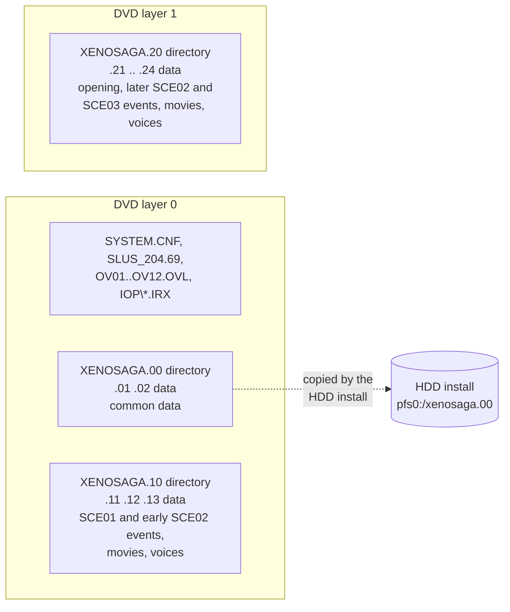
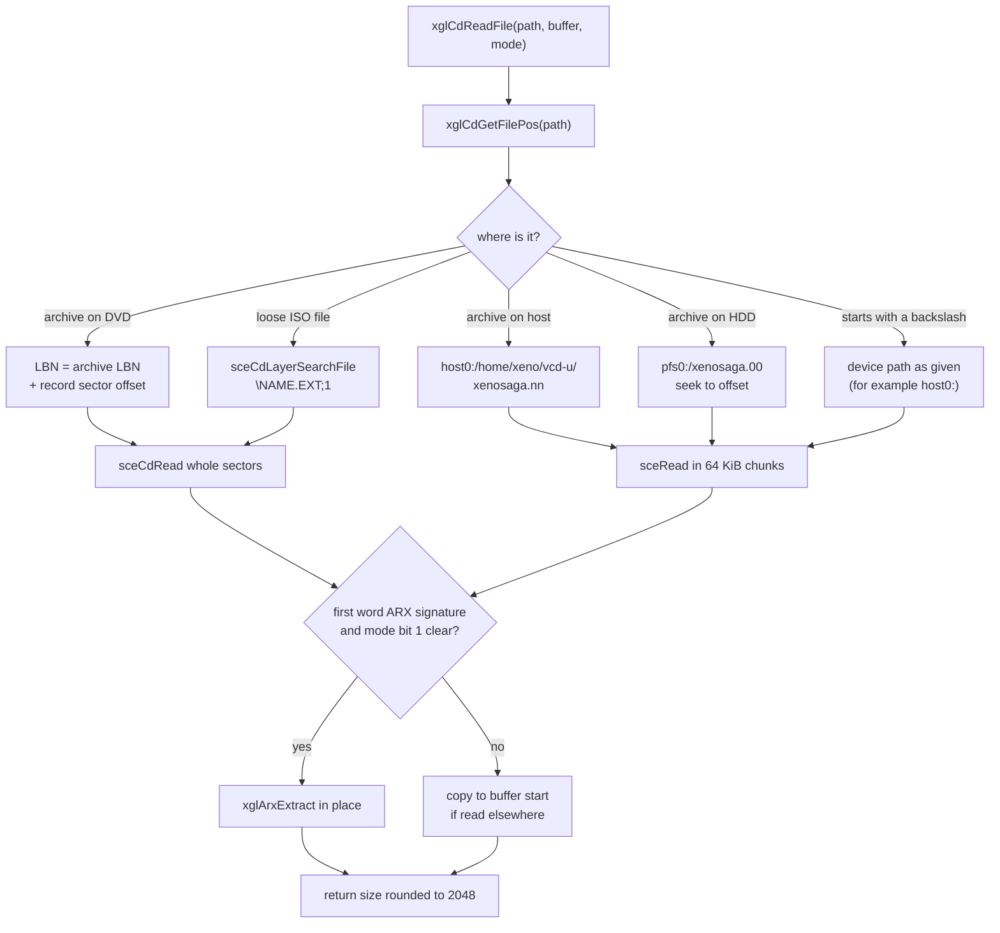
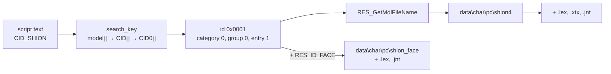
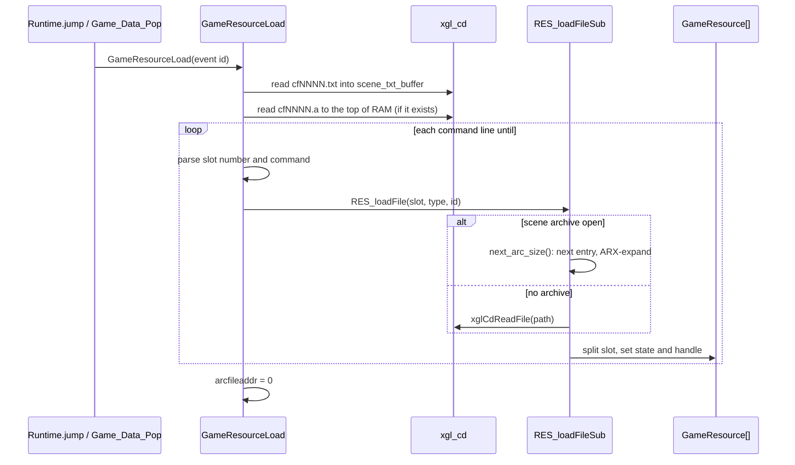
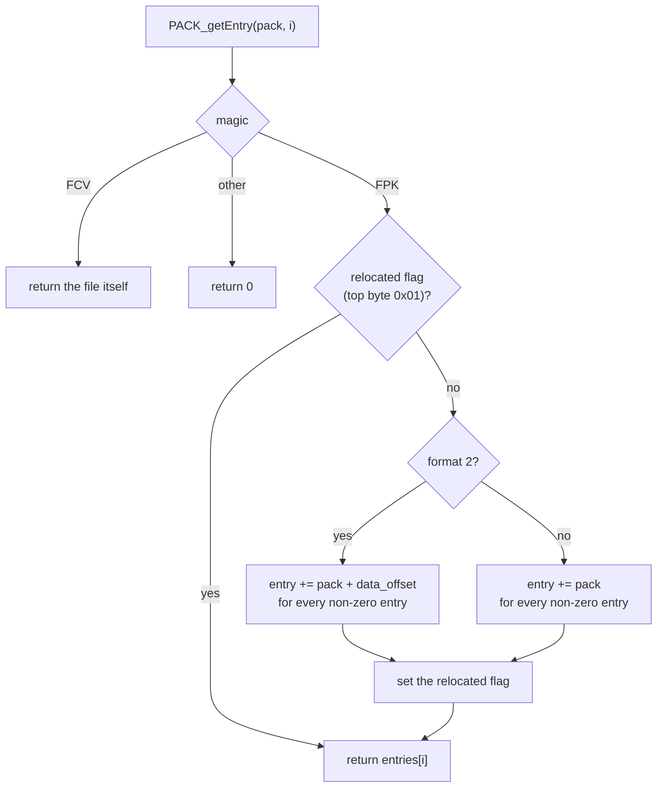
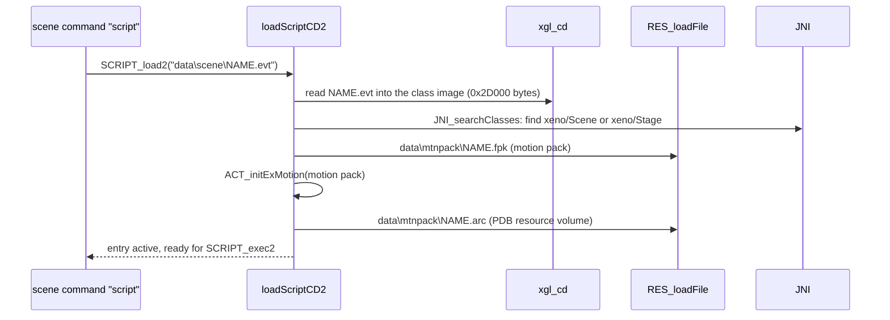

# Files and resources

All game data of Xenosaga Episode I is stored in a few very large archive
files on the DVD, `XENOSAGA.00` to `XENOSAGA.24`. Each archive starts with a
directory of path names, and the file library `xgl_cd` finds every file by its
path (for example `data\char\pc\kosmos.lex`). On top of plain file reads the
game has several resource layers: the field's resource table and its scene
resource scripts (`RES_*`), pack formats that are used in place after loading
(`PACK_*` for motion packs and `PDB_*` for script volumes), and the `RSRC_*`
arenas.

This page describes the disc layout, the archive format, how a path becomes
bytes in memory, the resource layers, and the file types the code reads. The
byte layout of each file type is described in the ten formats pages listed
under [File types](#file-types). The API of the file library itself is
described in
[xgl.md](../libraries/xgl.md#cd-and-files), and the memory the resources live
in is described in [memory.md](memory.md).

[← Back to the overview](../README.md)

## The disc

The root of the DVD holds the boot configuration `SYSTEM.CNF`, the main
executable `SLUS_204.69`, the five overlays `OV01.OVL` to `OV12.OVL`, an `IOP`
folder with the IOP modules, and the archive files. The executable, overlays
and IOP modules are loose ISO 9660 files read by the Sony loaders. Everything
else is inside an archive.

The archives come in three groups. Each group is one logical archive split
into pieces of at most 1 GiB. The first piece, `XENOSAGA.n0`, holds only the
directory. The data pieces `.n1`, `.n2` and so on follow it. File positions in
the directory are counted in 2048-byte sectors from the start of
`XENOSAGA.n0`, so the code treats the pieces as one continuous run of sectors.
This only works because the pieces are stored one after another on the disc,
which the mastering tool probably guaranteed.

| Group | Pieces | Directory | Data | Files | Contents |
| --- | --- | --- | --- | --- | --- |
| `XENOSAGA.00` | `.00`–`.02` | 83 sectors | about 1.4 GB | 8573 | Everything common: characters, enemies, maps, objects, motions, textures, effects, sound banks, field scripts, menus, U.M.N. data, minigame data, small movies |
| `XENOSAGA.10` | `.10`–`.13` | 4 sectors | about 2.8 GB | 349 | The first part of the story: 92 event scripts (44 `SCE01xxx`, 48 `SCE02xxx`), their motion packs and resource volumes, 45 MPEG-2 movies, voice data |
| `XENOSAGA.20` | `.20`–`.24` | 3 sectors | about 4.2 GB | 266 | The rest of the story: 89 event scripts (69 `SCE03xxx`, 19 `SCE02xxx` and the opening `SCE010OP`), motion packs, resource volumes, 58 MPEG-2 movies including the prologue and the opening, voice data |

The two event groups split the story in two parts, but not at a boundary of
the script numbers. Group 10 ends inside the `SCE02` scripts, and its last
movie is `2034.pss`. Group 20 continues with `2044A.pss` and the later
`SCE02` scripts and holds all `SCE03` scripts. The opening script
`SCE010OP` and the movies `prologue.pss` and `10OP.pss` are also in group 20,
although their names place them at the start of the story. The extracted North American
disc holds all three groups, so the release is one dual-layer DVD.
`xglCdInitial` asks the drive with
`sceCdReadDvdDualInfo` and stores the answer in `LW.dual_layer_disc`. On a
dual-layer disc `xglCdArcInit` reads the directories of `xenosaga.00` and
`xenosaga.10` from the first layer and the directory of `xenosaga.20` from
the second layer (it sets `LW.search_layer` to 1 for that lookup).

The code also supports a set of single-layer discs. Each disc then carries
`xenosaga.00` plus one of `xenosaga.10`, `xenosaga.20` or `xenosaga.30`, and
`xglCdDiskCheck` reports which disc is in the drive as a bit mask
(`CD_DISC_FLAG_DISC1` to `CD_DISC_FLAG_DISC3`). The scene command `disk`
calls `GameDiskChange(n)` in `src/main/game_disk_change.c`. It redraws a
"change disc" prompt every frame until disc `n` is detected or the player
presses START to force the game to continue. On the dual-layer disc
`xglCdDiskCheck` always reports `CD_DISC_FLAGS_DUAL_LAYER`, and
`GameDiskChange` returns at once. No third group exists on the released disc,
so the multi-disc path was probably used for development discs.

The diagram below shows where each group lives and what it contains.



When the game is installed on the hard disk, only the first group is used
from there. `xglCdArcInit` first tries `pfs0:/xenosaga.00` and, when it
exists, takes the directory and the data of group 00 from the HDD (archive
slot 0 gets state 2, the HDD source). Groups 10 and 20 are always read from
the DVD. The install itself is described in
[xgl.md](../libraries/xgl.md#install).

## The archive directory

The directory occupies the first sectors of `XENOSAGA.n0`. Its first byte is
the number of directory sectors. Records follow from byte 1, and a zero byte
ends the list. Every record starts with a flags byte whose low 6 bits
(`ARC_RECORD_LENGTH_MASK`) give the length of the record up to the end of its
name, counting the flags byte. There are two kinds of record.

```
directory record (bit 7 set, ARC_RECORD_EXTENDED):
  +0  flags            0x80 | length
  +1  levels up        how many directory levels to leave first
  +2  name             length - 2 bytes, no terminator

file record (bit 7 clear):
  +0  flags            bit 6 (ARC_RECORD_TYPE_EXTENDED) = packed, low 6 bits = length
  +1  name             length - 1 bytes, no terminator
  +n  sector offset    3 bytes, little endian, from the start of XENOSAGA.n0
  +n+3 stored size     4 bytes, little endian, bytes on disc
  +n+7 unpacked size   3 bytes, little endian, only when the packed bit is set
```

The records form a depth-first walk of a directory tree whose root is
`data\`. A directory record leaves some levels and enters a new directory,
and the file records that follow belong to it. `xglCdGetFilePosSub` keeps a
stack of 16 directory name positions while it walks, rebuilds the full path
of each file record and compares it with the requested path. The first file
of `XENOSAGA.00` is `data\font1.tex` at sector 83, right after the 83
directory sectors. The 3-byte unpacked size limits a packed file to 16 MiB.

The record list does not fill the directory sectors. After the zero byte that
ends it, the rest of the directory sectors holds the 32-byte string
`MONOLITHSOFT Xenosaga Episode.1` with its terminating zero, repeated. Each
copy starts at an offset that is a multiple of 32 from the start of the
archive. The same pattern fills the unused end of the last sector of every
file in the archive, again aligned to the archive offset, so the mastering
tool probably filled the whole archive with it first and then wrote the files
over it. No code reads the pattern. The directory parser stops at the zero
byte.

### How the files are laid out

Every file starts on a sector boundary, right after the previous one. There
is not a single free sector between two files in any of the three groups,
and the last file ends exactly at the end of the last piece. The only unused
space is the padding inside the last sector of each file.

The order of the files on the disc is not the order of the directory. The
data is laid out in the order the game reads it, which keeps the drive's
seeks short:

- Group 00 starts with what the boot needs: the font `font1.tex`, the window
  texture `endou\cfwin.xtx`, the resident sound banks `REGIST.SWD`,
  `REGIST.SED` and `REGIST2.SWD`, the logo movies, `monologo.jpg`, the title
  texture and `title.jpg`. Then come the Tech Attack and skill tables, the
  marker models, the item box tables, `system.evt` and `base.evt`, the save
  icon template, the menu tables, the U.M.N. files, the small movies, the
  scene textures, the sound banks and the field scenes. The maps come next.
  Each map's model, texture and `.id` file sit side by side, and files of
  `yamamoto\think` are placed between some of the maps.
  Characters, enemies, battle motions and battle sounds follow, then the
  effect data. The minigame data closes the group: Network Casino
  (`tanaka`), A.G.W.S. Battle (`nisimori`) and Xeno Card (`carddata`).
- Groups 10 and 20 hold one cutscene after another in story order. Each
  cutscene's files sit together: its `SCE0nnnnn.evt` script, its motion pack
  and resource volume in `mtnpack`, its voice streams and its movie, so a
  cutscene loads with almost no seeking.

The directory itself is sorted by folder, as the depth-first walk above
requires. Only the sector numbers in the file records tie the two orders
together.

All directories stay in memory for the whole game. `xglCdArcInit` loads them
at `WorkEnd`, one after another, each starting on a 64-byte boundary and
followed by a two-byte zero terminator (`xglCdArcInitSub2`), and then moves
`WorkEnd` past them. The archive slots `ArcHeader[4]` point at them. How a
lookup walks the slots is described in
[xgl.md](../libraries/xgl.md#archives-and-lookup).

The top level of group 00 shows how the data is organized. Several
directories are named after staff members, and the code that reads them
shows what each one holds.

| Directory | Files | Contents (from the code that reads it) |
| --- | --- | --- |
| `data\char\` (`pc`, `npc`, `ppl`, `citi`) | 868 | Character models, textures and skeletons, found by model key (see [Models and textures](../formats/models-and-textures.md#where-the-files-are)) |
| `data\enemy\` | 279 | Enemy models (`boss`, `guno`, `utma` and other families) |
| `data\robo\`, `data\weapon\` | 326 | A.G.W.S. and weapon models |
| `data\obj\` | 799 | Map objects (`aobj000`, `mobj000`, `muobj`) |
| `data\map\` | 704 | Maps: the model, texture set and `.id` collision and layout file of each `MC_*` map (see [Maps and field data](../formats/maps-and-field-data.md#the-map-directory)) |
| `data\motion\` | 176 | Field motion packs (`.fpk`, see [Skeletons and motion](../formats/skeletons-and-motion.md#motion-packs-fpk)) |
| `data\scene\` | 1066 | Scene resource scripts (`cf*.txt` for the field, `ev*.txt` for cutscenes), scene archives (`cf*.a`) and stage scripts (`ST*.evt`), see [Scripts and scene archives](../formats/scripts-and-archives.md) |
| `data\sound\` (`sed`, `smd`) | 680 | Wave banks and sound effect sequences (`sed`), music and ambience sequences (`smd`), see [Sound files](../formats/sound.md) |
| `data\texture\`, `data\movie\small\` | 209 | Scene textures (`fm*.xtx`) and small IPU movies (`mvs*.ipu`) |
| `data\simajiri\` | 1227 | Effect data (`esd\*.esd`, `esp\*.esp` and the name table `seffect.esp`), read by `src/main/srs.c`, and four models of the effect viewer and two loose models that the game does not read (see [Effect data files](../formats/effects.md)) |
| `data\endou\` | 24 | Menu data: Tech Attack, skill, T.Pts, ether tree and shop tables, the segment texts `mapex.bin` and save point names `savemap.bin` (see [Game data tables](../formats/game-tables.md#growth-tables)), window textures, the formation models in `poly`, the U.M.N. cube, history tree and Plug-in texts in `umn`, save-screen pictures (`new_d.jpg` and others) |
| `data\matumoto\` | 88 | Field enemy behaviour presets (`MC_*.dat`, `people01.dat`), the start-up table `enemy.dat` and its copy `testes.dat` in an older record format, the route spline weights `spline.dat`, and four marker models (`bikkuri`, `hatena`, `maru`, `sikaku`) that only debug displays draw (see [Maps and field data](../formats/maps-and-field-data.md#field-enemy-presets)) |
| `data\karakama\` | 2 | Item box tables `itembox.dat` and `evtitem.dat`, read by `src/main/init_uwamono_sys.c` (see [Item box tables](../formats/maps-and-field-data.md#item-box-tables)) |
| `data\yajima\` | 11 | Radar texture `cf_rader00.xtx`, title menu label texture `title_obj.xtx`, chapter pictures `im00.jpg` to `im03.jpg`, ending picture `end.jpg`, game-over picture and voice (`src/main/game_over.c`), the picture of the display adjustment screen `mnt_set.jpg`, HDD install pictures `hddi.bin` (`src/ov02/title_hdd_install.c`) |
| `data\yamamoto\` | 1211 | Battle data, read by OV01: the battle table `batdat.bin`, the enemy AI programs `think\thinkNNN.bin` and the battle model packs `pc\` and `wpn\` (see [Game data tables](../formats/game-tables.md)), the battle stages `map\mapNNN.bin`, the battle motion files `mot\`, the battle sound containers `snd\sed\` and the battle music `snd\smd\`, the battle movies `mv\`, and the status sheets with the battle font in `stat\` |
| `data\carddata\` | 393 | Xeno Card (OV10), see [Minigame data files](../formats/minigame-data.md#2-xeno-card-datacarddata) |
| `data\tanaka\` | 110 | Network Casino (OV11): the tuning file `CASINO.res` and 109 texture sets |
| `data\nisimori\` | 42 | A.G.W.S. Battle (OV12) |
| `data\umn\` | 348 | U.M.N.: mail and database pages (`.uml`), header lists (`.lst`), the keyword list `db_fileno.txt` and the dialogues `event00.txt` to `event18.txt` (see [Text, fonts and U.M.N. data](../formats/text-and-fonts.md#uml-pages)) |
| `data\` root | 10 | Fonts `font0.tex` and `font1.tex`, boot logo movies `namco.ipu` and `logo_msi.ipu`, `monologo.jpg`, title picture `title.jpg`, `system.evt`, `base.evt`, `carddata.new`, `hdd.res` |

## From a path to bytes in memory

Every read starts with a path relative to `data\`, written with backslashes.
Forward slashes in a request are turned into backslashes before the lookup.
The usual call is `xglCdReadFile(path, buffer, mode, callback)`. Bit 0 of
`mode` makes the read asynchronous, and bit 1 leaves packed data as it is.
The return value is the file size rounded up to a whole sector, so callers
can advance a bump pointer by it.

`xglCdGetFilePos` turns the path into a position. It searches the archive
slots in order and uses the first match. A path that no archive contains is
looked up as a loose ISO 9660 file, upper-cased and with `;1` appended. A path
that starts with `\` is passed to the I/O manager as it is, without the
backslash, so it can name any device such as `host0:`. For an HDD install
the archive `pfs0:/xenosaga.00` is opened with `sceOpen` and the read
position is set with `sceLseek`. An archive slot can also have the host
source. Its archive is then opened as `host0:/home/xeno/vcd-u/xenosaga.nn`,
probably the developers' copy of the disc image on a PC.

The data is always read in whole sectors. A packed file is read into the end
of the caller's buffer and expanded forward into the same buffer, so the
buffer must have room for the unpacked size. The diagram below shows the path
of one synchronous read.



Asynchronous reads, the request queue, streams and read errors are handled
by the CD thread and are described in [xgl.md](../libraries/xgl.md#the-cd-thread).

## Packed files (ARX)

Most models, textures and motion packs are stored packed. The
packed bit in a directory record says so, and the data itself starts with the
ARX header: the word `"ARX\0"` (`0x00585241`), the unpacked size, the packed
size, a zero flags word and a table of 30 frequent 32-bit words. The coded
stream replaces each frequent word by a 3- to 9-bit code and stores every
other word as a 33-bit literal (a flag bit plus the word). This probably
suits model and texture data, where the same words repeat often.

The real files show how the packer chose the table. The 30 entries are the
30 most frequent 32-bit words of the unpacked file, the most frequent first.
Words with the same count are ordered by their first appearance in the file.
The first entries get the shortest codes, so the most common words cost the
fewest bits. A sample of 40 packed files of group 00 follows this rule
without exception. The packed size in the header counts the whole stored
file, header included, and equals the stored size in the directory record.
The unpacked size equals the directory's unpacked size. All 2168 files with
the packed bit start with the ARX header, and no file without the bit does.

The format and the
in-place decoder `xglArxExtract` (`src/main/xgl_timer0.c`) are described in
detail in [xgl.md](../libraries/xgl.md#packed-files-and-arx).

The table lists every file type that has packed files. No other type is
packed.

| Type | Files | Packed |
| --- | --- | --- |
| `.lex` models | 1317 | 1010 |
| `.xtx` textures | 1269 | 810 |
| `.fpk` motion packs of group 00 (`data\motion`, `data\nisimori`) | 183 | 162 |
| `.fpk` event motion packs of groups 10 and 20 (`data\mtnpack`) | 107 | 99 |
| `.arc` resource volumes of groups 10 and 20 (`data\mtnpack`) | 77 | 77 |
| `.bin` data | 1230 | 8: seven battle model packs of `data\yamamoto\pc` and the battle stage `map000.bin` |
| `.npr` (OV12) | 2 | 2 |

Two readers decode ARX: the file library, for any file whose first word is
the ARX signature, and the scene archive reader `next_arc_size`, for each
entry of a scene archive.

## The field resource system

The field game does not read model files one by one from game logic. A
scene describes the resources it needs in a small text script, and the
resource system in `src/main/res_get_path.c` loads them into the resource
table `GameResource[128]`. How that table manages memory is described in
[memory.md](memory.md#the-resource-table). This section describes what goes
into it.

### Resource types

`RES_loadFile(slot, type, id, loader)` loads one resource. `type` is a
`ResourceType`, and `id` is a numeric key or a pointer to a name. Unless a
custom loader is passed, `RES_loadFileSub` does the reading.

| Type | Value | What is loaded |
| --- | --- | --- |
| `RES_TYPE_MODEL` | 0 | A model block: `.lex` model, `.xtx` texture (not for faces) and `.jnt` joints |
| `RES_TYPE_MAP` | 1 | A map: `.lex`, `.xtx` and `.id` from the map directory, and the battle AI file `data\yamamoto\think\thinkNNN.bin` when the map has one |
| `RES_TYPE_MOTION` | 2 | A motion pack by id: `data\motion\<base>.fpk` |
| `RES_TYPE_MOTION_NAMED` | 3 | A motion pack by file name |
| `RES_TYPE_MODEL_NO_JOINTS` | 4 | A model without its `.jnt` file |
| `RES_TYPE_FILE` | 5 | Any file under `data\` |
| `RES_TYPE_EFFECT` | 6 | An effect file (`.esd`), read by `sefLoadEffectCfName` |
| `RES_TYPE_JOINTS` | 7 | Only a `.jnt` file |
| `RES_TYPE_ENEMY_PRESET` | 8 | An enemy preset `data\matumoto\<name>.dat`, read by `Enemy_LoadPreset` |
| `RES_TYPE_ALLOC` | 9 | A raw block from `GameResourceAlloc` |
| `RES_TYPE_MOVIE` | 10 | A small movie, `data\movie\small\mvsNNNN.ipu` |
| `RES_TYPE_TEXTURE` | 11 | A texture, `data\texture\fmNNNN.xtx` |

A model block starts with a 16-byte header (`ResourceFileSet`) holding three
pointers: the model, the texture and the joints. The files follow it, each
aligned to 16 bytes. A file that is missing leaves its pointer at zero, and a
face model never has a texture. The byte layouts of the three files are in
[LEX models](../formats/models-and-textures.md#lex-models),
[XTX texture sets](../formats/models-and-textures.md#xtx-texture-sets) and
[Skeleton files (JNT)](../formats/skeletons-and-motion.md#skeleton-files-jnt).
How models are drawn is described in [nml.md](../libraries/nml.md), and how
skeletons and motions are used in [animation.md](../libraries/animation.md).
The map loader `RES_loadFileSubMap` builds a similar map block: a header
with a matrix and pointers to the map's `.lex`, `.xtx`, `.id` and think
files, followed by the files themselves, each aligned to 16 bytes (see
[The map block in memory](../formats/maps-and-field-data.md#the-map-block-in-memory)).

### Model keys and model ids

Models are named by a 16-bit id, built from nested tables of names:

| Bits | Meaning |
| --- | --- |
| 12–14 | Category: entry of the `model[]` table (characters `cid_`, robots `rid_`, weapons `wid_`, enemies `eid_`, objects `mid_`, `aid_` and `MOBJ`) |
| 8–11 | Group inside the category, for example `pc`, `npc`, `ppl` or `citi` for characters |
| 0–7 | 1-based index in the group's name list. 0 gives the `dummy` model |
| 16 | `RES_ID_FACE` (`0x10000`): the face model of the same character |

`RES_GetMdlFileName(dst, id)` builds the path from the tables:
`data\` + category directory + group directory + file name. Character 1 in the
first group, for example, is `data\char\pc\` plus its name. A name entry
can carry two names: `+shion,shion4` is matched as `shion` in a script and
loads the file `shion4`, and the face variant appends `_face` to the first
name. When the debug flag `ModelPath` is set, a `test` directory is inserted
into every model path.

Scene scripts write models as text keys made of the category prefix, the
group key and the name. The character groups have empty keys, so Shion's
model is `cid_` followed by `shion`. `search_key` walks the same tables to
turn the text into the id. It adds `0x1000` for each category and `0x100`
for each group it passes, and the position in the name list gives the low
byte. It compares the script text with the upper-case form of the table
names, so the keys in a script must be written in upper case, for example
`CID_SHION`. The tables `model[0]` and `model[1]` both use the prefix
`cid_`, so the search never reaches category 1. A key that matches nothing
gives the id 0, which loads the character stand-in `data\char\dummy`, on the
disc a copy of Shion's model. The scene scripts contain 14 such keys,
typing slips such as `CID_ALEN` (see
[Model keys and typos](../formats/scripts-and-archives.md#model-keys-and-typos)).

The diagram below shows how a script key becomes an id and the id becomes a
path.



### Scene resource scripts

Each field scene and each cutscene has a resource script. The disc holds
568 of them in `data\scene\`, 387 field scripts and 181 cutscene scripts,
all plain text. Their grammar, the use counts of every command and an
annotated example are in
[Scene resource scripts](../formats/scripts-and-archives.md#scene-resource-scripts-txt).
The scene id selects the script:

- `RES_getScenePath` takes the current scene directory from a table of 20
  directories. Index 0 is `data\scene\`. The others (`data\scene\test\`,
  `data\scene\check\` and per-developer folders such as
  `data\scene\kojima\`) do not exist in the released archives and were
  probably selected from the debug menu (`ScenePath`).
- The file name is `cf` for scene ids up to `0x0FFFFFFF` or `ev` for higher
  ids, then the low part of the id as four digits, then `.txt`. Scene 10 of
  the field is `data\scene\cf0010.txt`.

The script is read into `scene_txt_buffer` (`0x800` bytes). Its first word
must be `#scn`, otherwise nothing is loaded. The first line is skipped, and
each following line is one command:

```
#scn ...                 header line, skipped
; comment                lines starting with ';' are skipped
<slot> <command> <arguments>
...
#end                     stops the script
```

`<slot>` is an optional decimal resource slot number (0 when it is left
out), `<command>` is looked up in the table `command[24]`, and the rest of
the line is the command's arguments. A line whose command matches nothing is
skipped. A line that starts with `#` but is not `#end` makes the loop
`continue` without moving the cursor, so the game would hang. No script on
the disc has one.

| Command | Effect |
| --- | --- |
| `reset` | `GameResourceReset(n)`: free slot `n` and all later slots |
| `loadmap` | Load a map into the slot and switch to it. A leading `-` loads it without switching |
| `loadact` | Load a model by key (`RES_TYPE_MODEL`) |
| `loadface` | Load the face model of a key |
| `loadmot` | Load a named motion pack and store its foot-step sound number (no script gives one) |
| `loadtex` | Load texture `fmNNNN.xtx` |
| `loadmovie` | Load small movie `mvsNNNN.ipu` |
| `loadeffect` | Load a named effect |
| `loadene` | Load a named enemy preset |
| `script` | Load `<scene dir>\<name>.evt` with `SCRIPT_load2` and start it, unless game-loop flag `0x40` is set |
| `player` | `GameCfPlayerLoadResource(0)`: load the party leader into the player block, and its foot-step bank, always from the loose files |
| `dummy` | Reserve an empty slot |
| `loadse` | Store the leader's foot-step bank name with its `SO_` prefix removed (`player` loads that bank later), load the environment bank (`.SWD` and `.SED`) and an optional sequence, which no script gives |
| `loadsmd` | Load music sequences into sequence slots (`+` sets normal volume, `-` keeps a playing one) |
| `mpeg2`, `mpeg2_btl`, `mpeg2_nofade` | Play `data\movie\mpeg2\<name>.pss`, normally, into a battle, or without a fade |
| `enese`, `npcse` | Record an enemy or NPC sound bank and load it |
| `event_btl` | Prepare an event battle (`SCRIPT_frameLock2Battle`) |
| `disk` | `GameDiskChange(n)` |
| `save` | `Intermission(n)`: show chapter picture `n` and offer to save |
| `player_lock` | Set the player-lock flag of the game loop |

The scene and event systems that use these scripts are described in
[events.md](../scripting/events.md) and [field.md](../game/field.md). Map
loading is described in [map-and-units.md](../game/map-and-units.md), and the
sound commands in [audio.md](audio.md#7-loading-sound-data).

### Scene archives

Loading a scene from many separate files would mean many seeks on the DVD.
For 112 of the 387 field scenes the archive also has a scene archive, the
same name with the extension `.a` (for example `data\scene\cf0010.a`,
6.8 MB). All 112 are in group 00, and no cutscene script has one.
`GameResourceLoad` reads the archive in one piece to the top of memory, at
`EE_RAM_END` minus its size rounded up to a sector, and stores its address
in `arcfileaddr`.

An archive is a table of end offsets followed by the entries. Each entry is a
byte copy of one disc file as it is stored, either raw or as the same ARX
stream, padded with zeros to a 64-byte boundary. The archive carries no
names. The full layout and an annotated example are in
[Scene archives (.a)](../formats/scripts-and-archives.md#scene-archives-a).

```
scene archive (.a)
  +0x00   word 0: size of the offset table in bytes (4 x entry count)
  +0x04   word 1..N: end offset of entry 0..N-1, from the data start
  ...
  first 64-byte boundary after the table: data of entry 0, entry 1, ...
          each entry is either raw or an ARX stream, 64-byte aligned
```

While `arcfileaddr` is set, the loaders in `RES_loadFileSub`,
`RES_loadFileSubMap` and the sound commands do not use file names at all.
Each file they would have read is taken instead from the next entry of the
archive by `next_arc_size(address)`, which copies or ARX-expands the entry to
`address` and returns its size. For a raw entry the size includes the zero
padding. An empty entry stands for a file that does not exist. A model takes
up to three entries (model, texture, joints), a map three or four, a sound
bank two, and effects and enemy presets one. The number of entries of every
command is listed in
[Commands](../formats/scripts-and-archives.md#commands). The archive
therefore has to contain exactly the files of the script, in the order the
script loads them, and 109 of the 112 archives match their scripts exactly.
The other three (`cf1040.a`, `cf1050.a` and `cf1802.a`) end with one entry too
many. Their last command loads a face for a character that has none, and the
archive holds empty entries for both the `.lex` and the `.jnt`, while the game
stops the model at the empty `.lex`. The tool that built the archives
therefore did not follow the game's loading rules exactly, so it was probably
a separate program and not the game recording its own reads. After the last
entry, `arcfileaddr` is cleared and later loads read normal files again.

`next_arc_size` copies the offset table into the static array `archeader` on
its first call. The array has 64 words (`ARC_HEADER_WORDS`), enough for 63
entries, but 15 archives have more, up to 102 in `cf1800.a`. Their table runs
past the array into `GameResourceWorkReloadTable` and, for `cf1800.a`, into
the first 28 bytes of the movie record `mi`. This is probably harmless,
because `GameResourceWorkAlloc` always writes the reload flag before it is
read (see
[Header overflow](../formats/scripts-and-archives.md#header-overflow) and
[Borrowing the resource area](memory.md#borrowing-the-resource-area)). The
entry counter `arcno` is a byte, which limits an archive to 255 entries.

`GameResourcePreLoad(scene)` starts both reads early and asynchronously, so
the next scene can stream in while the current screen is still shown. The
battle result screen (`src/main/seisan_count_init1.c`) uses it. The next
`GameResourceLoad` then finds the preloaded archive in `arcfilepreload`.

The sequence below shows a scene load.



The Java side starts a scene load with `Runtime.jump`
(`Java_xeno_util_Runtime_jump_sub` in `src/main/runtime.c`), which calls
`GameResourceLoad(GameLoopState.current_event_id)`.

## Packs used in place

Several file types are containers that the game uses directly in the buffer
they were loaded into. They store offsets instead of pointers, and the first
access turns the offsets into pointers by adding the buffer's address. A flag
in the header records that this has happened, so it is done only once.

The diagram below shows the first access to a motion pack. A PDB volume
works the same way, with its version field as the flag.



### FPK and FCV motion packs

A motion pack (`.fpk`) collects the motions of one character, one object or
one event. Each entry is one motion, stored as an FCV2 curve set. The disc
holds 290 packs: 176 field sets in `data\motion`, 107 event packs in
`data\mtnpack` and 7 packs of A.G.W.S. Battle in `data\nisimori`. 338 more
sit inside the `.arc` resource volumes and 447 inside the battle motion
files. Its header is `FpkFcvPack` in `src/main/anm.c`:

| Offset | Size | Field | Meaning |
| --- | --- | --- | --- |
| +0x00 | 4 | `magic` | `"FPK"` in the low 3 bytes (`FPK_MAGIC`). The top byte becomes `0x01` (`FPK_RELOCATED`) after relocation |
| +0x04 | 2 | `format` | Pack format: 3 in every pack on the disc, 2 in four packs inside `.arc` volumes |
| +0x06 | 2 | `unmodeled_06` | Not read, 0 in every pack |
| +0x08 | 4 | `entry_count` | Number of entries |
| +0x0C | 2 | `unmodeled_0c` | Not read, 0 in every pack |
| +0x0E | 2 | `data_offset` | 4 in every pack. Added to the entries in format 2 only, where it skips a word with the value 1 that precedes each curve set |
| +0x10 | 4 × n | `entries[]` | Offset of each entry's curve set from the pack start, 0 for an empty slot |
| +0x10 + 4n | 4 × n | attribute slots | Format 3 only: one word per entry, which selects the entry's playback ranges |

`PACK_getEntry(pack, i)`, `PACK_getAttr(pack, i)` and `PACK_getSize(pack)`
relocate the pack on first use and then return entry `i`, attribute `i` or
the entry count. A zero entry is an empty slot and stays zero. The attribute
words are plain values and are never relocated. `PACK_getAttr` reads the
word after the entry table in every format, so for a format-2 pack it
returns the prefix word or bytes of the first curve set. The curve sets of
the four format-2 packs have no playback ranges, so this does no harm.
`PACK_getSize` tests `format >= 2` instead of `format == 2` and would treat a
format-3 pack as format 2, but it is only called on packs that are already
relocated. `PACK_unlink(pack, base)`
subtracts `base` from every entry again and clears the relocated flag
(format 2 entries are left as pointers). This probably lets a pack be moved
to another address and relocated there. A single curve file with the magic
`"FCV"` (`FCV_MAGIC`) is accepted wherever a pack is expected.
`PACK_getEntry` returns the file itself, `PACK_getAttr` returns 0 and
`PACK_getSize` counts it as one entry. No standalone `.fcv` file is on the
disc. Every curve set with this magic sits inside a motion pack. The byte
layout of the packs and curve sets is in
[Motion packs (FPK)](../formats/skeletons-and-motion.md#motion-packs-fpk) and
[Curve sets (FCV2)](../formats/skeletons-and-motion.md#curve-sets-fcv2). How
the game plays them is described in [animation.md](../libraries/animation.md).

### PDB volumes

A PDB volume is a small read-only file system in one buffer. Its magic is
`"FL00"` (`PDB_MAGIC`, `0x30304C46`). A 12-byte header is followed by the
record table: the record of each group, one per directory, followed by the
records of its file entries. The data of all entries comes next, each item on
a 4-byte boundary, and a table of the names closes the volume.

```
PDBHeader   magic "FL00", u16 version (1 = relocated), u16 group_count,
            u32 total size of the volume
PDBGroup    name offset, u16 name_length, u16 entry_count
  PDBEntryRecord  name offset, u16 name_length, u16 0 (never read),
                  data offset, data_length
  ...
PDBGroup    ...
entry data, each item 4-byte aligned
name table, NUL-terminated names in record order
```

The total size equals the file size in all 646 volumes on the disc.
`PDB_getEntry` never reads it, but the debug loader `loadScript` reads the
12-byte header of an `.evt` file from the host and then the rest of the
volume by this size. The byte layout and an annotated example are in
[PDB volumes](../formats/scripts-and-archives.md#pdb-volumes).

`PDB_getEntry(volume, &groups, &count)` takes the volume's address. It
returns no groups when the magic is wrong. On first use it relocates the name
and data offsets of every group and entry and sets the version to 1.
`PDB_findFile(volume, path)` splits
the path at its last `/` into a directory and a file name (no slash means the
directory `.`), finds the group with that name and then the entry.

The game uses PDB volumes for two things:

- **Java class databases.** The `.evt` files are PDB volumes of compiled Java
  classes. `SCRIPT_init` loads `data\system.evt` and `data\base.evt`, and
  `JNI_loadClassDB` registers each buffer as a class volume. `findClass` in
  `src/main/init_class_db.c` looks for `<class name>.class` in every
  registered volume. The 386 stage scripts (`ST*.evt`) and the 181 event
  scripts (`SCE*.evt`) are volumes of the same kind (see
  [Java class files](../formats/scripts-and-archives.md#java-class-files)).
- **Script resource volumes.** An event script `SCExxxxx.evt` can have a
  resource volume `data\mtnpack\SCExxxxx.arc` beside its motion pack
  `data\mtnpack\SCExxxxx.fpk`. Of the 181 event scripts, 77 have both files,
  30 have only the motion pack and 74 have neither. No stage script has
  either. The 77 volumes are ARX-packed and hold 667 files: 307 event camera
  curves (`.cam`), 338 motion packs (`.fpk`, most of them face motions named
  `FLS<character>.fpk`), and as build leftovers 21 Java sources and one time
  chart that holds only a header. Java code fetches a
  file from the volume with `Toolkit.loadResource(name)`, which calls
  `XTK_findFile` and returns the address of the file's data. The cameras go
  through the wrapper `PlayControl.loadCamera(name)`. The layout of the
  volumes and of the camera curves is in
  [Resource volumes (.arc)](../formats/scripts-and-archives.md#resource-volumes-arc)
  and [Camera curves (.cam)](../formats/scripts-and-archives.md#camera-curves-cam).

The Java VM is described in [java-vm.md](../scripting/java-vm.md).

### Loading an event script

`SCRIPT_load2(path)` in `src/main/script.c` calls `loadScriptCD2` with the
inactive one of the two script slots (`scriptDB[2]`), so the next script can
load while the current one still runs. `loadScriptCD2` reads the class
volume into the slot's class image buffer and looks in it for the class
`xeno/Scene` or `xeno/Stage` with `JNI_searchClasses`. It then loads the
motion pack and the resource volume from `data\mtnpack\` through
`RES_loadFile(RES_LOAD_ANY_BLOCK, RES_TYPE_FILE, ...)`, so they live in the
resource table. It tries this for every script, but only event scripts have
these files (see [PDB volumes](#pdb-volumes)), and the motion pack becomes
bank 1 of every actor. The older `loadScriptCD` reads the motion pack and the
volume to fixed addresses at `0x05000000` and above, which exist only on a
128 MiB development machine. The map loader in `src/main/disp_on.c` still
calls it through `SCRIPT_load` and looks for `<map>.evt` in the map
directory, but no `.evt`, `.fpk` or `.arc` file exists in `data\map\`, and
only a debug map window reaches that loader.

The sequence below shows `loadScriptCD2`.



## RSRC file arenas

`src/main/rsrc.c` can also load files. `RSRC_loadFile2(arena, directory,
name)` returns the data of a file that is already in the arena, or reads it
with `sceOpen` and files it under its name. It reads through the generic
`sceOpen` interface, not through the archive library, so it can only reach
device paths such as `host0:`. Its callers are two debug screens in
`src/main/script.c`: the light file dialog `DB_lightSave`, which loads light
settings `lgtNN.rc`, and the debug file browser, which accepts `.rc` files.
Both run the loaded text as a script with `JS_exec`. Their arena `rcFile` is
never created in the recovered code, so this is probably a development
feature only. The arena itself is described in
[memory.md](memory.md#rsrc-arenas).

## File types

The byte layout of every file type on the disc is described in ten formats
pages, each written from the real files and the code that reads them:

- [Models and textures](../formats/models-and-textures.md): the `.lex`
  models, the `.xtx` texture sets and the texture sets embedded in a few
  models.
- [Skeletons and motion](../formats/skeletons-and-motion.md): the `.jnt`
  skeletons, the `.fpk` motion packs and their FCV2 curve sets, the event
  camera curves, the script resource volumes and the battle motion files.
- [Maps and field data](../formats/maps-and-field-data.md): the map sets,
  the `.id` collision and layout files, the link from a map to its think
  file, the field enemy presets, the spline weights, the marker models, the
  item box tables and the battle stages.
- [Scripts and scene archives](../formats/scripts-and-archives.md): the
  FL00 (PDB) volumes, the Java class files, the `.arc` resource volumes, the
  scene resource scripts and the scene archives.
- [Text, fonts and U.M.N. data](../formats/text-and-fonts.md): the kanji
  fonts, the battle font, the text encoding and control codes, the MIF2
  message tags and the U.M.N. pages, lists and texts.
- [Sound files](../formats/sound.md): the `.swd`, `.sed` and `.smd` files of
  the sound driver, the battle sound containers and the ADPCM streams.
- [Effect data files](../formats/effects.md): the `.esd` effect files, the
  `.esp` packs, the name table `seffect.esp` and the effect script tables.
- [Movies, images and icons](../formats/movies-images-and-icons.md): the
  `.pss` and `.ipu` movies, the JPEG pictures, the HDD install pictures and
  the icon templates `carddata.new` and `hdd.res`.
- [Game data tables](../formats/game-tables.md): the battle table
  `batdat.bin`, the menu tables of `data\endou`, the enemy AI programs and
  the battle model packs.
- [Minigame data files](../formats/minigame-data.md): the files of Xeno
  Card, the Network Casino and A.G.W.S. Battle.

The table lists the file types of the archive directories, the code that
reads each one, the formats page section with its byte layout and the page
that describes what the code does with it. The table writes every extension
in lower case, but the directory lookup compares names exactly, case
included. The sound files are stored as `.SWD`, `.SED` and `.SMD` (except
`Minislot.swd` and `Minislot.sed`), and `CARDGRAP.BIN` is the only other
upper-case extension.

| Extension | Contents | Read by | Layout | Behaviour |
| --- | --- | --- | --- | --- |
| `.lex` | Model (tag `lex`): header, matrix table and blocks of ready-made VU1 data. 1317 files in the model, map, menu and minigame folders | `RES_loadFileSub`, `RES_loadFileSubMap`, `GameCfPlayerLoadResource`, menus, overlays | [LEX models](../formats/models-and-textures.md#lex-models) | [nml.md](../libraries/nml.md) |
| `.xtx` | Texture set (tag `XTX`): GS upload rectangles of 32-bit pixels that the models read back as 8-bit, 4-bit or 32-bit textures with their palettes. 1269 files | the same, `loadtex`, menus, overlays | [XTX texture sets](../formats/models-and-textures.md#xtx-texture-sets) | [nml.md](../libraries/nml.md) |
| `.jnt` | Skeleton (tag `JNT`): a 16-byte header, attribute records and 64-byte joint records. 760 files | `RES_loadFileSub`, `GameCfPlayerLoadResource`, `jnt.c` | [Skeleton files (JNT)](../formats/skeletons-and-motion.md#skeleton-files-jnt) | [animation.md](../libraries/animation.md) |
| `.fpk` | Motion pack (tag `FPK`): a table of FCV2 curve sets, one per motion. 290 files: field sets in `data\motion` (176), event packs in `data\mtnpack` (107), A.G.W.S. Battle packs in `data\nisimori` (7) | `PACK_*`, `ANM_*`, `loadmot`, `loadScriptCD2`, OV12 | [Motion packs (FPK)](../formats/skeletons-and-motion.md#motion-packs-fpk) | [animation.md](../libraries/animation.md), [this page](#fpk-and-fcv-motion-packs) |
| `.id` | Collision and layout file of a map: triangle meshes for the walk and camera floors, an attribute table and groups of locators. 209 files in `data\map` | `RES_loadFileSubMap`, `UnduInit` | [Collision and layout data](../formats/maps-and-field-data.md#collision-and-layout-data-id) | [map-and-units.md](../game/map-and-units.md) |
| `.evt` | FL00 (PDB) volume of Java class files: `system.evt` and `base.evt`, 386 stage volumes `ST*.evt` and 181 event volumes `SCE*.evt` | `JNI_loadClassDB`, `loadScriptCD2` | [Java class files](../formats/scripts-and-archives.md#java-class-files) | [java-vm.md](../scripting/java-vm.md) |
| `.arc` | ARX-packed FL00 resource volume of an event, `data\mtnpack\SCE*.arc` (77): camera curves `.cam`, motion packs `.fpk` and a few leftover files | `loadScriptCD2`, `XTK_findFile` | [Resource volumes (.arc)](../formats/scripts-and-archives.md#resource-volumes-arc) | [this page](#pdb-volumes) |
| `.txt` | Scene resource scripts `cfNNNN.txt` and `evNNNN.txt` (tag `#scn`, 568 in `data\scene`), and the U.M.N. texts `event00.txt` to `event18.txt` and `db_fileno.txt` (20 in `data\umn`) | `GameResourceLoad`, `UmnEventTextMake`, `dbfileno_load` | [Scene resource scripts](../formats/scripts-and-archives.md#scene-resource-scripts-txt), [Event texts](../formats/text-and-fonts.md#event-texts), [Keyword list](../formats/text-and-fonts.md#keyword-list) | [this page](#scene-resource-scripts), [umn.md](../game/umn.md) |
| `.a` | Scene archive: an end-offset table and copies of the files of one field scene in load order. 112 in `data\scene` | `next_arc_size` | [Scene archives (.a)](../formats/scripts-and-archives.md#scene-archives-a) | [this page](#scene-archives) |
| `.esd` | Effect file: 64-byte aligned chunks holding one effect script table and the images, colour tables and models it uses. 1051 in `data\simajiri\esd` | `src/main/srs.c`, `src/main/sv_get_image_item.c` | [The .esd files](../formats/effects.md#the-esd-files) | [sef.md](../libraries/sef.md) |
| `.esp` | Effect pack of the common battle effects, the common field effects, a character, an enemy group or a weapon: images, colour tables, models and whole embedded `.esd` files (169 in `data\simajiri\esp`). `seffect.esp` is not a pack but the table of effect names | `src/main/srs.c` | [The .esp effect packs](../formats/effects.md#the-esp-effect-packs), [The name table](../formats/effects.md#the-name-table-seffectesp) | [sef.md](../libraries/sef.md) |
| `.swd` | Wave bank (tag `swdm`): SPU ADPCM samples, sample records and programs. 289 files | `xglSoundLoadSwd`, `xglSoundSendSwd`, `loadse`, `npcse`, `enese`, OV01 | [SWD wave banks](../formats/sound.md#swd-wave-banks) | [audio.md](audio.md#6-sound-file-formats) |
| `.sed` | Sound effect sequences (tag `seds`). 284 files | `xglSoundLoadEffect`, `xglSoundSendSed`, `loadse`, `npcse`, `enese` | [SED effect files](../formats/sound.md#sed-effect-files) | [audio.md](audio.md#6-sound-file-formats) |
| `.smd` | Music and ambience sequences (tag `smdm`). 115 files | `loadsmd`, `loadse`, `xglSoundSendSmd2`, OV01 | [SMD music files](../formats/sound.md#smd-music-files) | [audio.md](audio.md#6-sound-file-formats) |
| `.vds`, `.vdm` | Headerless SPU ADPCM streams. `.vds` is stereo in 1 KiB left and right blocks: 136 cutscene and field streams in `data\sound\vda\` and the game-over voice `data\yajima\gameover.vds`. `.vdm` is mono (11 field streams) | `src/main/sound.c`, `src/main/game_over.c` | [VAG streams](../formats/sound.md#vag-streams) | [audio.md](audio.md#11-streams) |
| `.pss` | MPEG-2 program stream with ADPCM audio: 103 cutscene movies in `data\movie\mpeg2\` (groups 10 and 20) and 5 battle movies in `data\yamamoto\mv\` | `GameMpeg2Play` (`src/main/game_movie.c`), OV01 `MMv2Play` (names in `src/ov01/battle_init.c`) | [PSS movies](../formats/movies-images-and-icons.md#2-pss-movies) | [xgl.md](../libraries/xgl.md#movies) |
| `.ipu` | IPU movie (tag `ipum`): the boot logos `namco.ipu` and `logo_msi.ipu` and 131 small field movies `data\movie\small\mvsNNNN.ipu` | `xglMovie*`, `src/ov02/logo.c`, `RES_TYPE_MOVIE` | [IPU movies](../formats/movies-images-and-icons.md#3-ipu-movies) | [xgl.md](../libraries/xgl.md#movies) |
| `.jpg` | Pictures: title, chapter pictures, save-screen placeholders, game-over picture, the ending picture `end.jpg` and the picture of the display adjustment screen `mnt_set.jpg`. `monologo.jpg` is never loaded | `xglJpegDecode` | [JPEG pictures](../formats/movies-images-and-icons.md#4-jpeg-pictures) | [xgl.md](../libraries/xgl.md#jpeg) |
| `.tex` | Kanji fonts `font0.tex` and `font1.tex`: two GS upload packets with 4,096 glyph cells in four 2-bit sheets, then a table of proportional widths | `xglFontLoad` (`src/main/xgl_font.c`) | [Kanji fonts](../formats/text-and-fonts.md#kanji-fonts) | [xgl.md](../libraries/xgl.md#text) |
| `.uml` | U.M.N. pages, 81 mails and 245 database pages: a 32-byte header, a 64-byte picture table, text with `@` codes and the JPEG pictures | `tyaUmlDispLoad` (`src/ov02/tya_uml.c`) | [UML pages](../formats/text-and-fonts.md#uml-pages) | [umn.md](../game/umn.md) |
| `.lst` | U.M.N. header lists `header.lst` (mails) and `dbheader.lst` (database pages) | `UmnMailHeaderCreate`, `dbheader_load` | [Header lists](../formats/text-and-fonts.md#header-lists) | [umn.md](../game/umn.md) |
| `.bin` in `data\yamamoto\` | The battle table `batdat.bin` (units, techniques, equipment, items, rewards), the enemy AI programs `think\thinkNNN.bin` (100) and the battle model packs `pc\` (21) and `wpn\` (36) | OV01 `dataBatDatLoad`, `RES_loadFileSubMap`, `dataUnitFileLoad2Sub`, `dataPackWpnMdl2` | [Battle data](../formats/game-tables.md#battle-data-batdatbin), [Enemy AI programs](../formats/game-tables.md#enemy-ai-programs-think-files), [Battle model packs](../formats/game-tables.md#battle-model-packs-pc-and-wpn) | [battle.md](../game/battle.md) |
| `.bin` in `data\yamamoto\map\` | Battle stages `mapNNN.bin` (55): a stage model, its textures and a block of camera scripts | OV01 `dataMapLoad` | [Battle stage files](../formats/maps-and-field-data.md#battle-stage-files) | [battle.md](../game/battle.md) |
| `.bin` in `data\yamamoto\mot\` | Battle motion files (447): a format-3 motion pack and a trigger table (MTD) of hit and weapon frames | OV01 `dataUnitFileLoadMot`, `dataMtdRead` | [Battle motion files](../formats/skeletons-and-motion.md#battle-motion-files) | [battle.md](../game/battle.md) |
| `.bin` in `data\yamamoto\snd\sed\` | Battle sound containers (535): one to five SED and SWD pairs behind a count and offset header | OV01 `dataSndSeLoadSub`, `sndSeTrans` | [Battle sound containers](../formats/sound.md#battle-sound-containers) | [audio.md](audio.md#13-sound-in-the-overlays) |
| `.bin` in `data\endou\` | Menu tables: Tech Attack start values and costs, skill learning, T.Pts costs, the ether tree, shop lists, segment texts and save point names, and the U.M.N. history tree `histree.bin` and Plug-in texts `umntxt.bin` | `PartyDataInit`, the menu screens, OV02 | [Growth tables](../formats/game-tables.md#growth-tables), [Shop lists](../formats/game-tables.md#shop-lists-shopdatabin), [Segment texts](../formats/game-tables.md#segment-texts-and-save-point-names), [History tree](../formats/text-and-fonts.md#history-tree), [Plug-in texts](../formats/text-and-fonts.md#plug-in-texts) | [character-growth.md](../game/character-growth.md), [main-menu.md](../game/main-menu.md), [umn.md](../game/umn.md) |
| `.bin` in `data\yajima\` | `hddi.bin`: an offset table and the five JPEG pictures of the HDD install screen | `TitleHddInstall` (OV02) | [The install pictures](../formats/movies-images-and-icons.md#44-the-install-pictures-in-hddibin) | [title-and-boot.md](../game/title-and-boot.md) |
| `.bin` in `data\carddata\` | Xeno Card textures (24): each is one XTX texture set or a run of them stored back to back, for example the 148 card pictures of `CARDGRAP.BIN` | OV10 `CardFread` | [The .bin textures](../formats/minigame-data.md#the-bin-textures) | [xeno-card.md](../game/minigames/xeno-card.md) |
| `.dat` in `data\matumoto\` | Field enemy behaviour presets `MC_*.dat` and `people01.dat`, the start-up table `enemy.dat` and its copy `testes.dat` in an older record format, and the route spline weights `spline.dat` | `Enemy_SystemInit`, `Enemy_LoadPreset` | [Field enemy presets](../formats/maps-and-field-data.md#field-enemy-presets), [The B-spline weight table](../formats/maps-and-field-data.md#the-b-spline-weight-table) | [field-enemies.md](../game/field-enemies.md) |
| `.dat` in `data\karakama\` | Item box contents `itembox.dat` and event item names `evtitem.dat` | `InitUwamonoSys` | [Item box tables](../formats/maps-and-field-data.md#item-box-tables) | [map-and-units.md](../game/map-and-units.md#item-boxes-and-item-symbols) |
| `.dat` in `data\carddata\` | The Xeno Card table `card.dat` (148 cards) and the computer decks `deckdata\deckdata.dat` | OV10 `CardDataLoad`, `InitCpuDeck` | [card.dat](../formats/minigame-data.md#carddat), [deckdata.dat](../formats/minigame-data.md#deckdatadat) | [xeno-card.md](../game/minigames/xeno-card.md) |
| `.res` | `data\hdd.res`: the header template of the HDD partition, a table with a `SYSTEM.CNF`, a text `icon.sys` and a 3D icon (tag `PS2ICON3D`). `data\tanaka\CASINO.res`: the tuning file of the Network Casino (prizes, coin offers, sound ids) | `xglHddInstall`, OV11 `RES_Load` | [hdd.res](../formats/movies-images-and-icons.md#7-hddres-the-hard-disk-icon), [CASINO.res](../formats/minigame-data.md#casinores) | [xgl.md](../libraries/xgl.md#install), [network-casino.md](../game/minigames/network-casino.md#the-resource-file-casinores) |
| `.new` | `carddata.new`: the template of a new memory card save, with its `icon.sys` and 3D icon | `src/main/file.c`, `xglMcRequest`, `xglHddMcCreate` | [carddata.new](../formats/movies-images-and-icons.md#6-carddatanew-the-memory-card-icon-template) | [save-data.md](save-data.md#the-icon-files) |
| `.npr`, `.bxx`, `.rbg`, `.r2d`, `.rpl`, `.info` | A.G.W.S. Battle data in `data\nisimori`: prepared archives (NLNK), picture archives (NBXX), background archives (NBGL), picture lists, the particle archive (PTCL) and text databases | `src/ov12/` | [NLNK](../formats/minigame-data.md#nlnk-prepared-archives), [NBXX](../formats/minigame-data.md#nbxx-picture-archives), [NBGL](../formats/minigame-data.md#nbgl-background-archives), [picture lists](../formats/minigame-data.md#r2d-picture-lists), [PTCL](../formats/minigame-data.md#ptcl-particle-archive), [text databases](../formats/minigame-data.md#info-text-databases) | [agws-battle-engine.md](../game/minigames/agws-battle-engine.md) |

Some formats have no file of their own in the archive directories. The event
camera curves (`.cam`, tag `CAM`, 307 files), one time chart (`.tch`) and 21
Java sources (`.java`) exist only inside the `.arc` resource volumes. The
FCV2 curve sets exist only inside motion packs, and the trigger tables (MTD)
only inside the battle motion files. Whole `.esd` files are embedded in the
effect packs, and seven models carry a texture set of their own format inside
the `.lex`. The code also accepts a lone curve set with the tag `FCV`
wherever a motion pack is expected, but no `.fcv` file is on the disc.

The first word of most binary formats is a tag that the loaders check. The
player loader, for example, only trusts its cached files when the first words
of its buffers still read `lex`, `XTX`, `JNT` and `FPK`. Several formats have
no tag at all: the battle and menu tables, the enemy presets, the battle
sound containers and the ADPCM streams.

## Development paths

Several paths in the code only make sense on a development system. Absolute
paths starting with `\` are read from `host0:/home/xeno/vcd-u/`, the
developers' copy of the disc image on a PC. `GameSnapShotExecute` writes
screenshots to `host0:/home/xeno/work/snap/game0000.jpg`. `ModelPath` switches
all models to `test` folders. None of these are reachable in the retail game
without changing code or memory. The debug tools are described in
[debug-tools.md](../game/debug-tools.md).

Other paths that the code builds point to folders or files that are not on
the disc:

- The scene directory table in `src/main/look_at_player.c` names 19 folders
  under `data\scene\`, one per developer (`itai`, `yagi`, `kojima` and others)
  plus `event`, `cf`, `check` and `test`. The debug menu selects them, and none
  exists (see [Scripts and scene archives](../formats/scripts-and-archives.md#leftovers-and-unused-files)).
- `MAP_getPath` returns `data\map\test\` or `data\map\check\` when the debug
  variable `UseTestPath` selects them, and `RES_loadFileSubMap` falls back to
  `data\map\dummy` when a map file is missing. None of the three is on the
  disc (see [The map directory](../formats/maps-and-field-data.md#the-map-directory)).
- The older script loader looks for `<map>.evt` in `data\map\`, together with
  the motion pack and the resource volume of the same name (see
  [Loading an event script](#loading-an-event-script)). `data\map\` holds no
  such file.
- `GameMpeg2Play` reads a caption file named after the movie with the
  extension `.cap`. No caption file exists, so the movies play without
  captions (see [Caption files](../formats/movies-images-and-icons.md#27-caption-files)).
- The Java native `Movie.start` plays `data\movie\full\mvNNNN.ipu`, and the
  movie command of the effect scripts plays a file from
  `data\simajiri\movie\`. Neither folder exists, and no event script calls
  `Movie.start` (see [Files and paths that nothing uses](../formats/movies-images-and-icons.md#10-files-and-paths-that-nothing-uses)).

The disc also holds files that nothing reads, such as `monologo.jpg`, the
missile models in `data\simajiri\m\` and the Java sources left in the
resource volumes. Each formats page lists them: models and textures
([leftovers](../formats/models-and-textures.md#leftovers-and-unused-files)),
skeletons and motion
([files that nothing loads](../formats/skeletons-and-motion.md#files-that-nothing-loads)),
maps ([files nothing loads](../formats/maps-and-field-data.md#files-nothing-loads)),
scripts ([leftovers](../formats/scripts-and-archives.md#leftovers-and-unused-files)),
text ([unused files](../formats/text-and-fonts.md#unused-files-and-leftovers)),
sound ([unused files](../formats/sound.md#unused-missing-and-duplicate-files)),
effects ([files that nothing loads](../formats/effects.md#files-that-nothing-loads)),
movies and images
([unused files](../formats/movies-images-and-icons.md#10-files-and-paths-that-nothing-uses))
and minigames ([files nothing loads](../formats/minigame-data.md#5-files-nothing-loads)).
