# The IOP sound driver

The sound of Xenosaga Episode I is produced by two modules that run on the
IOP, the PlayStation 2's input/output processor. `SSD.IRX` is the sound
engine. Its module name is `PS2_SuzukiSoundDriver`, it prints
`SSD Ver 2.5.0.020108,0060.01` at start-up and it carries the string "Digital Sound
Element for PS2 Edition SSD, Copyright 1996-1999 Programmed by Hidenori
Suzuki". `RSSD.IRX` (`PS2_SSDRemote`) is the remote control that lets the EE
use that engine over SIF RPC. Both are recovered as C in `src/audio/ssd/` and
`src/audio/rssd/`, with headers in `include/ssd/` and `include/rssd/`.

The EE side of sound (the `xglSound*` layer, banks, the SE queue, streams and
the file formats) is described in [Audio](audio.md). The driver plays music
sequences and sound effects on the 48 voices of the SPU2 sound chip, manages
its 2 MB of sound RAM, moves samples there by DMA, feeds audio streams and
controls volume and reverb.

[← Back to the overview](../README.md)

## Contents

1. [Two modules](#1-two-modules)
2. [Threads, timer and interrupts](#2-threads-timer-and-interrupts)
3. [The RPC protocol](#3-the-rpc-protocol)
4. [Initialization](#4-initialization)
5. [Memory](#5-memory)
6. [The DMA queue](#6-the-dma-queue)
7. [Wave banks](#7-wave-banks)
8. [Driver objects](#8-driver-objects)
9. [The sequencer](#9-the-sequencer)
10. [MIDI devices, channels and voices](#10-midi-devices-channels-and-voices)
11. [Sound effects](#11-sound-effects)
12. [Output, volume and reverb](#12-output-volume-and-reverb)
13. [LFO modulation](#13-lfo-modulation)
14. [The PCM stream](#14-the-pcm-stream)
15. [The VAG stream](#15-the-vag-stream)
16. [RSSD stream rings](#16-rssd-stream-rings)
17. [Sampling](#17-sampling)
18. [Errors and debug functions](#18-errors-and-debug-functions)

## 1. Two modules

SSD is a self-contained sound engine with a C interface: `SsdInit`,
`SsdAddWaveData`, `SsdAddSequenceData`, `SsdStartSequence`,
`SsdPlayEffectNormal`, `SsdInitVagStreamStereo` and many more. Its entry point
`SsdStart` prints the version and registers these functions as an IOP library
(`ssd_entry`, `RegisterLibraryEntries`). SSD has no thread of its own and knows
nothing about the EE. It runs from a hardware timer and from interrupts, and
it reports events through callbacks.

RSSD is the bridge to the EE. It owns the SIF RPC server that receives the
EE's command packets, calls the SSD functions through the library imports,
copies data out of the RPC buffers, keeps the ring buffers that hold stream
data until SSD needs it, and turns SSD callbacks into messages for the EE.
The split probably keeps that engine independent of how it is
controlled, with RSSD written to adapt it to the PS2's two processors. The
engine also contains debug entry points (a debug MIDI device and a debug
effect slot) that RSSD exposes as commands.

| Module | File | Content |
| --- | --- | --- |
| SSD | `src/audio/ssd/ssd_init.c` | Module entry, `SsdInit`, timer, interrupts, suspend and resume, process list |
| SSD | `ssd_main.c` | The timer interrupt pipeline, track readers, voice events, ENVX polling |
| SSD | `ssd_mem.c` | IOP memory arena and the SPU RAM allocator |
| SSD | `ssd_dma.c` | DMA queue for sound RAM transfers, interrupt handlers |
| SSD | `ssd_wave.c` | Wave banks (SWD) |
| SSD | `ssd_musc.c`, `ssd_seq.c`, `ssd_trap.c` | Music sequences, sequence controls, the opcode handlers |
| SSD | `ssd_sec.c` | Sound effects (the effect sequence) |
| SSD | `ssd_chan.c`, `ssd_voic.c`, `ssd_dev.c` | MIDI devices and channels, voice allocation, SPU2 register helpers |
| SSD | `ssd_lfo.c` | LFO modulation |
| SSD | `ssd_out.c` | Output mode, master and CD volume, reverb |
| SSD | `ssd_pcm.c`, `ssd_vag.c`, `ssd_smpl.c` | PCM stream, VAG stream, sampling |
| SSD | `ssd_midi.c`, `ssd_dbg.c`, `ssd_err.c`, `ssd_data.c` | MIDI input, debug commands, errors and checksums, tables |
| RSSD | `src/audio/rssd/rssdinit.c` | Module entry, RPC server and client threads, command dispatch |
| RSSD | `rssdfunc.c` | Init, wave uploads, SPU read-back, sampling glue |
| RSSD | `rssdstrm.c`, `rssdring.c` | Stream glue and ring buffers |

The diagram below shows how the parts connect. Solid arrows are calls, dotted
arrows are interrupts and callbacks.

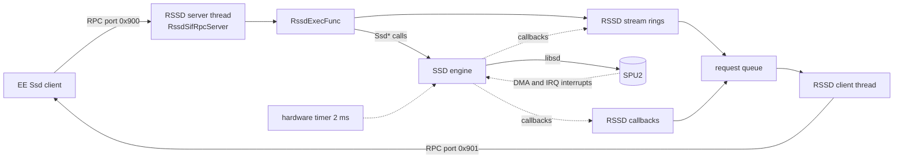

## 2. Threads, timer and interrupts

RSSD's `start` function allocates two RPC buffers of `0x10020` bytes from IOP
system memory, creates a completion semaphore and starts two threads with 4 KiB
stacks:

| Thread | Priority | Work |
| --- | --- | --- |
| `RssdSifServerThread` | 10 | Initializes SIF RPC, registers the server on port `0x900` and runs `sceSifRpcLoop`. Every EE command runs in this thread |
| `RssdSifClientThread` | 9 | Sleeps until a request is queued, then sends the queued requests to the EE server on port `0x901` one at a time |

SSD does its real-time work in interrupt context. `SsdInitTimer` converts
2,000,000 microseconds into IOP clock cycles and divides the result by 1000,
which gives the count for 2 ms. It allocates a hardware timer with that
interval and installs `SsdMainInterruptProcess` as its handler. The driver
therefore ticks 500 times per second. `SsdInitInterrupt` installs the SPU2 IRQ
handler and the handler of DMA channel 0, and enables the SPU2 interrupt and
both SPU2 DMA interrupts. The handler of DMA channel 1 is installed later by
the PCM or VAG stream set-up.

| Interrupt | Handler | Use |
| --- | --- | --- |
| SPU2 IRQ (address hit) | `SsdIrqInterruptProcess` | Calls `irq_callback`, used by the VAG stream |
| DMA channel 0 done | `SsdWaveTransferInterruptProcess` | Finishes the head of the DMA queue and starts the next |
| DMA channel 1 done | `SsdStreamInterruptProcess` | Calls `pcm_callback`, used by the PCM stream and the VAG stream's DMA chain |

Every 2 ms, `SsdSeqInterruptProcess` runs these steps in order:

1. Return at once if the driver is suspended.
2. On every second tick, `SsdCommonControl` advances the master and CD volume
   fades and writes the master volume when it changed.
3. `SsdMainSequenceProcess` advances every playing sequence, including the
   effect sequence (see [section 9](#9-the-sequencer)).
4. `SsdMidiTrackSequence` decodes queued MIDI input events.
5. `SsdGetEnvx` reads the current envelope level (ENVX) of all 48 voices.
6. `SsdLfoControlProc` runs the LFOs of the active voices.
7. `SsdVoiceEvent` turns pending voice events into volume and pitch values.
8. `SsdSetVoiceKeyon` writes the changed voice registers and keys voices on.
9. `SsdSetVoiceKeyoff` keys voices off.
10. Each process of the process list runs (`SsdLinkProc`). The PCM and VAG
    streams use it for their volume fades, sampling for its key-off check.
11. The timer counter before and after is added to `processing_ticks`, which
    the debug command `0x102` reports.

The flowchart below shows the same pipeline.

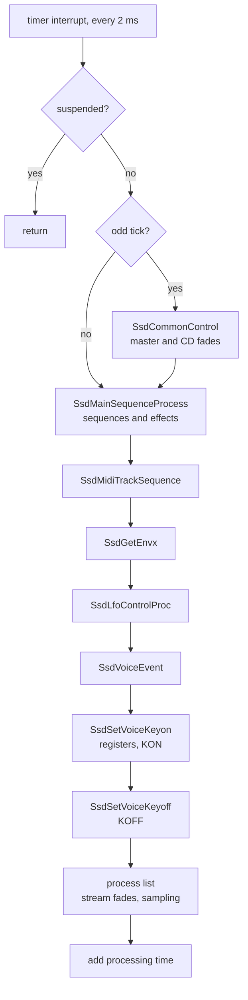

Because the engine runs in interrupts, the functions called from the RPC
thread disable interrupts (`CpuDisableIntr`) while they change shared lists
such as the sequence list or the wave bank list. `SsdSuspend` (command `0x06`)
suspends all devices and streams and sets the master volume of both cores to
0. `SsdResume` (`0x05`) undoes it.

## 3. The RPC protocol

Every message between the EE and RSSD is an `RssdRpcPacket`
(`include/rssd/rssdinit.h`): a 32-byte header followed by optional data.

```
RssdRpcPacket
+0x00  short command     command number, also the SIF RPC function number
+0x02  short error       reply: the SSD function error code
+0x04  int   parameter
+0x08  int   value       reply: the result of the command
+0x0C  int   dataSize    bytes of data after the header
+0x10  int   arguments[4]
+0x20  data[dataSize]    at most 64 KiB, the buffer is 0x10020 bytes
```

The server handler `RssdSifRpcServer` returns its own receive buffer as the
reply, and the EE reads back the first 32 bytes. So the answer of a command is
written into the same packet. `RssdExecFunc` resets the SSD error code, runs a
`switch` on the command, saves a copy of the packet in `RssdWork.lastPacket`
and stores the SSD error code in `error`. Commands that return something put it
in `value` and sometimes in `arguments`.

Command 4 is a batch. Its `arguments[1]` gives a count, and that many 32-byte
packets follow the header. `RssdSifRpcServer` runs `RssdExecFunc` on each of
them in turn. The EE uses the batch to send its whole queue of sound effect
commands once per frame. A batched packet has no room for data, so only
commands that need just their four arguments can be batched.

The sequence below shows a batch from the EE.

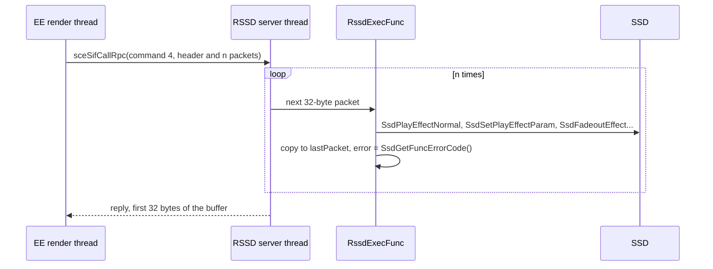

### Command table

The table lists every command that `RssdExecFunc` handles, with the SSD
function it calls. Arguments are `arguments[0..3]` unless stated otherwise.

| Command | Name | Handler |
| --- | --- | --- |
| `0x01` | INIT | `RssdInit` (see [section 4](#4-initialization)) |
| `0x05`, `0x06` | RESUME, SUSPEND | `SsdResume`, `SsdSuspend` |
| `0x10` | SET_OUTPUT_MODE | `SsdSetOutputMode(mode)` |
| `0x12`, `0x13` | SET_SPU_VOLUME, SET_CD_VOLUME | `SsdSetSpuVolume`, `SsdSetCDVolume(volume, frames)` |
| `0x14` | SET_REVERB_PARAMETER | `SsdSetReverbParameter(mode, depth, delay, feedback)`, then clear and enable the core |
| `0x1B` | SPU_DIRECT_READ | `RssdSpuDirectRead(address, size)`, read sound RAM back to the EE |
| `0x20`, `0x21` | ADD_WAVE_DATA, NEXT_WAVE_DATA | `RssdAddWaveData`, `RssdNextWaveData` (see [section 7](#7-wave-banks)) |
| `0x22`, `0x24` | DISPOSE_WAVE_BANK, CHECK_WAVE_DATA | `SsdDisposeWaveBank`, `SsdCheckWaveData` |
| `0x2C`, `0x2D` | SET_ / RESET_SEGMENT_ALLOC_MODE | `SsdSetSegmentAllocMode(address, size)`, `SsdResetSegmentAllocMode(address)` |
| `0x30` | PLAY_SEQUENCE_DATA | `SsdPlaySequence(data, volume, fade)` |
| `0x31`, `0x38` | ADD_SEQUENCE_DATA, ADD_SEQ_EFFECT_DATA | `SsdAddSequenceData`, `SsdAddSeqEffectData` (the SMD is in the data) |
| `0x32`, `0x33` | DISPOSE_SEQUENCE, CHECK_SEQUENCE | `SsdDisposeSequence`, `SsdCheckSequence` |
| `0x34` to `0x37` | START, RESUME, STOP, PAUSE_SEQUENCE | `SsdStartSequence(id, volume, fade)` and the others |
| `0x40` | GET_SEQ_PLAY_STATUS | `SsdGetSeqPlayStatus(id)` |
| `0x41` to `0x44` | SET_SEQ_MASTER_TEMPO, VOLUME, NOTE, PANPOT | Master ramps `(id, value, ticks)` |
| `0x45` | SET_SEQ_MUTE | `SsdSetSeqMute(id, mask)` |
| `0x48` to `0x4A` | SET_SEQ_NOTE, VOLUME, PANPOT_FADER | Per-track faders `(id, track, value)` |
| `0x4B`, `0x4C` | SET_SEQUENCE_OUTPUT_VOLUME, SET_EFFECT_OUTPUT_VOLUME | Group volumes |
| `0x50`, `0x51` | SET_SEQ_PATCH_NUMBER, SET_TRACK_PATCH_SET | Patch sets (the second takes its table from the data) |
| `0x58` | SET_SEQ_SIGNAL | `SsdSetSeqSignal(id, signal)` |
| `0x60` to `0x62` | ADD, DISPOSE, CHECK_EFFECT_DATA | `SsdAddEffectData` (the SED is in the data), `SsdDisposeEffectData`, `SsdCheckEffectData` |
| `0x70`, `0x71` | PLAY_EFFECT_NORMAL, PLAY_EFFECT_PARAM | `SsdPlayEffectNormal(effect, mode)`, `SsdPlayEffectParam(effect, volume, pan, mode)` |
| `0x78` | STOP_ALL_EFFECT | `SsdStopAllEffect` |
| `0x79`, `0x7A` | FADEOUT_EFFECT, FADEOUT_EFFECT_FILE_ID | Stop at once: `SsdFadeoutEffect(effect, 0, mode)`, `SsdFadeoutEffectFileID(file, 0)` |
| `0x7B`, `0x7C` | SET_EFFECT_PARAM, SET_PLAY_EFFECT_PARAM | Change volume and pan, the second plays the effect if it is not playing |
| `0x7D` | CONTINUE_ONE_EFFECT | Fade out every other effect |
| `0x7E`, `0x7F` | FADEOUT_EFFECT_FROM, ..._FILE_ID_FROM | Fade-outs with a duration |
| `0x80` to `0x82` | CHECK_PLAY_EFFECT_ALL, CHECK_PLAY_EFFECT, ..._FILE_ID | Return 1 while playing |
| `0x90` to `0x92` | PLAY_WAVE_NORMAL, PLAY_WAVE_PARAM, STOP_WAVE | Play one sample of a bank as an effect |
| `0xA0` to `0xA8` | PCM stream | Init, dispose, play, stop, data, status, volume, clear ring (see [section 14](#14-the-pcm-stream)) |
| `0xB0` to `0xBE` | VAG stream | Init stereo or mono, dispose, play, stop, data, status, pitch, volume, pan, parameters (see [section 15](#15-the-vag-stream)) |
| `0xD0` to `0xD7` | Sampling | Init, dispose, transfer, play, stop, parameters, effects (see [section 17](#17-sampling)) |
| `0x100` | CHECK_SPU_MEMORY | `SsdCheckSpuMemory(verbose)`, returns free sound RAM |
| `0x102`, `0x103` | GET_VOICE_ENV, GET_SEQ_PLAY_INFO | Debug reports sent back as calls to the EE |
| `0x200` to `0x205` | Debug device | Open, close, wave key-on, key-off, MIDI event, hardware effect |
| `0x300`, `0x301` | DEB_ADD_EFFECT, DEB_PLAY_EFFECT | Debug effects |
| `0x400` | COMPELLING_KEYOFF | `SsdCompellingKeyoff`, force all voices off |
| other | | Prints `Rssd illegal function No.0x%04x` and sets `error` to -1 |

The EE client also defines command `0x02` (QUIT) and `0x11` (SPDIF mode). RSSD
has no case for them, so they end in the "illegal function" branch.

### Messages to the EE

RSSD calls the EE with `RssdCallFunc` from thread context or `iRssdCallFunc`
from an interrupt. Both allocate an `RssdRequestNode` from IOP system memory,
copy the packet and the data into it, append it to the `firstRequest` list and
wake the client thread. The client thread takes the semaphore, removes the
first node, sends it with `sceSifCallRpc` to the EE server and frees it. When
the EE has received it, `RssdSifRpcCallback` releases the semaphore and runs the
node's completion callback. `RssdSetFuncCallback` sets that callback for the
next queued request. The SPU read-back uses it to start reading the next chunk
only after the EE has the previous one.

| Command | Name | Sent when |
| --- | --- | --- |
| 10 | `RSSD_EE_STREAM_FINISHED` | A stream ring stayed empty for two refills. `arguments[0]` is a bit mask of channels |
| 27 (`0x1B`) | SPU read chunk | A chunk of sound RAM has been read, data attached |
| 37 | `RSSD_EE_WAVE_TRANSFER_DONE` | A wave transfer to sound RAM finished. `arguments[0]` is 2 when the DMA ended, or -2 when a load failed before any DMA (sent from thread context) |
| 218 | `RSSD_EE_SAMPLING_DMA_DONE` | A sampling transfer finished |
| 219 | `RSSD_EE_SAMPLING_KEYOFF` | A sampling voice stopped |
| `0x102`, `0x103` | Reports | Voice envelopes and timing, sequence play information |
| `0x1000` | `RSSD_EE_INIT_NOTIFY` | `RssdInit` finished |

The sequence below shows a message sent from an interrupt.

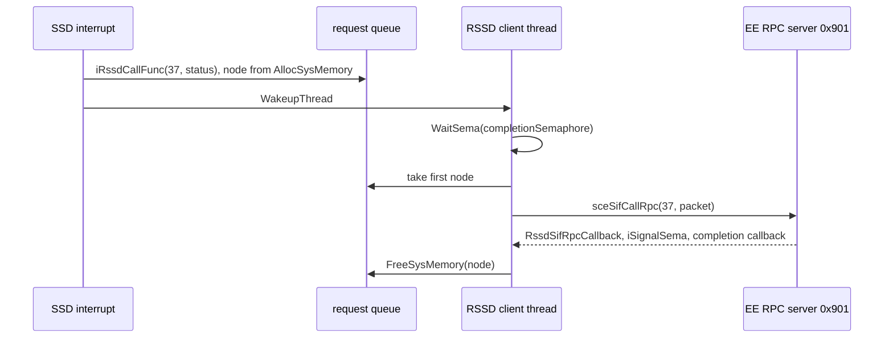

## 4. Initialization

The EE sends command `0x01` with the size of the work area it wants, `0x20000`
bytes in the game. `RssdInit` (`src/audio/rssd/rssdfunc.c`) then:

1. Calls `sceSdInit(0)` to reset `libsd` and the SPU2.
2. Allocates the work area and a `0x10020`-byte transfer buffer from IOP system
   memory.
3. Calls `SsdInit(work, size, 0)`.
4. Binds its RPC client to the EE server `0x901` and waits for the bind.
5. Sends `0x1000` to the EE with the work address, the size, `0x6001F4` (500
   and 96) and `0x10250`.

`SsdInit` (`src/audio/ssd/ssd_init.c`) refuses to run twice. It sets
`SsdWork.flags` to initialized and enabled, seeds the random generator with
`0x12345678`, clears the lists and then brings up each manager:

1. `SsdInitMainMemoryManager` over the work area.
2. `SsdInitSpuMemoryManager`, `SsdInitDmaManager`, `SsdInitVoiceManager`.
3. `SsdInitTimer` and `SsdInitInterrupt`.
4. `SsdInitOutputControl`: sequence and effect group volumes 127, stereo
   output, master volume 16383, CD volume 0, the CD reverb flags (left 0,
   right 1), the S/PDIF mode and two cleared bits in each core's `MMIX`
   register. Its attenuator call `SsdSetAudioAttenuator(128)` is an empty
   function.
5. `SsdMakeEffectSequenceRec(44, 0)` builds the effect sequence and links it
   (see [section 11](#11-sound-effects)).
6. The reverb work areas: `0x6FE0` bytes each (the size for reverb type 4,
   Studio C, in `SpuReverbWorkSize`), at the top of sound RAM for core 0 and
   below `0x1E0000` for core 1. Both cores are set to Studio C with depth 10240,
   cleared and enabled.
7. The driver block from `0x5040` to `0x6000` and the 8 KiB stream block at
   `0x6000`.

The flowchart below shows the order.

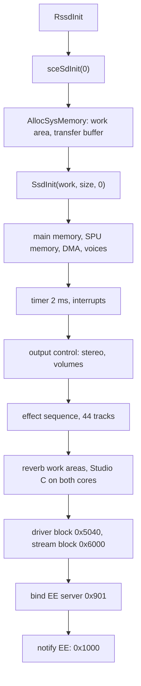

## 5. Memory

The driver manages two memories: a heap inside IOP RAM for its own records,
and the SPU2 sound RAM for sample data.

### IOP main memory

The work area that `RssdInit` allocates becomes SSD's heap
(`SsdWork.main_memory`). Each block starts with a 16-byte
`SsdMainMemoryBlock` header: flags, type, a cleared word, the end of the
payload and the next block. The blocks form a list sorted by address, starting
with an arena head block.

- `SsdNewPtr(size)` walks the list and takes the first gap that is large
  enough, from its low end.
- `SsdNewPtr2(size)` takes the last gap that is large enough, from its high
  end. Wave bank records use it, so long-lived tables gather at the top of the
  heap.
- Both zero the new payload. `SsdDisposePtr` unlinks a block.
- `SsdGetMemoryFreeSize` and `SsdGetMemoryBlockCount` report the state. RSSD
  returns them in `arguments[0]` and `arguments[1]` after each add command.

| Data | Allocated with | Memory |
| --- | --- | --- |
| Copied SMD and SED files | `SsdNewPtr` | SSD heap |
| Sequence records, track tables, MIDI devices | `SsdNewPtr` | SSD heap |
| Wave bank records with their sample and program tables | `SsdNewPtr2` | SSD heap |
| PCM and VAG stream double buffers | `SsdNewPtr` | SSD heap |
| RPC buffers, the transfer buffer, request nodes | `AllocSysMemory` | IOP system memory |
| RSSD stream rings, the sampling buffer | `AllocSysMemory` | IOP system memory |

### Sound RAM

The SPU memory manager (`SsdSpuMemoryManager`) has a fixed table of 16
descriptors. Each `SsdSpuMemoryBlock` holds the index of the next descriptor,
flags (`0x80` used, `0x01` fixed), a type, an address and a size. The used
descriptors form a list sorted by address that starts at descriptor 0, the
fixed system area from `0x0000` to `0x5040`. Gaps between descriptors are free
space. With only 16 descriptors, at most 15 areas can be allocated besides
the system area.

| Type | Name | Content |
| --- | --- | --- |
| 1 | `SSD_SPU_BLOCK_SYSTEM` | Hardware area at the bottom of sound RAM |
| 2 | `SSD_SPU_BLOCK_DRIVER` | Driver block up to `0x6000` |
| 3 | `SSD_SPU_BLOCK_STREAM` | Stream voices' buffers, 8 KiB |
| 4, 5 | `SSD_SPU_BLOCK_REVERB_CORE0`, `..._CORE1` | Reverb work areas |
| 9 | `SSD_SPU_BLOCK_WAVE` | Wave bank bodies |
| 10 | `SSD_SPU_BLOCK_SAMPLING` | Sampling areas |

The map below shows sound RAM after `SsdInit`, with the wave banks the game
loads later.

```
0x000000 +------------------------------+
         | system area (fixed)          |  type 1, 0x5040 bytes
0x005040 +------------------------------+
         | driver block                 |  type 2
0x006000 +------------------------------+
         | stream block, 8 KiB          |  type 3, VAG channel n at 0x6000 + n * 0x800
0x008000 +------------------------------+
         | wave banks                   |  type 9, first fit or at the SWD address
         | sampling areas               |  type 10
         | free                         |
0x1D9020 +------------------------------+
         | core 1 reverb work           |  type 5, 0x6FE0 bytes
0x1E0000 +------------------------------+
         | free, REGIST2 in the game    |  type 9, fixed at 0x1E0000
0x1F9020 +------------------------------+
         | core 0 reverb work           |  type 4, 0x6FE0 bytes
0x200000 +------------------------------+
```

The wave bank area is not filled at random. Each SWD header names a preferred
address, and the game's banks use a few fixed ones: `0x8000` for the system
sounds `REGIST`, `0x20000` for the common field and minigame banks, `0x60000`
for the footsteps, `0x70000` for the enemy and NPC banks, `0xB0000` for the
map environment, `0xD8000` for the battle music and `0x1E0000` for the
resident `REGIST2`. The battle containers use `0x20000`, `0x48000`, `0x98000`
and `0xA8000`. The full list per bank group is in
[Sound files](../formats/sound.md#swd-wave-banks).

The allocators differ in where they place a block:

| Function | Placement |
| --- | --- |
| `SsdSpuMalloc(size, type)` | First gap from the bottom that is large enough |
| `SsdSpuMalloc2(size, type)` | Top of the last gap that is large enough |
| `SsdSpuMallocAdrs(size, address, type)` | Exactly at `address`, fails if the range is not free |
| `SsdSpuMallocAdrsDynamic(size, minimum, type)` | First gap at or above `minimum` |
| `SsdSpuMallocAdrsSegment(size, minimum, segment, type)` | Like the dynamic one, but the start moves up in steps of `segment` from `minimum` |
| `SsdSpuMFree(address)` | Frees the block that starts at `address` |

### Segment allocation modes

`SsdWork.segment_modes` holds up to four rules `(address, size)`. When a wave
bank is loaded, `SsdSpuWaveMalloc(header, address)` decides where it goes:

1. An address argument of `~0` means "anywhere": the bank goes in the first
   free gap.
2. An address argument of 0 means "use the SWD header". If the header address
   is also 0, the bank goes in the first free gap.
3. Any other argument only selects the placed path. The address actually used
   is still the one in the SWD header.
4. If the header address matches a segment rule, the bank is placed with
   `SsdSpuMallocAdrsSegment`, at the first segment boundary at or after that
   address where it fits.
5. If the SWD flags have bit 0 set, the bank is placed with
   `SsdSpuMallocAdrsDynamic`, anywhere at or above that address.
6. Otherwise it must sit exactly at that address (`SsdSpuMallocAdrs`).

The flowchart below shows the same decision.

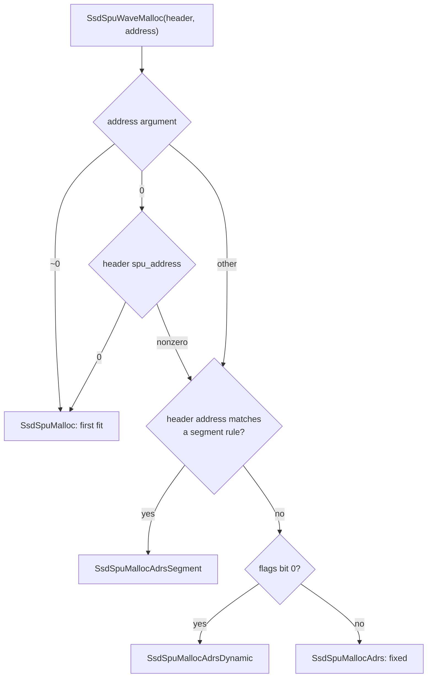

The game switches between two rules. `GameCFSoundReload` removes the rule at
`0xA8000` and installs `(0x70000, 0x10000)`. `GameCFSoundPurge` does the
opposite (see [Audio](audio.md#segment-allocation-modes)). Because the segment
test comes first, the dynamic flag decides only for addresses without a rule.
The eight loose banks on the disc that set the flag all name `0x70000`, so in
the field the segment rule places them and the flag has no effect.

## 6. The DMA queue

All transfers between IOP memory and sound RAM, except the streams, go through
one queue on SPU2 DMA channel 0. `SsdSpuDmaWrite` and `SsdSpuDmaRead` call
`SsdDmaStartTransfer`, which works like this:

1. Take a free `SsdDmaBuffer` slot. There are 8 slots but only 6 are handed
   out. Outside an interrupt the call spins until a slot is free. Inside an
   interrupt a full queue is an error.
2. Fill the slot: operation (1 write, 2 read), memory address, sound RAM
   address, size and callback.
3. Append it to `SsdWork.dma_queue`. If the queue was empty, start it at once.

`SsdDmaStartBuffer` sets the busy flag and calls `sceSdVoiceTrans` on channel 0.
When the transfer ends, `SsdWaveTransferInterruptProcess` calls the slot's
callback with result 2, frees the slot, clears the busy flag and starts the
next queued transfer. `SsdSpuDmaCompleted(1)` waits until the busy flag is
clear and returns the operation at the head of the queue.

Reading sound RAM back to the EE (command `0x1B`) uses the same queue.
`RssdSpuDirectRead` reads 64 KiB at a time into the transfer buffer. Each
finished chunk is sent to the EE as message 27 with the data attached, and the
completion callback of that message starts the next chunk.

## 7. Wave banks

A wave bank is the loaded form of an SWD file: its sample body in sound RAM and
its tables in the SSD heap. The file layout is in
[Sound files](../formats/sound.md#swd-wave-banks).
`SsdAddWaveData(data, size, address)` in `src/audio/ssd/ssd_wave.c` loads one:

1. Check the signature `swdm`. A wrong one is an error. Unlike the music and
   effect loaders, this function does not verify the checksum word of the
   file.
2. If a bank with the same `bank_id` is already loaded, warn and return that id.
   Nothing is loaded twice.
3. Walk the chunk list and note the sample table (type 3) and the program
   table (type 4). The END chunk (type 0) marks the start of the body.
4. Reserve sound RAM with `SsdSpuWaveMalloc`.
5. Start the DMA of the body bytes contained in this call
   (`size - body_offset`) and remember where the next piece must go.
6. Allocate an `SsdWaveBank` record with `SsdNewPtr2`, copy the sample and
   program tables behind it, and append it to `SsdWork.wave_banks`.
7. Return the bank id.

`SsdNextWaveData(data, size)` sends the following piece to the remembered
address. RSSD wraps both functions. `RssdAddWaveData` first copies the whole
packet into its transfer buffer. The DMA reads from there, so the RPC buffer
can take the next command while the transfer runs. It installs
`RssdSpuDmaTransferCallback`, which sends message 37 to the EE when the DMA ends.
The reply carries the bank id in `value`, and the record address, the sound RAM
address and the body size in `arguments`. The EE side of the upload is shown in
[Audio](audio.md#uploading-a-large-wave-bank).

```
SsdWaveBank (in the SSD heap)
+0x00  u32 signature "swav"
+0x04  u16 bank_id
+0x06  u8  sample_count, u8 program_count
+0x0C  u32 spu_address   start of the body in sound RAM
+0x10  u32 body_size
+0x18  SsdWaveSample *samples   copied sample table (32 bytes per sample)
+0x1C  void *programs           copied program table
+0x24  SsdWaveBank *next
```

`SsdGetWSPtrBank(id)` finds a bank by id. `SsdDisposeWaveBank(id)` unlinks it,
frees its sound RAM and its record. `SsdCheckWaveData(id)` returns the id if
the bank is loaded.

## 8. Driver objects

All driver state hangs off one global, `SsdWork` (`SsdGlobalWork` in
`include/ssd/ssd_init.h`). Its most important fields are:

| Field | Meaning |
| --- | --- |
| `flags` | Bit 15 initialized, bit 0 enabled, bit 1 DMA busy, bit 3 error, bits 4 and 5 inside a transfer or IRQ interrupt, bit 7 suspended |
| `main_memory`, `spu_memory`, `segment_modes` | The two memory managers |
| `timer_id`, `timer_interval`, `interrupt_count` | The 2 ms timer |
| `sequences` | List of loaded sequences, music and effects |
| `effect_sequence` | The 44-track sequence that plays sound effects |
| `effect_sets`, `wave_banks`, `devices` | Lists of loaded SED data, wave banks and MIDI devices |
| `dma_buffers`, `dma_queue` | The DMA queue |
| `pcm_callback`, `vag_callback`, `irq_callback` | Stream hooks |
| `master_volume`, `cd_volume`, `master_fade`, `cd_fade` | Output volumes and their ramps |
| `sequence_volume`, `effect_volume`, `output_mode` | Group volumes and mono, stereo or surround |
| `cores` | Reverb state of both cores, overlapped with the per-core switch words (KON, KOFF, cut-off, PMON, NON, reverb and dry mix) |
| `voices[48]` | One `SsdVoice` per SPU2 voice |
| `processes` | The process list run at the end of each tick |

A sequence owns a table of tracks and one MIDI device. The device has one
channel per MIDI channel, and each channel keeps the list of voices it is
playing. Tracks point at the channel they drive. The class diagram below shows
these links.

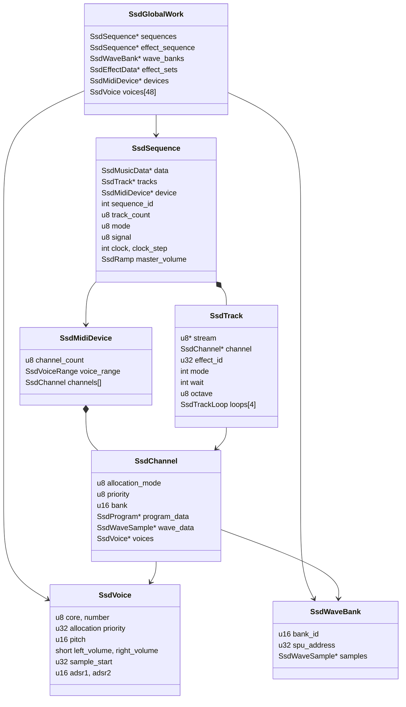

## 9. The sequencer

The sequencer plays music (SMD) and the effect programs of SED files with the
same machinery. Each loaded music file becomes one `SsdSequence`, and all sound
effects share the single effect sequence.

### Loading a sequence

`SsdAddSequenceData(data)` in `src/audio/ssd/ssd_musc.c` loads an SMD file,
whose layout is in [Sound files](../formats/sound.md#smd-music-files):

1. Checks the `smdm` signature and the checksum (`SsdCheckData`).
2. Refuses a second copy of the same `file_id` with a warning code.
3. Copies the file into the SSD heap, so the RPC buffer can be reused.
4. Checks that the heap still has `track_count × sizeof(SsdTrack) + 292` bytes.
5. Allocates the `SsdSequence` record (signature `mseq`) and the track table.
6. Creates a MIDI device. The channel count is `midi_channel_count` from the
   header, or one more than the highest channel any track uses. The device
   searches its voices in the header's voice range.
7. `SsdSetDataAddress` walks the chunks. Each track chunk sets the start of a
   track's event stream, its MIDI channel and attributes. The patch chunk and
   the metadata chunk are remembered.
8. `SsdInitSequence` applies the defaults and the header values, then
   `SsdSetSeqReverb` programs the reverb cores the header's options select.
9. The output volume is set from `SsdWork.sequence_volume` and the sequence is
   linked at the front of `SsdWork.sequences`. The `file_id` is returned as the
   sequence id.

`SsdAddSeqEffectData` (`0x38`) does the same but treats the sequence as an
effect (it uses the effect output volume). `SsdPlaySequence` (`0x30`) adds and
starts in one step.

### Timing

The tempo is in beats per minute, 120 by default, and a beat has 96 ticks by
default (`ticks_per_beat`, 4/4 time). Every 2 ms interrupt subtracts
`clock_step` from the sequence's `clock`. Each time the clock goes below zero,
65536 is added back and one tick runs. The step is

```
clock_step = ((tempo × 53687) >> 8) × master_tempo >> 8
```

With tempo 120 and the normal master tempo 256 this gives 25165, the default
value. That is 500 × 25165 / 65536 ≈ 192 ticks per second, or 96 ticks per beat
at 2 beats per second. A whole note is 384 ticks. The master tempo
(`0x41`) scales the speed without changing the music data.

Each tick of a playing sequence runs, in order:

1. `SsdNormalTrackEffect`: advance the pitch, volume, pan and fade-out ramps of
   each track and update its channel.
2. `SsdNormalTrackGate`: count down the duration of each sounding note and key
   it off at zero.
3. `SsdNormalTrackSequence` for music (mode 0) or `SsdEffectTrackSequence` for
   the effect sequence (mode 1): read new events.
4. If no track is active any more, clear the playing flag. If the master volume
   has reached 0, mark the sequence stopped and cut its device.

The beat, measure and `play_ticks` counters advance with the ticks.
`SsdGetTimeCode` converts ticks to hours, minutes, seconds and 30 fps SMPTE
frames.

### Event format

A track's event stream is a byte stream. A track waits while its `wait`
counter is not zero, then reads events until one of them sets a new wait.
Music tracks (SMD) and effect tracks (SED) share the command bytes, but they
code their notes differently. `SsdNormalTrackSequence` reads the music note
and `SsdEffectTrackSequence` the effect note, both in
`src/audio/ssd/ssd_main.c`.

```
music note (first byte < 0x80, SMD tracks)
  byte 0   velocity (0 to 127)
  byte 1   bits 6-7: number of duration bytes that follow (0 to 3)
           bits 4-5: octave change, value - 1 (so -1, 0, +1 or +2 octaves)
           bits 0-3: note within the octave
  bytes    duration, big-endian. With 0 bytes the previous duration is reused.
  key = octave + note

effect note (first byte < 0x80, SED tracks)
  byte 0   bits 0-3: note within the octave (the upper bits are ignored)
  byte 1   duration, low byte
  byte 2   duration, high byte
  key = octave + note, velocity = the track's current velocity

command event (first byte >= 0x80)
  handler = SsdSeqFuncTrap[byte - 0x80], it reads its operands and
  returns the new stream position
```

The two note formats behave differently. A music note carries its own
velocity and does not set the wait. The wait comes from the delta commands
`0x80` to `0x86` that follow it, so several notes can start together before
one delta. An effect note has no velocity byte, always carries a 16-bit
duration, and that duration is also the track's new wait. Before it keys on an
effect note, `SsdEffectTrackSequence` looks ahead over the following commands
with the length table `SsdSeqFuncLength` (`src/audio/ssd/ssd_data.c`), so that
a following tie or slur can join the next note to this one.

The byte order is mixed. The duration bytes of a music note are big-endian,
but the 16-bit and 24-bit operands of the commands (Delta2, Delta3, Rest, Tie,
Jump, If and the others) are little-endian. The bank id of WaveBankType
(`0xAB`) is again stored high byte first.

A note event keys on the track's channel unless the track is muted. Commands
set the delta time until the next event, change the octave, control flow,
instruments, envelopes, volume, pan, pitch, effects and LFOs. The table groups
the 128 opcodes of `SsdSeqFuncTrap` (`src/audio/ssd/ssd_trap.c`). Unlisted
codes are `SsdSeqDummy`. The number of operand bytes of each command, which a
reader of the files needs, is listed in
[Sound files](../formats/sound.md#event-operand-sizes).

| Opcodes | Handlers | Meaning |
| --- | --- | --- |
| `0x80` to `0x86` | `SsdSeqDeltaForGate`, `...AfterDelta`, `...AddGate`, `...AddAfterDelta`, `SsdSeqDelta1` to `3` | Set the wait until the next event: `0x80` to the last note's duration, `0x81` to the previous wait, `0x82` and `0x83` to the previous wait or the last duration plus a signed byte, `0x84` to `0x86` to a 1-, 2- or 3-byte value |
| `0x88`, `0x89` | `SsdSeqRest`, `SsdSeqTie` | Rest, tie |
| `0x90` | `SsdSeqStop` | End of track, or back to the repeat point if one is set |
| `0x91` | `SsdSeqRepeat` | Mark the repeat point (the music loop) |
| `0x92` | `SsdSeqJump` | Jump by a signed 16-bit offset |
| `0x93` | `SsdSeqIf` | Jump if the sequence signal equals the operand byte |
| `0x94` to `0x97` | `SsdSeqOctave*` | Absolute, relative, up and down |
| `0x98` to `0x9A` | `SsdSeqLoopTop`, `...LoopEnd`, `...LoopEscape` | Counted loops, up to four nested |
| `0x9C`, `0x9D` | `SsdSeqTempoAbsolute`, `...Relative` | Tempo |
| `0xA0`, `0xA1` | `SsdSeqMeasure`, `SsdSeqPosition` | Time signature and position. Measure reads its first byte as the note value and its second as the beats per bar |
| `0xA6` | `SsdSeqMasterFader` | Master fader |
| `0xA8`, `0xA9` | `SsdSeqBankMSB`, `SsdSeqBankLSB` | Set the low byte (`0xA8`) and the high byte (`0xA9`) of the channel's bank id |
| `0xAA` | `SsdSeqWaveChange` | Choose a sample of the channel's bank |
| `0xAB` | `SsdSeqWaveBankType` | Choose a sample of any loaded bank: sample index, then the bank id high byte first |
| `0xAC` | `SsdSeqProgramChange` | Choose a program of the channel's bank |
| `0xAE` | `SsdSeqRandomNote` | Random key range |
| `0xB0` to `0xBA` | `SsdSeqADSRReset`, `...ADSRMode`, `SsdSeqAR`, `DR`, `SL`, `SR`, `RR`, `DRSL`, `AMode`, `SMode`, `RMode` | Envelope settings |
| `0xBB`, `0xBC` | `SsdSeqPriority`, `SsdSeqGateTime` | Voice priority, note length ratio |
| `0xBF` to `0xC1` | `SsdSeqSustaion`, `SsdSeqSulrOn`, `SsdSeqSulrOff` | Sustain, slur on and off |
| `0xC2` to `0xC7` | `SsdSeqPMOn`, `PMOff`, `NoiseAbsolute`, `NoiseRelative`, `NoiseOn`, `NoiseOff` | Pitch modulation and the noise generator |
| `0xC8` to `0xCB` | `SsdSeqReverbParameter`, `...Set`, `...On`, `...Off` | Reverb settings and the voice's reverb send |
| `0xD0` to `0xD5` | `SsdSeqKeyTranspose*`, `SsdSeqTune`, `SsdSeqDetune`, `SsdSeqBender`, `SsdSeqSweep` | Transpose, tuning, pitch bend, sweep |
| `0xD7` to `0xDB` | `SsdSeqVibrate*` | Vibrato (pitch LFO) |
| `0xDD`, `0xDF` | `SsdSeqBenderOff`, `SsdSeqExpression` | Bend off, expression |
| `0xE0` to `0xE2` | `SsdSeqVolumeAbsolute`, `...Relative`, `...Fade` | Track volume |
| `0xE3` to `0xE7` | `SsdSeqTremolo*` | Tremolo (volume LFO) |
| `0xE8` to `0xEA` | `SsdSeqPanpotAbsolute`, `...Relative`, `SsdSeqPanpoMove` | Pan |
| `0xEB` to `0xEF` | `SsdSeqShake*` | Pan LFO |
| `0xF0` to `0xF7` | `SsdSeqLFOProcess`, `...Parameter`, `...Delay`, `...On`, `...Off` | Generic LFOs |
| `0xF8` to `0xFE` | `SsdSeqAllReset`, `SsdSeqLabel`, `SsdSeqSMPTETime`, `...Frame`, `...Offset`, `SsdSeqSkip` | Reset, labels, SMPTE time, skip |

Three commands read their operands in a way that is easy to get wrong, and
the files on the disc show which reading is the real one:

- `SsdSeqBankMSB` (`0xA8`) sets the low byte of the bank id and
  `SsdSeqBankLSB` (`0xA9`) the high byte. `BATTLE2.SMD` uses `a8 01 a9 02` to
  select bank `0x0201`, which is the id of `BATTLE2.SWD`.
- `SsdSeqWaveBankType` (`0xAB`) is the only command that carries a whole
  bank id in one operand, and it reads that id high byte first. All 83 uses in the
  effect files name an existing bank only when read this way. They let an
  effect play samples of a bank other than its own: effects 9, 33 to 35, 56
  and 58 of `REGIST.SED` use the resident bank `0x0100` (`REGIST2.SWD`), and
  some enemy and environment effects use `REGISTCF` or an enemy bank.
- `SsdSeqMeasure` (`0xA0`) computes `ticks_per_beat = 384 / first byte` and
  takes the second byte as the beats per bar. The files store the beats first
  (`a0 03 04` for 3/4, `a0 01 08` in the environment sequences), so the two
  readings agree only for 4/4. The driver's beat and measure counters, which
  only the debug report `0x103` sends out, are therefore wrong for the other
  time signatures. The playback speed does not depend on them.

The music loop works through `0x91` and `0x90`. `SsdSeqRepeat` stores the
current position and octave in the track. When the track reaches `SsdSeqStop`,
it jumps back there instead of ending. `SsdSeqIf` compares the operand with
`sequence->signal`, which the EE can set with command `0x58`. A piece of music
can therefore branch on a value chosen by the game. No recovered game code
calls the EE's `SsdSetSeqSignal`, though.

### Start, fade and stop

`SsdStartSequence(id, volume, fade)` stops the sequence if it plays and calls
`SsdCheckSumMusicData`, a stub that always returns 0. It then resets the
sequence and all its tracks to their defaults (middle C, gate ratio 15,
velocity 96, volume 100, center pan), sets the master volume to 0 and ramps it
to `volume` over `fade` ticks of 2 ms.
`SsdPauseSequence(id, fade)` ramps the master volume to 0. When it reaches 0 the
main process cuts the device and marks the sequence stopped.
`SsdResumeSequence` ramps the volume back up without resetting.
`SsdStopSequence` cuts all voices at once. `SsdDisposeSequence` stops, unlinks
and frees the sequence.

The state diagram below shows the life of a music sequence.

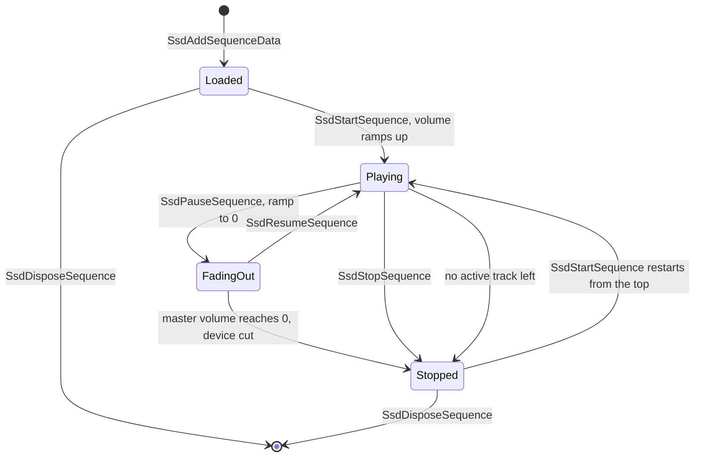

`SsdGetSeqPlayStatus` returns bit 0 while playing, bit 1 when stopped and bits
16 to 19 while a tempo, note, volume or pan ramp runs. Other controls act on a
running sequence: master note, volume and pan ramps (`0x42` to `0x44`), a mute
mask over the tracks after the first (`0x45`), per-track note, volume and pan
faders (`0x48` to `0x4A`) and patch sets from the SMD's patch chunk (`0x50`,
`0x51`), which give each track a note, volume and pan offset.

## 10. MIDI devices, channels and voices

The sequencer does not touch voices directly. Tracks send note events to
channels, channels pick voices, and the voice manager writes the SPU2
registers. This follows the MIDI model: a device is like a MIDI instrument,
and each track drives one of its channels.

### Devices and channels

`SsdMidiDevice` holds a channel count, a voice range, a master note, volume and
pan, an output volume and its channels. `SsdNewMidiDevice(count, mode, range)`
creates one and links it into `SsdWork.devices`. Each `SsdChannel` keeps:

- The allocation mode: 0 search (any voice in the range), 1 mono (reuse the
  channel's own voice), 2 fixed (always the first voice of the range).
- A priority, a voice range and a random key range.
- The wave bank, and either a sample index (program type 1, wave) or a program
  (program type 2).
- Volume, pan, expression, transpose, pitch bend and its sensitivity, ADSR
  words, the hardware effect bits and an LFO set.
- The list of voices it is playing.

A program (`SsdProgram`, from the SWD program table) has default ADSR words, a
voice range, four LFO definitions, a 16-byte name and a list of splits. The
name at `+0x50` is zero-terminated, such as `w_l` or `hashigo`, and no code
reads it (see [Sound files](../formats/sound.md#programs)). A split
(`SsdProgramSplit`) maps a key range (`lower_key` to `upper_key`) to a sample
(`wave_index`) with its root key, volume, pan, effects and ADSR words.

`SsdKeyonChannel` handles a note. Unless the channel is in slur mode, it first
releases the channel's previous note. Then:

- A wave channel takes one voice in the channel's range. The voice gets the
  sample start (`bank spu_address + body_offset`), the channel's ADSR words
  and effect bits, the sample's volume and pan, the note
  `base_pitch + key × 256` and the velocity `event velocity × sample volume`.
  The driver also stores a loop address computed from the sample's loop word
  in `voice->loop_start`, but nothing writes it to the SPU2:
  `SsdSetVoiceLoopStartAddress` in `src/audio/ssd/ssd_dev.c` has no caller.
  The voice loops through the loop flags inside the ADPCM data instead. In
  slur mode the sample addresses are kept, so the note changes pitch without
  restarting.
- A program channel starts one voice for every split whose key range contains
  the key, so a program can layer several samples. A channel with the
  random-key flag first replaces the key by a random one from its range. Each
  voice is searched in the overlap of the program's and the channel's voice
  ranges. It takes the split's ADSR words, the channel's effects masked by
  the split's, a volume of `sample volume × split volume / 127` and the
  split's pan. The note is transposed by `60 - root_key`, so the root key
  plays the sample at its base pitch. With the fixed-pitch flag every key
  plays at that root pitch. In slur mode a program channel starts nothing.
  The split's sample index is not checked against the bank's sample count.
  On the disc, 141 splits in 26 loose banks and 554 splits in the battle
  containers name a sample the bank does not have, probably leftovers of the
  larger banks these were cut from. A note in such a range would read a record
  behind the sample table.

Both paths copy the channel's LFO set into the voice and link the voice into
the channel's voice list.

### Voice allocation

`SsdGetKeyonVoice(channel, range)` chooses a voice. Each `SsdVoice` has an
allocation word:

```
bits 16 and up   priority of the channel that owns the voice
bit 8            set while the voice is keyed on (SSD_VOICE_PRIORITY_ACTIVE)
bits 0-7         current envelope level, copied from ENVX every tick
0                free voice
```

The requesting channel's own word is `priority << 16 | 0x100`. In search mode
the function walks the range and keeps the voice with the lowest word that is
below the channel's word, and it stops early at a free voice. The effect is
that a free voice is used first, then a released voice with the quietest
envelope, then a voice of a lower-priority channel. If no voice in the range
is below the channel's word, the last voice of the range is taken anyway.

A key-off or a cut keeps only the envelope byte of the word, so a voice in its
release phase becomes a candidate at once and competes only by its remaining
loudness. Mono mode reuses the voice the channel already holds and searches
only when it has none. Fixed mode also reuses its voice. Otherwise it takes
the first voice of the range if that voice's word is below the channel's, and
plays nothing if not. Streams and sampling reserve their voices with high words
(`0xA0000` and `0x90000`) that normal channels cannot beat, unless such a voice
is the last one of a searched range.

The 48 voices are shared like this:

| Voices | User |
| --- | --- |
| 0 to 23 (core 0) | Effect tracks 0 to 23, used by effects with the "low tracks" flag |
| 24 to 43 | Effect tracks 24 to 43 |
| Any, inside the SMD voice range | Music devices |
| 43 to 46 | Sampling, when used |
| 44 to 47 | VAG stream channels 0 to 3 |

Effect track `n` always uses voice `n`, so effects and music share voices
through the allocation words. Music devices take voices only inside the range
their SMD header gives.

### Voice update

Voices carry pending events (key on, key off, pitch, volume) and dirty flags
for each register. Every tick:

1. `SsdDeviceVoiceEvent` computes the new values of each voice with pending
   events. The volume is `channel volume × velocity / 63`, reduced by the
   tremolo LFO, scaled by the device master volume and squared. The pan adds
   the channel pan, the device pan, the fader, the sample's own pan and the pan
   LFO. The pitch adds the note, transpose, pitch offset, master note and the
   vibrato LFO and goes through `SsdNoteToPitch`.
2. `SsdSetVoiceKeyon` writes the dirty registers of each active voice: `VOLL`
   and `VOLR`, `PITCH`, the start address `SSA`, `ADSR1` and `ADSR2`. It
   updates the per-core switch words for pitch modulation (`PMON`), noise
   (`NON`), reverb send (`VMIXEL`, `VMIXER`) and dry output (`VMIXL`, `VMIXR`),
   writes the changed switches and then writes the pending key-on bits (`KON`)
   of both cores in one go.
3. `SsdSetVoiceKeyoff` writes the key-off bits (`KOFF`). A voice that must be cut
   rather than released first gets a very fast release written into the low
   bits of its `ADSR2`.

Key-ons are collected and written with one switch write per core, so all
notes started in the same tick appear to start together. `SsdCompellingKeyoff`
(`0x400`) writes a release setting to all 48 voices, keys all of them off on
both cores and unlinks them from their channels.

`SsdNoteToPitch` converts a note in 8.8 fixed point (key in the high byte, fine
tune in the low byte) into the SPU2 pitch value, where `0x1000` plays a sample
at its recorded rate. `SsdAllKeyTable` splits the key into an octave and a
semitone. `SsdAllPitchTable` has 3072 entries, 12 semitones of 256 fine steps,
and the result is shifted right by `6 - octave`. Both tables are in
`src/audio/ssd/ssd_data.c`.

### Pan law

`SsdCalcDirectVoiceVolume` and the device code use the same pan law. The pan
runs from 0 (left) to 32256 (right), center 16128. Toward the left, the right
gain rises linearly from 0 to 23040 at the center and the left gain falls from
32512 to 23040. The other side mirrors it. 23040 is about 0.7 of full scale, so
a centered sound plays at about -3 dB per side. The volume is squared before the
pan is applied, which gives a curve closer to perceived loudness. In mono
output both sides get `volume² × 23040 >> 15`.

## 11. Sound effects

### The effect sequence

At start-up `SsdMakeEffectSequenceRec(44, 0)` creates the effect sequence: an
`SsdSequence` with id `0xF000`, signature `sseq`, mode 1, priority 1 and 44
tracks. Its MIDI device has 44 channels in fixed allocation mode, and channel
`n` is bound to voice `n`. The device priority is 3 and the output volume is
`SsdWork.effect_volume`. The effect sequence is linked like any music sequence,
so the same tick loop runs it.

### Effect data

`SsdAddEffectData(sed)` checks the `seds` signature and checksum. If a set with
the same `file_id` is loaded, it returns that id. Otherwise it copies the file
into the SSD heap, links it into `SsdWork.effect_sets` (using the header's
`next` field as the link) and returns the `file_id`. `SsdDisposeEffectData`
stops the set's effects and frees it. The SED layout, with its effect
entries and their tracks, is in
[Sound files](../formats/sound.md#sed-effect-files).

### Playing an effect

An effect id is `(file_id << 16) | index`. The mode is a tag chosen by the
caller (see [Audio](audio.md#9-sound-effects-and-the-se-queue)).
`SsdPlayEffectParam(effect, volume, pan, mode)`:

1. Finds the set whose `file_id` is the upper half of the id. A missing set or
   an index beyond `effect_count` is an error. An offset of 0 plays nothing.
2. Reads the effect entry: flags, volume, priority and track count.
3. Fills an `SsdEffectPlayParam` with the id, mode, the set's wave bank, the
   priority, the requested volume and pan, and the entry.
4. Calls `SsdSaechSeqFreeTrack` to find room. If it succeeds,
   `SsdPlaySeqEffectNormal` starts the effect.

`SsdPlayEffectNormal(effect, mode)` is the same with volume 127 and center pan.

`SsdSaechSeqFreeTrack` first stops any instance of the same effect with the
same mode, or with any mode when the entry has flag `0x04`. It then looks for
`track_count` consecutive free tracks. Effects with flag `0x20` search tracks 0
to 23, the others search downward from the top of the table to track 24. On
the disc, 2,729 of the 3,279 effects in the loose SED files set flag `0x20`,
while no effect inside the battle containers does, so the field sounds mostly
use the voices of core 0 and the battle sounds the upper tracks. If no
run is free, it stops the oldest playing track whose priority is not higher
than the new effect's, and searches again. If no track can be stopped, the
effect is dropped.

`SsdPlaySeqEffectNormal` checks that the wave bank is loaded, then sets up each
track of the run with interrupts disabled. A track with a nonzero offset gets
its event stream (`entry + offset`), the effect id and mode, the priority, a
time stamp, the bank and default values. Its channel is reset to the bank, with
the fader volume taken from `SsdVolumeTable[volume]` and the fader pan from the
request. A zero offset leaves that track off. The sequence is marked playing,
and the next tick starts reading the tracks.

The flowchart below summarizes the free-track search.

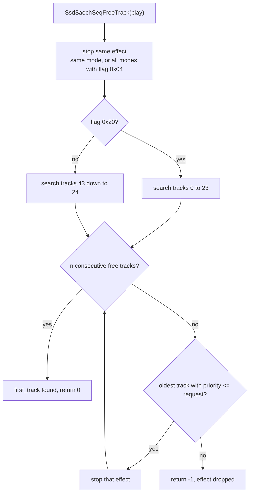

### Controlling effects

All control functions take a mode. Mode 0 means every instance of the effect,
a nonzero mode only the instances with that tag.

| Function | Command | Effect |
| --- | --- | --- |
| `SsdSetEffectParam(effect, volume, pan, mode)` | `0x7B` | Change volume and pan of playing instances. Returns 1 if one changed |
| `SsdSetPlayEffectParam(...)` | `0x7C` | The same, and play the effect if nothing changed |
| `SsdFadeoutEffect(effect, duration, mode)` | `0x79`, `0x7E` | Fade out over `duration` ticks of the effect sequence, or stop at once with 0 |
| `SsdFadeoutEffectFileID(file, duration)` | `0x7A`, `0x7F` | The same for every effect of a set |
| `SsdContinueOneEffect(effect, duration, mode)` | `0x7D` | Fade out every track that is not this effect |
| `SsdStopAllEffect` | `0x78` | Cut all effect tracks |
| `SsdCheckPlayEffect(effect, mode)` | `0x81` | 1 while playing |

A fade-out ramps the track velocity to 0 and sets the fade-out control flag.
A stop (`duration` 0) clears the track and cuts its channel.

`SsdPlayWaveNormal` and `SsdPlayWaveParam` (`0x90`, `0x91`) play a single sample
as an effect, without SED data. The upper half of the id is the wave bank and
the lower half the sample index. The sample plays on one effect track.

## 12. Output, volume and reverb

### Output mode

`SsdSetOutputMode(mode)` selects mono (0), stereo (1) or surround (2). It
calls `SsdCheckWideMode`, rewrites the reverb depths of both cores, marks every
voice of every sequence for a volume update and sets core 1's output volume
(`AVOL`). In surround mode `SsdSetVolumeRec`, which builds the master, CD and
reverb volume pairs, stores one side as a negative value, which inverts its
phase, and core 1's right output is set to `-32767`. In mono mode voices get
the same level on both sides and PCM stream data is duplicated from its left
half.

### Volumes

| Level | Set by | Applied |
| --- | --- | --- |
| Master | `SsdSetSpuVolume(volume, frames)` (`0x12`) | `MVOL` of both cores, faded in `SsdCommonControl` every second tick |
| CD input | `SsdSetCDVolume(volume, frames)` (`0x13`) | CD volume and its reverb send, faded the same way |
| Sequence group | `SsdSetSequenceOutputVolume` (`0x4B`) | Output volume of every music sequence |
| Effect group | `SsdSetEffectOutputVolume` (`0x4C`) | Output volume of the effect sequence and effect sequences |
| Sequence master | `SsdSetSeqMasterVolume` (`0x42`) | Device master volume, ramped every tick |
| Track and voice | Opcodes, faders, velocity | Voice `VOLL` and `VOLR` |

### Reverb

Each SPU2 core has one reverb unit with a work area in sound RAM. The driver
keeps an `SsdReverbState` per core: the type, depth, delay, feedback, the end
address of its work area and the allocation. `SsdSetReverbParameter(mode,
depth, delay, feedback)` works on the core given by the high byte of `mode`
(`0x100` selects core 1). The low byte is the reverb type, with 0 meaning off,
-1 meaning "keep the current type" and -2 meaning "do nothing". When the type
changes, the function points the core's work area end (`EEA`) at its fixed
end, writes the attributes with depth 0 and clears the work area with
`sceSdClearEffectWorkArea`. It returns 1 in that case, and the caller then
waits for the clear and writes the depth back with `SsdEnableReverbParam`.

The driver starts both cores with type 4 (Studio C) and depth 10240. A music
file can reprogram them: if its `options` byte has bit 0 or bit 1 set,
`SsdSetSeqReverb` applies the SMD's reverb type, depth, delay and feedback to
core 0 or core 1 when the sequence is added. The work areas are sized for
Studio C (`0x6FE0` bytes). `SpuReverbWorkSize` lists the sizes of all ten types
(from `0x80` to `0x18040`). Each voice sends to the reverb when its reverb
effect bit is set (`VMIXEL`, `VMIXER`), which channels, programs and the opcodes
`0xCA` and `0xCB` control.

## 13. LFO modulation

Channels and voices carry an `SsdLfoWork` with up to four LFO states. Slot 0 is
used by the vibrato opcodes, slot 1 by tremolo and slot 2 by the pan "shake".
Each state has an `SsdLfoParam`: a target (0 pitch, 1 volume, 2 pan), a
waveform, a depth, a period, a delay and a fade-in step. The waveform selects a
step function from `WaveformTable` in `src/audio/ssd/ssd_lfo.c`:

| Waveform | Function |
| --- | --- |
| 0, 1 | `SsdLfoRectangularSingleProc`, `...DoubleProc` |
| 2, 3 | `SsdLfoTriangularSingleProc`, `...DoubleProc` |
| 4, 5 | `SsdLfoSawtoothSingleProc` |
| 6, 7 | `SsdLfoNoiseSingleProc`, `...DoubleProc` |
| 8 to 15 | `SsdLfoOffProc` |

Bit 4 of the waveform operand selects continuous running, otherwise the LFO
runs one cycle. Every tick `SsdLfoControlProc` visits the active voices. For
each state it counts down the delay, runs the step function, scales the result
by the fade-in level until that reaches 1024, and adds it to the voice's
`lfo.pitch`, `lfo.volume` or `lfo.pan` total. It then sets the voice's pitch or
volume event, and the voice update of the same tick applies it. Programs can
define LFOs too. A program change copies `SsdProgram.lfo[4]` into the channel,
and each key-on copies the channel's LFO set into the new voice.

## 14. The PCM stream

The PCM stream plays raw samples through the SPU2's sound data input on core 1,
without a voice. `SsdInitPcmStream(bytes, callback, context)` allocates a
double buffer of `2 × bytes` from the SSD heap and installs the transfer
interrupt of DMA channel 1. `SsdPlayPcmStream(volume, fade)` clears the buffer
and starts a looping AutoDMA transfer of the whole double buffer with
`sceSdBlockTrans(1, SD_BLOCK_LOOP, ...)`. The volume is the core's input volume
(`BVOL`), set to `level² × 2` and faded by a process on the process list.

Each time the DMA finishes one half, the interrupt calls the fill callback.
`SsdSetPcmStreamData(source)` asks `sceSdBlockTransStatus` which half the DMA is
reading and copies the new data into the other half, or silence when `source`
is null. The data is interleaved in 512-byte runs per channel. In mono output it
copies the first 512 bytes of each 1 KiB block twice.

RSSD connects this to the EE with `SsdInitEEPcmStream`: one ring buffer, and a
callback that pops one block per half. The game does not use the PCM stream.

## 15. The VAG stream

The VAG stream plays ADPCM audio through normal SPU2 voices. It supports up to
four mono channels on voices 44 to 47. A stereo stream is two channels, the
left one panned fully left and the right one fully right, both without reverb.

### Buffers

Each channel owns a 2 KiB loop area in the stream block of sound RAM, at
`0x6000 + channel × 0x800`. The area has two 1 KiB halves of 64 VAG packets. In
IOP memory, `SsdInitVagStream(bytes_per_channel, channels, ...)` allocates a
double buffer of `2 × bytes_per_channel × channels` bytes from the SSD heap.
For the EE's stereo stream with 4 KiB chunks this is 2 × 4 KiB. Data in the
IOP buffer is laid out in 1 KiB blocks per channel: left, right, left,
right.

The voices loop forever over their 2 KiB area. Before each 1 KiB chunk goes to
sound RAM, `SsdVagStreamDmaTransfer` overwrites the flags of its last packet:
repeat (`0x02`) in half 0, repeat and end (`0x03`) in half 1. The very first
packet of the stream also gets loop start and repeat (`0x06`). So a voice
plays half 0, then half 1, then jumps back to half 0, like a ring. The flags
the encoder wrote are replaced only at these block edges. An end packet in the
middle of the last block of a file is kept and probably releases the voice
when the sound ends. The stream files and their packet flags are described in
[Sound files](../formats/sound.md#vag-streams).

### The IRQ chain

The driver refills sound RAM just behind the playing position, using the SPU2
IRQ. After each chunk has been written, the IRQ address is set to the second
packet (`+0x10`) of the half that was just filled, in channel 0's area. When
the voice enters that half, the IRQ fires. The other half has then finished
playing and receives the next chunk.

1. `SsdPlayVagStream(volume, ticks, pitch)` starts the chain if the stream is
   not playing: `SsdVagStreamBlockTrans(start)` sets up the voices and
   transfers the first 1 KiB chunk of channel 0 with `sceSdVoiceTrans` on DMA
   channel 1.
2. Each DMA completion calls `SsdVagStreamDmaCallback`, which transfers the
   chunk of the next channel. After the last channel it arms the IRQ at
   `0x6000 + 0x10 + buffer_index × 0x400` on core 1 and, the first time, keys
   on the stream voices.
3. When the voice passes the IRQ address, `SsdVagStreamIrqCallback` runs
   `SsdVagStreamSpuTransfer`. It advances the block counter, flips
   `buffer_index` and, at each half of the IOP double buffer, calls
   `vag_callback` so that new data can be supplied. Then it starts the DMA
   chain for the next chunk.

The sequence below shows one refill cycle of a stereo stream.

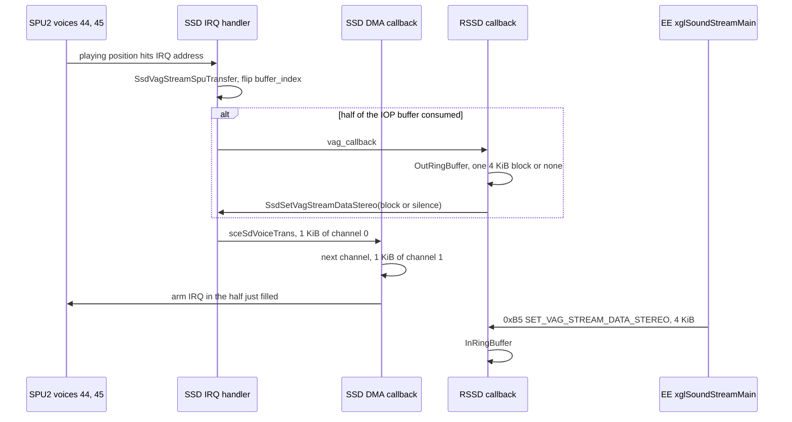

`SsdSetVagStreamDataStereo(source)` asks which IOP half is being transferred
and copies `source` into the other half, or fills it with silent VAG packets
(header `0x020C`) when `source` is null. `SsdStopVagStream(ticks)` fades the
stream master volume to 0, or with 0 ticks stops the chain, cuts the voices
and clears the buffer. Per-channel pitch, volume and pan are set with
`0xBA` to `0xBD`, and a process on the process list runs the master volume
fade.

## 16. RSSD stream rings

The EE sends stream data in 4 KiB chunks whenever it can, but SSD consumes it
at the playback rate. RSSD bridges the two with ring buffers
(`src/audio/rssd/rssdstrm.c`, `rssdring.c`).

`RssdIopStreamWork` holds the stream mode (none, PCM, VAG mono, VAG stereo),
the chunk size and one `StreamChannel` for PCM plus seven for VAG. A
`StreamChannel` has its ring, the chunk size, an `active` flag and a
`drain_count`. A ring (`RingBuffer`) is allocated from IOP system memory: a
16-byte header with the capacity, count and in and out indexes, followed by
`capacity` slots of a 16-byte slot header and `blockSize` bytes of data. The
EE asks for 4 slots of 4 KiB.

The flow of a stereo VAG stream is:

1. `0xB0` INIT_VAG_STREAM_STEREO creates the ring of channel 0 and calls
   `SsdInitVagStreamStereo(chunk, SsdEEVagStreamCallbackStereo, ...)`.
2. `0xB5` SET_VAG_STREAM_DATA_STEREO copies as many whole chunks from the
   packet as the ring accepts, sets `active` and resets `drain_count` to 2. In
   mono mode the same command splits interleaved stereo data into two channels.
3. `0xB7` GET_VAG_STREAM_STATUS_STEREO returns a status word: the SSD stream
   status, bit 1 when the channel is active, and the number of free slots from
   bit 8 up. The EE sends a chunk whenever the free count is not zero.
4. Each time SSD needs data, `SsdEEVagStreamCallbackStereo` pops one block and
   passes it to `SsdSetVagStreamDataStereo`. If the ring is empty, it passes
   null (silence) and counts `drain_count` down. When it reaches 0 the channel
   becomes inactive and message 10 (stream finished) goes to the EE.

The flowchart below shows the ring between the two sides.

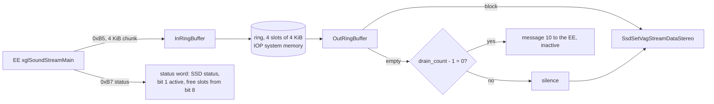

The PCM path works the same way with `SsdSetEEPcmStreamData`,
`SsdGetEEPcmStreamStatus` and `SsdEEPcmStreamCallback`. `0xA8`
CLEAR_RING_BUFFER empties one ring or all of them. `0xB4` STOP_VAG_STREAM
passes its argument to `SsdStopVagStream` as the fade time. With 0, an
immediate stop, it also clears all rings. The source comment of
`SsdStopEEVagStream` calls that argument a channel, which does not match the
code.

## 17. Sampling

Sampling plays sample data sent by the EE at run time, outside any wave bank.
`SsdInitSampling(voices, spu_address, buffer_size)` (`0xD0`) takes up to four
voices starting at voice 43 and reserves them with the allocation word
`0x90000`. It allocates a transfer buffer from IOP system memory and sets up
the sound RAM areas (type 10). `0xD2` transfers data for a voice, `0xD4`
plays it with a pitch, volume and pan, and `0xD5` to `0xD7` stop it and change
its parameters and effects. RSSD reports finished transfers (218) and voices
that stopped (219) to the EE. The sampling voices 43 to 46 overlap the VAG
stream voices 44 to 47, so the two appear not to be meant to run together. The
game code does not use sampling.

## 18. Errors and debug functions

`SsdErrorProc(code, detail)` records an error code and detail in
`SsdWork.errors`, prints them and sets the error flag. `SsdWarringProc` (sic)
records and prints warnings such as "bank already loaded". `SsdSeqErrorProc`
records a sequence error code and sets the error flag without printing, and
the DMA queue uses it when it is full inside an interrupt. `RssdExecFunc` returns the recorded code of each command in
the packet's `error` field. `SsdCheckData` and `SsdGetCheckSum` verify the
signature and the zero word sum of music and effect files.

| Feature | Command | Description |
| --- | --- | --- |
| SPU memory report | `0x100` | `SsdCheckSpuMemory(verbose)` prints "Ssd spu memory check Ver 1.0.1", one line per sound RAM block with its address range, size, type and wave bank id, and the free sizes of sound RAM, the SSD heap and IOP memory. It returns the free sound RAM. The battle code calls it when a bank cannot be sent |
| Voice envelopes | `0x102` | `RssdGetVoiceEnvX` sends the 48 allocation words (with ENVX) and the timer load: processing ticks, interrupt count and timer interval. The two counters are taken and reset every 20 polls, and the same figures are sent in between |
| Sequence information | `0x103` | `RssdGetSeqPlayInfo` sends play ticks, play time, tempo and the time signature counters of a sequence |
| Debug device | `0x200` to `0x205` | A MIDI device for direct tests: open and close it, key on wave patches tagged with a user id, key them off, set hardware effects. `SsdMidiDevSetMidiEvent` is empty |
| Debug effects | `0x300`, `0x301` | Add and play an effect from data in the packet |
| MIDI input | | `ssd_midi.c` decodes raw MIDI events into a device (bank select, modulation, volume, pan, expression, sustain, reverb, RPN and NRPN). The decoder runs every tick, but the entry points that create the device and queue events have no callers in the two recovered modules |

`src/audio/ssd/ssd_data.c` also holds two small built-in images, `drverr_s` (a
`seds` effect file) and `drverr_w` (a wave block with the signature `"wds "`).
No recovered function references them. They are probably fallback data for
missing files.
