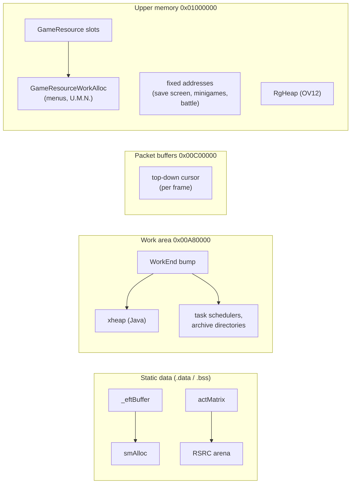
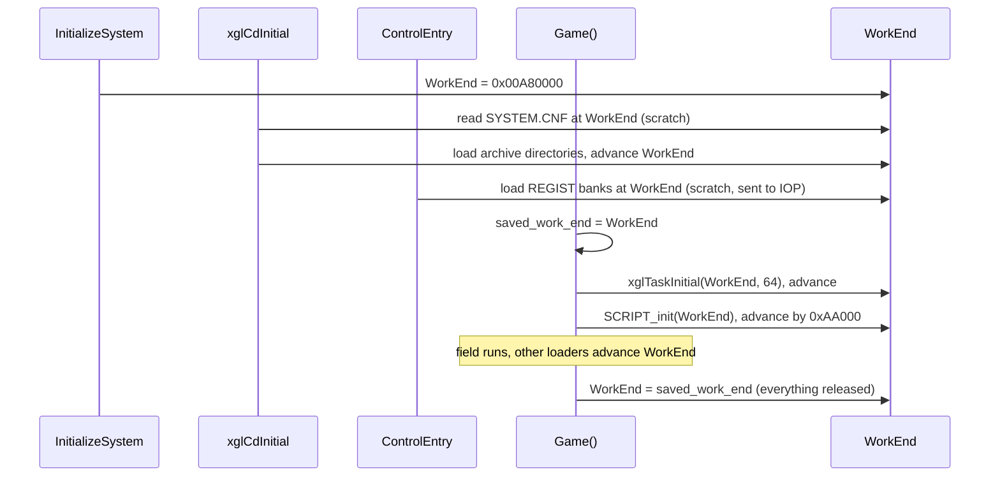
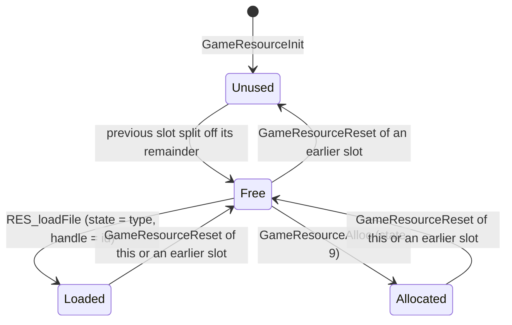
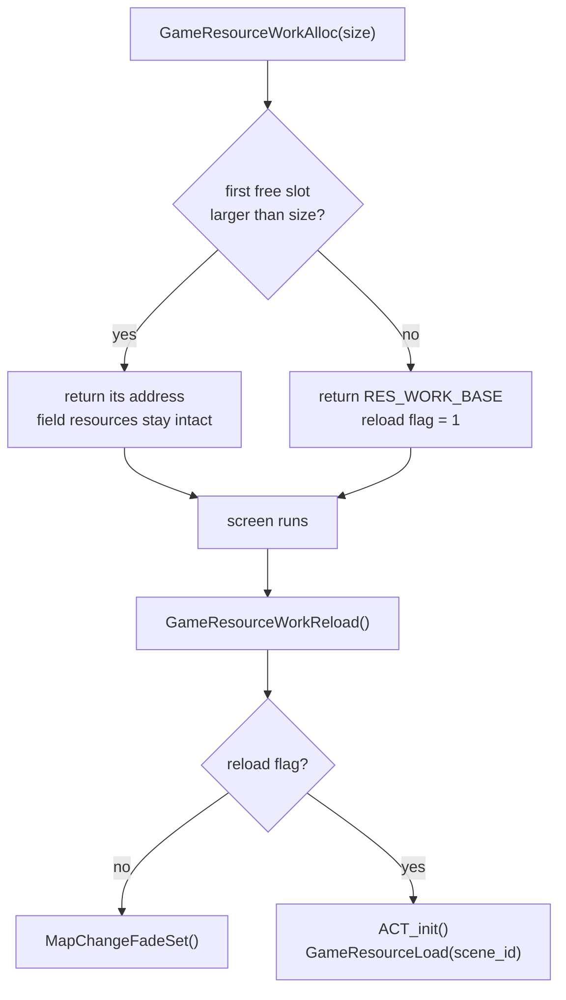
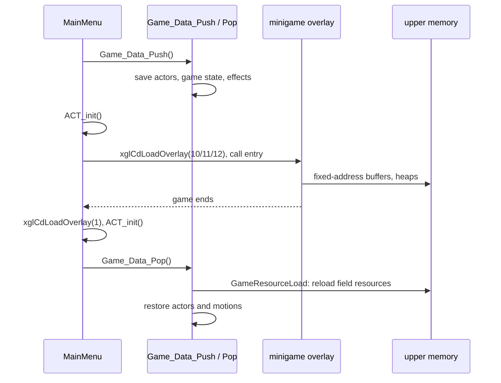
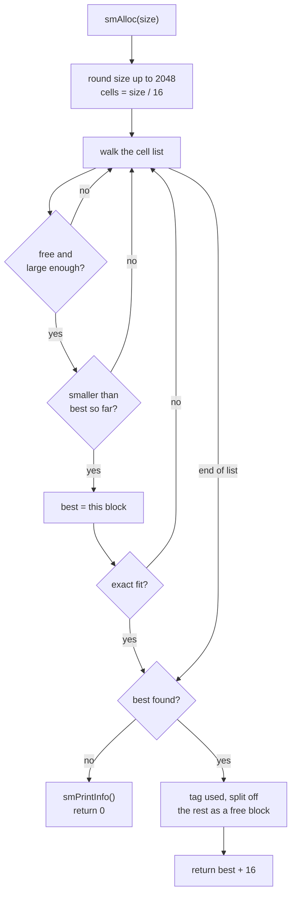

# Memory management

Xenosaga Episode I has no general-purpose heap. The EE's 32 MiB of main
memory is divided by convention: the executable's static data, a slot for the
current overlay, a work area handed out by a bump pointer, two packet buffers,
and an upper 16 MiB that every major mode of the game (field, menus, battle
effects, minigames) reuses in its own way. Most memory is "freed" by putting
a saved pointer back, which releases everything allocated after it at once.

A handful of small allocators exist where the game needs more than that: the
resource table `GameResource` for field data, the best-fit pool `smAlloc` of
the effect system, the Java object heap `xheap`, the `RSRC` arenas and the two
heaps of the A.G.W.S. Battle overlay. The IOP and the sound chip have memory
of their own, managed by the IOP modules.

[← Back to the overview](../README.md)

## The EE memory map

The main executable `SLUS_204.69` is loaded at `0x00200000`. Its code segment
(`.text`) ends at `0x00338570`. The data segment starts at `0x00338600` and
holds `.data`, `.rodata`, `.sdata`, `.sbss` and `.bss`. With the uninitialized
`.bss` (about 4.8 MiB) it ends at `0x0099D910`. Large static objects live
here: `GameLoopState` (the field game's state, 0x2A030 bytes at
`0x00338680`), the `actor` array (0x29C00 bytes), `SaveData` (0x163B0 bytes at
`0x004917B0`), the actor matrix arena `actMatrix` (768 KiB) and the effect
pool `_eftBuffer` (0xD4800 bytes).

The system thread stacks sit just below the executable. `xglThreadInitial`
in `src/main/xgl_thread.c` hands them out downward from
`XGL_THREAD_STACK_TOP` (`0x001F8000`): 4 KiB each for the render, CD and
studio threads and 64 KiB for the control thread, so the stacks cover
`0x001E5000` to `0x001F8000`. The threads are described in
[xgl.md](../libraries/xgl.md#threads).

The overlay slot starts at `0x00A00000`. Every overlay is linked for that
address (see [the overview](../README.md#2-overlays)). The largest, OV01,
ends at `0x00A5B8F8`. The main ELF also carries OV02 as a third segment linked
at `0x00A00000`, so OV02 is already in the slot when the program starts, and
`xglCdInitial` records it as loaded (`loaded_overlay = 2`).

The work area begins at `0x00A80000` (`WORK_HEAP_START` in
`src/main/control_entry.c`) and is handed out by the bump pointer `WorkEnd`.
It ends where the two 2 MiB packet buffers begin, at `0x00C00000`. Upper
memory, from `0x01000000` to the end of RAM at `0x02000000` (`EE_RAM_END` in
`include/shared.h`), has no single owner. The field puts its resource table
there, and the main menu, the save screen, the minigames and the battle
overlay all overwrite it with fixed-address buffers of their own.

The layout below shows all regions with the file or function that owns each
of them.

```
0x00000000 ┌──────────────────────────────────────────┐
           │ EE kernel                                │
0x001E5000 ├──────────────────────────────────────────┤
           │ thread stacks (grow down)                │ xgl_thread.c
           │  control 64 KiB, studio/CD/render 4 KiB  │
0x001F8000 ├──────────────────────────────────────────┤
           │ (not assigned by game code)              │
0x00200000 ├──────────────────────────────────────────┤
           │ .text: SCE libraries, game code,         │ runtime-libraries.md
           │ newlib, fdlibm, libgcc                   │
0x00338600 ├──────────────────────────────────────────┤
           │ .data .rodata .sdata                     │
           │  GameLoopState, actor[], SaveData, ...   │
0x004DC500 ├──────────────────────────────────────────┤
           │ .sbss .bss                               │
           │  actMatrix, _eftBuffer, MenuWorkEndTop   │
0x0099D910 ├──────────────────────────────────────────┤
           │ (unused)                                 │
0x00A00000 ├──────────────────────────────────────────┤
           │ overlay slot: OV01 / OV02 / OV10 /       │ xglCdLoadOverlay
           │ OV11 / OV12 (OV01 ends at 0x00A5B8F8)    │
0x00A80000 ├──────────────────────────────────────────┤
           │ work area, WorkEnd grows up              │ control_entry.c
           │  archive directories, task schedulers,   │
           │  Java heap and class images, ...         │
0x00C00000 ├──────────────────────────────────────────┤
           │ packet buffer 0 (2 MiB)                  │ xgl_packet.c
0x00E00000 ├──────────────────────────────────────────┤
           │ packet buffer 1 (2 MiB)                  │
0x01000000 ├──────────────────────────────────────────┤
           │ upper memory, reused by mode:            │
           │  field: player block, then the resource  │ res_get_path.c
           │  table, scene archive at the very top    │
           │  menus: GameResourceWorkAlloc blocks     │ window_tex_load.c
           │  save screen: staging at 0x01000000      │ file.c
           │  minigames and battle: fixed addresses   │ ov01, ov10, ov12
0x02000000 └──────────────────────────────────────────┘
```

The table lists the allocation schemes the rest of this page describes, and
the diagram after it shows which scheme serves which region.

| Scheme | Region | Freed by | Section |
| --- | --- | --- | --- |
| `WorkEnd` bump pointer | `0x00A80000`–`0x00C00000` | restoring a saved `WorkEnd` | [The work area](#the-work-area-and-workend) |
| `GameResource` slots | upper memory | `GameResourceReset(slot)` | [The resource table](#the-resource-table) |
| `MainMenuWorkEnd`, `UmnWorkEnd` | a `GameResourceWorkAlloc` block | leaving the screen | [Menu and U.M.N. work areas](#menu-and-umn-work-areas) |
| fixed addresses | upper memory | reloading the field afterwards | [Minigames and the battle overlay](#minigames-and-the-battle-overlay) |
| `smAlloc` best fit | `_eftBuffer` (static) | `smFree` | [smAlloc](#smalloc-the-effect-pool) |
| `xmalloc` bump + frames | first 256 KiB of the Java area | `xheap_pop` | [xheap](#xheap-the-java-heap) |
| `RSRC` arena | `actMatrix` (static) and others | inactive items, `RSRC_dispose` | [RSRC arenas](#rsrc-arenas) |
| `RgHeap` best fit | `0x01000000`–`0x02000000` in OV12 | `RgHeapFree` | [OV12 heaps](#the-ov12-heaps) |
| packet top-down cursor | packet buffers | reset every frame | [Packet buffers](#packet-buffers-as-frame-memory) |
| fixed offsets | scratchpad `0x70000000` | not managed | [The scratchpad](#the-scratchpad) |



## The work area and WorkEnd

`WorkEnd` is a single global pointer, `u8 *WorkEnd` in
`src/main/control_entry.c`. `InitializeSystem` sets it to `0x00A80000` after
loading the IOP modules. From then on it marks the first free byte of the work
area. A loader that wants memory reads its data at `WorkEnd` and moves the
pointer past it. `Enemy_SystemInit` is a typical user:

```c
AdrsEnemySpline = WorkEnd;
WorkEnd += xglCdReadFile(enemySplinePath, WorkEnd, 0, 0);
```

`xglCdReadFile` reads whole 2,048-byte sectors and returns the size rounded
up to them, so every file takes a whole number of sectors in the work area.
`Enemy_SystemInit` reads `enemy.dat` (11,332 bytes) first and gets 12,288
bytes for it at `AdrsEnemyPreset`. This block is the preset area that the
scene command `loadene` later fills with another preset, and the largest
preset, `people01.dat` (11,364 bytes), still fits in it (see
[Field enemy presets](../formats/maps-and-field-data.md#loading)).

Nothing is ever freed block by block. A part of the game that wants to
release its memory saves `WorkEnd` when it starts and writes the saved value
back when it ends. `Game()` in `src/main/game.c` does this for a whole play
session: it stores `WorkEnd` in `GameLoopState.saved_work_end` before it
builds anything, and restores it when the game loop is left. Everything the field placed in the work area is
then gone at once.

`WorkEnd` is also used as scratch space without being moved. Several readers
put temporary data at `WorkEnd` and leave the pointer where it was, so the
next user simply overwrites it. `xglCdInitial` reads `SYSTEM.CNF` there before
copying 80 bytes of it to `system_cnf`. `ControlEntry` loads the `REGIST`
sound banks there, and `GameCFSoundReload` loads the field's common effect
bank there, before they are sent to the IOP. `xglArxExtract` copies its
30-word decode table to the first 64-byte boundary after `WorkEnd`, and
`xglCdGetFilePos` reads 16-byte file headers there. The rule for any code
that runs while others use the work area is therefore simple: data at
`WorkEnd` is only valid until the next load.

The work area fills in a fixed order. During start-up, `xglCdInitial` loads
the directories of the disc archives at `WorkEnd` and moves the pointer past
them, so they stay in memory for the whole game. `Game()` then builds the
field in the work area: a task scheduler of 64 entries
(`xglTaskInitial(WorkEnd, 64, 0)`), the Java system (`SCRIPT_init`) and other
field data such as the enemy splines (`Enemy_SystemInit`) and the radar.
`SCRIPT_init` in `src/main/script.c` takes a fixed block for the Java VM.

```
WorkEnd on entry to SCRIPT_init
  +0x00000  Java heap (xheap), 0x40000 bytes         JNI_initSystem
  +0x40000  system.evt buffer, 0x8000 bytes
  +0x48000  base.evt buffer, 0x8000 bytes
  +0x50000  class image of script DB 0, 0x2D000 bytes
  +0x7D000  class image of script DB 1, 0x2D000 bytes
  +0xAA000  new WorkEnd
```

The two class images hold the compiled Java classes of the current and the
next event script. The largest script volume on the disc, `SCE03003D.evt`
(171,810 bytes), reads as 84 sectors and fits its 0x2D000-byte (184,320)
buffer. `system.evt` (31,766 bytes) reads as 16 sectors and fills its
0x8000-byte buffer exactly, and `base.evt` (15,485 bytes) uses half of its
buffer. The volumes are described in
[Scene volumes](../formats/scripts-and-archives.md#scene-volumes) and
[The library volumes](../formats/scripts-and-archives.md#the-library-volumes),
the Java VM and its class databases in [java-vm.md](../scripting/java-vm.md).

The sequence below shows how `WorkEnd` moves from boot to the field and back.



Other screens use the same pattern with their own pointer. The main menu has
`MainMenuWorkEnd`, the U.M.N. has `UmnWorkEnd`, and the save screen carves its
tasks from a local `task_work` pointer. These are described in
[Menu and U.M.N. work areas](#menu-and-umn-work-areas).

## The resource table

The field game keeps its models, maps, motions, textures and effects in upper
memory, managed by the resource table in `src/main/res_get_path.c`. The table
is `GameResourceEntry GameResource[128]` (`GAME_RESOURCE_COUNT`), a static
array at `0x00366620`.

| Field | Type | Meaning |
| --- | --- | --- |
| `address` | `unsigned char *` | Start of the block |
| `size` | `int` | Size of the block in bytes |
| `handle` | `int` | Resource id of a loaded block, or a random token from `xglSRand()` for a raw allocation |
| `state` | `int` | `-1` (`GAME_RESOURCE_FREE`) for a free block, otherwise the resource type (`RES_TYPE_*`) |

The slots describe consecutive extents of one memory range. Slot `n + 1`
starts where slot `n` ends, and the last used slot is followed by one free
slot that holds all the remaining space. A slot with a zero address is
unused. There is no free list and no search for a hole: new data always goes
into the first free slot.

`Game()` calls `GameResourceInit(0x01000000, 0x01000000)`, so the table
covers all of upper memory. `GameResourceInit` marks every slot free, gives
slot 0 the whole range and calls `GameResourceReset(0)`. It also clears the
first word of the six fixed player buffers (see below) so that the next
player load cannot mistake old data for valid data, and installs the read
callback `GameResourceReadFileCallback`, which simply calls `xglSleep()`.

Memory is taken from the table in three ways:

- `RES_loadFile(slot, type, id, flags)` reads a resource into the address of
  `slot`. It rounds the loaded size up to 64 bytes and, when the next slot is
  still unused, splits the rest of the space into slot `slot + 1`. It then
  stores the type in `state` and the id in `handle`. With
  `RES_LOAD_ANY_BLOCK` (`-1`) as the slot, it first calls
  `GameResourceSearch(type, id)` and returns the existing block when the
  resource is already loaded. A model with joints and a model without joints
  match each other, so a model is not loaded twice.
- `GameResourceAlloc(size)` takes a raw block of `size` bytes (rounded to 64)
  from the first free slot and splits the rest off in the same way. The block
  gets `state` 9 (`RES_TYPE_ALLOC`) and a random `handle`.
- `GameResourceRealloc(address, size)` grows or shrinks a block by moving the
  boundary with the free slot that follows it. It fails when the next slot is
  not free.

There is no way to free one block. `GameResourceReset(slot)` frees `slot` and
every slot after it, merges their space into `slot` and clears the eight enemy
sound-effect banks. A scene script therefore frees memory by naming the
first slot it wants to rebuild. The scene script commands are described in
[files-and-resources.md](files-and-resources.md#scene-resource-scripts).

The first two slots are reserved for the party leader.
`GameCfPlayerLoadResource` in `src/main/look_at_player.c` allocates slot 0
with `PLAYER_RESOURCE_SIZE` (`0x12A000`) bytes and slot 1 with zero bytes.
Slot 0 holds the leader's files at fixed addresses, and scene resources start
in slot 2 at `0x0112A000` (`RES_WORK_BASE`).

```
0x01000000  slot 0: player block (0x12A000 bytes)
            0x01000000 leader model (.lex)
            0x01070800 leader texture (.xtx)
            0x010B1000 leader joints (.jnt)
            0x010B4000 face model (.lex)
            0x010E6000 face joints (.jnt)
            0x010E7000 leader motion pack (.fpk)
0x0112A000  slot 1: empty marker block (size 0)
0x0112A000  slot 2..n: scene resources, loaded in script order
            ...
            last slot: free space
EE_RAM_END - size of the .a file: scene archive (while a scene loads)
0x02000000
```

A scene archive takes from 1,873,152 bytes (`cf1059.a`) to 10,510,272 bytes
(`cf1800.a`) at the top of memory while its scene loads. `next_arc_size`
copies the archive's end-offset table into the static array `archeader`,
which has room for 63 entries. Fifteen archives have more, and their tables
run past the array into `GameResourceWorkReloadTable` (see
[Borrowing the resource area](#borrowing-the-resource-area))
and, for `cf1800.a`, into the movie state `mi`. This is probably harmless,
because the reload flag in `GameResourceWorkReloadTable[0]` is written by
`GameResourceWorkAlloc` before `GameResourceWorkReload` reads it (see
[Header overflow](../formats/scripts-and-archives.md#header-overflow)).

Before it reads anything, `GameCfPlayerLoadResource(0)` checks the first word
of each fixed buffer for its file tag (`lex`, `XTX`, `JNT`, `FPK`) and
compares the character id and costume with the last load. When all of them
match, the files are still valid and nothing is read. This check is what lets
other screens overwrite the player block freely: they only have to call
`GameCfPlayerLoadResource` when they end.

`GameResourceGetFreeAddr()` returns the address of the first free slot, but
never an address below `RES_WORK_BASE`. Code uses it as a temporary buffer
that does not disturb loaded resources. `Intermission` decodes its chapter
picture there, and the leader's foot-step sound bank is read there before it
is sent to the IOP.

`GameResourceDump` prints a page of the table with the debug font. The debug
menu in `src/main/game_debug_menu.c` calls it. The test screens
(`karakama_test.c`, `endou_test.c`, `hair_test.c`, `wind_test.c`) initialize
the table at `0x07000000` with `0x06000000` bytes, an address range that only
exists on development hardware with 128 MiB of memory.

The state diagram below shows the life of one slot.



### Borrowing the resource area

Screens that run on top of the field, such as the main menu, need several MiB
of memory for a short time. They ask for it with
`GameResourceWorkAlloc(size)`. When the first free slot is larger than
`size`, it returns that slot's address, and the screen's data fits behind the
loaded field resources. Otherwise it returns `RES_WORK_BASE` and sets a flag
in `GameResourceWorkReloadTable[0]`. The screen then overwrites the scene
resources.

When the screen closes, `GameResourceWorkReload()` checks the flag. If it is
set, it calls `ACT_init()` and `GameResourceLoad(GameLoopState.scene_id)`,
which runs the current scene's resource script again and reloads everything
from disc. If it is not set, the field data was never touched, and only a
map-change fade is started. The users are the main menu (`0x500000` bytes),
the U.M.N. (`0x480000` bytes), the shop, the game-over screen, the field
movie player and the `tya` helpers.

The flowchart below shows the decision.



## Menu and U.M.N. work areas

`MainMenu()` in `src/main/window_tex_load.c` takes `MENU_WORK_SIZE`
(`0x500000`) bytes with `GameResourceWorkAlloc` and stores the address in
`MenuModelWorkTop`. The first `0x480000` bytes become the menu model pool
(`MenuModelMemoryInit`). The rest is handed out by the bump pointer
`MainMenuWorkEnd`, in this order: menu model records, the background task,
two task schedulers (`MenuTask` with 32 entries and `MenuTask_XMX` with 16),
a 0xD00-byte U.M.N. database area, the background model, the map name texts
and the formation data. The main menu itself is described in
[main-menu.md](../game/main-menu.md).

```
MenuModelWorkTop (from GameResourceWorkAlloc, 0x500000 bytes)
  +0x000000  menu model pool, 0x480000 bytes   MenuModelMemoryInit
  +0x480000  MainMenuWorkEnd grows up:
             model records, background task, MenuTask, MenuTask_XMX,
             UmnGunoDataBaseTop (0xD00), back model, map texts, formation
```

A second, static block serves the menu's sub-screens. `MenuWorkEndTop` is a
64 KiB array in `.bss`. `MenuWorkEndGet()` clears it and returns its address.
The save screen builds its `FileWork` record and its task scheduler there.

The U.M.N. (in OV02) uses an arena of `UMN_ARENA_SIZE` (`0x480000`) bytes.
When it is opened from the main menu (`UmnMain`), it reuses the main menu's
block at `MenuModelWorkTop`. When it is opened directly for a mail
(`UmnMain2`), it takes its own block with `GameResourceWorkAlloc`. `UmnInit`
in `src/ov02/tsk_umn_object_task_main.c` divides the arena with fixed
offsets.

```
UmnMemory (0x480000 bytes)
  +0x000000  load buffer for the U.M.N. sound bank and sequence,
             then tyaUmlDispInit2 data
  +0x180000  background cube texture (UmnBgCubeXtx)
  +0x190000  background cube model (UmnBgCubeLex)
  +0x1A0000  U.M.N. textures (UmnTexAddr)
  +0x1E0800  UmnWorkEnd grows up: two task schedulers, interface,
             background cube, windows, mail headers, history tree,
             event text buffer
  +0x220800  menu model pool, 0x200000 bytes
```

The U.M.N. screens are described in [umn.md](../game/umn.md).

## Minigames and the battle overlay

The minigame overlays take upper memory without asking. Before one starts,
`MainMenu()` saves the field and frees the actors:

1. `Game_Data_Push()` copies the `actor` array into
   `GameLoopState.saved_actors`, purges the field sound banks, saves the game
   state (`GameStateSave`) and the effect state (`sefPushEffect`), and records
   which model parts were hidden.
2. `ACT_init()` resets the actors and the actor matrix heap.
3. `xglCdLoadOverlay(n)` loads OV10, OV11 or OV12, and its entry point runs.

The overlay then uses fixed addresses in upper memory. Xeno Card (OV10) reads
the card table `card.dat` to `0x01000000`, the card pictures `CARDGRAP.BIN` to
`0x0100C000`, the card models to `0x016F8100` to `0x01716600`, the board and
effect files to a model arena from `0x01900000`, 62 small layouts to
`0x01C80000` and the hand to `0x01DA0000`. Only one pair of these loads
overlaps: `effect\atac_a.bin` (`0x13380` bytes at `0x01A01000`) loses its last
`0x380` bytes to `effect\atac_b.bin`, which `cgp.c` reads right after it to
`0x01A14000` (see
[How the overlay reads its files](../formats/minigame-data.md#how-the-overlay-reads-its-files)).
A.G.W.S. Battle (OV12) installs two heaps over all of upper memory (see
[The OV12 heaps](#the-ov12-heaps)). When the minigame returns, `MainMenu()`
loads OV01 again, calls `ACT_init()` and `Game_Data_Pop()`. `Game_Data_Pop`
reloads the field sound and effects, calls
`GameResourceLoad(GameLoopState.current_event_id)`, which reloads every field
resource from disc, and then restores the actors and their motions.

The sequence below shows the whole round trip.



The battle overlay OV01 stays resident during play and shares upper memory
with the field. It keeps some buffers at fixed addresses too: the battle
stage, the battle movie player's arena and the encounter effect's grid and
objects. `dataMapLoadAdrGet` returns `0x01B9E000` for every battle stage
`mapNNN.bin`, the same address as the movie arena (`MV2_ARENA_BASE` in
`src/ov01/m_mv2.c`). A battle that plays a movie therefore hides the stage,
plays the movie and reads the stage file again when it ends. The largest
stage, `map043.bin` (1,788,832 bytes), ends at `0x01D52BA0`, below the
encounter grid and objects at `0x01D9E000` and `0x01DBF840`
(`src/ov01/entry_first_init.c`). The stage layout is described in
[Battle stage files](../formats/maps-and-field-data.md#battle-stage-files),
the battle system in [battle.md](../game/battle.md).

## Allocators with real free

### smAlloc, the effect pool

`src/main/sm_initilize.c` implements a small best-fit allocator. The effect
system uses it to hold effect images. `sefInitEffect` in `src/main/sef.c`
gives it the static array `_eftBuffer` of `0xD4800` bytes:

```c
smInitilize(_eftBuffer, SEF_EFFECT_BUFFER_SIZE);
```

The pool is divided into 16-byte cells. Every block, free or used, starts
with one `MemCell` header cell. The headers form a doubly linked list in
address order.

| Field | Meaning |
| --- | --- |
| `tag` | `0x1234` (`MC_TAG_FREE`) or `0x5678` (`MC_TAG_USED`) |
| `cellCount` | Number of 16-byte cells after the header |
| `prev`, `next` | Neighbouring blocks in address order |

`smAlloc(size)` rounds the size up to 2 KiB (`SM_ALLOC_ALIGNMENT`), so every
block is a whole number of disc sectors. It walks the list and keeps the
smallest free block that is large enough, stopping early on an exact fit. The
rest of the chosen block becomes a new free block. When nothing fits, it
prints the pool statistics (`smPrintInfo`) and returns 0. `smFree(pointer)`
marks the block free and merges it with a free neighbour on each side.

```
_eftBuffer
┌────────┬──────────────────┬────────┬────────────┬────────┬─────────
│ MemCell│ used block       │ MemCell│ free block │ MemCell│ used ...
│ 0x5678 │ (n x 2 KiB)      │ 0x1234 │            │ 0x5678 │
└────────┴──────────────────┴────────┴────────────┴────────┴─────────
  16 B                        16 B                  16 B
```

The users are the effect lookup in `src/main/srs.c`, `src/main/sef.c` and
`src/main/sv_get_image_item.c`. `srs.c` takes fixed blocks for the effect
packs: `0x25800` bytes for the common battle pack `default.esp` (144,640
bytes), `0x3E000` bytes for the common field pack `cf_def.esp` (248,704
bytes, the largest pack), `0x12800` bytes for the weapon effects of one
character and `0x12000` bytes for one enemy combo. A single `.esd` effect
file gets a block of its own file size. The files are described in
[Effect data files](../formats/effects.md), the effect system in
[sef.md](../libraries/sef.md).

The flowchart below shows `smAlloc`.



### xheap, the Java heap

The Java VM allocates its objects from `xheap` (`src/main/xheap.c`).
`SCRIPT_init` passes the first `0x40000` bytes of its work block to
`JNI_initSystem`, which installs them as the heap. Each block has a 12-byte
header (`xheap_block`).

| Field | Meaning |
| --- | --- |
| `next` | The next block, which is also the next free byte |
| (+4) | Not used by the heap functions |
| `category` | Owner category, 0 = free. The low 5 bits select one of 32 accounting buckets |
| `size_words` | Payload size in 32-bit words |

Despite its `xfree` function, `xheap` is a bump allocator. `xmalloc(size,
category)` rounds the size up to a word, places the new block at
`freeBlock->next` and makes it the new `freeBlock`. `xfree(pointer)` only
sets the block's category to 0. The space is not reused.

Memory is reclaimed in frames. `xheap_push()` saves the current `freeBlock`
and the current Java thread (`jthreadCurrent`) on a frame stack that grows
down from the end of the heap. `xheap_pop()` restores both, which drops every
block allocated since the matching push, and then calls `reloadConstString`
and `reloadClassEntry` so that the string and class caches forget entries
that lived above the restored point. `xheap_init` empties the whole heap.
`xheap_info` and `infoMemory` total the live blocks per category for the
debug display.

```
heap_top                                                    heap_top + heap_size
┌──────┬──────┬──────┬──────┬──────────── free ───────────┬─────────────┐
│ blk  │ blk  │ blk  │ blk  │                              │ frame stack │
└──────┴──────┴──────┴──┬───┴──────────────────────────────┴──────▲──────┘
                        freeBlock (last block)                    frames
                        new blocks go to freeBlock->next          grow down
```

How the VM uses frames is described in
[java-vm.md](../scripting/java-vm.md).

### RSRC arenas

`src/main/rsrc.c` manages "resource arenas": one block of memory with a heap
at the bottom and an item table at the top. `RSRC_create(memory, size,
capacity)` lays the block out and returns the manager.

```
memory                                                       memory + size
┌──────────────── heap (grows up) ──────────┬────────────────┬────────────┐
│ item data, 16-byte aligned                │ RsrcItem table │ RsrcManager│
│                       heap_cursor ▲       │ (capacity x16) │ (0x20)     │
└───────────────────────────────────────────┴────────────────┴────────────┘
heap_origin                        heap_bound = start of the item table
```

Each `RsrcItem` describes one piece of data: its `size`, a `kind` (an
anonymous allocation or a file), `flags`, a `data` pointer and a `key`, which
is either a file name or a number the owner chose. `RSRC_alloc(manager, size,
key)` first looks for an inactive item that is large enough
(`RSRC_getDirtyItem`) and reuses its space. Otherwise it appends a new item
and takes the space from the heap. The data is always cleared.
`RSRC_inactiveSource(manager, key)` marks every item with that key inactive,
which is how an owner frees all its blocks at once. `RSRC_dispose` compacts
the arena: items flagged as selected are moved down to the heap origin, and
all others are dropped.

The main user is the actor matrix heap. `ACT_matrixInit` in
`src/main/act_1.c` builds a manager by hand over the static array `actMatrix`
(`0xC0000` bytes) with its own table of 64 items. `ACT_allocMatrix` and
`ACT_allocBlock` take an actor's joint matrices from it, keyed by the actor,
and deleting an actor calls `RSRC_inactiveSource` so its matrices can be
reused. `JS_init` (`src/main/js_init.c`) takes its class and primitive tables
from an arena too. `RSRC_loadFile` reads a file with `sceOpen` into an arena
and files it under its name. Its only caller, a script tool in
`src/main/script.c`, uses an arena (`rcFile`) that no recovered code creates,
so file loading is probably a development feature. Actors are described in
[actors.md](../libraries/actors.md).

### The OV12 heaps

The A.G.W.S. Battle overlay brings its own allocator, `RgHeap`, in
`src/ov12/rg_heap.c`. `xrg_sysinit.c` creates two heaps over upper memory: a
1 MiB "code" heap at `0x01000000` and a 15 MiB data heap at `0x01100000`.
Every block carries a 0x40-byte `RgHeapBlock` header with links (`pre`,
`next`), the `size`, an allocated `mark`, the source file name and line of
the call (`module`, `line`) and a 15-character magic stamp used to detect
overwrites. `RgHeapAlloc` picks the smallest free block that fits and splits
off the rest. Freeing returns the block to an address-ordered free list and
merges it with its neighbours. When the minigame ends, `XrgSystemDispose`
dumps both heaps, clears the code heap and calls `ACT_init`. The overlay's engine is described in
[agws-battle-engine.md](../game/minigames/agws-battle-engine.md).

## Packet buffers as frame memory

The two packet buffers at `0x00C00000` and `0x00E00000` are also the game's
per-frame memory. `xglPacketInit` sets up one `XglPacket` record per buffer.
The DMA chain grows upward from the start of the buffer, and large data that
the chain points to is allocated downward from the top through the record's
`cursor` field. `nmlPacketSetAttributeData` and
`nmlPacketSetAttributeAlloc16N` subtract the requested size from `cursor` and
return the new value.

Once per frame `xglPacketMove` ends the current packet, sets its `cursor`
back to its `limit`, hands it to the DMA and switches to the other buffer. A
buffer therefore always starts the frame it is filled in with an empty top
area. Everything allocated from a buffer stays valid for the frame
being built and the frame being sent, and it is released automatically two
frames later. The packet format is described in
[rendering.md](rendering.md#packets).

```
0x00C00000                                               0x00E00000
┌─ DMA chain (grows up) ─▶            ◀─ attribute data (grows down) ─┐
│ tags, VIFcodes, small data   free     matrices, layouts, copies     │
└───────────────────────────────────────────────────────────────────▲─┘
                                                     cursor, set back to limit
                                                     by xglPacketMove
```

## The scratchpad

The EE has 16 KiB of fast scratchpad memory at `0x70000000`
(`SCRATCHPAD_BASE` in `include/shared.h`). The game has no allocator for it.
Each routine that needs fast temporary space uses fixed offsets of its own:

| User | Offsets | Use |
| --- | --- | --- |
| `xgl_jpeg.c` | `+0x0000`, `+0x3000` | JPEG work area and staging |
| `xgl_packet.c` | `+0x0000` | GS register setup data |
| `nml_packet_add.c` | `+0x0010`–`+0x0040`, `+0x1000` | GS records for screen copies |
| `game_defocus.c` | `+0x0000`–`+0x0338` | Defocus and screen filter primitives |
| `tya.c` | `+0x0070`, `+0x0870`, `+0x1070` | Sprite colors, depths and RLE data |
| `jnt.c`, `game_camera.c`, `db_light_write.c` | various | Joint math, camera probes, light editing |
| `end_print.c` | `+0x0000` | Text drawing |

Because the offsets overlap, two of these routines must not use the
scratchpad at the same time. They appear to rely on running at different
points of the frame.

## IOP and sound memory

The IOP has its own 2 MiB of memory. `InitializeSystem` reboots the IOP with
the replacement image `IOPRP24D.IMG`, resets the IOP heap
(`sceSifInitIopHeap`) and loads the Sony modules `sio2man`, `mcman`,
`mcserv`, `padman` and `libsd`, then the game's sound drivers `SSD` and
`RSSD`. The modules allocate their own IOP memory.

The EE allocates IOP memory directly in one place. `xglCdStreamOpen` in
`src/main/xgl_cd.c` takes `sector_count * 2048 + 128` bytes with
`sceSifAllocIopHeap` as the ring buffer of a disc stream, and
`xglCdStreamClose` frees it with `sceSifFreeIopHeap`. Streams are described in
[xgl.md](../libraries/xgl.md#streaming).

Sound data takes a detour through EE memory. A wave bank or sequence is read
into a temporary EE buffer (often at `WorkEnd` or at
`GameResourceGetFreeAddr()`) and then sent to the IOP, which places it in its
own memory or in the 2 MiB of SPU2 sound memory. The SSD driver manages both
with its own allocators. On the EE side, the field only steers where wave
banks go: `GameCFSoundReload` and `GameCFSoundPurge` in `src/main/game.c`
switch the sound segment allocation modes (`SsdSetSegmentAllocMode(0x70000,
0x10000)` or `(0xA8000, 0x10000)`). The details are in
[audio.md](audio.md#segment-allocation-modes) and
[iop-sound-driver.md](iop-sound-driver.md).

A copy of the SSD memory manager (`SsdInitMemoryManager`,
`SsdNewMemoryPtr`) is also linked into the main executable in
`src/main/ssd_4.c`, but no EE code calls it, so it appears to be unused.

## GS memory

The Graphics Synthesizer has 4 MiB of local memory for frame buffers, the
depth buffer and textures. It is laid out with fixed page tables in
`src/main/xgl_render.c`, not with an allocator. The layout is described in
[rendering.md](rendering.md#video-memory).
