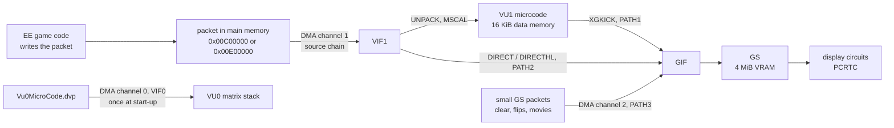
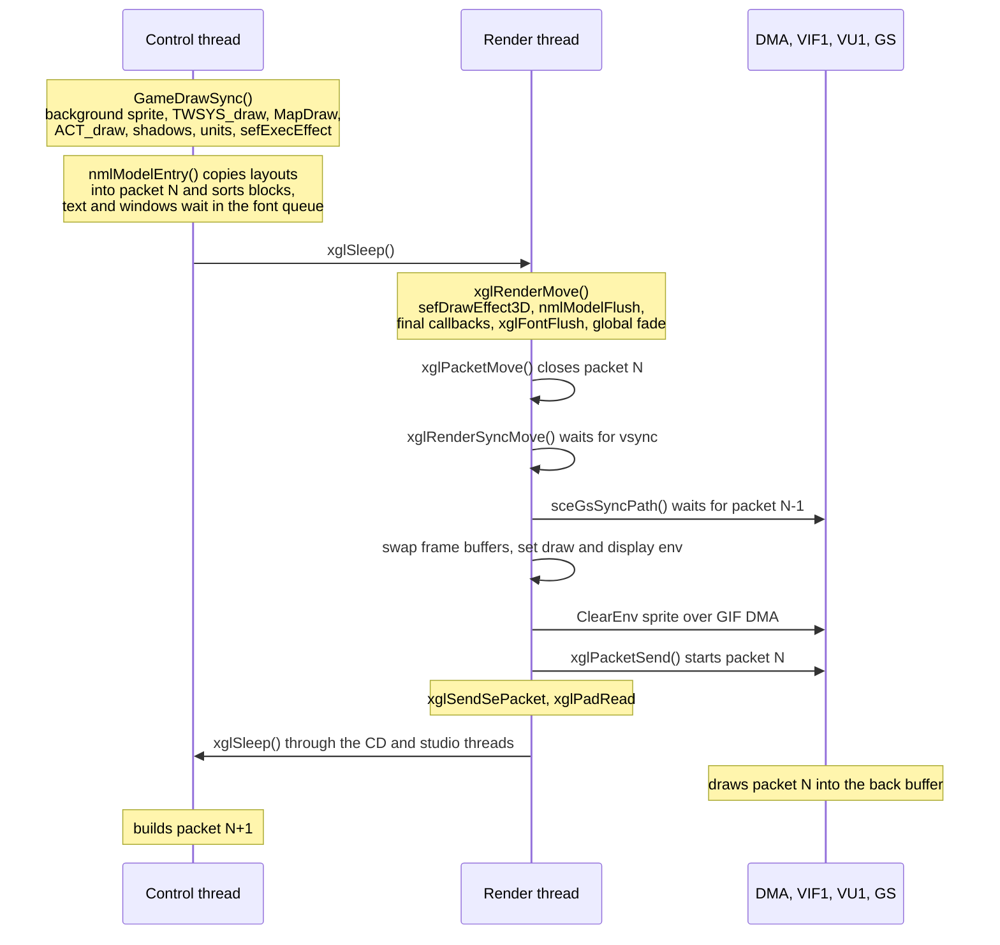
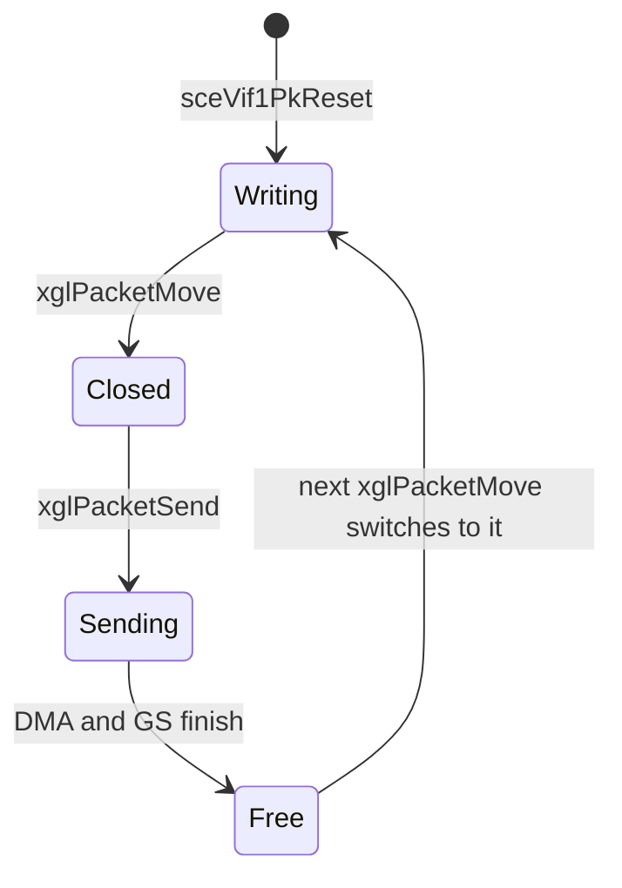
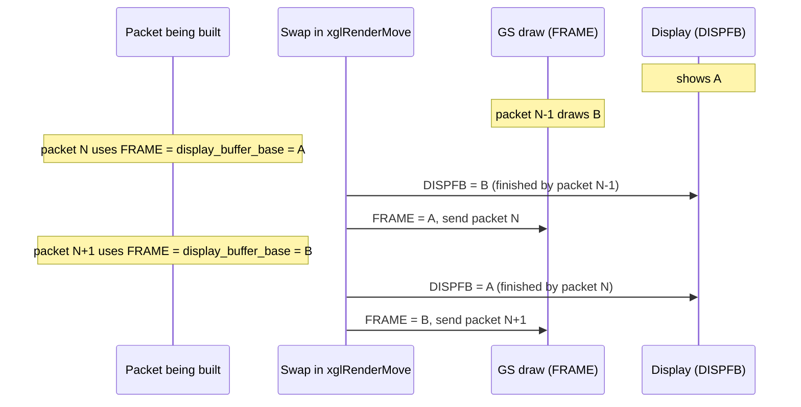
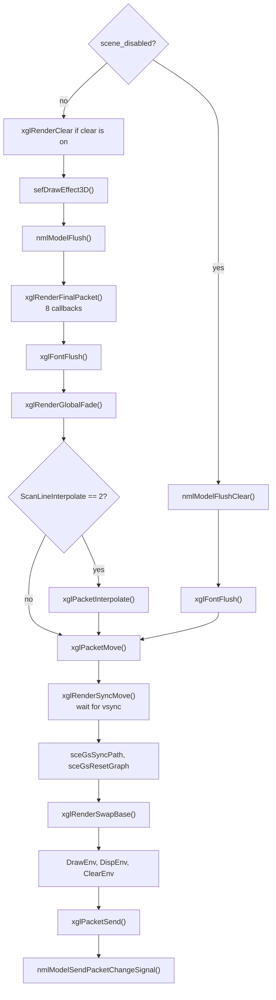
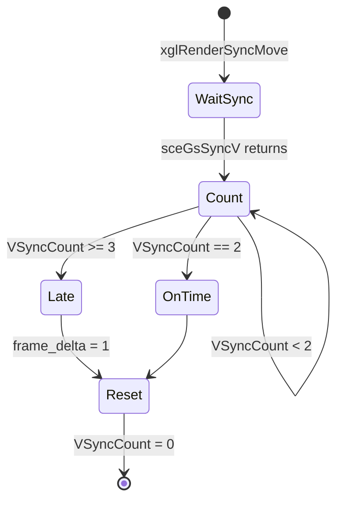
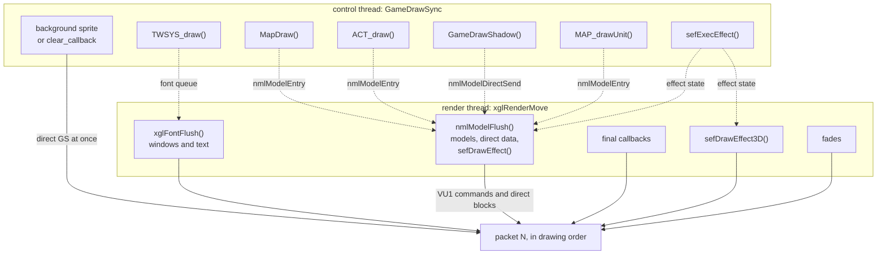
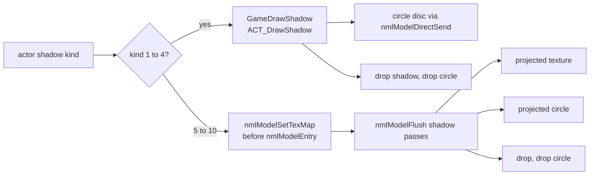
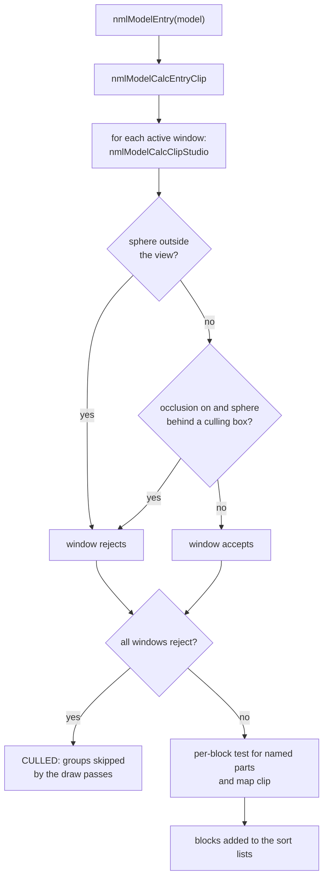

# Rendering pipeline

Every picture of Xenosaga Episode I is built as one long list of GPU commands
per frame, called a packet. The game writes the packet in main memory during
the frame. At the end of the frame the render thread closes it, waits for the
vertical sync, flips the frame buffers and starts a DMA transfer that feeds the
packet to the PS2's vector unit and graphics chip. While the hardware draws
that packet, the game is already writing the next one into a second buffer.

Several engine layers write into the same packet. `nml` draws 3D models through
VU1 microcode, `sef` draws effects, `TWSYS` draws windows, `xglFont` draws text,
and a few small users write raw GS commands. The `xgl` render module ties them
together, owns the frame buffers and the display, and decides when each part
runs. The code is mainly in `src/main/xgl_render.c`, `src/main/xgl_packet.c`,
`src/main/xgl_dma.c`, `src/main/xgl_prim_add.c`, `src/main/game.c` and the
`src/main/nml_*.c` files.

[← Back to the overview](../README.md)

## The hardware path

The PS2 has no single "GPU". Drawing goes through a chain of units. The **EE**
(Emotion Engine) is the main CPU that runs the game code. The **DMA
controller** copies data from main memory to the other units without the CPU.
**VIF1** is the interface in front of vector unit 1. It reads a stream of
VIFcodes and data, unpacks vertex data into VU1 memory and starts VU1
programs. **VU1** is a small vector processor with 16 KiB of data memory. It
runs microcode that transforms and lights vertices and writes ready-to-draw
GS packets into its memory. The **GIF** is the gateway to the **GS**
(Graphics Synthesizer), the rasterizer that owns 4 MiB of video memory and
draws the pixels.

The GIF accepts data from three paths. PATH1 is VU1 itself: the microcode runs
an `XGKICK` instruction that sends a GS packet from VU1 memory. PATH2 is VIF1
in "direct" mode: a `DIRECT` or `DIRECTHL` VIFcode inside the VIF1 stream passes
the following data straight to the GIF. PATH3 is the GIF's own DMA channel,
which sends GS packets from main memory without VIF1.

The game uses all three paths. The model library `nml` uploads vertex data and
matrices with `UNPACK` VIFcodes and calls VU1 programs with `MSCAL`. Even its GS
register changes travel through VU1. `nmlPacketAddGsFlush` unpacks a list of
queued register writes into VU1 memory and calls the `GsKick` entry of the
current microcode, which kicks it to the GIF (see
[nml.md](../libraries/nml.md#vu1-microcode)). The `nml` filters use the same
route for their sprites and strips. Text, windows, fades, the background
sprite, small queued GS blocks and texture uploads are written as direct
blocks inside the same VIF1 packet. A few jobs bypass the packet and send a
small GS packet over the GIF DMA channel at once: the per-frame `ClearEnv` sprite, the frame buffer
copies `xglRenderDrawFlip` and `xglRenderCopyDisp2Draw`, movie frames, the
snapshot code, the HDD code, the OV02 logo, the OV01 `m_mv.c` movie and some
debug tests.

A fourth path feeds VU0, the other vector unit. `xglGeometryInit` uploads the
resident VU0 microprogram `src/main/vu0/Vu0MicroCode.dvp` once through VIF0
(DMA channel 0). That program is a matrix stack used by the EE math code. It
does not draw anything (see [math.md](../libraries/math.md)).

The diagram below shows how the data flows from main memory to the screen.



`src/main/xgl_dma.c` wraps the DMA controller. `xglDmaDirectNormal` starts a
plain transfer and `xglDmaDirectSrcChain` starts a source-chain transfer, which
is how a packet is sent. Both wait until the channel is idle, convert
scratchpad addresses (`0x70000000`) to the DMA's scratchpad flag and set the
channel control register. The module also has small DMA chain helpers
(`xglDmaBufferCnt`, `xglDmaBufferRef`, `xglDmaBufferCall`) and MFIFO helpers,
but nothing outside `xgl_dma.c` uses them.

## Frames across the threads

The game runs four EE threads in a fixed rotation (see the
[overview](../README.md#5-the-four-system-threads)). Two of them take part in
drawing. The control thread runs the game and decides what to draw. The render
thread finishes the frame and starts the hardware.

During its turn, the control thread calls `GameDrawSync` in the field game
(`src/main/game.c`) or similar code in menus and minigames. That code mostly
records draw requests instead of drawing. A few small blocks, such as the
background sprite, are written into the current packet at once. Models are
registered: `nmlModelEntry` copies the model's layout and matrices into the
packet's data area and adds its blocks to sort lists. Shadows and other small
GS blocks are queued with `nmlModelDirectSend`. Window frames and text go into
the font queue. Effects are only updated. `GameDrawSync` ends with
`xglSleep()`, which ends the control thread's turn.

On its next turn, the render thread runs `xglRenderEntry`'s loop: one call of
`xglRenderMove`, then `xglSendSePacket` for queued sound commands, then
`xglPadRead`, then `xglSleep()`. `xglRenderMove` turns the registered models
into VU1 commands, adds the late layers, closes the packet, waits for the
vertical sync, flips the buffers and sends the packet. The hardware then draws
it during the following frame while the game prepares the next packet.

The sequence below shows one frame from the point of view of the two drawing
threads and the hardware.



## Packets

A packet is an `XglPacket` record plus a 2 MiB buffer. The two records live in
`asPacketSource[2]` in `src/main/xgl_packet.c`. Their buffers start at
`0x00C00000` and `0x00E00000`, so the second one ends at `0x01000000`, the
16 MiB mark of the 32 MiB main memory. The record is used through Sony's `sceVif1Pk*`
packet functions, so its first fields follow the SDK's layout.

| Offset | Field | Meaning |
| --- | --- | --- |
| +0x00 | `write_cursor` | Where the next DMA tag or VIFcode is written, growing upward |
| +0x04 | `start` | Start of the buffer and of the DMA chain |
| +0x08 | `directCode` | Address of the open `DIRECT` VIFcode, if a direct block is open |
| +0x0c | `directState` | State of the open direct or unpack block |
| +0x20 | `limit` | Top of the buffer |
| +0x24 | `cursor` | Allocation cursor for attribute data, growing downward from `limit` |

A packet fills from both ends. The DMA chain of tags, VIFcodes and small
inline data grows upward from `start`. Large data that the chain refers to
(model layouts, matrices, clip masks, copies of direct data) is allocated
downward from the top by `nmlPacketSetAttributeData*` and
`nmlPacketSetAttributeAlloc16N`. The chain uses `REF` DMA tags to point at
those blocks, and also at data that already sits in main memory: the
prebuilt VIF stream of each model block (see
[The VIF stream](../formats/models-and-textures.md#the-vif-stream)) and the
pixel data of a texture set, which already carries its own transfer tags (see
[The upload packet](../formats/models-and-textures.md#the-upload-packet)).
The `nml` builders check the gap between the two ends. When the packet is
about to overflow they stop adding blocks and `nmlModelFlush` sets
`sRender.render_status` to 1.

The diagram below shows the layout of one packet buffer while it is being
written.

```
0x00C00000  start  +----------------------------------------+
                   | DMA chain: CNT/REF tags, VIFcodes,     |
                   | UNPACK headers, DIRECT blocks          |
                   |               |                        |
                   |               v  grows upward          |
   write_cursor -> +----------------------------------------+
                   |              free space                |
         cursor -> +----------------------------------------+
                   |               ^  grows downward        |
                   |               |                        |
                   | attribute data: layouts, matrices,     |
                   | clip masks, ProReal data, direct copies|
0x00E00000  limit  +----------------------------------------+
```

`xglPacketInit` sets `limit` and `cursor` of both records to the top of their
buffers. `xglPacketGetCurrent` returns the packet being written in this frame.
At the end of the frame, `xglPacketMove` closes it: it ends the chain
(`sceVif1PkEnd`), terminates it, flushes the data cache so the DMA sees the
writes, resets the finished packet's `cursor` to its `limit`, remembers it as
`pSendPacket`, switches to the other record and resets that one with
`sceVif1PkReset`. A little later `xglPacketSend` starts the DMA with
`xglDmaDirectSrcChain(VIF1, pSendPacket->start)`.

Each buffer goes through the same cycle every two frames, as the state diagram
below shows.



Before the render thread sends a new packet it calls `sceGsSyncPath(0, 0)`,
which waits until the previous transfer and drawing are complete. The two
buffers therefore never overlap in use.

## Video memory

The GS has 4 MiB of local memory. The game addresses it in two units. Frame
buffer and depth buffer bases are given in 8 KiB pages (the GS `FBP` and `ZBP`
fields), and texture bases are given in 256-byte blocks (the `TBP` field). One
page holds 32 blocks.

`xglRenderSetReso` picks one row of two tables in `xgl_render.c`.
`asDispReso[6]` holds the pixel formats and the size: 24-bit depth
(`PSMZ24`), 32-bit color (`PSMCT32`), a width of 640, 512, 448, 384, 320 or 256
pixels and a height of 448 lines. `asVramBase[6]` holds the matching page
numbers. Only `xglRenderInit` calls `xglRenderSetReso`, always with the 512
row, so the game always renders at 512 x 448.

At 512 x 448 one buffer of 32-bit pixels needs 112 pages (`0x70`). The 512
row of `asVramBase` places four such buffers and leaves the rest for textures.
The diagram below shows that layout.

```
 page   block
0x000  0x0000 +--------------------------------------+
              | depth buffer, PSMZ24, 512 x 448      |  112 pages
0x070  0x0E00 +--------------------------------------+
              | frame buffer A, PSMCT32              |  112 pages
0x0E0  0x1C00 +--------------------------------------+
              | frame buffer B, PSMCT32              |  112 pages
0x150  0x2A00 +--------------------------------------+
              | flip buffer, PSMCT32                 |  112 pages
              | captures, back buffer, filters,      |
              | map change cross-fade                |
0x1C0  0x3800 +--------------------------------------+
              | texture area, 512 KiB                |   64 pages
              | model texture sets, circle shadow,   |
              | projected shadow target, font        |
0x200  0x4000 +--------------------------------------+  end of 4 MiB
```

The two frame buffers A and B alternate as draw buffer and display buffer.
The **flip buffer** (`sRender.vram.row.flip_base`, page `0x150`) is a third
full-screen buffer. It never goes to the display in normal play. The game
copies the picture into it and reads it back as a texture, for the
[back buffer](../libraries/nml.md#back-buffer), the
[Gnosis and stealth filters](../libraries/nml.md#filters), the map change
cross-fade and some defocus effects. The **texture area**
(`sRender.vram.row.texture_buffer_base`, page `0x1C0`, block `0x3800`) is shared
by every texture user. See [Textures](#textures) for how it is reused within a
frame.

## Frame buffers and the swap

`sRender` (`XglRenderState`, `0x5C` bytes at `0x004A90E0`) is the render
module's state. Several files declare their own partial view of it with
different field names, so the table lists the names used in
`src/main/xgl_render.c` first.

| Offset | Field | Meaning |
| --- | --- | --- |
| +0x00 | `reso.row` | Depth format, color format, width and height of the chosen resolution |
| +0x08 | `vram.row` | The chosen row of `asVramBase` |
| +0x10 | `vram.row.width` | Page of the buffer that is shown on screen (DISPFB) |
| +0x12 | `vram.row.height` | Page of the buffer the GS draws into (FRAME) |
| +0x14 | `vram.row.flip_base` | Page of the flip buffer |
| +0x1a | `vram.row.texture_buffer_base` | Page of the texture area |
| +0x20 | `display_buffer_base` | Same buffer as +0x10 |
| +0x22 | `draw_buffer_base` | Same buffer as +0x12 |
| +0x24 | `final_packet_callback[8]` | Late packet writers, see [The render step](#the-render-step) |
| +0x44 | `fade_callback` | Writer for the `nml` fades |
| +0x48 | `render_status` | 1 when the last packet overflowed |
| +0x4c | `frame_delta` | 1 when the last frame took three vertical syncs or more |
| +0x50 | `frame_count` | Number of such late frames |
| +0x54 | `frame_status` | 1 when VIF1 or the GIF was still busy at the second sync |
| +0x58 | `scene_disabled` | Skips the scene passes of the render step |

The fields at +0x10 and +0x12 are named `width` and `height` in the source
because they share a structure with the resolution row, but they hold buffer
pages. `xglRenderSwapBase` swaps the pair +0x10/+0x12 and the pair
+0x20/+0x22 in the same way, so +0x10 always equals `display_buffer_base` and
+0x12 always equals `draw_buffer_base`.

The names describe the state between two swaps, while the game builds the
next packet. During that time `display_buffer_base` is the buffer on screen
and `draw_buffer_base` is the buffer that the previous packet is drawing into.
The new packet draws into `display_buffer_base`. This looks backwards, but the
packet only starts after the next swap, and the swap turns the displayed
buffer into the draw buffer. That is why `nmlModelFlush` and the filters set
the GS `FRAME` register to `sRender.display_buffer_base`.

The sequence below follows two frames with the buffers A (page `0x70`) and B
(page `0xE0`).



`xglRenderSwapBase` also adds `frame_delta` to `frame_count` and resets
`render_status`, `frame_delta` and `frame_status` for the new frame.

Three helpers move whole pictures between the buffers with GS local-to-local
transfers (`BITBLTBUF`, `TRXPOS`, `TRXREG`, then `TRXDIR` = 2), 512 x 448
pixels each:

- `xglRenderCopyDisp2Draw` copies the displayed buffer into the draw buffer at
  once over GIF DMA. The game calls it from `game.c` and from `script.c` while
  `sRender.scene_disabled` is set, so the same picture stays on screen after
  the next swap (a frozen frame).
- `xglRenderDrawFlipPk(packet)` adds to a packet a copy from
  `draw_buffer_base` into the flip buffer. When the packet runs, that buffer
  holds the last finished picture, the one on screen. `MapChangeFadeSet` in
  `src/main/map_1.c` uses it to keep the last picture of the old map.
- `xglRenderDrawFlip` exchanges the display base and the flip base and sets
  `FRAME_1` and `FRAME_2` over GIF DMA.

## GS environments

Three small GS register sets are rebuilt or resent every frame. They are
global records in `xgl_render.c`.

**DrawEnv** (`GsDrawPacket`) is a GIF tag with fifteen A+D register writes,
sent by `xglRenderDrawEnvMove` through `sceGsPutDrawEnv` after each swap. It
sets the drawing context for both GS contexts.

| Register | Value |
| --- | --- |
| `FRAME_1`, `FRAME_2` | Draw buffer page (+0x12), width / 64, `PSMCT32` |
| `ZBUF_1`, `ZBUF_2` | Depth buffer page, `PSMZ24` |
| `XYOFFSET_1`, `XYOFFSET_2` | `(2048 - width / 2) << 4` and the same for the height, which centers the screen at GS coordinate 2048 |
| `SCISSOR_1`, `SCISSOR_2` | The whole screen |
| `TEST_1`, `TEST_2` | Depth test on with `GEQUAL` |
| `PRMODECONT` | Use the attributes of the `PRIM` register |
| `TEXA` | Alpha 0x80 for texels with alpha bit 0 and 1 |
| `COLCLAMP` | Clamp colors |
| `DTHE`, `DIMX` | Dithering off, default dither matrix |

The depth test uses `GEQUAL`, so a larger Z value is nearer to the camera. A
depth buffer cleared to 0 is "infinitely far".

**DispEnv** (`GsDispEnv`) holds the display registers. `xglRenderDispEnvInit`
fills it with `sceGsSetDefDispEnv`. Every frame `xglRenderDispEnvMove` sets
`DISPFB1` to the displayed buffer, applies the
[scanline interpolation](#scanline-interpolation) mode, sends it with
`sceGsPutDispEnv` and writes `DISPFB2`, `DISPLAY2`, `EXTBUF`, `EXTDATA` and
`EXTWRITE` directly to the GS. `xglRenderDispOn` and `xglRenderDispOff` turn
read circuit 2 on or off through `PMODE`, which shows or hides the picture.

**ClearEnv** (`GsClearPacket`) is a full-screen sprite with five A+D writes: a
`TEST_1` value, the color, two corners and a final `TEST_1` that restores the
depth test to `GEQUAL`. `xglRenderClearEnvMove` sends it over GIF DMA right
after each swap, before the new packet starts. So every frame begins with this
sprite. Its Z is 0. The first `TEST_1` value selects what it clears.

| Function | TEST value | Effect |
| --- | --- | --- |
| `xglRenderClearFrame` | `0x30003` | Alpha test and depth test always pass, so the sprite writes color and depth |
| `xglRenderClearDepth` | `0x32001` | The alpha test never passes and the fail mode writes depth only |

`xglRenderClearColor(color)` sets the color, which is black (`0x80000000`)
by default. The default target is the full clear. `Game()` switches to
`xglRenderClearDepth` when the field game starts, because the field draws its
own background sprite in `GameDrawSync` (see
[Field scene passes](#field-scene-passes)). The text log screen (`log.c`),
`set_path.c` and some debug test files switch back to the full clear.

## The render step

`xglRenderMove` in `src/main/xgl_render.c` is the render thread's work for one
frame. Its first half adds the late layers to the current packet. Its second
half closes the packet and hands it to the hardware.

1. **Packet clear.** `xglRenderClearOn` sets a counter to 2. The first frame
   only counts it down to 1. From then on, each frame `xglRenderClear` adds a
   full-screen sprite in the clear color with `TEST` `0x71001`, which writes
   color but not depth. `xglRenderClearOff` stops it.
2. **3D effects.** `sefDrawEffect3D` (see [sef.md](../libraries/sef.md)).
3. **Models.** `nmlModelFlush` turns all registered models into VU1 commands
   (see [nml.md](../libraries/nml.md#flush)). When `scene_disabled` is set,
   `nmlModelFlushClear` throws the registered models away instead.
4. **Final packet callbacks.** `xglRenderFinalPacket` calls each non-null
   entry of `sRender.final_packet_callback[8]` with the packet, unless
   `nmlModelIsBackBufferRequest` reports a back buffer request.
5. **Text.** `xglFontFlush` draws all queued text (see
   [xgl.md](../libraries/xgl.md#text)).
6. **Global fade.** `xglRenderGlobalFade`, see [Global fade](#global-fade).
7. **Packet interpolation.** `xglPacketInterpolate` when the scanline mode is 2.
8. **Close.** `xglPacketMove` closes the packet and switches buffers.
9. **Wait.** `xglRenderSyncMove` waits for the vertical sync, see
   [Frame pacing](#frame-pacing). Then `FrameCount` and `LoopCount` advance.
10. **Hardware sync.** `sceGsSyncPath(0, 0)` waits until the previous packet
    has finished. `sceGsResetGraph(1, 0, 0, 0)` then resets the GS drawing
    state (probably the SDK's flush mode, which keeps the video mode).
11. **Swap.** `xglRenderSwapBase` exchanges the buffers.
12. **Environments.** `xglRenderDrawEnvMove`, `xglRenderDispEnvMove` and
    `xglRenderClearEnvMove`.
13. **Send.** `xglPacketSend` starts the DMA of the closed packet.
14. **Signal.** `nmlModelSendPacketChangeSignal` tells `nml` that a new packet
    has started (see [nml.md](../libraries/nml.md#signals)).

Steps 1, 2, 4, 6 and 7 are skipped while `sRender.scene_disabled` is set. Text
is still drawn. The flowchart below shows the same order.



The **final packet callbacks** are hooks for whole-screen post effects that
must come after the models. The slots are fixed by convention:

| Slot | Offset | Writer | Installed by |
| --- | --- | --- | --- |
| 3 | +0x30 | `taskMapChange` | `MapChangeFadeSet` in `src/main/map_1.c`: fades the old map's picture out of the flip buffer over the new map, 4 alpha steps per frame from 0x80 |
| 4 | +0x34 | `DefocusMain` | `GameDefocusCheck` in `src/main/game_defocus.c` while any defocus layer is active (see [sef.md](../libraries/sef.md)) |
| any | | `MenuCfTaiki[i]` | `src/main/window_tex_load.c`, which saves and replaces callbacks for a menu screen |

## Frame pacing

The game runs at 30 frames per second, one frame for every two vertical syncs
of the NTSC display. Pacing is done by the render thread, so every other
thread simply follows it.

`xglRenderInit` installs `xglRenderVSyncCallback` with `sceGsSyncVCallback`.
The callback increments `VSyncCount` on each vertical sync. When the count
reaches 2 and the GIF still has an active path or VIF1 is still busy, it sets
`sRender.frame_status` to 1. That marks a frame whose packet did not finish in
time.

`xglRenderSyncMove` runs after the packet is closed. It waits for the next
vertical sync, then spins until `VSyncCount` is at least 2. If the count is 3
or more, the frame was late and it sets `sRender.frame_delta` to 1, which game
code can read to advance by an extra step. Then it resets the count to 0.
`xglRenderSwapBase` adds `frame_delta` to `frame_count`, so `frame_count`
counts the late frames.

The flag `FLAG_FRAME_60` (defined in `src/main/Undulate.c`) switches to 60
frames per second. `xglRenderSyncMove` then waits for a single vertical sync.
Only a debug page of the pause menu (`pause_menu_page_enemy.c`, the START
button) toggles it, and a few animation and enemy routines check it. The
state diagram below shows the normal 30 fps wait.



## Scanline interpolation

`xglRenderInit` calls `sceGsResetGraph(0, 1, 2, 0)`, which probably selects
NTSC, interlaced, frame mode. In that mode each field shows every other line
of the 448-line buffer, so detail that is only one line thin appears in one
field and not the other, and flickers. The global `ScanLineInterpolate` selects one of three ways to
soften it.

| Value | Name in the source | Method |
| --- | --- | --- |
| 0 | `SCANLINE_INTERP_OFF` | Read circuit 1 off, no softening |
| 1 | `SCANLINE_INTERP_CIRCUIT_BLEND` | Both read circuits show the same buffer, circuit 2 one line higher (`DISPLAY2.DY = DISPLAY1.DY - 1`), merged at 50% (`PMODE.ALP = 0x80`) |
| 2 | `SCANLINE_INTERP_PACKET` | `xglPacketInterpolate` draws the finished frame over itself one line lower, at 50% |

Mode 1 is the default set by `xglRenderInit`. It costs nothing because the
display hardware does the blend. Mode 2 costs one full-screen textured sprite.
`xglPacketInterpolate` adds a `FLUSHE` and a direct block that sets `TEX0_1`
to the buffer being drawn, then draws a sprite that samples it with a
one-line offset (V starts at 1.0) using `ALPHA` `(Cs - Cd) * 0x40 + Cd`, which
is a 50% mix.

The defocus effect of type 9 in `game_defocus.c` switches to mode 2 and uses
the display's write-back circuit (`EXTBUF`, `EXTDATA`, `EXTWRITE`) to capture
the displayed picture into the flip buffer. It restores the previous mode when
the layer ends (see [sef.md](../libraries/sef.md)). The snapshot code in
`game_pause_disp.c` restores the mode from `GameLoopState.scanline_value`, and
the debug menu (`game_debug_menu.c`) can cycle through the modes.

## Global fade

Two fade systems paint over the finished frame. Both run in step 6 of the
render step.

The first is the `nml` fade queue. `sRender.fade_callback` points at
`nmlFadePacketWrite` once an `nml` fade has been set. It draws up to four
active fade-in and fade-out sprites with their own colors and timers (see
[nml.md](../libraries/nml.md#fades)).

The second is the render module's own global fade. `xglRenderGlobalFadeSet(r,
g, b, a)` clamps its arguments to 0..1 and packs them into `s_nGblFade`: the
color as bytes scaled by 255 and the alpha scaled by 128. When the alpha is
not 0, `xglRenderGlobalFade` writes a direct block from the scratchpad that
sets `ALPHA_1` to `(Cs - Cd) * FIX + Cd` with `FIX` = alpha, turns the depth
test to "always", draws one full-screen sprite in the fade color and restores
the `GEQUAL` depth test. `xglRenderGlobalFadeInit` clears the color and the
fade callback. The card game overlay (`src/ov10/card_play_sound1.c`) uses it
directly. The screen masks of `fx_screen_mask` are described in
[sef.md](../libraries/sef.md).

## Field scene passes

In the field, `GameDrawSync` in `src/main/game.c` is the per-frame draw
routine (see [field.md](../game/field.md) for the loop around it). Each pass
can be replaced by a callback in `GameLoopState`, which minigames, events and
special scenes use to change what is drawn.

1. `VibrationEngine`, then `xglStudioMainCameraMove` and `xglStudioMove`
   update the controller vibration and the cameras.
2. `frame_hook(GAME_HOOK_DRAW_BEGIN)` if a hook is set.
3. When `GAME_FLAG_DRAW` is set, the scene passes run:
   - **Background.** `clear_callback` (+0x2c) if set. Otherwise a `REF` to
     `TestEnv_2` adds a full-screen sprite in the `ClearEnv` color with `TEST`
     `0x71001`. The alpha test fails and the fail mode
     writes color only, so the sprite paints the background but leaves the
     depth buffer at 0. Every later pixel still passes the depth test.
   - **Windows.** `TWSYS_draw` (see [ui-windows.md](../libraries/ui-windows.md)).
   - **Map.** `map_draw_callback` (+0x30) or `MapDraw` (see
     [map-and-units.md](../game/map-and-units.md)).
   - **Actors.** `actor_draw_callback` (+0x34) or `ACT_draw` (see
     [actors.md](../libraries/actors.md)).
   - **Shadows.** `shadow_draw_callback` (+0x38) or `GameDrawShadow`, see
     [Shadows](#shadows).
   - **Units.** `unit_draw_callback` (+0x3c) or `MAP_drawUnit`.
   - **Effects.** `sefExecEffect` advances the effect scheduler, unless
     U.M.N. mode or pause is active.
   - **Movie and stream.** `GameMovieMain` and `xglSoundStreamMain`.
   - **Debug tag.** `GameDispTag` when `GAME_FLAG_DISP_TAG` is set.
4. `frame_hook(GAME_HOOK_DRAW_END)` and `GameSnapShotCheck`.
5. `StudioEntrySkip = 1`, then `xglSleep()` ends the turn. While the other
   threads run, the flag probably tells the studio thread that the cameras
   were already moved. After the sleep, `nmlModelSetGlobalFogReset` and
   `StudioEntrySkip = 0`.
6. The frame countdown, then `frame_hook(GAME_HOOK_FRAME_END)`.

The order of the passes is the order of registration, not the order of
drawing. Only the background sprite goes straight into the packet. `MapDraw`,
`ACT_draw` and `MAP_drawUnit` register models with `nmlModelEntry`. The
shadow pass and the movie code queue small GS blocks with
`nmlModelDirectSend`, which `nmlModelFlush` inserts at fixed points between
its model passes (see [nml.md](../libraries/nml.md#direct-data)). `TWSYS_draw`
puts window frames and their text into the font queue, so windows are drawn
by `xglFontFlush`, after all models. `sefExecEffect` only moves the effects.
They are drawn in the render thread by `sefDrawEffect3D` and by
`sefDrawEffect`, which `nmlModelFlush` calls between its passes. The flowchart
below shows where each pass ends up.



### Backgrounds

A scene can replace the map with a generated background. The Java native
`Stage.setCFBG(draw_type, background)` in `src/main/stage_2.c` selects it, and
the code is in `src/main/game_bg_draw_type.c`.

- Type 0 clears both callbacks at +0x2c and +0x30, which restores the default
  background sprite and `MapDraw`.
- Type 1 (`GameBgDrawType1Entry`) installs `GameBgDrawType1`, a field of moving
  particles drawn as direct GIF lines. Particles that leave the screen are
  spawned again.
- Type 2 (`GameBgDrawType2Entry`) installs `GameBgDrawType2`, which sets the
  clear color and draws four rotating textured bands. Its texture is a
  generated star pattern placed at `WorkEnd`.

Both entries store their draw routine in `clear_callback` (+0x2c) and an empty
function in the next slot. `game.c` calls that slot `map_draw_callback`, so the
map is not drawn while such a background is active. `GameBgDrawType0` is an
empty function. `Stage.setBgColor(r, g, b)` sets the clear color through
`xglRenderClearColor`.

## Shadows

Actors get one of several kinds of shadow. Some are flat shapes drawn in the
shadow pass, and others are projections drawn by `nml` during the model flush.
The actor side, including how each actor picks its kind, is described in
[actors.md](../libraries/actors.md).

`GameDrawShadow` calls `ACT_DrawShadowBegin`, then `ACT_DrawShadow` for each
actor in use that has the `SHADOW` flag and not `NO_SHADOW`, then
`ACT_DrawShadowEnd`. None of these functions writes to the packet directly.
They project their vertices on the EE and queue small GS packets with
`nmlModelDirectSend` (modes 1 and 2). `nmlModelFlush` inserts that data right
after the opaque models of the main view, so the shadows land on the ground
that has just been drawn and under any transparent model. Begin and End queue
a head and a tail block that set GS state for the buffer the packet draws
into (`sRender.shadow_state`, the same field as
`display_buffer_base`). `ACT_DrawShadow` switches on the actor's
`shadow_type`:

| Type | Function | Technique |
| --- | --- | --- |
| 1 | `DrawCircleShadow` | A 16-vertex disc under the actor, projected with `xglRotTransPersN` |
| 2 | `DrawZeldaShadow` | Five projected points per ground contact, sent as one small packet (see [actors.md](../libraries/actors.md)) |
| 3 | `DrawDropCircle` | A ring of 8 vertices at ground height with 8 copies below it, drawn as quads back faces first, then front faces |
| 4 | `DrawDropShadow` | Shapes listed per actor kind in `DropShadowDefineTable`, attached to the actor's matrices and flattened onto the ground along the light direction by a "flatten" matrix |
| 0, 5 to 10 | none | Nothing is drawn in the shadow pass |

Kinds 5 to 10 are set up when the actor's model is registered.
`src/main/act_2.c` passes a mode to `nmlModelSetTexMap` before `nmlModelEntry`.
`nml` then draws the shadow during the flush in a dedicated pass (see
[nml.md](../libraries/nml.md#projected-shadows-and-texture-maps)).

| Kind | `nmlModelSetTexMap` mode | `nml` pass |
| --- | --- | --- |
| 5 | `1` | Projected texture (ProReal) |
| 6 | `3` | Projected texture (ProReal) |
| 10 | `0x40001` | Projected texture (ProReal) |
| 7 | `0x10001` | Drop shadow |
| 8 | `0x20001` | Projected circle |
| 9 | `0x30000` | Drop circle |

The **projected texture** shadow first renders the actor's silhouette into
the texture area, then draws the other models inside the shadow's volume a
second time with that texture projected onto them. The **drop shadow** draws
the model again through the layout's projection matrix, which probably
flattens it onto the ground, with a darkening blend (`Cd * As`) and a
destination alpha test. Map units use the same modes through `src/main/map_2.c`, together with
`nmlModelSetShadowMapEntry`. The diagram below sums up the two routes.



## Culling

Two tests keep hidden models out of the draw passes: a view test against
each camera window and an occlusion test against hand-placed boxes. Both run
in `nmlModelEntry`, on the control thread, while the model is registered.
The clip functions live in `src/main/face_point.c`.

The **view test** uses the camera's clip matrices. `_ModelCalcClipInit` loads
them into the VU0 registers `vf12` to `vf19`, and `_ModelCalcClip` tests a
bounding sphere against them. The sphere comes from the layout store's
`center`, with its radius scaled by `entryClipWidthScale`.

The **occlusion test** uses boxes that are built into the executable. The
table `s_aCullingMap` in `face_point.c` has 70 entries, one per map, named
after the map model (for example `MC_UTK05`, `MC_KAS31`, and maps of the
`vok`, `els`, `pro`, `dyu` and `kou` families). An entry holds an optional
list of occluder boxes and an optional list of up to 12 "last entry" block
numbers. `MapReset` in `map_1.c` passes the map's model to
`xglCullingMapSet` (the field is called `culling_map` there, and `MapDraw`
passes the same pointer to `nmlModelEntry`). `xglCullingMapSet` reads the
model's name, skips its first character and looks it up. It then copies up
to 10 boxes into `s_inCulling`, stopping at a record with a negative scale.
Each record is nine floats: a position, a rotation and a scale.
`xglCullingCheck` runs over the boxes. For each one, `setup_occlusion` turns
the box's corners, as seen through the camera's `occlusionTransform`, into
five planes, and `check_occlusion` reports the sphere as hidden when it lies
completely behind the box.

`nmlModelCalcClipStudio(sphere, window)` combines both tests for one camera
window. `nmlModelCalcEntryClip` calls it for every active window (the main
view and the [sub-windows](../libraries/nml.md#sub-windows)) and stores each
result in the layout store. When every active window rejects the model, it
gets the `CULLED` render status. The model is still registered, but its block
groups carry the `CULLED` flag, and the opaque and alpha passes of the flush
skip them. Models without sample points skip the test.
`nmlModelSetClip(1)` turns the clip tests off for one entry. `MapDraw` passes
1 or 2 depending on `GameLoopState.clip_mode`. Blocks of models with named
parts, and all blocks while `nmlModelSetMapClip` is on, are also tested
one by one with `nmlModelCalcClipMat2AllCam`. It sets bit `0x80` in the
block's clip mask when every active window rejects the block, and the block
is then skipped.

`xglCullingIgnore` and `xglCullingIgnoreOff` turn the occlusion test off and
on. The field turns it off while the main menu runs, probably because the
menu shows models that are not part of the map's view. `xglCullingMapInit` clears the
table when the field game ends. `xglCullingMapLastCheck` passes the "last
entry" block numbers of the map to `nmlModelSetMapLastEntry`, so those map
blocks are drawn after the other alpha blocks.

The flowchart below shows the tests for one model.



## Textures

The texture area at block `0x3800` is 512 KiB, much smaller than the
textures of a scene. So textures are not resident. Each user uploads its
texture inside the packet just before it draws with it, and the next user
overwrites the area again. Because the GS executes the packet in order, each
draw sees the texture that was uploaded last.

The users in packet order are:

- **Model texture sets.** `nmlPacketAddTexture` uploads a model's whole
  texture set when it differs from the last one (`s_pCacheTexture`). The
  cache is cleared between passes.
- **Projected shadows.** The silhouette pass renders into the texture area
  as a frame buffer (page `0x1C0`, 512 x 224).
- **Circle shadow.** `nmlPacketSendCircleTexture` uploads a 64 x 64 8-bit
  radial gradient at block `0x3800` and its 16 x 16 palette at `0x3880`.
- **Text.** `xglFontReloadTexture` uploads the kanji texture to block
  `0x3820` (read back as 4-bit texels with a palette at `0x3800` or `0x3801`)
  and the window textures from block `0x3C00`. It runs from `xglFontFlush`,
  after the models. The font files are described in
  [Kanji fonts](../formats/text-and-fonts.md#kanji-fonts).
- **Direct XTX sets.** `nmlModelDirectSendXtx` builds upload blocks for an
  XTX texture set at block `0x3800` and above. The radar
  (`GameRadarDraw`) and the `unit6003_draw` unit use it.

`xglPacketTextureTrans(set)` is the generic upload for an `XglTextureTransSet`.
The set has a count and an offset to its entries. Each entry is 20 bytes: a
size word (width, or width and buffer width), a height, a VRAM offset in
32-bit words from the texture area, a data size in quadwords and a data
offset. For each entry the function adds a `FLUSHE` VIFcode, a direct block
with `sceGsSetDefLoadImage` (`BITBLTBUF`, `TRXPOS`, `TRXREG`, `TRXDIR`) at
`(texture_buffer_base << 11) + vramOffset` in `PSMCT32` format, and a `REF` to
the pixel data. The `REF` adds no tag of its own. In every one of the 1792
entries of the 1269 XTX files on the disc, the pixel data starts with three
`NOP` VIFcodes, a `DIRECT` VIFcode and a GIF `IMAGE` tag, so the file carries
the rest of the transfer itself. The layout is described in
[XTX texture sets](../formats/models-and-textures.md#xtx-texture-sets).

Every rectangle is uploaded as 32-bit pixels, but the models read the same
memory in other formats. The converter pre-swizzled the real textures, mostly
`PSMT8` images with 256-color palettes and a few `PSMT4` images with 16-color
palettes, both with `CSM1` palettes, so that the 32-bit upload leaves them
where the GS expects them in their own format. No texture has mipmaps. How
the addresses line up is explained in
[How a model finds its texels](../formats/models-and-textures.md#how-a-model-finds-its-texels).

The VIF stream of a model block also carries `TEX0` values for its material
changes. Each one comes in two copies: one for the texture area at block
`0x3800` and one for block `0x2A00`, the start of the flip buffer (see
[Video memory](#video-memory)). The CPU cannot rebase these in-stream values
the way it rebases the block header's. Instead the VU1 program picks the
second copy when the textures sit in the flip buffer, which
`nmlPacketAddScreen` signals in lane w of the screen offset. See
[Material batches](../formats/models-and-textures.md#material-batches) and
[How a program runs](../libraries/nml.md#how-a-program-runs).

## Simple primitives

`src/main/xgl_prim_add.c` adds Gouraud-shaded triangle strips
(`xglPrimAddGouraudStripN`) and line strips (`xglPrimAddLineStripN`) to the
current packet. `xglPrimAddGifTagDirect` reuses an open direct block when
possible, otherwise it adds `FLUSHE` and opens a `DIRECTHL` block. The strip
builder writes a packed GIF tag with `RGBAQ` and `XYZ2` per vertex. It accepts
8-bit, 16-bit or direct vertex indices, an optional position offset, and masks
Z to 24 bits.

## Summary of the layers

The table lists the writers of the frame's picture roughly in drawing order,
with the thread that runs each one and the GIF path its data takes.

| Layer | Code | Thread | Path |
| --- | --- | --- | --- |
| Frame clear | `ClearEnv`, `xglRenderClearEnvMove` | render, after the swap | PATH3 |
| Background sprite or generated background | `GameDrawSync`, `game_bg_draw_type.c` | control | PATH2 |
| 3D effects | `sefDrawEffect3D` | render | see [sef.md](../libraries/sef.md) |
| Opaque models | `nmlModelFlush` | render | PATH1 |
| Shadows 1 to 4, menu Z clear, movie and radar blocks | `nmlModelDirectSend` data, inserted by `nmlModelFlush` | queued by control, written by render | PATH2 |
| Projected shadows and transparent models | `nmlModelFlush` | render | PATH1 |
| Effects between the model passes | `sefDrawEffect`, called by `nmlModelFlush` | render | see [sef.md](../libraries/sef.md) |
| Filters and back buffer | `nml_filter_set.c` | render | PATH1 through the `GsKick` programs |
| Post effects | final packet callbacks | render | PATH2 |
| Windows and text | `TWSYS_draw` queues, `xglFontFlush` draws | render | PATH2 |
| Fades | `nmlFadePacketWrite`, `xglRenderGlobalFade` | render | PATH2 |
| Scanline mode 2 | `xglPacketInterpolate` | render | PATH2 |
| Movies, snapshot, frame copies | `xgl_1.c`, `game_snap_shot.c`, `xglRenderCopyDisp2Draw` | any | PATH3 |
