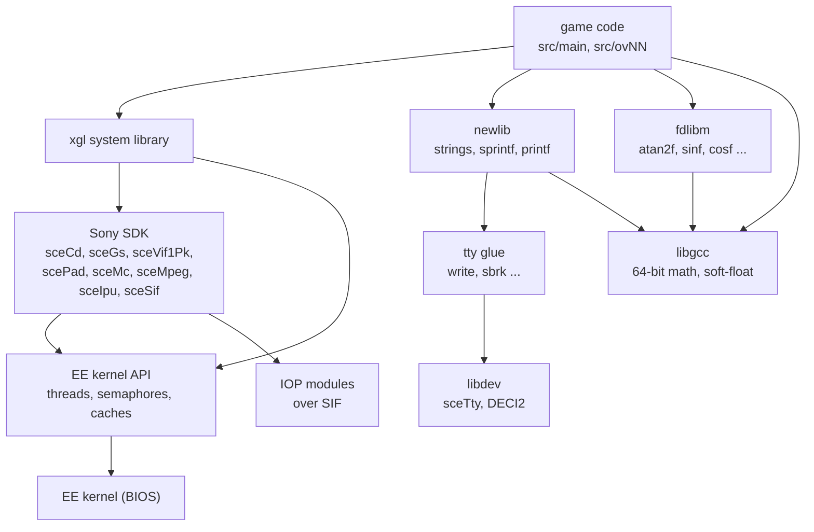
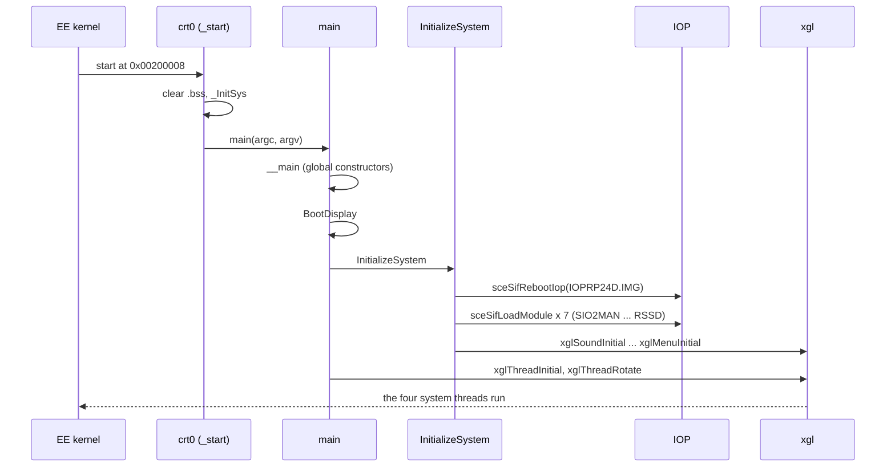
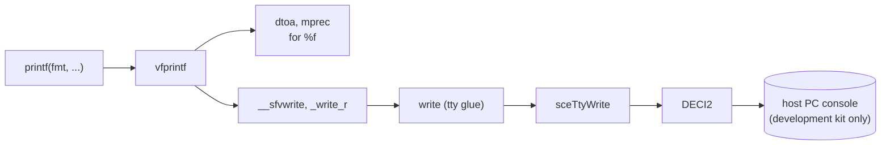
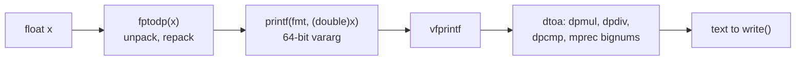

# Runtime libraries

Not all code in `SLUS_204.69` was written by the game's developers. About 855
of its 4526 functions come from libraries that were linked into the
executable: the startup code `crt0`, the EE kernel interface and the Sony
PlayStation 2 SDK (release 2.4.x), the C library newlib (1.8.x), the math
library fdlibm, and the GCC runtime library with its software floating
point. Together they take about 179 KiB of the 1.2 MiB of code.

The project does not turn these libraries into C. They are kept as the
original assembly, and only the game's own code is recovered. This page shows
where the libraries sit in the executable, how the game starts through them,
and which parts of them the game uses.

[← Back to the overview](../README.md)

## Where the libraries are

The libraries sit in two blocks at the two ends of the code segment. The
game's own code lies between them, from `ControlEntry` at `0x00218240` to the
last game function before `0x00323AB0`. The linker probably placed the
startup code and the Sony libraries first and the GCC and newlib archives
last, in the order they appeared on the link command line.

```
.text of SLUS_204.69 (0x00200000 - 0x00338570)

0x00200008  crt0           _start, _exit, _root
0x00200100  kernel         138 EE kernel syscall stubs (CreateThread, FlushCache, ...)
0x002009A0  tty glue       newlib system calls: write, read, open, close, lseek, sbrk, ...
0x00200D70  kernel glue    cache, interrupt and DMA helpers, threads, alarms
0x002016B0  libdev         DECI2, TTY and scePrintf (debugger output)
0x00202728  libkernel      SIF commands and RPC, file I/O (sceOpen ...), IOP heap and reset,
                           TLB handler, _InitSys, ExecPS2, LoadExecPS2, Exit
0x00209410  libgraph       sceGs*
0x0020AC68  libpkt         sceVif1Pk* (VIF1 packet building)
0x0020B580  libpad         scePad*
0x0020C918  libcdvd        sceCd*, sceCdSt* (streaming)
0x0020E9E8  libmc          sceMc*
0x002101A0  libipu         sceIpu*
0x002107B0  libmpeg        sceMpeg* and its decoder internals
0x00218240  ----------     game code (src/main/) -----------------------------
0x00323AB0  fdlibm         cos, sin, acos, atan2, fmod, pow, sqrt, the float versions
0x00329F38  libgcc         64-bit integer helpers, __main, fp-bit soft-float, frame.c
0x0032E040  newlib         abort ... strtoul, stdio, malloc, mprec, the *_r wrappers
0x003384F8  libgcc         __fixdfdi
0x00338570  end of .text
```

| Family | Functions | What it contains |
| --- | --- | --- |
| crt0 | 3 | The program entry `_start` and two exit paths |
| EE kernel API | 220 | 138 system call stubs and the glue around them. The names have no `sce` prefix |
| Sony SDK | 419 | libkernel (SIF, file I/O), libdev, libgraph, libpkt, libpad, libcdvd, libmc, libipu, libmpeg |
| fdlibm | 42 | Math functions, double and float |
| libgcc | 49 | 64-bit integer arithmetic, constructors, frame registration, soft-float |
| newlib | 122 | The C library: strings, memory, stdio, `malloc`, conversions |

The overlays contain no library code of their own. They call the copies in
the main executable, which stays in memory all the time.

### Identification

The Sony libraries carry their version strings in `.rodata`. The executable
contains `PsIIlibkernl2420` (libkernel 2.4.2.0), `PsIIlibcdvd 2424` (libcdvd
2.4.2.4), `PsIIlibmpeg 2420` (libmpeg 2.4.2.0), `PsIIlibpad  2410` (libpad
2.4.1.0) and 2.4.0.0 banners for libgraph, libipu, libmc and libpkt, so the
game was built against SDK release 2.4.x. The other libraries have no
version string and no compiler `.comment` section exists. Their identity comes
from symbol names. The newlib helpers are spelled `_multadd` and `_lshift`
with one underscore, and the allocator keeps `__malloc_av_`, which matches
the newlib 1.8 line shipped with the GNU toolchain for the EE. The fdlibm
constants (`atanhi`, `two_over_pi`, `npio2_hw` and others) and libgcc's
`__clz_tab` are also present as local symbols.

In the project's function index (`config/index/functions.tsv`), each library
object is a translation unit with a virtual path such as `src/main/crt0.s`
or `src/main/malloc.s`. These files do not exist in `src/`. The library units
are `main/tu000` to `main/tu082` and `main/tu275` to `main/tu413`, and they
are built from the original assembly.

The diagram below shows the layers from the game down to the hardware. The
game calls the libraries mostly through `xgl`, the system library described
in [xgl.md](../libraries/xgl.md).



## Start-up

The EE kernel starts the program at `_start` (`0x00200008`). This crt0 code
appears to clear the `.bss` area, call `_InitSys` to set up the kernel
services (it runs `supplement_crt0`, finds the system call table and installs
the alarm, thread and TLB handlers), run `main`, and finally exit. `_root` is
the entry of the root thread and ends it with a kernel call, and `_exit` is
an endless loop reached after shutdown. These descriptions come from the
function index and are not recovered C.

`main(argc, argv)` is in `src/main/control_entry.c`. GCC inserts a call to
`__main` at the start of `main`, which runs the global constructors through
`__do_global_ctors`. `main` then stores its arguments, shows the boot screen
with `BootDisplay`, calls `InitializeSystem` and starts the thread system
with `xglThreadInitial` and `xglThreadRotate`, which appears never to
return.

`InitializeSystem` brings up the IOP and the libraries in a fixed order:

1. `sceSifInitRpc(0)` and `sceCdInit(0)`.
2. Reboot the IOP with the replacement module image
   `cdrom0:\IOP\IOPRP24D.IMG;1` (`sceSifRebootIop`), repeated until it is
   accepted, and wait for it with `sceSifSyncIop`.
3. Initialize SIF RPC again, the IOP heap (`sceSifInitIopHeap`) and the
   module loader (`sceSifLoadFileReset`).
4. `sceCdInit(0)` again, `sceCdMmode(SCECdDVD)` and `sceFsReset`.
5. Load the IOP modules `SIO2MAN`, `MCMAN`, `MCSERV`, `PADMAN`, `LIBSD`, `SSD`
   and `RSSD` with `xglCdSifLoadModule`, which turns each name into
   `cdrom0:\IOP\NAME.IRX;1` and calls `sceSifLoadModule`.
6. Register the power-off handler with `sceCdPOffCallback`.
7. Set `WorkEnd` to `0x00A80000` and initialize the `xgl` modules: sound, CD,
   pad, memory card, tasks, DMA, geometry, packets, render, font, movie and
   menu.

The sequence below shows the whole start-up up to the first game thread.



The start-up of the game itself, from the boot logo to the title screen, is
described in [title-and-boot.md](../game/title-and-boot.md), and the threads
in [xgl.md](../libraries/xgl.md#threads).

## The EE kernel API

The EE kernel lives in the console's BIOS. Programs call it with the
`syscall` instruction, and the 138 stubs in the `kernel_syscalls` unit wrap
these calls. Unlike the rest of the SDK, they have no `sce` prefix:
`CreateThread`, `StartThread`, `SleepThread`, `WakeupThread`, `CreateSema`,
`SignalSema`, `WaitSema`, `FlushCache`, `ExecPS2` and so on. Versions for
interrupt handlers start with a lowercase `i`, such as `iWakeupThread`. Small
glue units around them handle caches (`SyncDCache`, `InvalidDCache`),
interrupt and DMA masks (`EnableIntc`, `DisableDmac`), the thread helper
`topThread`, alarms and the program exit (`ExecPS2`, `LoadExecPS2`, `Exit`,
`ExecOSD`).

The game uses only a few of them directly:

| Functions | Used in | Purpose |
| --- | --- | --- |
| `CreateThread`, `StartThread`, `SleepThread`, `WakeupThread`, `GetThreadId` | `src/main/xgl_thread.c`, `src/main/ssd_init.c` | The four system threads, and the two EE threads of the RSSD sound client (`RssdWork.rpc_thread_id`, `next_wave_thread_id`, see [audio.md](audio.md)) |
| `CreateSema`, `SignalSema`, `WaitSema` | the same files | Waiting for the end of a frame or a reply |
| `FlushCache`, `SyncDCache` | `xgl` modules | Write back the data cache before DMA, and after loading an overlay |

`xglCdLoadOverlay` in `src/main/xgl_cd.c` loads an overlay with
`sceSifLoadElf("cdrom0:\OVnn.OVL;1")` and calls `FlushCache(0)` and
`FlushCache(2)` before and after it, so that no stale data or instructions
from the previous overlay remain in the caches. Overlays are described in
the [overview](../README.md#2-overlays).

## The Sony libraries

Each Sony library is used by only a few game files, almost always inside
`xgl`. The table lists them with the game files that call them.

| Library | Prefix | Version | Called from |
| --- | --- | --- | --- |
| libkernel SIF | `sceSif*` | 2.4.2.0 | `src/main/control_entry.c`, `src/main/xgl_cd.c`, `src/main/ssd_1.c`, `src/main/ssd_init.c` |
| libkernel file I/O | `sceOpen`, `sceRead`, `sceWrite`, `sceLseek`, `sceClose` | 2.4.2.0 | `xgl_cd.c`, `xgl_hdd.c`, `script.c`, `srs.c`, `rsrc.c`, `tya.c`, `game_snap_shot.c`, `db_light_write.c`, `yajima_test.c` |
| libkernel device control | `sceDevctl`, `sceMount`, `sceIoctl`, ... | 2.4.2.0 | `xgl_cd.c`, `xgl_hdd.c`, `yajima_test.c` |
| libgraph | `sceGs*` | 2.4.0.0 | 12 files, mostly `xgl_render.c`, `xgl_dma.c`, `xgl_jpeg.c`, `nml_packet_add.c` |
| libpkt | `sceVif1Pk*` | 2.4.0.0 | 30 files that build VIF1 packets, such as `xgl_font.c`, `xgl_prim_add.c`, `nml_model_set.c` |
| libpad | `scePad*` | 2.4.1.0 | `xgl_pad.c` |
| libcdvd | `sceCd*` | 2.4.2.4 | `xgl_cd.c`, `control_entry.c` |
| libmc | `sceMc*` | 2.4.0.0 | `xgl_mc.c`, `yajima_test.c` |
| libipu, libmpeg | `sceIpu*`, `sceMpeg*` | 2.4.0.0, 2.4.2.0 | `xgl_1.c` (movies) |
| libdev | `sceDeci2*`, `sceTty*`, `scePrintf` | | No game file. Reached only through newlib's `write` |

The file I/O functions (`sceOpen` and the others) do not read the disc
themselves. Judging by their internals (`_sceFs_Rcv_Intr`, `sceFsInit`), they
send each request to the IOP's file manager over SIF, which
passes it to the device named in the path: `cdrom0:` for the disc, `host0:`
for a PC connected to a development kit, `pfs0:` and `pfs1:` for HDD
partitions and `hdd0:` for the drive itself. The archive reads of `xgl_cd`
use `sceCdRead` directly instead. Both paths
are described in [files-and-resources.md](files-and-resources.md) and
[xgl.md](../libraries/xgl.md#cd-and-files).

The two movie formats use the movie libraries in different ways. The MPEG-2
movies (`.pss`) go through libmpeg, which demultiplexes the program stream,
drives the IPU and passes the audio packets to a callback of the game. It
picks the video and the ADPCM audio sub-streams with its table `_strmap`
(`0x004AD510`), which the library function `_type2id` (`0x00215DE0`)
searches. The IPU movies (`.ipu`) bypass libmpeg. The IPU player uses only
two libipu functions, `sceIpuInit` in `xglMovieInit` and `sceIpuSync` in
`xglMoviePlay`. It feeds the pictures to the IPU by DMA and sends the decode
commands itself. Both file formats are described in
[PSS movies](../formats/movies-images-and-icons.md#2-pss-movies) and
[IPU movies](../formats/movies-images-and-icons.md#3-ipu-movies).

How the game drives the graphics libraries is described in
[rendering.md](rendering.md), and the movie libraries in
[xgl.md](../libraries/xgl.md#movies).

## The C library (newlib)

newlib provides the standard C functions. The linked parts are the string and
memory functions (`memcpy`, `memset`, `memmove`, `memcmp`, `memchr`,
`strcpy`, `strcat`, `strcmp`, `strncmp`, `strncpy`, `strlen`, `strchr`,
`strrchr`, `strstr`, `strcasecmp`, `strlwr`, `bcopy`), the conversions
(`atoi`, `atol`, `atof`, `strtol`, `strtoul`, `strtod` with its `mprec`
bignum helpers and `dtoa`), formatted I/O (`printf`, `sprintf`, `vprintf`,
`vsprintf`, `vfprintf`, `sscanf`, `vfscanf`), the stdio internals (`fflush`,
`fread`, `ungetc`, buffers and file table), memory allocation (`malloc`,
`free`, `calloc`, `realloc` and their `_r` forms), `rand`, `signal`,
`atexit`, `exit` and `abort`.

The game uses the string functions and `sprintf` most. The table counts the
game source files (main executable and overlays) that call each function.

| Function | Files | Typical use |
| --- | --- | --- |
| `memset` | 92 | Clearing work areas and structures |
| `printf` | 37 | Debug messages |
| `strcpy` | 37 | Building file paths |
| `strcat` | 27 | Building file paths |
| `strlen` | 26 | Text layout |
| `sprintf` | 25 | Paths such as `data\motion\%s.fpk`, number formatting |
| `strcmp` | 23 | Name lookups |
| `memcpy` | 13 | Block copies |
| `strncpy` | 13 | Fixed-length names |
| `strcasecmp` | 10 | Case-blind name lookups |
| `strncmp` | 9 | Prefix tests |
| `rand` | 4 | Random numbers, next to the game's own `xglFRand` |
| `exit` | 1 | `src/main/file.c` calls `exit(1)` when a save thumbnail is too large |

### printf and the debug output

newlib's `printf` formats its text with `vfprintf` and writes it through the
stdio layer. The low-level `write` in the tty glue unit
appears to initialize the TTY service and pass the bytes to `sceTtyWrite`,
which sends them over DECI2, the debug link of a development kit, to the
host PC. On a retail console no debugger is connected, so the output of the
37 files that call `printf` probably goes nowhere. The game still spends the
time to format it. The path is shown below.



The game's on-screen text does not use this path. It is drawn by the font
module of `xgl`, which has its own `printf`-like formatter (see
[xgl.md](../libraries/xgl.md#text)).

### malloc and sbrk

No game source file calls `malloc`, `free`, `calloc` or `realloc`. The game
manages its memory itself, with `WorkEnd`, the resource table and several
special allocators (see [memory.md](memory.md)). newlib's allocator is
therefore probably used only by newlib itself, for example for stdio
buffers (`__smakebuf`) and the big numbers of `dtoa`.

The allocator gets its memory from `sbrk` in the tty glue unit. `sbrk` moves
a pointer `heap_ptr` forward and compares the new end with the kernel's
`EndOfHeap()`. It fails with `ENOMEM` when the end would pass that limit.
Where `heap_ptr` starts is set by the crt0 code and is not visible in the
recovered C.

## The math library (fdlibm)

The math functions come from Sun's fdlibm, as redistributed in newlib. Both
the double versions (`cos`, `sin`, `acos`, `atan`, `atan2`, `fmod`, `pow`,
`sqrt`, `floor`, `fabs`, `scalbn`, `copysign`, with the internal `__ieee754_*`
and `__kernel_*` functions) and the float versions (`cosf`, `sinf`, `tanf`,
`asinf`, `atanf`, `atan2f`, `fmodf`, `sqrtf`, `floorf`, `fabsf`) are linked.
The wrappers (`w_*` and `wf_*`) are the public entry points and call the
implementations (`e_*` and `ef_*`).

The game mostly calls the float versions, which run on the EE's
single-precision FPU without soft-float calls:

| Function | Files |
| --- | --- |
| `atan2f` | 23 |
| `sinf` | 13 |
| `cosf` | 11 |
| `tanf`, `floorf`, `atan2`, `sqrt` | 4 each |
| `fmodf` | 2 |
| `acos`, `pow`, `asinf`, `sqrtf` | 1 each |

Vector and matrix math does not use this library. It runs on the VU0
coprocessor through the macros and functions described in
[math.md](../libraries/math.md).

## The GCC runtime (libgcc)

libgcc holds the helpers that GCC calls for operations the processor cannot
do in one instruction:

- 64-bit integer multiplication, division and remainder (`__muldi3`,
  `__divdi3`, `__moddi3`, `__udivdi3`, `__umoddi3`), and conversions between
  64-bit integers and floating point (`__fixunsdfdi`, `__fixunssfdi`,
  `__floatdidf`, `__fixdfdi`). The R5900 has 64-bit registers but no 64-bit
  multiply or divide instruction, so `long long` arithmetic such as the
  save checksum (see [save-data.md](save-data.md#the-checksum)) probably
  calls them.
- The constructor support `__main`, `__do_global_ctors` and
  `__do_global_dtors`.
- `frame.c`, 19 functions that register exception-handling frame tables
  (`__register_frame_info` and others). The game is written in C, so these
  are probably linked only because crt0 or `__main` refers to them.
- The software floating-point routines.

### Soft-float

The EE's FPU handles only single-precision `float`. Every operation on a
`double` therefore becomes a call into libgcc's `fp-bit` code. The toolchain
builds it with the GOFAST option, which gives the routines short names:
`dpadd`, `dpsub`, `dpmul`, `dpdiv` and `dpcmp` for arithmetic and compares,
and `fptodp`, `dptofp`, `litodp`, `dptoli` and `dptoul` for conversions.
Internally they unpack each double into sign, exponent and fraction
(`__unpack_d`), compute, and pack the result again (`__pack_d`). A single
`double` addition runs through about 1.1 KiB of code: `dpadd`, two calls of
`__unpack_d`, `_fpadd_parts` and `__pack_d`.

The game code avoids `double`, but it appears in 34 source files. The most
common reason is C's rule for variable argument lists: a `float` passed to
`printf` or to the game's `DB_println` is converted to `double`, so each such
call runs `fptodp`. The fdlibm double functions and newlib's `strtod` and
`dtoa` also use the soft-float routines throughout.

Some recovered sources call the routines by name and handle doubles as
64-bit bit patterns. The original code probably used `double` there, and
the calls are what that code compiled to. The files that do this are listed
below.

- `src/main/xgl_font.c` reads a `%f` argument of the font formatter as a
  64-bit value and converts it with `dptofp`.
- `src/ov11/mini_g.c` (Network Casino) draws numbers digit by digit with
  `pow(DOUBLE_TEN, litodp(digits))`, `dpcmp` and `dpdiv`, where
  `DOUBLE_TEN` is `0x4024000000000000`, the bit pattern of 10.0.
- `src/main/matrix_print.c`, `src/main/db_light_write.c`,
  `src/main/init_uwamono_sys.c`, `src/main/wind_test.c`,
  `src/main/karakama_test.c` and the OV12 files `rg_main.c`,
  `rg_battlemgr.c`, `rg_weapon_db.c` and `rg_motion_info_db.c` do the same.

The diagram below shows what a debug print of one `float` costs.



## IOP modules on the disc

The `IOP` folder of the disc holds the modules that the EE loads into the
IOP:

| File | Origin | Role | Loaded by |
| --- | --- | --- | --- |
| `IOPRP24D.IMG` | Sony | Replacement IOP module image used to reboot the IOP | `sceSifRebootIop` in `InitializeSystem` |
| `SIO2MAN.IRX` | Sony | Serial port manager for pads and cards | `InitializeSystem` |
| `MCMAN.IRX`, `MCSERV.IRX` | Sony | Memory card driver and its EE server | `InitializeSystem` |
| `PADMAN.IRX` | Sony | Controller driver | `InitializeSystem` |
| `LIBSD.IRX` | Sony | Low-level sound library | `InitializeSystem` |
| `SSD.IRX`, `RSSD.IRX` | Game | Sound drivers, see [iop-sound-driver.md](iop-sound-driver.md) | `InitializeSystem` |
| `ATAD.IRX`, `DEV9.IRX`, `HDD.IRX`, `PFS.IRX`, `SMAP.IRX` | Sony | HDD and network adapter drivers | Not named in the recovered EE code |

The HDD drivers must be running for the HDD install and the `pfs0:` reads to
work, but no recovered EE function loads them by name. How they are loaded
is not clear from the code. The HDD functions are described in
[xgl.md](../libraries/xgl.md#hdd).

## Using the libraries from recovered C

The recovered game source calls the library functions with their usual C
prototypes, declared locally or in the project's headers. Because the
library code is kept as original assembly, a game function that calls
`sprintf` or `atan2f` links against exactly the same library code as the
original executable. The compiler contract for the game code (GCC 2.96 for
the EE) is the one that produced these calls, so argument passing, the
promotion of `float` to `double` in variable argument lists and the soft-float
calls come out the same way.
