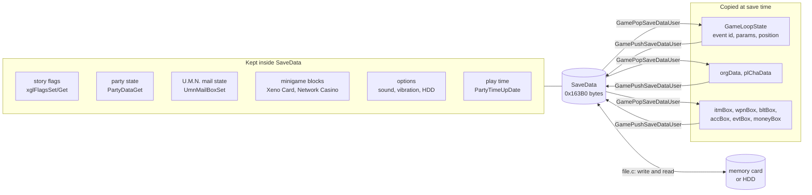
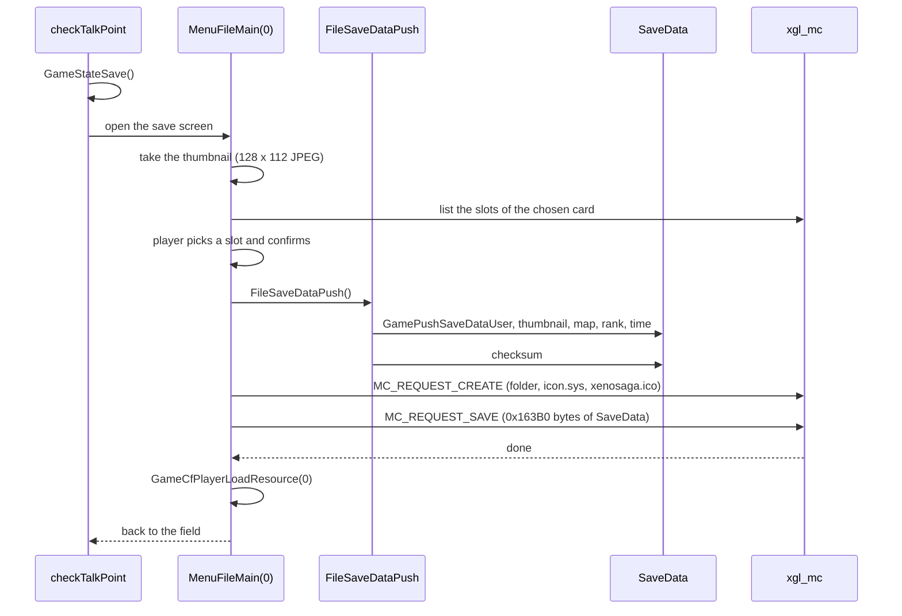
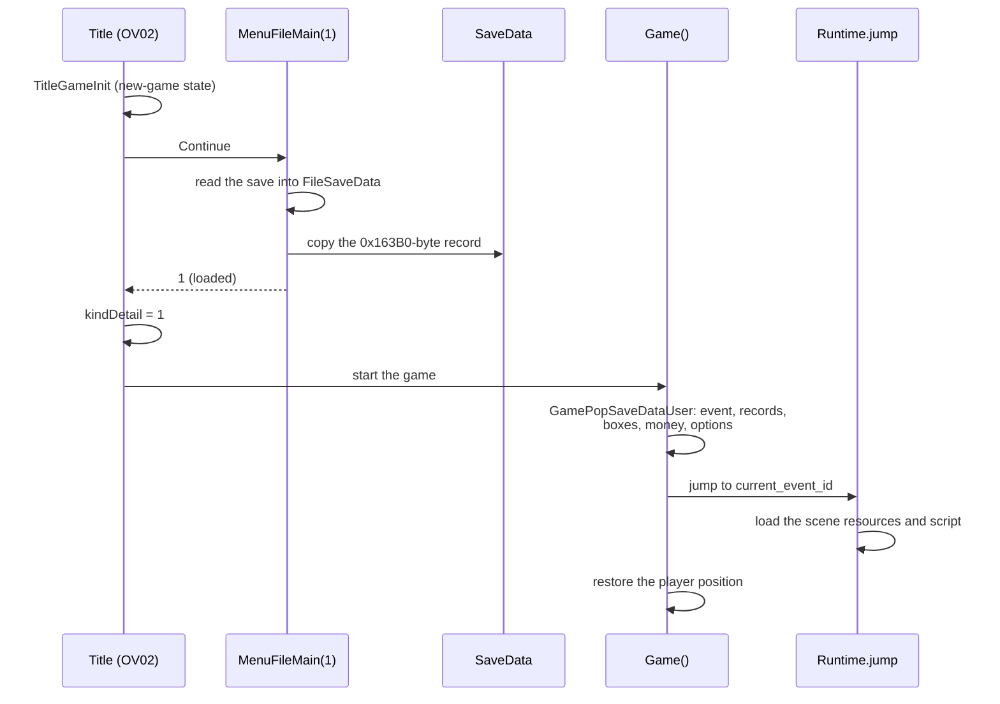
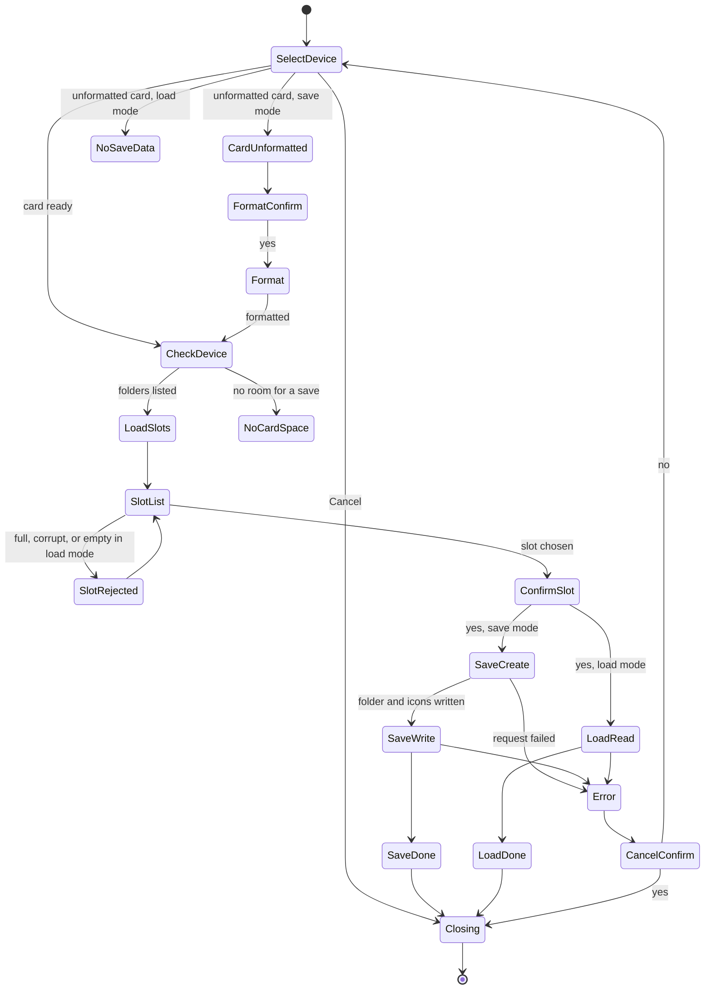
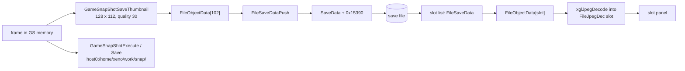

# Save data

Everything that Xenosaga Episode I keeps between play sessions lives in one
block of memory, `SaveData`, defined in `src/main/xgl_mc.c`. It is
`0x163B0` bytes (about 89 KiB) long and sits at `0x004917B0` in the data
segment of the main executable. A save file on a memory card or on the hard
disk is a plain copy of this block, protected by a checksum. Loading a game
copies the file back over the block.

Some systems keep their state directly inside `SaveData` all the time: the
story flags, the party state, the U.M.N. mail state and the minigame blocks.
Others keep their state in their own variables and copy it into `SaveData`
only when the game is saved. This page describes the layout of the block,
who owns each part, how a new game fills it, and how the save and load screen
(`src/main/file.c`) writes it to a memory card or the HDD.

[← Back to the overview](../README.md)

## The save image

`SaveData` is an array of bytes, not a C structure. Each system that owns a
part of it adds a fixed offset to its address and casts the result to its own
type. `src/main/game.c` uses `SAVE_GAME_USER` (`0x50`), `src/main/party.c`
uses `SAVE_PARTY_STATE` (`0x10078`), `src/main/xgl_flags.c` uses
`XGL_FLAGS_OFFSET` (`0x74`), and the overlays use their own offsets. The save
screen reads the block through two partial views, `FileSaveRecord` and
`FileSaveOutput` in `src/main/file.private.h`, which name only the fields
the screen needs.

Because the whole block is written and read as one piece, a field only has
to be inside `SaveData` to be saved. No list of saved variables exists. This
makes saving simple, but the offsets are spread over many files, and the map
below was rebuilt from them.

```
SaveData (0x163B0 bytes at 0x004917B0)
+0x00000  version            u64, FILE_SAVE_VERSION = 3
+0x00008  checksum           u64, see "The checksum"
+0x00010  save_count         int, how many times this game was saved
+0x00014  unit_map_count     int, saves made on map 10
+0x00028  sound output       byte, passed to SsdSetOutputMode
+0x0003C  vibration          byte, controller vibration on or off
+0x00040  HDD option         byte, 0 = use the HDD install
+0x00044  cursor memory      byte, main menu keeps its cursors when 0
+0x00060  save date          XglClock, real-time clock at the last save
+0x00068  play time          XglClock, total play time
+0x00074  flags area         0x10000 bytes of story flags (xglFlags*)
+0x10078  party state        PartyDataPrefix, 0x188 bytes
+0x10200  event id, params   GameUserSave: current event and 8 floats
+0x10230  position, rotation GameUserSave: player position and rotation
+0x10250  map_no             short, map of the last save
+0x10252  scenario rank      byte 1..3, shown as the chapter
+0x10254  item menu sorting  8 bytes (MenuSaveDataGet)
+0x1025C  U.M.N. work        168 bytes: 128 mail box slots, flags at +0x86
+0x102DC  discount levels    5 bytes, shop price rates
+0x10304  U.M.N. mail data   128 entries of 2 bytes
+0x10404  unit records       orgData[33], 0x180 bytes each
+0x13584  character records  plChaData[16], 0xA8 bytes each
+0x14684  boxes              item, weapon, bullet, accessory, event: u16[256] each
+0x15088  money              u64 (moneyBox)
+0x15090  minigame block 0   256 bytes, Xeno Card (OV10)
+0x15190  minigame block 1   256 bytes, Network Casino (OV11)
+0x15290  minigame block 2   256 bytes, cleared at a new game only
+0x15390  thumbnail          0x1000 bytes, JPEG of the screen at the last save
+0x16390  user_word          u32, GameUserSave
+0x163A0  user_longs[2]      u64 x 2, GameUserSave
+0x163B0  end
```

Gaps in the map (for example `+0x18` to `+0x27` and `+0x14004` to
`+0x14683`) are bytes that no recovered code reads or writes by a fixed
offset.

The diagram below shows the two ways a system's state reaches the block.
Systems on the left work inside `SaveData` directly. Systems on the right
are copied in by `GamePushSaveDataUser` when the game is saved and copied
back by `GamePopSaveDataUser` when a save is resumed.



## The header

The first 0x74 bytes hold the save's bookkeeping and the player's options.

`version` must be `FILE_SAVE_VERSION` (3) for the save screen to accept a
save. `checksum` protects the whole block and is described below.
`save_count` is incremented by every save. `unit_map_count` counts saves made
on map 10 (`FILE_UNIT_MAP_NO`). Nothing in the recovered code reads it back,
so its purpose is unknown.

The option bytes are written by the system options screen of the main menu
(`src/main/menu_system.c`, see [main-menu.md](../game/main-menu.md)) and
applied by `GamePopSaveDataUser` when a save is resumed:

| Offset | Option | Applied with |
| --- | --- | --- |
| `0x28` | Sound output, stereo (1) or mono (0), see [audio.md](audio.md#14-output-settings) | `SsdSetOutputMode(SaveData[0x28])` |
| `0x3C` | Controller vibration | `PadData.vibrationReset` and `PadData.vibrationStatus` |
| `0x40` | Use the HDD install. 0 means yes | `xglHddActivate(SaveData[0x40] ^ 1)` |
| `0x44` | Keep the menu cursors. 0 means yes | `MenuCursorKeepCheck` in `src/main/menu_1.c` |

`GamePopSaveDataUser` also calls `tyaDisplaySetting(0)`, which applies the
saved screen position offsets.

### Dates and play time

Two clock records follow, both in the `XglClock` format of the real-time
clock (day, hour, minute, second, see [xgl.md](../libraries/xgl.md#clock)).
The one at `0x60` is the date and time of the last save, read with
`xglClockRead` just before the checksum is computed.

The one at `0x68` (`SAVE_PLAY_TIME`) is the total play time. The game does
not count frames for it. `PartyTimeUpDate` in `src/main/party.c` reads the
real-time clock, converts the reading and the previous reading
(`_CountTime`) to seconds with `xglClockDayTime2UInt`, and adds the
difference to the record. `PartyTimePauseStart` updates the record when the
game is paused, and `PartyTimePauseEnd` takes a new reference reading, so
the time spent in a pause is not counted. `PartyTimeLimitCheck` clamps the
record at day 5, 3:59:59. `PartyTimeDispChange` folds the days into the hour
field for display, counting the day field from 1, so the longest time a
save shows appears to be 99:59:59.

## The flags area

The 64 KiB from `0x74` to `0x10074` are the story flags, a packed bit array
used by the event scripts, the item pick-ups, the Driller Game and the
Network Casino. A flag is addressed by its bit offset and its width with
`xglFlagsSet` and `xglFlagsGet`. `xglFlagsInitial` clears the whole area at a
new game. The functions and their 32-bit and 64-bit defect are described in
[xgl.md](../libraries/xgl.md#flags), and the script access in
[natives.md](../scripting/natives.md).

## The party state

The 0x188 bytes at `0x10078` are the party state, returned by
`PartyDataGet()` and typed `PartyDataPrefix` in `include/main/party.h`. The
party functions work on this memory directly, so it is always current.

| Offset in block | Field | Meaning |
| --- | --- | --- |
| `+0x24` | `lock_party_mask` | Members locked out of the party, one bit per party id |
| `+0x26` | `out_friend_mask` | Members that are out of the selectable party |
| `+0x28` | `friend_mask` | Recruited members, party ids 1 to 7 |
| `+0x2A` | `take_agws_mask` | A.G.W.S. units taken along, party ids 17 to 32 |
| `+0x2C` | `leader_battle_id` | Battle id of the party leader |
| `+0x2E` | `radar_disp` | Radar shown on the field (`src/main/game_radar.c` reads `SaveData[0x100A6]`) |
| `+0x30` | `attack_slots[3]` | The three battle positions |
| `+0x3C` | `tech_records[8]` | Tech Attack levels per character, from `data\endou\tec\tecinit.bin` |
| `+0x140` | `skill_levels` | Skill level per character |
| `+0x148` | `next_level_points[8]` | Points needed for the next skill level |

The first 0x24 bytes are read by `PartyCharNumGet` and `PartyAgwsNumGet`
as bit masks, but their exact shape is not known. The party and growth
systems are described in [character-growth.md](../game/character-growth.md).

## The game user block

`GameUserSave` in `src/main/game.c` is a view of `SaveData + 0x50`
(`SAVE_GAME_USER`). Its parts are copied from the game's own variables by
`GamePushSaveDataUser` and back by `GamePopSaveDataUser`. Both functions copy
the same fields in the same order:

| Absolute offset | Field | Live copy |
| --- | --- | --- |
| `0x10200` | `event_id` | `GameLoopState.current_event_id`, the event or field scene to resume |
| `0x10204` | `params[8]` | `GameLoopState.params`, eight floats |
| `0x10230` | `actor_position` | `GameLoopState.saved_actor_position` |
| `0x10240` | `actor_rotation` | `GameLoopState.saved_actor_rotation` |
| `0x10404` | `org[33]` | `orgData`, the unit records, 0x180 bytes each (`dataUnitOrgGet`) |
| `0x13584` | `players[16]` | `plChaData`, the character records, 0xA8 bytes each (`dataPlChaGet`) |
| `0x14684` | `item_box` ... `event_box` | `itmBox`, `wpnBox`, `bltBox`, `accBox`, `evtBox`, 255 entries each |
| `0x15088` | `money` | `moneyBox` |
| `0x16390` | `user_word` | `GameLoopState.user_word` |
| `0x163A0` | `user_longs[2]` | `GameLoopState.user_longs` |

The unit and character records probably hold the characters' parameters
and equipment. They are described in
[character-growth.md](../game/character-growth.md) and
[battle.md](../game/battle.md). The live copies sit elsewhere in the data
segment, for example `orgData` at `0x00422940` and `plChaData` at
`0x00425AC0`.

### Data boxes

The inventory is kept in five "boxes", arrays of 16-bit quantities indexed
by item id minus one. They are defined with their functions in
`src/main/data.c` (`include/main/data.h`):

| Category | Value | Array | Functions |
| --- | --- | --- | --- |
| `ITEM_CATEGORY_ITEM` | 0 | `itmBox` | `dataItmBoxChk`, `dataItmBoxInc`, `dataItmBoxDec` |
| `ITEM_CATEGORY_WEAPON` | 1 | `wpnBox` | `dataWpnBox*` |
| `ITEM_CATEGORY_BULLET` | 2 | `bltBox` | `dataBltBox*` |
| `ITEM_CATEGORY_ACCESSORY` | 3 | `accBox` | `dataAccBox*` |
| `ITEM_CATEGORY_EVENT` | 10 | `evtBox` | `dataEvtBox*` |

`dataBoxInc(category, id)` adds one unless the quantity is already
`DATA_BOX_QUANTITY_MAX` (99) and returns 1 when it added. `dataBoxDec`
removes one when the quantity is not zero. `dataBoxChk` returns the
quantity. Each box has 255 used entries (`DATA_BOX_SLOTS`), while the save
area reserves 256 per box.

Money is the 64-bit `moneyBox`. `dataMoneyBoxInc` clamps it to
`MONEY_BOX_MAX` (999,999,999) and returns 0 when it hit the limit.
`dataMoneyBoxDec` subtracts only when enough money is there.

## The other blocks

Several small blocks sit between the party state and the unit records. The
table lists them with the code that uses them.

| Offset | Size | Contents | Used by |
| --- | --- | --- | --- |
| `0x10250` | 2 | `map_no`, the map of the last save | `FileSaveDataPush` |
| `0x10252` | 1 | Scenario rank: 3 when `MenuScenarioNoGet()` is above 300, 2 above 100, else 1. The save screen shows it as the chapter | `FileSaveDataPush`, `FileObjectDataInput` |
| `0x10254` | 8 | Sort order chosen per item menu tab | `MenuSaveDataGet` in `src/main/menu_item.c` |
| `0x1025C` | 168 | U.M.N. work: 128 mail box slots (`0xFF` = empty) and a flag word at `0x102E2` | `UmnMailBoxSet`, `src/ov02/tya_uml.c` |
| `0x102DC` | 5 | Discount levels. Each level takes 10% off a price, down to half price | `src/main/menu_1.c` |
| `0x10304` | 256 | U.M.N. mail data, 2 bytes per mail | `UmnMailDataGet` |
| `0x15090` | 256 | Xeno Card save block `CardSaveData` (options, owned cards, stored decks) | `src/ov10/card_play_sound1.c` |
| `0x15190` | 256 | Network Casino save block `CasinoSaveWork` (prizes bought and others) | `src/ov11/mini_g.c` |
| `0x15290` | 256 | Cleared at a new game, no other user found | `PartyDataInit` |
| `0x15390` | 0x1000 | Thumbnail picture of the last save | `FileSaveDataPush` |

The U.M.N. data is described in [umn.md](../game/umn.md), the shops in
[main-menu.md](../game/main-menu.md), and the minigame blocks in
[xeno-card.md](../game/minigames/xeno-card.md) and
[network-casino.md](../game/minigames/network-casino.md).

## A new game

The title screen's New Game calls `TitleGameInit` in
`src/ov02/title_game_init.c`. It clears `GameLoopState`, clears the flags
with `xglFlagsInitial`, and calls `PartyDataInit`, which fills the rest of
the block with the starting state:

1. Clear the party state and copy the eight Tech Attack records from
   `data\endou\tec\tecinit.bin`. Read the skill table
   `data\endou\skill\skilldat.bin` and set every skill level to 1.
2. Set the sound output to 1. If an HDD install is found, turn the HDD on and
   set the HDD option byte to 0.
3. Turn the radar on and set the leader's battle id to 1.
4. Clear the item menu sorting and the U.M.N. work, mark all 128 mail box
   slots empty, and deliver mails 78, 79 and 80.
5. Clear the U.M.N. mail data and all five boxes.
6. Give 1000 money (`PARTY_INITIAL_MONEY`) and weapon 19.
7. Clear the three minigame blocks and `UmnSimulationNo`.
8. Reset the play time to zero with `PartyTimeInit`.

The two files of step 1 are described in
[Technique start values](../formats/game-tables.md#technique-start-values-tecinitbin)
and [Skill learning](../formats/game-tables.md#skill-learning-skilldatbin).

The title screen then sets `GameLoopState.current_event_id` to
`0x100003E8`, which names the scene `ev1000`, and `kindDetail` to 0.
`Game()` starts that scene from its beginning. The flow is shown in
[title-and-boot.md](../game/title-and-boot.md).

## Saving

A save can be made at four places:

- At a save point on the field. `checkTalkPoint` in `src/main/game.c` opens
  the save screen when the player presses Circle on a save or event symbol.
  It first stores the game mode with `GameStateSave`.
- At an intermission. The scene command `save` calls `Intermission(n)` in
  `src/main/game_over.c`. It shows chapter picture `data\yajima\im0n.jpg`
  and asks whether to save.
- At the end of the game. When `GameOver` runs on scene 9998, it calls
  `GameEnd`, which shows `data\yajima\end.jpg` and asks "Save clear data?".
  These pictures are listed in
  [JPEG pictures](../formats/movies-images-and-icons.md#41-the-pictures).
- From the debug scene `src/main/endou_test.c`.

Each of these calls `MenuFileMain(0)`. When the player confirms a slot, the
screen calls `FileSaveDataPush` to bring the block up to date and then
writes it. `FileSaveDataPush` does these steps in order:

1. `GamePushSaveDataUser` copies the event, the position, the unit and
   character records, the boxes and the money into the block.
2. The thumbnail taken when the screen opened is copied to `0x15390`.
3. `map_no` is stored, and the map's name is passed to `xglMcSetMapName`.
   That function prepares a Shift-JIS copy of the name, but nothing writes
   it into `icon.sys` (see [xgl.md](../libraries/xgl.md#creating-a-save-folder)). A save on map 10 increments
   `unit_map_count`.
4. The version is set to 3, `save_count` is incremented and the scenario
   rank is stored.
5. `PartyTimeUpDate` brings the play time up to date, and `xglClockRead`
   stores the save date.
6. `FileCheckSumGet` computes the checksum, which is stored last.

The sequence below shows a save at a save point on a memory card.



### The checksum

`FileCheckSumGet(source, &checksum)` copies the whole record to the stack,
sets the stored checksum of the copy to zero, and then sums over all 0x163B0
bytes:

```
checksum = sum over i = 0 .. 0x163AF of ( byte[i] * i + 0x7CA )
```

The sum is a 64-bit `long long`. Each byte is weighted by its position, so
moved bytes change the result, and the constant `0x7CA` adds a fixed amount
per byte. `FileCheckSumCheck` recomputes the sum and compares it with the
stored one.

When the save screen lists the slots, it reads each save and checks it. A
save with a different version or a wrong checksum is shown as corrupt
(`FILE_SLOT_CORRUPT`) and cannot be loaded or overwritten.

The code also has a converter, `VersionChange00To01`, which copies a
version 0 record into the version 1 layout, and `VersionUpDate`, which
increments the version and recomputes the checksum. They are only reachable
from `FileVersionCheck`, whose body is empty, so they are never used. They
are probably left over from development, when the save layout changed.

## Loading

The title screen's Continue calls `TitleGameInit` first, so a cancelled load
leaves a clean new-game state. It then calls `MenuFileMain(1)`. When the
player loads a slot, the save screen reads the file into its staging buffer
`FileSaveData`, copies the whole record over `SaveData`, and calls the empty
`FileVersionCheck`. If the load was not cancelled, `MenuFileMain` returns 1,
and the title screen sets `GameLoopState.kindDetail` to 1.

At this point only the parts that live inside `SaveData` are current. The
copied parts are restored later. When `Game()` in `src/main/game.c` starts
and finds `kindDetail` set, it calls `GamePopSaveDataUser` to copy the event
id, the position, the records, the boxes and the money back and to apply the
options. It then jumps to the saved event with
`Java_xeno_util_Runtime_jump_sub`, which loads the scene's resources (see
[files-and-resources.md](files-and-resources.md#scene-resource-scripts)), and
puts the player actor at the saved position.

The sequence below shows a load from the title screen.



## The save and load screen

`MenuFileMain(menu_mode)` in `src/main/file.c` runs the whole screen in its
own loop, with mode 0 for saving and 1 for loading. It returns when the
screen's state reaches `FILE_STATE_DONE`. On entry, `MenuCfTaikiPush` sets
aside the eight final render callbacks of whatever screen was running, and
`MenuCfTaikiPop` puts them back on exit. This probably lets the screen open
over the field, the title screen and the game-over pictures alike. The
return value is 1 unless the player cancelled a load.

### Memory used by the screen

The screen's control block, `FileWork` (a `FileWorkBlock` of 0x80 bytes),
and the work areas of its five tasks are placed after the main menu's work,
at `MenuWorkEndGet()` rounded up to 0x80 bytes. The tasks are `MenuFilePas`
(the sliding banner), `MenuFileInfo` (the message window), `tskFileSelect`
(the slot list), `tskFileEx` and `tskFileData`. They run on the screen's own
task scheduler `FileTask`. Tasks are described in
[xgl.md](../libraries/xgl.md#tasks).

The large buffers are placed at the fixed address `FILE_STAGING_BASE`
(`0x01000000`):

```
0x01000000  FileCardDataBuf       0x12000   data\carddata.new (icon files), save mode only
0x01012000  FileObjectDataSystem  0x258     load progress, card status and state of 99 slots
0x01012800  FileJpegDec           0x46500   5 thumbnail decode slots of 0xE100 bytes
0x01059000  FileObjectData        0x696A0   103 entries of 0x1060 bytes:
                                              0..98   one per save slot
                                              99      "new data" placeholder (new_d.jpg)
                                              100     "cannot be used" placeholder (n_use.jpg)
                                              101     "broken data" placeholder (brk_d.jpg)
                                              102     the current game's thumbnail
0x010C2800  FileSaveData          0x163B0   one save record, read or written
0x010D9000  FileExistCheckWork    0x2000    directory scan work
```

The three placeholder pictures are 128 × 112 JPEG files, described in
[JPEG pictures](../formats/movies-images-and-icons.md#41-the-pictures).

This area is the start of the field's player block, which holds the party
leader's model and motions (see
[memory.md](memory.md#the-resource-table)). The save screen overwrites it.
When a save screen closes, `MenuFileMain` calls
`GameCfPlayerLoadResource(0)`, which finds the tags of its cached files
damaged and reloads the player block. A load does not call it, probably
because the game restarts its scene afterwards and loads the player again.

When saving, the screen first takes the thumbnail of the current frame into
entry 102 with `GameSnapShotSaveThumbnail(30, ...)`. If the JPEG is larger
than 0x1000 bytes, the game calls `exit(1)`.

### Slot list and states

Each entry of `FileObjectData` (`FileObjectEntryView`) holds a slot's
thumbnail, its state and the summary shown in the list. `FileObjectDataInput`
fills an entry from the save just read: the chapter (the scenario rank at
`0x10252`), a leader byte at `0x10718` (inside the third unit record), the
map number, the play time clock, the party member ids and the thumbnail. The
value it calls `play_time` is the 64-bit word at `0x15088`, which is the
money. The panel shows it with nine digits. The real play time comes from
the clock at `0x68`. The state of each slot is kept in
`FileObjectDataSystem->state[]`:

| State | Value | Meaning | Entry shown |
| --- | --- | --- | --- |
| `FILE_SLOT_EXISTING` | 1 | A valid save | The save's own data |
| `FILE_SLOT_NEW` | 2 | Empty, and the device has room for a save | Entry 99 |
| `FILE_SLOT_FULL` | 3 | Empty, but no room left | Entry 100 |
| `FILE_SLOT_CORRUPT` | 4 | Wrong version or checksum | Entry 101 |

A save needs 165 KB of free space on a memory card (`FILE_CARD_SAVE_KB`) and
225 KB on the HDD (`FILE_HDD_SAVE_KB`). After every save the screen
recomputes which empty slots still fit. Only existing saves can be loaded,
and only new or existing slots can be saved to.

### The state machine

The screen is a state machine in `FileWork->state`, driven by `MenuFile()`
once per frame. A state change is requested by writing `FileWork->command`.
The main states are listed in `enum FileMenuState`:

| State | Value | What happens |
| --- | --- | --- |
| `SELECT_DEVICE` | `0x24` | Choose memory card slot 1, slot 2 or Cancel |
| `CHECK_DEVICE` | `0x25` | Check the card, its format, free space and save folders |
| `LOAD_SLOTS` | `0x27` | Read every existing save to fill the slot list |
| `SLOT_LIST` | `0x28` | Browse the slots, three panels at a time |
| `SLOT_REJECTED` | `0x29` | The chosen slot cannot be used |
| `CONFIRM_SLOT` | `0x2A` | Yes or no for the chosen slot |
| `SAVE_CREATE` | `0x2D` | `FileSaveDataPush`, then create the folder and icon files |
| `SAVE_WRITE` | `0x2C` | Write `SaveData` |
| `SAVE_DONE` | `0x2E` | Report the save |
| `LOAD_READ` | `0x50` | Read the save and copy it over `SaveData` |
| `LOAD_DONE` | `0x52` | Report the load |
| `CARD_UNFORMATTED` to `FORMAT_FAILED` | `0x80`–`0x87` | Offer to format an unformatted card |
| `ERROR_*` | `0x90`–`0x96` | Request failed, no card, no access, HDD limits |
| `CANCEL_CONFIRM`, `INSERT_CARD` | `0xA0`, `0xA1` | Confirm leaving, ask for a card |
| `NO_CARD_SPACE`, `NO_SAVE_DATA` | `0xB0`, `0xB8` | Not enough space, nothing to load |
| `CLOSING`, `DONE` | `0xF0`, `0xFF` | Leave the screen |

Every save goes through `SAVE_CREATE`, even over an existing save. The
folder creation step deletes the old data file and writes the icon files
again. Choosing a slot with no card or with a PlayStation card only plays the
buzzer. An unformatted card leads to the format offer in save mode and to
"no save data" in load mode. Every error state leads to `CANCEL_CONFIRM`,
which either closes the screen or goes back to the device choice. The state
diagram below shows these paths.



### The icon files

A memory card save is a folder with three files: the save data, the system
icon description `icon.sys` and the 3D icon `xenosaga.ico`. Both icon files
come from one disc file, `data\carddata.new`, which the save screen reads
into `FileCardDataBuf` when it opens in save mode. Its layout is described
in [carddata.new](../formats/movies-images-and-icons.md#6-carddatanew-the-memory-card-icon-template),
with [icon.sys](../formats/movies-images-and-icons.md#62-iconsys) and
[the 3D icon format](../formats/movies-images-and-icons.md#5-the-3d-icon-format). The request
`MC_REQUEST_CREATE` in `src/main/xgl_mc.c` then creates the folder, writes
`icon.sys` (964 bytes) with the slot number filled in, and writes the icon.
The paths, the slot number and the random animation speed written into the
icon are described in
[xgl.md](../libraries/xgl.md#creating-a-save-folder).

The screen also contains a complete HDD path, selected by
`FileWork->use_hdd`. It uses the same buffer: `xglHddMcCreate` creates the
same folder and files under `pfs1:/Your Saves` on the `__common` partition,
`xglHddMcSave` writes the data file and `xglHddMcLoad` reads it. The HDD
functions are described in [xgl.md](../libraries/xgl.md#saves-on-the-hdd).
However, no recovered code ever sets `use_hdd` to a value other than 0, and
the device list offers only the two memory card slots and Cancel. Saving to
the HDD therefore appears to be unreachable in the released game, even when
the game itself is installed on the HDD.

```
memory card                               HDD (hdd0:__common mounted as pfs1:)
/BASLUS-20469XenoNN/                      pfs1:/Your Saves/BASLUS-20469XenoNN/
    BASLUS-20469XenoNN   SaveData             BASLUS-20469XenoNN
    icon.sys             964 bytes            icon.sys
    xenosaga.ico         3D icon              xenosaga.ico
```

`NN` is the slot number, 00 to 98. A card can therefore hold up to 99 Xenosaga
saves, as many as its free space allows.

## Thumbnails and snapshots

The thumbnail in each save is a small JPEG of the screen at the moment the
save screen opened. `GameSnapShotSaveThumbnail(quality, out)` in
`src/main/game_snap_shot.c` sends a prepared GS transfer packet for the
current draw buffer, probably to make a reduced copy of the frame in video
memory, and then encodes a 128 × 112 picture with `xglJpegEncode` at
quality 30. The result must fit in 0x1000 bytes. As the slot list scrolls,
the save screen decodes thumbnails into its five `FileJpegDec` slots with
`xglJpegDecode`. The JPEG coder is described in
[xgl.md](../libraries/xgl.md#jpeg). No thumbnail comes from the disc apart
from the placeholders (see
[Save thumbnails](../formats/movies-images-and-icons.md#8-save-thumbnails)).

The same file has a development screenshot tool:

- `GameSnapShotExecute(quality, flags)` encodes the full 512 × 448 frame and
  writes it to `host0:/home/xeno/work/snap/game0000.jpg`, with an optional
  `.bin` file holding the clock and game state. The file number counts up
  after each shot. A negative quality picks one of five presets (100, 90,
  75, 50 and 30).
- `GameSnapShotSave(quality, image)` builds one file with a JPEG header, an
  APP14 segment holding the metadata and a thumbnail at quality 50, and the
  full frame after them. `PauseMenu` in `src/main/game_pause_disp.c` calls it
  in its snapshot mode and writes the result with `GameSnapShotSaveFile`.
- `GameSnapShotCheck`, called every frame by the save screen, is empty.

All of these write to `host0:`, so they only work with a development kit
connected to a PC. The debug tools are described in
[debug-tools.md](../game/debug-tools.md).

The diagram below shows where thumbnails are made and used.



## Quirks

- The save screen calls the money field `play_time` (`FileSaveRecord` and
  `FileObjectEntryView`). The value comes from `0x15088`, where
  `GamePushSaveDataUser` stores `moneyBox`.
- `FileVersionCheck` is empty, so the version converter is dead code. A save
  with another version is simply shown as corrupt.
- The leader shown in a slot is read from a byte inside the third unit
  record, not from the party state's `leader_battle_id`.
- The third minigame block at `0x15290` is cleared at a new game but no
  recovered code uses it.
- The save screen has a full HDD path, but nothing sets `use_hdd`, so HDD
  saves appear unreachable.
- The debug scene `src/main/yajima_test.c` has its own memory card test that
  saves the whole block with `xglMcEasySave`.
