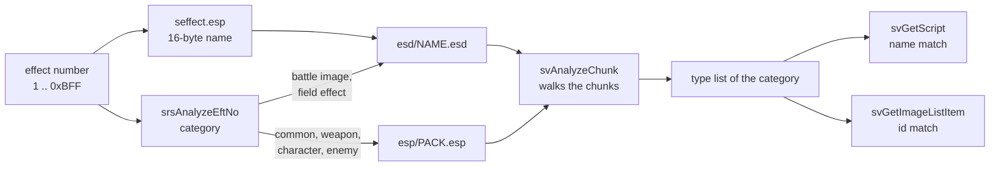
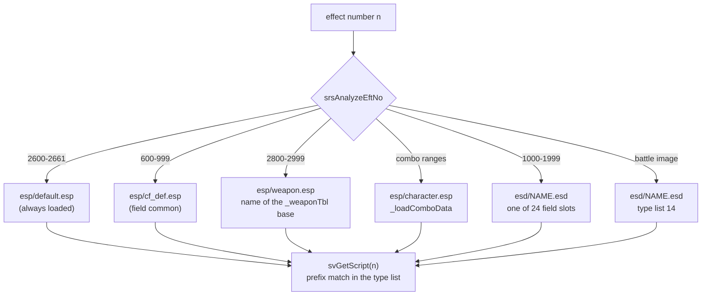
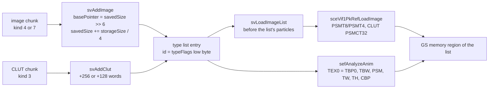
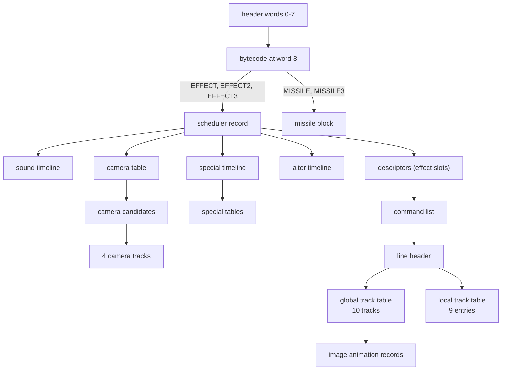

# Effect data files

The special effects of battles and of the field, such as sparks, rings,
flashes, Ether blasts, weapon trails and camera moves, are data for the effect
system `sef`. That data lives in `data\simajiri\` of the disc archive: 1051
`.esd` files with one effect each, 169 `.esp` packs that bundle the images,
models and effects of a character, an enemy group or a weapon, and the name
table `seffect.esp` that turns an effect number into a file name. The folder
also holds the two models of the effect viewer and two loose missile models,
which the retail game does not read.

Every `.esd` and `.esp` file is a list of 64-byte aligned chunks. A chunk holds
one picture, one colour table, one model, one texture set or one effect script
table. The script table is a compact graph of 16-bit words: a small bytecode
program, scheduler records, command lists, emitters ("lines") and keyframe
tracks. The counts below come from walking every file and every structure
reachable in it. How the effect system runs this data is described in
[sef.md](../libraries/sef.md).

[← Back to the overview](../README.md) · See also [Files and resources](../architecture/files-and-resources.md)
for the disc, the archive directory and the ARX packing.

## The files

All effect files sit in one folder of archive group 00. None of them is ARX
packed. `src/main/srs.c` builds every path from `data/simajiri/` plus a name,
and the effect viewer can redirect the same names to a host PC or a USB drive
(see [sef.md](../libraries/sef.md#effect-files-and-memory)).

| Path | Files | Bytes | Contents |
| --- | --- | --- | --- |
| `data\simajiri\esd\*.esd` | 1051 | 44 903 040 | One effect each: a script table, often with its own images and models |
| `data\simajiri\esp\*.esp` | 169 | 4 665 472 | Packs: images, colour tables, models and embedded `.esd` files |
| `data\simajiri\seffect.esp` | 1 | 49 152 | Name table, 16 bytes per effect number |
| `data\simajiri\hama.lex`, `hama.xtx` | 2 | 42 640 | Stand-in actor model of the effect viewer |
| `data\simajiri\sen.lex`, `sen.xtx` | 2 | 34 368 | Grid floor model of the effect viewer |
| `data\simajiri\m\de_mss.lex`, `misl.lex` | 2 | 8 480 | Loose missile models, never loaded |

The `.esd` files range from 576 bytes (90 files with one small script and
nothing else, such as `debs0011.esd`) to 268 608 bytes (`eve022.esd`), with a
median of 13 440 bytes. The `.esp` packs range from
128 bytes, which is an empty pack, to 248 704 bytes (`cf_def.esp`), with a
median of 20 608 bytes.

The file names follow the effect families. `c_so`, `c_ko`, `c_ca`, `c_mm`,
`c_zi`, `c_jr` and `c_bg` are the combo effects of Shion, KOS-MOS, chaos,
MOMO, Ziggy, Jr. and Virgil. `etso`, `etko`, `etca`, `etmm`, `etzi`, `etjr`
and `etst` are the Ether and Tech Attack effects of the same characters and
of character 4 (`shitan` in the code). `etem` and `item` are enemy Ether and
item effects, `boss` and `debs` belong to bosses, `guno`, `fema`, `fere`,
`fero`, `feso`, `utma`, `utre`, `utro` and `utso` to enemy groups, `ef` and
`eve` to field and event effects, `def`, `exef`, `btlef` and `att_b` to the
common battle effects, and two- or three-letter names such as `sud00`,
`bd00`, `ax00` or `wire00` to weapons. A trailing `b` or `c` (`bd00b`,
`bd00c`) marks a variant of a weapon effect.

The diagram below shows how an effect number reaches its data.



## The chunk container

An effect file is a sequence of chunks. Each chunk starts with a 64-byte
header and its data follows at chunk offset 0x40. The first chunk is always a
file header of kind 1 and the last one is an end marker of kind 0. The walker
`svAnalyzeChunk` in `src/main/sv_get_image_item.c` steps over kinds 1 and 2 by
0x40 bytes, steps over every other chunk by its `byteSize`, and stops at kind 0
or at any kind it does not know. So the byte size of the file header, which is
the size of the whole file, is never used to skip.

```
+0x00  byteSize     u32   size of the chunk including the header, multiple of 0x40
+0x04  storageSize  u32   payload size (scripts, models) or VRAM size (images)
+0x08  kind         s16   0 end, 1 file header, 3 CLUT, 4/7 image, 5 script,
                          6 LEX model, 9 XTX texture set, 10 embedded .esd
+0x0A  typeFlags    u16   low byte: id of the chunk inside the file
+0x0C  width        s16   images and CLUTs only
+0x0E  height       u16   images and CLUTs only
+0x10  bitsPerPixel s16   images and CLUTs only (4 or 8)
+0x12  pack class   u16   never read (see below)
+0x14  name         44 bytes, NUL-terminated
+0x40  data
```

| Offset | Size | Type | Source name | Meaning | Values seen |
| --- | --- | --- | --- | --- | --- |
| 0x00 | 4 | u32 | `byteSize` | Chunk size with header. For kind 1 the file size | Multiple of 0x40 in all 14 086 chunks |
| 0x04 | 4 | u32 | `storageSize` | Kind 5 and 10: data size (`byteSize - 0x40`). Kind 6 and 9: model size before padding to 0x40. Kind 3, 4 and 7: GS memory to reserve | 0 for kinds 0 and 1 |
| 0x08 | 2 | s16 | `kind` | Chunk kind | 0, 1, 3, 4, 5, 6, 7, 9, 10 (kind 2 never occurs) |
| 0x0A | 2 | u16 | `typeFlags` | Low byte: the id that image references use. High byte always 0 in the files | 0 to 132 |
| 0x0C | 2 | s16 | `width` | Image or CLUT width in pixels | 8 to 256 |
| 0x0E | 2 | u16 | `height` | Image or CLUT height in pixels | 2 to 256 |
| 0x10 | 2 | s16 | `bitsPerPixel` | Index depth | 4, 8 |
| 0x12 | 2 | u16 | `packClass` | Pack class, written by the conversion tool, not read by the game | 0, 1, 2, 4 |
| 0x14 | 44 | char | `name` | Resource name with extension, NUL-terminated | up to 36 characters |
| 0x40 | | | `data` | Payload | |

The chunk kinds and what the loader does with them are listed below. The
counts are over all 1220 `.esd` and `.esp` files.

| Kind | Name extension | Loader | Count in `.esd` | Count in `.esp` | Contents |
| --- | --- | --- | --- | --- | --- |
| 0 | none | end of walk | 1051 | 169 | End marker, all 64 bytes zero |
| 1 | none | skipped (0x40) | 1051 | 169 | File header, `byteSize` = file size |
| 3 | `.clt` | `svAddClut` | 2839 | 663 | Colour table |
| 4 | `.bmp` | `svAddImage` | 2842 | 0 | Indexed image, name with source path |
| 5 | `.esd` | `svAddScript` | 1051 | 0 | Effect script table |
| 6 | `.lex` | `svAddModel` | 1380 | 222 | LEX model |
| 7 | `.bmp` | `svAddImage` | 0 | 697 | Indexed image, name without path |
| 9 | `.xtx` | `svAddModel` | 1378 | 222 | XTX texture set of the model |
| 10 | `.esd` | `svAddScript2` | 0 | 352 | A complete `.esd` file embedded in a pack |

Kinds 4 and 7 have the same layout and the same loader. Kind 4 appears only in
`.esd` files and kind 7 only in `.esp` packs. The kind-1 header of an `.esd`
file has every field except `byteSize` and `kind` zero. In an `.esp` pack it
also carries the pack class at +0x12.

Several fields hold build leftovers. In 1175 chunks of `.esd` files (695
colour tables and 480 images) the name field holds stray bytes after the NUL,
such as `enemy\boss_001\nduzu.clt\0lt` in `boss0011.esd`. They are the tail of
a longer name that the conversion tool probably wrote into the same buffer
before. The names of chunks inside `.esd` files keep the source directory of
the artist's files: folders under `cf\` such as `cf\cf_seek\` for field
effects (1988 chunks),
`enemy\boss_NNN\` for enemies (1722), `pc\kosmos\c_ko10\`, `pc\shion\c_so10\`
and the other party folders, `etem\etemNN\`, `item\itemNN\`, and shared folders
such as `pc\bom\`, `pc\kemuri\` (Japanese for smoke) and `pc\zanzou\`
(afterimage). 4343 of the 8439 paths start with a backslash and the others do
not, often for the same folder. Chunk names inside `.esp` packs have no path.

The walk was checked on every file: each chunk size is a multiple of 0x40, the
chunks end exactly at the end of the file, every file starts with kind 1 and
ends with kind 0, and the ids are unique inside each file.

### Annotated example: the start of `amp02.esd`

`amp02.esd` is a weapon effect with a single script chunk. Its first 0xC0 bytes
are shown below.

```
0000: c00c0000 00000000 0100 0000 ...          kind 1, byteSize 0xCC0 = file size
0040: 400c0000 000c0000 0500 0000 00000000     kind 5, byteSize 0xC40, storageSize 0xC00
0050: 00000000 616d7030 322e6573 64000000      +0x14 name "amp02.esd"
0080: 0300 0600 ffff 0800 ffff 0100 ffff 0000  script table words 0-7 (fixed header)
0090: 3e00 0280 5000 5a00                      EFFECT3 #2, schedulers at words 80, 90
0098: 4800 0280 1300                           MISSILE3 #2, missile block at word 19
009e: 3600                                     WAITMISSILE
00a0: 3400 ffff 0400                           WAITEFT #-1, EXIT
00a6: 0400 4221 4c21 1102 ...                  missile block (word 19)
0c80: 00000000 00000000 0000 0000 ...          kind 0 end chunk, last 0x40 bytes
```

## The name table (seffect.esp)

`seffect.esp` is not a chunk file. It is a flat array of 3072 entries of 16
bytes, one for each effect number from 0 to 0xBFF. Each entry is a
NUL-padded name without extension. 1631 entries are named and the others are
all zero. `sresLoadCommonMemory` loads it once into `_loadEsdData` together
with `esp/default.esp`. The buffer is 0xC800 bytes, but the file is only 0xC000
bytes, so the last 128 entries of the buffer stay zero.

| Offset | Size | Type | Source name | Meaning | Values seen |
| --- | --- | --- | --- | --- | --- |
| 0x00 | 16 | char | `_loadEsdData[n]` | Name of effect number `n`, NUL-padded | up to 10 characters, no bytes after the NUL |

`srsGetEsdData(n)` returns the entry, and `srsGetEffectName(n)` turns it into
`esd/NAME.esd`. Before the lookup, `srsGetEffect2Idx(n)` is subtracted from
the number. Numbers that share one script with an `EFFECT2` table therefore
read the entry of the first number of their group (see
[effect numbers](#effect-numbers-and-files)). 142 named entries below 2900 are
never read this way. They only document the variant, for example `def002` at
2601, whose script is the second branch of `def001`.

Several entries are markers that bracket a range and have no file:
`combotop` and `comboend` (0 and 99), `enemytop` and `enemyend` (240 and 396),
`mapeft` (600), `mapseek` and `mapseekend` (1000 and 1999), `ettop` and `etend`
(2000 and 2218), `bosstop` and `bossend` (2300 and 2481), `efcmn` (2500),
`efcmdend` (2661), `bossdeftop` and `bossdefend` (2680 and 2786), and
`weapontop` and `weaponend` (2800 and 2999).

The bytes below are entries 2800 to 2805 at offset 0xAF00.

```
af00: 7765 6170 6f6e 746f 7000 0000 0000 0000  2800 "weapontop" (marker)
af10: 7375 6430 3000 0000 0000 0000 0000 0000  2801 "sud00"
af20: 7375 6430 3062 0000 0000 0000 0000 0000  2802 "sud00b"
af30: 6178 3030 0000 0000 0000 0000 0000 0000  2803 "ax00"
af40: 6178 3030 6300 0000 0000 0000 0000 0000  2804 "ax00c"
af50: 6264 3030 0000 0000 0000 0000 0000 0000  2805 "bd00"
```

## Effect numbers and files

`srsAnalyzeEftNo` in `src/main/srs.c` sorts an effect number into a category,
and the category decides which file holds the script. The tests run in the
order of the table. Effect numbers and categories are described in
[sef.md](../libraries/sef.md#effect-numbers). This table adds where the data
sits on the disc.

| Numbers | Category | Script found in | Loader |
| --- | --- | --- | --- |
| 3042 to 3071 | battle image (14) | `esd/db01.esd` to `esd/db30.esd`, none of them on the disc | `svFileLoadScript` |
| 2600 to 2661 | common (0) | kind-10 chunks of `esp/default.esp` | `sresLoadCommonMemory` |
| 2800 to 2999 | weapon (2 to 10) | kind-10 chunks of the weapon pack `esp/NAME.esp` | `sresLoadBattleData` |
| 600 to 999 | field common (15) | kind-10 chunks of `esp/cf_def.esp` | `sresLoadCfMemory` |
| 2200 to 2217 | battle image (14) | `esd/NAME.esd` | `svFileLoadScript` |
| 1000 to 1999 | field effect (16 to 39) | `esd/NAME.esd` | `srsFileLoadCf` |
| 2000 to 2218 | battle image (14) | `esd/NAME.esd` | `svFileLoadScript` |
| `_srsChrEfTbl` combo and alternate ranges | weapon (2 to 10) | kind-10 chunks of `esp/<character>.esp` | `sresLoadBattleData` |
| `_srsChrEfTbl` first and second ranges | battle image (14) | `esd/NAME.esd` | `svFileLoadScript` |
| `_srsChrEfTbl2` ranges | combo (11 to 13) | kind-10 chunks of `esp/<group>.esp` | `sresLoadBattleData` |
| `_srsChrEfTbl2` boss ranges below 2680 | battle image (14) | `esd/NAME.esd` | `svFileLoadScript` |
| anything else | battle image (14) | `esd/NAME.esd` | `svFileLoadScript` |

The pack of a character, enemy group or boss is named by `_loadComboData`
(195 rows: `shion`, `kosmos`, `chaos`, `guno_001`, `fema_002`, `boss_017` and
so on). The pack of a weapon is named after the first effect number of its row
in `_weaponTbl`: `srsWeapon2EffectID(weapon)` gives that number and
`srsGetEffectName2` builds `esp/NAME.esp` from its name entry. Each of the 45
rows of `_weaponTbl` lists three effect numbers, one per attack of the weapon.
For weapon 109 they are 2859, 2859 and 2860, so `esp/wire00.esp` holds the
scripts `wire00.esd` and `wire00c.esd`. Numbers 2900 to 2998 reuse the name of
the number 100 lower and run the second `EFFECT2` branch of its script.

Inside the loaded pack, `svGetScript(n)` looks for the first script chunk
whose name starts with the name entry of `n` (`strncmp` over the length of the
entry). It searches the type list of the category, and for the battle image
list 14 it returns the first entry without comparing names. A prefix match
could pick the wrong chunk, for example `bd00` could match `bd00b.esd`.
In the shipped packs the chunk with the exact name always comes first, so all
552 pack lookups that have data resolve to the right chunk.

### The mapper index

Every loaded file fills one type list of the image mapper, a table of 40 lists
(see [sef.md](../libraries/sef.md#the-image-mapper)). `sefSearchMapperIndex(n)`
in `src/main/sef.c` runs `srsAnalyzeEftNo` and turns the category into the
index of the list that holds the data of `n`. `svGetScript`, the image lookups
and the missile code all start from this index.

| Category or number | Type list |
| --- | --- |
| battle image | 14 |
| field common | 15 |
| field effect | 16 to 39: the slot whose loaded effect number is `n`, or 0 when none is |
| 2800 to 2999 | 2 to 10: the loaded weapon slot whose weapon id (`srsEftNoWeaponEffectID(n)`) matches, or 0 |
| below 100, 240 to 396, 2500 to 2599 and 2680 to 2785 | 2, 5 or 8 for the party member whose character id matches `mapperSearchCharacterId`, otherwise 11 to 13 for the matching enemy slot, otherwise 0 |
| anything else | 0, the common list filled from `default.esp` |

The diagram below shows the decision for one number.



## The .esd files

An `.esd` file holds one effect. Its first chunk after the header is always
the script (kind 5), named like the file. Images, colour tables and models
that only this effect uses follow it. The 1051 files fall into four shapes.

| Chunks after the script | Files |
| --- | --- |
| none | 403 |
| images, colour tables, models and texture sets | 279 |
| models and texture sets | 185 |
| images and colour tables | 184 |

The script chunk is 448 to 13 760 bytes long (median 2112). Its id is always
0. The ids of the other chunks are not in file order: the images come first
with odd ids and their colour tables follow with even ids, as in the listing of
`boss0011.esd` below.

```
000000 kind 1  byteSize 0x4fc0                       file header
000040 kind 5  id 0x00  "boss0011.esd"               script, 0x1080 bytes
001100 kind 4  id 0x01  "enemy\boss_001\nduzu.bmp"   64x64, 4 bit, storage 0x800
001940 kind 4  id 0x03  "enemy\boss_001\dumi.bmp"    32x32, 4 bit, storage 0x200
...
002c00 kind 4  id 0x09  "enemy\boss_001\hikari03.bmp" 64x64, 4 bit, storage 0x1600
003440 kind 3  id 0x06  "enemy\boss_001\mmzhaji1.clt" 16 colours
...
0036c0 kind 6  id 0x0b  "enemy\boss_001\nfra11.lex"  model
003ac0 kind 9  id 0x0c  "enemy\boss_001\nfra11.xtx"  texture set
004f80 kind 0                                        end
```

An effect whose category loads it from a pack never reads its `.esd` file.
346 of the 1051 files are such duplicates of a kind-10 chunk in a pack, and 68
of them differ from the copy in the pack (see [unused files](#files-that-nothing-loads)).

## The .esp effect packs

An `.esp` pack groups the data that a part of the game needs at once. Its
chunks are images (kind 7), colour tables (kind 3), models (kinds 6 and 9) and
whole `.esd` files (kind 10), in that order.

| Pack | Files | Contents |
| --- | --- | --- |
| `default.esp` | 1 | Common battle data, loaded once: 32 images, 27 colour tables, 10 models, and the scripts `def001`, `exef001`, `btlef01` to `btlef06`, `btlef10` and `att_b01` |
| `cf_def.esp` | 1 | Common field effects 600 to 999: 14 images, 14 colour tables, 20 models and 37 scripts |
| character packs | 8 | `shion`, `kosmos`, `chaos`, `momo`, `ziggy`, `jr`, `shitan` and `virgil`: the combo effects of each character and the `deNN` effects of its alternate range |
| enemy and boss packs | 112 | `boss_NNN` (35), `guno_NNN` (29), `utma_NNN` (14), `utro_NNN` (7), `utso_NNN` (7), `fema_NNN` (6), `utre_NNN` (6), `feso_NNN` (4), `fere_NNN` (3) and `fero_001` |
| weapon packs | 47 | `sud00`, `ax00`, `bd00`, `wire00`, `msp00` and the others: the scripts of one weapon and its variants |

`_loadComboData` also names the packs `cecilia`, `catherin`, `mary` and
`shelley` (character slots 8, 9, 11 and 12). No file of these names is on the
disc, and `_srsChrEfTbl` gives these characters no effect numbers, so nothing
asks for them.

28 packs are empty. They hold only the file header and the end chunk (128
bytes). 20 of them belong to enemies and bosses whose effects need no pack
data, such as `boss_006` or `utma_014`, and 8 to weapons, such as `bw00` or
`msp01`.

The listing of `bd00.esp`, the pack of weapon effects 2805 to 2807, shows the
usual order.

```
000000 kind 1  byteSize 0x4e80          pack class 2 (weapon)
000040 kind 7  id 01 "fls01.bmp"        64x64, 4 bit
000880 kind 7  id 02 "hen01.bmp"        64x64, 4 bit
0010c0 kind 7  id 03 "ring03.bmp"       64x64, 4 bit, storage 0x1000
001900 kind 3  id 04 "hen01.clt"        16 colours
001980 kind 3  id 05 "fls01.clt"
001a00 kind 3  id 06 "ring03.clt"
001a80 kind 6  id 07 "zan01.lex"        model
002480 kind 9  id 08 "zan01.xtx"        texture set
002d80 kind 10 id 09 "bd00.esd"         embedded effect 2805
003840 kind 10 id 0a "bd00b.esd"        embedded effect 2806
004200 kind 10 id 0b "bd00c.esd"        embedded effect 2807
004e40 kind 0                           end
```

### The pack class field

Inside a pack, the u16 at chunk offset +0x12 of every chunk except colour
tables and texture sets holds the same small number. No code reads it
(`packClass` in `SvImageChunk` and `SvClutChunk`). It is probably a pack
type written by the conversion tool.

| Value | Packs | Chunks |
| --- | --- | --- |
| 0 | `default.esp` | all of its chunks |
| 1 | character, enemy and boss packs | 120 headers, 535 images, 171 models, 241 embedded scripts |
| 2 | weapon packs | 47 headers, 116 images, 21 models, 64 embedded scripts |
| 4 | `cf_def.esp` | 1 header, 14 images, 20 models, 37 embedded scripts |

In `.esd` files the field is 0 in every chunk.

### Embedded .esd chunks

A kind-10 chunk wraps a complete `.esd` file. Its data at +0x40 is that file
byte for byte: a kind-1 header whose `byteSize` equals `byteSize - 0x40` of
the outer chunk, the kind-5 script chunk, and the kind-0 end. The script table
therefore starts at outer chunk offset 0xC0. `svAddScript2` registers it like a
kind-5 chunk: data pointer at +0xC0, name pointer at +0x14 (the outer chunk's
name), resource kind 5 and the chunk id. The source names the name pointer
`dataPtr`, and its comment places it in the next list slot, but the slot base
`typeList + index * 0x24` plus 0x1C is exactly the list entry, so the fields
land on the entry's `data`, `used`, `resourceKind`, `typeFlags`, `width`,
`height` and `name`. The inner kind-1 and kind-0 chunks are never walked, so
any images inside an embedded `.esd` would be ignored. None of the 352
embedded files has any.

## Images and colour tables

### Images

An image chunk (kind 4 or 7) holds an indexed picture of 4 or 8 bits per
pixel, stored row by row from the top without any GS swizzling. In 4-bit
images the low nibble of a byte is the left pixel. The data size is
`width × height × bits / 8`.

| Offset | Size | Type | Source name | Meaning | Values seen |
| --- | --- | --- | --- | --- | --- |
| 0x04 | 4 | u32 | `storageSize` | GS memory the image reserves, in bytes | at least the data size |
| 0x0A | 2 | u16 | `typeFlags` | Image id (low byte) | 1 to 131 |
| 0x0C | 2 | s16 | `width` | Width, power of two | 16 to 256 |
| 0x0E | 2 | u16 | `height` | Height, power of two | 8 to 256 |
| 0x10 | 2 | s16 | `bitsPerPixel` | 4 or 8 | 1892 images of 4 bits, 1647 of 8 bits |
| 0x40 | | | `data` | Pixel indices | |

The most common sizes are 64×64 at 8 bits (989 images), 64×64 at 4 bits
(870), 32×32 at 4 bits (754) and 128×128 at 8 bits (369). The largest are
256×256 at 8 bits (56 images).

In 3191 of the 3539 images `storageSize` equals the data size. The other 348
reserve more, from 1.19 to 16 times the data (150 of them exactly twice). The
same picture size gets different reservations, for example 32×32 4-bit images
reserve 0x200, 0x400, 0x600, 0x800, 0xA00, 0xB80, 0xC00, 0xE00 or 0x1000
bytes. The GS block layout of a
PSMT4 or PSMT8 texture of these sizes needs no more than the data size, so the
padding is probably a choice of the conversion tool, such as room for a
larger version of the picture. It is not explained by the code.

### Colour tables

A colour table chunk (kind 3) holds a CLUT of 32-bit RGBA entries. The width
and height fields are fixed per depth and do not describe the data.

| Depth | `width` × `height` | `storageSize` | Data | Chunk size | Count |
| --- | --- | --- | --- | --- | --- |
| 4 bits | 8 × 2 | 0x40 | 16 entries, 64 bytes | 0x80 | 1857 |
| 8 bits | 8 × 8 | 0x400 | 256 entries, 1024 bytes | 0x440 | 1645 |

Each entry is the bytes R, G, B and A. The alpha follows the GS convention
where 0x80 is fully opaque. The 256-entry tables are stored in the order of
the GS CSM1 layout: inside each group of 32 entries, entries 8 to 15 and 16 to
23 are swapped. A decoder that does not swap them shows the wrong colours on
8-bit images.

### From the chunk to the GS

Images are not uploaded at load time. `svAddImage` records the chunk in the
type list of its category and gives it a place in GS memory, and the draw code
uploads the whole list right before it draws the list's particles
(`svLoadImageList`, see [sef.md](../libraries/sef.md#the-image-mapper)).

Each type list keeps a running GS address `savedSize` in 32-bit words, starting
at `top_1[list]` (917 504 words, byte 0x380000, for list 0). `svAddImage` sets
the image's `basePointer` to `savedSize >> 6`, the GS block number, and adds
`storageSize >> 2`. For a 4-bit image whose height is less than half its width
the reservation is multiplied by `width / (height × 2)`. `svAddClut` sets
`basePointer` the same way and adds 256 words for an 8-bit table or 128 words
for a 4-bit one. The capacities in `siz_0` are never checked against
`savedSize`.

`svLoadTexture` sends the pixels with `sceVif1PkRefLoadImage`: GS format
PSMT8 (19) or PSMT4 (20), destination block `basePointer`, buffer width
`bufferWidthPixels >> 6`, and `bufferWidthPixels × height / 16` quadwords read
straight from the chunk data. `bufferWidthPixels` is the row length in bytes:
`width / 2` for 4-bit images, `width` for wider 8-bit images and `height` for
taller ones. `svLoadClut` sends an 8-bit table as a 16×16 PSMCT32 rectangle and
a 4-bit table as 8×2.

When a particle uses an image, `sefAnalyzeAnim` builds its GS `TEX0` register
from the two list entries of an [image animation record](#image-animation-records):
`TBP0` = image `basePointer`, `TBW` = `bufferWidthPixels >> 6`, `PSM` = PSMT8
or PSMT4, `TW` and `TH` = the size exponents, `TCC` = 1, `CBP` = colour table
`basePointer` and `CLD` = 1 (load the CLUT). The CLUT format stays PSMCT32 and
the storage mode CSM1, which is why the tables are stored in CSM1 order.

The diagram below follows one image.



### Image references

Effect data never names an image. It stores a 16-bit reference whose low byte
is the chunk id and whose high bits pick the type list.
`svGetImageListItem(type, flags)` checks the bits in this order and returns the
first used entry of that list whose id equals the low byte. The counts are the
references in image animation records, and the number in brackets is how many
of them also carry the model bit 0x2000.

| Bit | List searched | Records |
| --- | --- | --- |
| 0x0100 | 0, `default.esp` | 4546 (540) |
| 0x0200 | the scheduler's own list (its [mapper index](#the-mapper-index)) | 2016 (454) |
| 0x0400 | the scheduler's own list | 530 (70) |
| 0x1000 | the scheduler's own list | 1158 (617) |
| 0x0800 | 15, `cf_def.esp` | 186 (136) |
| none | 14, the battle image | 3642 (914) |
| 0x2000 | not tested by the lookup, marks a model | 2731 in all |

For example the missile of `amp02.esd` uses the references 0x2142 and 0x214C:
models in list 0 with the ids 0x42 and 0x4C, which are `de_mss.lex` and
`de_mss.xtx` in `default.esp`.

## Models

Kind 6 chunks hold a LEX model and kind 9 chunks the XTX texture set that goes
with it. Their formats are described in [nml.md](../libraries/nml.md#lex-models).
`svAddModel` records the data at chunk +0x40, the name at +0x14 and the chunk
id with bit 0x2000 added. The model is drawn by the particle code when the
particle's render type is 6 (see [sef.md](../libraries/sef.md#particles)).
`storageSize` is the exact model size and `byteSize` rounds it up to a
multiple of 0x40 plus the header.

In all 547 files that hold models, every LEX chunk comes first and every XTX
chunk follows, so a model is not stored next to its texture set. The XTX names
repeat the LEX names, in the same order in 364 files and in another order in
181. Two files do not pair up. `etem45.esd` has eight LEX chunks but only six
XTX chunks (`swkake02` and `swkake03` have none), and `etjr03.esd` has a
`moji02.lex` with a `moji03.xtx`. The pairing in the game comes from the
[image animation records](#image-animation-records), which name the model and
its texture set by id, not from the order of the chunks.

## The effect script table

The data of a script chunk is one table of 16-bit little-endian words. Every
reference inside it is a word index from the start of the table, not a byte
offset and not a pointer. The value 0xFFFF, and in most places 0, means "none".
`scGetImmAdrImmIdx2(base, table, i)` turns entry `i` of a table into an
address: `base + 2 × table[i]`, or 0 for a null entry. Nothing is fixed up at
load time, every lookup does this conversion.

The first eight words are the same in all 1403 tables (1051 `.esd` files and
352 embedded copies).

| Word | Value | Meaning |
| --- | --- | --- |
| 0 | 3 | Index of the entry address |
| 1 | 6 | Unknown, constant |
| 2 | 0xFFFF | Unknown, constant |
| 3 | 8 | Entry point of the bytecode, read through word 0 |
| 4 | 0xFFFF | Unknown, constant |
| 5 | 1 | Unknown, constant |
| 6 | 0xFFFF | Unknown, constant |
| 7 | 0 | Unknown, constant |

`scCreateScript` starts the first task at `table[table[0]]`, which is always
word 8. The program there is tiny. It starts schedulers, waits for them and
ends. The schedulers point to the rest of the data.

The diagram below shows how the structures of a table point to each other.



### The bytecode

The program is the effect-script language of
[sef.md](../libraries/sef.md#effect-scripts). An opcode word is followed by
its operands, and the length of a command depends on its opcode. A numeric
operand with bit 0x8000 is an immediate of 14 bits (signed when bit 0x4000 is
set), otherwise it names a register. Address operands are word indices into
the table.

| Opcode | Command | Operands after the opcode |
| --- | --- | --- |
| 1, 2 | `GO`, `GOSUB` | address |
| 3 | `BRA` | number, condition, number, address |
| 6, 7 | `ONGO`, `ONGOSUB` | selector, count, then `count` addresses |
| 10, 70 | `PRINT`, `MOVIE` | NUL-terminated string, padded to an even length (one extra byte when its length is odd, two when even) |
| 20, 23 to 30 | `RSET`, `RADD` ... `R_XOR` | register, number |
| 21, 22, 31, 32, 11, 34 | `RINC`, `RDEC`, `R_NOT`, `R_NEG`, `RPUT`, `REVE` | register |
| 33 | `RRND` | register, number, number |
| 40 | `OBJEVE` | number, address |
| 41, 50, 51, 52 | `ABORT`, `WAITCNT`, `WAITEVE`, `WAITEFT` | number |
| 60 | `EFFECT` | scheduler record |
| 61 | `EFFECT2` | count, then `count` scheduler records |
| 62 | `EFFECT3` | number, scheduler record, scheduler record |
| 71 | `MISSILE` | missile block |
| 72 | `MISSILE3` | number, missile block |
| 0, 4, 5, 12 to 15, 42, 53, 54 | `ERROR`, `EXIT`, `RETURN`, `RDUMP`, `CMDPUTON`, `CMDPUTOFF`, `FADEON`, `PAUSE`, `WAITMOVIE`, `WAITMISSILE` | none |

The shipped scripts use only nine commands. Over all 1403 tables, following
every reachable command, the counts are `EXIT` 1403, `WAITEFT` 1396, `EFFECT`
1187, `EFFECT3` 146, `EFFECT2` 70, `WAITMISSILE` 23, `MISSILE` 13, `FADEON` 11
and `MISSILE3` 10. No script branches, uses registers, prints or plays a movie.
The first command at word 8 is `EFFECT` in 1182 tables, `EFFECT3` in 140,
`EFFECT2` in 70 and `FADEON` in 11.

`WAITEFT` always carries the operand 0xFFFF (immediate -1), but its handler
reads the operand and ignores it: it waits for the task's last scheduler.
`EFFECT2` tables have 2 to 12 entries. The entry is chosen by
`srsGetEffect2Idx` of the effect number, or 1 for effects 2900 to 2998. The
first number of `EFFECT3` and `MISSILE3` is a delay: the second scheduler (or
the missile) of task `t` starts `number × t` frames late, which staggers the
hits on several targets.

`scAnalyzeScriptCf` reads word 8 directly instead of running the program. For
`EFFECT` it takes word 9, for `EFFECT2` the entry `srsGetEffect2Idx(n)` of the
list at word 10 (word 9 is the count), and for `EFFECT3` word 10.

### Scheduler records

A scheduler record is what `sefCreateScheduler2` reads to start one
scheduler (see [sef.md](../libraries/sef.md#schedulers)). It is four timeline
offsets followed by a list of effect slot descriptors.

```
+0  sound timeline     offset or 0xFFFF
+1  camera table       offset or 0xFFFF
+2  special timeline   offset or 0xFFFF
+3  alter timeline     offset or 0xFFFF
+4  descriptor 0       category, command list, setting
+7  descriptor 1
...
    0xFFFF 0xFFFF 0xFFFF   end
```

| Word | Source name | Meaning | Values seen |
| --- | --- | --- | --- |
| +0 | `value0` → `soundParameters` | Sound timeline (stride 4) | 8 records use one |
| +1 | `value1` → `sdvSelectCamera` | Camera table | 443 |
| +2 | `value2` → `effectValue` | Special timeline (stride 2) | 282 |
| +3 | `value3` → `alterValue` | Alter timeline (stride 18) | 229 |

The 1861 records have between 1 and 41 descriptors: 1 in 790 records, 2 in
396, 3 in 193, 4 in 126, and fewer for higher counts. 902 `.esd` files hold
one scheduler record, 132 hold two, and a few event effects hold up to 11.

Each descriptor is three words, the fields of `SefEffectDescriptor`.

| Word | Source name | Meaning | Values seen |
| --- | --- | --- | --- |
| +0 | `category` | Start frame in bits 0-9, signal bits above (0x800 sound, 0x1000 wait for the special flag, 0x2000 hit, 0x4000 finish). A negative value ends the list | 0x1000 in 339, 0x2000 in 431, 0x4000 in 366, 0x5000 in 310, 0x800 in 176, none in 4289 |
| +1 | `script_offset` | Command list, or 0xFFFF for a slot that only fires its signals | 0xFFFF in 814 |
| +2 | `setting` | -1 normal. An index names another descriptor, whose category becomes the scheduler's loop target (`link_id`). -0x100 fills the slot only when bit 0 of the request's `initFlags` is set, otherwise the slot stays empty, also when the scheduler loops. -0x200 shows the battle map at the start frame (`mapDispOn`). -0x201 hides it (`mapDispOff`) and sets scheduler flag 0x4000, so the map comes back when the effect ends | -1 in 5864, index in 44, -0x100 in 2, -0x201 in 1, -0x200 in none |

The end of the list is always the three words 0xFFFF 0xFFFF 0xFFFF. The
game's slot table has room for 32 slots (`SEF_EFFECT_COUNT`), and
`sefInitEffectTbl` stops after 32. `eve486.esd` has 41 descriptors in one
record, so its last 9 slots never run.

### Command lists

A command list starts lines in an effect slot (see
[sef.md](../libraries/sef.md#effect-slots)). It is a list of six-word
`SefEffectCommand` records.

| Word | Source name | Meaning | Values seen |
| --- | --- | --- | --- |
| +0 | `start_time` | Frame of the slot at which the line starts. 0x400 ends the list | 0 to 0x3FF |
| +1 | `frame` | End frame of the line. The line's timer is `frame - start_time` | |
| +2 | `data_offset` | Line header | never null |
| +3 | `link_index` | Index of a parent line in the same list, or -1 | -1 in 15 393, an index in 1784 |
| +4 | `count` | 1: when the timer runs out the line goes on while it has particles, and its child lines are kept. 0: it ends at once with its children | 1 in 16 075, 0 in 1102 |
| +5 | `flags` | Non-zero would mark the line not attached (`line_flags` 0x401) | always 0 |

`sefExecEffectData` walks the list in order and stops at the first command
whose start time has not come yet, so the commands are sorted by start time.
The 3959 lists hold 17 177 commands, most often 1 (1122 lists), 2 (631) or 4
(505). Every list ends with the record 0x400 0x400 0xFFFF 0 1 0, except the
two copies of a broken reference in `wire00c.esd` (see
[errors](#unreferenced-data-and-errors-in-the-tables)). Only the first 32
commands of a list can start a line. `kos_bw01.esd` has three lists of 33
commands, so the last command of each never runs. In 45 commands the
`link_index` points to a later command of the list.

### Line headers

A line header describes one emitter (`SefLineScriptHeader`, read by
`sefInitLineData`). It is six words long. The code reads only the first five,
and the sixth is 0 in all 14 726 headers.

| Word | Source name | Meaning | Values seen |
| --- | --- | --- | --- |
| +0 | `table_indices[0]` | [Global track table](#global-tracks) | |
| +1 | `table_indices[1]` | [Local track table](#local-tracks) | |
| +2 | `gravity` | Gravity, times `gravityScale` | non-zero in 4089 |
| +3 | `collision` | Collision setting (`collision_progress`) | 0 in 12 912, then 50, 60, 1, 20, 30 ... |
| +4 | `height` | Ground height, times `heightScale` | |
| +5 | none | Unused | always 0 |

### Key lists

All tracks are lists of keys of one of two shapes, the source's `SefKey3` and
`SefKey5`.

| Shape | Words | Fields |
| --- | --- | --- |
| Key3 | 3 | `frame`, `value`, `jump` |
| Key5 | 5 | `end_frame`, `vector[3]` (x, y, z), `jump` |

A key's frame is the frame at which the track reaches it. A list ends with a
single word 0x400 in place of the next key's frame. `sefProgressKey3` and
`sefProgressKey5` move to the next key when the frame counter reaches its
frame. When that next key has a `jump` of 0 or more, the counter jumps back to
the key with that index and takes its frame, which makes the track loop. A
`jump` of -1 just moves on. A list whose second key frame is 0x400 holds one
constant key, which the code evaluates once at creation. Frame counters stop
at 0x3FF, so a key frame of 0x400 or more is never reached.

In the shipped data loops are rare. Most loop keys sit at the end of colour,
scale and alpha tracks and jump back to key 0 (360 in L4 tracks, 159 in L2,
115 in L5). The light track L8 uses the `jump` word for its range (see
below), with values from -100 to -5000.

### Global tracks

The global track table (`key_table` in `sefInitLineData`) has ten entries.
Tracks G0 to G8 move the emitter and set its emission. G9 lists its images.
The table keeps the code's field names.

| Entry | Source name | Prefix words | Keys | Meaning |
| --- | --- | --- | --- | --- |
| G0 | `global_position_keys` | point code, random x, y, z | Key5 | Emitter position: a [point code](../libraries/sef.md#positions-and-attachment) plus an offset in tenths. The random words spread the origin by up to ±range/2 |
| G1 | `first_vector_keys` | volume shape, 0 | Key5 | Start volume around the emitter. Shapes 0 sphere, 1 sphere surface, 2 cube, 3 cube top, 4 cube bottom, 5 rotated circle, 6 cylinder |
| G2 | `parent_position_keys` | point code, random x, y, z | Key5 | Target position of the particles, same form as G0 |
| G3 | `second_vector_keys` | volume shape, 0 | Key5 | Target volume, same shapes as G1 |
| G4 | `key_1E0` | mode, 3 words | Key5 | Particle direction. The mode is a point code or 3, and mode 3 also turns off the 0.01 size scale |
| G5 | `key_1E4` (`float_keys`) | random range, 0 | Key3 | Particle speed in hundredths |
| G6 | `light_position_keys` | point code, random x, y, z | Key5 | Light position (used with L8) |
| G7 | `first_integer_keys` | none | Key3 | Particles per emission |
| G8 | `second_integer_keys` | none | Key3 | Frames between emissions |
| G9 | `key_1F0` | none | animation records | Images of the particles |

The point codes seen in G0 are 529 (a damage null, 1365 tracks), 3 (no anchor,
1106), 512 (target, 898), 256 (caster, 869), 2048 (alternative caster, 778),
4 (parent particle, 670), caster nulls 257 to 264 and weapon nulls 1024 and
up. The code 4096 (0x1000, in 90 tracks) leaves the offset unanchored, but
`sefExecLineGlobalData` then attaches the whole scheduler to the caster
(scheduler flag 0x80). Codes above 4096 would also pass `code - 0x1000` to
`sefGetParentMatrix`, but none occurs in G0. When the G0 key list holds one
constant key, `sefInitLineData` converts it once and scales it by
`globalPositionScale` (0.1). Each random word `r` adds `random % r - r / 2` to
that axis of the origin. G6 is null in 11 540 of the 11 915 global tables, the
other nine entries are always present.

### Image animation records

The G9 list has four-word records, read by `sefAnalyzeAnim` and `sefAnimate`.

| Word | Source name | Meaning | Values seen |
| --- | --- | --- | --- |
| +0 | `time` | Frames this image is shown. 1024 holds it | 1 to 1024 |
| +1 | `image_id` | [Image reference](#image-references). 0 or less ends the list | |
| +2 | `alt_image_id` | Reference of the colour table (images) or of the texture set (models) | |
| +3 low byte | `jump` | -1 next record, 0 or more loop to that record, -2 stop | -1 in 11 661, 0 in 417 |
| +3 high byte | `flag` | Only record 0 is read. Above 0 sets `first_flag` | 0 or 1 |

The list ends with the three words 0x400 0 0xFFFE (all 9359 lists). 8811 lists
have a single record, 22 have none, and the others animate through up to 30
records (`boss0184.esd`). The render
type of the particle is the resource kind of the first image (4 for a sprite,
6 for a model).

### Local tracks

The local track table (`line_table`) has nine entries. The first two are plain
numbers and the other seven point to tracks that each particle runs on its
own.

| Entry | Source name | Prefix words | Keys | Meaning |
| --- | --- | --- | --- | --- |
| L0 | `script_parameters[0]` | number | | Particle life in frames |
| L1 | `script_parameters[1]` | number | | Random extra life, 0 to L1 - 1 frames |
| L2 | `initial_vector_keys` | random x, y, z, uniform flag | Key5 | Particle scale in 1/64. With the flag set one random value is used for all axes |
| L3 | `rotation_vector_keys` | mode, random x, y, z (degrees) | Key5 | Rotation. The mode is a point code or flag. The word before the table is read as `previous_mode` |
| L4 | `position_vector_keys` | none | Key5 | RGB colour (128 = full) |
| L5 | `first_integer_keys_local` | blend, 0 | Key3 | Alpha. The low byte of the first word indexes `alphaTbl`: 1 in 7029 tracks, 2 in 1124, 0 in 341 |
| L6 | `size_vector_keys` | none | Key5 | Size, times 0.01 unless G4's mode is 3 |
| L7 | `second_integer_keys_local` | none | Key3 | Value passed to `sefMoveParticle`, unknown use (probably a curve or homing strength) |
| L8 | `light_keys` | none | Key5 | Point light: r, g, b, with the negative range in the `jump` word |

Typical tables leave L6, L7 and L8 null (8141 of 11 157). 386 local tables
hold only a light track (L8) and leave L2 to L7 null. The word just before an
L3 track is part of the data: it is 0 in 8170 tracks, and 1, 2 or 4 in the
others.

### Timelines

The four timelines of a scheduler are read by `sdvExecSeqTbl` in
`src/main/sdv.c` (see [sef.md](../libraries/sef.md#timelines-in-sdv)). Each is
a list of fixed-size rows whose first word is a frame. A frame of 0x400 ends the
list. A frame of 0x1000 waits for the hit signal (`_hitFlag` or `_hitSignal`)
when byte 22 of the battle data is set, and is skipped without firing when it
is clear. 120 special rows use it. Any other frame fires when the timeline's
frame counter reaches it. The counter stops at 1023, so a row with a larger
frame and every row after it never fire. The stride comes from
`sefCreateScheduler2`, not from the data.

| Timeline | Stride (words) | Row | Distinct timelines |
| --- | --- | --- | --- |
| Sound | 4 | frame, latch, sound id (u32) | 8, one row each |
| Special | 2 | frame, special table | 282 |
| Alter | 18 | see [alter events](#alter-events) | 221 |

The sound rows are rare. Only `ef10101`, `ef10104b`, `ef10105b` and `eve017`
(and their copies in `cf_def.esp`) play a sound from data. The latch is -1 in
all of them, and the ids are 28, 0x10008, 0x10009 and 0x3008A. `sdvPlaySound`
passes the id to `xglSoundEffectNormalID`, which takes the high 16 bits as the
slot of a loaded effect bank and the low 16 bits as the sound in that bank. So
0x3008A is sound 0x8A of bank slot 3, and 28 is sound 28 of bank slot 0.

### Camera tables

A camera table is read by `sdvSelectCamera`. It holds four candidates with
weights and a fifth candidate for battles that start with a boss entry. The
code reads ten words, but the tenth (a weight for the fifth candidate) is never
used, and in the files the first candidate begins right after the ninth word.

| Word | Meaning | Values seen |
| --- | --- | --- |
| 0, 2, 4, 6 | Candidate 0 to 3, or 0xFFFF | |
| 1, 3, 5, 7 | Weight of the candidate in percent | the four weights add up to 100 in every table |
| 8 | Boss-entry candidate, or 0xFFFF | |

A candidate is four offsets, one per camera track, and each track has its own
row size. `sdvScheduleCamera` steps them with `sdvProgressPrm`.

| Track | Row words | Row | Ends with |
| --- | --- | --- | --- |
| Position | 12 | frame, transition, 2 unknown words, x, y, z, point selection, offset x, y, z, offset kind | the word 0x400 |
| Target | 12 | same as position | the word 0x400 |
| Perspective | 4 | frame, transition, perspective, bank in degrees | the full row 0x400 0 40 0 (all 921 tracks) |
| Shake | 6 | frame, the five arguments of `MCamShake` | the full row 0x400 0 0 0 0 0 (all 488 tracks, 232 of them with no other row) |

The transition word holds two bytes, the high byte and the low byte, that
`sdvProgressPrm` copies into the transition it passes to `MCamMove`. Their
exact meaning is unknown. The point selection uses the camera codes of
`sdvSetCameraParam`: 256 and 257 to 272 the caster, 512 and 513 to 528 the
target, 529 the damage null, 32 and 33 both actors, anything else a fixed
point. Candidates with a weight of 0 are often still written out in full,
together with their tracks, and nothing reads them.

### Special tables

A special timeline row points to a special table, which `sdvExecSpecial`
turns into a screen filter (see
[sef.md](../libraries/sef.md#special-timeline-screen-filters)).

| Word | Source name | Meaning | Values seen |
| --- | --- | --- | --- |
| +0 | `kind` | Filter kind | 7 in 233, 4 in 150, 6 in 23, 1 in 19 |
| +1 | `part` | Point code the filter follows, or 3 for screen space | |
| +2 | `keys[]` | Ten-word `SdvSpecialKey` rows | |

| Key word | Source name | Meaning |
| --- | --- | --- |
| 0 | `time` | Frame of the key. 2048 ends the filter, 1024 holds the last key forever |
| 1 | `depth_step` | Depth offset of the filter |
| 2-3 | `color[4]` | R, G, B, A bytes |
| 4, 5 | `x`, `y` | Offset |
| 6, 7 | `width`, `height` | Size, 512 × 480 is the whole screen |
| 8 | `intensity` | Strength |
| 9 | `z` | Third offset coordinate |

398 tables end with a full key row of time 2048 that holds default values
(colour 0x80 0x80 0x80 0x40, size 512 × 480, z -1), and each of them is followed by the
two words 0x400 0xFFFF. Only the time of the end row is read, and nothing reads
the two extra words. They are probably an end marker of the conversion tool.
The 27 tables that end with 1024 have neither. The blend between two keys
interpolates `z` toward the next key's `intensity` instead of its `z` (in
`sdvExecSpecial`), which only matters when two keys differ in `z`.

### Alter events

An alter timeline row starts a ribbon trail (`SdvAlterEvent`, read by
`sdvScheduleAlter`, see [sef.md](../libraries/sef.md#alters-trails)).

| Word | Source name | Meaning | Values seen |
| --- | --- | --- | --- |
| 0 | `unmodeled_00` | Frame | |
| 1 | `life` | Life of the trail | |
| 2 | `mode` | Texture mode: 2 scrolls, 3 and 4 follow the sample phase, others plain | 1 in 309, 4 in 130, 2 in 40, 3 in 16, and one broken row with 0x400 (`etem39.esd`) |
| 3 | `blend` | Index into `alphaTbl` | |
| 4-7 | `rgba[4]` | Colour and alpha | |
| 8, 9 | `selector[2]` | Point codes of the two edges of the ribbon | |
| 10 | `max_samples` | Samples kept, at most 128 | |
| 11 | `shrink` | Shrink setting | |
| 12 | `image_frames` | Frames per image of the texture animation | |
| 13 | `length` | Texture length | |
| 14-17 | `images[2]` | Two pairs of image and colour table references, -1 for none | |

### Missile blocks

`MISSILE` and `MISSILE3` point to a missile block (`MissileCommandData`).
`scWaitMissileScript` in `src/main/sc_wait_parse_script.c` reads it while the
script waits in `WAITMISSILE`, and hands one spawn record per entry to the
missile code of the battle overlay (see
[battle-effects.md](../game/battle-effects.md)). It is a 12-word header
followed by six-word entries (`MissileCommandEntry`).

| Word | Source name | Meaning | Values seen |
| --- | --- | --- | --- |
| 0 | `command_value` | Value copied into every spawn record | |
| 1, 2 | `primary_image_index`, `secondary_image_index` | [Image references](#image-references), looked up in the list of the effect's [mapper index](#the-mapper-index) | |
| 3 | `command_kind` | Target selection. 529 picks 527 or 528 from the missile subtype, 5 targets every enemy (`sefCaclAllTarget`) | 529 in 20 blocks, 5 in 2, 0 in 1 |
| 4-9 | `image_pairs[3]` | Three pairs of image references. Each pair becomes one 64-bit `TEX0` value | |
| 10, 11 | `unmodeled_14` | Not read | 0 in all 23 |

| Entry word | Source name | Meaning |
| --- | --- | --- |
| 0 | `frame` | Frame at which the missile spawns. 1024 or more ends the list |
| 1 | `flags` | Bit 0x400 or 0x100 selects a command flag (`flags - 1024` or `flags - 249`) |
| 2-4 | `position_x`, `position_y`, `position_z` | Start position in hundredths |
| 5 | `spawn_parameter` | Passed on to the spawn record |

The 23 blocks have 4 to 40 entries (`solb.esd` has the most).

### Annotated example: one line of `amp02.esd`

The words below come from the script table of `amp02.esd` and show one
complete emitter, from the scheduler record to its tracks.

```
w80   ffff 015a ffff ffff            scheduler: camera table at w346 only
w84   0019 0064 ffff                 slot 0: frame 25, command list w100
w87   ffff ffff ffff                 end of descriptors
w100  0000 001e 0112 ffff 0001 0000  command: start 0, end 30, line w274, no parent
w106  0000 000a 0142 ffff 0001 0000  command: start 0, end 10, line w322
...
w130  0400 0400 ffff 0000 0001 0000  end of the command list
w274  01f5 0242 0000 0000 0000 0000  line: global w501, local w578, no gravity
w501  01ff 0209 0211 021b 0223 022d ffff 0233 0237 023b   global table G0-G9
w511  0400 0000 0000 0000            G0 prefix: weapon null 0, no spread
w515  0000 0000 0005 0003 ffff 0400  G0 key: offset (0, 0.5, 0.3), end
w521  0000 0000                      G1 prefix: sphere
w523  0000 0007 0000 0000 ffff 0400  G1 key: radius 7, end
w557  0001 0000 0000 0002 ffff 0400  G5: random 1, speed 0.02, end
w563  0001 0001 ffff 0400            G7: 1 particle per emission
w567  0001 0005 ffff 0400            G8: every 5 frames
w571  005a 0120 013f 00ff            G9: 90 frames of de_cld01.bmp (list 0, id 0x20), CLUT id 0x3F
w575  0400 0000 fffe                 end of the image records
w578  001e 0000 024b 025b 0265 026b ffff 027d ffff        local table: life 30
w613  0001 0080 0080 0080 ffff 0400  L4: colour 128,128,128
w619  0001 0000                      L5 prefix: blend 1
w621  0001 0000 ffff 0003 0020 ffff 001e 0000 ffff 0400   L5: alpha 0, 32, 0
w631  0000 0000 0000 0000 ffff 0400  unreferenced default size track
```

### Unreferenced data and errors in the tables

Following every reference from word 8 reaches 84.7 % of all words of the 1051
`.esd` tables. The rest is padding or data nothing points to.

| Words | Share | What |
| --- | --- | --- |
| 1 221 896 | 84.7 % | Reached from the bytecode |
| 107 357 | 7.4 % | Whole command lists, with their lines and tracks, that no descriptor points to (94 files, up to 4993 words in the boss effects `debs0123`, `debs0203` and `debs0333`) |
| 31 902 | 2.2 % | Default size tracks 0 0 0 0 0xFFFF 0x400 written after L5 when the L6 entry is null |
| 15 116 | 1.0 % | Zero padding at the end of the table |
| 65 585 | 4.5 % | Other leftovers: disabled camera candidates and their tracks, scheduler records no command uses (such as the record at word 13 of `debs0013.esd`), other default tracks |

So the conversion tool wrote every track and candidate it had, and then left
the defaults and the disabled parts out of the tables. A few tables also hold
real errors. The game reads them as they are.

- In 10 tracks of 7 files (`c_so03`, `c_ko07`, `shb00`, `ecm02`, `boss0143`,
  `item08`, `item09`) the 0x400 end of a key list is missing. The list runs
  into the next structure, which the game reads as more keys.
- `wire00c.esd` (effect 2860, the third attack of weapon 109) and its copy in
  `wire00.esp` have a descriptor whose command list is 0x2059 instead of 0x59.
  The extra bit 0x2000 points to word 8281, about 12 KB past the end of the
  1952-word table, into whatever follows it in memory. The second scheduler of
  the same table, used by effect 2960, has the right value.
- In `etem39.esd` the alter offset points to data laid out as a special
  timeline, and the special offset is empty. The game runs the first row as an
  alter event with mode 0x400 and never reaches the second row, whose frame is
  0x7878.
- `eve486.esd` has 41 descriptors in one scheduler and `kos_bw01.esd` three
  lists of 33 commands, more than the 32 that the game uses.
- `eve334.esd` has an emission count key at frame 0x429, which is never
  reached.

## The simajiri models

The four model files in the root of `data\simajiri\` belong to the effect
viewer `SimajiriTest` in `src/main/set_path.c` (see
[debug tools](../game/debug-tools.md#simajiritest-the-effect-viewer)).
`dummyMapLoad` loads `sen.lex` and `sen.xtx` as the grid floor
(`gridlexTop`, `gridxtxTop`) and `hama.lex` and `hama.xtx` as the stand-in
model that `dummyMapDraw` draws at the caster and target positions. They are
ordinary LEX models with their XTX texture sets (magic `lex\0` and `XTX\0`).
The viewer has no caller in the retail game, so these files are never read.

`m\de_mss.lex` is byte for byte the `de_mss.lex` chunk of `default.esp`, the
missile model of the common effects. `m\misl.lex` is another missile model
that no pack contains. No code builds a path with `m\`, so both are source
leftovers. The `effect\misl.bin` that Xeno Card loads in OV10 is an unrelated
file of the card game.

## Files that nothing loads

The name table and the loaders above decide which files the game can reach.

- 347 of the 1051 `.esd` files are never read. 346 of them are standalone
  copies of scripts that the game loads from a pack, such as `c_so01` to
  `c_so06` (from `shion.esp`), all weapon scripts (from the weapon packs) and
  the 37 field effects `ef00001` to `ef10203` (from `cf_def.esp`). 284 copies
  are identical to the pack version and 68 differ. In many weapon effects,
  such as `bam00`, `bl00` and `hb00`, the only difference is the z offset of
  the first camera position key: 1000 or 1100 in the `.esd` file and 940 in
  the pack. Four copies differ in size (`bp00`, `hmr01`, `rf00c` and
  `c_zi03`). The 347th is `def002.esd`, whose number 2601 shares the script of
  `def001`.
- 10 `.esp` packs are not named by `_loadComboData` or `_weaponTbl`: the empty
  `bw00`, `drl00`, `drl01`, `guno_101`, `guno_102`, `guno_103`, `msp01` and
  `msp03`, and `boss_103` and `boss_104`, whose scripts `debs1031` to
  `debs1043` are read from their standalone `.esd` files instead.
- `hama.lex`, `hama.xtx`, `sen.lex` and `sen.xtx` are only read by the effect
  viewer, and `m\de_mss.lex` and `m\misl.lex` by nothing.
- The other way round, 425 named effect numbers have no script anywhere on the
  disc. They are mostly attack slots of bosses (97 `boss` numbers such as
  `boss0073` or `boss0044`), event effects (124 `eve` numbers), 39 `ef`
  numbers from 743 to 1052, the 30 numbers `db01` to `db30` (3042 to 3071),
  the combos of character 4 (`c_st01` to `c_st14`), and enemy effects whose
  packs are empty.

## Statistics

| Item | Count |
| --- | --- |
| Chunk files walked | 1220 (1051 `.esd`, 169 `.esp`) |
| Chunks | 14 086, with the file headers and end markers |
| Script tables | 1403 (1051 in `.esd`, 352 embedded) |
| Script table size | 192 to 6848 words (median 1024) |
| Scheduler records | 1861 |
| Effect slot descriptors | 5911, of which 814 signal only |
| Command lists | 3959, with 17 177 commands |
| Line headers | 14 726 |
| Global track tables | 11 915 |
| Local track tables | 11 157 |
| Camera tables | 443 |
| Special timelines | 282, with 425 special tables |
| Alter timelines | 221 |
| Missile blocks | 23 |
| Images | 3539 (2842 kind 4, 697 kind 7) |
| Colour tables | 3502 |
| LEX models and XTX texture sets | 1602 and 1600 |

The numbers count each distinct structure once per table, so the 352 embedded
copies add to the totals.

## Source files

| File | What it reads |
| --- | --- |
| `src/main/srs.c` | Name table, effect number categories, file names and loading (`srsAnalyzeEftNo`, `srsGetEsdData`, `srsGetEffect2Idx`, `srsGetEffectName`, `srsGetEffectName2`, `sresLoadCommonMemory`, `sresLoadCfMemory`, `sresLoadBattleData`, `srsFileLoadCf`, `srsMakeFileName`, `_loadComboData`, `_weaponTbl`, `_srsChrEfTbl`, `_srsChrEfTbl2`, `_srsEffect2IndexTbl`) |
| `src/main/sv_get_image_item.c` | Chunk walk and type lists (`svAnalyzeChunk`, `svAddImage`, `svAddClut`, `svAddModel`, `svAddScript`, `svAddScript2`), uploads (`svLoadTexture`, `svLoadClut`, `svLoadImageList`), lookups (`svGetImageListItem`, `svGetScript`, `svFileLoadScript`), GS memory tables `top_1` and `siz_0` |
| `src/main/sc_get.c` | Bytecode interpreter, operand decoding, `EFFECT`, `EFFECT2`, `EFFECT3`, `MISSILE`, `MISSILE3`, `scAnalyzeScriptCf` |
| `src/main/sc_wait_parse_script.c` | Wait commands and missile blocks (`scWaitMissileScript`) |
| `src/main/sef.c` | Mapper index (`sefSearchMapperIndex`, `sefSearchMapperIndex2`), scheduler records (`sefCreateScheduler2`, `sefInitEffectTbl`), command lists (`sefExecEffectData`), line headers and tracks (`sefInitLineData`, `sefExecLineGlobalData`, `sefExecLineLocalData`, `sefCreateParticle`), keys (`sefProgressKey3`, `sefProgressKey5`), image records (`sefAnalyzeAnim`, `sefAnimate`) |
| `src/main/sdv.c` | Timelines (`sdvExecSeqTbl`, `sdvScheduleSound`), camera tables (`sdvSelectCamera`, `sdvProgressPrm`, `sdvScheduleCamera`), special tables (`sdvExecSpecial`), alter events (`sdvScheduleAlter`) |
| `src/main/set_path.c` | Effect viewer and its models (`SimajiriTest`, `dummyMapLoad`, `dummyMapDraw`) |
| `include/main/srs.h`, `include/main/sef.h`, `include/main/sc_get.h`, `src/main/sdv.h`, `src/main/sc_wait_parse_script.h` | Resource categories (`SrsResourceType`), slot limits, script task fields, `SdvSpecialKey`, `MissileCommandData` |
