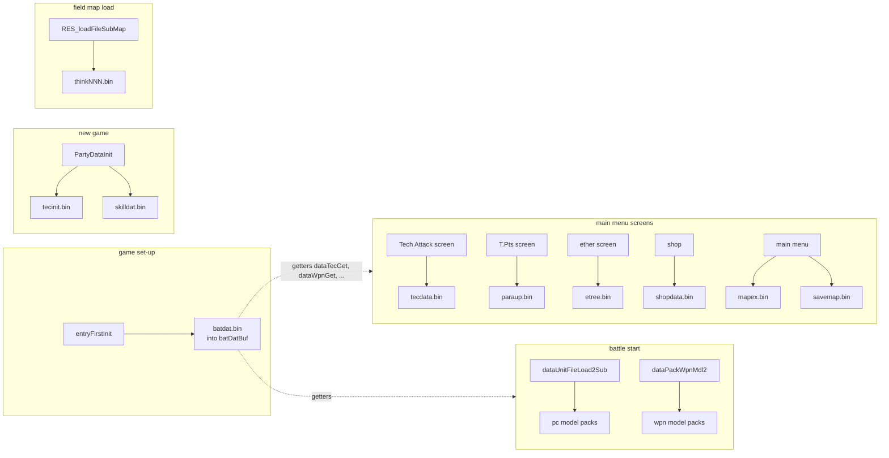
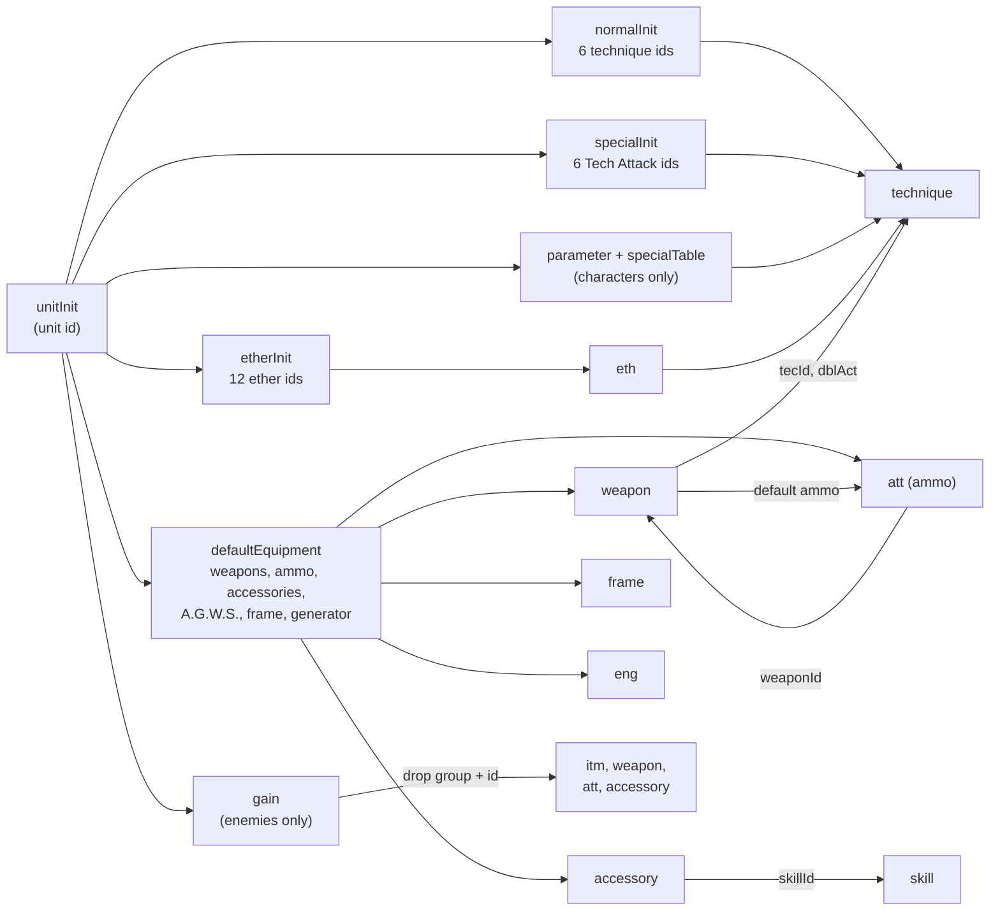
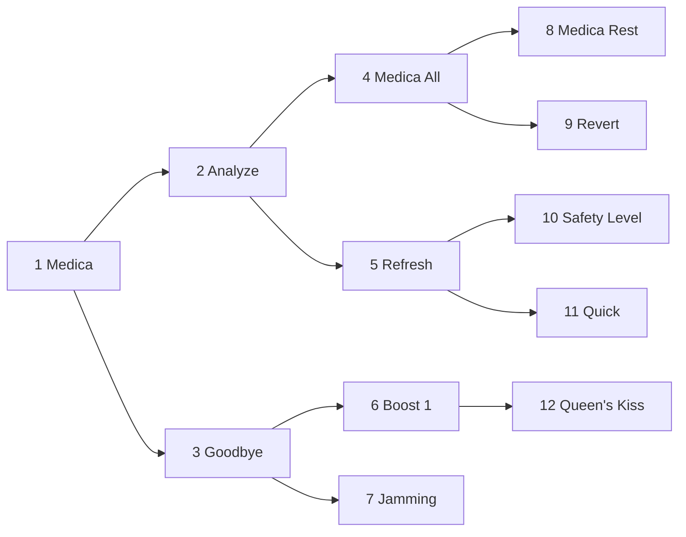
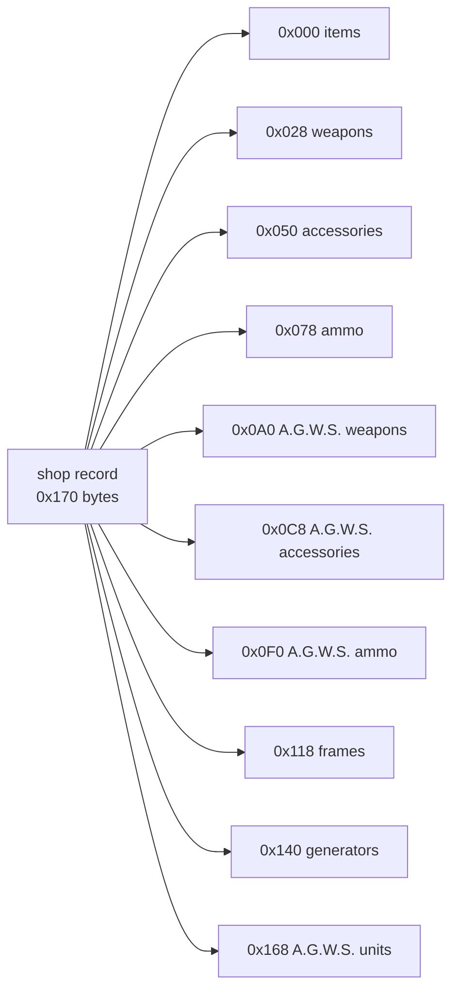
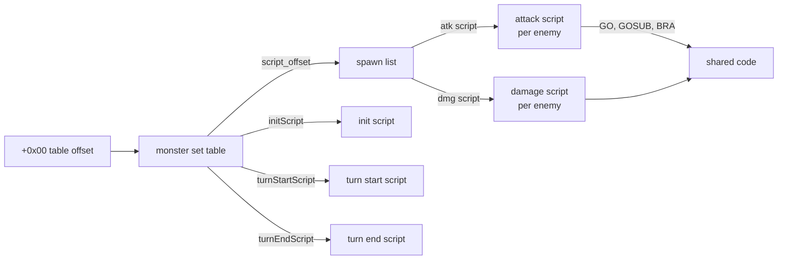
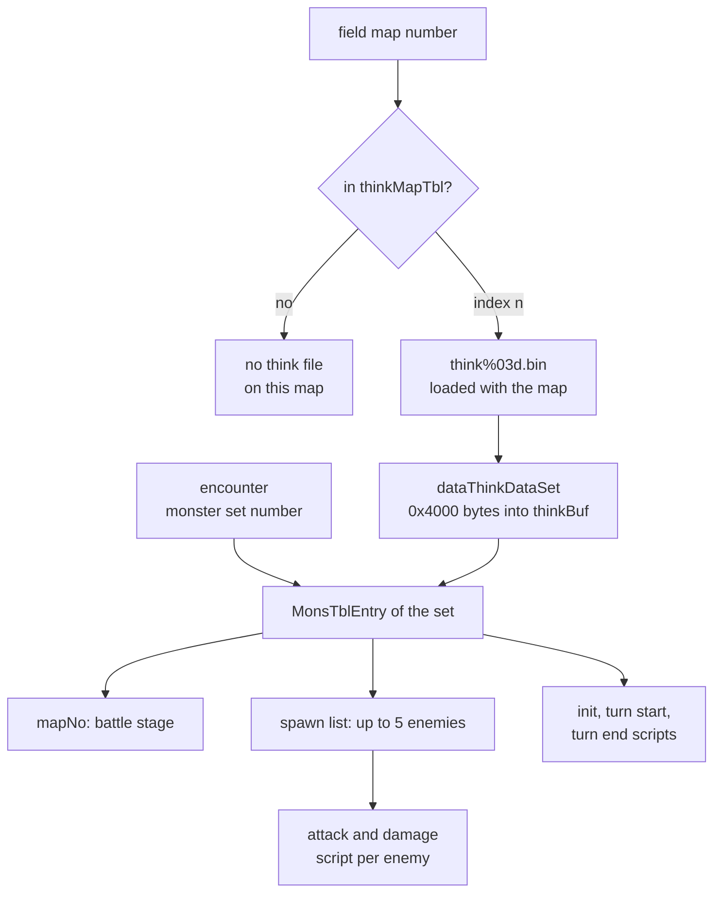

# Game data tables

The battle and growth rules of Xenosaga Episode I live in a small set of
binary tables on the disc. `data\yamamoto\batdat.bin` holds every unit,
technique, weapon, item, accessory, ether and battle reward of the game in 18
sections. The files in `data\endou` hold the rules of the main menu screens:
the start values and upgrade costs of the Tech Attacks, the skill levels of
the accessories, the T.Pts costs of the basic parameters, the ether tree, the
shop lists and the names of the segments and the save points. The 100 files
of `data\yamamoto\think` are the enemy AI programs, written in the bytecode
of the battle's think machine. Next to them, `data\yamamoto\pc` and
`data\yamamoto\wpn` hold the battle models of the playable characters and of
their weapons.

None of these files has a magic number or a version field. The code finds
every table through a fixed offset or through an offset header at the start
of the file. All multi-byte values are little-endian, as everywhere on the
PS2. All files are stored unpacked in the archive except seven model packs of
`data\yamamoto\pc`.

[← Back to the overview](../README.md)

The disc archive, the ARX packing and the resource system are described in
[Files and resources](../architecture/files-and-resources.md).

## Contents

- [Files at a glance](#files-at-a-glance)
- [Shared conventions](#shared-conventions)
- [Battle data (batdat.bin)](#battle-data-batdatbin)
- [Growth tables](#growth-tables)
- [Shop lists (shopdata.bin)](#shop-lists-shopdatabin)
- [Segment texts and save point names](#segment-texts-and-save-point-names)
- [Enemy AI programs (think files)](#enemy-ai-programs-think-files)
- [Battle model packs (pc and wpn)](#battle-model-packs-pc-and-wpn)
- [Other files in these directories](#other-files-in-these-directories)
- [Source files](#source-files)

## Files at a glance

The table lists every file with its size and the code that
reads it. The behaviour of the screens and of the battle system that use
these files is explained on the pages in the last column.

| File | Count | Bytes | Read by | When | Behaviour |
|------|------:|------:|---------|------|-----------|
| `data\yamamoto\batdat.bin` | 1 | 57,552 | `dataBatDatLoad` (OV01) | once, at game set-up | [Battle system](../game/battle.md) |
| `data\endou\tec\tecinit.bin` | 1 | 256 | `PartyDataInit` | new game | [Character growth](../game/character-growth.md) |
| `data\endou\tec\tecdata.bin` | 1 | 512 | Tech Attack screen (`menu_tec.c`) | screen opens | [Character growth](../game/character-growth.md) |
| `data\endou\skill\skilldat.bin` | 1 | 392 | `PartyDataInit`, skill screen | new game, screen opens | [Character growth](../game/character-growth.md) |
| `data\endou\para\paraup.bin` | 1 | 256 | T.Pts screen (`menu_para_pt_rate_get.c`) | screen opens | [Character growth](../game/character-growth.md) |
| `data\endou\ether\etree.bin` | 1 | 320 | ether screen (`menu_ether.c`) | screen opens | [Character growth](../game/character-growth.md#ether-tree) |
| `data\endou\shop\shopdata.bin` | 1 | 7,360 | `MenuShop` (`menu_shop.c`), `ShopTest` | shop opens | [Character growth](../game/character-growth.md) |
| `data\endou\mapex.bin` | 1 | 1,920 | main menu (`menu_1.c`) | menu opens | [Main menu](../game/main-menu.md) |
| `data\endou\savemap.bin` | 1 | 2,660 | main menu (`menu_1.c`) | save screen | [Main menu](../game/main-menu.md) |
| `data\yamamoto\think\thinkNNN.bin` | 100 | 382 to 11,220 | `RES_loadFileSubMap`, `dataThinkDataSet` | field map load | [Battle system](../game/battle.md#enemy-ai-and-the-think-vm) |
| `data\yamamoto\pc\*.bin` | 21 | 425,808 to 1,381,888 | `dataUnitFileLoad2Sub` (OV01) | battle start | [Battle system](../game/battle.md) |
| `data\yamamoto\wpn\*.bin` | 36 | 33,536 to 180,416 | `dataPackWpnMdl2` (OV01) | battle start | [Battle system](../game/battle.md) |
| `data\yajima\hddi.bin` | 1 | 181,824 | HDD install (`title_hdd_install.c`) | HDD install | [Title and boot](../game/title-and-boot.md) |

The diagram below shows which part of the game reads each file. The battle
code in OV01 stays resident during field play, so the field loader and the
main menu call its table getters directly.



## Shared conventions

**One-based ids.** Every table is indexed by an id that starts at 1. The id 0
means "none" and ends every list. The OV01 getters (`dataTecGet`,
`dataWpnGet`, `dataItmGet` and the others in `data_unit_org_get.c`) return
`records[id - 1]`. They print an error such as `** dataTecGet: err %d` for an
id of 0 or less and do not check the upper bound.

**Strings.** Text is EUC-JP: plain ASCII plus two-byte JIS X 0208 characters
with both bytes at 0xA1 or above. The English release still uses a few of
them, mostly the ideographic space `A1 A1` and the middle dot `A1 A6`, which
appears in names such as `R・BLADE` and `F・GSHOT`.

**Prices.** Prices are 32-bit values stored at 2-byte aligned offsets. The
code reads them through the packed union `BattleDataS32` (`include/main/sdv.h`)
as two halfwords.

**Character masks.** An equipment record says who can use it with a 16-bit
mask. `chrEquipGet` gives a character the bit `0x8000 >> (id - 1)` and an
A.G.W.S. the bit `0x8000 >> (id - 17)`. Bit 0x8000 is therefore chaos for a
character item and VX-01 for an A.G.W.S. item. A second mask, `categoryMask`
at +0x0C of a weapon, tells the two kinds apart: 0x4000 for character
equipment and 0x2000 for A.G.W.S. equipment (`MENU_EQUIP_CLASS_*` in
`menu_1.c`).

### Id spaces

The **unit id** (`charaId`) names every combatant. One unit record exists
for each id from 1 to 186. The ids 4, 8, 9, 12 to 16 and 30 to 32 have no
name in the player name table.

| Unit ids | Meaning |
|----------|---------|
| 1 to 12 | Characters: 1 chaos, 2 KOS-MOS, 3 Shion, 4 a nameless character with full data, 5 Ziggurat 8, 6 MOMO, 7 Jr., 10 Virgil, 11 Mary |
| 13 to 16 | Unused player slots |
| 17 to 22 | A.G.W.S. VX-01 to VX-06 |
| 23 to 28 | A.G.W.S. AG-01 to AG-06 |
| 29 | Bunnie |
| 33 to 186 | Enemies, from 33 "Debugster" and 34 Goblin to 186 |
| 187 to 194 | Special character models (`SPECIAL_MODEL_CHARACTER_ID_BEGIN` to `_END`), with model packs but no unit record |

A **technique** is any action with a damage formula. One technique table
covers all of them, so its id space is split in ranges by kind. The `kind`
byte at +0x11 of the technique record confirms the ranges.

| Technique ids | Count | `kind` | Meaning |
|---------------|------:|--------|---------|
| 1 to 44 | 44 | 0 or 1 | Normal attacks, six per character from chaos to Jr. (19 to 24 belong to the unused character 4), then 43 and 44 for Virgil |
| 45 to 98 | 54 | 2 | Tech Attacks, eight ids per character: 45 chaos, 53 KOS-MOS, 60 Shion, 68 character 4, 76 Ziggy, 83 MOMO, 91 Jr. |
| 99 to 553 | 455 | 0 | Enemy attacks |
| 554 to 731 | 178 | 3 | Ethers, technique = 553 + ether id |
| 732 to 871 | 140 | 4, 5 or 6 | Weapon attacks (character and A.G.W.S. weapons) |

## Battle data (batdat.bin)

`data\yamamoto\batdat.bin` is a single 57,552-byte (0xE0D0) file. It is not
packed. `dataBatDatLoad` reads it once into `batDatBuf` (0x00426F40), during
`entryFirstInit`, which the game's set-up calls long before the first
battle. The buffer is a `BattleDataStorage` of 0x10000 bytes, so 0x1F30 bytes
of it stay unused. Nothing writes the tables back. The battle code, the main
menu, the shops and the U.M.N. read them in place through the getters of
`src/ov01/data_unit_org_get.c`.

The file starts with a 0x50-byte header: a section count, the file size and
one offset per section. Each offset counts from the start of the file. The 18
sections follow back to back in header order, with no padding, and each is an
array of fixed-size records. The code never uses the count or the size
fields. It reads the offset of a section and indexes records from there.

```
batdat.bin (0xE0D0 bytes)
+--------+------------------------------+
| 0x0000 | sectionCount = 18            |
| 0x0004 | byteSize     = 0xE0D0        |
| 0x0008 | offset[18], s32 each         |
+--------+------------------------------+
| 0x0050 | unitInit         186 x 0x34  |
| 0x2618 | technique        871 x 0x18  |
| 0x77C0 | normalInit       186 x 0x0C  |
| 0x8078 | specialInit       16 x 0x0C  |
| 0x8138 | etherInit        186 x 0x18  |
| 0x92A8 | weapon           115 x 0x20  |
| 0xA108 | eth              178 x 0x0C  |
| 0xA960 | itm               72 x 0x14  |
| 0xAF00 | att              178 x 0x0E  |
| 0xB8BC | accessory        180 x 0x10  |
| 0xC3FC | skill             90 x 0x08  |
| 0xC6CC | gain             154 x 0x14  |
| 0xD2D4 | experience        99 x 0x04  |
| 0xD460 | parameter         16 x 0x20  |
| 0xD660 | specialTable      16 x 0x20  |
| 0xD860 | defaultEquipment  32 x 0x20  |
| 0xDC60 | frame             41 x 0x10  |
| 0xDEF0 | eng               40 x 0x0C  |
+--------+------------------------------+
```

### Header

| Offset | Size | Type | Field (`BattleDataHeader`) | Meaning | Value in the file |
|--------|-----:|------|----------------------------|---------|-------------------|
| 0x00 | 4 | u32 | `sectionCount` | number of sections | 18 |
| 0x04 | 4 | u32 | `byteSize` | size of the file | 0xE0D0 |
| 0x08 | 72 | s32[18] | `unitInitOffset` ... `engOffset` | byte offset of each section | 0x0050 to 0xDEF0 |

### Section list

Every section has one getter. Most getters return `records[id - 1]`. The gain
getter is the exception: its table starts 0x294 bytes (33 records) before the
section offset, so it is indexed by the enemy's unit id directly and record 1
belongs to unit 33.

| # | Section | Offset | Bytes | Record | Records | Getter | Index |
|--:|---------|--------|------:|-------:|--------:|--------|-------|
| 0 | `unitInit` | 0x0050 | 0x25C8 | 0x34 | 186 | `dataUnitOrgGet`, `dataUnitInitGet` | unit id |
| 1 | `technique` | 0x2618 | 0x51A8 | 0x18 | 871 | `dataTecGet` | technique id |
| 2 | `normalInit` | 0x77C0 | 0x08B8 | 0x0C | 186 | `dataNormInitGet` | unit id |
| 3 | `specialInit` | 0x8078 | 0x00C0 | 0x0C | 16 | `dataSpecInitGet` | unit id |
| 4 | `etherInit` | 0x8138 | 0x1170 | 0x18 | 186 | `dataEtherInitGet` | unit id |
| 5 | `weapon` | 0x92A8 | 0x0E60 | 0x20 | 115 | `dataWpnGet` | weapon id |
| 6 | `eth` | 0xA108 | 0x0858 | 0x0C | 178 | `dataEthGet` | ether id |
| 7 | `itm` | 0xA960 | 0x05A0 | 0x14 | 72 | `dataItmGet` | item id |
| 8 | `att` | 0xAF00 | 0x09BC | 0x0E | 178 | `dataAttGet` | ammo id |
| 9 | `accessory` | 0xB8BC | 0x0B40 | 0x10 | 180 | `dataAccGet` | accessory id |
| 10 | `skill` | 0xC3FC | 0x02D0 | 0x08 | 90 | `dataSklGet` | skill id |
| 11 | `gain` | 0xC6CC | 0x0C08 | 0x14 | 154 | `dataGainGet` | enemy unit id (33 to 186) |
| 12 | `experience` | 0xD2D4 | 0x018C | 0x04 | 99 | `dataExpTblGet` | level (zero-based) |
| 13 | `parameter` | 0xD460 | 0x0200 | 0x20 | 16 | `dataParaTblGet` | character id |
| 14 | `specialTable` | 0xD660 | 0x0200 | 0x20 | 16 | `dataSpecTblGet` | character id |
| 15 | `defaultEquipment` | 0xD860 | 0x0400 | 0x20 | 32 | `dataDefEquipGet` | player-side unit id |
| 16 | `frame` | 0xDC60 | 0x0290 | 0x10 | 41 | `dataFrmGet` | frame id |
| 17 | `eng` | 0xDEF0 | 0x01E0 | 0x0C | 40 | `dataEngGet` | generator id |

The sections refer to each other by id. A unit's start lists name its
techniques and ethers, its default equipment names weapons, accessories,
ammo, frames and generators, a weapon names its attack techniques and its
default ammo, an ether names its technique, an accessory names a skill and an
ammo record names the weapon it fits. The diagram below shows these links.



### Unit records

A unit record (0x34 bytes) holds the start state of one combatant. At the
start of a battle `calcCopyParaMake` copies it into the first 0x34 bytes of
the battle unit (`CalcUnitParam`, `include/ov01/calc.h`). The field names
below come from the debug view `UnitOrgData` in `src/ov01/debug_entry.c`,
whose labels the debug status screen prints. The battle side names the same
fields differently, as the last column shows.

| Offset | Size | Type | Field | Meaning | Range seen |
|--------|-----:|------|-------|---------|------------|
| 0x00 | 2 | u16 | `maxHp` | maximum HP | 0 to 16,000 |
| 0x02 | 2 | u16 | `maxEp` | maximum EP | 0 to 37 |
| 0x04 | 2 | s16 | `str` | Str, physical attack (`baseAtk`) | 0 to 165 |
| 0x06 | 2 | s16 | `vit` | Vit, physical defence (`phyDefense`) | 0 to 120 |
| 0x08 | 2 | s16 | `eatk` | Eatk, ether attack (`magAttack`) | 0 to 220 |
| 0x0A | 2 | s16 | `edef` | Edef, ether defence (`magDefense`) | 0 to 42 |
| 0x0C | 1 | s8 | `hit` | Dex, hit (`hitStat`) | 0 to 80 |
| 0x0D | 1 | s8 | `eva` | Eva, evasion (`evadeStat`) | 0 to 60 |
| 0x0E | 1 | s8 | `agility` | Agl, the wait-count term of `calcWct` | 0 to 18 |
| 0x0F | 1 | s8 | `moveKindId` | movement kind, `unitCmdMove` tests 4 | 0 to 9 |
| 0x10 | 2 | s16 | `atkRange` | gap kept when this unit walks up to another (`coliMove`), in hundredths | 0 to 750 |
| 0x12 | 2 | s16 | `defRange` | gap kept when another unit walks up to this one (`coliTarget`) | 0 to 440 |
| 0x14 | 1 | s8 | `level` | start level | 1 to 20 |
| 0x15 | 1 | s8 | `size` | size class, printed SS, S, M, L, LL | 0 to 4 |
| 0x16 | 1 | s8 | `cRate` | base counter chance of `calcCounter` (`counterRate`) | 0, 10, 20, 25, 50 |
| 0x17 | 1 | s8 | `ecap` | printed as ECAP by the debug screen | always 0 |
| 0x18 | 2 | u16 | `weak` | attribute weakness bits (`conditions`) | 0 to 0x4050 |
| 0x1A | 2 | u16 | `spec` | attribute resistance bits (`specDef`) | 0 to 0x4210 |
| 0x1C | 2 | u16 | `flags` | unit flags (`enum CalcUnitFlag`) | 0 to 0x4C02 |
| 0x1E | 2 | s16 | `weight` | weight | 38 to 176, 50 in 179 records |
| 0x20 | 1 | s8 | `bRate` | printed as BRATE | 0 to 25 |
| 0x21 | 1 | s8 | `bNum` | printed as BNUM | 0 to 10 |
| 0x22 | 2 | - | - | no reader | always 0 |
| 0x24 | 16 | u16[8] | `protect` | status protection word per status category (`statProtect`) | 0 to 0x7982 |

`calcCrit` ANDs `weak` with the attribute of the incoming technique. Any
common bit makes the hit critical. The damage multiplier starts at 1.5 (2.0
when `weak` has bit 0x4000) and grows by one half for each attribute group
that matches (bits 0x1F, 0xE0 and 0x300). `calcSpec` treats `spec` as the
matching resistance bits.

The known `flags` bits are 0x0001 and 0x0002 (block hit results 2 and 1),
0x0040 (`CALC_UNIT_FLAG_IS_AGWS`), 0x0100 (no range-0 attack), 0x0200
(items work in reverse, `CALC_UNIT_FLAG_ITEM_REVERSED`), 0x0800 (blocks the
back line) and 0x1000, 0x2000, 0x4000 (half damage from techniques whose
status kind byte 2, 1 or 0 is 2). The bits 0x0008, 0x0010, 0x0020 and 0x0400
appear in the file without a known reader.

Fourteen records have a `maxHp` of 0: the unused slots 8, 9, 13 to 16 and 30
to 32, the A.G.W.S. 21, 23, 25 and 28 and Bunnie (29). An A.G.W.S. probably
takes its HP from its frame (Fhp) instead.

The first record is chaos (`batdat.bin` at 0x0050):

```
000050: 90 01 1f 00 14 00 13 00 17 00 1a 00 14 16 08 00
        maxHp  maxEp  str    vit    eatk   edef   hit eva agl move
        400    31     20     19     23     26     20  22  8   0
000060: 96 00 32 00 0b 00 00 00 00 00 00 00 00 00 34 00
        atkRng defRng lv sz cR ec weak   spec   flags  weight
        150    50     11 0  0  0  0      0      0      52
000070: 00 00 00 00 00 00 00 00 00 00 00 00 00 00 00 00  bRate, bNum, +0x22, protect[0..6]
000080: 00 00 00 00                                      protect[7]
```

### Technique records

A technique record (0x18 bytes) describes one action. The battle reads it
through `TecKindView` (`src/ov01/calc.c`) and `TecRecord`
(`data_unit_org_get.c`).

| Offset | Size | Type | Field | Meaning | Range seen |
|--------|-----:|------|-------|---------|------------|
| 0x00 | 1 | u8 | `attr` | target and range class bits (`TEC_ATTR_RANGE`, `CALC_TRG_ALL_PARTY`) | 0x0A to 0xD2 |
| 0x01 | 1 | s8 | `epCost` | EP cost, the base of `calcTakeEpGet` | 0 to 60, set only for ethers and a few weapons |
| 0x02 | 2 | u16 | `flags` | technique flags, bit 0x0800 rules out a counter, 0x1000/0x2000/0x4000 enable the three status tests | 0 to 0x6000 |
| 0x04 | 1 | s8 | `effectType` | effect type, 4 clears statuses (`calcStatClr`) | 0 to 7 |
| 0x05 | 1 | s8 | `doubleDamageKind` | 1 doubles the damage while the target carries a certain status | 0 or 1 |
| 0x06 | 1 | u8 | `powLevBase` | base power, read by `calcPowLevGet` | 2 to 120 |
| 0x07 | 1 | s8 | `agility` | wait-count term of `calcPlusAglGet` | 0 to 3 |
| 0x08 | 3 | u8[3] | `statFlagKind` | status test bytes of `calcStatAtk` | 0, 1, 4 |
| 0x0B | 1 | u8 | - | no reader found | 1 for Tech Attacks, 31 for ethers, 7 to 12 for normal and enemy attacks, 0 to 7 for weapons |
| 0x0C | 1 | s8 | `statCategory` | status category set or cleared | 0 to 8 |
| 0x0D | 1 | s8 | `statRate` | status chance in percent | 0, 10, 20, 25, 50, 100 |
| 0x0E | 2 | u16 | `statMask` | status bits within the category | 0 to 0x4000 |
| 0x10 | 1 | u8 | - | no reader found | 1 to 15, 1 in 743 records |
| 0x11 | 1 | s8 | `kind` | technique kind, also the Boost timeline selector of `calcBp2Tid` | 0 to 6 |
| 0x12 | 2 | u16 | `attribute` | attribute bits, compared with the target's `weak` | 0 to 0x201 |
| 0x14 | 2 | s16 | `motionId` | motion played, through `dataMotNameGetMenu` | 0 to 340 |
| 0x16 | 2 | s16 | `effectNo` | visual effect started by the battle sequencer (`sefIsFinishEffect`) | 0 to 2867 |

Technique 45 is chaos's first Tech Attack, Angel Wings (`batdat.bin` at
0x2A38):

```
002a38: 80 00 00 04 00 00 18 02 00 00 00 01 00 00 00 00
        at ep flags  ef dd pw ag statFlag  0B cat rt mask
        80 0  0x400  0  0  24 2  0 0 0     1  0   0  0
002a48: 01 02 82 00 c3 00 22 00
        10 kd attr   motion effect
        1  2  0x82   195    34
```

Its base power of 24 is the same number that `tecdata.bin` lists for this
technique (see [Technique costs](#technique-costs-tecdatabin)).

### Normal, special and ether start lists

Three sections give each unit the actions it starts with. `dataPlUnitInit`
copies them into the unit records of the party, and the battle copies the
enemy lists at battle start.

| Section | Record | Content | Records with data |
|---------|--------|---------|-------------------|
| `normalInit` | 6 x s16 | normal technique ids, unit +0x76 | 159 of 186. Characters 1 to 7 and 10 use ids 1 to 44, the enemies ids 99 to 553 |
| `specialInit` | 6 x s16 | Tech Attack ids, unit +0x82 | 6 of 16 (chaos, KOS-MOS, Shion, Ziggy, MOMO, Jr.) |
| `etherInit` | 12 x s16 | ether ids, unit +0x8E | 39 of 186. Seven player-side records and 32 enemies, ids 17 to 155 |

The ether start list of character 4 holds ethers 59 to 70, the twelve
"Reserve" ethers. The chaos records are typical:

```
normalInit  1 at 0x77C0: 01 00 02 00 03 00 04 00 05 00 06 00   techniques 1 to 6
specialInit 1 at 0x8078: 00 00 00 00 2d 00 2d 00 2e 00 2d 00   0, 0, 45, 45, 46, 45
etherInit   1 at 0x8138: 1b 00 1c 00 00 00 ...                 ethers 27 and 28
```

### Weapon records

A weapon record (0x20 bytes) covers both character weapons and A.G.W.S.
weapons. Its names come from `WpnData` (`calc.c`), `WpnRecord`
(`data_unit_org_get.c`), `BattleWeaponPriceRecord` (`sdv.h`) and
`MenuShopWeapon` (`menu_shop.c`).

| Offset | Size | Type | Field | Meaning | Range seen |
|--------|-----:|------|-------|---------|------------|
| 0x00 | 2 | s16 | `attack` | attack term of `calcWpnAtkGet`, shown by the shop as `shopParameter1` | 0 to 160 |
| 0x02 | 4 | s32 | `price` | price | 0 to 20,000 |
| 0x06 | 2 | u16 | `flags` | 0x0100 = uses ammo (`SHOP_WEAPON_FLAG_BULLET`) | 0, 0x100, 0x1000 |
| 0x08 | 2 | u16 | `characterEquipMask` | who can equip it, see [Shared conventions](#shared-conventions) | 18 different masks |
| 0x0A | 2 | s16 | `motionType` | 1 loads the weapon technique's own motion | 0 or 1 |
| 0x0C | 2 | u16 | `categoryMask` | 0x4000 character weapon, 0x2000 A.G.W.S. weapon | 70 and 45 records |
| 0x0E | 1 | u8 | `mountMask` | A.G.W.S. mount points the weapon fits | 0 to 0x50 |
| 0x0F | 1 | s8 | `apCost` | AP cost checked by `calcWpnEnableChk` | 0, 3, 4, 6 |
| 0x10 | 1 | u8 | `equipped` | non-zero: the attack comes from the fitted ammo record (`calcAttWpnChk`) | 0 to 0xFF |
| 0x11 | 1 | u8 | `equipWeight` | weight class, the menu allows 3 per A.G.W.S. (2 for AG-05) | 1 or 2 |
| 0x12 | 2 | s16 | `wagl` | the Wagl value the shop shows for an A.G.W.S. weapon | 0 to 2 |
| 0x14 | 2 | s16 | `tecId` | attack technique | 732 to 871 |
| 0x16 | 2 | s16 | - | a second technique id, no reader found | 0 or 732 to 849 |
| 0x18 | 2 | s16 | `dblAct` | double-action technique, `calcDblActChk` requires it | 0 or 851 to 870 |
| 0x1A | 2 | s16 | `bullet` | default ammo id shown by the shop | 0 to 178 |
| 0x1C | 2 | s16 | `phyDefense` | physical defence added by `calcPhyDefGet` | 0 or 1 |
| 0x1E | 2 | u16 | `shopParameter2` | shown by the shop as the P.Arm of an A.G.W.S. weapon | always 0 |

Weapon 46 is Jr.'s ROOK505 (`batdat.bin` at 0x9848):

```
009848: 00 00 20 03 00 00 00 01 00 02 00 00 00 40 00 00
        atk   price       flags charM motT  catM  mt ap
        0     800         0x100 0x200 0     0x4000 0 0
009858: ff 01 00 00 09 03 00 00 00 00 2e 00 00 00 00 00
        eq wt wagl  tecId +16   dblAct bullet phyD  +1E
        ff 1  0     777   0     0      46     0     0
```

The mask 0x200 is `0x8000 >> 6`, the bit of unit 7, Jr. The weapon uses ammo
(flag 0x100) and takes its attack from the ammo record because `equipped` is
non-zero. Its default ammo is record 46 of `att`.

### Ether records

An ether record (0x0C bytes) holds the menu data of one ether. Its battle
action is the technique `tecId`, always 553 + ether id.

| Offset | Size | Type | Field | Meaning | Range seen |
|--------|-----:|------|-------|---------|------------|
| 0x00 | 2 | u16 | - | no reader | always 0 |
| 0x02 | 2 | u16 | `flags` (`EtherStatus`) | 0x4000 = cannot be transferred (`MenuEtherJoutoCheck`), 0x2000 unknown | 0, 0x4000 (5), 0x6000 (12) |
| 0x04 | 2 | s16 | `capCost` | Wt, the slot weight counted against `ETHER_CAP_MAX` (12) | 1 to 12 |
| 0x06 | 2 | s16 | `tecId` | technique | 554 to 731 |
| 0x08 | 2 | s16 | `pointCost` | E.Pts cost of an evolution | 0 to 2,800 |
| 0x0A | 2 | s16 | - | no reader | always 0 |

Ether 1, Medica, is `00 00 00 00 01 00 2a 02 28 00 00 00`: no flags, Wt 1,
technique 554 and 40 E.Pts. The ether menu and the ether tree use the ids 1
to 80. Only the ids 1 to 79 have a name, and the ids above 80 appear only in
the start lists of enemies.

### Item records

An item record (0x14 bytes) describes a consumable. `ItmTrgView` (`calc.c`)
names the battle fields.

| Offset | Size | Type | Field | Meaning | Range seen |
|--------|-----:|------|-------|---------|------------|
| 0x00 | 4 | s32 | `price` | price | 0 to 10,000 |
| 0x04 | 2 | u16 | `flags` | item class bits read by the menus | 0 to 0xE000 |
| 0x06 | 2 | - | - | no reader | always 0 |
| 0x08 | 1 | u8 | `trgFlags` | target selection bits | 0 to 0xC4 |
| 0x09 | 1 | u8 | `useFlags` | use flags, probably where the item can be used | 0, 2, 3 |
| 0x0A | 1 | u8 | `power` | amount used by `calcHitItem` and `calcDmgItem` | 0 to 100 |
| 0x0B | 1 | u8 | - | unknown, set in two records | 0 to 2 |
| 0x0C | 2 | u16 | effect bits | bit 0 recover HP (power x 50), bit 1 recover EP (power x 10), bit 3 recover HP by rate (maxHp x power / 20), bit 8 HP to 1, bit 13 like bit 3 in `calcDmgItem` | 0 to 0x2000 |
| 0x0E | 2 | s16 | - | value of some effects | 0 to 2,048 |
| 0x10 | 2 | s16 | effect number | visual effect | 0 to 2,184 |
| 0x12 | 2 | - | - | no reader | always 0 |

The records 62 to 72 are all zero, so only the first 61 records hold items.

### Ammo records

The `att` section (`BattleBulletPriceRecord` in `sdv.h`, `CalcAttData` in
`calc.c`) holds the ammo and attachments of the weapons that set
`equipped`. The shop calls them ammo (`SHOP_CAT_CHAR_AMMO`,
`SHOP_CAT_AGWS_AMMO`).

| Offset | Size | Type | Field | Meaning | Range seen |
|--------|-----:|------|-------|---------|------------|
| 0x00 | 2 | s16 | `attack` | attack used in place of the weapon's | 0 to 350 |
| 0x02 | 1 | s8 | `statCategory` | status inflicted, category | 0, 1, 4, 6 |
| 0x03 | 1 | s8 | `statRate` | status chance | 0 or 100 |
| 0x04 | 2 | u16 | `statMask` | status bits | 0 to 0x4000 |
| 0x06 | 4 | s32 | `price` | price | 0 to 2,400 |
| 0x0A | 2 | u16 | `flags` | item class bits | 0 or 0x1000 |
| 0x0C | 2 | s16 | `weaponId` | the weapon it fits, selects the price rate | 0 to 111 |

Record 1 is `00 00 04 64 00 08 c8 00 00 00 00 10 45 00`: no attack of its own,
status category 4 at 100 percent with mask 0x800, price 200, flags 0x1000,
for weapon 69 (M.W.S.). The names of the first records (`BXS001V` and on) say
which Tech Attack of Shion they modify. The records 170 to 178 are all zero.

### Accessory records

An accessory record (0x10 bytes) covers the character accessories (ids 1 to
128) and the A.G.W.S. parts (ids 129 to 180, all with the mask 0xFFF8 of the
13 A.G.W.S.).

| Offset | Size | Type | Field | Meaning | Range seen |
|--------|-----:|------|-------|---------|------------|
| 0x00 | 4 | s32 | `price` | price | 0 to 10,000 |
| 0x04 | 2 | u16 | `flags` | item class bits | 0 or 0x800 |
| 0x06 | 2 | u16 | `equipMask` | who can equip it | 0 to 0xFFF8 |
| 0x08 | 2 | - | - | no reader | always 0 |
| 0x0A | 2 | u16 | `category` | 0 and 1: only one accessory of that category per character, 2: free (`MenuAccessoryEquipCheck`) | 0 (39), 1 (19), 2 (122) |
| 0x0C | 1 | u8 | `shopParameter2` | physical defence, P.Arm for an A.G.W.S. part | 0 to 50 |
| 0x0D | 1 | u8 | `shopParameter3` | ether defence, E.Arm for an A.G.W.S. part | 0 to 6 |
| 0x0E | 2 | u16 | `associatedId` | skill id | 0 to 86 |

A.G.W.S. treat every accessory as category 2. Accessory 6, Neo Armor, is
`d0 07 00 00 00 08 00 92 00 00 00 00 1e 00 39 00`: 2,000 credits, mask
0x9200 (chaos, character 4 and Jr.), category 0, P.Def 30 and skill 57. The skill
level and cost of an accessory are not here but in
[skilldat.bin](#skill-learning-skilldatbin).

### Skill records

A skill record (`SkillData`, 8 bytes) holds two halfwords of flags that
`calcSkillInitSub` and `calcSkillSub` test. The low byte of `typeFlags` is a
status category, bit 0x400 sets a status (`SKILL_TYPE_STAT_SET`) and bit 0x800
protects one (`SKILL_TYPE_STAT_PROTECT`). `levelFlags` gives the bits of the
status or parameter, and its bits 0 to 6 are the amount `calcSkillSub`
returns. Bytes 4 to 7 are always zero and have no reader. The records 87 to
90 are zero, and only 67 skills have a name.

### Gain records

A gain record (`DebugGainRecord`, 0x14 bytes) is the reward of one enemy:
its experience, money, points and the three item slots.

| Offset | Size | Type | Field | Meaning | Range seen |
|--------|-----:|------|-------|---------|------------|
| 0x00 | 4 | s32 | `exp` | experience | 2 to 300,000 |
| 0x04 | 2 | u16 | `money` | credits | 0 to 65,000 |
| 0x06 | 1 | u8 | `tp` | T.Pts | 1 to 255 |
| 0x07 | 1 | u8 | `ep` | E.Pts | 0 to 255 |
| 0x08 | 1 | u8 | `sp` | S.Pts | 0 to 255 |
| 0x09 | 1 | - | - | no reader | always 0 |
| 0x0A | 1 | u8 | `layer[0]` | normal drop chance in percent | 0 to 100 |
| 0x0B | 1 | u8 | `layer[1]` | rare drop chance in percent | 0 to 100 |
| 0x0C | 1 | u8 | `layer[2]` | no reader | always 0 |
| 0x0D | 1 | u8 | `group[0]` | normal drop item group | 0 to 3 |
| 0x0E | 1 | u8 | `group[1]` | rare drop item group | 0 to 3 |
| 0x0F | 1 | u8 | `group[2]` | item change group | 0 to 3 |
| 0x10 | 1 | u8 | `item[0]` | normal drop item id | 0 to 168 |
| 0x11 | 1 | u8 | `item[1]` | rare drop item id | 0 to 168 |
| 0x12 | 1 | u8 | `item[2]` | item change item id | 0 to 168 |
| 0x13 | 1 | - | - | no reader | always 0 |

The item group selects the table of the id: 0 items, 1 weapons, 2 ammo and 3
accessories (`itemGrpChk`, `itemNameGet`). The three slots are used in
different places:

- When an enemy dies, `battleExecDead` calls `monsGainSet`, which adds the
  experience, money and points to the battle's reward totals (`monsGain`)
  that `calcResult` hands out at the end of the battle. The points are multiplied while the event timer bonus is active.
  It then rolls the rare slot first: `layer[1]`, raised by the percentage of
  the skill bits 0x1000/0x8000 and capped at 100. If that roll fails it rolls
  `layer[0]` for the normal slot. Each slot drops only if it has not been
  stolen (status bits 7/8 and 7/0x10).
- Stealing (`specNusumuProc`) ignores the chances. It takes the rare item if
  there is one and it has not been stolen yet, else the normal item. The
  attempt succeeds 49 times in 100, and always when the acting technique is
  90 (Magic Caster).
- The item change status (`battleInitItemChangeText`) gives the item of slot
  2, so `layer[2]` is never needed.

Two enemies (units 174 and 175) carry a rare item with a chance of 0, so it
can only be stolen.
43 enemies have an item change entry.

The U.M.N. Gnosis database (`UmnInterface`, `window_tex_load.c`) builds its
records for the units 34 to 62 from the same two sections. It reads `maxHp`
and `weak` from the unit record and the experience, money, points and both
drop slots from the gain record. The two names it looks up are the names of
the normal and the rare drop item. The view types in
`src/main/window_tex_load.h` still call these fields `unit_type`,
`text_type`, `unit_id`, `value`, `property_a` to `property_c`, and the name
and description page and id.

Record 2 belongs to unit 34, the Goblin (`batdat.bin` at 0xC6E0):

```
00c6e0: 28 00 00 00 00 00 06 00 00 00 64 00 00 00 00 00
        exp=40      money tp ep sp -- L0 L1 L2 g0 g1 g2
                    0     6  0  0     100 0  0  0  0  0
00c6f0: 10 00 39 00
        i0 i1 i2 --
        16 0  57
```

The Goblin always drops item 16 (Escape Pack) and turns into item 57
(Garnet) under the item change status.

### Experience and level-99 targets

The `experience` section is 99 s32 values indexed from 0 by the current
level. Entry n is the experience needed to go from level n to level n + 1,
10 × (n + 1)², from 40 for level 1 to 98,010 for level 98. Entry 0 is 0 and
unused. When a character gains a level, `calcLvUp` adds the entry of the new
level to its experience to the next level.

The `parameter` section (`BattleParameterRecord`) has one record of two
s16[8] arrays per character. The columns are Str, Vit, Eatk, Edef, Dex, Eva,
HP and EP. The first array is the start value of a growth counter, and the
second array is the value that counter reaches at level 99. At each level up
`calcLvUp` moves the counter g of each column by
`((target - g) * 100 / (100 - level) + 25) / 50`, with integer division, and
adds the same step to the parameter. The caps are 999 for the four attack
and defence values, 99 for Dex and Eva, 9,999 for HP and 99 for EP. The
steps are larger at low levels and the counter lands on the target at level
98 or 99. For chaos, who starts at level 11, the counter of Str goes 20,
29 (level 20), 59 (level 50) and 82 (level 98).

| Record | Character | Start (Str Vit Eatk Edef Dex Eva HP EP) | Level-99 target |
|-------:|-----------|------------------------------------------|-----------------|
| 1 | chaos | 20 19 23 26 20 22 400 31 | 82 82 86 90 80 76 1558 94 |
| 2 | KOS-MOS | 12 10 13 8 12 12 120 20 | 92 88 94 90 92 90 1760 90 |
| 3 | Shion | 8 9 10 8 10 8 80 14 | 79 82 84 83 80 80 1404 85 |
| 4 | character 4 | 34 33 28 31 31 27 390 36 | 85 86 92 94 90 88 920 94 |
| 5 | Ziggy | 25 22 16 17 14 12 405 16 | 94 90 83 84 70 75 1920 76 |
| 6 | MOMO | 10 11 15 16 23 25 147 23 | 70 80 84 85 92 94 1140 92 |
| 7 | Jr. | 21 20 27 25 30 27 402 23 | 81 82 90 88 92 90 1520 80 |
| 10 | Virgil | 15 18 16 11 30 14 160 12 | 60 60 60 60 60 60 600 70 |
| 11 | Mary | 16 17 12 14 25 18 182 18 | 60 60 60 60 60 60 600 70 |
| 12 | unnamed | 20 24 18 18 15 8 240 22 | 60 60 60 60 60 60 600 70 |

The records 8, 9 and 13 to 16 are zero. For chaos, KOS-MOS, Shion, Ziggy,
MOMO and Jr. the start values repeat the unit record of the same character,
so record 1 begins with the chaos values shown above. Character 4 is the
exception.

### Special technique table

The `specialTable` section has one record of eight (technique id, level)
pairs per character (`dataSpecTblGet`). At each level up `calcLvUp` learns
every listed Tech Attack whose level is non-zero and has been reached. A
level of 0 means the technique is never learned by level.

| Record | Character | Pairs (id at level) |
|-------:|-----------|---------------------|
| 1 | chaos | 45 at 0, 46 at 0, 47 at 15, 48 at 20, 49 at 23, 50 at 30, 51 at 25, 52 at 50 |
| 2 | KOS-MOS | 53, 54, 55, 56, 54, 58, 59 all at 0 |
| 3 | Shion | 60 at 0, 61 at 0, 62 at 11, 63 at 15, 64 at 20, 65 at 23, 66 at 27, 67 at 30 |
| 4 | character 4 | 68 to 75 all at 0 |
| 5 | Ziggy | 76 at 0, 77 at 0, 78 at 15, 79 at 20, 80 at 24, 81 at 26, 82 at 30 |
| 6 | MOMO | 83 at 0, 84 at 0, 85 at 15, 86 at 20, 87 at 24, 88, 89, 90 at 0 |
| 7 | Jr. | 91 at 0, 92 at 0, 93 at 15, 94 at 20, 95 at 24, 96 at 30, 97 at 0 |

The KOS-MOS record lists 54 twice and leaves out 57, `S・CHAIN`. Because all
its levels are 0 the mistake has no effect on level ups. A related table in
the code, `wepSpTbl` in `data_unit_org_get.c`, pairs 15 Tech Attacks (48,
53, 54, 55, 58, 59, 83, 84, 86, 87, 88, 90, 92, 95 and 97) with the weapon
whose model the attack shows.

### Default equipment

A `defaultEquipment` record (0x20 bytes, 32 records) is the equipment a
party member or A.G.W.S. starts with. `dataPlUnitInit` copies it into the
unit records of the party.

| Offset | Size | Type | Meaning | Range seen |
|--------|-----:|------|---------|------------|
| 0x00 | 2 | s16 | weapon 1 | 0 to 115 |
| 0x02 | 1 | u8 | mount code of weapon 1 | 0, 0x18 to 0x20 |
| 0x03 | 1 | - | padding | 0 |
| 0x04 | 2 | s16 | ammo of weapon 1 | 0 to 178 |
| 0x06 | 6 | | weapon 2, its mount code, padding and ammo | |
| 0x0C | 6 | | weapon 3, its mount code, padding and ammo | |
| 0x12 | 6 | s16[3] | accessories | 0 to 155 |
| 0x18 | 2 | s16 | A.G.W.S. unit id | 0 or 17 to 24 |
| 0x1A | 2 | s16 | frame id | 0 to 28 |
| 0x1C | 2 | s16 | generator id | 0 to 28 |
| 0x1E | 2 | - | no reader | always 0 |

chaos (record 1) starts with weapon 1 (Space Gloves), the accessories 3
(Fiber Suit), 86 (Green Ring) and 78 (Spirit Pendant) and the A.G.W.S. 24.

### Frame and generator records

The `frame` section (0x10 bytes) and the `eng` section (0x0C bytes) are the
A.G.W.S. frames and generators that the shop sells for tuning. The menus read
the values through `MenuShopEquipmentValues` and `MenuShopEngineValue`.

| Offset | Size | Type | Frame field | Range seen |
|--------|-----:|------|-------------|------------|
| 0x00 | 4 | s32 | price | 0 to 10,000 |
| 0x04 | 2 | u16 | flags | always 0x1000 |
| 0x06 | 2 | u16 | `equipMask`, the A.G.W.S. that can use it | 0x20 to 0xFC00 |
| 0x08 | 2 | s16 | Fhp, frame HP | 0 to 1,960 |
| 0x0A | 2 | s16 | P.Arm | 0 to 80 |
| 0x0C | 2 | s16 | E.Arm | 0, 4, 8 |
| 0x0E | 2 | s16 | Agl | always 0 |

| Offset | Size | Type | Generator field | Range seen |
|--------|-----:|------|-----------------|------------|
| 0x00 | 4 | s32 | price | 600 to 10,000 |
| 0x04 | 2 | u16 | flags | always 0x1000 |
| 0x06 | 2 | u16 | `equipMask` | 0x20 to 0xFC00 |
| 0x08 | 2 | s16 | Dpow, drive power | 0 to 44 |
| 0x0A | 2 | - | no reader | always 0 |

`BattleFramePriceRecord` in `sdv.h` names the frame fields `frameHp`,
`physicalArmor`, `etherArmor` and `agility`. The frame section has 41 records but the
name table only 40.

### Unread fields and leftovers in batdat.bin

The census of all 2,656 records of the file shows these fields as zero
everywhere: unit +0x17 (`ecap`) and +0x22, weapon +0x1E, ether +0x00 and +0x0A,
item +0x06 and +0x12, accessory +0x08, skill +0x04 and +0x06, gain +0x09,
+0x0C and +0x13, frame +0x0E and generator +0x0A. The technique bytes +0x0B
and +0x10 are not zero but have no reader in the recovered code.

Several sections end in all-zero records: items 62 to 72, ammo 170 to 178,
skills 87 to 90, `specialInit` 8 to 16, `parameter` 13 to 16,
`specialTable` 8 to 16 and the last three `etherInit` records. The record
counts also exceed the name tables in OV01 (`data_eth_name_get.c`): 115
weapons for 114 names, 41 frames for 40, 90 skills for 67 and 178 ethers
for 79. Of the 871 techniques, 160 are not named by any start list, weapon,
ether or special table. Most of them are enemy attacks, and the list
includes 57 (`S・CHAIN`) and 98.

## Growth tables

The menu screens of `data\endou` read five small growth tables. None of them
has a header. Each is a fixed array indexed by character (1 to 8) or by
accessory id.

### Technique start values (tecinit.bin)

`tecinit.bin` (256 bytes) holds one `TecInitEntry` of 32 bytes for each of
the characters 1 to 8. `PartyDataInit` copies the whole file into
`party->tech_records` on a new game.

| Offset | Size | Type | Field | Meaning | Values seen |
|--------|-----:|------|-------|---------|-------------|
| 0x00 | 8 | u8[8] | `level` | start level of each Tech Attack | always 1 |
| 0x08 | 8 | u8[8] | `speed` | start speed level | always 2 |
| 0x10 | 8 | u8[8] | `wait` | start wait level | 2, 3 for Ziggy's Meteor Shot |
| 0x18 | 8 | u8[8] | `levelLimit` | highest level | 50, 1, 10 or 5 |

The eight slots follow the technique ids of the character. The limit is 1 for
the four techniques that only cause a status (chaos's Demon Banisher,
KOS-MOS's `S・CHAIN`, Shion's Ether Amp and MOMO's Magic Caster), 10 for all
of character 4 and 5 for all of character 8. chaos's record starts at offset 0:

```
000000: 01 01 01 01 01 01 01 01  level
000008: 02 02 02 02 02 02 02 02  speed
000010: 02 02 02 02 02 02 02 02  wait
000018: 32 32 32 32 32 01 32 32  levelLimit: 50, Demon Banisher 1
```

### Technique costs (tecdata.bin)

`tecdata.bin` (512 bytes) holds one `MenuTecData` record of 64 bytes for each
of the characters 1 to 8. The Tech Attack screen reads it to price its three
upgrades. The cost of the next level is `levelPointBase + levelPointIncrement
× (level + 1)` (`MenuTecNextTLevPointGet`).

| Offset | Size | Type | Field | Meaning |
|--------|-----:|------|-------|---------|
| 0x00 | 8 | u8[8] | `unmodeled_00` | base power of each technique, the same value as the technique's `powLevBase` in `batdat.bin` |
| 0x08 | 8 | u8[8] | `levelPointIncrement` | extra T.Pts per level |
| 0x10 | 16 | u16[8] | `levelPointBase` | T.Pts base cost of a level |
| 0x20 | 16 | u16[8] | `speedPointCost` | T.Pts cost of the speed upgrade |
| 0x30 | 16 | u16[8] | `waitPointCost` | T.Pts cost of the wait upgrade |

The menu does not read the first eight bytes. In every record they repeat
the base power of the eight techniques, and unused slots hold 0. The
techniques that cannot be levelled (increment 0) are not consistent: S・CHAIN
and Magic Caster hold 0, while Demon Banisher and Ether Amp hold 20. The records of characters 4 and 8 are
entirely zero. chaos's record is the first 64 bytes:

```
000000: 18 18 1c 18 1c 14 20 32  power 24 24 28 24 28 20 32 50
000008: 28 28 28 50 28 00 28 50  increment 40 40 40 80 40 0 40 80
000010: 32 00 32 00 5a 00 64 00 5a 00 00 00 82 00 5e 01   base 50 50 90 100 90 0 130 350
000020: 96 00 96 00 c8 00 58 02 2c 01 90 01 58 02 b0 04   speed 150 150 200 600 300 400 600 1200
000030: 0a 00 0a 00 14 00 1e 00 1e 00 28 00 28 00 32 00   wait 10 10 20 30 30 40 40 50
```

### Skill learning (skilldat.bin)

`skilldat.bin` (392 bytes) is a `MenuSkillData` of three arrays. It is
indexed by accessory id, because every skill is learned from an accessory.

| Offset | Size | Type | Field | Meaning |
|--------|-----:|------|-------|---------|
| 0x000 | 126 | u8[0x7E] | level | highest skill level, entry id - 1 (`SkillSetLvGet`) |
| 0x07E | 256 | u16[0x80] | cost | S.Pts cost to learn, entry id (`SkillGetPtGet`), entry 0 unused |
| 0x17E | 10 | u16[5] | `next_level_points` | 0, 200, 800, 1,800, 4,500 (`SKILL_NEXT_LEVEL_TABLE`) |

Accessory 6 (Neo Armor, skill 57) has level 3 and cost 300, accessory 32
(Shield Armor, skill 18) level 4 and cost 500, and accessory 33 (Craft
Apron, skill 48) level 5 and cost 1,000. The arrays cover the character
accessories only. The 19 A.G.W.S. parts that carry a skill (accessories 129
to 136, 138 to 144 and 165 to 168) have no entry, so their skills cannot be
learned. Accessory 137 has no skill.

### T.Pts costs (paraup.bin)

`paraup.bin` (256 bytes) prices the "Use T.Pts" upgrades of the basic
parameters. It holds two tables of 8 × 8 halfwords: the rate table at 0x00
and the base table at 0x80. Each row belongs to one of the characters 1 to 8.
The code addresses the base table as `ParaDataBuf + 56 + chr × 8 + slot`
halfwords with a one-based `chr`, which is offset 0x80 for character 1. The
columns are Str, Vit, Eatk, Edef, Dex, Eva, HP and EP, and
`ParaDataChangeTbl` maps the screen's parameter index to its column.

| Column | Str | Vit | Eatk | Edef | Dex | Eva | HP | EP |
|--------|----:|----:|-----:|-----:|----:|----:|---:|---:|
| rate | 200 | 140 | 200 | 180 | 200 | 180 | 200 | 200 |
| base | 10 | 8 | 10 | 9 | 10 | 8 | 20 | 20 |

All eight rows of both tables are identical, so every character pays the
same costs.

```
000000: c8 00 8c 00 c8 00 b4 00 c8 00 b4 00 c8 00 c8 00  rate, character 1
000080: 0a 00 08 00 0a 00 09 00 0a 00 08 00 14 00 14 00  base, character 1
```

### Ether tree (etree.bin)

`etree.bin` (320 bytes) is the ether tree. It holds one 4-byte record for
each ether id from 1 to 80 (`MenuEtherDataGet`). The first three bytes are
the ids of the ethers this ether can evolve into, 0 meaning none. The fourth
byte is 0 in every record.

| Offset | Size | Type | Meaning | Values seen |
|--------|-----:|------|---------|-------------|
| 0x00 | 3 | u8[3] | child ether ids, packed from the left | 0 or 2 to 79 |
| 0x03 | 1 | u8 | unused | always 0 |

The file is a forest of nine trees. Every child id is larger than its parent
and no ether has two parents. 49 records have no child, 11 have one, 18 have
two and 2 have three. The roots are the ethers 1, 17, 27, 37, 43, 46, 49, 57
and 72, which are the start ethers of the characters in
`EtherTreeFirstData`. The ethers 13 to 16 (Seraphim Bird, Throni Blade,
Dominion Tank and Erde Kaiser), the "Reserve" ethers 59 to 71 and ether 80
are in no tree. Character 4's root 59 has no child. The tree of Shion, which
starts at Medica, shows the layout:



The record of ether 1 is `02 03 00 00` and the record of ether 2 is
`04 05 00 00`. How the ether screen draws and walks the tree is explained in
[Character growth: ether tree](../game/character-growth.md#ether-tree).

## Shop lists (shopdata.bin)

`data\endou\shop\shopdata.bin` (7,360 bytes) holds 20 shop records of 0x170
bytes. `MenuShop` copies record `shopType - 1` into `ShopData`, and the
debug shop test (`ShopTest` in `endou_test.c`) reads the same file.

A record has nine columns of 20 halfword ids (0x28 bytes each) and a tail of
four halfwords. A column has no count. It ends at the first 0 or after 20
ids. `menuShopRecordSortTable` in `menu_shop.c` gives each column its item
kind, and the names of the ids confirm the order.

| Offset | Column | Item kind | Ids from |
|--------|--------|-----------|----------|
| 0x000 | 0 | items (`ITEM_KIND_ITEM`) | `itm` |
| 0x028 | 1 | character weapons | `weapon` |
| 0x050 | 2 | character accessories | `accessory` |
| 0x078 | 3 | character ammo | `att` |
| 0x0A0 | 4 | A.G.W.S. weapons | `weapon` |
| 0x0C8 | 5 | A.G.W.S. accessories | `accessory` |
| 0x0F0 | 6 | A.G.W.S. ammo | `att` |
| 0x118 | 7 | frames (`ITEM_KIND_FRAME`) | `frame` |
| 0x140 | 8 | generators (`ITEM_KIND_ENGINE`) | `eng` |
| 0x168 | tail | A.G.W.S. units for sale (`ITEM_KIND_AGWS`), 4 unit ids | unit ids 17 to 28 |

The shop offers A.G.W.S. tuning only when column 7 (`SHOP_RECORD_FRAME`) is
not empty, and a non-empty tail makes it free the unit models on exit. The
shops 19 and 20 are entirely empty. The same lists repeat across shops:
shops 8 and 10 are byte for byte identical, and shop 9 is shop 7 without two
of its accessories.



Shop 6 (record at 0x730) is a character shop with all four character
columns:

| Column | Ids |
|--------|-----|
| items | 1 Med Kit, 2 Med Kit S, 5 Ether Pack, 6 Ether Pack S, 10 Revive, 12 Cure-All, 13 Antidote, 14 Neuro Stim, 16 Escape Pack, 36 Bio Sphere |
| weapons | 3 Rider Gloves, 26 Platinum Rod, 46 ROOK505 |
| accessories | 5 Battle Gear, 13 D Unit V4, 22 VOLG30, 48 Space Helmet, 65 Protector, 74 Sniper Goggles, 81 Snake Hunter |
| ammo | 48 RK280, 2 BXS002V, 3 BXS003V, 4 BXS004V, 5 BXS005V |

```
000730: 01 00 02 00 05 00 06 00 0a 00 0c 00 0d 00 0e 00   items 1 2 5 6 10 12 13 14
000740: 10 00 24 00 00 00 ...                             16 36, then 0 ends the column
```

Shop 18 is the largest. It sells all nine kinds and the A.G.W.S. VX-06,
AG-04 and AG-05, whose unit ids 22, 26 and 27 fill its tail.

## Segment texts and save point names

Two small text tables of the main menu name the places of the game. Both are
plain ASCII.

### Segment texts (mapex.bin)

`data\endou\mapex.bin` (1,920 bytes) holds the texts of the Segment Address
items. The main menu reads it into a 0x2000-byte buffer (`MAPEX_BUFFER_SIZE`)
when it opens. It has three blocks of NUL-terminated strings at fixed
offsets, and segment n uses string n - 1 of a block.

| Offset | Strings | Content | Read by |
|--------|--------:|---------|---------|
| 0x000 | 23 | descriptions of the segment items ("Junk part that looks like it could be useful.") | `MenuSegmentInfoTextGet` |
| 0x3C0 | 23 | names of the segment items ("Robot Part Head", "Thief Ring") | `MenuSegmentItemNameGet` |
| 0x540 | 18 | names of the segment places, with `\n` line breaks ("Foundation\nRoof of the Inn") | `MenuSegmentMapNameGet` |

Segment 0 shares string 0 with segment 1. String 22 of the first two blocks,
the Erde Kaiser pair, is never requested by the code.

```
000000: 4a 75 6e 6b 20 70 61 72 74 ...  "Junk part that looks like it could be useful."
0003c0: 52 6f 62 6f 74 20 50 61 72 74 20 48 65 61 64 00  "Robot Part Head"
000540: 46 6f 75 6e 64 61 74 69 6f 6e 0a 52 6f 6f 66 20  "Foundation\nRoof "
```

### Save point names (savemap.bin)

`data\endou\savemap.bin` (2,660 bytes) names the save points on the save
screen. It is an array of `SaveMapNameEntry` records of 70 bytes.

| Offset | Size | Type | Field | Meaning |
|--------|-----:|------|-------|---------|
| 0x00 | 33 | char[33] | `names[0]` | place, NUL padded |
| 0x21 | 33 | char[33] | `names[1]` | room |
| 0x42 | 2 | u16 | `map_id` | field map number of the save point |
| 0x44 | 2 | u8[2] | `unknown` | always 0 |

The code reads 37 entries (`SAVEMAP_ENTRY_COUNT`), but the file holds 38.
The 38th is a leftover of line feeds, `F0 1F` and zeros. `MenuSaveMapNameGet`
finds the entry of the current map and returns only `names[0]`. The first
entry is "Woglinde" / "Lab" for map 16 (`MC_VOK01`). The two Elsa rooms
"Lab ##1" store a doubled `#`, probably an escape for the text printer.

```
000000: 57 6f 67 6c 69 6e 64 65 00 ...       names[0] "Woglinde"
000021: 4c 61 62 00 ...                      names[1] "Lab"
000042: 10 00 00 00                          map_id 16, unknown 0
```

The entries 32 to 36 are not save rooms. They are "Woglinde Escape", "Elsa
Rescue", "Elsa Respite", "Kukai Dock" and "Episode 1 End" on the test maps 3,
1, 4, 2 and 10 (`MC_TST03`, `MC_TST01`, `MC_TST04`, `MC_TST02`, `MC_TST10`).
They are probably the labels of the saves the game offers between chapters
and at the end. The save file itself is described in
[Save data](../architecture/save-data.md).

## Enemy AI programs (think files)

The 100 files `data\yamamoto\think\think000.bin` to `think099.bin` (186,762
bytes in all, 382 to 11,220 bytes each, unpacked) are the enemy AI of the
field maps. Each file belongs to one field map and holds the monster sets
that can attack on that map and the scripts that drive the enemies. The
scripts are bytecode of the think machine of `src/ov01/cmd.c`, described in
[Battle system: enemy AI and the think VM](../game/battle.md#enemy-ai-and-the-think-vm).

### File layout

A think file is one block of halfwords. All references inside it are byte
offsets from the start of the file, rounded down to an even value by
`thinkAdrGet`. The first halfword is the offset of the monster set table. The
table lists the monster sets, each set points to a spawn list, and each set
and spawn entry points to scripts. The rest of the file is code, strings and
the data tables the scripts read.

```
thinkNNN.bin
+--------------------------------------+
| 0x0000  s16 offset of the monster    |
|         set table (always 0x0002)    |
+--------------------------------------+
| monster set table                    |
|   MonsTblEntry x n, 10 bytes each    |
|   s16 0 (end)                        |
+--------------------------------------+
| spawn lists                          |
|   per set: 1 to 5 entries of 8 bytes |
|   s16 0 (end)                        |
+--------------------------------------+
| code, strings and script data        |
+--------------------------------------+
```

The diagram below shows how the parts point to each other.



### Monster set table

A `MonsTblEntry` (`src/ov01/cmd.h`) is 10 bytes. The table ends at a
`script_offset` of 0. `thinkInit` picks the entry of the battle's monster set
number and checks it against the table length (`thinkMonsTblNumGet`).

| Offset | Size | Type | Field | Meaning | Range seen |
|--------|-----:|------|-------|---------|------------|
| 0x00 | 2 | s16 | `script_offset` | offset of the spawn list | |
| 0x02 | 2 | s16 | `mapNo` | battle stage, 0 keeps the current one | 0 to 56 |
| 0x04 | 2 | s16 | `initScript` | script run once at battle start, 0 for none | |
| 0x06 | 2 | s16 | `turnStartScript` | script run when a turn starts | |
| 0x08 | 2 | s16 | `turnEndScript` | script run when a turn ends | |

The 100 files hold 1,040 monster sets, and every set has its own spawn list.
Only 195 sets have an init script, 38 a turn start script and 7 a turn end
script. The stage numbers name the files `data\yamamoto\map\mapNNN.bin`
loaded by `dataMapLoad`.

### Spawn lists

A spawn list is an array of 8-byte entries that ends at a `charaId` of 0.
`entryPhase35` creates up to five enemies from it. `unitCreate` reads the
first two fields, and the last two are the `AtkTblEntry` scripts of the
enemy.

| Offset | Size | Type | Field | Meaning | Range seen |
|--------|-----:|------|-------|---------|------------|
| 0x00 | 2 | s16 | `charaId` | enemy unit id | 33 to 185 |
| 0x02 | 2 | s16 | `posId` | battle position (`posTbl`) | 10 to 35 |
| 0x04 | 2 | s16 | `script_offset` | attack script, run when the enemy chooses its action | |
| 0x06 | 2 | s16 | `dmgScript` | damage script, run when the enemy is hit, 0 for none | |

The 1,040 lists hold 1,908 enemies: 602 lists of one, 152 of two, 172 of
three, 84 of four and 30 of five. Every enemy has an attack script, and 272
have a damage script.

### Instruction encoding

An instruction is a halfword opcode followed by halfword operands. There is
no length field. The handler of each opcode reads its own operands and moves
the program counter. A handler returns 0 to go on, 1 to end the process and
2 to wait, in which case the same instruction runs again on the next frame.

An operand halfword is decoded by `cmdNum`:

| Bits | Meaning |
|------|---------|
| bit 15 clear | literal. Bits 0 to 14 are a 15-bit number, sign-extended from bit 14 (`thinkValSet`), so 0x7FFF is -1 |
| bit 15 set, bit 14 clear | register. Bits 0 to 13 index the 64 halfword registers of the context |
| bit 15 set, bit 14 set | indirect. The register holds a file offset, and the operand is the halfword at that offset |

Register values are masked to 15 bits when stored. Jump targets and table
entries are plain file offsets. A string operand is stored inline, ends with
a NUL byte and is padded to an even length. Its text is EUC-JP.

The script of the attack of think068.bin at offset 0xEA shows the encoding.
The enemy picks a random attack from a table and shows a message:

```
0000ea: 2c 00 00 80 88 00 06 00           ATKTBL R00, 136, 6
0000f2: 04 00 00 80 00 00 00 00 b6 01     BRA R00, 0 (==), 0, ->0x1B6
0000fc: 09 00 00 80                       RDEC R00
000100: 14 00 01 80 00 80                 RRRND R01, R00
000106: 2d 00 88 00 01 80                 ATKSET 136, R01
00010c: 22 00                             THINKSET
00010e: 20 00 1e 00 5e 01                 MSGPOS 30, 350
000114: 21 00 a1 a1 48 79 70 65 72 ...    MSG "　Hyper-rocket Launcher　P/S\n..."
000146: 3c 00                             (number operand 60)
000148: 00 00                             EXIT
```

`0x8000` is register 0 (R00), `0x8001` is R01, and `0xA1 0xA1` is the EUC-JP
ideographic space. The header of the same file is `02 00`, and its first
monster set is `22 00 1a 00 00 00 00 00 00 00`: spawn list at 0x22, stage 26,
no set scripts. The spawn list at 0x22 is `4b 00 15 00 4a 01 00 00` three
times, three enemies of unit 75 at the positions 21, 20 and 19, each with the
attack script at 0x14A.

### Opcodes

There are 99 opcodes. The mnemonics below are the original names of the
debug table `thinkStrTbl` in `src/ov01/debug_entry.c`. The operand letters
are n for a number (literal or register), r for a register, J for a jump
target, s for a string and T for a table of jump targets whose length is the
preceding operand. The counts come from a recursive disassembly of all 100
files from every entry point.

| # | Mnemonic | Operands | Uses | Files |
|--:|----------|----------|-----:|------:|
| 0 | `EXIT` | | 1,281 | 100 |
| 1 | `GO` | J | 563 | 74 |
| 2 | `GOSUB` | J | 278 | 40 |
| 3 | `RETURN` | | 244 | 42 |
| 4 | `BRA` | n relation n J | 2,314 | 99 |
| 5 | `ONGO` | n count T | 27 | 24 |
| 6 | `ONGOSUB` | n count T | 2 | 2 |
| 7 | `RSET` | r n | 3,390 | 100 |
| 8 | `RINC` | r | 145 | 46 |
| 9 | `RDEC` | r | 341 | 96 |
| 10 | `RADD` | r n | 55 | 19 |
| 11 | `RSUB` | r n | 15 | 10 |
| 12 | `RMUL` | r n | 22 | 17 |
| 13 | `RDIV` | r n | 16 | 8 |
| 14 | `RMOD` | r n | 21 | 20 |
| 15 | `R_AND` | r n | 36 | 17 |
| 16 | `R_OR` | r n | 15 | 3 |
| 17 | `R_XOR` | r n | 0 | 0 |
| 18 | `R_NOT` | r | 0 | 0 |
| 19 | `R_NEG` | r | 0 | 0 |
| 20 | `RRRND` | r n | 736 | 100 |
| 21 | `RPUSH` | n | 24 | 4 |
| 22 | `RPOP` | r | 16 | 3 |
| 23 | `TBLGET` | r n n | 131 | 40 |
| 24 | `TBLSET` | r n n | 87 | 25 |
| 25 | `RPUT` | r | 54 | 24 |
| 26 | `PRINT` | s | 87 | 29 |
| 27 | `MEMDUMP` | n n | 0 | 0 |
| 28 | `CMDPUTON` | | 0 | 0 |
| 29 | `CMDPUTOFF` | | 0 | 0 |
| 30, 31 | `NULL` | | 0 | 0 |
| 32 | `MSGPOS` | n n | 734 | 97 |
| 33 | `MSG` | s n | 826 | 98 |
| 34 | `THINKSET` | | 871 | 100 |
| 35 | `THINKSET2` | | 21 | 10 |
| 36 | `BOOST` | | 77 | 43 |
| 37 | `STATCHK` | r n n | 56 | 39 |
| 38 | `LINECHK` | r n | 14 | 14 |
| 39 | `UNITPARA_GET` | r n n | 235 | 64 |
| 40 | `UNITPARA_SET` | r n n | 330 | 64 |
| 41 | `UNITTBL` | r n n | 71 | 35 |
| 42 | `UNIT_CREATE` | r n n n | 60 | 12 |
| 43 | `UNIT_CHANGE` | r n | 7 | 4 |
| 44 | `ATKTBL` | r n n | 250 | 95 |
| 45 | `ATKSET` | n n | 249 | 95 |
| 46 | `ATKTBL_SORT` | n n | 5 | 5 |
| 47 | `ATKTBL_SORT_REV` | n n | 12 | 12 |
| 48 | `ATKTBL_SEARCH` | r n n J | 114 | 38 |
| 49 | `TECPARA_GET` | r n n | 44 | 29 |
| 50 | `MONSSETNO_GET` | r | 3 | 3 |
| 51 | `PARTYSIZE_GET` | r n | 23 | 20 |
| 52 to 54 | `LIGHT_AMB`, `LIGHT_COL`, `LIGHT_DIR` | 3 or 4 n | 0 | 0 |
| 55 to 79 | `CAM_REF_MODE` ... `CAM_MOVE_STOP` (25 camera opcodes) | 0 to 8 n | 0 | 0 |
| 80 | `EVENT` | r J | 0 | 0 |
| 81 | `WAIT_EVENT` | n | 0 | 0 |
| 82 | `WAIT_CNT` | n | 284 | 43 |
| 83 | `WAIT_CAM_MOVE` | | 0 | 0 |
| 84 | `WAIT_MSG` | | 272 | 55 |
| 85 | `VPAD_ENEBLE` | | 28 | 12 |
| 86 | `VPAD_DISABLE` | | 27 | 11 |
| 87 | `VPAD_SET` | n | 77 | 5 |
| 88 | `MAP_MULSET` | n n n n | 0 | 0 |
| 89 | `HP_PER_GET` | r n | 132 | 41 |
| 90 | `EVENT_SLOT_GET` | r | 10 | 9 |
| 91 | `THINK_CAM_EVENT` | n | 36 | 13 |
| 92 | `CF_ENCOUNT_GET` | r | 11 | 9 |
| 93 | `CF_EVENT_GET` | r | 3 | 3 |
| 94 | `THINKNO_GET` | r | 0 | 0 |
| 95 | `STAT_GET` | r n n n | 46 | 13 |
| 96 | `STAT_SET` | r n n n | 9 | 4 |
| 97 | `STAT_RESET` | n n n | 7 | 4 |
| 98 | `DEAD_TIME` | n n | 0 | 0 |

`BRA` compares its first and third operands with the relation of the second
(`cmdBra`): 0 equal, 1 not equal, 2 greater, 3 greater or equal, 4 less and 5
less or equal. The files use them 1,350, 188, 82, 574, 64 and 56 times. An AI
script usually ends by filling the command registers and calling `THINKSET`,
which turns them into the enemy's action (`cmdThinksetSub`).

Forty opcodes never appear in any think file: the three bit operations
`R_XOR`, `R_NOT` and `R_NEG`, the debug opcodes `MEMDUMP`, `CMDPUTON` and
`CMDPUTOFF`, all light and camera opcodes, `EVENT`, `WAIT_EVENT`,
`WAIT_CAM_MOVE`, `MAP_MULSET`, `THINKNO_GET` and `DEAD_TIME`. The light and
camera opcodes belong to the camera programs that `camInit` takes from the
battle stage file (header +0x10 of the stage, `dataMapCameraAdrGet`).

### Registers

A context has 64 halfword registers (`ThinkContext`), a return stack of 16
entries at +0x80, its depth at +0xA0, a value stack of 32 entries at +0xA4
and its depth at +0xE4. The debug printer shows registers 0 to 15 as `R0` to
`R15` and names the next ones from the string table.

| Register | Debug name | Source define (`cmd.h`) | Meaning | Uses in the files |
|----------|------------|-------------------------|---------|------------------:|
| 0x00 to 0x0F | `R0` to `R15` | - | general purpose | R00 3,668, R01 3,373, R02 361, the rest fewer than 200 |
| 0x10 | `UNIT` | `THINK_REG_UNIT` | acting unit | 816 |
| 0x11 | `CMD` | `THINK_REG_COMMAND` | command for `THINKSET` | 689 |
| 0x12 | `ID` | `THINK_REG_ARG` | command argument | 629 |
| 0x13 | `TGT` | `THINK_REG_TARGET` | target unit | 363 |
| 0x14 | `UNIT_ATK` | `THINK_REG_ATTACKER` | attacking unit (damage scripts) | 53 |
| 0x15 | `CMD_ATK` | - | the attacker's command | 63 |
| 0x16 | `TID_ATK` | - | the attacker's technique | 46 |
| 0x17 | `PARA_ATK` | - | an attacker parameter | 0 |
| 0x18 | `RRT` | `THINK_REG_ACCEPT` | set when `ATKTBL_SEARCH` accepts a pair | 124 |
| 0x19 | `PL_NUM` | `THINK_REG_LIVE_NUM_SIDE0` | living units of side 0 | 2 |
| 0x1A | `EN_NUM` | `THINK_REG_LIVE_NUM_SIDE1` | living units of side 1 | 84 |
| 0x1B | `CAM_MODE` | `THINK_REG_CAMERA_FLAG` | camera flag | 0 |

The command register 0x11 takes the values 0 to 8 in the files. The
`RSET R11, n` statements use 1 (271 times), 2 (177), 0 (175), 7, 4, 8 and 6.

### How a program is chosen

The choice of a program has two levels. The field map chooses the file, and
the encounter chooses the monster set inside it.

1. When a field map loads, `RES_loadFileSubMap` (`src/main/res_get_path.c`)
   asks `dataThinkNameGet` for the think file of the map. `thinkMapGet`
   returns the index of the map number in `thinkMapTbl`, and the file is
   `data\yamamoto\think\think` plus that index in three digits. A map that is
   not in the table has no think file. The field side of this lookup is
   described in [Maps and field data](maps-and-field-data.md#map-think-data).
2. `MapReset` calls `dataThinkDataSet`, which copies 0x4000 bytes from the
   loaded file into `thinkBuf` (0x00436F40) and sets the think number.
3. When a battle starts, `thinkInit` reads the monster set table, checks the
   monster set number of the encounter against its length (it falls back to
   set 0 when the number is too large) and takes the stage from the set's
   `mapNo`.
4. `entryPhase35` creates the enemies of the spawn list, and the scripts of
   the set and of each enemy run at the points listed in the
   [battle page](../game/battle.md#enemy-ai-and-the-think-vm).



The table has 99 initialized words. The first is map number 0, the next 91
name 91 different maps and the last 7 are 0. The 100th word read by `thinkMapGet` is the first
word of the next table, `specTbl`, which holds 45. A search for map 0 always
stops at index 0, so `think092.bin` to `think098.bin` can never be selected,
and `think099.bin` would need a map numbered 45, which does not exist.
`think000.bin` belongs to map number 0 (`araikabe`, a map without files) and
holds 100 monster sets, probably for battles started from the debug menu.

### Statistics, dead code and unreachable files

The disassembler reaches 116,194 bytes of code from the 2,420 entry points.
The headers, set tables and spawn lists take 28,144 bytes. The other 42,424
bytes are 27,240 zero bytes and 15,184 bytes that no entry point reaches. A
large part of those are complete scripts left in the files without a
reference. think068.bin, for example, keeps a block at 0x70 that reads
`RSET R00, 112`, `RSET [R00], 0`, `PRINT "INIT"` and then a run of `EXIT`
opcodes. The 913 strings are battle messages for `MSG` and debug texts for
`PRINT`.

Some files are copies of each other. The think files of the maps
`MC_UTA03` to `MC_UTA06` and `MC_UTA08` (059 to 062 and 064) are identical,
as are 071 to 073 (`MC_DYU13` to `MC_DYU15`), 077 and 078 (`MC_GNK09`,
`MC_GNK10`) and 079 to 083 and 085 (`MC_GNK11` to `MC_GNK14`, `MC_GNK18` and
`MC_GNK20`). The unreachable files 092 to 099 have 6 to 100 monster sets each
but very little reachable code (288 to 2,768 bytes).

## Battle model packs (pc and wpn)

The battle models of the party and of the visible weapons are packs of
three or five resources. The model (`lex`), texture (`XTX`) and skeleton
(`JNT`) formats inside them are described in
[Models and textures](models-and-textures.md) and
[Skeletons and motion](skeletons-and-motion.md).

A pack starts with a section count, the total size and one offset per
section. The offsets count from the start of the file. The header is padded
to 0x20 bytes, so the first section always starts at 0x20. After loading,
`dataUnitFileLoad2Sub` and `dataPackWpnMdl2` resolve the sections in place.

| Offset | Size | Type | Meaning | Values seen |
|--------|-----:|------|---------|-------------|
| 0x00 | 4 | u32 | section count | 5 for party packs, 3 for `skj_*` and weapons |
| 0x04 | 4 | u32 | size of the pack | equal to the file size |
| 0x08 | 4 × count | u32[] | section offsets | first always 0x20 |
| ... | to 0x20 | | padding | zero or leftovers |

A five-section pack holds the body model, its texture and the body
skeleton, then a second model and skeleton for the unit's sub-actor (`face`
in `dataUnitFileLoad2Sub`), which shares the texture. A three-section pack
holds one model, its texture and its skeleton. The packs of the special models `skj_*` are
the only ARX-packed files among these tables.

```
chaos.bin (841,744 bytes)
000000: 05 00 00 00 10 d8 0c 00 20 00 00 00 30 0a 06 00  count 5, size 0xCD810, lex at 0x20, XTX at 0x60A30
000010: 80 8a 09 00 80 ac 09 00 50 cb 0c 00 00 00 00 00  JNT 0x98A80, lex 0x9AC80, JNT 0xCCB50, padding
```

**Party packs.** `dataPackPcMdlNameGet` takes the name from `pcPack_0`,
which maps the unit ids 1, 2, 3, 5, 6, 7 and 10 to `chaos`, `kosmos`, `shion`,
`ziggy`, `momo`, `jr` and `virgil`, and the ids 187 to 192 and 194 to the
`skj_*` packs. It then replaces the name for variants: `chaosm`, `shionm`,
`momom` and `jrm` while accessory 45 (Swimsuit) is equipped, `kosmos1` for
KOS-MOS while the scenario number is below 10, and `momoa` or `momob` while
MOMO carries one of two statuses (category 7, bits 2 and 1). All 21 files of
`data\yamamoto\pc` have a name in the code. The id 193 has no entry in
`pcPack_0`, so `skj_shion4.bin` (1,381,888 bytes, the largest pack) is never
loaded as a model, although the motion table `motFile` names `skj_shion4`
for that id.

**Weapon packs.** `dataPackWpnMdlNameGet` takes the name from `pcPack_1`,
which maps 37 weapon ids to the files of `data\yamamoto\wpn`. A weapon is
drawn only when its model id in `widChgTbl` is not 0x3000. The names are
`cho_wing`, `kos_hw01` to `kos_hw06`, `kos_bw01` to `kos_bw04`, `mmo_rd01`
to `mmo_rd09` and `mmo_rd13` to `mmo_rd17`, `zig_sw01`, `zig_bw01`,
`zig_bw02`, `jr_gun01` to `jr_gun08` and `son_mbox`. Many of them belong to
weapons named "Reserve", which are the weapons shown during Tech Attacks
(`wepSpTbl`). The A.G.W.S. weapons have no pack of their own.

Three names and files do not match:

- `kos_bw02` (weapon 19, F・MSHOT) has no file, and the weapon's model id is
  0x3000, so it is never requested.
- `jr_gun08` (weapon 53, a "Reserve" weapon) has no file.
- `kos_bw05.bin` exists but no table names it.

The header padding of 28 weapon packs and of `jr.bin` and `kosmos1.bin` is
not zero. It holds leftovers of the tool that wrote the packs: the text
`ZIG_BW02` (in `jr_gun01` to `jr_gun07` and `zig_sw01`), `_bw02`, `_hw06`,
`OS`, float values such as `DB 0F 49 3F` (0.785) in `mmo_rd15.bin`, and
repeated `00 00 00 43` words. These bytes are never read.

## Other files in these directories

The same directories hold a few files of other kinds. Their formats
are described on other pages.

- `data\endou\umn\histree.bin` and `umntxt.bin` are text tables of the
  U.M.N. They are described in [Text and fonts](text-and-fonts.md), and the
  U.M.N. itself in [U.M.N.](../game/umn.md).
- `data\endou\poly\tai00.lex`, `tai00.xtx`, `tai01.lex` and `tai01.xtx` are
  the small menu models that the main menu loads with `mapex.bin`. They are
  ordinary models and textures (see [Models and textures](models-and-textures.md)).
- `data\endou\new_d.jpg`, `otr_d.jpg`, `brk_d.jpg` and `n_use.jpg` (3,092 to
  4,015 bytes) are small JFIF pictures of the menus (see
  [Movies, images and icons](movies-images-and-icons.md)).
- `data\yamamoto\stat\stat.xtx`, `manu.xtx` and `cur.xtx` are textures of the
  battle status display that OV01 loads with its other textures.

### HDD install pictures (hddi.bin)

`data\yajima\hddi.bin` (181,824 bytes, unpacked) holds the five pictures the
title screen shows while it copies the game to the hard disk. It has a
0x40-byte header of sixteen u32 values, of which only the first six are
non-zero, and then five JFIF pictures of 512 × 448 pixels, numbered 0 to 4
here as in the code.

| Offset | Size | Type | Meaning | Value |
|--------|-----:|------|---------|-------|
| 0x00 | 4 | u32 | not used as an offset, possibly the percent per picture | 20 |
| 0x04 | 16 | u32[4] | start of pictures 1 to 4, counted from 0x40 | 0xE200, 0x18140, 0x1E6C0, 0x23B00 |
| 0x14 | 4 | u32 | end of picture 4, counted from 0x40, never read | 0x2C600 |
| 0x18 | 40 | | zero | |
| 0x40 | | | picture 0, then pictures 1 to 4 | |

The install code decodes picture 0 from 0x40 when it starts. Every 20
percent of progress it decodes picture `step` from `0x40 + header[step]`,
for steps 1 to 4, so the first word is never used as an offset. The JPEG
settings and the padding between the pictures are described in
[the install pictures](movies-images-and-icons.md#44-the-install-pictures-in-hddibin).
The install itself is described in [Title and boot](../game/title-and-boot.md).

## Source files

| File | What it reads |
|------|---------------|
| `src/ov01/data_unit_org_get.c` | `dataBatDatLoad`, every `batdat.bin` getter, `thinkMapTbl` and the think file loaders, `pcPack_0`, `pcPack_1`, `wepSpTbl`, the model pack loaders |
| `src/ov01/data_unit_org_get_data.inc` | initialized data of the tables above (`thinkMapTbl`, `specTbl`, `widChgTbl`, `motFile`) |
| `src/ov01/entry_first_init.c` | `entryFirstInit`, which loads `batdat.bin` |
| `src/ov01/calc.c`, `include/ov01/calc.h` | battle views of the unit, technique, weapon, item, ammo and skill records, `calcLvUp`, `calcCrit` |
| `src/ov01/battle_init.c` | the gain record: drops, stealing, item change |
| `src/ov01/debug_entry.c` | `UnitOrgData`, `DebugGainRecord`, `thinkStrTbl` and the register names |
| `src/ov01/cmd.c`, `src/ov01/cmd.h` | the think VM: `thinkInit`, `MonsTblEntry`, `AtkTblEntry`, operand decoding, `cmdBra` |
| `src/ov01/unit_cmd.c`, `src/ov01/entry_first_init.c` | spawn list readers (`unitCreate`, `entryPhase35`) |
| `src/ov01/data_eth_name_get.c` | name tables of ethers, items, skills, accessories, weapons, ammo, techniques, frames, generators and units |
| `include/main/sdv.h`, `src/main/sdv.c` | `BattleDataStorage`, `BattleDataHeader`, `batDatBuf` |
| `src/main/party.c`, `include/main/party.h` | `PartyDataInit`: `tecinit.bin`, `skilldat.bin` |
| `src/main/menu_tec.c` | `tecdata.bin` |
| `src/main/menu_skill.c` | `skilldat.bin` |
| `src/main/menu_para_pt_rate_get.c`, `src/main/menu_1.c` | `paraup.bin`, `ParaDataChangeTbl`, `mapex.bin`, `savemap.bin`, equipment checks |
| `src/main/menu_ether.c`, `src/main/ether_tree.c` | `etree.bin` |
| `src/main/menu_shop.c`, `src/main/endou_test.c` | `shopdata.bin` |
| `src/main/window_tex_load.c` | `UmnInterface`, the Gnosis database records |
| `src/main/res_get_path.c`, `src/main/map_1.c` | loading of the think file with a field map |
| `src/ov02/title_hdd_install.c` | `hddi.bin` |
