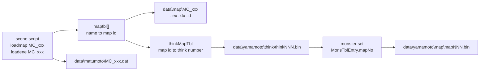
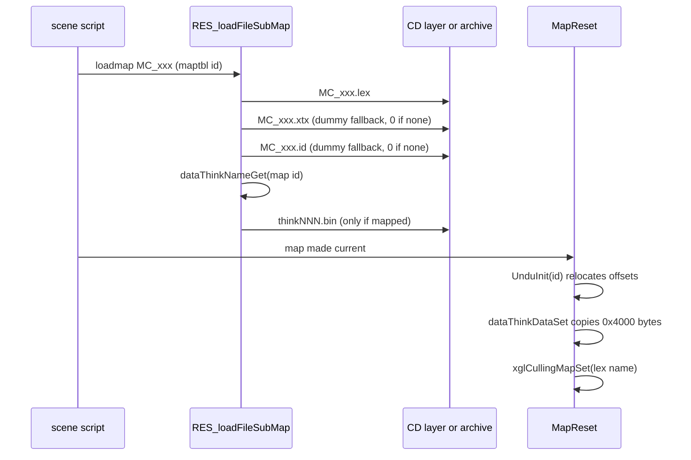
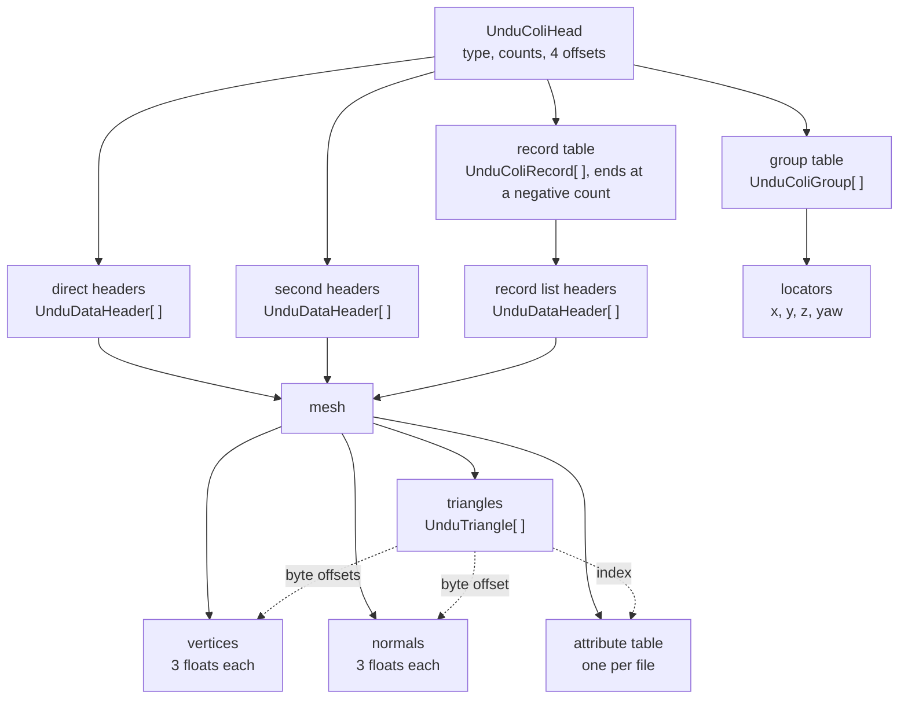
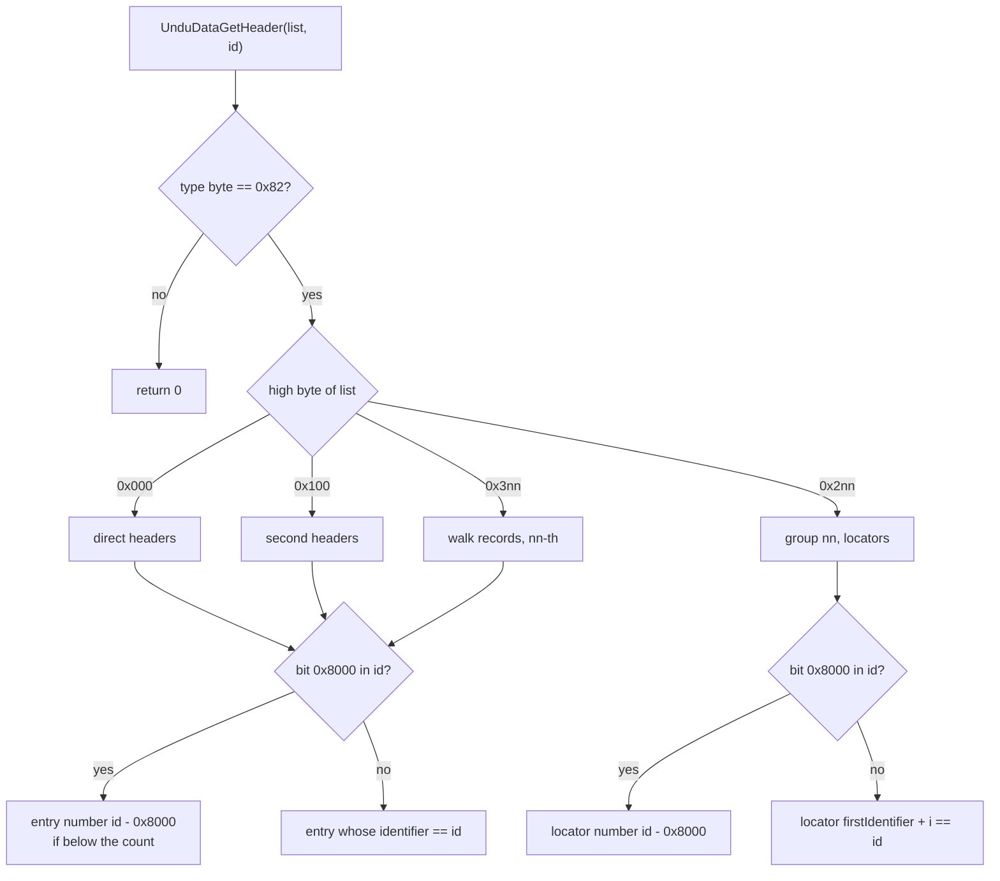
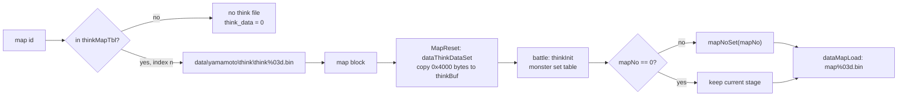
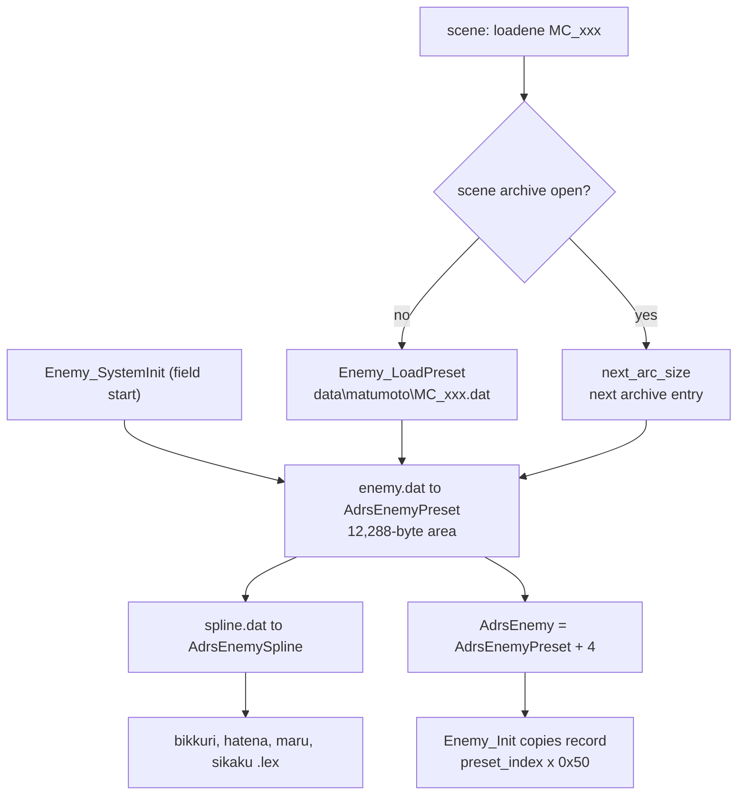

# Maps and field data

A field map of Xenosaga Episode I is a set of up to three files in
`data\map\` that share one name: the scenery model (`.lex`), its textures
(`.xtx`) and a collision and layout file (`.id`). The `.id` file holds the
floors the characters walk on, the floors the camera rides on, the special
ground layers that enemies, NPCs, the camera, footsteps and floor lights read,
and the named points where scripts place the player, characters, effects and
event triggers. Around the maps sit three smaller families of field data: the
enemy behaviour presets and spline weights in `data\matumoto\`, the item box
and event item tables in `data\karakama\`, and the battle stages in
`data\yamamoto\map\`, which the battle AI file of a field map selects.

All 209 `.id` files, all 248 map `.lex` headers, all 88 files of
`data\matumoto\`, both item tables and all 55 battle stages were parsed and
checked against the layouts below. How the game uses the data at run time is
explained in [Maps and units](../game/map-and-units.md),
[Field enemies](../game/field-enemies.md), [The field game](../game/field.md)
and [Battle system](../game/battle.md).

[← Back to the overview](../README.md) · [Files and resources](../architecture/files-and-resources.md)

## Contents

- [The formats at a glance](#the-formats-at-a-glance)
- [The map directory](#the-map-directory)
- [The map block in memory](#the-map-block-in-memory)
- [Map models and textures](#map-models-and-textures)
- [Collision and layout data (.id)](#collision-and-layout-data-id)
- [Map think data](#map-think-data)
- [Field enemy presets](#field-enemy-presets)
- [The B-spline weight table](#the-b-spline-weight-table)
- [Marker models](#marker-models)
- [Item box tables](#item-box-tables)
- [Battle stage files](#battle-stage-files)
- [Files nothing loads](#files-nothing-loads)
- [Source files](#source-files)

## The formats at a glance

Every file of this family lives in archive group 00 of the disc (see
[Files and resources](../architecture/files-and-resources.md) for groups and
ARX packing). "Packed" means stored with ARX compression. The CD layer
unpacks such files while it reads them, so the code always sees the plain
bytes.

| Files | Directory | Count | Packed | Size range (unpacked) | Total (unpacked) | First reader |
| --- | --- | --- | --- | --- | --- | --- |
| `MC_*.lex` | `data\map\` | 248 | 246 | 14,368 – 1,884,624 | 219,397,648 | `RES_loadFileSubMap` |
| `MC_*.xtx` | `data\map\` | 247 | 184 | 24,656 – 524,416 | 84,587,712 | `RES_loadFileSubMap` |
| `MC_*.id` | `data\map\` | 209 | 0 | 1,300 – 287,828 | 8,053,152 | `RES_loadFileSubMap`, `UnduInit` |
| `MC_*.dat`, `people01.dat` | `data\matumoto\` | 81 | 0 | 164 – 11,364 | | `Enemy_LoadPreset` |
| `enemy.dat`, `testes.dat` | `data\matumoto\` | 2 | 0 | 11,332 | | `Enemy_SystemInit` |
| `spline.dat` | `data\matumoto\` | 1 | 0 | 10,760 | | `Enemy_SystemInit` |
| `bikkuri.lex`, `hatena.lex`, `maru.lex`, `sikaku.lex` | `data\matumoto\` | 4 | 0 | 7,584 – 121,776 | | `Enemy_SystemInit` |
| `itembox.dat` | `data\karakama\` | 1 | 0 | 4,808 | | `InitUwamonoSys` |
| `evtitem.dat` | `data\karakama\` | 1 | 0 | 32,640 | | `InitUwamonoSys` |
| `mapNNN.bin` | `data\yamamoto\map\` | 55 | 1 | 455,760 – 1,788,832 | 62,724,272 | `dataMapLoad` (OV01) |

The files of `data\matumoto\` add up to 336,404 bytes and the two item tables
to 37,448 bytes. The think files of `data\yamamoto\think\` belong to the
battle AI and are covered here only for the way a map selects one (see
[Map think data](#map-think-data)).

The files reference each other only by name and number. A scene script
names a map (`loadmap`) and an enemy preset (`loadene`). The map name gives a
map id through the map table, the map id gives a think file through the think
map table, and a monster set inside the think file gives the battle stage
number.



## The map directory

`data\map\` holds 704 files with 250 distinct base names. There are no
subdirectories. The code knows two more map directories, `data\map\test\` and
`data\map\check\`, which `MAP_getPath` returns when the debug variable
`UseTestPath` selects them (set by the debug menu in `game_debug_menu.c` and by
`karakama_test.c`). Neither directory exists on the disc.

### Naming

Every map file name has the form `MC_<zone><two digits>[variant].<ext>`, for
example `MC_DYU02.id` or `MC_VOK12B.lex`. The zone is a three-letter code. The
code does not spell out what the codes mean. The variant letter is `B` in 30
sets and `H` in one (`MC_ELS06H`). 27 of the 30 B sets have an enemy preset
in `data\matumoto\`, an entry in the think map table (see
[Map think data](#map-think-data)) or both, while of their base sets only
`MC_KUK04` has one. A B set is therefore probably the version of an area
that has enemies and battles. The three exceptions go the other way:
`MC_DYU04` and `MC_DYU06` have a preset and `MC_UTK03` has both, while
`MC_DYU04B`, `MC_DYU06B` and `MC_UTK03B` have neither.

The map table `maptbl[]` in `src/main/maptbl.c` turns a name into a map id.
A map id is `group * 100 + index` (`MAP_GROUP_SIZE`), and `MapGetName`
accepts ids below 0x71F. The table has 344 slots, 323 of them named. Each
group holds one zone, except group 0, which mixes the test maps, the battle
test map, the VOK maps and one ELS map. The table below lists the groups with
the number of named slots, the number of names that have files on the disc
and the number that have an `.id` file.

| Group | Map ids | Zones | Named slots | With files | With `.id` |
| --- | --- | --- | --- | --- | --- |
| 0 | 0 – 57 | `araikabe`, `TST`, `TEST`, `BTL`, `VOK`, `ELS01` | 53 | 39 | 36 |
| 1 | 100 – 131 | `ELS` | 25 | 24 | 23 |
| 2 | | none | 0 | 0 | 0 |
| 3 | 300 | `SYU` | 1 | 1 | 1 |
| 4 | 400 – 401 | `UMN` | 2 | 2 | 2 |
| 5 | 500 – 507 | `UZU` | 8 | 8 | 7 |
| 6 | 600 – 601 | `MIL` | 2 | 1 | 1 |
| 7 | 700 – 747 | `EVE` | 48 | 25 | 1 |
| 8 | 800 – 818 | `DYU` | 17 | 17 | 16 |
| 9 | 900 – 918 | `UTA` | 19 | 16 | 16 |
| 10 | 1000 | `SYO` | 1 | 1 | 1 |
| 11 | 1100 – 1108 | `PRO` | 9 | 9 | 9 |
| 12 | 1200 – 1240 | `KAS` | 41 | 30 | 23 |
| 13 | 1300 – 1323 | `KUK` | 24 | 24 | 24 |
| 14 | 1400 – 1424 | `GNK` | 25 | 20 | 18 |
| 15 | 1500 – 1511 | `UTK` | 12 | 12 | 11 |
| 16 | 1600 – 1606 | `KOU` | 5 | 5 | 5 |
| 17 | 1700 – 1713 | `GNU` | 14 | 14 | 14 |
| 18 | 1800 – 1821 | `UDO` | 17 | 0 | 0 |

`MC_ELS01` has two slots (ids 46 and 100), so the "with files" column counts
it twice. The whole `UDO` group and 58 other names have no files at all (75
names in total), for example `araikabe`, `MC_TST02` to `MC_TST13`, `MC_TEST`,
`MC_ELS01H`, `MC_MIL02`, `MC_UTA15` and `MC_KAS01` (whose enemy preset
`MC_KAS01.dat` exists and is named by `loadene` in 36 scene scripts that
load other maps). Three sets on the disc have no
`maptbl` name and can never be loaded: `MC_DYU06B` (an `.id` only),
`MC_VOK17` (an `.id` only) and `MC_GUN08` (a `.lex` only). `MC_GUN08.lex` is a
different model from `MC_GNU08.lex` (56 instead of 61 matrices, 1,280,944
instead of 709,600 bytes) by the same artist, so it is probably another
version of that map stored under a misspelled name.

The number of sets on the disc per zone code is VOK 37, KAS 30, EVE 25,
ELS 24, KUK 24, GNK 20, DYU 18, UTA 16, GNU 14, UTK 12, PRO 9, UZU 8, KOU 5,
UMN 2 and one each for BTL, GUN, MIL, SYO, SYU and TST.

### Which files a set has

A complete set is `.lex`, `.xtx` and `.id`. The disc has 207 complete sets,
40 sets with a model and textures but no `.id`, one model alone
(`MC_GUN08`) and two `.id` files alone (`MC_DYU06B`, `MC_VOK17`).

The 41 sets without an `.id` are 24 of the 25 event maps (`MC_EVE*`, all but
`MC_EVE02`), `MC_BTL01`, `MC_DYU04B`, `MC_ELS06H`, `MC_GNK05`, `MC_GNK24`,
`MC_GUN08`, seven KAS maps (`MC_KAS07`, `11`, `21`, `23`, `37`, `39`, `41`),
`MC_TST01`, `MC_UTK03B`, `MC_UZU08` and `MC_VOK15`. Without an `.id` a map has
no floor, no entrances and no locators, so the player cannot walk on it.
Scene scripts load ten of them. Nine (`MC_EVE01`, `08`, `15`, `20`, `22`,
`41`, `MC_KAS23`, `MC_KAS39` and `MC_VOK15`) are loaded only by event scenes
(`ev*.txt`), which use them as a backdrop for cutscenes. `MC_GNK24` is
loaded by the field scenes `cf9024` and `cf9025` together with one actor and
the preset `MC_ENS`, and it has a think entry, so it is probably the setting
of a scripted battle that needs no floor. `MC_DYU04B.lex` is byte-identical
to `MC_DYU04.lex`, so that variant is the same room without collision.

### Identical files

Several files are byte-identical copies of each other. The same data is
stored once per name because the loader always reads `<name>.<ext>`.

| Type | Identical groups |
| --- | --- |
| `.lex` | `DYU04` = `DYU04B`, `ELS06` = `ELS06B`, `ELS13` = `ELS13B`, `UTK03` = `UTK03B`, `VOK04` = `VOK04B` |
| `.xtx` | `ELS04` = `ELS04B`, `ELS05` = `ELS05B`, `ELS06` = `ELS06B` = `ELS06H`, `ELS07` = `ELS07B`, `ELS12` = `ELS12B`, `ELS13` = `ELS13B`, `UTA03` = `UTA04` = `UTA05` = `UTA06` = `UTA07`, `UTK03` = `UTK03B`, `VOK03` = `VOK03B`, `VOK04` = `VOK04B`, `VOK08` = `VOK09`, `VOK08B` = `VOK09B` |
| `.id` | `UTA03` = `UTA05` = `UTA06` = `UTA08`, `VOK13` = `VOK13B` |

### Missing files and the dummy name

`RES_loadFileSubMapSub` builds `MAP_getPath()` + name + suffix and asks the CD
layer for the file size. When the file does not exist it tries
`data\map\dummy` + suffix instead. No `dummy` file exists on the disc, so the
size stays 0 or below and the loader stores a null pointer for the `.xtx`
or `.id` part of the map. A missing `.xtx` or `.id` is therefore harmless.
The `.lex` pointer is kept whatever the size, so a missing model would leave
it pointing at the next file, but every set that `maptbl` can name has a
model.

### Scene archives

When a scene is read from a scene archive (`.a`, see
[Files and resources](../architecture/files-and-resources.md)), the map
files are not read from `data\map\`. `next_arc_size` takes the next entry of
the open archive instead, in the fixed order `.lex`, `.xtx`, `.id` and then the
think file, but the think entry only when the map has a think number. The
`.id` is stored in the archive unpacked, exactly as in `data\map\`. Archive
entries are padded to 64 bytes and `next_arc_size` copies the padded size, so
the copy of `MC_VOK01.id` (52,524 bytes) in `cf0010.a` is 52,544 bytes long.
Entries 50 to 53 of `cf0010.a` are the `people01` preset followed by
`MC_VOK01.lex`, `.xtx` and `.id`, with no think entry because `MC_VOK01` is not
in the think map table.

## The map block in memory

The command `loadmap NAME` of a scene script loads a map as one resource of
type `RES_TYPE_MAP` (see
[Loading a map](../game/map-and-units.md#loading-a-map)).
`RES_loadFileSubMap(end_address, scene_id)` in `src/main/res_get_path.c`
builds the whole map in one block of memory. It starts with a 0x60-byte
`SubMapLoadState` and then reads the four files one after another, each
starting on a 16-byte boundary. The structure is the same record that the
field code later reads as `MapResource` through `GameLoopState.map_resource`.

| Offset | Size | Type | Field (`SubMapLoadState` / `MapResource`) | Meaning |
| --- | --- | --- | --- | --- |
| 0x00 | 4 | pointer | `matrix` / `place` | Points at `matrix_storage` below |
| 0x04 | 4 | pointer | `lex_file` / `culling_map` | The `.lex` scenery model |
| 0x08 | 4 | pointer | `texture_file` / `texture` | The `.xtx` textures, or 0 |
| 0x0C | 4 | pointer | `id_file` / `undu_state` | The `.id` collision and layout data, or 0 |
| 0x10 | 4 | pointer | `think_file` / `think_data` | The think file, or 0 |
| 0x14 | 12 | | `unmodeled_14` | Unused, pads to 0x20 |
| 0x20 | 64 | float[4][4] | `matrix_storage` | A unit matrix (`xglMatrixUnit`) that places the map at the origin |
| 0x60 | | | | The `.lex` file starts here |

The layout below shows the block. Each file starts at the next 16-byte
boundary after the one before it. A file that is missing, or that the
archive gives as an empty entry, takes no space and its pointer is 0.

```
map resource block (RES_TYPE_MAP)
+0x00 +----------------------------------+
      | SubMapLoadState / MapResource    |  five pointers, 12 unused bytes
+0x20 | place matrix (unit)              |  64 bytes
+0x60 +----------------------------------+
      | <name>.lex                       |  scenery model
      +----------------------------------+  16-byte aligned
      | <name>.xtx                       |  textures (pointer 0 if missing)
      +----------------------------------+  16-byte aligned
      | <name>.id                        |  collision and layout (0 if missing)
      +----------------------------------+  16-byte aligned
      | thinkNNN.bin                     |  battle AI (0 if the map has none)
      +----------------------------------+
```

The think file name comes from the OV01 function `dataThinkNameGet`, which
`res_get_path.c` still declares under its old name `func_A1CF18`. It is read
with `xglCdReadFile`, which returns the size rounded up to the 2,048-byte CD
sector, so the block reserves whole sectors for it.

When the map becomes current, `MapReset` in `src/main/map_1.c` hands each part
to its user: `UnduInit(undu_state)` installs the `.id`,
`dataThinkDataSet(map_no, think_data)` (declared as `func_A1CFB8`) copies the
think data into the battle code, and `xglCullingMapSet(culling_map)` looks up
the culling volumes by the name stored in the `.lex` header. The diagram
below shows the order.



## Map models and textures

A map `.lex` is an ordinary model file and a map `.xtx` an ordinary texture
file. Their general layout is described in
[Models and textures](models-and-textures.md). The map code reads only a few
header fields of the model, and some facts hold for map files in particular.

Of the 248 map models, 246 are ARX-packed and two are stored plain
(`MC_KUK11.lex` and `MC_TST01.lex`). Of the 247 texture files, 184 are packed.
61 texture files have the largest size, 524,416 bytes.

### The model header fields the map code reads

The map code reads three fields of the `.lex` header. The artist field is
shown as well because it names the people who built the maps.

| Offset | Size | Type | Field | Meaning for a map | Values seen |
| --- | --- | --- | --- | --- | --- |
| 0x10 | 32 | char[32] | name (`CullingMapNameSource.name_with_prefix`) | `/` + internal map name, the key for the culling table | see below |
| 0x30 | 15 | char[15] | artist | Name of the person who built the model, not read by the game | `honne` 107, `yasuyuki` 39, `yokota` 37, `hori` 22, `nakai` 16, `tomo` 14, `moto` 7, `eiji` 6 |
| 0x40 | 4 | u32 | `MapPartsResource.partCount` | Number of parts (matrices) | 1 – 935 |
| 0x50 | 4 | u32 | `MapPartsResource.arrayOffset` (`weightedMatrixOffset` in the model code) | Offset of the part matrix array from the file start | |

In every map model the matrix area has the same shape, which
[The matrix table](models-and-textures.md#the-matrix-table) describes for all
models. The u32 at 0x50 points at array A, `partCount` placement matrices of
64 bytes each. The u32 at 0x54 points right after them, at array B, the
inverses of the A matrices in the same order (`A[i] * B[i]` is the unit
matrix in all 248 map models). Maps have no skin joints, so the arrays C and
D are empty: the u32 values at 0x58 and 0x5C both point right after B, where
the mesh data begins, and the u32 at 0x60 repeats the value at 0x50. A and B
are separate arrays, not interleaved pairs.

`GetPartsPos` in `src/main/init_uwamono_sys.c` reads the first table to place
a map unit on a part of the scenery. It takes `GameLoopState.partsRoot`
(offset 0x54 of `GameLoopState`, the same field as `map_resource`), then the
`.lex` pointer at offset 4 of the map block, and indexes the transform table
with the unit's serial number. Row 3 of the matrix gives the unit position
and `atan2(row2.x, row2.z)` its yaw. The units themselves are explained in
[Map units](../game/map-and-units.md#map-units).

### The internal name and culling

`xglCullingMapSet` in `src/main/face_point.c` copies the name at 0x10 without
its first character (`/`) and compares it, case-sensitively, with the 69
names of `s_aCullingMap[]` (the 70th entry ends the table). A match installs
that map's culling volumes and last-draw tables (see
[Culling](../architecture/rendering.md#culling)).

The internal name is normally the file name with a `/` in front, but the case
varies. 23 files use lower or mixed case, for example `/Mc_dyu04`,
`/mc_vok04` and `/MC_VOK12b`. Six B and H variants carry the name of the base
map: `MC_DYU04B` (`/Mc_dyu04`), `MC_ELS06B` (`/Mc_els06`), `MC_ELS07B`
(`/MC_ELS07`), `MC_ELS13B` (`/Mc_els13`), `MC_UTK03B` (`/Mc_utk03`) and
`MC_VOK04B` (`/mc_vok04`). Because of this, 71 map models get a culling entry
from 69 names: `MC_DYU04` and `MC_DYU04B` share `Mc_dyu04`, and `MC_VOK04` and
`MC_VOK04B` share `mc_vok04`. The comparison is exact, so `MC_VOK07B`
(`/MC_VOK07b`) and `MC_VOK10B` (`/MC_VOK10b`) get no culling data although
`MC_VOK07` and `MC_VOK10` have entries, while `MC_VOK12B` has its own entry
`MC_VOK12b`.

The header of `MC_DYU02.lex` shows the fields:

```
00000000: 6c 65 78 00 6a 2b 4d 7a 0a d7 23 3e 00 00 00 00  "lex\0" ...
00000010: 2f 4d 43 5f 44 59 55 30 32 00 00 00 00 00 00 00  name "/MC_DYU02"
00000030: 79 6f 6b 6f 74 61 00 00 00 00 00 00 00 00 00 01  artist "yokota"
00000040: 18 00 00 00 1f 00 00 00 00 00 00 00 1f 2f 00 00  partCount 24, 31 blocks, no skin joints
00000050: 30 01 00 00 30 07 00 00 30 0d 00 00 30 0d 00 00  transforms 0x130, inverses 0x730 (= 0x130 + 24*64), meshes 0xD30
```

## Collision and layout data (.id)

The `.id` file is the map's undulation data. The code calls it "undulation"
(`Undu*` functions in `src/main/Undulate.c`) after the relief of the ground.
It holds triangle meshes and named points, organised in lists. The behaviour
of the queries is explained in
[The collision mesh](../game/map-and-units.md#the-collision-mesh-undulate) and
[Undulate](../libraries/animation.md#undulate-ground-height-and-walls).

There are 209 files, all in `data\map\`, all stored unpacked, from 1,300 bytes
(`MC_GNU14.id`, 22 triangles) to 287,828 bytes (`MC_KAS10.id`, 6,860
triangles). The median is 28,044 bytes. Together they hold 2,360 meshes with
204,121 triangles. Every size is a multiple of 4 and no file has trailing
padding.

### Offsets and relocation

All numbers are little-endian. Every pointer field in the file is a byte
offset from the start of the file. `UnduInit(data)` turns them into real
addresses by adding the address of the file (`UNDU_RELOCATE`) and then sets
bit 0x80 (`UNDU_COLI_RELOCATED`) in the type byte, so a type 2 file becomes
type 0x82 in memory. A second call sees the bit and does nothing. Only the
table pointers and the four pointers of each mesh header are relocated. The
vertex, normal and neighbour numbers inside a triangle stay offsets relative
to their own tables.

`UnduInit` knows three file types. Type 0 has five table pointers and type 1
has the header without groups and records. Only type 2 occurs on the disc
(all 209 files), and `UnduDataGetHeader` refuses any file whose type byte is
not 0x82, so only type 2 supports lookups by list.

### The overall layout

A file starts with a 20-byte header that gives the number of entries and the
offset of four tables: the direct headers, the second headers, the group
table and the record table. The direct and second tables hold mesh headers
directly. The group table holds one entry per locator group, each pointing at
an array of locators. The record table holds one entry per record list, each
pointing at an array of mesh headers, and ends with a negative count. Each
mesh header points at its own vertices, normals and triangles and at the
file's single attribute table.

The tool that wrote the files placed the regions in a fixed order. The
header and all the tables come first, then the meshes in list order with the
attribute table right after the first mesh, then the locators and finally
the meshes of the record lists. 173 files follow this order with exactly
one direct mesh. The other 36 differ only in which optional regions exist:
31 have more than one direct mesh (the extra ones follow the attribute
table), four have no record meshes and one (`MC_UTA02`) has no second
meshes.

```
.id file (type 2), offsets from the file start
+--------------------------------------+ 0x00
| UnduColiHead (0x14 bytes)            |
+--------------------------------------+ 0x14 = directHeaders
| direct headers   directCount x 20    |
+--------------------------------------+ secondHeaders
| second headers   secondCount x 20    |
+--------------------------------------+ groups
| group table      groupCount x 8      |
+--------------------------------------+ records
| record table     n x 8, then (-1,..) |
+--------------------------------------+
| record list headers   x 20 each      |
+--------------------------------------+
| direct mesh 0: vertices, normals,    |
|                triangles             |
+--------------------------------------+
| attribute table  x 8 each            |  shared by every mesh
+--------------------------------------+
| other direct meshes                  |
| second meshes                        |
+--------------------------------------+
| locators of groups 0..7   x 16 each  |
+--------------------------------------+
| meshes of the record lists           |
+--------------------------------------+ end of file
```

The diagram below shows which structure points at which.



### The header

| Offset | Size | Type | Field (`UnduColiHead`) | Meaning | Values seen |
| --- | --- | --- | --- | --- | --- |
| 0x00 | 1 | u8 | `type` | File type, bit 0x80 set after relocation | 2 in all files |
| 0x01 | 1 | u8 | `directCount` | Number of direct headers (walk floors) | 1 in 178 files, 2 in 27, 3 in 1, 4 in 3 |
| 0x02 | 1 | u8 | `secondCount` | Number of second headers (camera floors) | 0 – 24, 0 only in `MC_UTA02` |
| 0x03 | 1 | u8 | `groupCount` | Number of locator groups | 8 in 198 files, 3 in 11 |
| 0x04 | 4 | offset | `directHeaders` | Direct header table | 0x14 in all files |
| 0x08 | 4 | offset | `secondHeaders` | Second header table | `directHeaders + 20 * directCount` |
| 0x0C | 4 | offset | `groups` | Group table | `secondHeaders + 20 * secondCount` |
| 0x10 | 4 | offset | `records` | Record table | `groups + 8 * groupCount` |

The code tells the type 1 and type 2 headers apart by where the direct
headers begin. `UnduInit` and `UnduDataGetHeader` read the record table only
when the address of the `records` field is not the address of the first
direct header, which holds for type 2 because its direct headers start at
0x14, after the `records` field.

### Mesh headers

A mesh header (`UnduDataHeader`, 20 bytes) describes one triangle mesh. The
same structure is used in the direct list, the second list and the record
lists.

| Offset | Size | Type | Field | Meaning | Values seen |
| --- | --- | --- | --- | --- | --- |
| 0x00 | 2 | u16 | `subCount` | Number of triangles | 1 – 1,143 |
| 0x02 | 2 | u16 | `identifier` | Number used to find the header in its list | 1, 2, 3 … in list order |
| 0x04 | 4 | offset | `vertexData` | Vertex array | |
| 0x08 | 4 | offset | `normalData` | Normal array | |
| 0x0C | 4 | offset | `subList` | Triangle array | |
| 0x10 | 4 | offset | `wallAttributeTable` | Attribute table | the same value in every header of a file |

The vertex array holds 12-byte vertices (three floats x, y, z) shared by the
triangles of the mesh. The normal array holds 12-byte unit normals and is a
pool without repeats, so a flat floor needs only one normal (2,304 of the
2,360 meshes share normals between triangles). The vertex array ends exactly
where the normal array begins and the normal array ends exactly where the
triangle array begins, in every mesh, so the sizes follow from the offsets.
No two headers share a mesh.

`UnduDataGetHeader` returns any header as a `LayoutHeader` pointer. For mesh
headers that pointer is only used as a handle (for example as an actor's
`data_header`), never read as a locator.

### Triangles

A triangle (`UnduTriangle`) is 24 bytes.

| Offset | Size | Type | Field | Meaning | Values seen |
| --- | --- | --- | --- | --- | --- |
| 0x00 | 2 | u16 | `wallAttributeIndex` | Index into the attribute table | 0 – the table size minus 1 |
| 0x02 | 2 | u16 | | Not read | 0 in all 204,121 triangles |
| 0x04 | 4 | float | plane offset | `normal · vertex A` | |
| 0x08 | 6 | u16[3] | vertex offsets | Byte offsets of vertices A, B and C in the vertex array | multiples of 12 |
| 0x0E | 2 | u16 | normal offset | Byte offset of the normal in the normal array | multiple of 12 |
| 0x10 | 6 | s16[3] | `neighbor[3]` | Byte offset in the triangle array of the triangle across edge AB, BC and CA, or -1 for an open edge | multiples of 24 |
| 0x16 | 2 | u16 | | Not read | see below |

The height of the floor at (x, z) is `(planeOffset - nx * x - nz * z) / ny`.
The plane offset matches `normal · vertex A` in every triangle whose normal is a number. A point is
inside a triangle when the three edge orientations in the x/z plane are all
zero or negative, so a triangle must run clockwise seen from above.

The neighbour links were checked in both directions. Of the 612,363 edges,
456,835 have a neighbour that links back across the same edge and 155,528
are open (-1). 36 links do not point back. An open edge always stops a move.
A move into a neighbour is stopped when the neighbour's attribute passes
`CheckWallAttr` (see [The attribute table](#the-attribute-table)).

Some triangles cannot work as floors. 894 have zero area and 810 run
counter-clockwise, so the inside test never accepts them. Some have a normal
that is NaN or has y = 0 (vertical faces): 390 in `MC_KAS32.id`, 264 in
`MC_MIL01.id`, 217 in `MC_UTK05.id` and 120 in `MC_KAS10.id`, among others.
Such a triangle cannot give a finite height.

The last field (0x16) is never read. It is 0 in 91,913 triangles. The most
common other values are 0x7F00 (32,456), 0x8100 (8,874), 0xC100 (1,657),
0x3F00 (1,282) and 0xC11F (458), and many small values occur. They do not
follow the normal, the attribute or the open edges. The field is probably a
leftover of the export tool.

### The attribute table

Each file has one attribute table, and every mesh header of the file points
at it. An entry is 8 bytes (`UnduWallAttributes`), read as one 64-bit value.
In all 3,316 entries of the disc the upper 32 bits are 0. The table has no
stored length. Its size follows from the highest index the triangles use.
Values may repeat (`MC_DYU02.id` has three entries of 0). In seven files one
more entry follows the last used one and no triangle refers to it:
`MC_KAS09`, `MC_UZU04`, `MC_UZU07`, `MC_VOK12`, `MC_VOK12B`, `MC_VOK13` and
`MC_VOK13B`.

A query copies the attribute of the triangle it lands on into
`UnduParam.attribute`. The bits mean different things in different lists,
because each user reads a different list with its own mask. The table shows
every value class found on the disc, the list where it appears and the code
that reads it. Floor attributes are also described in
[Floor attributes](../game/map-and-units.md#floor-attributes).

| Value | Found in | Read by | Meaning |
| --- | --- | --- | --- |
| 0 | all lists | | Plain surface |
| bits 0–2 (`7`) | all lists, mostly records 0, 4 and 5 | `CheckWallAttr` | Wall for query wall mode 1, 2 and 3 |
| 0x10 | direct | `GameCfPlayerMove` | Walk only |
| 0x100 – 0xA00 | direct | `checkAttr` in `game.c` | Floor script, run when stepped on: bits 8–12 hold the script number plus 1 |
| 0x2300 – 0x2600 | record 3 (also 0, 4, 5) | `act_3.c` | Footstep material, sound offset `((attr & 0xFF00) - 0x2300) >> 6` = +0, +4, +8, +12 |
| 0x4100 | direct (also record 0) | height table query (flag 0x20) | Kind 2 (`UNDU_ATTR_KIND_HEIGHT_TABLE`, 0x4000), slot 1 of `GameLoopState.attributeHeights` |
| 0x6100 – 0x6800 | record 6 | `GameIdLightSet` | Kind 3, floor light 1 – 8 |
| 0x8300, 0x8400, 0x8500, 0x8700, 0x8800, 0x8A00 | direct | `Get_EffectCode` | Kind 4, footstep effect index |
| 0x00100000 | direct | `Get_Ladder` | Ladder 0 |
| 0x00210000, 0x00230000 | direct | `Get_Arrival` | Ladder arrival points 1 and 3 |
| 0x01000000 | direct | player, `Move_BeltConveyer` | Conveyor direction 1, speed class 0 |
| 0x08000000 – 0x0F000000 | record 4 | `TM_Check_Move` | Enemy territory 1 – 8 (`EneTerritoryID[1..8]`) |
| 0x18000000 – 0x1A000000 | record 0 | `TM_Check_Move` | Territory 11 – 13 (`EneTerritoryID[11..13]`) |
| 0x20000000 + (n << 20) | record 2 (stray copies in direct) | `GameCamera` | Camera zone, selects camera index n + 1, n = 0 – 22 |
| 0x20008400, 0x20008500 | direct | `Get_EffectCode` | Footstep effect with bit 29 set |
| 0x28000000, 0x29000000 | record 2 | `GameCamera` | Not a camera select (see below) |

Bits 8–12 hold a number and bits 13–15 a kind in the low half-word. Kind 0
with a number is a floor script, kind 2 a height table slot, kind 3 a floor
light and kind 4 a footstep effect.

`CheckWallAttr(work, attribute)` decides whether a move may enter a
neighbouring triangle. It returns 1, which stops the move at the shared
edge, when `(attribute & excludedAttributes) == includedAttributes`, or when
the attribute has the wall bit chosen by the query's flags: 0x100 tests bit
0, 0x200 bit 1 and 0x300 bit 2. `UnduParamInit` sets the masks to 0 and 1, so
by default only the wall bits count. Every wall on the disc sets all three
bits (value 7).

The camera code tests `(attr & 0x38000000) == 0x20000000` and takes the
index from bits 20–26 (`UNDU_ATTR_CAMERA_*` in `game_camera.c`). Bits 27–29
must therefore be 4, not 2 as [Floor attributes](../game/map-and-units.md#floor-attributes)
states. The values 0x28000000 (343 triangles) and 0x29000000 (23) have bit
27 set, so they fail the test and the camera keeps its current index there.
Keeping the camera is probably what those zones are for.

The value 0x2300 also appears in records 0, 4 and 5 (about 2,300 triangles
each), where no reader of those lists tests it. It is probably a copy of the
footstep layer left in by the export tool.

### Locator groups

A group entry (`UnduColiGroup`, 8 bytes) points at an array of locators.

| Offset | Size | Type | Field | Meaning | Values seen |
| --- | --- | --- | --- | --- | --- |
| 0x00 | 2 | u16 | `firstIdentifier` | Identifier of the first locator, the others count up from it | 0, 1, 100, or 0xFFFF when the group is empty |
| 0x02 | 2 | u16 | `count` | Number of locators | 0 – 44 |
| 0x04 | 4 | offset | `headers` | Locator array | empty groups still point at the current end of the locator area |

A locator is 16 bytes, read as `LayoutHeader.locator`: three floats x, y, z
and a fourth float w that is a yaw angle in radians. Every user copies w into
the rotation of what it places, except the event triggers, which read it as a
kind code.

| Group | List | Locators | Files | Used by | Meaning |
| --- | --- | --- | --- | --- | --- |
| 0 | 0x200 | 4 | 2 | `setLocation(0, n)`, and the one-argument `setLocation(n)` of `Chr`, `Unit` and `Effect` | Default layout points, only in `MC_VOK23` (3) and `MC_VOK24` (1) |
| 1 | 0x201 | 847 | 209 | `MapChangeResource`, debug map menu, `Chr.setLocation(1, n)` | Entrances |
| 2 | 0x202 | 0 | | | Always empty |
| 3 | 0x203 | 0 | | | Always empty |
| 4 | 0x204 | 41 | 9 | `Chr.setLocation(4, n)` | Character placement points |
| 5 | 0x205 | 2 | 1 | `Chr.setLocation(5, n)` | Character placement points (`MC_VOK10B` only) |
| 6 | 0x206 | 218 | 42 | `Effect.setLocation(6, n)` | Effect positions |
| 7 | 0x207 | 1,045 | 131 | `Check_Locater`, pause enemy page | Event trigger pairs |

Every `setLocation` call found in the 569 `.evt` volumes uses the overload
`setLocation(int group, int number)` of `Chr`, `Unit` or `Effect`, which
places the object through `xeno.util.Layout`. The number that
`Layout.getManager` stores is a locator group of the current map's `.id`,
not a map id (see [xeno.util.Layout](../scripting/natives.md#xenoutillayout)).
The natives in `src/main/layout.c` look the locator up as
`UnduDataGetHeader(0x200 + group, number + 0x8000)`, that is by index.
`MapChangeResource` (`0x201`, `entrance + 0x8000`) and the debug map menu
(`513`, `0x8000`) also use indices. The only readers that search by
identifier are `Check_Locater` and the locator page of the enemy debug menu,
both on group 7, where `firstIdentifier` is always 0. The first identifiers
100 (in the 11 files `MC_SYO01`, `MC_SYU01`, `MC_UMN02`, `MC_UZU01` to
`MC_UZU07` and `MC_VOK17`) and 1 (`MC_GNK01` and group 0) are therefore
never used.

`Unit.setLocation(0, 0)` in the scripts `ST0240` and `ST0241`, whose scenes
load `MC_VOK24`, is the only use of group 0 found in the scripts.

### Event locators

Group 7 holds event triggers as pairs of locators. `Check_Locater` in
`src/main/call_java_method.c` reads locator 2k and 2k + 1 for k = 0, 1, 2 …
up to identifier 100 (`EVENT_LOCATOR_HEADER_LIMIT`), and stops at the first
pair that contains the actor or at a missing locator. The pair number k
becomes the event id sent to the script with `KickEvent`. The w value of the
first locator selects the kind through the ranges of `LocaterAngle[]` in
`src/main/set_motion.c`. The w of the second locator is not read.

| Kind | w range (exclusive) | Name | Shape | Pairs seen | w used on the disc |
| --- | --- | --- | --- | --- | --- |
| 0 | -3.2 … -3.0 | none | no handler | 0 | |
| 1 | -2.4 … -2.2 | `LINE_BUTTON` | line between the two points, within one unit in front of the actor, with a button | 227 | -3π/4 |
| 2 | -1.6 … -1.4 | `LINE_TOUCH` | line between the two points, crossed by the move | 206 | -π/2 |
| 3 | -0.8 … -0.6 | `CIRCLE_BUTTON` | circle around the first point, radius = distance to the second, with a button | 4 | -π/4 |
| 4 | -0.1 … 0.1 | `SQUARE_BUTTON_CENTER` | square around the first point, half side = distance, button, and the actor must face the point | 13 | 0 |
| 5 | 0.6 … 0.8 | `SQUARE_BUTTON` | square with a button | 0 | |
| 6 | 1.4 … 1.6 | `SQUARE_TOUCH` | square entered | 71 | π/2 (70), 1.54 (1) |
| 7 | 2.2 … 2.3 | none | no handler | 0 | |

One pair in the disc data uses w = π, which falls in no range, so it never
triggers. The range of kind 7 stops at 2.3 and cannot contain 3π/4 (2.356).
`MC_DYU01.id` has an odd count of 9, so its last locator (w = 0.5) has no
partner and is never read.

### Record lists

A record (`UnduColiRecord`, 8 bytes) points at an array of mesh headers.

| Offset | Size | Type | Field | Meaning | Values seen |
| --- | --- | --- | --- | --- | --- |
| 0x00 | 2 | s16 | `count` | Number of mesh headers, a negative value ends the table | 0 – 2, -1 at the end |
| 0x02 | 2 | | | Not read | 0 in 1,410 of 1,435 records |
| 0x04 | 4 | offset | `headers` | Mesh header array | set even when the count is 0 |

194 files have 7 records, 10 have 5, 4 have 6 and one (`MC_VOK17`) has 3. The
terminator is `ff ff 00 00 00 00 00 00` in 205 files. The unused half-word
holds small numbers or ASCII pairs such as `0x3030` ("00"), `0x302E` (".0")
and `0x3120` (" 1") in the other 25 records, and the terminator holds such
bytes in four files. They are probably uninitialised memory of the export tool.

`UnduDataGetHeader(0x3nn, id)` walks the table and decrements nn at each
record, so the record number is its position in the table.

| Record | List | Triangles | Files with a mesh | Used by | Meaning |
| --- | --- | --- | --- | --- | --- |
| 0 | 0x300 | 41,564 | 193 | NPCs (`Enemy_Init` for non-enemy ids) | NPC ground layer: walls (7), territories 11 – 13, plain floor |
| 1 | 0x301 | 8 | 1 (`MC_UZU02`) | nothing | Unused |
| 2 | 0x302 | 41,769 | 205 | `GameCamera` (`CamPlayer`, flags 0x810) | Camera zones |
| 3 | 0x303 | 11,940 | 197 | `act_3.c` (flags 0x810) | Footstep materials |
| 4 | 0x304 | 25,490 | 140 | enemies (`inUseId` 0x4000 – 0x4F22) | Enemy ground layer: walls (7), territories 1 – 8, plain floor |
| 5 | 0x305 | 17,187 | 139 | `AimMapUnitLookCheck` | Line of sight for aiming, falls back to the direct floor when empty |
| 6 | 0x306 | 3,986 | 99 | `GameIdLightSet` | Floor light zones |

Most triangles of records 0, 4 and 5 are walls (37,872, 17,806 and 13,947).

### The direct and second lists

The direct list (0x000) holds the walk floors. Most queries use direct
header 0. In 31 files the list has 2 to 4 alternative floors of similar size
(`MC_KUK07`, `MC_KUK07B` and `MC_UTA17` have 4). A script binds an actor to
one of them with `Chr.setID(id)`, which stores the header as the actor's
`data_header`, and the `Get_*` helpers with map index 0 use the player's
`data_header`.

The second list (0x100) holds the camera floors, with identifiers 1 to 24.
The camera zone in record 2 selects camera index n, and
`GameCameraChangeID(n)` takes the second header with identifier n, or the
first one (`GAME_CAMERA_ID_DEFAULT`, 0x8000) when there is none. The camera
code keeps the camera position over the current camera floor and caps its
height at the floor's height there. 196 files have a camera floor for every
camera index their record 2 uses, and 13 do not, so those fall back to the
first one. The camera itself is explained in
[The field camera](../game/field.md#the-field-camera).

### Looking up a header

`UnduDataGetHeader(list, id)` finds a header or locator. The high byte of
`list` selects the kind and the low byte the group or record number. Bit
0x8000 in `id` means "by index", otherwise the identifier is searched.



### Example: MC_DYU02.id

`MC_DYU02.id` is a small file (7,356 bytes) with one floor, two camera
floors, entrances and four record meshes. Its header and tables:

```
00000000: 02 01 02 08 14 00 00 00 28 00 00 00 50 00 00 00  type 2, 1 direct, 2 second, 8 groups,
00000010: 90 00 00 00                                      direct @0x14, second @0x28, groups @0x50, records @0x90
00000014:             38 00 01 00 20 01 00 00 d8 03 00 00  direct 0: 56 triangles, id 1, vertices @0x120, normals @0x3D8
00000020: e4 03 00 00 24 09 00 00                          triangles @0x3E4, attributes @0x924
00000028:                         02 00 01 00 7c 09 00 00  second 0: 2 triangles, id 1, vertices @0x97C
00000030: ac 09 00 00 b8 09 00 00 24 09 00 00              normals @0x9AC, triangles @0x9B8, attributes @0x924
00000050: ff ff 00 00 54 0a 00 00 00 00 02 00 54 0a 00 00  group 0 empty | group 1: first id 0, 2 locators @0xA54
00000060: ff ff 00 00 74 0a 00 00 ...                      groups 2-7 empty, all point at 0xA74
00000090: 01 00 00 00 d0 00 00 00 00 00 00 00 e4 00 00 00  record 0: 1 header @0xD0 | record 1: 0 headers
000000a0: 01 00 00 00 e4 00 00 00 01 00 00 00 f8 00 00 00  record 2: 1 @0xE4 | record 3: 1 @0xF8
000000b0: 00 00 00 00 0c 01 00 00 00 00 00 00 0c 01 00 00  record 4: 0 | record 5: 0
000000c0: 01 00 00 00 0c 01 00 00 ff ff 00 00 00 00 00 00  record 6: 1 @0x10C | terminator -1
```

The first triangle of the floor, its normal and the attribute table:

```
000003d8: 00 00 00 80 00 00 80 3f 00 00 00 00              normal 0: (-0.0, 1.0, 0.0)
000003e4: 01 00 00 00 00 00 00 00 c8 01 d4 01 6c 00 00 00  attr index 1, plane 0.0, vertices 38, 39, 9, normal 0
000003f4: f8 01 18 00 ff ff 00 00                          neighbours: triangle 21, triangle 1, open | tail 0
00000924: 00 00 00 00 00 00 00 00 00 00 00 00 00 00 00 00  attribute 0: 0, attribute 1: 0
00000934: 00 01 00 00 00 00 00 00 00 00 10 20 00 00 00 00  attribute 2: 0x100, attribute 3: 0x20100000
00000944: 00 00 00 20 00 00 00 00 07 00 00 00 00 00 00 00  attribute 4: 0x20000000, attribute 5: 7
00000954: 00 00 00 00 00 00 00 00 00 61 00 00 00 00 00 00  attribute 6: 0, attribute 7: 0x6100
00000964: 00 62 00 00 00 00 00 00 00 63 00 00 00 00 00 00  attribute 8: 0x6200, attribute 9: 0x6300
00000974: 00 23 00 00 00 00 00 00                          attribute 10: 0x2300
00000a54: 1f 1e 84 c0 00 00 00 00 00 00 88 40 db 0f c9 3f  entrance 0: (-4.129, 0, 4.25), yaw pi/2
00000a64: 1f 1e 84 c0 00 00 00 00 00 00 88 40 db 0f c9 3f  entrance 1: the same point
```

The lists use the shared table like this: the floor uses attributes 1 (54
triangles, plain) and 2 (2 triangles, floor script 0), record 0 uses only 5
(walls), record 2 uses 3 and 4 (camera indices 2 and 1), record 3 uses 10
(footstep material 0x2300) and record 6 uses 7, 8 and 9 (floor lights 1, 2
and 3).

The event triggers of `MC_DYU01.id` show group 7. Its group entry at 0xD8
reads `00 00 09 00 ac 1d 00 00` (first id 0, 9 locators at 0x1DAC):

```
00001dac: 00000000 00000000 00008041 db0fc93f   locator 0: (0, 0, 16), w = pi/2: pair 0 is SQUARE_TOUCH
00001dbc: bd378635 00000000 cdcc7041 db0fc93f   locator 1: (0, 0, 15.05): half side 0.95
00001dcc: f6c589c0 000000c0 a2ee9140 eacb16c0   locator 2: (-4.31, -2, 4.56), w = -3pi/4: pair 1 is LINE_BUTTON
00001ddc: 57308bc0 000000c0 da45a840 e1cb16c0   locator 3: (-4.35, -2, 5.26): other end of the line
```

### Statistics

| List | Triangles | Most common attribute values |
| --- | --- | --- |
| direct | 59,512 | 0 (53,367), 0x8300 (769), 0x100 (725), 0x20000000 (589), 7 (406), 0x200 (403), 0x10 (297) |
| second | 2,665 | 0 (2,659), 7 (6) |
| record 0 | 41,564 | 7 (37,872), 0x2300 (2,329), 0 (874), 0x19000000 (248), 0x18000000 (215) |
| record 1 | 8 | 7 (8) |
| record 2 | 41,769 | 0x20000000 (15,071), 0x20100000 (6,417), 0x20200000 (4,691), 0x20300000 (3,646) |
| record 3 | 11,940 | 0x2300 (3,605), 0x2500 (2,485), 0 (2,265), 7 (1,708), 0x2400 (1,370), 0x2600 (507) |
| record 4 | 25,490 | 7 (17,806), 0x08000000 (2,849), 0x2300 (2,263), 0x09000000 (1,028) |
| record 5 | 17,187 | 7 (13,947), 0x2300 (2,263), 0 (977) |
| record 6 | 3,986 | 0x6100 (1,718), 0x6300 (767), 0x6200 (699), 0x6400 (397) |

The 11 files with three groups (the same 11 whose entrances start at 100)
also have only 5 records, except `MC_VOK17` with 3. They were probably
written by an earlier version of the export tool. The models of `MC_UMN01`
and `MC_UMN02` are also among the oldest model files on the disc (see
[Models and textures](models-and-textures.md#early-files-with-merged-uploads)).

## Map think data

A map can carry a think file, the battle AI data used when a battle starts on
that map. The think VM and its scripts are described in
[Enemy AI and the think VM](../game/battle.md#enemy-ai-and-the-think-vm).
A map is linked to its think file by its map id.

`dataThinkNameGet(name, map_id)` in `src/ov01/data_unit_org_get.c` looks the
map id up in `thinkMapTbl` with `thinkMapGet`, which returns the index of the
first equal entry. The index n gives the path
`data\yamamoto\think\think%03d.bin`. A map whose id is not in the table gets
no think file, and `think_data` stays 0. OV01 is resident during field play,
so the field loader can call it.

`thinkMapTbl` is declared with 100 entries (`THINK_MAP_COUNT`) but the object
holds only 99 words. The 100th entry is the first word of the following table
`specTbl`, which is 0x2D (45). Entries 1 to 91 name 91 different maps.
Entry 0 is map id 0 (`araikabe`, no files), entries 92 to 98 are also 0, and
entry 99 is 45, an empty `maptbl` slot. A search for id 0 always stops at entry 0, so
`think092.bin` to `think099.bin` can never be selected through a map. Two
mapped maps have no collision file (`MC_KAS08` has no files at all and
`MC_GNK24` has no `.id`).

`MapReset` calls `dataThinkDataSet(map_no, think_data)`, which copies 0x4000
bytes into `thinkBuf` whenever the map is mapped and the data pointer is not
0. The think files are 382 to 11,220 bytes long, so the copy always takes the
bytes that follow the file in memory as well. Only the part inside the file
is meaningful.

The battle stage of a battle comes from the think data. The file starts with
a 16-bit offset of the monster set table, an array of 10-byte `MonsTblEntry`
records (`script_offset`, `mapNo`, `initScript`, `turnStartScript`,
`turnEndScript`) that ends at a `script_offset` of 0. `mapNo` is the battle
stage number. A value of 0 keeps the current number, which `entryFirstInit`
sets to 1. Across the 100 think files, the 1,040 monster sets name the
stages 1 to 56 except 5, 42 and 44. No monster set names stage 0 or stage
5, so they are probably reached only through the battle debug menu
(`configMap` in `src/ov01/debug_entry.c`, 0 to 99). Stages 42 and 44 have no
file.



## Field enemy presets

`data\matumoto\` holds the behaviour presets of the field enemies and NPCs.
A preset is a table of ready-made behaviour values that the scene script's
characters refer to by index (see
[Loading enemy data](../game/field-enemies.md#loading-enemy-data)). The
directory has 88 files, none packed: 80 map presets `MC_*.dat`, the preset
`people01.dat`, the start-up table `enemy.dat`, its copy `testes.dat`, the
spline table `spline.dat` and four marker models.

### Loading

`Enemy_SystemInit` in `src/main/enemy_system_init.c` runs when the field game
starts. It reads `enemy.dat`, `spline.dat`, `bikkuri.lex`, `hatena.lex`,
`maru.lex` and `sikaku.lex` one after another at `WorkEnd`. Each read returns
the file size rounded up to the 2,048-byte sector, and `WorkEnd` advances by
that amount, so the preset area is 12,288 bytes (6 sectors) and the spline
table also gets 12,288 bytes.

The scene command `loadene NAME` (`command_loadene` in `res_get_path.c`)
replaces the preset table. Without an open scene archive it calls
`Enemy_LoadPreset(AdrsEnemyPreset, NAME)`, which reads
`data\matumoto\NAME.dat` into the same area. From an archive it copies the
next archive entry there with `next_arc_size`, which includes the 64-byte
entry padding (11,392 bytes for `people01`). The largest preset,
`people01.dat` (11,364 bytes), fits in the area, so a preset never reaches the
spline table. The area could hold at most 153 records.

When an enemy is created, `Enemy_Init` copies the record with the
character's preset index from `AdrsEnemy`, which points 4 bytes after the
start of the table. The count at the start is never read by the code.



### Layout

A preset file is a 4-byte count followed by `count` records of 0x50 bytes,
so its size is `4 + 80 * count`. All 80 `MC_*.dat` files and `people01.dat`
follow this exactly.

```
preset file
+0x00   u32 count            not read by the code
+0x04   EnemyPreset [0]      0x50 bytes
+0x54   EnemyPreset [1]
...     EnemyPreset [count-1]
```

The record is `struct EnemyPreset` in `src/main/enemy_1.h`. The column "Copied
to" names the field that `Enemy_Init` fills. The meanings of the behaviour
values are explained in [Behaviour](../game/field-enemies.md#behaviour).

| Offset | Size | Type | Field | Copied to | Meaning |
| --- | --- | --- | --- | --- | --- |
| 0x00 | 4 | float | `route_step_length` | | Step length along the route |
| 0x04 | 4 | float | `chase_distance` | | Distance at which a chase starts |
| 0x08 | 4 | float | `value_c8` | `params.move_speed` | Walking speed |
| 0x0C | 4 | float | `chase_speed` | | Chase speed |
| 0x10 | 4 | float | `sight_angle` | | Field of view in degrees |
| 0x14 | 4 | float | `sight_distance` | | Sight range |
| 0x18 | 4 | float | `hearing_distance` | | Hearing range |
| 0x1C | 4 | float | `body_radius` | | Body radius |
| 0x20 | 4 | float | `value_108` | `work.value_0c` | Height offset of the look-at point (`set_motion.c`) |
| 0x24 | 2 | u16 | `value_d8` | `stiff_duration` | Stiff (stun) duration |
| 0x26 | 2 | u16 | `pause_interval` | | Pause interval |
| 0x28 | 2 | u16 | `value_dc` | `threat_duration` | Threat duration |
| 0x2A | 2 | u16 | `threat_interval` | | Threat interval |
| 0x2C | 2 | u16 | `value_2c` | `work.value_4c` | Never read after the copy |
| 0x2E | 1 | u8 | `move_kind` | `work.pause_kind` | Move kind |
| 0x2F | 1 | u8 | `unmodeled_2f` | | Unused |
| 0x30 | 2 | u16 | `chase_frame_limit` | | Chase time limit |
| 0x32 | 2 | u16 | `initial_motion_id` | | Motion at start |
| 0x34 | 4 | float | `locator_distance` | | Reach of the locator (tentacle) attack |
| 0x38 | 2 | u16 | `locator_start_frame` | | First frame of the reach |
| 0x3A | 2 | u16 | `locator_end_frame` | | Last frame of the reach |
| 0x3C | 4 | s32 | `state_flags` | | State flags |
| 0x40 | 4 | float | `value_3858` | | Blend weight used with `CUSTOM_BLEND` |
| 0x44 | 12 | | `unmodeled_44` | | Unused, 0 |

### Example: MC_DYU02.dat

`MC_DYU02.dat` is 164 bytes with two records.

```
00000000: 02 00 00 00                                      count 2
00000004:             00 00 00 40 00 00 e0 40 cd cc 4c 3d  step 2.0, chase distance 7.0, speed 0.05
00000010: 29 5c 0f 3e 00 00 20 43 00 00 00 00 00 00 00 00  chase speed 0.14, sight 160 deg, sight 0, hearing 0
00000020: 00 00 00 00 00 00 20 40 3c 00 04 00 1e 00 04 00  radius 0, look-at 2.5, stiff 60, pause 4, threat 30, 4
00000030: 10 00 06 00 00 00 3c 00 00 00 a0 40 0a 00 2d 00  value_2c 16, move kind 6, chase limit 0, motion 60, reach 5.0, frames 10-45
00000040: 44 01 00 00 00 00 40 40 00 00 00 00 00 00 00 00  flags 0x144, blend 3.0, unused
00000050: 00 00 00 00                                      unused (end of record 0)
00000054:             00 00 00 3f ...                      record 1: step 0.5 ...
```

### Counts and identical files

The record counts are 2 to 49 for the map presets, 118 for `MC_TEST.dat` and
142 for `people01.dat`. Ten files have 2 records, nine have 3, thirteen have
4 and seven have 39. Some presets are byte-identical: `MC_ELS02B` =
`MC_ELS07B`, `MC_PRO03` = `MC_PRO06` = `MC_PRO07`, `MC_PRO08` = `MC_PRO09` and
`MC_UTK07` = `MC_UTK10`.

### The old table: enemy.dat and testes.dat

`enemy.dat` and `testes.dat` are byte-identical (11,332 bytes). Their count
is 177 (0xB1), and `4 + 177 * 64` = 11,332, so their records are 64 bytes
long, not 0x50. The first 0x40 bytes of a record hold the same fields as
`EnemyPreset` (the first record starts 2.0, 6.0, 0.115, 0.117, 160.0, 0, 0,
0.2, 1.6, 60, 8, 30, 8). The blend weight and the unused tail are missing.
Read with the 0x50 stride of the code, only record 0 lines up. This is an
older version of the preset format. The start-up table is probably replaced
by `loadene` before any enemy reads it.

## The B-spline weight table

`spline.dat` (10,760 bytes) is a table of 1,345 rows of four signed 16-bit
weights. Every row adds up to 24,576 (6 × 4,096), give or take one.
`Enemy_SystemInit` loads it to `AdrsEnemySpline`, and `Enemy_Init` stores
that address in `DataSpline[0]`.

`GetBSplineLoop(frame, count, period, points, destination)` in
`src/main/get.c` evaluates a closed cubic B-spline through `count` control
points, the curve that enemies follow on their routes and random walks (see
[Field enemies](../game/field-enemies.md#behaviour)). It computes
`phase = (frame % period) * (2048 / period)` and reads the four weights at
byte offset `4304 + phase` (`GET_BSPLINE_WEIGHTS_OFFSET`), then divides the
weighted sum of four consecutive points by 24,576
(`GET_BSPLINE_WEIGHT_SCALE`). Since a row is 8 bytes, byte offset 4304 is row
538, and phases that are multiples of 8 land on rows 538 to 793.

The table is five blocks of 269 rows. Each block holds the weights of one
segment of a clamped cubic B-spline for t = k / 256, k = 0 to 268: 257 rows
for t from 0 to 1 and 12 rows that run past t = 1.

| Block | Rows | Byte offset | First row | Last row of t ≤ 1 | Segment |
| --- | --- | --- | --- | --- | --- |
| 0 | 0 – 268 | 0x0000 | (24576, 0, 0, 0) | (0, 6144, 14336, 4096) | First segment, starts on the first point |
| 1 | 269 – 537 | 0x0868 | (6144, 14336, 4096, 0) | (0, 4096, 16384, 4096) | Second segment |
| 2 | 538 – 806 | 0x10D0 | (4096, 16384, 4096, 0) | (0, 4096, 16384, 4096) | Uniform middle segment |
| 3 | 807 – 1075 | 0x1938 | (4096, 16384, 4096, 0) | (0, 4096, 14336, 6144) | Second-to-last segment |
| 4 | 1076 – 1344 | 0x21A0 | (4096, 14336, 6144, 0) | (0, 0, 0, 24576) | Last segment, ends on the last point |

Block 2 matches the uniform weights `(1-t)³/6`, `(3t³-6t²+4)/6`,
`(-3t³+3t²+3t+1)/6` and `t³/6` times 24,576 within 0.5 in every row. The code
reads only block 2, which is the right one for a closed loop. Blocks 0, 1, 3
and 4 are the end segments of an open curve that starts and ends on its end
points. No code reads them, so they are probably left from an open-curve mode
that the game does not use. The rows past t = 1 give extrapolated weights,
some of them negative (row 1,344 is (0, 83, -3703, 28197)).

The rows at 0x10D0 show the start of block 2:

```
000010d0: 00 10 00 40 00 10 00 00   row 538, t = 0:     (4096, 16384, 4096, 0)
000010d8: d0 0f 00 40 30 10 00 00   row 539, t = 1/256: (4048, 16384, 4144, 0)
000010e0: a1 0f ff 3f 61 10 00 00   row 540, t = 2/256: (4001, 16383, 4193, 0)
```

## Marker models

The four `.lex` files of `data\matumoto\` are small models made by
`kojima` (the artist field), each with one part. Their general format is in
[Models and textures](models-and-textures.md).

| File | Size | Internal name | Pointer |
| --- | --- | --- | --- |
| `bikkuri.lex` | 50,048 | `/!` | `AdrsEnemyExclamation` |
| `hatena.lex` | 121,776 | `/hatena` | `AdrsEnemyQuestion` |
| `maru.lex` | 25,408 | `/maru` | `AdrsEnemySphere` |
| `sikaku.lex` | 7,584 | `/sikaku` | `AdrsEnemySquare` |

The only code that draws them is `Debug_Mark` in
`src/main/pause_menu_page_enemy.c`. The homing graph editor `Disp_Homing`
marks the graph nodes with all four, and an enemy draws a ring of `maru`
models around itself while the enemy debug flag `FLAG_FRAME_60` is set (see
[Debug tools](../game/debug-tools.md)).
`Disp_EnemyMark`, which the enemy update calls, copies the first three
pointers into a local table and draws nothing, so the `!` and `?` models do
not appear above enemies in normal play.

## Item box tables

`InitUwamonoSys` in `src/main/init_uwamono_sys.c` reads the two files of
`data\karakama\` at field start into `WorkEnd` and copies a fixed number of
bytes from each into a table in the executable. Both files are stored
unpacked.

### itembox.dat

`itembox.dat` is 4,808 bytes (`ITEM_BOX_TABLE_SIZE`, 0x12C8), 601 records of
8 bytes (`ITEM_BOX_COUNT`), copied to `ItemBoxTbl`. A field item box or item
symbol carries a box number (`itemNo`), and `taskItemGet` in
`src/main/create_evt_item_get_task.c` reads the record with that number,
sets the collected flag `0x79EC7 + itemNo` (`ITEM_COLLECTED_FLAG_BASE`) and
gives the contents. Item boxes in the field are explained in
[Item boxes and item symbols](../game/map-and-units.md#item-boxes-and-item-symbols).

| Offset | Size | Type | Field (`ItemBoxRecord`) | Meaning | Values seen |
| --- | --- | --- | --- | --- | --- |
| 0x00 | 1 | u8 | `category` | 0 item, 1 weapon, 2 bullet, 3 accessory, 10 event item (`ITEM_CATEGORY_EVENT`) | 0, 1, 2, 3, 10 |
| 0x01 | 1 | u8 | `item` | Item number in that category | 0 – 144 |
| 0x02 | 1 | u8 | `count` | Number of items given | 1 – 5 and 8, 0 in money and empty rows |
| 0x03 | 1 | u8 | `option` | Container chance in percent for the Driller minigame | 0 (561 rows), 10 (20), 40 (20) |
| 0x04 | 4 | s32 | `money` | Money given instead of an item when not 0 | 0, 50 – 1,200 |

When `money` is not 0 the box gives money and the item fields are ignored.
Otherwise the box gives `count` items of `category` and `item`, and the name
comes from the menu tables (categories 0 to 3) or from `evtitem.dat`
(category 10). The `option` byte is only stored in the task by
`taskItemGet`. `init_drill.c` uses it as the weight of a container in the
Driller Game. Only rows 501 to 540 have a chance, 20 of them 10 and 20 of
them 40.

Of the 601 rows, 375 give items, 4 weapons, 1 bullets, 45 accessories, 121
event items and 31 money, and 24 are empty (rows 0, 27 – 29, 41 – 42, 64 – 67,
285, 288 – 291, 293 – 294, 302 and 305 – 310). Rows 395 to 494 list the event
items 1 to 100 in order, rows 495 to 500 repeat event item 100 and rows 546
to 550 give event item 90. 39 rows give event items above 72, which have no
name in `evtitem.dat`, so they would show an empty name. `ITEM_NO_LIMIT` is
602, so the check in `create_evt_item_get_task.c` lets box number 601 through
although the table ends at 600.

```
00000000: 00 00 00 00 00 00 00 00   row 0: empty
00000008: 00 01 01 00 00 00 00 00   row 1: item 1, count 1
00000010: 00 05 01 00 00 00 00 00   row 2: item 5, count 1
00000020: 00 02 02 00 00 00 00 00   row 4: item 2, count 2
00000078: 00 00 00 00 c8 00 00 00   row 15: money 200
00000fa8: 00 02 01 28 00 00 00 00   row 501: item 2, count 1, Driller chance 40
00000fb0: 00 03 01 0a 00 00 00 00   row 502: item 3, count 1, Driller chance 10
```

### evtitem.dat

`evtitem.dat` is 32,640 bytes (`EVT_ITEM_TABLE_SIZE`, 0x7F80), 255 records of
128 bytes (`EVT_ITEM_COUNT`, `EVT_ITEM_NAME_SIZE`), copied to `EvtItemTbl`.
Event items are numbered from 1. `dataEvtItmNameGet(n)` returns
`EvtItemTbl + n * 0x80 - 0x80`. A record is the name, a NUL byte, the
description, a NUL byte and zero padding to 128 bytes. The name is what the
item window shows (`GetItemName`), and the menu reads the text after the
first NUL as the description (`menu_1.c`).

Records 1 to 72 are used and 73 to 255 are empty. The longest record uses 116
of its 128 bytes. All text is ASCII. It contains the text control codes of
the game font: `##` in "Card Pack ##1" probably prints a single `#`, and
"#62" at the end of the description of the Engagement Ring is a code
sequence (see [Text and fonts](text-and-fonts.md)).

```
00000000: 4d 69 73 73 69 6f 6e 20 4b 65 79 00 52 65 71 75  "Mission Key" NUL "Requ
00000010: 69 72 65 64 20 74 6f 20 63 6c 65 61 72 20 74 68  ired to clear th
00000020: 65 20 45 6e 63 65 70 68 61 6c 6f 6e 20 6d 69 73  e Encephalon mis
00000030: 73 69 6f 6e 2e 00 00 00 00 00 00 00 00 00 00 00  sion." NUL, padding to 0x80
```

## Battle stage files

`data\yamamoto\map\` holds the 3D stages of the battles, `map000.bin` to
`map056.bin` without `map042.bin` and `map044.bin`, 55 files. Only
`map000.bin` is ARX-packed (562,900 bytes stored, 840,464 unpacked). The
others are stored plain. Sizes run from 455,760 to 1,788,832 bytes and add
up to 62,724,272 bytes unpacked (62,446,708 stored).

`dataMapLoad(mapNo)` in `src/ov01/data_unit_org_get.c` builds
`data\yamamoto\map\` + `map` + `%03d` + `.bin` and starts a non-blocking read
(`dataFileLoadNB`) to the fixed address 0x01B9E000, which
`dataMapLoadAdrGet` returns for every number. Numbers of 100 or more print
`** dataMapLoad: err -> %d`. The stage number comes from the monster set (see
[Map think data](#map-think-data)). How the stage is drawn is explained in
[Battle HUD and map](../game/battle.md#battle-hud-and-map).

### Layout

A stage file starts with a 32-byte header of offsets, followed by a model, a
texture file and a block of camera scripts. The model and the textures are
ordinary `.lex` and `.xtx` data (see [Models and textures](models-and-textures.md)).
`mapDisp` reads the model and texture offsets (`MapDispData` in
`src/ov01/map_disp.h`), and `dataMapCameraAdrGet` reads the camera offset
(`MapHeader.cameraOffset`).

| Offset | Size | Type | Field | Meaning | Values seen |
| --- | --- | --- | --- | --- | --- |
| 0x00 | 4 | u32 | | Probably the number of parts | 3 in all files |
| 0x04 | 4 | u32 | | File size | equal to the file size in all files |
| 0x08 | 4 | u32 | `entryOffset` | Offset of the model (`lex\0`) | 0x20 in all files |
| 0x0C | 4 | u32 | `textureOffset` | Offset of the textures (`XTX\0`) | 16-byte aligned |
| 0x10 | 4 | u32 | `cameraOffset` | Offset of the camera block | 16-byte aligned |
| 0x14 | 12 | | | Zero | 0 in all files |

```
mapNNN.bin
+--------------------------------+ 0x00
| header: 3, size, 0x20,         |
|   xtx offset, camera offset    |
+--------------------------------+ 0x20
| .lex stage model               |  parts "ten" and "yuka"
+--------------------------------+ textureOffset
| .xtx stage textures            |
+--------------------------------+ cameraOffset
| camera block (think bytecode)  |  3,760 - 12,304 bytes
+--------------------------------+ end of file
```

The model's internal name has the form `/BM<2 digits><letter><letter or
digit><digit>`, for example `/BM01B01` or `/BM02CB1`, with one name in lower
case (`/bm02bb1` in `map014.bin`). No two stage files are identical, but six
groups have byte-identical models and textures and differ only in their
camera blocks: 026 and 053 (`/BM03A01`), 027 and 056 (`/BM03A02`), 031 and
045 (`/BM03B04`), 035, 054 and 055 (`/BM03C02`), 041 and 050 (`/BM03E01`),
043 and 046 (`/BM03E03`). They are the same place with different camera
work. `map000.bin` and `map004.bin` share the name `/BM01B01` and the
textures, but their models differ (664,512 and 649,136 bytes). `mapDisp`
shows and hides the parts named `ten` and `yuka`.

### The camera block

The camera block is think bytecode for the camera context, addressed with
16-bit offsets from the start of the block (`thinkTopSet(pCamTop)`, then
`thinkAdrGet(offset)`, which rounds the offset down to an even number). It
starts with a `CamTopEntry`.

| Offset | Size | Type | Field | Meaning |
| --- | --- | --- | --- | --- |
| 0x00 | 2 | s16 | `camTblOffset` | Offset of the camera table list (`pCamSetTop`) |
| 0x02 | 2 | s16 | `initScript` | Offset of the initial camera script, run by `camInitExec`, 0 for none |

The camera table list is an array of s16 offsets that ends at 0. The battle
selects one entry with `camTblIdx` (`camInit` sets it to 0). Each entry
points at a list of (s16 event type, s16 script offset) pairs that ends at
type 0. `camEventExec(type)` finds the pair with the event type and runs its
script as a context 1 think process. The event types are listed in
[Battle camera](../game/battle.md#battle-camera).

The start of the camera block of `map000.bin`:

```
000cc460: 2a 00 04 00                camTblOffset 0x2A, initScript 0x04
000cc464: 34 00 50 00 14 00 14 00    initial script bytecode ...
000cc48a: 30 00 74 00 00 00          camera tables at 0x30 and 0x74, end
000cc490: 01 00 e0 03 04 00 80 00    table 0: type 1 -> 0x3E0, type 4 -> 0x080
000cc498: 05 00 04 05 02 00 c0 08    type 5 -> 0x504, type 2 -> 0x8C0
000cc4a0: 03 00 e4 0b 06 00 72 01    type 3 -> 0xBE4, type 6 -> 0x172 ...
```

The header of the same file:

```
00000000: 03 00 00 00 10 d3 0c 00 20 00 00 00 e0 23 0a 00  3, size 840,464, model 0x20, textures 0xA23E0
00000010: 60 c4 0c 00 00 00 00 00 00 00 00 00 00 00 00 00  camera 0xCC460, zero
00000020: 6c 65 78 00 ...                                  "lex\0"
00000030: 2f 42 4d 30 31 42 30 31 00 ...                   "/BM01B01"
```

## Files nothing loads

The following files are on the disc but no code path, scene script or
data file of the shipped game reaches them.

- Map sets with no `maptbl` name: `MC_DYU06B.id`, `MC_VOK17.id` and
  `MC_GUN08.lex`.
- 46 map sets that are in `maptbl` but that no scene script `loadmap` and
  no constant argument of the Java `Runtime.setLocation` loads, so only the
  debug map changes reach them (`MapChange` in `karakama_test.c` and the map
  page of `game_debug_menu.c`): `MC_TST01`, `MC_BTL01`, `MC_ELS06H`,
  `MC_UMN01`, `MC_UMN02`, `MC_UZU01` to `MC_UZU08`, `MC_MIL01`, `MC_DYU04B`,
  `MC_GNK01`, `MC_GNK05`, `MC_UTK03B`, ten KAS maps (`MC_KAS07`, `09`, `10`,
  `11`, `21`, `22`, `32`, `36`, `37` and `41`) and 18 event maps
  (`MC_EVE04`, `05`, `09`, `17`, `18`, `21`, `24` to `26`, `28`, `30`, `33`
  and `35` to `40`).
- Presets that no `loadene` names: `MC_EFFECT`, `MC_ELS02B`, `MC_ENEMY`,
  `MC_KOJI`, `MC_PRO02` to `MC_PRO08`, `MC_TEST`, `MC_UTK01`, `MC_UTK02`,
  `MC_UTK07`, `MC_UTK10`, `MC_UTK11`, `MC_VOK03B` and `testes.dat`.
  `enemy.dat` is read at start-up but is probably replaced by `loadene`
  before an enemy uses it.
- Rows of `spline.dat` outside rows 538 to 793.
- Think files 092 to 099, which no map can select.
- Battle stages `map000.bin` and `map005.bin`, which no monster set names.
- Inside `.id` files: the unreferenced last attribute entry in seven files,
  the odd last event locator of `MC_DYU01.id`, the only record 1 mesh (8
  wall triangles in `MC_UZU02.id`) and every 0x2300 value in records 0, 4
  and 5.

The reverse also happens. The scene scripts ask for three presets that do
not exist: `loadene MC_VOK18` in `cf0180` and `cf0189`, `MC_VOK19` in
`cf0190` and `cf0199` and `MC_VOK20` in `cf0200` and `cf0209`. The read finds
no file, so the table loaded before probably stays in place. The map loaders
`LoadMap` and `LoadMap2` in `src/main/disp_on.c` load `<map>.evt`, `.fpk` and
`.arc` from `MAP_getPath()`, and none of these files exists in `data\map\`.
Only the debug map window calls `LoadMap2`, and nothing calls `LoadMap`.

## Source files

| File | What it reads |
| --- | --- |
| `src/main/res_get_path.c` | `RES_loadFileSubMap`, `RES_loadFileSubMapSub` (map block, dummy fallback), `next_arc_size` (archive entries), `command_loadmap`, `command_loadene` |
| `src/main/map_1.c` | `MapResource`, `MAP_getPath`, `MapReset`, `MapChangeResource` (entrances), `MapGetName` |
| `src/main/maptbl.c`, `include/main/maptbl.h` | `maptbl[]`, map ids |
| `src/main/Undulate.c`, `include/main/Undulate.h` | `.id` structures, `UnduInit`, `UnduDataGetHeader`, `UnduCheck`, `CheckWallAttr`, `UnduParamInit` |
| `src/main/layout.c` | `Layout` natives, locator groups |
| `src/main/call_java_method.c` | Event locators (group 7), `Check_Locater`, `Check_InsideID` |
| `src/main/set_motion.c` | `LocaterAngle[]`, `EneTerritoryID[]`, `Move_BeltConveyer`, `Disp_Homing` |
| `src/main/game_camera.c` | Camera floors (0x100), camera zones (0x302) |
| `src/main/game_id_light_set.c` | Floor light zones (0x306) |
| `src/main/act_3.c` | Footstep materials (0x303) |
| `src/main/enemy_1.c`, `src/main/enemy_1.h` | `EnemyPreset`, `Enemy_Init`, layers 0x300 and 0x304, `Disp_EnemyMark` |
| `src/main/enemy_system_init.c` | `Enemy_SystemInit`, `Enemy_LoadPreset` |
| `src/main/get.c` | `GetBSplineLoop`, `Get_Attr` |
| `src/main/init_uwamono_sys.c` | `InitUwamonoSys` (item tables), `GetPartsPos`, `AimMapUnitLookCheck` (0x305) |
| `src/main/create_evt_item_get_task.c` | `ItemBoxRecord`, `taskItemGet`, `GetItemName`, `dataEvtItmNameGet` |
| `src/main/init_drill.c` | Driller container chances (`option` byte) |
| `src/main/face_point.c` | `xglCullingMapSet`, `s_aCullingMap[]` |
| `src/main/pause_menu_page_enemy.c` | `Debug_Mark` |
| `src/main/xgl_cd.c` | `xglCdReadFile` and its sector-rounded return value |
| `src/ov01/data_unit_org_get.c`, `src/ov01/data_unit_org_get_data.inc` | `thinkMapTbl`, `thinkMapGet`, `dataThinkNameGet`, `dataThinkDataSet`, `dataMapLoad`, `dataMapCameraAdrGet` |
| `src/ov01/cmd.c`, `src/ov01/cmd.h` | `MonsTblEntry`, `CamTopEntry`, `camInit`, `camEventExec`, `thinkAdrGet` |
| `src/ov01/map_disp.c`, `src/ov01/map_disp.h` | `mapDisp`, `MapDispData` |
| `src/ov01/entry_first_init.c`, `src/ov01/debug_entry.c` | Default stage number 1, debug stage selection |
