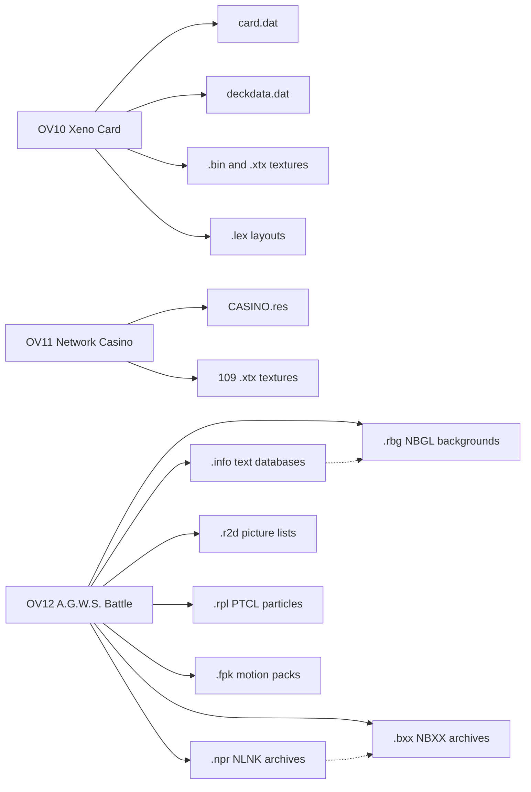
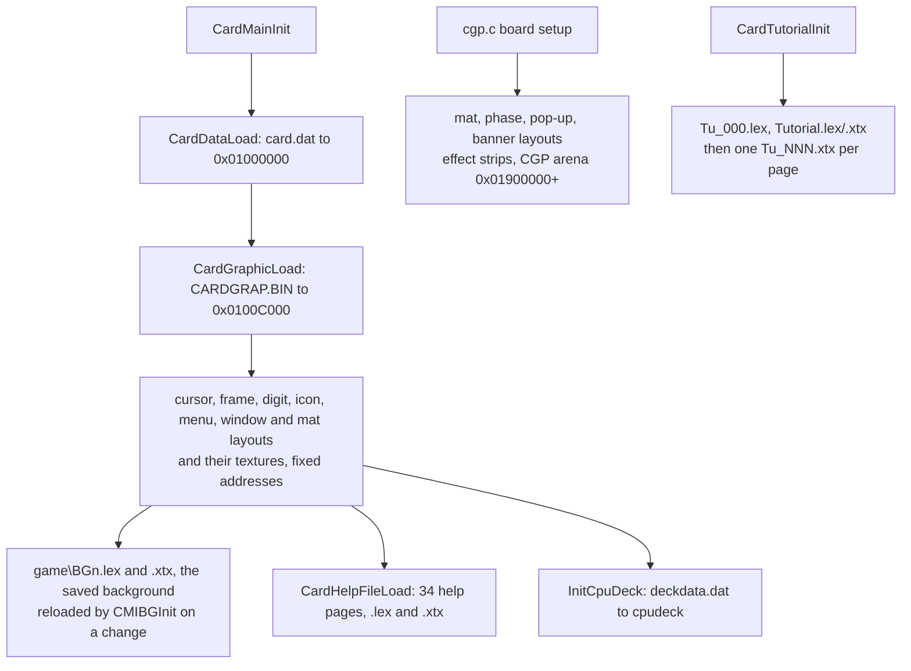
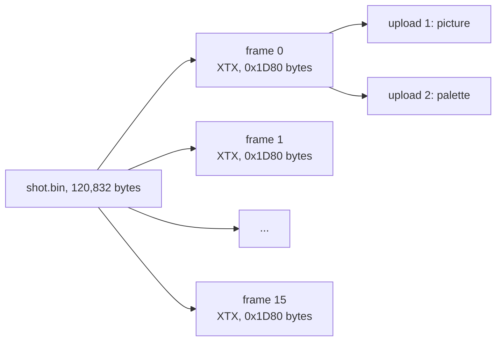
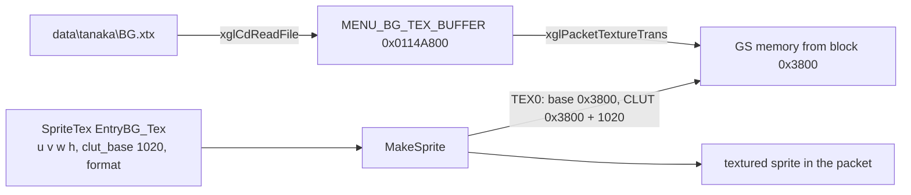
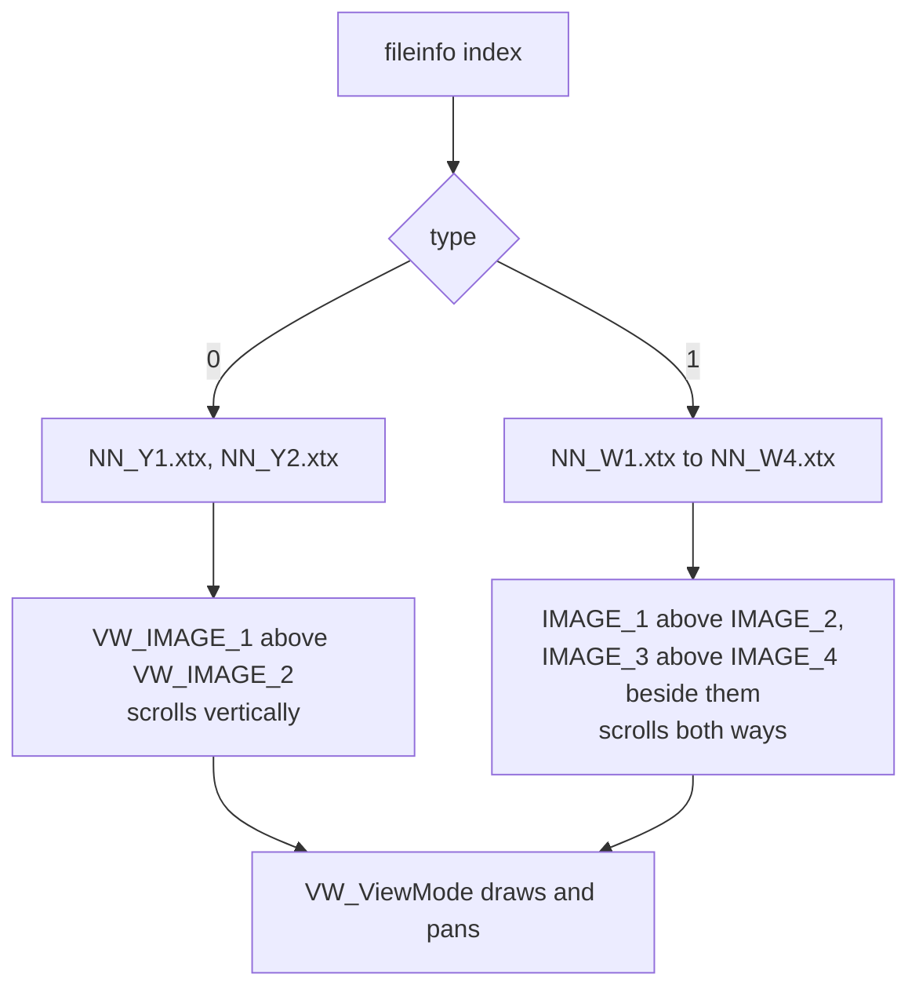
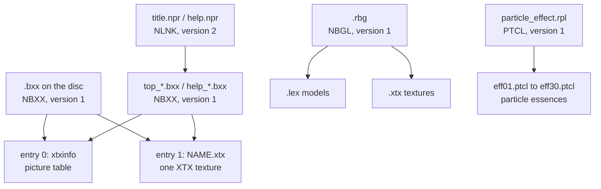
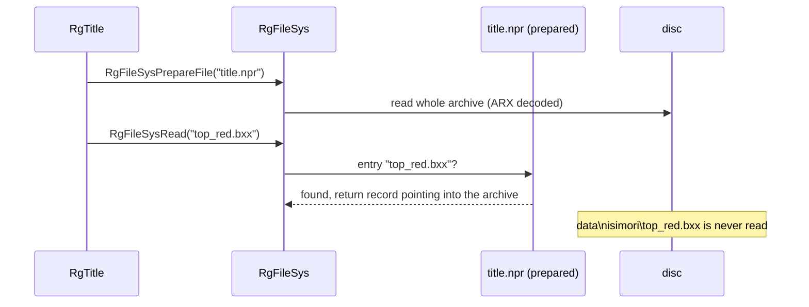
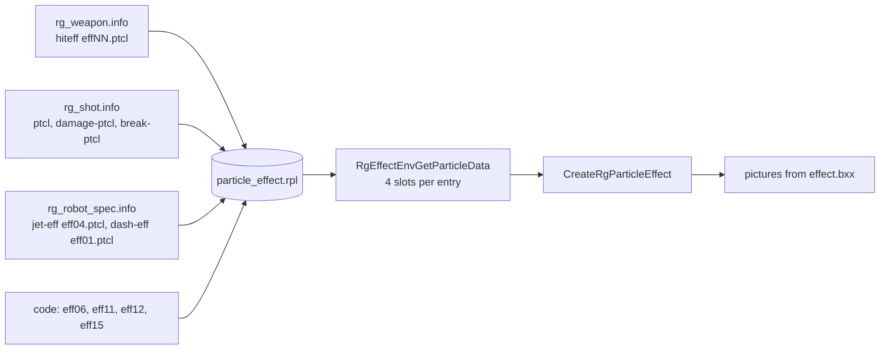
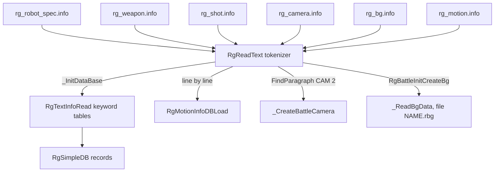

# Minigame data files

The three minigames that run as their own overlays keep their data in three
folders of the disc archives. Xeno Card (overlay OV10) reads
`data\carddata\`, the Network Casino (OV11) reads `data\tanaka\` and the
A.G.W.S. Battle (OV12) reads `data\nisimori\`. Together they hold 545 files.
Most of them are pictures and 3D layouts in the game's ordinary texture and
model formats, but each minigame also has a few files of its own: the card
table and the computer decks of Xeno Card, the tuning file of the casino, and
the picture archives, layout lists, particle tables and text databases of the
A.G.W.S. engine.

Every file of the three folders was parsed, and every field was checked
against the recovered code that reads it. What the code does with the data
is described on the pages of the three minigames,
[Xeno Card](../game/minigames/xeno-card.md),
[Network Casino](../game/minigames/network-casino.md) and
[A.G.W.S. Battle](../game/minigames/agws-battle.md).

[← Back to the overview](../README.md) · See also [Files and resources](../architecture/files-and-resources.md)
for the disc, the archive directory and the ARX packing.

## Contents

1. [Overview](#1-overview)
2. [Xeno Card: data\carddata](#2-xeno-card-datacarddata)
3. [Network Casino: data\tanaka](#3-network-casino-datatanaka)
4. [A.G.W.S. Battle: data\nisimori](#4-agws-battle-datanisimori)
5. [Files nothing loads](#5-files-nothing-loads)
6. [Source files](#6-source-files)

## 1. Overview

None of the three overlays uses the field resource system of the main game.
Each one reads its files directly with `xglCdReadFile()` (see
[from a path to bytes in memory](../architecture/files-and-resources.md#from-a-path-to-bytes-in-memory))
into fixed addresses of main memory or into its own heap. Only two files are
ARX-packed, the two `.npr` archives of the A.G.W.S. Battle. ARX is the
compression of the disc archives and is decoded by the CD layer before the
data reaches the overlay (see
[packed files](../architecture/files-and-resources.md#packed-files-arx)).

Many files are in formats shared with the rest of the game:

- **XTX** is the game's texture file. It is an image of a piece of GS video
  memory with a small header that lists the rectangles to upload. The GS is
  the PS2 graphics chip, and its memory holds both the pixel data and the
  colour palettes (CLUTs). The [models and textures](models-and-textures.md)
  page describes the format.
- **LEX** is the model format of the nml library. In Xeno Card most `.lex`
  files are flat 2D layouts of rectangles that point into an XTX texture.
  The [models and textures](models-and-textures.md) page describes it and the
  [nml library](../libraries/nml.md) page explains how models are drawn.
- **FPK** is a motion pack. The six robot packs and the weapon pack of the
  A.G.W.S. Battle are described on the [skeletons and motion](skeletons-and-motion.md)
  page.

The table below counts every file of the three folders by type. Sizes are
the decoded sizes.

| Folder | Overlay | Type | Files | Bytes | Own format? |
| --- | --- | --- | --- | --- | --- |
| `data\carddata\` | OV10 | `.lex` | 249 | 907,104 | no, LEX layouts |
| | | `.xtx` | 118 | 16,501,936 | no, XTX textures |
| | | `.bin` | 24 | 8,875,232 | no, every one is XTX (see [the .bin textures](#the-bin-textures)) |
| | | `.dat` | 2 | 28,342 | yes, [card.dat](#carddat) and [deckdata.dat](#deckdatadat) |
| `data\tanaka\` | OV11 | `.xtx` | 109 | 28,589,824 | no, XTX textures |
| | | `.res` | 1 | 7,488 | yes, [CASINO.res](#casinores) |
| `data\nisimori\` | OV12 | `.bxx` | 13 | 6,882,736 | yes, [NBXX picture archives](#nbxx-picture-archives) |
| | | `.rbg` | 8 | 8,381,248 | yes, [NBGL background archives](#nbgl-background-archives) |
| | | `.npr` | 2 | 14,853,184 (2,022,864 packed) | yes, [NLNK prepared archives](#nlnk-prepared-archives) |
| | | `.r2d` | 4 | 39,424 | yes, [picture lists](#r2d-picture-lists) |
| | | `.rpl` | 1 | 62,560 | yes, [PTCL particle archive](#ptcl-particle-archive) |
| | | `.info` | 7 | 79,436 | yes, [text databases](#info-text-databases) |
| | | `.fpk` | 7 | 1,683,412 | no, motion packs |

The progress of two of the minigames lives in the normal save, not in these
files. The Xeno Card block `CardSaveData` sits at `SaveData + 0x15090` and
the casino block `CasinoSaveWork` at `SaveData + 0x15190`. The
[save data](../architecture/save-data.md#the-other-blocks) page describes
both.

The diagram below shows which overlay reads which kind of file. Solid arrows
are files the overlay names in its code, dashed arrows are files that another
data file names. The four battle backgrounds, for example, are named only in
`rg_bg.info`.



## 2. Xeno Card: data\carddata

### The folder

The folder holds 393 files in seven subfolders and the root. None is packed.
The names follow the screens of the game: `title\` for the title and START
menu, `game\` for the play mat, `deckmake\` for the deck screens, `help\` and
`tuto\` for the help pages and the tutorial, and `effect\` for the battle
effects. The root holds the card table, the card pictures and the small
models every card is built from.

| Subfolder | Files | `.lex` | `.xtx` | `.bin` | `.dat` | Bytes |
| --- | --- | --- | --- | --- | --- | --- |
| root | 85 | 75 | 3 | 6 | 1 | 7,403,878 |
| `deckdata\` | 1 | | | | 1 | 6,144 |
| `deckmake\` | 36 | 26 | 6 | 4 | | 1,042,864 |
| `effect\` | 12 | 2 | | 10 | | 947,456 |
| `game\` | 110 | 89 | 19 | 2 | | 2,451,088 |
| `help\` | 79 | 41 | 38 | | | 1,908,096 |
| `title\` | 20 | 14 | 4 | 2 | | 431,728 |
| `tuto\` | 50 | 2 | 48 | | | 12,121,360 |

### How the overlay reads its files

`CardFread(address, name)` in `src/ov10/card_fread.c` adds the prefix
`data\carddata\` and calls `xglCdReadFile()`. Almost every file goes to a
fixed address that is written in the code. `CardMainInit()` in
`src/ov10/card_play_sound1.c` loads the card table, the card pictures and
about 170 layout and texture files when the card game starts. `cgp.c` loads
the play mat, the banners and the effect strips into the model arena that
starts at `0x01900000` (`CARD_MODEL_ARENA_BASE`). Files that sit at a
constant distance are written as a base plus a multiple. The 62 small digit
and icon layouts, for example, are read in the order `o0` to `o9`, `s0` to
`s9`, the nine `Ftype_*`, the eight `Btype_*`, the four `Atype_*`, `L0` to
`L9`, `R0` to `R9` and `game\field.lex`, each `0x400` bytes after the one
before, from `0x01C80000` (`CARD_SMALL_LEX_BASE`).

Three groups of files are found by building names at run time instead:

- `CardMainInit()` takes one of the six names `game\BG1` to `game\BG6`
  from `BGFileNameList` by the background stored in the save, appends `.lex`
  and `.xtx` and loads both. `CMIBGInit()` does the same again when the
  player picks the next background in the START menu.
- `CardHelpFileLoad()` in `src/ov10/card_disp.c` walks a list of 34 page
  names (`h_tittle`, `h_ph1`, `h_ph2`, `h_text`, `help5`, `help6`,
  `h_1P2P`, `h_Phase1` to `h_Phase7` and others) and loads `help\NAME.lex`
  and `help\NAME.xtx` for each one into one buffer, each file on a 16-byte
  boundary. Every one of the 68 files exists on the disc.
- `CardTutorialInit()` in `src/ov10/card_tutorial.c` loads `tuto\Tu_000.lex`
  and the frame `tuto\Tutorial.lex` and `.xtx`. `CardTutorialFileLoad()`
  then reads one page texture at a time, `tuto\Tu_000.xtx` to `Tu_046.xtx`
  (47 pages), by its name in `tutoxtx_tbl`.

The tutorial and the computer decks bypass `CardFread()` and call
`xglCdReadFile()` themselves. `InitCpuDeck()` in `src/ov10/card_enemy.c`
names the full path `data\carddata\deckdata\deckdata.dat`.

Because the addresses are fixed, the loads must not overlap. A check of all
84 arena loads of `cgp.c` against the real file sizes finds exactly one
overlap. `effect\atac_a.bin` is `0x13380` bytes long and is read to
`0x01A01000`, but `effect\atac_b.bin` is read right after it to `0x01A14000`.
The second file therefore overwrites the last `0x380` bytes of the first one.
Those bytes are the end of the palette of the fifteenth and last frame of the
`atac_a` strip, which the direct-attack effect does show (its frame index
runs from 0 to 14). The last frame of that effect is probably drawn with 224
wrong palette colours for one frame.

The flowchart below shows the order in which the card game reads its files.



### card.dat

`card.dat` (22,198 bytes) is the master table of the 148 cards. Its layout is
described on the [Xeno Card](../game/minigames/xeno-card.md#carddat-and-carddefinition)
page from the code. `CardDataLoad()` reads it to `0x01000000`
(`CARD_DATA_BUFFER`), compares the 12-byte tag at offset 4 with the copy in
the overlay and returns a pointer to the table at offset `0x10`. The file
holds a 16-byte header, 148 records of `0x24` bytes and then the text area.

```
0x0000  +---------------------------------------------+
        | u16 count = 0x94 (148)   u16 0              |
        | char tag[12] = "CardData1.10"               |
0x0010  +---------------------------------------------+
        | CardDefinition[148], 0x24 bytes each        |
0x14E0  +---------------------------------------------+
        | names and captions, NUL-terminated ASCII,   |
        | in card order, 16,854 bytes, no gaps        |
0x56B6  +---------------------------------------------+  end of file
```

The table below maps every byte of a record. The field names are those of
`CardDefinition` in `include/ov10/cgp.h`. The ranges are the values found in
the 148 records. Kind 1 is a battle card, kind 2 an event card and kind 4 a
situation card.

| Offset | Size | Type | Field | Meaning | Values in the file |
| --- | --- | --- | --- | --- | --- |
| `0x00` | 1 | u8 | `kind` | card kind | 1 (82 cards), 2 (38), 4 (28) |
| `0x01` | 1 | u8 | `unmodeled_01` | serial number of the card inside its kind, never read | 1 to 82, 1 to 38 and 1 to 28 |
| `0x02` | 2 | u16 | `flags` | attribute bits (H, R, G, M, U, weapon) | 0 on every event and situation card |
| `0x04` | 4 | u8[4] | `need` | requirement masks | `0x01`, `0x04`, `0x08`, `0x1F` and 0 |
| `0x08` | 4 | u8[4] | `unmodeled_08` | not read | 0 in 147 records, `1F 1F 00 00` in Lv 10 chaos (`0x0D`) |
| `0x0C` | 4 | u8[4] | `discardRequirements` | one discard per set byte | `00000000` (136), `01000000` (9), `01010000` (3) |
| `0x10` | 1 | u8 | `reserveCost` | cards moved from deck to lost pile | 0 to 5 |
| `0x11` | 1 | u8 | `playCost` | play points | 0 or 1 |
| `0x12` | 1 | u8 | `operationDuration` | life of a battle card, turns of a situation card | 0 to 10, or 100 (26 cards, 17 of them situations) |
| `0x13` | 1 | u8 | `attackType` | 1 hand, 2 ballistic, 3 spread, 4 homing | 1 to 4, or 0 on event and situation cards and on two battle cards |
| `0x14` | 1 | u8 | `attackPower` | attack | 0 to 10 |
| `0x15` | 1 | u8 | `basePower` | base power | 0 to 2 |
| `0x16` | 1 | u8 | `rarity` | rarity letter, see below | `C` (61), `U` (32), `R` (36), `P` (19) |
| `0x17` | 1 | u8 | `identity` | id for the "only one on the field" rule | 0 to 33 on 41 battle cards, `0xFF` on the rest |
| `0x18` | 4 | u32 | `nameOffset` | name, from the start of the file | every record |
| `0x1C` | 4 | u32 | `captionOffset` | caption, from the start of the file | every record |
| `0x20` | 4 | u32 | `descriptionOffset` | description | 0 in every record |

The byte `rarity` is the rarity of the card, stored as an
ASCII letter. `CardDispLight()` picks the mark model by it: `0x50` (`P`) selects
`card_m_p.lex` at `0x01C90730`, `0x52` (`R`) selects `card_m_r.lex`, `0x55`
(`U`) selects `card_m_u.lex`, and every other value, in practice `0x43`
(`C`), falls through to `card_m_c.lex`. The marks are drawn with the texture
`card_Rare.xtx`. The letters are probably common, uncommon, rare and
promotional.

The texts use escape characters that `CardDispTxtSub()` and
`CardNameConvert()` rewrite in place in the loaded buffer before printing.
`@` becomes a comma (91 uses, the file contains no real comma), `#` an
apostrophe (20 uses, as in `Miyuki#s Email`), and `$` a line break (16
uses). A pair of backslashes followed by a third backslash becomes `#73`, and
followed by `%` becomes `#23`. These two forms are probably the `#xx` raw
character escape of the [xgl font](../libraries/xgl.md#glyphs-and-fonts).
They appear only in the names `X\\\BUSTER` (card `0x6E`) and `D\\%mmerung`
(card `0x80`, probably "Dämmerung" with an umlaut).

The description text is never used. Every record has a caption, the
description offset is 0 everywhere, and the code prints the description only
when the caption offset is 0.

The first record, Lv 1 Shion, and the start of the text area look like this
in the file:

```
0000  94 00 00 00 43 61 72 64 44 61 74 61 31 2e 31 30   count 148, "CardData1.10"
0010  01 01 01 00 00 00 00 00 00 00 00 00 00 00 00 00   kind 1, serial 1, flags 0x0001 (H), need, unmodeled_08, discard
0020  01 01 04 02 01 01 52 00 e0 14 00 00 eb 14 00 00   reserve 1, play 1, life 4, attack type 2, power 1, base 1, 'R', identity 0, name 0x14E0, caption 0x14EB
0030  00 00 00 00 ...                                   description 0
14E0  4c 76 20 31 20 53 68 69 6f 6e 00 44 72 61 77 ...  "Lv 1 Shion\0Draw ..."
```

`include/ov10/card_fread.h` defines `CARD_ID_COUNT` as 150, the size of the
per-card arrays in the work area and in the save. The file holds 148 cards,
and the drawing code bounds its card id test by `0x94` (148,
`CARD_DISP_ID_COUNT`), so ids 148 and 149 have no data.

### deckdata.dat

`deckdata.dat` (6,144 bytes) holds the 48 computer decks. `InitCpuDeck()`
reads it into `cpudeck[48]` and points four lists at the parts of each record
(`EnemyDeckListStr` at the name, `DeckGeneLst`, `EnemyDeckLst` and
`DeckDataLst`). The file is an array of `CpuDeckRecord` (`0x80` bytes,
`include/ov10/card_enemy.h`) with no header.

```
+0x00  +-----------------------------------------+
       | name[0x20]   EUC-JP, NUL-padded          |
+0x20  +-----------------------------------------+
       | gene[0x10]   6 used bytes, 10 zero       |
+0x30  +-----------------------------------------+
       | deck[40]     card ids                    |
+0x58  +-----------------------------------------+
       | data[40]     one class byte per card     |
+0x80  +-----------------------------------------+
```

| Offset | Size | Field | Meaning | Values in the file |
| --- | --- | --- | --- | --- |
| `0x00` | 32 | `name` | deck name, printed with `xglFontPrint` in the opponent lists | 10 to 31 bytes, rest zero |
| `0x20` | 1 | `gene[0]` | minimum field cards of the "other" bucket (Human and every attribute not listed below) | 0 to 4 |
| `0x21` | 1 | `gene[1]` | minimum Realian cards | always 0 |
| `0x22` | 1 | `gene[2]` | minimum Mech cards | 0 to 2 |
| `0x23` | 1 | `gene[3]` | minimum Gnosis cards | 0 to 2 |
| `0x24` | 1 | `gene[4]` | minimum Unknown cards | always 0 |
| `0x25` | 1 | `gene[5]` | field size at which the minimums no longer apply | 0 to 4 |
| `0x26` | 10 | `gene[6..15]` | not read | always 0 |
| `0x30` | 40 | `deck` | card ids, copied into the enemy deck by `CardCopyRom2Deck()` | every id below 148 |
| `0x58` | 40 | `data` | class byte of the card at the same position, read by `GetDeckData()` | 0 (908), 1 (314), 2 (178), 3 (406), 4 (114) |

The `gene` bytes are read by `CheckGeneration()` in
`src/ov10/battle_area_check_enemy.c`. It counts the computer's field cards in
five buckets with `CardCountGeneration()` (Realian 1, Mech 2, Gnosis 3,
Unknown 4, anything else 0). When the total is at least `gene[5]` the check
passes, otherwise every bucket must reach its minimum. `GetDeckDataAdjust()`
turns a class byte of 0 into 2 and of 1 into 3 when the check passes. The
[computer opponent](../game/minigames/xeno-card.md#9-the-computer-opponent)
section explains how the classes steer the play.

The names are EUC-JP text, the Japanese encoding the game font uses. The
first 40 begin with a number, a full-width parenthesis and full-width spaces
(`A1 CB` and `A1 A1`) and then the English name, for example
`1）　Shion　&　Ziggy`, `12）　MOMO　to　the　Rescue` and
`40）　Gnosis-Machine　Combo`. Two names (decks 24 and 32) lack the spaces
after the parenthesis.

The first record, deck 1, is shown below.

```
0000  31 a1 cb a1 a1 53 68 69 6f 6e a1 a1 26 a1 a1 5a   "1）　Shion　&　Z"
0010  69 67 67 79 00 00 00 00 00 00 00 00 00 00 00 00   "iggy", padding
0020  02 00 00 00 00 02 00 00 00 00 00 00 00 00 00 00   gene: 2 others, threshold 2
0030  00 00 00 02 02 02 07 07 0f 0f 0f 14 14 14 15 15   card ids, sorted
0040  15 16 16 16 1b 1b 1b 1c 1c 1c 1f 1f 21 21 21 6b
0050  6b 6b 6c 6c 6c 7b 7b 7b 01 01 01 01 01 01 03 03   ... then the class bytes
0060  01 01 01 01 01 01 01 01 01 01 01 01 01 01 01 01
0070  01 01 03 03 03 03 03 00 00 00 00 00 00 00 00 00
```

**The last eight decks are test decks.** The opponent pools of the
exhibition and the tournament hold at most the first 40 decks
(`CARD_ENEMY_POOL_ALL`), so decks 41 to 48 are never picked. Their names were
never translated and describe tests: `４１）鉄壁` ("iron wall"),
`４２）脆いよなぁ！` ("so fragile!"), `４３）カレー試食` ("curry tasting"),
`４４）コマンド撃ち` ("command shots"), `４５）休戦協定` ("ceasefire"),
`４６）ＡＩ実験` ("AI experiment"), `４７）トニー＆テスタ` ("Tony and
Testa") and `４８）弾道テスト` ("ballistic test"). Most of their contents
match the names, and six of them break the rule that every one of the 40
real decks keeps, that a card appears at most three times
(`CARD_DECK_MAX_COPIES`):

- deck 41 is deck 19 "Flat Broke" with two cards changed, and its `gene` and
  class bytes are the same,
- deck 42 holds 17 copies of So Weak! (`0x8B`),
- deck 43 holds 12 copies of Curry (`0x54`),
- deck 44 holds 9 U-TIC Soldier, 7 Drone, 5 Woglinde and four each of
  Miyuki's Email, Retreat and Mary & Shelley,
- deck 45 holds 15 Joachim Mizrahi, 11 Revive DX and 11 Armistice,
- deck 46 holds 40 battle cards and keeps the three-copy rule,
- deck 47 holds 40 battle cards: 17 Allen, 9 Kobold, 9 Civilian Female and
  4 Testament,
- deck 48 holds 40 battle cards: 7 VX-4000, 7 Eyeglasses, 6 VX-20000, 5
  Aird and smaller groups.

36 of the 48 card lists are sorted by card id. The class bytes of decks 5,
20, 43 and 47 are all 0, and those of deck 48 are all 3.

`CardLoadDeckProc2()` in `src/ov10/card_deck_chk.c` is a deck-load screen
that reads the first five records of this file as if they were the player's
stored decks. Nothing calls it.

### The .bin textures

None of the 24 `.bin` files is a table. Every one is a single XTX texture or
a run of XTX textures stored back to back, with the same header as the
`.xtx` files. The name only tells which files the artists exported together.
The table lists each file with its size, the number of XTX blocks it holds,
the address the code loads it to and what the code draws with it.

| File | Bytes | XTX blocks | Loaded to | Used as |
| --- | --- | --- | --- | --- |
| `CARDGRAP.BIN` | 7,073,216 | 148 of `0xBAB0` | `0x0100C000` | card pictures, block n is card n (`CARD_TEXTURE(cardId)`) |
| `NewCardBase.bin` | 82,048 | 1 | `0x016E0000` | card frame overlay and the deck and discard pile markers |
| `CardBase.bin` | 32,848 | 1 | not loaded | probably the older card frame that `NewCardBase.bin` replaced |
| `CardInfo0.bin` | 12,368 | 1 | `0x01C91000` | attribute icons, generation markers, battle and pile digits |
| `CardInfo1.bin` | 20,560 | 1 | `0x01C94050` | attack type and battle icons (`CARD_ATTACK_TEXTURE`) |
| `CardInfo2.bin` | 10,960 | 1 | `0x01C990A0` | digit texture of the card values and the damage numbers |
| `title\menu.bin` | 65,616 | 1 | `0x0170F600` | START menu item and option plates |
| `title\window.bin` | 3,200 | 1 | `0x01DB5800` | title window frames and the card fan backdrop |
| `deckmake\battlewin.bin` | 6,896 | 1 | `0x01937800` | battle window frames |
| `deckmake\deck_gra.bin` | 225,456 | 1 | `0x01F30100` | texture of the three deck screens |
| `deckmake\pack.bin` | 262,224 | 1 | `0x01A00000` | card pack opening screen |
| `deckmake\cur_LR.bin` | 65,616 | 1 | `0x01A40050` | cursor of the card viewer |
| `game\up_LR.bin` | 18,512 | 1 | `0x01939800` | texture of the `up_L` and `up_R` layouts |
| `game\victory.bin` | 50,304 | 1 | `0x01952D90` | win and loss banners |
| `effect\*.bin` | 57,728 to 157,440 | 11 to 30 | see below | animated effect strips |

`CardInfo0.bin`, `CardInfo1.bin`, `CardInfo2.bin` and `card_Rare.xtx` are
packed without gaps. Each one starts exactly where the previous one ends
(`0x01C91000 + 0x3050 = 0x01C94050` and so on), so the four were probably
laid out as one block.

An effect strip is a run of complete XTX files of equal size, one per frame.
The code computes frame n as `base + n * size` (`CARD_EFFECT_FRAME`) with a
frame size of `0x1480` for the small strips and `0x1D80` for the large ones.
The number of frames in every file equals the number of frames the code steps
through, as the table shows.

| File | Loaded to | Strip in `cgp.c` | Frame size | Frames in the file | Frame index in the code |
| --- | --- | --- | --- | --- | --- |
| `atac_c.bin` | `0x01BF0000` | `TRAVEL_1` (front attack) | `0x1480` | 15 | `14 - timer` |
| `atac_d.bin` | `0x01C04000` | `TRAVEL_2` (pierce attack) | `0x1480` | 15 | `14 - timer` |
| `atac_b.bin` | `0x01A14000` | `TRAVEL_3` (support attack) | `0x1480` | 15 | `14 - timer` |
| `atac_a.bin` | `0x01A01000` | `TRAVEL_4` (direct attack) | `0x1480` | 15 | `14 - timer` |
| `zan.bin` | `0x01BD8000` | `BURST_1` | `0x1D80` | 13 | `12 - timer` |
| `shot.bin` | `0x01AA0000` | `BURST_2` | `0x1D80` | 16 | `15 - timer` |
| `rang.bin` | `0x01A85000` | `BURST_3` | `0x1D80` | 11 | `10 - timer` |
| `misl.bin` | `0x01A67000` | `BURST_4` | `0x1D80` | 15 | `14 - timer` |
| `bom.bin` | `0x01A28000` | `FADE` | `0x1480` | 11 | `10 - timer / 2` |
| `flas.bin` | `0x01A40000` | `SWIRL` (effect code 10) | `0x1480` | 30 | `29 - timer` |

The two models the strips are drawn on are `effect\effect0.lex` (at
`0x01A00000`, `CARD_EFFECT_SPRITE_MODEL`) and `effect\effect1.lex` (at
`0x01A00800`, the scaled sprite). Each frame XTX has two uploads, the picture
and a 256-colour palette. The diagram shows how a strip is cut into frames.



`CARDGRAP.BIN` works the same way with 148 blocks of `0xBAB0` bytes, one per
card id. Each card XTX has three uploads of 32-bit GS memory, one of
112 × 80 words and two smaller ones of 80 × 32 and 24 × 16 words. Which of
them hold the picture and which the palettes was not checked.

In `atac_a.bin` and the other strips, the picture upload of a frame comes
first (`0x40` to `0x1060`) and the palette upload last (`0x1060` to
`0x1480`), so the `0x380` bytes that `atac_b.bin` overwrites at the end of
the last `atac_a` frame belong to its palette.

### Layout and texture files

The 249 `.lex` and 118 `.xtx` files are the 2D and 3D pieces of the screens.
The [models and textures](models-and-textures.md) page describes their bytes.
What they show follows from the names and from the code that draws them:

- **Root.** The parts of a card: `NewCard_B.lex`, `NewCard_E.lex` and
  `NewCard_S.lex` (the frame of a battle, event and situation card),
  `name.lex` (the picture area, drawn with the card's `CARDGRAP.BIN` block),
  `cardgrap.lex` (the frame), `card_kage.lex` (the shadow), the rarity marks
  `card_m_*.lex`, the attribute and type icons `Atype_*`, `Btype_*` and
  `Ftype_*`, the digit sets `o0` to `o9`, `s0` to `s9`, `L0` to `L9` and `R0`
  to `R9` (1,024 bytes each) and the line layouts `line1.lex` to `line4.lex`
  with `line.xtx`.
- **`title\`.** The title logo (`NewTitle`), the three title items `m_game`,
  `m_card` and `m_help`, the START menu plates `menu1` and `menu2`, and eight
  window layouts `window1.lex` to `window8.lex`.
- **`game\`.** The play mat (`mat_fg`, `mat_info`, `mat_hpatk`, `mat_moji`
  and the Japanese labels `mat_mojiJ`), the six backgrounds `BG1` to `BG6`,
  the phase names (`dlow`, `move`, `set`, `event`, `battle`, `adjust`,
  `block`, each also with a `2` variant), the phase lamps `phase1` to
  `phase7`, the turn and win plates (`tern`, `P1tern`, `P2tern`, `Etern`,
  `Ptern`, `P1win`, `P2win`, `Ewin`, `Pwin`), the pop-ups `pop1`, `pop2`,
  `NewPop1P` and `NewPop2P`, the deck piles `NewYama*`, the life bar
  `HPbar`, the cursors `cur2D_01` to `cur2D_06` and `cur2D_11` to
  `cur2D_16`, the frames `Cur_WakuG`, `Cur_WakuR`, `Cur_WakuW` and
  `Cur_WakuY`, and the banners `victory1` to `victory7` and `NewLost1` to
  `NewLost3`.
- **`deckmake\`.** The deck list, deck editor and viewer screens, the battle
  windows `battlewin1` to `battlewin5`, the card back `xg_ura_up` and the
  completion badge `comp`. `type1_B.xtx`, `type1_E.xtx` and `type1_S.xtx`
  are byte-identical.
- **`help\`.** The 34 help pages loaded by `CardHelpFileLoad()` and the help
  frame `help1` to `help3` with the menu plates `Hmenu1` and `Hmenu2`. Many
  pages share one picture: `h_base.xtx`, `h_battl.xtx` and `h_field.xtx` are
  identical, so are `h_Phase2.xtx` to `h_Phase7.xtx`, and so are `h_hand`,
  `h_hand2`, `h_junk`, `h_lost`, `h_situation` and `h_standby`.
- **`tuto\`.** The 47 tutorial page pictures `Tu_000.xtx` to `Tu_046.xtx`,
  which make up 12 MB of the folder, with one shared layout `Tu_000.lex` and
  the frame `Tutorial.lex` and `.xtx`. `Tutorial.xtx` is byte-identical to
  `help\help2.xtx`.

### Leftovers in data\carddata

Nine files are on the disc but no code names them. The overlay strings, the
source and the name tables were searched for every file name.

| File | Bytes | What it probably is |
| --- | --- | --- |
| `CardBase.bin` | 32,848 | older card frame texture, replaced by `NewCardBase.bin` |
| `name.xtx` | 10,960 | a texture with the same header and size as `CardInfo2.bin` but different pixels, probably the texture `name.lex` was made with |
| `game\NewTitle.lex` | 2,528 | byte-identical copy of `title\NewTitle.lex` |
| `game\NewTitle.xtx` | 65,616 | byte-identical copy of `title\NewTitle.xtx` |
| `game\yama.lex` | 3,808 | older deck pile layout, replaced by `NewYama.lex` (its texture `game\yama.xtx` is still loaded) |
| `help\card_H.lex` | 8,096 | an unused help layout |
| `help\card_H.xtx` | 32,848 | its texture |
| `help\help3.xtx` | 65,616 | byte-identical copy of `help\help1.xtx` (only `help3.lex` is loaded) |
| `help\helpdamy.lex` | 20,912 | a dummy help layout ("damy" is probably "dummy") |

The prefix `New` on many names (`NewCardBase`, `NewCard_B`, `NewTitle`,
`NewYama`, `NewPop`, `NewLost`) marks a second version of the art. The old
versions that were left behind are the ones above.

## 3. Network Casino: data\tanaka

### The folder

The casino folder holds `CASINO.res` and 109 XTX textures, none packed. 92 of
the textures are the parts of the 30 design sketches that the data viewer
shows. The other 17 are the screens of the casino. Every one of the 110 files
is loaded by the code, from paths in `src/ov11/mini_g.c`.

### CASINO.res

`CASINO.res` (7,488 bytes) holds the numbers and texts that tune the casino.
`RES_Load()` reads it to `0x01000000` (`CASINO_RES_BUFFER`) and points
`ResData` at it. The code describes the file as `CasinoResourcePrefix` in
`src/ov11/mini_g_private.h`. Its header comment calls the 256-entry extent of
the sound table inferred. The file confirms it: the debug word that follows
the table is the last word of the file.

```
0x0000  +-------------------------------------------+
        | s32 bonus_duration = 600                  |
        | s32 reel_step      = 32                   |
0x0008  +-------------------------------------------+
        | CasinoPrize prizes[51]     0x7C each      |
0x18BC  +-------------------------------------------+
        | CasinoCoinOffer coin_offers[4]  0x20 each |
0x193C  +-------------------------------------------+
        | s32 sound_effect_id[256]                  |
0x1D3C  +-------------------------------------------+
        | s32 debug_mode = 0                        |
0x1D40  +-------------------------------------------+  end of file
```

| Offset | Size | Type | Field | Meaning | Value in the file |
| --- | --- | --- | --- | --- | --- |
| `0x0000` | 4 | s32 | `bonus_duration` | length of a slot bonus, counted in eligible updates (`RES_GetBonusTime`) | 600 |
| `0x0004` | 4 | s32 | `reel_step` | reel position step per eligible update (`RES_GetRealSpeed`) | 32 |
| `0x0008` | 6,324 | `CasinoPrize[51]` | `prizes` | the prize list of the exchange | see below |
| `0x18BC` | 128 | `CasinoCoinOffer[4]` | `coin_offers` | the four coin offers | see below |
| `0x193C` | 1,024 | s32[256] | `sound_effect_id` | sound id for each casino sound number | 65 entries set |
| `0x1D3C` | 4 | s32 | `debug_mode` | nonzero makes `InitWork()` unlock every prize and add money and coins | 0 |

A prize is `0x7C` bytes: the price in coins (`coin_cost`, s32), the name
(`name[40]`) and the description (`description[80]`). A coin offer is `0x20`
bytes: the price in G (`money_cost`, s32) and the text (`description[28]`).
All texts are NUL-terminated ASCII. The file holds these values:

| Prize | Name in the file | Price (coins) |
| --- | --- | --- |
| 0 | Recovery Set | 100 |
| 1 | Escape and Rest Set | 150 |
| 2 | Golden Dice | 10,000 |
| 3 | Bravesoul | 15,000 |
| 4 | `Revive DX ` (with a trailing space) | 18,000 |
| 5 | Stim DX | 12,000 |
| 6 to 35 | Design sketch 01 to Design sketch 30 | 2,000 each |
| 36 | Starter Set | 400 |
| 37 | Card Pack #821 | 100 |
| 38 | Card Pack #822 | 100 |
| 39 to 50 | PM Card F to PM Card Q | 1,000 each |

| Offer | Text in the file | Price |
| --- | --- | --- |
| 0 | `  10 coins    100G` | 100 G |
| 1 | ` 100 coins    950G` | 950 G |
| 2 | ` 500 coins   4500G` | 4,500 G |
| 3 | `1000 coins   8000G` | 8,000 G |

These are the names and prices that the
[prize exchange](../game/minigames/network-casino.md#9-prize-exchange) and the
[coin exchange](../game/minigames/network-casino.md#8-coin-exchange) show. The
save block `prize_bought[0x50]` has room for 80 prizes, but the file defines
51.

A sound id is `(bank << 16) | index`, the form `xglSoundEffectNormalID()`
takes (see [sound effects](../architecture/audio.md#9-sound-effects-and-the-se-queue)).
`RES_SoundEffect(n)` looks up entry n and plays it. The code plays casino
sounds 0 to 66 except 7. Entries 67 to 255 are zero. The ids used are:

| Bank | Ids | Used for |
| --- | --- | --- |
| 0 | 1, 2, 3, 5 | the user-interface sounds of bank 0 that `xglSoundEffectNormalID()` treats specially, used for the menus, the entrance sounds and many refusals |
| 1 | 13 ids between `0x10001` and `0x1001C` | the game sounds of the slot machine, Nine Reel and poker |
| 2 | `0x20009` | one sound, casino sound 47 |

Two entries hold 0. Sound 7 is never played. Sound 52 (`0x34`) is the payout
sound of Nine Reel, started and stopped by `NgGame_Paid()`, but its entry is
0, where the payout of the slot machine (sound 39) holds `0x10004`. Nine Reel
therefore requests sound id 0, effect 0 of bank 0, during its payout. Whether
that effect is audible was not checked. Every request is also logged with
`dprintf("Sound Req = SE_%.3d:Sound num = %x")`, the format that gives the table its
`SE_` numbering.

`debug_mode` is 0 on the disc, so the debug grants that `InitWork()` would
make (see [debug leftovers](../game/minigames/network-casino.md#12-debug-leftovers))
are off.

The start of the file shows the two numbers and the first prize:

```
0000  58 02 00 00 20 00 00 00 64 00 00 00 52 65 63 6f   bonus 600, reel step 32, prize 0 cost 100, "Reco"
0010  76 65 72 79 20 53 65 74 00 52 65 63 6f 76 65 72   "very Set\0" then leftover "Recover"
...
18BC  64 00 00 00 20 20 31 30 20 63 6f 69 6e 73 20 20   offer 0: 100 G, "  10 coins  "
18CC  20 20 31 30 30 47 00 30 47 00 2e 2e 00 c7 00 c7   "  100G\0", then leftover bytes
```

**Leftover bytes.** The bytes after the terminating NUL of almost every
string are not zero. The tool that wrote the file probably reused its text
buffer without clearing it, so the rest of each field keeps pieces of older
texts:

- the name field of prize 0 holds `Recovery Set` a second time after the NUL,
- the names of sketches 02 to 30 keep `h 02` to `h 30` after the NUL, the
  end of a longer earlier spelling,
- `Starter Set` is followed by ` Set`, and `Card Pack #821` and `#822` by
  `#1` and `#2`, probably the ends of earlier names such as "Card Pack #1",
- the coin offer texts keep `0G` and the EUC-JP bytes `A3 B0 A3 C7`, the
  full-width characters "０Ｇ" of the Japanese text,
- many fields are filled with runs of `.` (`0x2E`) after the NUL.

The code never reads past a NUL, so none of this shows in the game.

### The casino textures

Every casino texture is an XTX file with one upload. The 92 sketch parts and
14 of the other textures have the same shape: one 256 × 256 rectangle of
32-bit GS memory (262,144 bytes plus an `0x50`-byte header, 262,224 bytes in
all). Most casino sprites read that memory as an 8-bit picture of 512 × 512
pixels. The GS arranges 8-bit pixels in pages of 128 × 64 where 32-bit pixels
use pages of 64 × 32, so the same bytes hold a picture of twice the width and
twice the height. `sam.xtx` (4 uploads), `slot_1.xtx` (3 uploads) and `window.xtx` (1 upload,
43,088 bytes) have other shapes.

The palettes are not separate files. Each one is a 16 × 16 block of 32-bit
words (256 colours) stored inside the same texture, in a corner the picture
does not use. The sprite tables of `mini_g.c` give its position as a GS block
address (`clut_base`). The checker found a 256-colour palette at the position
of every `clut_base` the code uses, for example at `(240, 240)` for
`BG.xtx`, `exchange1.xtx` and `exchange2.xtx` and at `(0, 224)` for all 92
sketch parts.

The sprite tables themselves are compiled into the overlay, not stored on
the disc. Each `SpriteTex` (28 bytes) names a rectangle `u`, `v`, `w`, `h` in
pixels of the 8-bit picture, the two block addresses `texture_base` and
`clut_base` (relative to block `0x3800`, where the casino uploads its
textures) and a `format` that selects the `TEX0` setting of the GS. `TEX0` is
the GS register that tells the chip where a texture and its palette are and
how wide they are. The [2D sprites](../game/minigames/network-casino.md#2d-sprites)
section of the casino page describes the drawing.

The flowchart shows how one sprite of the casino reaches the GS.



The table lists what each of the 17 screen textures holds. The buffers are
the fixed addresses of `mini_g_private.h`.

| File | Buffer | What the code draws from it |
| --- | --- | --- |
| `BG.xtx` | `MENU_BG_TEX_BUFFER` | the casino menu background |
| `window.xtx` | `MENU_WINDOW_TEX_BUFFER` | menu window and cursor |
| `exchange2.xtx` | `COIN_EXCHANGE_TEX_BUFFER` | coin exchange screen |
| `exchange1.xtx` | `SHOP_EXCHANGE_TEX_BUFFER` | prize exchange screen |
| `base.xtx` | `BASE_TEX_BUFFER` | the slot machine parts: reels (`Real_2`), buttons, digits, pay table, lines, time bar, and the background of the unreachable test mode |
| `slot_1.xtx` | `SLOT_1_TEX_BUFFER` | the slot machine background (`SlBgDraw`) |
| `slot_2.xtx` | `SLOT_2_TEX_BUFFER` | the Nine Reel background |
| `w1.xtx` | `SLOT_W1_TEX_BUFFER` | the prize effect of the slot machine |
| `help_all.xtx` | `SLOT_HELP_TEX_BUFFER` | the help pages of the slot machine and Nine Reel |
| `poker_1.xtx` | `POKER_TABLE1_TEX_BUFFER` | the poker table background |
| `poker_2.xtx` | `POKER_TABLE2_TEX_BUFFER` | poker cursor, markers, selector, digits and window |
| `spade.xtx`, `clover.xtx`, `heart.xtx`, `dia.xtx` | `POKER_*_TEX_BUFFER` | the card faces of one suit each |
| `dataviewer.xtx` | `VW_DATAVIEWER_TEX_BUFFER` | the data viewer background and key help |
| `sam.xtx` | `VW_SAM_TEX_BUFFER` | the 30 small sketch previews of the viewer list (`ViewSamTex[30]`) |

Each suit texture holds 15 card pictures of 80 × 120 pixels (`CardTex[15]`).
Pictures 0 to 12 are the thirteen ranks of the suit. Pictures 0 to 9 use the
palette at block 1016 and pictures 10 to 13 the one at block 1020. Picture
14, at `(416, 0)` with the palette at block 1004, is
drawn from `spade.xtx` by two single sprites (`tex_72` and `tex_76`) and is
probably the card back. The diamond range of `range_71` runs to 53, so
pictures 13 and 14 of `dia.xtx` could be drawn as cards 52 and 53, but the
deal only produces cards 0 to 51.

### The design sketches

The data viewer shows 30 sketches as one picture each, made of two or four
textures. `fileinfo[30]` in `mini_g.c` gives the type of each sketch, and
`VW_ViewModeInit()` builds the names with `sprintf` and the formats
`%s\%.2d_Y1.xtx` to `%s\%.2d_W4.xtx`, from `data\tanaka` and the sketch
number. A type 0 sketch is made of `NN_Y1.xtx` and `NN_Y2.xtx`, a type 1
sketch of `NN_W1.xtx` to `NN_W4.xtx`. The disc agrees with the table for all
30 sketches: 14 of type 0 (01, 02, 04, 06, 07, 11, 14, 16, 18, 20, 22, 24, 29
and 30) with 28 files, and 16 of type 1 with 64 files.

Each part is a 512 × 448 8-bit picture with its 256-colour palette parked
below it, at `(0, 224)` in the 32-bit view (rows 448 to 511 of the 8-bit
view). `VW_ViewMode()` draws `VW_IMAGE_1_BUFFER` above `VW_IMAGE_2_BUFFER`
and, for type 1, `VW_IMAGE_3_BUFFER` and `VW_IMAGE_4_BUFFER` beside them, so
a type 0 sketch is a tall picture of two pages that scrolls only up and down,
and a type 1 sketch a picture of two by two pages that also scrolls sideways.
The diagram shows how the type of a sketch decides its files and its layout.



## 4. A.G.W.S. Battle: data\nisimori

### The folder

The 42 files of the A.G.W.S. folder use five container and text formats of
their own and the motion packs of the main game. The two `.npr` files are
ARX-packed (1,239,312 and 783,552 bytes on the disc). All files are read
through `RgFileSys`, the file cache of the engine (see
[files and archives](../game/minigames/agws-battle-engine.md#files-and-archives)).

| Type | Files | Magic | Read by |
| --- | --- | --- | --- |
| `.bxx` | 13 | `NBXX` | `RgBxx` (`rg_bxx.c`): `RgTitle`, `RgHelp`, `RgSelectAGWS`, `RgBattleCommonDataLoad`, `RgEffectEnvLoadData` |
| `.npr` | 2 | `NLNK` | `RgFileSysPrepareFile` from `_Title` and `_Help` in `rg_main.c` |
| `.rbg` | 8 | `NBGL` | `_ReadBgData` in `rg_bg_builder.c`, the selection floor and the shot models, models found by `xrg_dispmodel_impl.c` |
| `.rpl` | 1 | `PTCL` | `RgEffectEnvLoadData` and `RgEffectEnvGetParticleData` in `rg_effect_env.c` |
| `.r2d` | 4 | none | `CreateRgPicListFromBinary` in `rg_piclist.c` (from `rg_select_agws.c`) |
| `.info` | 7 | none, text | `RgReadText` (`rg_read_text.c`) and the databases |
| `.fpk` | 7 | motion pack | `XrgActor` and `RgBattleCommonDataLoad`, see [skeletons and motion](skeletons-and-motion.md) |

### The link container

Four of the formats are the same container with different magics. The code
reads it with `RgLinkData` (`src/ov12/rg_linkdata.c`). The `.npr` files carry
the magic `NLNK`, and the `.bxx`, `.rbg` and `.rpl` files use the same layout
with the magics `NBXX`, `NBGL` and `PTCL`. A container is a header of `0x20` bytes, a table of names and a table
of offsets, followed by the entries.

```
0x00  +--------------------------------------------------+
      | magic[4]  "NBXX" "NBGL" "NLNK" "PTCL"            |
      | u32 nameTableOffset = 0x20                       |
      | u32 offsetTableOffset = 0x20 + 0x20 * num        |
      | u32 0                                            |
      | u32 version  (1 or 2)                            |
      | u32 numOfData                                    |
      | u32 time  (Unix time)                            |
      | "    "  (four spaces)                            |
0x20  +--------------------------------------------------+
      | char name[0x20] x num   NUL-padded               |
      +--------------------------------------------------+
      | u32 offset x num        (version 1)              |
      | u32 offset x (num + 1)  (version 2, last = size) |
      +--------------------------------------------------+
      | zero padding to a 16-byte boundary               |
      +--------------------------------------------------+
      | entry 0, entry 1, ...  each a multiple of 0x800  |
      +--------------------------------------------------+
```

| Offset | Size | Field (`RgLinkDataHeader`) | Meaning | Values in the 24 containers |
| --- | --- | --- | --- | --- |
| `0x00` | 4 | `unmodeled_000` | magic, the container kind | `NBXX` (13 + 28 nested), `NBGL` (8), `NLNK` (2), `PTCL` (1) |
| `0x04` | 4 | `nameTableOffset` | start of the name table | always `0x20` |
| `0x08` | 4 | `offsetTableOffset` | start of the offset table | always `0x20 + 0x20 * num` |
| `0x0C` | 4 | `unmodeled_00C` | not read | always 0 |
| `0x10` | 4 | `version` | `RgLinkDataVersion` | 1, or 2 for the two `.npr` |
| `0x14` | 4 | `numOfData` | number of entries | 2 to 30 |
| `0x18` | 4 | `time` | build time, seconds since 1970 | 2001-09-28 to 2002-07-23 |
| `0x1C` | 4 | | not read | always four spaces, `20 20 20 20` |

The offsets count from the start of the container. The first entry always
starts at the first 16-byte boundary after the offset table, and every entry
is padded with zeros to a multiple of `0x800` bytes. Where there is a gap
between the offset table and the first entry, it is zero.

The magic is checked in one place only. `_FindInPrepare` (`rg_filesys.c`), called by `RgFileSysRead`, tests that a
prepared archive starts with `NLNK` (`RgLinkDataMatchDataName`) and reports
"%s is not nlink data" otherwise. The magics `NBXX`, `NBGL` and `PTCL` are
never read, so they only tell a human which kind of data a file holds.

The two versions differ in one point. A version 2 container stores one more
offset, the end of the last entry, which equals the file size. A version 1
container stores only `num` offsets, so the word after the table is padding
or already the first bytes of the first entry (`lex\0` or `XTX\0` in four
`.rbg` files). This is why `RgLinkDataGetSize()` refuses archives older than
version 2 (`RG_LINKDATA_MIN_VERSION_FOR_SIZE`). The engine never needs the
size of an entry in a version 1 container: it finds Bxx entries by index and
the entries of the other containers by name (`RgLinkDataGet`).

The time stamps decode as Unix times to plausible build dates. The oldest is
`aircarrier.rbg` (2001-09-28), the newest are `title.npr` and the entries
inside it (2002-07-23 07:13).

The diagram shows how the container kinds nest.



### NBXX picture archives

A Bxx file is a picture archive. It always has exactly two entries. The first
is named `xtxinfo` and holds the table of pictures. The second is named
after the file with the extension `.xtx` (for example `top_red.xtx`) and is
one XTX texture. `RgBxx` takes them as entry 0 and entry 1
(`RgLinkDataGetIndex`), so the two names are never read.

All 41 Bxx archives (13 files and 28 inside the `.npr`) have the same
texture shape: two uploads of 512 × 128 32-bit words, together one
512 KB area of GS memory (524,416 bytes with the header). The pictures are
rectangles inside that area, read as 4-bit or 8-bit images.

The `xtxinfo` entry starts with a `0x30`-byte header (`RgBxxHeader`,
`include/ov12/rg_bxx.h`).

| Offset | Size | Field | Meaning | Values in the 41 archives |
| --- | --- | --- | --- | --- |
| `0x00` | 4 | `unmodeled_000` | not read | 0 |
| `0x04` | 4 | `numTex` | number of pictures | 1 to 61 |
| `0x08` | 8 | `unmodeled_008` | not read | 0 |
| `0x10` | 4 | `width4` | texture width for 4-bit pictures, in units of 64 pixels | 16 (1024 pixels) |
| `0x14` | 4 | `width8` | the same for 8-bit pictures | 16 |
| `0x18` | 4 | `width16` | the same for 16-bit pictures | 8 |
| `0x1C` | 4 | `width24` | the same for 24-bit and 32-bit pictures | 8 (512 pixels) |
| `0x20` | 4 | `height` | texture height in pixels | 512 |
| `0x24` | 12 | `unmodeled_024` | not read | 0 |

`numTex` picture records of `0x60` bytes (`RgBxxPic`) follow at `0x30`, and
the entry is padded with zeros to a multiple of `0x800`.

| Offset | Size | Field | Meaning | Values in the 279 pictures |
| --- | --- | --- | --- | --- |
| `0x00` | 32 | `name` | picture name, found by `RgBxxGetPic` with `strncmp` | every name ends in `.bmp`, the bytes after the NUL are zero |
| `0x20` | 4 | `unmodeled_020` | unknown, not read | 0 (196), 4 (43), 7 (24), 3 (16) |
| `0x24` | 4 | `bpp` | bits per pixel, selects the GS pixel format | 4 (120) or 8 (159) |
| `0x28` | 4 | `unmodeled_028` | GS block address of the picture's top-left pixel, relative to the texture base, not read | matches `x` and `y` in all 279 |
| `0x2C` | 4 | `x` | left edge in the texture, in pixels of the picture's format | 0 to 992 |
| `0x30` | 4 | `y` | top edge | 0 to 480 |
| `0x34` | 4 | `width` | width in pixels | 8 to 512 |
| `0x38` | 4 | `height` | height in pixels | 16 to 448 |
| `0x3C` | 4 | `paletteBase` | GS block address of the palette, relative to block `0x3800` | matches the palette position in all 279 |
| `0x40` | 4 | | palette x, in 32-bit pixels, not read | 0 to 496 |
| `0x44` | 4 | | palette y, not read | 8 to 240 |
| `0x48` | 4 | | palette width, not read | 8 (16 colours) or 16 (256 colours) |
| `0x4C` | 4 | | palette height, not read | 2 or 16 |
| `0x50` | 8 | | not read | 0 |
| `0x58` | 4 | `pOwner` | filled at load time with the owning `RgBxx` | 0 in the file |
| `0x5C` | 4 | | not read | 0 |

`XrgBxxPs2Tex0()` (`src/ov12/xrg_bxx_ps2.c`) builds the `TEX0` register for
a picture from `bpp`, the header width of that format, `height` and
`paletteBase`. The texture base is always block `0x3800`, so the drawing code
selects a picture only through its texture coordinates (`x`, `y`, `width`,
`height`). The two block addresses in the record are the GS addresses an
artist's tool would compute. A GS block is 256 bytes, and the GS stores the
pixels of a block and the blocks of a 8 KB page in a fixed swizzled order.
The checker recomputed both addresses from the positions with the PSMT4,
PSMT8 and PSMCT32 block tables of the GS and found no mismatch. The
palettes are 16-colour strips of 8 × 2 words for the 4-bit pictures and
16 × 16 squares for the 8-bit ones, parked inside the texture like the
casino palettes.

The archive `top_red.bxx` holds one 8-bit picture. Its `xtxinfo` entry
starts at `0x70`:

```
0070  00 00 00 00 01 00 00 00 00 00 00 00 00 00 00 00   numTex 1
0080  10 00 00 00 10 00 00 00 08 00 00 00 08 00 00 00   width4 16, width8 16, width16 8, width24 8
0090  00 02 00 00 00 00 00 00 00 00 00 00 00 00 00 00   height 512
00A0  72 65 64 5f 63 61 70 74 2e 62 6d 70 00 00 00 00   "red_capt.bmp"
00B0  00 00 00 00 00 00 00 00 00 00 00 00 00 00 00 00
00C0  00 00 00 00 08 00 00 00 00 00 00 00 00 00 00 00   +0x20 = 0, bpp 8, block 0, x 0
00D0  00 00 00 00 00 02 00 00 b0 00 00 00 7c 03 00 00   y 0, width 512, height 176, paletteBase 0x37C
00E0  f0 00 00 00 70 00 00 00 10 00 00 00 10 00 00 00   palette at (240, 112), 16 x 16
```

`0x37C` is page 27, block 28 of the 32-bit view with 8 pages per row, which
is the pixel `(240, 112)`. The texture entry follows at `0x870`.

The 13 Bxx files on the disc hold these pictures:

| File | Pictures | Format | Content (from the picture names and the code) |
| --- | --- | --- | --- |
| `announce_p.bxx`, `announce_n.bxx` | 27, 23 | 4-bit | announcer banners in a plus (`_1`) and a minus (`_2`) version, probably for an added and a subtracted layer: `ready`, `fight`, `round1` to `round3`, `count0` to `count9`, `youwin`, `youlos`, `draw`, `tmover`, `gmover`, `gmcler`, `stcler`, `cntinu`, and in the plus file only `time_pt.bmp` and three `total` pictures |
| `btl_all.bxx` | 38 | 8-bit | HUD pictures and the fonts `bullet.bmp`, `time.bmp`, `wpn_font.bmp` |
| `btl_sel.bxx` | 10 | 8-bit | never loaded: a page frame `pageagws.bmp`, two direction arrows, a button and six robot faces (`fag02`, `fag04`, `fag05`, `fvx4000`, `fvx7000`, `fvx10000`), probably an early selection screen |
| `effect.bxx` | 32 | 22 8-bit, 10 4-bit | particle and shot pictures (`beam`, `bom`, `cld`, `fire`, `gls`, `tama`, `t_*`) |
| `select.bxx` | 61 | 8-bit | frames, buttons and texts of the selection screens |
| `top_*.bxx` (7) | 1 to 3 | 8-bit | title pictures, shadowed by `title.npr` (see below) |

Some pictures of these archives are never drawn. `icn02.bmp` of
`select.bxx` is named neither by a picture list nor by the code. Nine of the
32 pictures of `effect.bxx` (`bom03`, `gls01`, `gls02`, `gls04`, `t_bar01`,
`t_beem01`, `t_beem02`, `t_den02`, `tama04`) are named by no particle
effect, no text database and no code.

Two pictures do not fit their texture. `02_03_14.bmp` and `02_03_15.bmp` of
`help_02_03_mid.bxx` start at `y = 384` and are 184 rows high, so their last
56 rows would lie below row 511. All other 277 pictures fit.

The field at `+0x20` is the only unexplained one. Its values 3 and 7 occur
only in `btl_all.bxx`, `btl_sel.bxx` and `select.bxx`. The value 4 occurs on
43 pictures in eleven archives, 32 of them in `select.bxx`. It does not follow
the bit depth or the position, and it is probably a setting of the export
tool. The copy of `top_b1h.bxx` inside `title.npr` differs from the separate
file in this field for one picture.

### NLNK prepared archives

`title.npr` and `help.npr` are version 2 link containers whose entries are
complete Bxx archives. `title.npr` holds 9 (`top_b1h`, `top_base`,
`top_base_ag02`, `top_base_vx01`, `top_cur_1e`, `top_cur_vh`, `top_red`,
`top_title`, `top_ve`) and `help.npr` holds 19 (17 help pages from
`help_01_01` to `help_03_03_low`, plus `help_bg_grad` and `help_bg_pad`).
Every entry is 530,432 bytes. Both files are ARX-packed on the disc:
`help.npr` shrinks from 10,078,928 to 1,239,312 bytes and `title.npr` from
4,774,256 to 783,552, probably because the 4-bit help pages and the small
title pictures leave large parts of their textures empty.

`_Title` and `_Help` in `src/ov12/rg_main.c` load the archive with
`RgFileSysPrepareFile`. While it is prepared, `RgFileSysRead` looks in it
first and returns a record that points into the archive. It only reads a file
from the disc when the archive has no entry of that name.

This shadows seven files. The disc also holds `top_b1h.bxx`, `top_base.bxx`,
`top_cur_1e.bxx`, `top_cur_vh.bxx`, `top_red.bxx`, `top_title.bxx` and
`top_ve.bxx` as separate files, but the title loads its pictures only while
`title.npr` is prepared, so the copies inside the archive win. The separate
files are older versions: their time stamps are 2001-12-21 and they are
528,496 bytes long, while the archive copies were built on 2002-07-23. The
archive also holds the two variants `top_base_ag02.bxx` and
`top_base_vx01.bxx`, which exist nowhere else.

The sequence below shows one picture read by the title while `title.npr` is
prepared.



### NBGL background archives

A `.rbg` file is a background: a version 1 container whose entries are LEX
models and XTX textures, named as they were exported. The battle stages are
chosen in `rg_main.c` by name (`BG_TOWN`, `BG_AIRCAR`, `BG_COL`, `BG_BLOCK`,
`BG_VS1`), and `rg_bg.info` maps each name to its data block and its file
(see [text databases](#info-text-databases)). `_ReadBgData` in
`src/ov12/rg_bg_builder.c` then reads the file and finds the models by name.
For a model `NAME`, `xrg_dispmodel_impl.c` looks up the entries `NAME.lex`
and `NAME.xtx`. When the archive has no `NAME.xtx` it takes the first entry
whose name ends in `.xtx` (`RgLinkDataFindExt`). This is why most
backgrounds hold one texture, for example `BL02.xtx`, shared by all their
models.

| File | Entries | Content | Read because |
| --- | --- | --- | --- |
| `town.rbg` | 12 | `BL02` town: `bil1` to `bil4`, `bus1`, `bus2`, `light`, `sky`, `tree`, `tv` (probably buildings, buses, lights, sky, trees and a screen) | `BG_DATA_TOWN` of `rg_bg.info` |
| `ship.rbg` | 12 | `BL03` ship: `51`, `ale`, `box`, `bri`, `in1`, `in2`, `lau`, `rad`, `ship`, `star` (probably with a bridge, a launcher, a radar and a star sky) | `BG_DATA_AIRCAR` |
| `col.rbg` | 8 | `BL04` with `box`, `co1` to `co4` and `tek` | `BG_DATA_COL` |
| `souko.rbg` | 18 | `BL01` warehouse ("souko"): `box1` to `box5`, `boxr1`, `boxr2`, `fork1`, `kabe1` to `kabe4`, `kure1` to `kure4` (probably boxes, a forklift, walls and cranes) | `BG_DATA_BLOCK` |
| `vs1.rbg` | 2 | `BL04.xtx` and `BL05.lex` | `BG_DATA_VS1` |
| `sel_yuka.rbg` | 2 | `SA_yuka`, the floor of the robot selection | `selectRobotFloorModelFileName` in `rg_select_robot.c` |
| `shot.rbg` | 8 | shot models `de_mss`, `de_yak01`, `gre` and `tama` | `RgEffectEnvLoadData` |
| `aircarrier.rbg` | 10 | `kuubo001` ("kuubo" is aircraft carrier) and four container models of three types, each with its own texture | nothing |

`aircarrier.rbg` is the oldest file of the folder (2001-09-28). The stage
called `BG_AIRCAR` uses `ship.rbg` instead, so the carrier is probably an
early version of that stage.

### r2d picture lists

The `.r2d` files are the 2D layouts of the robot and weapon selection
screens. Each one places named pictures of `select.bxx`.
`CreateRgPicListFromBinary()` in `src/ov12/rg_piclist.c` reads a `0x40`-byte
header and then `num` records of `0x100` bytes.

```
0x000  +-----------------------------------+
       | u32 num                           |
       | s32 ofsX    s32 ofsY              |
       | s32 reserved                      |
       | 48 zero bytes                     |
0x040  +-----------------------------------+
       | RgPic record 0      0x100 bytes   |
       | RgPic record 1                    |
       | ...                               |
       +-----------------------------------+  size = 0x40 + 0x100 * num
```

| Offset | Size | Field | Meaning | Values in the 4 files (153 records) |
| --- | --- | --- | --- | --- |
| header `0x00` | 4 | `num` | number of records | 19, 28, 28, 78 |
| header `0x04` | 4 | `ofsX` | shift of the whole list | 0, or -256 in `wepsel.r2d` |
| header `0x08` | 4 | `ofsY` | | 0 |
| header `0x0C` | 4 | `reserved` | read and dropped | 0 |
| record `0x00` | 32 | `name` | picture name in the Bxx | always found |
| record `0x20` | 4 | `x` | screen position | -8 to 720 |
| record `0x24` | 4 | `y` | | 8 to 408 |
| record `0x28` | 4 | `alpha` | blend mode: 1 add, 2 linear, 3 alpha (`RG_PIC_ALPHA_*`) | 0 (1), 1 (6), 2 (142), 3 (4) |
| record `0x2C` | 4 | `dark` | draw darkened | 0 |
| record `0x30` | 4 | `notDraw` | hide | 0 |
| record `0x34` | 204 | | padding | 0 |

The colour of a picture is not in the file. `CreateRgPicFromBinary()` sets
it to 128, 128, 128 with alpha 127. A record whose picture is missing from
the Bxx is dropped.

The format comes from a layout editor built into the engine. `RgPicDebug`
lets a developer pick pictures from a Bxx, move them, change their blend mode
and save the list with `RgPicListWrite()`, which writes exactly this layout
and fills the rest of each record with zeros. The save goes to a development
host (`XrgHostWrite`), whose functions are stubs in the release.

The start of `wepsel.r2d` shows the shifted header and the first record:

```
0000  13 00 00 00 00 ff ff ff 00 00 00 00 00 00 00 00   num 19, ofsX -256, ofsY 0, reserved 0
0040  69 63 6f 6e 5f 6c 65 66 74 62 75 74 2e 62 6d 70   "icon_leftbut.bmp"
0050  00 00 00 00 00 00 00 00 00 00 00 00 00 00 00 00
0060  20 02 00 00 58 00 00 00 02 00 00 00 00 00 00 00   x 544, y 88, alpha 2 (linear), dark 0
0070  00 00 00 00 00 00 00 00 ...                       notDraw 0, padding
```

The weapon list is drawn at `x` 512 to 720 and shifted left by 256, probably
because it was laid out to the right of the robot list in the editor.

### PTCL particle archive

`particle_effect.rpl` (62,560 bytes) is a version 1 container with the magic
`PTCL` and 30 entries named `eff01.ptcl` to `eff30.ptcl`. Every entry is
`0x800` bytes: eight slots of `0x100` bytes. The code reads the first four
(`RG_EFFECT_ENV_PARTICLE_SLOTS`) and counts the slots that have a texture
name. Slots 4 to 7 are zero in every entry. Each slot holds one
`RgParticleEffectEssence` (`0xB0` bytes, `include/ov12/rg_particle_effect.h`),
the template of one emitter, and `0x50` bytes that nothing reads.

| Offset | Size | Field | Meaning | Values in the 62 used slots |
| --- | --- | --- | --- | --- |
| `0x00` | 64 | `textureName` | picture in `effect.bxx` | every name found, see the note on junk below |
| `0x40` | 4 | `particleCount` | particles of the emitter | 5 to 140 |
| `0x44` | 12 | `unmodeled_44` | not read | zero (44), `FF FF FF FF` and zeros (13), `0`, `0x001A0C0E`, `0x001A0C0E` (5) |
| `0x50` | 16 | `appearance` | float size, intensity and two angles of a new particle | 0 to 5.14 |
| `0x60` | 16 | `appearanceRate` | change of the four values per second | -10 to 26.8 |
| `0x70` | 4 | `interval` | float | 0 to 162 |
| `0x74` | 4 | `duration` | float | 0 to 433.5 |
| `0x78` | 8 | `unmodeled_78` | not read | 0 |
| `0x80` | 16 | `unitDirection` | float vector | `(0,0,0,0)` or `(0,0,1,1)` |
| `0x90` | 4 | `speed` | float | 0 to 6.283 (2π) |
| `0x94` | 4 | `life` | float, particle life | 0 to 100 |
| `0x98` | 4 | `shotLife` | float, emitter life | 0.5 to 100 |
| `0x9C` | 4 | `repeat` | nonzero restarts the emitter when its life ends | 0 (56), 1 (5), `0x80808080` (1) |
| `0xA0` | 4 | `resist` | float | 0 to 10 |
| `0xA4` | 12 | `unmodeled_a4` | not read | zero (50) or `FF FF FF FF` and zeros (12) |
| `0xB0` | 80 | | not read | 0 |

The first slot of `eff01.ptcl` starts at `0x460`:

```
0460  63 6c 64 30 33 2e 62 6d 70 00 00 00 00 00 00 00   textureName "cld03.bmp"
04A0  20 00 00 00 00 00 00 00 00 00 00 00 00 00 00 00   particleCount 32
04B0  34 33 33 40 24 5c 0f 3e 00 00 00 00 00 00 00 00   appearance 2.8, 0.14, 0, 0
04C0  e3 ff bf bf 93 99 99 bf 0a d7 23 3d 0a d7 23 3d   appearanceRate -1.5, -1.2, 0.04, 0.04
04D0  b7 cc 8c 40 c5 32 50 43 00 00 00 00 00 00 00 00   interval 4.4, duration 208.2
04F0  db 0f c9 40 00 00 c8 42 00 00 78 41 01 00 00 00   speed 2π, life 100, shotLife 15.5, repeat 1
0500  00 00 00 00 ...                                   resist 0
```

**Junk from the editor.** In 41 of the 62 used slots the bytes after the NUL
of `textureName` are not zero. Some of them are probably the ends of longer names
that were typed earlier into the same buffer, for example `mp` left over from
a `.bmp` (5 slots). Others repeat byte patterns such as `0A 0A 0A 0A 0A 40`
(8 slots) or a lone `02` (10 slots), probably uninitialised memory of the
tool that saved the effects. The `repeat` word of the first slot of
`eff11.ptcl` holds `0x80808080`, the same kind of garbage. The code only tests
`repeat` for nonzero, so this emitter repeats.

**References and copies.** The text databases name `eff01`, `eff03`,
`eff04`, `eff05`, `eff06`, `eff11`, `eff12`, `eff17`, `eff18`, `eff19`,
`eff20` and `eff21` (outside comments). The code adds `eff06`, `eff11`,
`eff12` and `eff15` as fixed names in `rg_shot.c`, `rg_bgobj.c`,
`rg_weapon.c` and `rg_robot.c`. Thirteen effects are therefore used and 17
are not: `eff02`, `eff07` to `eff10`, `eff13`, `eff14`, `eff16` and `eff22` to
`eff30`. `eff16` is a byte-identical copy of `eff15`, and `eff22` to `eff30`
are byte-identical copies of `eff19` (one fire emitter of 95 particles),
probably placeholders for effects that were never made.

The diagram shows where the effect names come from and how an entry becomes
a running effect.



### .info text databases

The seven `.info` files are plain text that the engine parses at start-up.
`RgReadText` (`src/ov12/rg_read_text.c`) splits a file into tokens separated
by white space. A `#` starts a comment that runs to the end of the line, an
`@` inside a token stands for a space (as in `Beam@rifle`), and a `%` where
a token would start ends the current **paragraph**. The files mark every `%`
with the words "デリミタ消去禁止" ("delimiter, do not delete"), written as a
`#` comment in most files. In `rg_robot_spec.info` the seven delimiter lines
read `%  デリミタ。消去禁止` without a `#`, so the parser sees the words as a
token. This does no harm, because `RgReadTextFindParagraph()` does not only
look at the first tokens of each paragraph. It reads token after token,
stepping over delimiters, until it meets the tag followed by the sub-tag
(such as `character` `vx01`).

The files differ in encoding and line ends. Most are EUC-JP, but
`rg_weapon.info` is Shift-JIS and `rg_camera.info` uses NEC extension
characters (the circled digits ① to ③, bytes `AD A1` to `AD A3`) that plain
EUC-JP lacks. The Japanese text appears only in comments, so the parser never
sees it.

| File | Bytes | Encoding | Line ends | Structure | Records |
| --- | --- | --- | --- | --- | --- |
| `rg_robot_spec.info` | 8,470 | EUC-JP | CR LF | paragraphs `character NAME` | 6 robots: `vx01`, `ag05`, `ag04`, `vx02`, `vx06`, `ag02` |
| `rg_weapon.info` | 29,138 | Shift-JIS | CR LF | records `KIND NAME` with keyword lines | 40 weapons: 28 `shottype`, 7 `atktype`, 2 `sldtype`, 2 `enetype`, 1 `sudetype` |
| `rg_shot.info` | 18,225 | EUC-JP | CR LF | records `KIND NAME` | 30 shots: 12 `normal`, 9 `gre`, 6 `beam`, 2 `fire`, 1 `homing` |
| `rg_motion.info` | 2,691 | EUC-JP | LF only | one line per motion and robot | motion timing lines |
| `rg_camera.info` | 4,171 | EUC-JP with NEC characters | CR LF | `USE-CAM 2`, then paragraphs `CAM 0`, `CAM 1`, `CAM 2` | 3 cameras |
| `rg_bg.info` | 16,249 | EUC-JP | CR LF | paragraphs `DATA NAME` and `BG NAME DATA` | 5 data blocks, 6 stages |
| `rg_battle.info` | 492 | EUC-JP | CR LF | two `player` blocks | never loaded |

A robot paragraph lists the keywords of the robot spec, each followed by its
values and usually a comment with the unit. The weapon and shot files have no
delimiters. Their records follow one another, each opened by its kind keyword
(`shottype`, `atktype`, `normal`, `beam` and so on). The
fields are described on the [A.G.W.S. engine](../game/minigames/agws-battle-engine.md#text-databases)
page. The start of `rg_camera.info` shows the style. Its comments say "use
version 2", "delimiter, do not delete", "version 0", "how far behind the
camera is", "how far above it is" and "how far it looks down".

```
# バージョン２使用
USE-CAM 2

%  # デリミタ消去禁止

# バージョン０
CAM 0
  behind-offset 12.0        # カメラがどのぐらい後ろに位置するか
  upper-offset  2.0         # カメラがどのぐらい上に位置するか
  look-down     0.5         # カメラがどの程度下を向くか
```

`rg_bg.info` holds two kinds of paragraph. A `DATA` paragraph names a
background file and its collision layout: `file vs1.rbg`, a floor
(`tray 150.0 150.0 BL05`) and boxes (51 `posbox` and 20 `box` lines in the
five blocks). A `BG` paragraph joins a stage name to a data block, for example
`BG BG_TOWN BG_DATA_TOWN`, and dresses the stage with the keywords `put`,
`pos`, `pos*N` (N copies), `rand`, `grid`, `light0` to `light2`, `amb`, `fog`
and `fogcol`. The flags `-nohide` (the camera never hides the object, as the
comment says), `-nofog` and `-hitbody` come before a line. The sixth stage,
`BG BG_TEST_TEST *`, has `*` for "no data" (the comment says so), and its
name is not among the stages `rg_main.c` can choose. The file ends with
`USE_BG BG_TOWN` and two commented-out alternatives, a line nothing reads
because `rg_main.c` picks the stage itself.

`rg_motion.info` is read by `RgMotionInfoDBLoad()` line by line. A line names
a motion, an optional robot (`char ag05`) and actions with a time window in
seconds (`action 0.15 0.2`) or in frames (`action-f 8 10`). Its comments name
the author ("適当 by nis", "rough, by nis").

Several parts of these files are never read. `USE-CAM 2` names the camera
version, but `_CreateBattleCamera()` in `rg_battlemgr.c` creates a version 2
camera and looks up the paragraph `CAM 2` by its literal tags (`"CAM"` and
`"2"`), so the `USE-CAM` line and the `CAM 0` and `CAM 1` paragraphs are
dead. The `USE_BG` line of `rg_bg.info` is dead in the same way. `rg_battle.info` describes two players
(type, start position, pad, camera flag and two weapons) and is named
nowhere in the overlay. It is probably an early test setup that the
selection screens replaced.

The diagram shows how the text files reach the engine.



### Motion packs

The seven `.fpk` files are motion packs in the main game's format.
`vx01_all.fpk`, `vx02_all.fpk`, `vx06_all.fpk`, `ag02_all.fpk`,
`ag04_all.fpk` and `ag05_all.fpk` (198,672 to 305,472 bytes) are the extra
motions of the six robots, read by `XrgActor` (`src/ov12/xrg_actor.c`) by
the full path `data\nisimori\NAME_all.fpk`. `weponall.fpk` (53,608 bytes)
holds the weapon motions and is read by `RgBattleCommonDataLoad()`. The
[skeletons and motion](skeletons-and-motion.md) page describes the format.

## 5. Files nothing loads

Twelve files of the three folders are on the disc but are named by no code,
no overlay string and no other data file, and seven more are shadowed by an
archive. Each was checked against the strings of the main executable and all
overlays, the recovered source and the name tables built at run time.

| File | Bytes | Reason |
| --- | --- | --- |
| `data\carddata\CardBase.bin` | 32,848 | replaced by `NewCardBase.bin` |
| `data\carddata\name.xtx` | 10,960 | texture of `name.lex`, the cards use `CARDGRAP.BIN` |
| `data\carddata\game\NewTitle.lex` | 2,528 | copy of `title\NewTitle.lex` |
| `data\carddata\game\NewTitle.xtx` | 65,616 | copy of `title\NewTitle.xtx` |
| `data\carddata\game\yama.lex` | 3,808 | replaced by `NewYama.lex` |
| `data\carddata\help\card_H.lex` | 8,096 | unused help page |
| `data\carddata\help\card_H.xtx` | 32,848 | its texture |
| `data\carddata\help\help3.xtx` | 65,616 | copy of `help\help1.xtx` |
| `data\carddata\help\helpdamy.lex` | 20,912 | dummy help layout |
| `data\nisimori\aircarrier.rbg` | 788,880 | early carrier stage, `BG_AIRCAR` uses `ship.rbg` |
| `data\nisimori\btl_sel.bxx` | 528,496 | 10 pictures, no reader |
| `data\nisimori\rg_battle.info` | 492 | early player setup |
| `data\nisimori\top_*.bxx` (7 files) | 528,496 each | older copies, shadowed by `title.npr` |

Inside files that are loaded, the unused parts are: the eight test decks of
`deckdata.dat`, the description offsets of `card.dat`, sound entries 7 and
67 to 255 of `CASINO.res`, the `USE-CAM`, `CAM 0` and `CAM 1` parts of
`rg_camera.info`, the `USE_BG` line of `rg_bg.info`, 17 of the 30 particle
effects, nine pictures of `effect.bxx` and one of `select.bxx`.

## 6. Source files

| File | What it reads |
| --- | --- |
| `src/ov10/card_play_sound1.c` | `CardDataLoad()` (`card.dat`), `CardGraphicLoad()` (`CARDGRAP.BIN`), `CardMainInit()` and `CMIBGInit()` (the fixed-address textures and layouts), `BGFileNameList` |
| `src/ov10/card_fread.c`, `src/ov10/card_fread.h`, `include/ov10/card_fread.h` | `CardFread()`, the card drawing (`CardDispLight()` and its rarity marks, text escapes in `CardDispTxtSub()` and `CardNameConvert()`), `CardCopyRom2Deck()`, `CARD_ID_COUNT` and `CARD_DISP_ID_COUNT` |
| `include/ov10/cgp.h` | `CardDefinition` |
| `src/ov10/cgp.c` | the arena loads of the mat, banners and effect strips, the strip frame selection |
| `src/ov10/card_enemy.c`, `include/ov10/card_enemy.h` | `InitCpuDeck()` and `CpuDeckRecord` (`deckdata.dat`) |
| `src/ov10/battle_area_check_enemy.c` | `CheckGeneration()`, `GetDeckData()`, `GetDeckDataAdjust()` |
| `src/ov10/card_deck_chk.c` | `CardLoadDeckProc2()`, the unused ROM deck loader |
| `src/ov10/card_disp.c` | `CardHelpFileLoad()` and its 34 page names |
| `src/ov10/card_tutorial.c` | `CardTutorialInit()`, `CardTutorialFileLoad()` |
| `src/ov10/card_view_proc.c` | `pack.bin`, `cur_LR.bin`, `window.bin` addresses |
| `src/ov11/mini_g.c`, `src/ov11/mini_g_private.h` | `RES_Load()` and the `RES_*` accessors (`CASINO.res`), `CasinoResourcePrefix`, `SpriteTex`, `MakeSprite()`, every texture path and buffer, `fileinfo` |
| `src/ov12/rg_linkdata.c`, `src/ov12/rg_linkdata.h` | the link container (`RgLinkDataHeader`) |
| `src/ov12/rg_bxx.c`, `include/ov12/rg_bxx.h`, `src/ov12/xrg_bxx_ps2.c` | NBXX archives, `RgBxxHeader`, `RgBxxPic`, `XrgBxxPs2Tex0()` |
| `src/ov12/rg_filesys.c`, `src/ov12/xrg_cdread.c`, `src/ov12/rg_main.c` | the file cache, the `NLNK` check of prepared archives, the CD calls, `_Title`, `_Help`, `_InitDataBase`, the stage names |
| `src/ov12/rg_title.c`, `src/ov12/rg_help.c` | the title and help Bxx names |
| `src/ov12/rg_battle_init.c`, `src/ov12/rg_bg_builder.c`, `src/ov12/xrg_dispmodel_impl.c`, `src/ov12/rg_select_robot.c` | `rg_bg.info`, the `.rbg` backgrounds and the lookup of `NAME.lex` and `NAME.xtx` |
| `src/ov12/rg_piclist.c`, `src/ov12/rg_select_agws.c` | `.r2d` picture lists and their editor |
| `src/ov12/rg_effect_env.c`, `src/ov12/rg_particle_effect.c`, `include/ov12/rg_particle_effect.h` | `particle_effect.rpl`, `RgParticleEffectEssence` |
| `src/ov12/rg_read_text.c`, `src/ov12/rg_text_info.c`, `src/ov12/rg_motion_info_db.c`, `src/ov12/rg_battlemgr.c` | the `.info` tokenizer, keyword tables, motion timing and camera lookup |
| `src/ov12/xrg_actor.c`, `src/ov12/rg_battle_common_data.c` | the `.fpk` motion packs and the battle pictures |
| `src/main/xgl_sound.c` | `xglSoundEffectNormalID()`, the sound id format |
