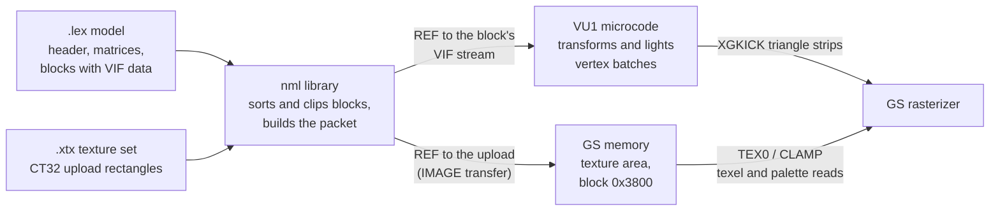
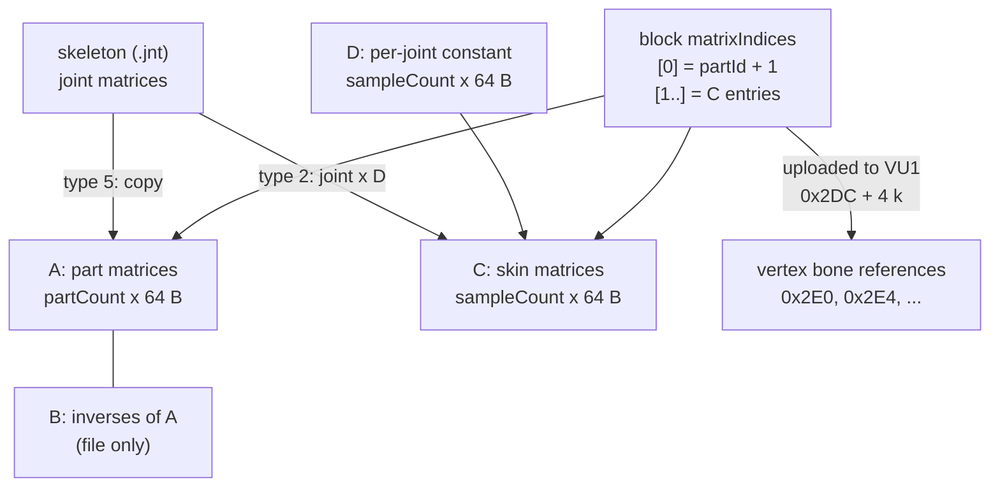
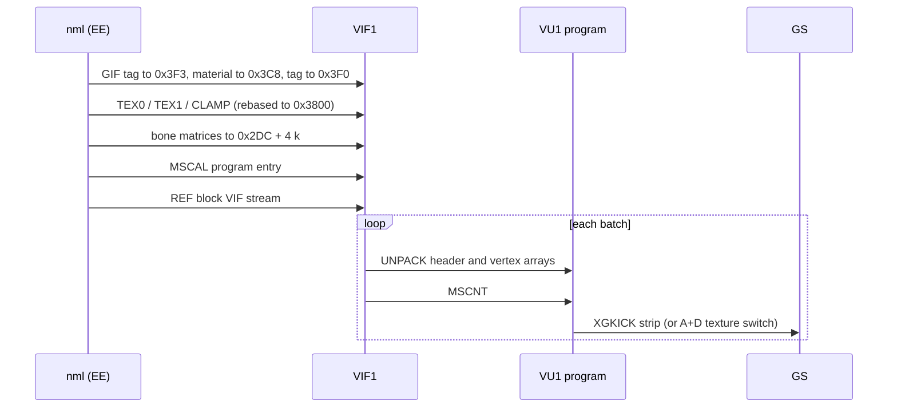
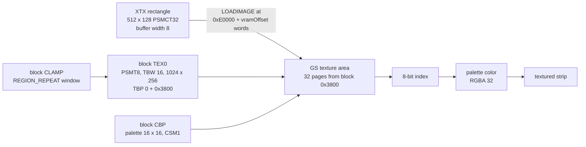

# Models and textures

Every 3D object in the game, from Shion and KOS-MOS to the rooms of the Woglinde, the Xeno Card table and the `!` marker above an enemy, is a `.lex` model file. Its colors come from a `.xtx` texture set. A model holds ready-made data for the vector unit VU1: its vertices are already packed as VIF commands that the renderer sends to VU1 without touching them. A texture set holds ready-made image uploads for the Graphics Synthesizer (GS): rectangles of 32-bit pixels that land at fixed addresses of video memory, where the model's texture registers find them as 8-bit, 4-bit or 32-bit textures with their palettes.

The two formats are tied together by video memory addresses, not by names or ids. A model block says "read 8-bit texels from block 0 of the texture area with the palette at block 992", and the texture set of the same name is built so that its upload puts exactly those texels and that palette there. The renderer that draws them is the `nml` library, described in [nml](../libraries/nml.md). The GS memory layout and the texture area are described in [Rendering](../architecture/rendering.md#video-memory).

[← Back to the overview](../README.md) · [Files and resources](../architecture/files-and-resources.md)

## Where the files are

All model and texture files are in archive group 00 under `data\`. There are 1317 `.lex` files (261.1 MB stored, 413.5 MB unpacked, 1010 of them packed with ARX) and 1269 `.xtx` files (215.1 MB stored, 242.1 MB unpacked, 810 packed). [ARX packing](../architecture/files-and-resources.md#packed-files-arx) is undone by the file reader, so the formats below always describe the unpacked bytes.

Most models come with a texture set of the same name and, for animated ones, a `.jnt` skeleton of the same name (see [The skeleton file](../libraries/animation.md#the-skeleton-file)). A few directories hold only textures. The table counts both types per directory.

| Directory | `.lex` | `.xtx` | Contents |
| --- | --- | --- | --- |
| `char\pc`, `char\npc`, `char\ppl`, `char\citi` | 58, 121, 97, 46 | 42, 72, 60, 45 | Party members, named characters, crowd people, citizens. Face models `*_face` have no texture set of their own |
| `char\` | 2 | 1 | `dummy` (a copy of Shion) and `dummy_face` |
| `enemy\boss`, `guno`, `utma`, `utro`, `utso`, `utre`, `feso`, `fema`, `fere`, `fero` | 26, 26, 12, 7, 7, 4, 4, 3, 2, 1 | the same | Enemy families |
| `enemy\` | 1 | 1 | `dummy` (a copy of Shion) |
| `robo\ag`, `robo\vx`, `robo\etc` | 8, 5, 9 | 8, 5, 9 | A.G.W.S. and other machines |
| `weapon\pc`, `weapon\robo`, `weapon\enemy` | 41, 46, 1 | 40, 46, 1 | Weapons held by characters, A.G.W.S. and enemies |
| `obj\aobj000`, `obj\mobj000`, `obj\muobj` | 79, 158, 44 | 78, 158, 44 | Map objects in three numbered families: `acc_NNN`, `mobj_NNN` and `MU_NNN` |
| `obj\` | 1 | 1 | `dummy` |
| `map\` | 248 | 247 | Field and battle maps `MC_*` |
| `carddata\` and its `deckmake`, `effect`, `game`, `help`, `title`, `tuto` | 249 | 118 | Xeno Card boards, cards, windows and help pages |
| `matumoto\` | 4 | 0 | Enemy marker models `bikkuri` (`!`), `hatena` (`?`), `maru`, `sikaku` |
| `simajiri\`, `simajiri\m\` | 2, 2 | 2, 0 | Grid and test models of the effect viewer, two unreferenced models |
| `endou\`, `endou\poly\`, `endou\umn\` | 0, 2, 1 | 3, 2, 2 | Menu window textures, the formation model and its pointer (`tai00`, `tai01`), the U.M.N. cube |
| `texture\` | 0 | 78 | Scene textures `fm0000.xtx` and up |
| `tanaka\` | 0 | 109 | Network Casino sheets |
| `yamamoto\stat\` | 0 | 3 | Battle status sheets `cur`, `manu`, `stat` |
| `yajima\` | 0 | 2 | Radar texture `cf_rader00`, title menu label texture `title_obj` |

The diagram below shows the path of both formats from the disc to the screen. The model data goes through VU1, which turns it into GS primitives. The texture data goes straight to GS memory, where the primitives read it.



## LEX models

### Who loads a model

The field resource system loads characters, enemies, weapons, A.G.W.S. and objects as a **model block**. `RES_loadFileSub` in `src/main/res_get_path.c` reads a 16-byte `ResourceFileSet`, then the `.lex`, the `.xtx` (not for a face model) and the `.jnt` (not when the request says the model has no joints), each one 16-byte aligned behind the previous one. The file name comes from the model id through `RES_GetMdlFileNameSub`, described in [Model keys and model ids](../architecture/files-and-resources.md#model-keys-and-model-ids). A face model loads `name_face.lex` and draws with the texture set of its body. [Loading the files](../libraries/actors.md#loading-the-files) shows how an actor takes the block over.

Maps go through `RES_loadFileSubMap`, which reads the map's `.lex`, `.xtx`, `.id` and think file. Its fallback path `data\map\dummy` does not exist on the disc. Other readers load models by path:

| Reader | Files |
| --- | --- |
| `MenuTairetuLoad` (`src/main/window_tex_load.c`) | `endou\poly\tai00` and `tai01`, `.xtx` and `.lex`, for the party formation screen |
| `enemy_system_init.c` | `matumoto\bikkuri`, `hatena`, `maru`, `sikaku` |
| `dummyMapLoad` (`src/main/set_path.c`) | `simajiri\sen` and `hama`, the grid and test model of the effect viewer |
| OV02 `tsk_umn_object_task_main.c` | `endou\umn\cube.lex` with `cube.xtx` and `umn00.xtx` |
| OV10 (Xeno Card) | the `carddata` models, by name lists such as the help pages of `card_disp.c` |

All of them pass the model to `nml` through `nmlModelEntry` and its setters. `nmlModelLexDataCheck` accepts a model only when it lies between `0x00200000` and `0x02000000`, is 16-byte aligned, starts with `lex` and has at least one block. It also checks the [MagicCarpetCome trailer](#the-magiccarpetcome-trailer).

### File layout

A LEX file is one contiguous image that is used in place: every reference inside it is a byte offset from the start of the file, and nothing is relocated after loading. The real files always use the same order:

1. The 0xB0-byte header, then the block offset table at +0xB0, padded with zeros to a 16-byte boundary.
2. The [matrix table](#the-matrix-table): four arrays of 64-byte matrices, back to back.
3. The blocks. Each block is a 0x190-byte [block header](#blocks) followed at once by its VIF stream. `dataOffset` is 0x190 in all 48789 blocks, and the next block header starts right where the stream ends.
4. In 13 map files, a table of 16 bytes per block (see [The block sphere table](#the-block-sphere-table)).
5. In 7 files, an [embedded texture set](#embedded-texture-sets).
6. In 1152 files, the 16-byte trailer `MagicCarpetCome\0`.

Every file size is a multiple of 16 and the parser finds no gaps and no unexplained bytes between these parts. The ASCII box shows the layout of `char\pc\kosmos.lex` (421 680 bytes, 26 parts, 37 blocks, 46 skin joints).

```
0x00000  +-------------------------------------------+
         | header "lex", time stamp, name, artist,   |
         | counts, offsets, bounding box             |
0x000B0  | blockOffsets[37]                          |
0x00144  | zero padding                              |
0x00150  +-------------------------------------------+
         | A: part matrices        26 x 64 bytes     |
0x007D0  | B: inverses of A        26 x 64 bytes     |
0x00E50  | C: skin matrix slots    46 x 64 bytes     |
0x019D0  | D: skin joint matrices  46 x 64 bytes     |
0x02550  +-------------------------------------------+
         | block 0 header (0x190) "kosmos_kubi"      |
0x026E0  | block 0 VIF stream (0x1BA0 bytes)         |
0x04280  | block 1 header                            |
         | block 1 VIF stream                        |
         | ...                                       |
         | block 36 header and VIF stream            |
0x66F20  +-------------------------------------------+
         | "MagicCarpetCome\0"                       |
0x66F30  +-------------------------------------------+  end of file
```

### The header

The table lists the header as the files show it. Field names are the ones of `NmlModel` in `include/main/nml_model_set.h` where one exists.

| Offset | Size | Type | Field | Meaning | Values seen |
| --- | --- | --- | --- | --- | --- |
| +0x00 | 4 | char[4] | magic | `lex\0` | all files |
| +0x04 | 4 | u32 | (none) | MS-DOS date (low half) and time (high half), probably when the converter wrote the file | 2001-05-23 to 2002-07-01 |
| +0x08 | 4 | float | (none) | Always 0.16 (`0x3E23D70A`), probably the converter version | 0.16 |
| +0x0C | 4 | u32 | (none) | Always 0 | 0 |
| +0x10 | 32 | char[32] | name | Model name with a leading `/` (1279 files) or `\` (38 files) | |
| +0x30 | 15 | char[15] | (none) | Name of the artist's account | 19 names |
| +0x3F | 1 | s8 | `unclassified_3f` | 1 when the file ends with `MagicCarpetCome` | 0 (165 files), 1 (1152) |
| +0x40 | 4 | s32 | `partCount` | Number of parts | 1 to 935 |
| +0x44 | 4 | s32 | `blockCount` | Number of blocks | 1 to 940 |
| +0x48 | 4 | s32 | `sampleCount` | Number of skin joints, the size of arrays C and D | 0 to 72 |
| +0x4C | 4 | s32 | (none) | Triangle count of the whole model in about half the files, 0 in the rest. Never read | 0 or count |
| +0x50 | 4 | u32 | `weightedMatrixOffset` | Offset of array A | always the end of the padded offset table |
| +0x54 | 4 | u32 | (none) | Offset of array B, `A + 64 * partCount` | |
| +0x58 | 4 | u32 | `skinMatrixOffset` | Offset of array C, `B + 64 * partCount` | |
| +0x5C | 4 | u32 | `jointMatrixOffset` | Offset of array D, `C + 64 * sampleCount` | |
| +0x60 | 4 | u32 | `geometryTableOffset` | Always equal to +0x50 | |
| +0x64 | 8 | | (none) | Always 0 | 0 |
| +0x6C | 4 | u32 | `textureSetOffset` | Offset of the embedded texture set, 0 when there is none | nonzero in 7 files |
| +0x70 | 16 | Vector4 | `boxMaxOffset` | Bounding box maximum corner, w = 0 | |
| +0x80 | 16 | Vector4 | `boxMinOffset` | Bounding box minimum corner, w = 0 | |
| +0x90 | 16 | Vector4 | `entryTranslation` | Bounding sphere: center in x, y, z and radius in w | |
| +0xA0 | 4 | u32 | `unclassified_a0` | Offset of the block sphere table, 0 when there is none | nonzero in 13 maps |
| +0xA4 | 12 | | (none) | Always 0 | 0 |
| +0xB0 | 4 * blockCount | u32[] | `blockOffsets` | Offset of each block header | |

**Time stamp.** The word at +0x04 is a valid MS-DOS date and time in every file. Most files were written between August and December 2001: 440 in September and 293 in November. The oldest is `obj\dummy.lex` (2001-05-23). Five files are newer than the Japanese release of February 2002: `char\npc\albelt_h`, `albelt3_h`, and the maps `MC_ELS03`, `MC_DYU05` and `MC_KUK11` (2002-07-01, the newest). They were probably rebuilt for the North American release.

**Name and artist.** The name at +0x10 is the scene node name from the modelling tool, prefixed by a separator (`/` in 1279 files, `\` in 38). The `nml` code searches it for `_face` to recognize face models (`nml_model_set.c`, from +0x10 and from +0x11), and `xglCullingMapSet` (`src/main/face_point.c`) compares it with its culling-map table, as described in [The internal name and culling](maps-and-field-data.md#the-internal-name-and-culling). The name matches the file name exactly in 1223 files and differs only in case in 19. The other 75 carry another name. Most of them are Xeno Card pieces (48 files, for example `carddata\o0` carries `/0` and `carddata\Atype_1` and `Atype_2` carry each other's names) and older versions of a character (`char\pc\shion5` carries `/shion1`). Six B maps carry the name of their base map: `MC_DYU04B` (`/Mc_dyu04`), `MC_ELS06B` (`/Mc_els06`), `MC_ELS07B` (`/MC_ELS07`), `MC_ELS13B` (`/Mc_els13`), `MC_UTK03B` (`/Mc_utk03`) and `MC_VOK04B` (`/mc_vok04`). Others are `obj\dummy` with `/acc_003` and `endou\poly\tai00` and `tai01` with `/manu_tai_03` and `/menu_tai_01`. Because the culling lookup compares case-sensitively, `MC_VOK07B` (`/MC_VOK07b`) and `MC_VOK10B` (`/MC_VOK10b`) find no culling entry. The 15 bytes at +0x30 hold the artist: `domoto` (285 files), `takami` (274), `nv-sato` (225), `anzai` (161), `honne` (107), `yokota` (71), `yasuyuki` (62), `akinobu` (36), `hori` (22), `uchiyama` (20), `nakai` (16), `tomo` (14), `moto` (7), `eiji` (6), `kojima` (4), `tayzou` (3), `miyata` (2), `miyake` and `hasegawa` (1 each).

**Bounding box.** The vector at +0x70 is the larger corner and the one at +0x80 the smaller corner in all 1317 files, the opposite of the field names. The code agrees with the files: `ActModel` in `src/main/act_1.h` names +0x70 `boxMax` and +0x80 `boxMin`, and the ProReal overlap test in `nml_model_set.c` uses +0x80 as the minimum. The sphere at +0x90 encloses the box.

**Triangle count.** The word at +0x4C is nonzero in 585 files. In 567 of them it equals the number of triangles of all [vertex batches](#vertex-batches) (the sum of `n - 2`), and the other 18 are close. No code reads it.

### The matrix table

The four arrays that start at +0x50 hold row-major 4x4 float matrices with the translation in the last row, as the VU1 programs expect them. Their total size is `(partCount + sampleCount) * 2` matrices, split into four arrays with different jobs:

| Array | Offset field | Count | Content in the file | Use |
| --- | --- | --- | --- | --- |
| A | +0x50 | `partCount` | The rest placement of each part. Identity for every character model, real placements in maps and objects | Overwritten by the skeleton (`JNT_setMDLMatrix` copies joint matrices here) |
| B | +0x54 | `partCount` | The inverse of each A matrix: `A[i] * B[i]` is the identity in every file | `nmlPacketAddParts` sends the inverse from here for skinned blocks |
| C | +0x58 | `sampleCount` | The identity in every file | Skin matrices, written at run time as joint matrix times D |
| D | +0x5C | `sampleCount` | One constant matrix per skin joint, probably the inverse of the joint's bind pose | Read only |

The skeleton writes into A and C each frame, as [Writing the model matrices](../libraries/animation.md#writing-the-model-matrices) describes. The code also reads the translations of C and D as the **sample points** of the model: `nmlModelCalcSample` reaches them at indices `partCount * 2 + v` and `partCount * 2 + sampleCount + v`. 548 files have skin joints. Maps, card models and most objects have `sampleCount` 0.

Blocks refer to these matrices through 1-based indices into the concatenated table A, B, C, D (so index 1 is `A[0]` and index `2 * partCount + 1` is `C[0]`). The diagram below shows how the skeleton and the block indices meet in these arrays.



### Blocks

A **block** (`NmlModelBlock`) is one drawable piece of a model: a set of triangle strips that share one part, one material and one texture. The 48789 blocks of the retail files are all 0x190 bytes long, and each is followed at once by its VIF stream. The table lists every field.

| Offset | Size | Type | Field | Meaning | Values seen |
| --- | --- | --- | --- | --- | --- |
| +0x00 | 32 | char[32] | `name` | Name of the mesh node in the modelling tool (`kosmos_kubi`, `polySurface518`, `pCube1892`) | |
| +0x20 | 4 | u32 | `flags` | [Block flags](#block-flags) | 0, 1, 3, 5, 0x201, 0x203, 0x205, 0x400 |
| +0x24 | 4 | s32 | `dataOffset` | Offset of the VIF stream from the block header | always 0x190 |
| +0x28 | 4 | s32 | `dataSize` | Length of the VIF stream in bytes | |
| +0x2C | 4 | s32 | `partId` | The part (index into A) the block belongs to | |
| +0x30 | 64 | u16[32] | `matrixIndices` | Up to 31 matrix indices and a 0 terminator. Entry 0 is always `partId + 1`, the others point into C | |
| +0x70 | 16 | Vector4 | (part of `matrixIndices[48]`) | Block bounding box maximum corner, w = 1 | |
| +0x80 | 16 | Vector4 | (part of `matrixIndices[48]`) | Block bounding box minimum corner, w = 1 | |
| +0x90 | 16 | Vector4 | `clipBounds` | Block bounding sphere: center in x, y, z, radius in w | |
| +0xA0 | 4 | u32 | `geometryIndex` | Always `0xFFFFFFFF` | -1 |
| +0xA4 | 4 | u32 | `vertexIndexOffset` | Always 0 | 0 |
| +0xA8 | 4 | u32 | `vertexIndexCount` | Always 0 | 0 |
| +0xAC | 2 | u16 | `vertexIndexBase` | Always 0 | 0 |
| +0xAE | 2 | | (none) | Always 0 | 0 |
| +0xB0 | 16 | GIF tag | `gifTag` | GIF tag for the block's strips: NLOOP 0, EOP 1, PRE 1, PRIM, NREG 3, REGS `0x412` (ST, RGBAQ, XYZF2) | PRIM `0x1C` or `0x0C` |
| +0xC0 | 4 | u32 | `materialFlags` | [Material flags](#material-flags) | |
| +0xC4 | 4 | float | `materialAlphaScale` | Material alpha | mostly 1.0 |
| +0xC8 | 4 | | (none) | Always 0 | 0 |
| +0xCC | 4 | u32 | `alphaTag` | Sent to VU1 as the first word of the material tag at `0x3F0`. It is the specular exponent: the highlight programs raise the highlight to the power 2^(`alphaTag` + 1), 16 for the usual 3 | 0 to 6, 3 in 44263 blocks |
| +0xD0 | 80 | quadword[5] | `materialParameters` | [Material parameters](#material-parameters) | |
| +0x120 | 24 | u64[3] | `textureParameters[0..2]` | `TEX0_1`, `TEX1_1`, `CLAMP_1` register values | see [Texture registers](#texture-registers) |
| +0x138 | 24 | u64[3] | `textureParameters[3..5]` | A second `TEX0`, `TEX1`, `CLAMP` set for reflection mapping | nonzero in 907 blocks |
| +0x150 | 28 | char[28] | (none) | Name of the group node above the mesh (`kosmos_face`, `mckas35_sub01`, `space`) | |
| +0x16C | 4 | s8[4] | `shapeMathParameter`, `shapeMode`, `shapeWeight`, `shapeFlags` | [Shape bytes](#shape-bytes) | |
| +0x170 | 32 | char[32] | `materialName` | Name of the material in the modelling tool (`phong2`, `space_phong13`) | |

The three names never coincide. The mesh name at +0x00 is the one the name visibility functions compare and the one `add_exec_prog` searches for `lenz` and `eye`. The material name at +0x170 is the one `nmlModelLexBlockDoit` compares to apply a multiply color to one material. The group name at +0x150 is not read by any code found so far.

The header declares `matrixIndices` as 48 entries, but the files use only the first 32. `nmlPacketAddParts` compares 0x3E bytes of the list against its cache, which is 31 entries, and the parser never finds more than 31 indices before the terminator. The two vectors at +0x70 and +0x80 are a per-block bounding box in the same max-then-min order as the header, with w = 1.

The geometry table fields are dead in the retail data. `geometryTableOffset` always points at the matrix table, `geometryIndex` is always -1, the vertex index fields are always 0, and block flag `0x10` (indexed vertices) is never set. The indexed path of `nmlPacketAddParts` therefore never runs on the disc's models.

#### Block flags

The word at +0x20 selects the VU1 program variant, as described in [VU1 microcode](../libraries/nml.md#vu1-microcode). The files use these values:

| Value | Blocks | Meaning |
| --- | --- | --- |
| `0x000` | 40071 | Rigid block: every vertex follows the block's part |
| `0x003` | 4160 | Skinned, one joint reference per vertex |
| `0x005` | 2357 | Skinned, two joint references and two weights per vertex |
| `0x001` | 1799 | Skinned, up to four joint references and four weights per vertex |
| `0x400` | 383 | Rigid map block that may not use the extended two-pass programs |
| `0x203`, `0x205`, `0x201` | 4, 14, 1 | Skinned and drawn twice: `nmlPacketAddExecProg` runs program 2, waits, then program 1 |

Bit 0 is set on exactly the blocks whose vertices carry [joint references and weights](#skin-references-and-weights), and bits 1 and 2 match the number of weights. The family that bit 0 selects (`NewVu1EnvMicroCode`, "Env") is the skinned (envelope) variant. Bits `0x80` and `0x100`, which `nmlPacketAddExecProg` also tests, are never set in the files, and neither is bit `0x8` (`NML_BLOCK_HIDDEN`), which the game sets at run time.

#### Material flags

The word at +0xC0 combines what the code reads with bits that only describe the vertex data. The table counts the blocks that have each bit.

| Bit | Blocks | Read by | Meaning |
| --- | --- | --- | --- |
| `0x1` | 46675 | `nmlPacketAddGifTag`, `nmlPacketAddTextureParam` | Textured: sets TME in the GIF tag and sends the texture registers |
| `0x2`, `0x4` | 5597, 6902 | sort code in `nml_model_set.c` | Transparent: the block goes to the alpha groups |
| `0x8` | 25160 | `add_exec_prog` | Specular highlight: the `Spec` or `MultiSpec` program of the block's family (skipped when the render level has `NML_LEVEL_NO_SPECULAR`) |
| `0x10` | 38058 | many (`NML_BLOCK_MATERIAL_NAMED_PARTS`) | Map vertex layout and map program slots. Set on every block of all 248 maps and of 33 of the 44 `muobj` models, nowhere else |
| `0x20`, `0x40` | 14, 1 | pixel control | Additive and subtractive blending |
| `0x80` | 10731 | none | Float vertex layout with per-vertex normals (characters, enemies, objects) |
| `0x100`, `0x200` | 17645, 17612 | none | Unknown. Almost always set together |
| `0x800` | 3599 | `add_exec_prog` | With `0x8`, picks the one-strip `Spec` programs instead of `MultiSpec`, which draw the highlight as a second strip |
| `0x1000` | 907 | `nmlPacketAddReflRot`, `nmlPacketAddReflectParam` | Reflection mapping, uses the second texture register set |
| `0x2000` | 4 | `nmlPacketAddReflRot` | Reflection rotation type 2 |
| `0x8000` | 1 | pixel control, alpha flush | Transparent block that always writes depth: it is drawn in the depth pass of its alpha group (see [Flush](../libraries/nml.md#flush)), where its pixel test is only `ZGEQUAL`, without the alpha test that other blocks get there |
| `0x10000` | 16781 | `nmlPacketAddTransMicrocode` | Map block with per-vertex normal indices, lit by point lights |
| `0x20000` | 166 | `nmlPacketAddBlockMaterial` | `NML_MATERIAL_LIGHT_PARA`: also upload the light parameters to `0x3D1` |
| `0x40000` | 3 | sort code | With bit `0x4`, keeps the block out of the opaque groups |

The flags and the vertex layout agree in every block of every file. Each block has exactly one of `0x10` and `0x80`: `0x10` (38 058 blocks) always comes with the compact map layout of the [Vertex layouts](#vertex-layouts) section, `0x80` (10 731 blocks) with the float layout that carries normals, and `0x10000` comes with the normal index array and never without it. A map block without `0x10000` has no normals, and `nmlPacketAddTransMicrocode` then keeps it on the `PLAIN` family even under point lights (the test `(materialFlagsQword & 0x10010) == 0x10`).

98 blocks have bit `0x1` set but carry no texture registers and an untextured PRIM. They are probably converter leftovers.

#### Material parameters

`nmlPacketAddBlockMaterial` sends the 80 bytes at +0xD0 to VU1 address `0x3C8` as five quadwords, after it overwrites the w lane of the first one with `materialAlphaScale` times the model transparency. The files fill them as follows.

| Quadword | Offset | Content in the files |
| --- | --- | --- |
| q0 | +0xD0 | Material color, for example (1.15, 1.12, 1.10) on KOS-MOS. w is 0 in the file and replaced by the alpha |
| q1 | +0xE0 | Reflection UV window, nonzero in about 909 blocks |
| q2 | +0xF0 | A second color, for example (0.5, 0.5, 0.5) on maps. Its w lane is `reflectAlpha` (+0xFC) |
| q3 | +0x100 | `multiplyColor`, always (1, 1, 1, 1) in the files. The game overwrites it every frame |
| q4 | +0x110 | `translationX`, `translationY`, `translationStepX`, `translationStepY`: UV scroll. Nonzero in about 1300 blocks |

`nmlModelLexBlockDoit` adds the steps to the translation each frame and wraps U at 0.5 and V at 1.0, so scrolling water and screens need no animation data.

#### Texture registers

The six doublewords at +0x120 are GS register values. The first three are sent for the block's main texture, the last three for the reflection map. The code adds the texture area base to both base pointers before sending them: `texture_buffer_base << 5` (block `0x3800`) to the low word and `texture_buffer_base << 10` to the high word, which places it on the `CBP` field. The files therefore store addresses relative to the texture area.

| Register | Field | Values seen |
| --- | --- | --- |
| `TEX0_1` | `TBP0` (texture base, blocks) | 0, except in the models with an [embedded texture set](#embedded-texture-sets) |
| | `TBW` (buffer width, 64 pixels) | 16 or 8 in most blocks |
| | `PSM` | 19 `PSMT8` (42805 blocks), 0 `PSMCT32` (3690), 20 `PSMT4` (82) |
| | `TW`, `TH` (log2 size) | (10, 9) 26960 blocks, (10, 8) 15793, then (9, 8), (9, 7) and others |
| | `TCC`, `TFX` | 1 (RGBA), 0 (modulate) |
| | `CBP` (palette base, blocks) | Relative to the texture area |
| | `CPSM`, `CSM`, `CSA`, `CLD` | 0 (`PSMCT32`), 0 (`CSM1`), 0, 1 (load the palette) |
| `TEX1_1` | | `0x60` (46049 blocks: bilinear magnification and minification, no mipmaps), or 0 (528) |
| `CLAMP_1` | `WMS`, `WMT` | `REGION_CLAMP` (2, 2) in 28596 blocks, `REGION_REPEAT` (3, 3) in 17276, mixed in 705 |

46 577 blocks use PRIM `0x1C` (textured Gouraud triangle strip). 2114 blocks have no texture: PRIM `0x0C` (Gouraud triangle strip), no bit `0x1` and zero registers. The remaining 98 are the blocks with bit `0x1` but no registers. How the registers find the texels is described in [How a model finds its texels](#how-a-model-finds-its-texels).

#### Shape bytes

The four bytes at +0x16C drive **shape blending** (morphing between the base mesh and the targets in the [morph data](#morph-targets)). Most blocks have four zeros. `nmlModelLexBlockDoit` animates a block on its own when `shapeFlags` is 2 or 3: `shapeMathParameter` picks the period from `s_aShapeMathPara` (4, 8, 16 up to 2048 frames), `shapeMode` 0 gives a triangle wave and 1 a sawtooth, and `shapeWeight` is the peak weight. The byte at +0x16F is also read signed as `alphaMode` and sent as the last word of the material tag.

| Bytes (+0x16C..+0x16F) | Files | Meaning |
| --- | --- | --- |
| 00 00 01 01 | the 14 high-detail faces `*_h_face` (2 blocks each) | Shape flag 1: not animated by the automatic loop, so the weights are probably set by the face code |
| 00 00 00 01 | `virgil_h_face`, `jr_h_face` | The same with peak weight 0 |
| 00 19 01 02, 00 19 00 02 | `momo_h_face`, `albelt_h_face`, `gaignun_h_face` | Automatic, mode 25 |
| 03 00 01 02, 04 00 01 02 | `MC_PRO02` | Automatic triangle wave, period 32 or 64 |
| 05 00 01 02, 06 00 01 02 | `MC_EVE28`, `MC_KAS20` | Automatic triangle wave, period 128 or 256 |
| 06 00 01 03, 07 00 01 03, 07 07 01 03, 08 00 01 03 | `MC_BTL01` | Automatic, period 256 to 1024, one block with mode 7 |

Modes 7 and 25 do not exist in the code, which handles only modes 0 and 1. For them `nmlModelLexBlockDoit` still counts a shape entry but leaves its part and weight unset.

### The VIF stream

The bytes after each block header are a VIF1 command stream that `nmlPacketAddTransData` sends with one `REF` DMA tag, unchanged. Before it, `nmlPacketAddExecProg` has already sent `MSCAL` to start the chosen VU1 program, and the CPU has uploaded the matrices, the material and the GIF tag to the fixed VU1 addresses listed in [VU1 memory](../libraries/nml.md#vu1-memory). The stream is prebuilt VIF code that unpacks the vertices and starts the processing of the program.

Only five VIF commands occur in the 1317 files: `UNPACK` (5 373 372 times), `STCYCL` and `MSCNT` (1 634 827 times each), `STMASK` (551 018) and `NOP` (122 680). `STCYCL` is always `0x0101` (write every cycle, no skipping). Every stream ends exactly at `dataSize`. Padding `NOP`s appear only before a batch or at the end of the stream, to keep the next data aligned.

The stream is a sequence of **batches**. Each batch is one `STCYCL`, optionally one or two `STMASK`, a few `UNPACK`s that fill the VU1 input buffer from address 0, and one `MSCNT` that lets the program process them. There are two kinds:

- **Vertex batches** (1 593 399 in all files) hold one triangle strip.
- **Material batches** (41 428) change the texture and material in the middle of a block. See [Material batches](#material-batches).

Every `UNPACK` has the `FLG` bit set, so its address counts from the VIF `TOPS` register. The CPU code never sets `BASE` or `OFFSET`, but each [microcode packet](../libraries/nml.md#vu1-microcode) ends with `BASE 0` and `OFFSET 0x16E`. VIF1 therefore double buffers the batches: every `MSCNT` swaps `TOPS` between 0 and `0x16E`, and the program finds the current batch with `XTOP` (see [How a program runs](../libraries/nml.md#how-a-program-runs)). The addresses below count from the start of the batch's buffer.

The ASCII box shows the shape of one stream.

```
block header (0x190 bytes)
+--------------------------------------------------------------+
| STCYCL 0x0101 | [STMASK m] | UNPACK hdr+... | UNPACK ... |   |
|                                         ...  | MSCNT         |  vertex batch
+--------------------------------------------------------------+
| STCYCL 0x0101 | UNPACK hdr+... | UNPACK ... | MSCNT          |  vertex batch
+--------------------------------------------------------------+
| STCYCL 0x0101 | UNPACK 9 qw: material header, A+D tag,       |
|               | CLAMP_1, TEX0_1, TEX0_1 copy, 4 qw | MSCNT   |  material batch
+--------------------------------------------------------------+
| ...                                                          |
| NOP NOP ...                                                  |  padding to dataSize
+--------------------------------------------------------------+
```

### Vertex batches

The first quadword at VU1 address 0 is the batch header. Its first word is the vertex count `n` with bit 15 set, in the shape of a GIF tag `NLOOP` with `EOP`. The program copies it into the GIF tag of the strip it kicks.

| Word | Content | Values seen |
| --- | --- | --- |
| 0 | `0x8000 + n` | n from 3 to 36. 4 vertices in 726 127 batches, 3 in 420 360, 6 in 154 829 |
| 1 | `n / 4 + 1` (integer division). The programs only compare it with `0x4000`, which marks a material batch. 0 in the early files with [merged uploads](#early-files-with-merged-uploads) | |
| 2 | A count of leading vertices that take the color of vertex 0, always 0. In material batches `0x4000` marks the 9-quadword form | |
| 3 | 1 when the batch carries [morph targets](#morph-targets), else 0 | 3106 batches |

Each vertex batch is one independent triangle strip of `n` vertices, so it draws `n - 2` triangles with alternating winding. Neighbouring strips repeat their shared vertices. The 1317 files hold 8 177 052 strip vertices and 4 990 254 triangles.

### Vertex layouts

The rest of the input buffer holds per-vertex arrays at fixed multiples of `n`. Two layouts exist, chosen by the material flags, and both keep the same addresses so that the programs can find each array.

| VU address | Float layout (`materialFlags & 0x80`) | Map layout (`materialFlags & 0x10`) |
| --- | --- | --- |
| 0 | header | header |
| 1 to n | position x, y, z and texture coordinate s, `V4-32` | the same |
| n+1 to 2n | normal x, y, z and texture coordinate t, `V4-32` | t written by `V1-32` into all four lanes, then optionally a normal index by a masked `V1-8` into x, y, z |
| 2n+1 to 3n | color as floats, `V4-32` (128 = full intensity) | color as bytes, `V4-8` (unsigned in most blocks, signed in a few), 128 = full |
| 3n+1 to 4n | face normals, `V3-32` (optional) | the same |
| 4n+1 to 6n | joint references and weights (skinned blocks only) | not used |
| 6n+1 and up | morph targets (only when header word 3 is 1) | morph targets |

The float layout uploads the header, the positions and the normals with one `UNPACK V4-32` of `2n + 1` quadwords. The map layout uploads the header and positions as `n + 1` quadwords, then the t coordinates as `V1-32` (one float per vertex, copied to every lane), then sets `STMASK 0xC0C0C0C0` and writes a byte per vertex with a masked `V1-8`. The mask protects lane w, so the byte lands in x, y and z while t stays in w. That byte is an index into the 114-entry normal table `s_aNormalTbl` that the CPU uploads to VU1 address `0x350`. It is present only in blocks with `materialFlags & 0x10000`, values run from 0 to 113 plus 255 (94 vertices, probably "no normal"), and index 113 (straight up, (0, 1, 0)) is the most common at 507 690 vertices, followed by index 0 (straight down) at 181 591. The table is a lookup for compressed normals. The map layout thus stores a vertex in 16 + 4 + 1 + 4 bytes instead of 48.

The colors are vertex colors in the PS2 convention, where 128 means full brightness and the GS doubles the modulated texel. The character blocks sampled have (128, 128, 128, 128) nearly everywhere, while maps carry baked lighting in their colors.

The diagram below shows the VU1 input buffer of one batch with the address ranges of both layouts.

```
VU1 input buffer (quadwords)
  0      +--------------------------------------------+
         | header: n|0x8000, n/4+1, 0, morph flag     |
  1      +--------------------------------------------+
         | x, y, z, s           (n quadwords)         |
  n+1    +--------------------------------------------+
         | nx, ny, nz, t        float layout          |
         | idx, idx, idx, t     map layout            |
  2n+1   +--------------------------------------------+
         | r, g, b, a           (floats or bytes)     |
  3n+1   +--------------------------------------------+
         | face normal of the triangle ending here    |
  4n+1   +--------------------------------------------+
         | joint references (and weights)             |
  6n+1   +--------------------------------------------+
         | morph targets                              |
         +--------------------------------------------+
```

### Skin references and weights

Skinned blocks (block flags with bit 0) carry the joint data at `4n + 1`. A joint reference is not an index but a VU1 address written as an integer: `0x2E0`, `0x2E4`, `0x2E8` and so on. `nmlPacketAddParts` uploads the block's matrices to the bone area at `0x2DC` in the order of `matrixIndices`, four quadwords each, so the matrix of `matrixIndices[k + 1]` sits at `0x2E0 + 4k`. The program can therefore load the matrix directly from the address in the vertex.

| Block flags | Quadwords | Layout per vertex |
| --- | --- | --- |
| `0x3` | n | (reference, 0, 0, 0). The vertex follows one joint fully |
| `0x5` | n | (reference 1, reference 2, weight 1, weight 2), references as integers, weights as floats |
| `0x1` | 2n | n quadwords of up to four references, then n quadwords of the four matching weights |

The weights of a vertex add up to 1. In `char\citi\baba_a.lex`, for example, the block `baba_a_kao` has vertices with (`0x2E0`, `0x2E4`, 0.8, 0.2) and the block `baba_a_food` has a vertex with references (`0x2E0`, `0x2F4`, `0x2E4`) and weights (0.65, 0.2, 0.15).

### Face normals

Many blocks, rigid and map ones alike, add an `UNPACK V3-32` of `n` quadwords at `3n + 1`. Element `i` (for `i` from 2) is the cross product of the triangle `(i - 2, i - 1, i)` of the strip. It is not normalized: its length is twice the triangle's area. Elements 0 and 1 copy element 2. The parser checks the direction of 391 993 triangles against their vertices. The vectors point into the surface, opposite to the vertex normals. Only the `Face` and `Back` programs of the `PLAIN` family read them, to drop the triangles that face away from the camera or towards it (see [Front and back faces](../libraries/nml.md#front-and-back-faces)).

### Morph targets

When word 3 of the header is 1, a further array starts at `6n + 1`, 2n or 4n quadwords long. 19 files have such batches: the 14 high-detail faces `*_h_face`, `char\ppl\vec_w1`, and the maps `MC_BTL01`, `MC_EVE28`, `MC_PRO02` and `MC_KAS20`. In the faces the array is 4n quadwords: target positions and then target normals, two targets per vertex stored in pairs. The program mixes the two quadwords of each pair by the block's shape weight, limited to 1, and writes the result over the positions and normals. In `MC_PRO02`, `MC_EVE28` and `MC_KAS20` it is 2n quadwords of float colors, and the blocks' `shapeFlags` byte is 2, which makes the program blend the colors instead. Those maps thus fade their vertex colors through the [shape bytes](#shape-bytes). `MC_BTL01` has 4n quadwords like the faces. `vec_w1` has 1003 batches with the 2n-quadword array but header word 3 left at 0 and four zero shape bytes. The program blends only when word 3 is 1, so these targets are never used.

### Material batches

A block has one set of texture registers in its header, but its strips may use several palettes or texture windows. The converter splits such a block with **material batches**, which reload the GS texture registers through VU1 between two strips. 41 428 material batches occur in maps (28 036), enemies, objects, A.G.W.S., weapons, characters and card models (20 batches).

A material batch starts like a vertex batch, but its header is `0x8003, 0x4000, 0x4000 or 0, 0`: word 1 `0x4000` marks it and word 0 counts the three quadwords to kick to the GS. The quadwords that follow are:

| Address | Content |
| --- | --- |
| 1 | GIF tag: NLOOP 2, EOP 1, NREG 1, REGS `0xE` (A+D) |
| 2 | `CLAMP_1` value and register number 8 |
| 3 | `TEX0_1` value and register number 6, with absolute addresses: `TBP0` is always `0x3800` and `CBP` is `0x3800` plus the palette offset |
| 4 | The same `TEX0_1` with `TBP0` and `CBP` both lowered by `0xE00` blocks |
| 5 to 8 | Only in the 9-quadword form (36 143 batches): material color, 0, second color, and the material tag (3, 3, 3, 3). The program takes the material color times the multiply color as its new material color, stores the second color at `0x3CA` as the specular color and lane x of the tag at `0x3F0` as the specular exponent |

The 5-quadword form (5 285 batches, header word 2 = 0) sends the same three values as separate one-quadword `UNPACK`s to `0x3C8`, `0x3CA` and `0x3F0` under `STMASK 0xFCFCFCFC`, which lets only lane x through. Those addresses are the first and third material quadwords and the material tag, so this form patches the first lane of each in place. The programs call their path for this form `gsold`, so it is the older of the two. Its three `UNPACK`s count from `TOPS` like all others, so they reach those addresses only when the batch sits in the first buffer. In the second buffer they land `0x16E` quadwords higher, which wraps past the end of VU1 memory to `0x136`, `0x138` and `0x15E`, inside the output area of the first buffer. The 9-quadword form avoids this, because the program copies the values itself.

The second `TEX0` (address 4) is outside the GIF tag's NLOOP, so it is never kicked as it stands. It differs from the first only in its base pointers: 41 428 times out of 41 428, both are `0xE00` blocks (112 pages, one full-screen buffer) lower, at `0x2A00`, which is the start of the flip buffer (see [Video memory](../architecture/rendering.md#video-memory)). Because the stream is sent unchanged, the CPU cannot rebase these registers the way it rebases the block header's. `nmlPacketAddScreen` puts pi into the w lane of the screen offset when the texture area base is not `0x3800`, and the program kicks the second copy whenever that lane is not 0. The in-stream registers always use `PSMT8` except in 45 batches (`PSMCT32`) and 15 (`PSMT4`), and match the block header's `TEX0` in every field other than the bases in 41 391 of the 41 428 batches.

The sequence below shows what one block costs in packet order, from the CPU uploads to the strips.



### A worked example: kosmos.lex

`char\pc\kosmos.lex` shows the common character case. The first 0xD0 bytes of the header:

```
00000000: 6c65 7800 392b 4359 0ad7 233e 0000 0000  lex.9+CY..#>....
          magic     date/time 0.16      0
00000010: 2f6b 6f73 6d6f 7300 0000 0000 0000 0000  /kosmos.........
          name "/kosmos"
00000030: 7461 6b61 6d69 0000 0000 0000 0000 0001  takami..........
          artist "takami"                    +3F = 1 (trailer)
00000040: 1a00 0000 2500 0000 2e00 0000 0000 0000  ....%...........
          parts 26  blocks 37  joints 46  +4C = 0
00000050: 5001 0000 d007 0000 500e 0000 d019 0000  P.......P.......
          A 0x150   B 0x7D0   C 0xE50   D 0x19D0
00000060: 5001 0000 0000 0000 0000 0000 0000 0000  P...............
          = A       0         0         no texture set
00000070: 3ab4 a83e 721b dd3f 2f4c 263e 0000 0000  :..>r..?/L&>....
          max (0.330, 1.727, 0.162)
00000080: 3ab4 a8be 0000 0000 15ae 87be 0000 0000  :...............
          min (-0.330, 0.000, -0.265)
00000090: 0000 0000 721b 5d3f f61f 52bd 5ce4 723f  ....r.]?..R.\.r?
          center (0, 0.864, -0.051)   radius 0.949
000000b0: 5025 0000 8042 0000 408e 0000 b0b8 0000  P%...B..@.......
          block 0 at 0x2550, block 1 at 0x4280, ...
```

The time stamp `0x59432B39` decodes to 2001-09-25 11:10:06. KOS-MOS stands 1.73 units tall with her feet at y = 0, so the units are probably meters and +y is up.

Block 0 at `0x2550` is the neck, a skinned block with two weights per vertex:

```
00002550: 6b6f 736d 6f73 5f6b 7562 6900 ...        name "kosmos_kubi"
00002570: 0500 0000 9001 0000 a01b 0000 0d00 0000  flags 5, data +0x190, 0x1BA0 bytes, part 13
00002580: 0e00 4000 4100 4200 0000 ...             matrixIndices 14, 64, 65, 66, 0
000025c0: e7ae a53d 06a3 ca3f d3bc 633c 0000 803f  box max (0.081, 1.583, 0.014, 1)
000025d0: e7ae a5bd d7c5 b53f 1a73 d7bd 0000 803f  box min (-0.081, 1.420, -0.105, 1)
000025e0: 0000 0000 6e34 c03f 80fb 3abd 3176 043e  sphere (0, 1.502, -0.046) r 0.129
000025f0: ffff ffff 0000 0000 0000 0000 0000 0000  geometryIndex -1, index fields 0
00002600: 0080 0000 0040 0e30 1204 0000 0000 0000  GIF tag EOP PRE PRIM 0x1C NREG 3, REGS 0x412
00002610: 8103 0000 0000 803f 0000 0000 0000 0000  materialFlags 0x381, alpha 1.0, 0, alphaTag 0
00002620: 3333 933f 643b 8f3f 91ed 8c3f 0000 0000  q0 color (1.15, 1.12, 1.10)
00002650: 0000 803f 0000 803f 0000 803f 0000 803f  q3 multiplyColor (1, 1, 1, 1)
00002670: 0000 3429 067c 0020 6000 0000 0000 0000  TEX0: T8, TBW 16, 1024 x 256, CBP 992 | TEX1 0x60
00002680: ff07 c07f 0002 0000 0000 0000 0000 0000  CLAMP REGION_REPEAT: u 768..895, v 128..255
000026a0: 6b6f 736d 6f73 5f66 6163 6500 ...        group "kosmos_face"
000026bc: 0000 0000                                shape bytes 0
000026c0: 7068 6f6e 6732 0000 ...                  material "phong2"
```

Matrix index 14 is `A[13]`, the part itself. Indices 64, 65 and 66 are `C[11]`, `C[12]` and `C[13]` (C starts at index `2 * 26 + 1 = 53`), uploaded to `0x2E0`, `0x2E4` and `0x2E8`. The stream starts right after the header:

```
000026e0: 0101 0001                    STCYCL 0x0101
000026e4: 0080 356c                    UNPACK V4-32, 53 qw to 0 (FLG): header + 26 positions + 26 normals
000026e8: 1a80 0000 0700 0000 0000 0000 0000 0000   header: n = 26 | 0x8000, 26/4+1 = 7, 0, 0
000026f8: 0bd7 a3bc 4d84 bd3f e19c 91bd 448b 5c3f   vertex 0: (-0.020, 1.481, -0.071), s = 0.862
          ...
00002a38: 3580 1a6c                    UNPACK V4-32, 26 qw to 53 (2n+1): colors
00002bdc: 6980 1a6c                    UNPACK V4-32, 26 qw to 105 (4n+1): references and weights
00002d80: 0000 0017                    MSCNT
00002d84: 0101 0001                    STCYCL, next batch (n = 6) ...
```

### A map example: MC_KAS39.lex

`map\MC_KAS39.lex` (14 368 bytes) is the smallest map: one part, one block (`MC_KAS39`, group `space`, material `space_phong13`) and 192 triangles, a cube 400 units wide, probably a sky box. Map blocks use the same units as characters: the block `sdoa01` of `MC_KAS35`, probably a door, is 2.25 high and 1.5 wide. Its first batch shows the map layout with normal indices:

```
000002d0: 0101 0001                    STCYCL 0x0101
000002d4: 0000 0020 c0c0 c0c0          STMASK 0xC0C0C0C0 (protect lane w)
000002dc: 0080 056c                    UNPACK V4-32, 5 qw to 0: header + 4 positions
000002e0: 0480 0000 0200 0000 0000 0000 0000 0000   n = 4, 4/4+1 = 2
000002f0: 0000 a0c2 0000 0c43 0000 0c43 23db f9bb   (-80, 140, 140), s = -0.0076
          ...
00000330: 0580 0460                    UNPACK V1-32, 4 values to 5: t
00000334: 23db 793c 0000 00be 0000 00be d9ce 87be
00000344: 0580 0472                    UNPACK V1-8 masked, 4 bytes to 5: normal indices
00000348: 1827 0716                    24, 39, 7, 22 (index into s_aNormalTbl)
0000034c: 09c0 046e                    UNPACK V4-8 unsigned, 4 to 9: colors
00000350: 6060 6080 6060 6080 6060 6080 6060 6080   (96, 96, 96, 128) each
00000360: 0000 0017                    MSCNT
```

The block's `materialFlags` are `0x10319` (textured, specular, map layout, unknown `0x100` and `0x200`, normal indices).

A material batch from `map\MC_KAS35.lex`, block `sdoa01`:

```
00001580: 0101 0001                    STCYCL
00001584: 0080 096c                    UNPACK V4-32, 9 qw to 0
00001588: 0380 0000 0040 0000 0040 0000 0000 0000   header 0x8003, 0x4000, 0x4000, 0
00001598: 0280 0000 0000 0010 0e00 0000 0000 0000   GIF tag NLOOP 2, EOP, NREG 1, A+D
000015a8: 0aca 3780 7c03 0000 0800 0000 0000 0000   CLAMP_1
000015b8: 0038 3429 8646 0720 0600 0000 0000 0000   TEX0_1, TBP 0x3800, CBP 0x3A34
000015c8: 002a 3429 8686 0520 0600 0000 0000 0000   TEX0_1, TBP 0x2A00, CBP 0x2C34
000015d8: 0000 803f 0000 803f 0000 803f 0000 0000   color (1, 1, 1)
000015e8: 0000 ... (two quadwords: 0, second color)
00001608: 0300 0000 0300 0000 0300 0000 0300 0000   material tag (3, 3, 3, 3)
00001618: 0000 0017                    MSCNT
```

### Variants

#### Map models

The 248 maps are the largest models: up to 935 parts and 940 blocks (`MC_EVE36`) and 1 884 624 bytes (`MC_DYU04B`). Every map block has `materialFlags & 0x10` and the compact layout, and 383 map blocks also have block flag `0x400`. Map parts have real placements in array A (rotated in 170 maps, translations only in 67), and maps have no skin joints. The map microcode slots and the per-part visibility (`nmlModelSetPartsVisible` on blocks with `NML_BLOCK_MATERIAL_NAMED_PARTS`) apply only to them and to the `muobj` objects that share the layout.

`map\MC_GUN08.lex` is a special case. It is not in the map name table of `src/main/map_1.c`, has no `.xtx`, carries its textures as an [embedded texture set](#embedded-texture-sets) and dates from 2001-07-04. It is probably an early test map that no code can reach.

#### The MagicCarpetCome trailer

1152 files end with the 16 bytes `MagicCarpetCome\0`, and exactly these files have +0x3F set to 1. `nmlModelLexDataCheck` uses the pair as an integrity check: when +0x3F is set and there is no embedded texture set, it looks for the string right after the last block's data, skipping `blockCount * 16` bytes when +0xA0 is nonzero. In 1150 files the trailer is exactly there and is the last thing in the file. In `obj\aobj000\acc_037` and `acc_064` it follows the embedded texture set instead, which the check never looks at. The 165 files without the trailer are exactly the older ones: every file dated before August 2001 and 100 of the 129 files from August, while every file from September 2001 on has it. The phrase means "magic carpet, come", and its purpose beyond the check is unknown.

#### The block sphere table

In 13 maps the word at +0xA0 is the offset of a table placed right after the last block's data, with 16 bytes per block: x, y, z and the negated block radius. The radius equals the block's `clipBounds` radius and the center is the block center moved by its part's translation. No code reads the table, `nmlModelLexDataCheck` only skips it. It is probably a culling aid that an earlier renderer used.

#### Early files with merged uploads

The oldest files (`MC_UMN01`, `MC_UMN02`, the four `matumoto` markers, `weapon\pc\kos_hw01` to `kos_hw03`, `stn_sw01`, `simajiri\sen` and `hama`, and `obj\dummy`) upload a whole batch with one `UNPACK V4-32` of `4n + 1` or `5n + 1` quadwords and leave header word 1 at 0. The arrays still sit at the same multiples of `n`, so the same programs read them. They were written between 23 May and 18 June 2001 and make up 13 of the 16 files older than July 2001, so they show an earlier version of the converter.

#### Xeno Card models

The 249 models in `carddata` are flat rigid cards, boards and windows. 248 of them have a single part, and all 343 of their blocks are rigid and use the float layout. 161 of the models have no `.xtx` of the same name, because OV10 loads its texture sheets separately and draws the models with them, and 24 use a sheet whose name is a prefix of their own.

#### Marker and effect models

The four `matumoto` models (`bikkuri` is the `!` marker, internal name `/!`) are small merged-upload models with one untextured block each and an empty embedded texture set. `endou\umn\cube` and `endou\poly\tai00`, `tai01` are ordinary rigid models. `simajiri\sen` (a grid) and `hama` are the viewer models of the effect viewer `SimajiriTest` (see [Debug tools](../game/debug-tools.md)).

### Statistics

| Measure | Value |
| --- | --- |
| Files | 1317 (all valid) |
| Blocks | 48 789 (0x190 bytes each) |
| Vertex batches, material batches | 1 593 399, 41 428 |
| Strip vertices, triangles | 8 177 052, 4 990 254 |
| File size | 1008 bytes (`acc_037`) to 1 884 624 (`MC_DYU04B`), median 191 120 |
| Parts per file | 1 to 935, median 6 |
| Skin joints per file | 0 to 72 (`albelt_h`), 548 files have joints |
| Vertices per strip | 3 to 36 |
| Textured blocks | 46 577 (T8 42 805, CT32 3690, T4 82) |

## XTX texture sets

### Who loads a texture set

A texture set is loaded next to its model by `RES_loadFileSub` and `RES_loadFileSubMap`, and passed to `nml` with `nmlModelSetTexture`, which accepts it when it starts with `XTX`. `nmlPacketAddTexture` sends the whole set with `xglPacketTextureTrans` whenever a block needs a different set than the last one (see [Textures](../architecture/rendering.md#textures)). The scene command `loadtex` loads the scene textures `data\texture\fmNNNN.xtx` through `command_loadtex` (`RES_TYPE_TEXTURE`). Other readers load sheets by path:

| Reader | Sheets |
| --- | --- |
| `GameRadarDraw` (`src/main/game_radar.c`) | `yajima\cf_rader00.xtx`, sent with `nmlModelDirectSendXtx` |
| `MenuTairetuLoad` | `endou\poly\tai00.xtx`, `tai01.xtx` |
| `open_close_main.c`, `WindowTexLoad` | `endou\cfwin.xtx`, `menu01.xtx`, `menu02.xtx` |
| OV01 `dataXtxLoad` | `yamamoto\stat\cur.xtx`, `manu.xtx`, `stat.xtx` |
| OV02 title and U.M.N. | `yajima\title_obj.xtx`, `endou\umn\cube.xtx`, `umn00.xtx` |
| OV10 (Xeno Card) | the `carddata` sheets |
| OV11 (Network Casino) | `tanaka\slot_1.xtx`, `base.xtx`, `w1.xtx`, `help_all.xtx` and the others |
| OV12 (A.G.W.S. Battle) | XTX sets inside its own resource containers, found with `RgBxxGetXtx` (see [A.G.W.S. Battle engine](../game/minigames/agws-battle-engine.md)) |

### Layout

An XTX file is a small header, a table of **upload rectangles**, and the pixel data of each rectangle wrapped in its own GS transfer packet. The structure the game reads is `XglTextureTransSet` in `src/main/xgl_packet.h`.

| Offset | Size | Type | Field | Meaning | Values seen |
| --- | --- | --- | --- | --- | --- |
| +0x00 | 4 | char[4] | magic | `XTX\0` | all files |
| +0x04 | 4 | u32 | (none) | Total file size | equals the file size in all files |
| +0x08 | 4 | u32 | `count` | Number of upload rectangles | 1 (842 files), 2 (340), 3 (80), 4 (5), 5 (2) |
| +0x0C | 4 | u32 | `entryOffset` | Offset of the rectangle table | always 0x10 |
| +0x10 | 20 * count | | entries | The rectangle table, then zero padding to a 16-byte boundary | |

Each 20-byte entry (`XglTextureTransEntry`):

| Offset | Size | Type | Field | Meaning | Values seen |
| --- | --- | --- | --- | --- | --- |
| +0x00 | 2 | u16 | `size` (low half) | Width in pixels | 8 to 512 |
| +0x02 | 2 | u16 | `size` (high half) | Buffer width in 64-pixel units. 0 means `(width + 63) / 64` | 8 (1489 entries), 4 (268), 0 (35) |
| +0x04 | 2 | u16 | `height` | Height in pixels | |
| +0x06 | 2 | | (none) | Always 0 | 0 |
| +0x08 | 4 | u32 | `vramOffset` | Destination in 32-bit words from the start of the texture area | multiples of 64, all inside 131 072 words |
| +0x0C | 4 | u32 | `dataSize` | Length of the transfer packet in quadwords | `width * height / 4 + 2` |
| +0x10 | 4 | u32 | `dataOffset` | Offset of the transfer packet | 16-byte aligned |

The transfer packets follow the table back to back and the last one ends exactly at the end of the file. Each packet is two quadwords of header and then the pixels:

| Offset in packet | Content |
| --- | --- |
| +0x00 | VIF codes `NOP`, `NOP`, `NOP`, `DIRECT` with immediate `dataSize - 1` |
| +0x10 | GIF tag: `NLOOP = width * height / 4`, `EOP`, `FLG = IMAGE` |
| +0x20 | `width * height` pixels of 32 bits (`PSMCT32`), row by row |

The ASCII box shows `map\MC_KAS35.xtx`, which has two rectangles.

```
0x00000  +-------------------------------------------+
         | "XTX\0"  size 0x13080  count 2  table 0x10 |
0x00010  | entry 0: 128 x 128, bw 8, vram 0x0000,     |
         |          0x1002 qw at 0x40                 |
0x00024  | entry 1:  48 x 64,  bw 8, vram 0x1000,     |
         |          0x302 qw at 0x10060               |
0x00038  | zero padding                               |
0x00040  +-------------------------------------------+
         | NOP NOP NOP DIRECT 0x1001                  |
         | GIF IMAGE tag, NLOOP 0x1000                |
         | 128 x 128 x 4 bytes                        |
0x10060  +-------------------------------------------+
         | NOP NOP NOP DIRECT 0x301                   |
         | GIF IMAGE tag, NLOOP 0x300                 |
         | 48 x 64 x 4 bytes                          |
0x13080  +-------------------------------------------+  end of file
```

### The upload packet

For each entry `xglPacketTextureTrans` adds `FLUSHE`, then a `DIRECT` block with the five quadwords of `sceGsSetDefLoadImage`: a GIF tag with `EOP` and the registers `BITBLTBUF` (destination `(textureBufferBase << 11) + vramOffset` in words, divided by 64, buffer width from the entry, `PSMCT32`), `TRXPOS` (0, 0), `TRXREG` (width, height) and `TRXDIR` (host to local). Then it adds a `REF` DMA tag to `dataOffset` with `dataSize` quadwords. The `REF` sends the file's own `NOP NOP NOP DIRECT` and `IMAGE` tag followed by the pixels, so the pixels go to the GS as the image data of the transfer just set up. All 1792 entries of the 1269 files start their pixel data with this `DIRECT` VIFcode and GIF `IMAGE` tag.

`kosmos.xtx` (262 224 bytes) has one entry:

```
00000000: 5854 5800 5000 0400 0100 0000 1000 0000  "XTX\0", size 0x40050, count 1, table 0x10
00000010: 0002 0800 8000 0000 0000 0000 0240 0000  512 wide, bw 8, 128 high, pad, vram 0, 0x4002 qw
00000020: 3000 0000 0000 0000 0000 0000 0000 0000  data at 0x30, padding
00000030: 0000 0000 0000 0000 0000 0000 0140 0050  NOP NOP NOP DIRECT 0x4001
00000040: 00c0 0000 0000 0008 0000 0000 0000 0000  GIF tag NLOOP 0x4000, EOP, IMAGE
00000050: 8989 135c 8989 084e 8989 0b3e 891d 5c24  pixel data (really 8-bit indices, see below)
```

### How a model finds its texels

The XTX rectangles are always uploaded as 32-bit pixels, but very few textures are 32-bit. The converter packed the real textures, mostly 8-bit indexed images with 256-color palettes, into the rectangle so that a plain 32-bit upload lays them out in GS memory exactly as the GS expects to read them in their own format. The model's `TEX0` then reads the same memory as `PSMT8`, `PSMT4` or `PSMCT32`.

This works because GS memory is organized in 8 KiB **pages** of 32 **blocks** of 256 bytes, and each pixel format arranges its pixels differently inside a block and a page. A `PSMCT32` page covers 64 x 32 pixels and a `PSMT8` page covers 128 x 64 pixels, with the same number of bytes. A 512 x 128 rectangle in `PSMCT32` with buffer width 8 fills 8 x 4 = 32 pages, which as `PSMT8` with buffer width 16 are a 1024 x 256 image. KOS-MOS's `TEX0` asks for exactly that: `PSMT8`, `TBW` 16, `TW` 10, `TH` 8, base 0. The palettes sit in the same sheet as 16 x 16 rectangles of 32-bit colors (8 x 2 for `PSMT4`), at the block given by `CBP`, in the `CSM1` arrangement, where palette index `i` is found at position `i` with bits 3 and 4 swapped.

A sheet holds many textures and many palettes. Each block picks its window with `CLAMP`: `REGION_REPEAT` keeps a power-of-two window by masking (`u = (u & MINU) | MAXU`) so that the texture can tile, and `REGION_CLAMP` clamps to a rectangle. `kosmos_kubi` uses u 768 to 895 and v 128 to 255 with the palette at block 992. The block headers of KOS-MOS use 13 such windows with 12 different palettes.

The parser checks this for every textured block of every model. For each block it takes the `TEX0` window and palette, finds the GS blocks they cover under the GS block arrangement of their format, and tests that the model's texture set uploads all of them. 45 677 blocks are covered by the set of the same name, 605 face blocks by the body's set, 102 blocks by an embedded set and 64 by a set whose name is a prefix of the model name. Only two blocks are not: the `PSMT4` block of `carddata\name` and the block `gun01_r` of `enemy\utma\utma_001`. The palettes are covered in every case except `carddata\name`. A decoder that writes the rectangles into a model of GS memory and reads them back as `PSMT8` through the `CSM1` palette produces clean images for the windows of KOS-MOS's sheet, which confirms the arrangement.

The diagram below follows one texel from the file to the screen.



### Pixel formats, palettes and mipmaps

The blocks of all models use three formats: `PSMT8` with a 256-color `PSMCT32` palette in 42 805 blocks, plain `PSMCT32` in 3690 and `PSMT4` with a 16-color palette in 82. `CSA` (the palette offset for 4-bit textures) is always 0. `CLD` is always 1, so the GS reloads the palette with every `TEX0` write, which is why the material batches can switch palettes between strips.

Rectangles of 16 x 16 (65 entries) and 8 x 2 (12 entries) hold only a palette. The most common rectangle sizes are 512 x 128 with buffer width 8 (298 entries, a 1024 x 256 8-bit sheet), 256 x 256 with buffer width 4 (225, a 512 x 512 8-bit sheet) and 256 x 128 (181).

No model uses mipmaps. `TEX1` is `0x60` (bilinear for magnification and minification, `MXL` 0) or 0, the `MIPTBP` registers are never sent, and no set holds reduced copies.

### Special texture sheets

Some sets are not tied to a model:

- **Scene textures** `data\texture\fm0000.xtx` and up (78 files) are loaded by scene scripts with `loadtex`.
- **Network Casino** sheets in `data\tanaka\` (109 files) are the game sheets (`slot_1`, `poker_1`, `BG`, `window` and others) and the numbered images of the data viewer. `mini_g.c` loads the images with the format strings `%s\%.2d_Y1.xtx`, `_Y2` and `_W1` to `_W4`: an entry of type 0 uses two pages `NN_Y1` and `NN_Y2`, other types four pages `NN_W1` to `NN_W4`.
- **Menu sheets** `endou\cfwin.xtx`, `menu01.xtx` and `menu02.xtx` are 512 x 128 rectangles like a character sheet. `cfwin` is read during boot.
- The **radar** `yajima\cf_rader00.xtx` is drawn by 2D code that sends the set with `nmlModelDirectSendXtx` and builds its own sprites. The **battle status sheets** in `yamamoto\stat\` are loaded by OV01's `dataXtxLoad`.

### The TEXUTL list

The developer test `XtxDecode` in `src/main/yajima_test.c` (the "XTX DECODE" item of `YajimaTest`, see [Debug tools](../game/debug-tools.md)) shows how the converter described a sheet. It reads `host0:NAME.lst` from the development PC, which must start with `#TEXUTL1`, then `host0:NAME.xtx`. It uploads every rectangle to `(vramOffset + 0xE0000) / 64` as `PSMCT32` and then, for each line of the list after the first two, cuts one image out of GS memory and writes it back to the PC as a BMP file.

A list line starts with the quoted image path (only the part after the last backslash is kept) and continues with decimal numbers: one unknown, the bits per pixel, one unknown, the left and top edge and the width and height of the image in the sheet's own format, one unknown, and the x and y of its palette in 32-bit coordinates. At 8 bits per pixel the tool reads the palette as sixteen 8 x 2 pieces of a 16 x 16 area (the `CSM1` order) and the rows as `PSMT8` with twice the rectangle's buffer width. The 4, 16, 24 and 32-bit row cases are empty in the code. No `.lst` file is on the disc. The list was the converter's map of which picture went where in a sheet. The tool prints each line with the format `[%s],%d,(%d,%d)-(%d,%d),(%d,%d)`.

### Statistics

| Measure | Value |
| --- | --- |
| Files | 1269 (all valid) |
| Upload rectangles | 1792 |
| Rectangles per file | 1 to 5 |
| Largest file | 512 KiB of rectangles: every set fits in the 131 072-word texture area |
| Buffer widths | 8 (1489 rectangles), 4 (268), 0 (35, all 512 wide) |

## Embedded texture sets

Seven models carry a texture set inside the `.lex` at `textureSetOffset` (+0x6C): `map\MC_GUN08`, the four `matumoto` markers, and `obj\aobj000\acc_037` and `acc_064`. It is not an XTX set but a different format, `NmlTextureResourceSet` in `src/main/nml_packet_add.h`, uploaded by `nmlPacketTextureTrans` instead of `xglPacketTextureTrans`. `nmlPacketAddTexture` takes it whenever `textureSetOffset - 1 <= 0x7FFFFE`, and the layout's XTX set otherwise.

| Offset | Size | Type | Field | Meaning |
| --- | --- | --- | --- | --- |
| +0x00 | 4 | u32 | `count` | Number of images, 0 in five of the seven files |
| +0x04 | 4 | u32 | (none) | 0x30, the offset of the table below |
| +0x08 | 8 | | (none) | 0 |
| +0x10 | 32 | char[32] | (none) | Set name (`MC_GUN08`, `acc_064`, `!` for `bikkuri`) |
| +0x30 | 4 * count | u32[] | `entry_offsets` | Offset of each image from the set |

Each image (`NmlTextureResourceEntry`) has a 0x40-byte header followed by its transfer packet:

| Offset | Size | Type | Field | Meaning |
| --- | --- | --- | --- | --- |
| +0x00 | 4 | u32 | `width` | Width in pixels |
| +0x04 | 4 | u32 | `height` | Height in pixels |
| +0x08 | 4 | u32 | `psm` | GS pixel format, 19 (`PSMT8`) or 0 (`PSMCT32`) |
| +0x0C | 4 | u32 | `buffer_width` | Buffer width in 64-pixel units |
| +0x10 | 4 | u32 | `vram_offset` | Destination in **blocks** from the texture area |
| +0x14 | 4 | u32 | `pixel_bytes` | Length of the transfer packet, including its 32-byte header |
| +0x18 | 8 | | (none) | 0 |
| +0x20 | 32 | char[32] | (none) | Image name (`mcgun08_guno07`, `sample_ref1`) |
| +0x40 | | | | `NOP NOP NOP DIRECT`, GIF `IMAGE` tag, pixels |

Unlike the XTX rectangles, these images are uploaded in their own format, unswizzled, with the destination in blocks. `MC_GUN08` has 70 images, alternating a `PSMT8` image and its 16 x 16 `PSMCT32` palette. The first is a 128 x 256 8-bit image at block 0 named `mcgun08_guno07`, followed by its palette at block 128. The blocks of these models point `TBP0` at their own image, which is why `TBP0` is nonzero only in them. The header of the set in `MC_GUN08.lex`:

```
000ddc60: 4600 0000 3000 0000 0000 0000 0000 0000  count 70, table at 0x30
000ddc70: 4d43 5f47 554e 3038 0000 0000 0000 0000  "MC_GUN08"
000ddc90: 5001 0000 b081 0000 1086 0000 70c2 0000  images at +0x150, +0x81B0, +0x8610, +0xC270, ...
```

`acc_064` has 22 images and also an `acc_064.xtx` on the disc, which the code ignores while the embedded set exists. The four markers and `acc_037` have count 0, and their only block is untextured.

## Leftovers and unused files

Some files have no reader that the code or the executables' strings show. Model ids and texture numbers are built from tables and format strings, so a file of a numbered family (`mobj_NNN`, `acc_NNN`, `MU_NNN`, `fmNNNN`, the casino sheets) may be used only by scene or map data that this search does not cover. The named files below are not in any name table, path string or format string of `SLUS_204.69` and the overlays, and their names do not occur in the 568 scene scripts (`.txt`), the 569 `.evt` archives or the 88 `.dat` tables either. The 112 scene archives (`.a`) were not searched.

| File | Notes |
| --- | --- |
| `weapon\pc\sat.lex`, `sat.xtx`, `sat.jnt` | 490 032-byte model, not in the weapon lists `WID0` to `WID8` of `res_get_path.c` |
| `weapon\pc\rod.lex`, `rod.jnt` | No texture set, not in the weapon lists |
| `simajiri\m\de_mss.lex`, `misl.lex` | No reference (the OV10 string `effect\misl.bin` is a different file) |
| `carddata\help\card_H.lex`, `card_H.xtx`, `helpdamy.lex` | Not in the help lists of OV10 |
| `carddata\help\help3.xtx` | OV10 loads `help3.lex` but only `help1.xtx` and `help2.xtx` |
| `map\MC_GUN08.lex` | Not in the map table, embedded textures, probably an early test map |

The stand-ins `char\dummy` and `enemy\dummy` are copies of Shion and `obj\dummy` carries the name `/acc_003`. They are reachable: `RES_GetMdlFileNameSub` turns a model id whose list index is 0 into `data\` plus the category directory plus `dummy` (and `_face` for a face), so `char\dummy_face` is the face of the character stand-in.

The reverse also exists: the code names files that the disc does not have.

| Name in the code | Where |
| --- | --- |
| `data\map\dummy` | Fallback of `RES_loadFileSubMap` |
| `data\robo\dummy`, `data\weapon\dummy` | Stand-ins for list index 0 of the robot and weapon categories |
| `musobj`, `mufobj`, `muxobj`, `treobj`, `muwobj` directories | Object categories of the `MOBJ` model table |
| `weapon\pc\mmo_rd10` to `rd12`, `stn_sw03` to `sw05`, `zig_bw03`, `zig_bw04` | Weapon lists `WID1`, `WID4`, `WID2` |
| `robo\ag\ag_01_ho2` | Robot list `RID1` (`ag_01_cv`, `ag_01_ho` and `ag_02_ho` exist) |
| `data\endou\menu00.xtx`, `bustup.xtx`, `floor.xtx`, `newd\endou\menu01.xtx`, `data\karakama\cha_hit.xtx` | Test programs `EndouTest` and `KarakamaTest` |

## Source files

| File | What it does with the formats |
| --- | --- |
| `include/main/nml_model_set.h` | `NmlModel`, `NmlModelBlock`, material and render flag enums |
| `src/main/nml_model_set.c` | `nmlModelLexDataCheck`, `nmlModelLexBlockDoit` (UV scroll, multiply color, shape weights), visibility, sample points, bounding box use |
| `src/main/nml_packet_add.c`, `src/main/nml_packet_add.h` | Block packet building: GIF tag, texture registers, material, matrices, program selection, `REF` of the VIF stream. `NmlTextureResourceSet` and `nmlPacketTextureTrans` for embedded sets. `s_aNormalTbl` |
| `src/main/xgl_packet.c`, `src/main/xgl_packet.h` | `XglTextureTransSet` and `xglPacketTextureTrans`, the XTX upload |
| `src/main/res_get_path.c` | `RES_loadFileSub`, `RES_loadFileSubMap`, `RES_GetMdlFileNameSub`, the `CID`, `RID`, `WID`, `EID`, `MID`, `AID` and `MOBJ` name tables, `command_loadtex` |
| `src/main/look_at_player.c` | The name strings of the model tables |
| `src/main/jnt.c` | `JNT_setMDLMatrix`, writes arrays A and C |
| `src/main/act_1.h` | `ActModel` view of the header (`boxMax` at +0x70) |
| `src/main/face_point.c` | `xglCullingMapSet`, compares the model name |
| `src/main/map_1.c` | Map names |
| `src/main/window_tex_load.c` | `MenuTairetuLoad` |
| `src/main/set_path.c`, `src/main/srs.c` | Effect viewer models `sen` and `hama` |
| `src/main/enemy_system_init.c` | Marker models |
| `src/main/game_radar.c` | Radar texture |
| `src/main/yajima_test.c` | `XtxDecode` and the TEXUTL list |
| `src/ov10/card_disp.c` | Xeno Card help models |
| `src/ov11/mini_g.c` | Network Casino sheets |
| `src/ov12/rg_bxx.c` | `RgBxxGetXtx` |
