# Movies, images and icons

Xenosaga Episode I shows moving pictures in two ways. The long cutscenes are
MPEG-2 program streams (`.pss`) with interleaved video and audio, decoded
through Sony's `sceMpeg` library. Short silent clips, such as the boot logos
and the pictures on monitor screens inside maps, are IPU movies (`.ipu`). An
IPU movie is a plain stream of compressed frames that the PS2's image
decoding unit (the IPU) reads directly. Still pictures are baseline JPEG files
that the game decodes in software with `xglJpegDecode`.

This page describes how these files are laid out on the disc. Every
statement was checked against all the files of each type and against the
recovered code that reads them. The page also covers the two icon templates
on the disc: `data\carddata.new`, which becomes the `icon.sys` and 3D icon of
every memory card save, and `data\hdd.res`, the icon and description that the
game writes into its hard disk partition. The players and decoders are
described in [xgl](../libraries/xgl.md#movies), and this page links there for
their behaviour.

[← Back to the overview](../README.md) · Archives, paths and file types:
[Files and resources](../architecture/files-and-resources.md)

## Contents

1. [The files of this family](#1-the-files-of-this-family)
2. [PSS movies](#2-pss-movies)
3. [IPU movies](#3-ipu-movies)
4. [JPEG pictures](#4-jpeg-pictures)
5. [The 3D icon format](#5-the-3d-icon-format)
6. [carddata.new, the memory card icon template](#6-carddatanew-the-memory-card-icon-template)
7. [hdd.res, the hard disk icon](#7-hddres-the-hard-disk-icon)
8. [Save thumbnails](#8-save-thumbnails)
9. [CASINO.res](#9-casinores)
10. [Files and paths that nothing uses](#10-files-and-paths-that-nothing-uses)
11. [Open questions](#11-open-questions)
12. [Source files](#source-files)

## 1. The files of this family

The table lists every file of this family on the North American disc. The
sizes are the sizes stored in the archive directories. None of these files is
ARX packed, so they are used exactly as they are stored.

| Format | Files | Total size | Location | Read by |
| --- | --- | --- | --- | --- |
| `.pss` MPEG-2 program stream | 108 | 6,486,770,096 bytes | `data\movie\mpeg2\` (103), `data\yamamoto\mv\` (5) | `GameMpeg2Play`, OV01 `MMv2Play`, both through `xglMpeg2*` |
| `.ipu` IPU movie | 133 | 95,724,540 bytes | `data\namco.ipu`, `data\logo_msi.ipu`, `data\movie\small\` (131) | `xglMovie*`, called by the OV02 logo screen and the monitor unit |
| `.jpg` JPEG picture | 13 | 225,381 bytes | `data\`, `data\endou\`, `data\yajima\` | `xglJpegDecode` |
| `hddi.bin` five JPEG pictures | 1 | 181,824 bytes | `data\yajima\` | `TitleHddInstall` (OV02) |
| `carddata.new` icon template | 1 | 72,448 bytes | `data\` | save screen, `xglMcRequest`, `xglHddMcCreate` |
| `hdd.res` HDD icon | 1 | 74,240 bytes | `data\` | `xglHddInstall` |

All of these files are in archive group 00, except the 103 cutscenes of
`data\movie\mpeg2\`. Those are split between group 10 (45 files) and group 20
(58 files). The archive groups and the layers of the disc are described in
[Files and resources: the disc](../architecture/files-and-resources.md#the-disc).
A third `.res` file, `data\tanaka\CASINO.res`, belongs to the casino minigame
and is described in [section 9](#9-casinores).

Each kind of file has its own reader. The MPEG-2 movies go through Sony's
`sceMpeg` library, which demultiplexes the stream and drives the IPU itself.
The IPU movies skip that library. `xglMoviePlay` feeds them to the IPU by DMA
and sends the decode commands directly. The JPEG pictures never touch the
IPU. `xglJpegDecode` decodes them on the main CPU into a buffer that is then
uploaded as a texture. The two icon files are not decoded at all. The game
only copies them to a memory card or to the hard disk, and the console's own
browser draws them.

The diagram below shows which code reads each kind of file.

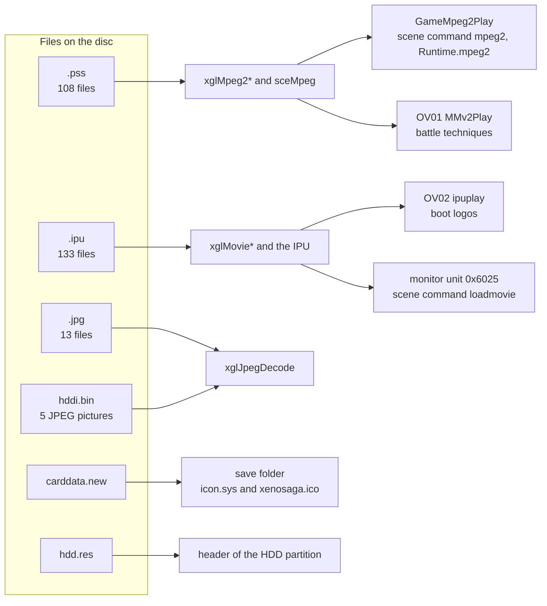

## 2. PSS movies

### 2.1 Where they are and who plays them

The 108 PSS files hold all the full-motion video of the game, about 4 hours
and 31 minutes in total. 103 of them are story cutscenes in
`data\movie\mpeg2\`. The other five are short clips for battle techniques in
`data\yamamoto\mv\` (`gamera`, `gr`, `kiss`, `momo_a` and `momo_b`). The
folder names below `data\` are probably the names of the staff members who
made the files.

The cutscene names follow the event numbers. A movie with a plain number, or a
number with a letter (`1005`, `1038B`, `2033A`), is started by the scene
resource script of the same event. The script name drops the second digit of
the movie number and adds a digit for the part of the scene, so `ev1050.txt`
plays `1005`, `ev1220.txt` plays `1022` and `ev3000.txt` plays `3000`. This
naming rule is read from the pairs on the disc. The script commands are
described in
[Files and resources: scene resource scripts](../architecture/files-and-resources.md#scene-resource-scripts).
There are three of them, and the code builds the path the same way for all
three. `command_mpeg2_core` in `src/main/res_get_path.c` copies
`data\movie\mpeg2\`, appends the name up to the next blank and adds `.pss`.
It then calls `GameMpeg2Play(path, mode)`.

| Command | Mode | Extra step | Movies |
| --- | --- | --- | --- |
| `mpeg2` | `MPEG2_MODE_NORMAL` (2) | none | 61 |
| `mpeg2_btl` | `MPEG2_MODE_BATTLE` (1) | `SCRIPT_fade(2)` first | 10 |
| `mpeg2_nofade` | `MPEG2_MODE_NOFADE` (5) | none | 2 |

The 30 movies with a suffix such as `_1`, `_2` or `_9` (`1001_1`, `2064_2`,
`3050C1_9`) are started from Java event scripts instead. Each name is a string
constant in the event volume with the same number, so `SCE01001.evt` plays
`1001_1` and `SCE02064.evt` plays both `2064_1` and `2064_2`. The native
`Runtime.mpeg2(String)` (`src/main/runtime.c`) builds the same
`data\movie\mpeg2\<name>.pss` path. It passes mode 3, or mode 2 while a fade
is active, or mode 4 when `Runtime.mpeg2AfterCrossFade(int)` reserved a
cross-fade just before. Only `SCE02001A.evt` uses the cross-fade. 27 event
volumes call `Runtime.mpeg2`.

The five battle movies are named in OV01 code. `MMv2Play` plays `gamera.pss`,
`kiss.pss` and `gr.pss` for the techniques 0x38, 0x235 and 0x239, and
`momo_a.pss` and `momo_b.pss` in the transformation flow `specHensinProc`.
That player is described in
[Battle effects: movie players](../game/battle-effects.md#movie-players).

Every one of the 108 files is named by exactly one of these three routes, so
no PSS movie on the disc is unused. The archive group of a cutscene follows
the story. Group 10 holds `1001_1` to `2034`. Group 20 holds `2044A` to
`3058D`, and also `prologue` and `10OP`, which `ev1000.txt` plays one after
the other at the very start of a new game.

The diagram below shows the three routes to the MPEG-2 player.

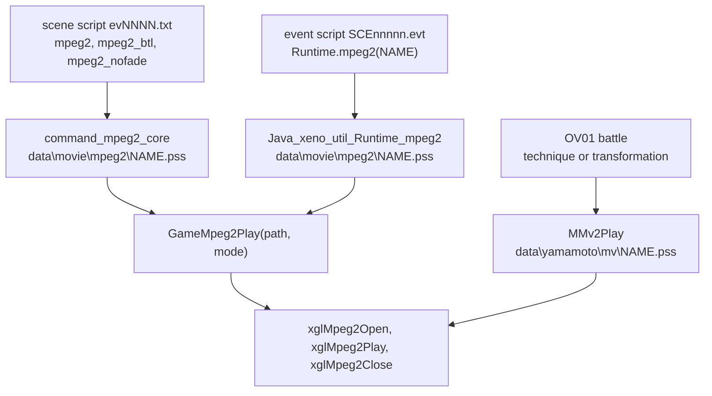

### 2.2 The program stream

A PSS file is an MPEG-2 program stream, the container format of DVD video.
The stream is cut into *packs*. Each pack starts with a pack header that holds
a time stamp for the system clock (the SCR) and the multiplex rate. After the
header come *PES packets* (packetized elementary stream packets). Each PES
packet carries a piece of one elementary stream, either video or audio, with
an optional presentation time stamp (PTS) and decoding time stamp (DTS) in
90 kHz ticks. A stream id after the start code `00 00 01` tells the streams
apart.

All 108 files share the same structure. Every pack is exactly 16,384 bytes,
which is eight 2048-byte sectors. The last pack of each file is 16,388 bytes,
because it ends with the 4-byte program end code `00 00 01 B9`. Nothing
follows that code, so the size of every file is a multiple of 16,384 plus 4.
The files hold 395,921 packs in total. The first pack of each file also
carries the single system header of the file, which announces the streams and
the rate limits.

Three stream ids appear. Stream `E0` is the MPEG-2 video. Stream `BD`, MPEG's
*private stream 1*, carries the audio inside Sony's own sub-stream format
([section 2.5](#25-the-audio-stream)). Stream `BE` is padding and occurs only
298 times in all the files.

| Stream id | Content | PES packets |
| --- | --- | --- |
| `E0` | MPEG-2 video | 1,363,807 |
| `BD` | private stream 1, audio | 219,707 |
| `BE` | padding | 298 |

A pack usually holds four PES packets of 4,090 bytes, or 4,076 bytes for the
last one, which together fill the 16,384 bytes. 395,654 packs have four PES
packets, 213 have five, 27 have three, 26 have six and one has two.

The pack header is 14 bytes long. The values in the table are those of the
first pack of every file.

| Offset | Size | Field | Value |
| --- | --- | --- | --- |
| `0x00` | 4 | pack start code | `00 00 01 BA` |
| `0x04` | 6 | `01` marker bits, SCR base and SCR extension | SCR 0 in the first pack |
| `0x0A` | 3 | program mux rate (22 bits, units of 50 bytes per second) and two marker bits | 18,597 in most packs |
| `0x0D` | 1 | 5 reserved bits and the pack stuffing length | `F8`, no stuffing in any pack |

The system header follows the first pack header. It lists only the video
stream. The audio bound is 0, which is correct for MPEG, because private
stream 1 does not count as an MPEG audio stream.

| Offset | Size | Field | Value |
| --- | --- | --- | --- |
| `0x0E` | 4 | system header start code | `00 00 01 BB` |
| `0x12` | 2 | header length | 9 |
| `0x14` | 3 | rate bound (22 bits) | 18,597 in 103 files |
| `0x17` | 1 | audio bound, fixed flag, CSPS flag | all 0 |
| `0x18` | 1 | audio lock, video lock, video bound | 0, 0, 1 |
| `0x19` | 1 | packet rate restriction | 0 |
| `0x1A` | 3 | stream entry | `E0`, P-STD buffer scale 1, size 1,798 × 1024 bytes |

A PES packet starts with its start code, the stream id and a 16-bit length.
Two flag bytes and a header data length follow. The first flag byte is always
`0x83`, which means "copyright" and "original". The muxer always gives the
header 10 bytes of data and fills the bytes it does not need with `FF`
stuffing, so the payload of nearly every PES packet starts at the same
offset. Only the first video packet of each file has a longer header of 13
bytes, because it also carries the P-STD buffer size.

| Stream | Flag bytes | Header data | Contents of the header data | Packets |
| --- | --- | --- | --- | --- |
| `E0`, first of the file | `83 C1` | 13 bytes | PTS, DTS, extension flags, P-STD buffer | 108 |
| `E0` | `83 C0` | 10 bytes | PTS and DTS | 162,202 |
| `E0` | `83 80` | 10 bytes | PTS and 5 stuffing bytes | 318,379 |
| `E0` | `83 00` | 10 bytes | 10 stuffing bytes | 883,118 |
| `BD` | `83 80` | 10 bytes | PTS and 5 stuffing bytes | 219,707 |

Every audio packet has a PTS. In every file the first audio PTS equals the
first video PTS, and the SCR of the first pack is 0.

The multiplex rate of the packs is nearly constant. Each value in the table
is in units of 50 bytes per second, so 18,597 means about 7.44 Mbit/s. The
higher rates belong to the five battle movies ([section 2.8](#28-variants-and-statistics)).
The values 1,097 and 17,500 appear in only 31 and 96 packs.

| Mux rate | Bit rate | Packs |
| --- | --- | --- |
| 18,597 | 7.44 Mbit/s | 392,073 |
| 22,347 | 8.94 Mbit/s | 2,588 |
| 25,597 | 10.24 Mbit/s | 642 |
| 23,597 | 9.44 Mbit/s | 488 |
| 17,500 | 7.00 Mbit/s | 96 |
| 1,097 | 0.44 Mbit/s | 31 |
| 21,250 | 8.50 Mbit/s | 3 |

The box below shows the first pack of a file and a typical later pack.

```
first pack (16,384 bytes)
+------------------+-------------------+---------------------------------+---------+---------+---------+
| pack header      | system header     | PES E0 (header 13 bytes)        | PES E0  | PES BD  | PES E0  |
| 00 00 01 BA      | 00 00 01 BB       | sequence header, GOP, picture   | ...     | ...     | ...     |
| 14 bytes         | 15 bytes          | 4,096 bytes                     |         |         |         |
+------------------+-------------------+---------------------------------+---------+---------+---------+

later pack (16,384 bytes)
+------------------+------------------+------------------+------------------+------------------+
| pack header      | PES E0 or BD     | PES E0 or BD     | PES E0 or BD     | PES E0 or BD     |
| 14 bytes         | 4,096 bytes      | 4,096 bytes      | 4,096 bytes      | 4,082 bytes      |
+------------------+------------------+------------------+------------------+------------------+

last pack: the same, followed by 00 00 01 B9 (16,388 bytes)
```

The diagram below shows how the data nests inside a PSS file.

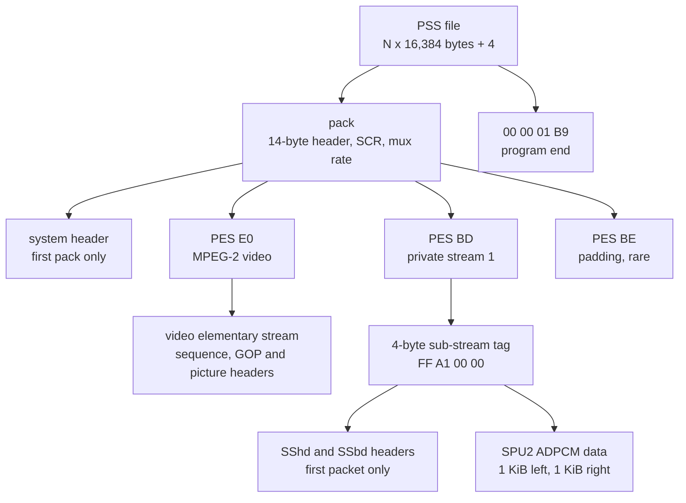

### 2.3 Annotated start of a movie

The dump below is the start of `data\movie\mpeg2\1004_1.pss`, the shortest
movie (4.7 seconds). It shows the pack header, the system header, the first
video PES header and the start of the video sequence header.

```
offset  bytes                                   meaning
0000    00 00 01 BA                             pack start code
0004    44 00 04 00 04 01                       '01' marker, SCR base 0, SCR extension 0
000A    01 22 97                                mux rate 0x48A5 = 18,597 (x 50 bytes/s), markers
000D    F8                                      reserved bits, stuffing length 0
000E    00 00 01 BB                             system header start code
0012    00 09                                   header length 9
0014    80 91 4B                                rate bound 18,597
0017    00                                      audio bound 0, fixed 0, CSPS 0
0018    21                                      locks 0, marker, video bound 1
0019    7F                                      packet rate restriction 0
001A    E0 E7 06                                stream E0, P-STD scale 1, size 0x706 = 1,798
001D    00 00 01 E0                             PES start code, video stream E0
0021    0F FA                                   PES length 4,090
0023    83 C1 0D                                flags: PTS, DTS and extension, header data 13 bytes
0026    31 00 01 32 B7                          PTS 6,491 (72 ms)
002B    11 00 01 1B 41                          DTS 3,488 (39 ms)
0030    1E                                      extension flags: P-STD buffer present
0031    67 06                                   P-STD scale 1, size 1,798
0033    00 00 01 B3                             sequence header
0037    20 01 C0                                width 0x200 = 512, height 0x1C0 = 448
003A    14                                      aspect code 1, frame rate code 4 (29.97)
003B    11 17 23 80                             bit rate 17,500 x 400 = 7,000,000, VBV 112, no matrices
003F    00 00 01 B5 14 8A ...                   sequence extension: Main Profile at Main Level,
                                                progressive sequence, 4:2:0
0049    00 00 01 B5 25 05 05 04 ...             sequence display extension: NTSC, display 512 wide
0055    00 00 01 B2 ...                         user data, ends with "encoded by TMPGEnc (ver. 2.57.41.146)."
```

The first audio packet of this file is in the third pack, which starts at
`0x8000`. Its payload begins with the sub-stream tag and the two headers that
[section 2.5](#25-the-audio-stream) describes.

```
offset  bytes                                   meaning
900E    00 00 01 BD                             PES start code, private stream 1
9012    0F FA                                   PES length 4,090
9014    83 80 0A                                flags: PTS only, header data 10 bytes
9017    21 00 01 32 B7                          PTS 6,491, the same as the first video PTS
901C    FF FF FF FF FF                          stuffing
9021    FF A1 00 00                             sub-stream tag: ADPCM, channel 0
9025    53 53 68 64                             "SShd"
9029    18 00 00 00                             header size 24
902D    10 00 00 00                             format 0x10, SPU2 ADPCM
9031    80 BB 00 00                             sample rate 48,000
9035    02 00 00 00                             2 channels
9039    00 04 00 00                             interleave 0x400 = 1,024 bytes
903D    FF FF FF FF                             loop start -1
9041    FF FF FF FF                             loop end -1
9045    53 53 62 64                             "SSbd"
9049    00 D0 03 00                             body size 0x3D000 = 249,856 bytes
904D    ...                                     ADPCM data of the left channel
```

### 2.4 The video stream

All 108 video streams have the same picture format. They are 512 pixels wide
and 448 pixels high, the size of the game's own frame buffer, with aspect code
1 (square pixels) and 4:2:0 chroma. The profile and level byte is `0x48`,
Main Profile at Main Level. Every picture is a frame picture
(`picture_structure` 3) with `progressive_frame` set.

| Field | Value | Files |
| --- | --- | --- |
| Size | 512 × 448 | 108 |
| Aspect ratio code | 1 | 108 |
| Frame rate code | 4 (29.97 per second) | 105 |
| Frame rate code | 5 (30 per second) | 3: `2007C_1`, `2007C_2`, `3050C1_9` |
| Bit rate field | 7,000,000 bit/s | 103 |
| Bit rate field | 8,500,000 / 9,000,000 / 9,800,000 bit/s | 3 / 1 / 1 (the battle movies) |
| VBV buffer size | 112 × 16 kbit | 108 |
| `progressive_sequence` | 1 | 103 |
| `progressive_sequence` | 0, top field first | 5 (the battle movies) |
| Loaded intra matrix | yes | 2: `gr`, `kiss` |
| Sequence headers | one per file | 103 |
| Sequence headers | one per GOP | 5 (the battle movies) |

The pictures are grouped into GOPs (groups of pictures) that each start with an
I picture, a picture coded without reference to others. Inside a GOP, two B
pictures (predicted from both sides) sit between each pair of reference
pictures. The display order of a normal GOP is
`I B B P B B P B B P B B P B B P B B`, 18 pictures. The files hold 28,419 GOPs
in total. 23,078 of them have 18 pictures and 2,661 have 16. The rest are
shorter, mostly at scene cuts. 2,676 GOPs are closed (they do not reference
the previous GOP), and no GOP has the broken link flag.

| Picture type | Count |
| --- | --- |
| I | 28,419 |
| P | 137,054 |
| B | 323,076 |
| Total | 488,549 |

The GOP time codes start at `00:00:00:00` in the 103 cutscenes and at
`01:00:00:00` in the five battle movies. Every video stream ends with the
sequence end code `00 00 01 B7`, directly before the program end code.

The user data of the first sequence header names the encoder in 103 files.
96 files say `encoded by TMPGEnc (ver. 2.57.41.146).` Four files (`1020_1`,
`2000_1`, `2031_2`, `3050C1_9`) were made with version 2.02.31.119 and three
(`2002B_1`, `2007C_1`, `2007C_2`) with version 2.01.30.116. The three files
with frame rate code 5 are all among these seven older encodings. The five
battle movies have no user data at all. They also differ in every other
detail, so they probably come from another encoder and another team.

### 2.5 The audio stream

The audio travels in private stream 1. Sony's `sceMpeg` library splits that
stream into sub-streams by the first four bytes of each PES payload. The
library keeps the rules in a table, `_strmap` at `0x004AD510` in
`SLUS_204.69`, which the library function `_type2id` searches. Each entry is
a 64-bit key and a 64-bit mask. The key holds the PES stream id in its fifth
byte and the expected payload bytes in its low four bytes. The channel number
is probably added to the key by `sceMpegAddStrCallback`.

| Type | Name in `libmpeg` | Stream id | Payload bytes | Payload mask |
| --- | --- | --- | --- | --- |
| 0 | `sceMpegStrM2V` | `E0` | none | none |
| 1 | `sceMpegStrIPU` | `BD` | `FF C0 00 00` | all four |
| 2 | `sceMpegStrPCM` | `BD` | `FF A0 00 00` | all four |
| 3 | `sceMpegStrADPCM` | `BD` | `FF A1 00 00` | all four |
| 4 | `sceMpegStrDATA` | `BD` | `FF 90 00 00` | all four |
| 5 | probably MPEG audio | `C0` | none | none |
| 6 | probably AC-3 | `BD` | `80` | first byte |
| 7 | probably LPCM | `BD` | `A0` | first byte |
| 8 | probably DTS | `BD` | `88` | first byte |
| 9 | unknown | `BD` | `90` | first byte |

Types 6 to 9 match the sub-stream numbers of DVD video, which is why they are
probably the DVD audio formats. The game uses only types 0 and 3.
`xglMpeg2Open` registers a callback for the video stream (`SCE_MPEG_STR_M2V`,
type 0, channel 0) and one for ADPCM audio (`SCE_MPEG_STR_ADPCM`, type 3,
channel 0) with `sceMpegAddStrCallback`. Every audio
packet in all 108 files carries exactly the tag `FF A1 00 00`, ADPCM channel 0.

The first audio packet of a file starts its payload with two small headers
after the tag. `SShd` describes the sound and `SSbd` announces the sound body.
Both are little-endian.

| Offset from the tag | Size | Field | Value in all 108 files |
| --- | --- | --- | --- |
| `0x00` | 4 | sub-stream tag | `FF A1 00 00` |
| `0x04` | 4 | `SShd` | `53 53 68 64` |
| `0x08` | 4 | size of the rest of the header | 24 |
| `0x0C` | 4 | format | `0x10`, SPU2 ADPCM |
| `0x10` | 4 | sample rate | 48,000 |
| `0x14` | 4 | channels | 2 |
| `0x18` | 4 | interleave size | `0x400` (1,024 bytes) |
| `0x1C` | 4 | loop start | -1 |
| `0x20` | 4 | loop end | -1 |
| `0x24` | 4 | `SSbd` | `53 53 62 64` |
| `0x28` | 4 | size of the body | a multiple of 2,048 |
| `0x2C` | | body | ADPCM data |

The body is SPU2 ADPCM, the same compressed format as the game's voice
streams. Every 16-byte frame holds 28 samples. The two channels alternate in
blocks of 1,024 bytes, left first, which is the same interleave as the `.vds`
stereo voice files described in
[Audio: VAG and PCM streams](../architecture/audio.md#vag-and-pcm-streams).
At 48 kHz this gives 54,857 bytes per second for the two channels, about
439 kbit/s. The audio takes 13.8 percent of all PSS bytes, and a file carries
about 13.5 audio packets per second. Later audio packets carry only the
4-byte tag and the next part of the body.

In 106 files the `SSbd` size equals the body that is actually present. In two
files the last packet is a few bytes short. `10B01_1.pss` announces 309,248
bytes and holds 309,214, and `2015.pss` announces 5,294,080 and holds
5,294,075. The player never reads the size field, so these short endings
probably make no difference. The audio and the video of a file have nearly
the same length. The audio is between 1.6 seconds shorter and 0.9 seconds
longer than the video.

### 2.6 How the player reads the stream

`GameMpeg2Play` in `src/main/game_movie.c` first tries to read a caption file
([section 2.7](#27-caption-files)) to the start of free resource memory. It
then lays out the player's buffers directly after the caption text with
`xglMpeg2InfoInit2(info, arena, 0x40000)`. The table shows the buffers in the
order of the arena. The third argument of `xglMpeg2InfoInit2` sets the size
of the CD stream ring, the ring buffer that the CD thread fills from the disc.
The source names the parameter `ring_size`. The sound ring always has the
fixed size `0x20000`.

| Buffer | Size | Use |
| --- | --- | --- |
| `sceMpeg` work area | `0xFD768` | decoder state |
| video buffer | `0xE0000` | one decoded picture, 896 macroblocks of 16 × 16 RGBA pixels |
| packet buffer | `0x15040` | GIF upload packets |
| read buffer | `0x4000` | stream data handed to the demultiplexer |
| DMA ring | `0x80000` | demultiplexed video for the IPU |
| sound ring | `0x20000` | demultiplexed ADPCM |
| CD stream ring | third argument | `0x40000` in `GameMpeg2Play`, `0x80000` in OV01 `MMv2`, 1 MiB through `xglMpeg2InfoInit` |

`xglMpeg2Open` opens the file as a CD stream and creates the decoder. The
video callback copies each piece of the `E0` stream into the DMA ring. The
audio callback receives the payload of each ADPCM packet, starting at the
sub-stream tag. For the first packet it reads the sample rate at offset
`0x10` and skips `0x2C` bytes, the tag and both headers. For every later
packet it skips the 4-byte tag. It does not read the channel count, the
interleave or the body size. The player instead always opens a stereo stream
with `SsdInitVagStreamStereo(0x1000, 4)`, four chunks of 4 KiB, so it relies
on every movie being stereo with a 1 KiB interleave.

Each call to `xglMpeg2Play` asks `sceMpegGetPicture(mpeg, videoBuffer, 896)`
for the next picture. The last argument is the size of the buffer in
macroblocks, 32 × 28 = 896 for a 512 × 448 picture, and each RGBA macroblock
takes 1,024 bytes, which gives the `0xE0000` bytes of the video buffer. On the
first picture the player starts the audio with
`SsdPlayVagStream(0x7F, 0, rate << 12 / 48000)`, which is pitch `0x1000` for
the 48 kHz of every movie. It then hands new 4 KiB pieces of audio to the
sound driver, refills the read buffer up to 16 times, and uploads the
picture. The movie loop in `GameMpeg2Play` calls `xglMpeg2Play` once per game
frame, and the game runs at 30 frames per second
([xgl: frame pacing](../libraries/xgl.md#frame-pacing)). The player therefore
probably shows one picture per game frame and does not look at the PTS
values. The behaviour of the player is described in more detail in
[xgl: MPEG-2 movies](../libraries/xgl.md#mpeg-2-movies-xglmpeg2).

The sequence below shows how one movie flows from the disc to the screen.

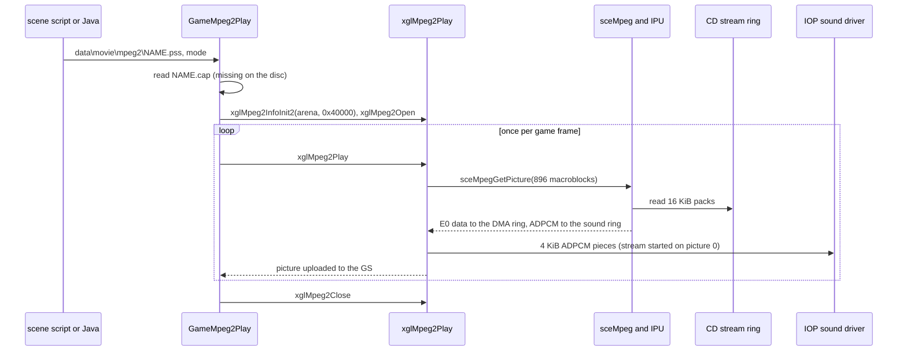

### 2.7 Caption files

`GameMpeg2Play` supports subtitles from a text file next to the movie. It
copies the movie path up to its first `.` and appends `.cap`, so
`data\movie\mpeg2\1005.pss` would get `data\movie\mpeg2\1005.cap`. It reads
that file with `xglCdReadFile`. When the read fails, the movie plays without
captions. No `.cap` file exists on the disc, so this feature is never used.
The English subtitles of the cutscenes are therefore probably part of the
video pictures themselves.

The parser in `caption_convert`, `caption_getparam` and `caption_nextline`
accepts the following text. Lines that start with `;` are comments. Each
entry is a time stamp, blanks (spaces or tabs) and a text up to the end of
the line. A backslash in the text starts a further line of the same caption.
The time stamp `m:s:f` means `((m × 60) + s) × 30 + f` frames. A stamp with
one colon, `a:b`, gives `a × 60 + b` frames, which is probably a units slip,
since the source comment calls it minutes and seconds. The list ends at the
first entry that does not start with a digit. The example below is written
for this page to show the syntax. It does not come from the disc.

```
; caption file for 1005.pss (example)
0:01:15	first caption
0:04:00	second caption\with a second line
0:07:10	 
end
```

`caption_convert` rewrites the text in place into a list of records. The first
record is an empty string. Each later record is a 16-bit little-endian frame
number, a 2-byte font header and the caption text with a terminating zero.
The font header is the value 1 and the complement of half the text width,
which probably centres the line. The terminating record has the frame number
-1.

| Bytes | Field |
| --- | --- |
| 2 | frame from which the caption is shown (little-endian), -1 ends the list |
| 1 | `1`, a font control code |
| 1 | `~(width / 2)`, from `xglFontGetStringWidth` |
| n | caption text, `\n` between lines |
| 1 | `0` |

While the movie plays, the loop compares the frame counter of the decoder with
the frame number of the next record and moves on when it is reached. It
prints the current caption at (64, 317) after the font controls in
`movieCaptionControl`.

### 2.8 Variants and statistics

The 108 files fall into two clear groups.

| Property | Cutscenes (103) | Battle movies (5) |
| --- | --- | --- |
| Folder | `data\movie\mpeg2\` | `data\yamamoto\mv\` |
| Encoder user data | TMPGEnc 2.01, 2.02 or 2.57 | none |
| Rate bound | 18,597 | 22,347 (3), 23,597, 25,597 |
| Bit rate field | 7.0 Mbit/s | 8.5 to 9.8 Mbit/s |
| Average bit rate | 2.45 to 3.96 Mbit/s | 4.51 to 4.88 Mbit/s |
| `progressive_sequence` | 1 | 0, top field first |
| Sequence headers | 1 | one per GOP |
| GOP length | mostly 18 | mostly 15 |
| First time code | `00:00:00:00` | `01:00:00:00` |
| Audio | 48 kHz stereo ADPCM | 48 kHz stereo ADPCM |

The average bit rate of most cutscenes is close to 3.2 Mbit/s. Nine files
(`2017`, `2053`, `3000`, `3007`, `3008A`, `3010`, `3011`, `3022`, `3037`) are
at 2.45 Mbit/s and six (`1032`, `2007`, `2018`, `2046`, `2058A`, `3056B`) at
about 3.96 Mbit/s, so they were probably encoded with other target rates.

| Statistic | Value |
| --- | --- |
| Files | 108 (5 in group 00, 45 in group 10, 58 in group 20) |
| Total size | 6,486,770,096 bytes |
| Total length | 16,301 seconds of video (4 h 31 min), 16,294 seconds of audio |
| Pictures | 488,549 |
| Average bit rate | 3.18 Mbit/s over all files |
| Shortest | `1004_1.pss`, 140 pictures, 4.7 seconds, 1,474,564 bytes |
| Longest | `1035.pss`, 19,902 pictures, 11 min 4 s |
| Largest | `2018.pss`, 281,247,748 bytes, 9 min 28 s |
| Audio share | 13.8 percent of the bytes |

### 2.9 All PSS movies

The table lists every PSS file with its archive group, its number of
pictures, its length, its size, its average bit rate and the script or code
that plays it. The length is the number of pictures divided by the frame rate
of the file.

| File | Group | Pictures | Length | Size | Mbit/s | Played by |
| --- | --- | --- | --- | --- | --- | --- |
| `gamera.pss` | 00 | 215 | 0:07.2 | 4.0 MB | 4.51 | OV01 `MMv2Play`, technique 0x38 |
| `gr.pss` | 00 | 1586 | 0:52.9 | 32.2 MB | 4.87 | OV01 `MMv2Play`, technique 0x239 |
| `kiss.pss` | 00 | 315 | 0:10.5 | 6.3 MB | 4.76 | OV01 `MMv2Play`, technique 0x235 |
| `momo_a.pss` | 00 | 420 | 0:14.0 | 8.0 MB | 4.59 | OV01 `MMv2Play`, `specHensinProc` |
| `momo_b.pss` | 00 | 518 | 0:17.3 | 10.6 MB | 4.88 | OV01 `MMv2Play`, `specHensinProc` |
| `1001_1.pss` | 10 | 1495 | 0:49.9 | 20.0 MB | 3.21 | `Runtime.mpeg2` in `SCE01001.evt` |
| `1003B2.pss` | 10 | 3229 | 1:47.7 | 42.7 MB | 3.17 | `mpeg2` in `ev1032.txt` |
| `1004_1.pss` | 10 | 140 | 0:04.7 | 1.5 MB | 2.53 | `Runtime.mpeg2` in `SCE01004.evt` |
| `1005.pss` | 10 | 2395 | 1:19.9 | 38.9 MB | 3.89 | `mpeg2` in `ev1050.txt` |
| `1006.pss` | 10 | 8515 | 4:44.1 | 113.8 MB | 3.21 | `mpeg2` in `ev1060.txt` |
| `1008_2.pss` | 10 | 5614 | 3:07.3 | 74.6 MB | 3.19 | `Runtime.mpeg2` in `SCE01008.evt` |
| `1010_1.pss` | 10 | 3493 | 1:56.5 | 43.0 MB | 2.95 | `Runtime.mpeg2` in `SCE01010.evt` |
| `1011_2.pss` | 10 | 1235 | 0:41.2 | 15.7 MB | 3.04 | `Runtime.mpeg2` in `SCE01011.evt` |
| `1017.pss` | 10 | 4200 | 2:20.1 | 43.4 MB | 2.47 | `mpeg2` in `ev1170.txt` |
| `1019_1.pss` | 10 | 789 | 0:26.3 | 10.3 MB | 3.13 | `Runtime.mpeg2` in `SCE01019.evt` |
| `1020_1.pss` | 10 | 1095 | 0:36.5 | 14.6 MB | 3.21 | `Runtime.mpeg2` in `SCE01020.evt` |
| `1022.pss` | 10 | 12347 | 6:52.0 | 165.0 MB | 3.20 | `mpeg2` in `ev1220.txt` |
| `1028.pss` | 10 | 4461 | 2:28.8 | 59.6 MB | 3.20 | `mpeg2` in `ev1280.txt` |
| `1032.pss` | 10 | 5806 | 3:13.7 | 95.9 MB | 3.96 | `mpeg2` in `ev1320.txt` |
| `1033.pss` | 10 | 7811 | 4:20.6 | 104.4 MB | 3.21 | `mpeg2` in `ev1330.txt` |
| `1035.pss` | 10 | 19902 | 11:04.1 | 266.1 MB | 3.21 | `mpeg2_btl` in `ev1350.txt` |
| `1038B.pss` | 10 | 816 | 0:27.2 | 10.9 MB | 3.19 | `mpeg2` in `ev1381.txt` |
| `1039.pss` | 10 | 9013 | 5:00.7 | 120.6 MB | 3.21 | `mpeg2_btl` in `ev1390.txt` |
| `1039B.pss` | 10 | 1777 | 0:59.3 | 23.7 MB | 3.20 | `mpeg2` in `ev1391.txt` |
| `1040.pss` | 10 | 4179 | 2:19.4 | 55.8 MB | 3.20 | `mpeg2` in `ev1400.txt` |
| `1041_1.pss` | 10 | 840 | 0:28.0 | 11.0 MB | 3.13 | `Runtime.mpeg2` in `SCE01041.evt` |
| `1043_1.pss` | 10 | 6866 | 3:49.1 | 91.7 MB | 3.20 | `Runtime.mpeg2` in `SCE01043.evt` |
| `1044B.pss` | 10 | 8601 | 4:47.0 | 114.5 MB | 3.19 | `mpeg2` in `ev1441.txt` |
| `10B01_1.pss` | 10 | 168 | 0:05.6 | 2.2 MB | 3.16 | `Runtime.mpeg2` in `SCE010B01.evt` |
| `2000_1.pss` | 10 | 1066 | 0:35.6 | 14.2 MB | 3.19 | `Runtime.mpeg2` in `SCE02000.evt` |
| `2001A_1.pss` | 10 | 150 | 0:05.0 | 1.6 MB | 2.51 | `Runtime.mpeg2` in `SCE02001A.evt` |
| `2002B_1.pss` | 10 | 179 | 0:06.0 | 2.5 MB | 3.34 | `Runtime.mpeg2` in `SCE02002B.evt` |
| `2004C_1.pss` | 10 | 253 | 0:08.4 | 3.3 MB | 3.12 | `Runtime.mpeg2` in `SCE02004C.evt` |
| `2004D_2.pss` | 10 | 2046 | 1:08.3 | 27.3 MB | 3.19 | `Runtime.mpeg2` in `SCE02004D.evt` |
| `2006_1.pss` | 10 | 1019 | 0:34.0 | 13.5 MB | 3.18 | `Runtime.mpeg2` in `SCE02006.evt` |
| `2007.pss` | 10 | 1615 | 0:53.9 | 26.6 MB | 3.95 | `mpeg2_btl` in `ev2070.txt` |
| `2007B.pss` | 10 | 2884 | 1:36.2 | 38.6 MB | 3.20 | `mpeg2` in `ev2071.txt` |
| `2007C_1.pss` | 10 | 235 | 0:07.8 | 3.1 MB | 3.20 | `Runtime.mpeg2` in `SCE02007C.evt` |
| `2007C_2.pss` | 10 | 285 | 0:09.5 | 3.8 MB | 3.17 | `Runtime.mpeg2` in `SCE02007C.evt` |
| `2010.pss` | 10 | 1990 | 1:06.4 | 25.8 MB | 3.11 | `mpeg2` in `ev2100.txt` |
| `2012B.pss` | 10 | 4595 | 2:33.3 | 60.3 MB | 3.15 | `mpeg2` in `ev2121.txt` |
| `2015.pss` | 10 | 2899 | 1:36.7 | 39.0 MB | 3.22 | `mpeg2` in `ev2150.txt` |
| `2017.pss` | 10 | 7107 | 3:57.1 | 72.7 MB | 2.45 | `mpeg2` in `ev2170.txt` |
| `2018.pss` | 10 | 17032 | 9:28.3 | 281.2 MB | 3.96 | `mpeg2` in `ev2180.txt` |
| `2031_1.pss` | 10 | 4235 | 2:21.3 | 56.6 MB | 3.21 | `Runtime.mpeg2` in `SCE02031.evt` |
| `2031_2.pss` | 10 | 195 | 0:06.5 | 2.6 MB | 3.22 | `Runtime.mpeg2` in `SCE02031.evt` |
| `2032.pss` | 10 | 6429 | 3:34.5 | 85.9 MB | 3.20 | `mpeg2` in `ev2320.txt` |
| `2033A.pss` | 10 | 4500 | 2:30.2 | 59.7 MB | 3.18 | `mpeg2_btl` in `ev2330.txt` |
| `2033B.pss` | 10 | 1409 | 0:47.0 | 18.8 MB | 3.21 | `mpeg2` in `ev2331.txt` |
| `2034.pss` | 10 | 4549 | 2:31.8 | 60.8 MB | 3.21 | `mpeg2` in `ev2340.txt` |
| `10OP.pss` | 20 | 8239 | 4:34.9 | 109.7 MB | 3.19 | `mpeg2` in `ev1000.txt` |
| `2044A.pss` | 20 | 2452 | 1:21.8 | 32.3 MB | 3.16 | `mpeg2` in `ev2440.txt` |
| `2046.pss` | 20 | 3031 | 1:41.1 | 50.1 MB | 3.96 | `mpeg2` in `ev2460.txt` |
| `2048.pss` | 20 | 2325 | 1:17.6 | 30.9 MB | 3.18 | `mpeg2` in `ev2480.txt` |
| `2051.pss` | 20 | 12207 | 6:47.3 | 160.0 MB | 3.14 | `mpeg2` in `ev2510.txt` |
| `2053.pss` | 20 | 3519 | 1:57.4 | 36.0 MB | 2.45 | `mpeg2` in `ev2530.txt` |
| `2055.pss` | 20 | 5813 | 3:14.0 | 77.7 MB | 3.20 | `mpeg2_btl` in `ev2550.txt` |
| `2056A.pss` | 20 | 4425 | 2:27.6 | 57.8 MB | 3.13 | `mpeg2_nofade` in `ev2560.txt` |
| `2057.pss` | 20 | 4915 | 2:44.0 | 65.7 MB | 3.21 | `mpeg2` in `ev2570.txt` |
| `2058A.pss` | 20 | 10091 | 5:36.7 | 166.7 MB | 3.96 | `mpeg2` in `ev2580.txt` |
| `2064_1.pss` | 20 | 280 | 0:09.3 | 3.7 MB | 3.20 | `Runtime.mpeg2` in `SCE02064.evt` |
| `2064_2.pss` | 20 | 3554 | 1:58.6 | 46.6 MB | 3.14 | `Runtime.mpeg2` in `SCE02064.evt` |
| `3000.pss` | 20 | 15505 | 8:37.4 | 158.5 MB | 2.45 | `mpeg2` in `ev3000.txt` |
| `3003A.pss` | 20 | 3304 | 1:50.2 | 44.2 MB | 3.20 | `mpeg2` in `ev3030.txt` |
| `3003E.pss` | 20 | 500 | 0:16.7 | 6.7 MB | 3.20 | `mpeg2` in `ev3034.txt` |
| `3007.pss` | 20 | 4299 | 2:23.4 | 43.9 MB | 2.45 | `mpeg2` in `ev3070.txt` |
| `3008A.pss` | 20 | 3685 | 2:03.0 | 37.7 MB | 2.45 | `mpeg2` in `ev3080.txt` |
| `3008B.pss` | 20 | 3050 | 1:41.8 | 40.6 MB | 3.19 | `mpeg2` in `ev3081.txt` |
| `3009D.pss` | 20 | 1158 | 0:38.6 | 15.5 MB | 3.21 | `mpeg2` in `ev3093.txt` |
| `3010.pss` | 20 | 6151 | 3:25.2 | 62.8 MB | 2.45 | `mpeg2` in `ev3100.txt` |
| `3011.pss` | 20 | 7888 | 4:23.2 | 80.7 MB | 2.45 | `mpeg2` in `ev3110.txt` |
| `3014_1.pss` | 20 | 3650 | 2:01.8 | 48.6 MB | 3.19 | `Runtime.mpeg2` in `SCE03014.evt` |
| `3015.pss` | 20 | 7724 | 4:17.7 | 103.0 MB | 3.20 | `mpeg2_btl` in `ev3150.txt` |
| `3016_1.pss` | 20 | 831 | 0:27.7 | 10.6 MB | 3.06 | `Runtime.mpeg2` in `SCE03016.evt` |
| `3017_1.pss` | 20 | 630 | 0:21.0 | 7.3 MB | 2.79 | `Runtime.mpeg2` in `SCE03017.evt` |
| `3020.pss` | 20 | 4209 | 2:20.4 | 54.9 MB | 3.12 | `mpeg2` in `ev3200.txt` |
| `3021_1.pss` | 20 | 3065 | 1:42.3 | 41.3 MB | 3.23 | `Runtime.mpeg2` in `SCE03021.evt` |
| `3022.pss` | 20 | 4880 | 2:42.8 | 49.8 MB | 2.45 | `mpeg2` in `ev3220.txt` |
| `3026A.pss` | 20 | 4787 | 2:39.7 | 63.1 MB | 3.16 | `mpeg2_btl` in `ev3260.txt` |
| `3027_1.pss` | 20 | 8582 | 4:46.4 | 114.8 MB | 3.21 | `Runtime.mpeg2` in `SCE03027.evt` |
| `3028B.pss` | 20 | 4094 | 2:16.6 | 55.0 MB | 3.22 | `mpeg2` in `ev3281.txt` |
| `3035.pss` | 20 | 6160 | 3:25.5 | 82.3 MB | 3.21 | `mpeg2` in `ev3350.txt` |
| `3036I.pss` | 20 | 1536 | 0:51.3 | 20.5 MB | 3.21 | `mpeg2` in `ev3368.txt` |
| `3037.pss` | 20 | 901 | 0:30.1 | 9.2 MB | 2.46 | `mpeg2` in `ev3370.txt` |
| `3039A.pss` | 20 | 4254 | 2:21.9 | 56.1 MB | 3.16 | `mpeg2` in `ev3390.txt` |
| `3039B_1.pss` | 20 | 2002 | 1:06.8 | 26.1 MB | 3.13 | `Runtime.mpeg2` in `SCE03039B.evt` |
| `3039C.pss` | 20 | 9772 | 5:26.1 | 130.8 MB | 3.21 | `mpeg2` in `ev3392.txt` |
| `3040.pss` | 20 | 2185 | 1:12.9 | 29.1 MB | 3.19 | `mpeg2` in `ev3400.txt` |
| `3042.pss` | 20 | 13327 | 7:24.7 | 178.1 MB | 3.20 | `mpeg2` in `ev3420.txt` |
| `3045.pss` | 20 | 2128 | 1:11.0 | 28.1 MB | 3.17 | `mpeg2` in `ev3450.txt` |
| `3046A.pss` | 20 | 6618 | 3:40.8 | 88.1 MB | 3.19 | `mpeg2` in `ev3460.txt` |
| `3046B.pss` | 20 | 2676 | 1:29.3 | 34.6 MB | 3.10 | `mpeg2` in `ev3461.txt` |
| `3047B.pss` | 20 | 8680 | 4:49.6 | 115.4 MB | 3.19 | `mpeg2` in `ev3471.txt` |
| `3047C.pss` | 20 | 1937 | 1:04.6 | 24.2 MB | 2.99 | `mpeg2` in `ev3472.txt` |
| `3047D.pss` | 20 | 2076 | 1:09.3 | 27.4 MB | 3.17 | `mpeg2_btl` in `ev3473.txt` |
| `3048.pss` | 20 | 10183 | 5:39.8 | 136.1 MB | 3.20 | `mpeg2` in `ev3480.txt` |
| `3050C1_9.pss` | 20 | 195 | 0:06.5 | 2.6 MB | 3.23 | `Runtime.mpeg2` in `SCE03050C1.evt` |
| `3050C2.pss` | 20 | 3097 | 1:43.3 | 41.2 MB | 3.19 | `mpeg2` in `ev3504.txt` |
| `3052.pss` | 20 | 16294 | 9:03.7 | 217.9 MB | 3.21 | `mpeg2` in `ev3520.txt` |
| `3054B2.pss` | 20 | 3509 | 1:57.1 | 47.0 MB | 3.21 | `mpeg2` in `ev3543.txt` |
| `3055_1.pss` | 20 | 1033 | 0:34.5 | 13.7 MB | 3.18 | `Runtime.mpeg2` in `SCE03055.evt` |
| `3056A.pss` | 20 | 2817 | 1:34.0 | 37.7 MB | 3.21 | `mpeg2_btl` in `ev3560.txt` |
| `3056B.pss` | 20 | 8847 | 4:55.2 | 146.2 MB | 3.96 | `mpeg2_btl` in `ev3561.txt` |
| `3056C.pss` | 20 | 8159 | 4:32.2 | 108.9 MB | 3.20 | `mpeg2` in `ev3562.txt` |
| `3058A.pss` | 20 | 10189 | 5:40.0 | 136.1 MB | 3.20 | `mpeg2` in `ev3580.txt` |
| `3058B.pss` | 20 | 8394 | 4:40.1 | 112.2 MB | 3.20 | `mpeg2_nofade` in `ev3581.txt` |
| `3058D.pss` | 20 | 12103 | 6:43.8 | 154.3 MB | 3.06 | `mpeg2` in `ev3583.txt` |
| `prologue.pss` | 20 | 8121 | 4:31.0 | 108.0 MB | 3.19 | `mpeg2` in `ev1000.txt` |

## 3. IPU movies

### 3.1 Where they are and who plays them

An IPU movie is a sequence of intra-coded pictures (pictures that do not
depend on other pictures), stored with almost no container. The format is
made for the IPU, the image decoding unit of the PS2. The IPU decodes one
picture from an MPEG-style bit stream and outputs RGBA macroblocks, so a
player only has to feed it data and collect the pixels. There is no sound.

133 IPU files are on the disc. Two of them are the boot logos, `data\namco.ipu`
and `data\logo_msi.ipu`. A decoded frame of the second shows the Monolith Soft
emblem above the letters "M.S.I.". They are played by `ipuplay` in
`src/ov02/logo.c`, described in
[Boot and title screen: the logo movies](../game/title-and-boot.md#5-the-logo-movies).
That function opens the file as a CD stream (`xglMovieOpen(&movie, path)`)
with a 512 KiB source buffer at `0x01000000`, so the stream ring is twice that
size. It decodes one frame per game frame until the last frame or until START
is pressed.

The other 131 files are the small movies `data\movie\small\mvsNNNN.ipu`. They
are shown by the monitor unit `0x6025`, a screen inside a map that shows
pictures or a movie, described in
[Maps and units: monitor screens](../game/map-and-units.md#monitor-screens).
A scene resource script preloads a small movie with `loadmovie NNNN`.
`command_loadmovie` in `src/main/res_get_path.c` passes the number to
`RES_loadFile` with the type `RES_TYPE_MOVIE`, and the resource system builds
the path from `data\movie\small\mvs0000.ipu`. When a scene archive is open,
the movie is taken from the archive instead
([Files and resources: scene archives](../architecture/files-and-resources.md#scene-archives)).
The monitor unit names its source with a resource id. An id from 20000 is
`mvsNNNN.ipu` with `NNNN` = id − 20000. `movie_work_setup` in
`src/main/unit6003.c` then opens the movie from memory with
`xglMovieOpen(info, 0)` and builds two XTX texture headers, so each decoded
frame can be drawn as a texture.

Two more IPU paths exist in the code, but the disc has no files for them. The
Java native `Movie.start(int)` in `src/main/movie.c` builds
`data\movie\full\mvNNNN.ipu`, and the effect script command for movies in
`src/main/sc_get.c` plays `data\simajiri\movie\<name>` through OV01 `MMvPlay`.
Neither folder exists. No event volume calls `Movie.start`, although seven
volumes create `xeno.Movie` objects, call `init` and `update` and use the
fields `alpha` and `transparent`
([section 10](#10-files-and-paths-that-nothing-uses)).

The diagram below shows the users of the IPU player.

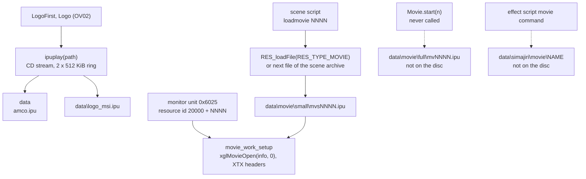

### 3.2 File layout

An IPU file has a 16-byte header and then the frames, one after the other.
The header is little-endian.

| Offset | Size | Field | Notes |
| --- | --- | --- | --- |
| `0x00` | 4 | signature `ipum` | `XglMovieSourceHeader.signature`, checked by `xglMovieOpen` |
| `0x04` | 4 | file size minus 8 | never read by the player |
| `0x08` | 2 | width in pixels | a multiple of 16 |
| `0x0A` | 2 | height in pixels | a multiple of 16 |
| `0x0C` | 4 | frame count | the player reads only the low 16 bits |

Each frame is one byte of flags ([section 3.3](#33-the-frame-flags-byte)),
then the macroblocks of the picture as a bit stream, then zero bits up to the
next byte boundary, then the 4-byte code `00 00 01 B0`. After the last frame
comes the end code `00 00 01 B1`, so the last eight bytes of every complete
file are `00 00 01 B0 00 00 01 B1`. No other start codes occur in the files.
In 1,775 of the 14,600 frames on the disc, a whole zero byte sits before the
`B0` code, probably because the bit stream ended exactly on a byte boundary
and the encoder still added a padding byte.

The macroblock data uses the syntax of an MPEG-2 intra slice without the slice
headers. The files were also decoded with the independent IPU decoder of
FFmpeg, which reads them the same way and decodes exactly the stated number of
frames from every complete file. Every macroblock except the first starts
with the address increment bit `1`. The macroblock type follows, `1` for a
plain intra block or `01` for an intra block with a new quantiser. When the
flags ask for it, one DCT type bit comes next. A 5-bit quantiser scale code
follows when the type says so, and then the six 8 × 8 blocks of the 4:2:0
macroblock (four luminance blocks and two chrominance blocks).

```
ipum file
+--------------------------------------------------------------+
| header, 16 bytes: "ipum", size - 8, width, height, frames    |
+--------------------------------------------------------------+
| frame 0: flags byte | macroblock bits | 0 padding | 00 00 01 B0
+--------------------------------------------------------------+
| frame 1: flags byte | macroblock bits | 0 padding | 00 00 01 B0
+--------------------------------------------------------------+
| ...                                                          |
+--------------------------------------------------------------+
| frame n-1: flags byte | macroblock bits | 0 padding | 00 00 01 B0
+--------------------------------------------------------------+
| 00 00 01 B1   end of the stream                              |
+--------------------------------------------------------------+
```

### 3.3 The frame flags byte

The first byte of every frame sets the decoding mode of the IPU for that
frame. `xglMoviePlay` reads it with the IPU's `FDEC` command, which shows the
next 32 bits of the input, and keeps the top byte. A second `FDEC` consumes
the 8 bits. The player then writes `(flags & 0xFB) << 16` to the IPU control
register `IPU_CTRL` and sends the decode command `IDEC` with bit 24 set from
flag bit 2. The meaning of each bit therefore comes from the fields of
`IPU_CTRL` and `IDEC`.

| Bit | Mask | Goes to | Meaning |
| --- | --- | --- | --- |
| 0–1 | `0x03` | `IPU_CTRL` bits 16–17, IDP | intra DC precision: 0 = 8 bits, 1 = 9 bits, 2 = 10 bits |
| 2 | `0x04` | `IDEC` bit 24, DTD | each macroblock has a DCT type bit (frame or field DCT) |
| 3 | `0x08` | `IPU_CTRL` bit 19 | none, always 0 in the files |
| 4 | `0x10` | `IPU_CTRL` bit 20, AS | alternate scan order |
| 5 | `0x20` | `IPU_CTRL` bit 21, IVF | intra VLC format, the second table for AC coefficients |
| 6 | `0x40` | `IPU_CTRL` bit 22, QST | non-linear quantiser scale |
| 7 | `0x80` | `IPU_CTRL` bit 23, MP1 | MPEG-1 bit stream |

Every frame of a file uses the same flags byte. Four values occur.

| Flags | Meaning | Files |
| --- | --- | --- |
| `0x62` | 10-bit DC, intra VLC table, non-linear quantiser | 100, including `logo_msi.ipu` |
| `0x80` | MPEG-1 mode, 8-bit DC | 24 |
| `0x76` | as `0x62`, plus DCT type bits and alternate scan | 8, including `namco.ipu` |
| `0x60` | as `0x62`, with 8-bit DC | 1, `mvs0074.ipu` |

The 24 files in MPEG-1 mode are `mvs0101`, `mvs0106`, `mvs2007`, `mvs2025`,
`mvs2026`, `mvs2027`, `mvs2030`, `mvs2031`, `mvs2034`, `mvs2035`, `mvs3001`,
`mvs3002`, `mvs3003`, `mvs3025`, `mvs3029`, `mvs3030`, `mvs3031`, `mvs4209`,
`mvs4210`, `mvs7003`, `mvs8055`, `mvs8059`, `mvs8060` and `mvs8061`. Apart
from `namco.ipu`, the files with `0x76` are `mvs0063`, `mvs0065`, `mvs0067`,
`mvs0072`, `mvs0073`, `mvs0076` and `mvs0081`. The different settings
probably reflect different settings of the conversion tool rather than any
need of the game, since the player handles all of them the same way.

### 3.4 Annotated example

The dump below shows the header and the last bytes of `data\namco.ipu`.

```
offset  bytes                                   meaning
000000  69 70 75 6D                             "ipum"
000004  40 0C 1B 00                             0x1B0C40 = 1,772,608 = file size - 8
000008  00 02                                   width 512
00000A  C0 01                                   height 448
00000C  79 00 00 00                             121 frames
000010  76                                      frame 0 flags: 10-bit DC, DCT type bits,
                                                alternate scan, intra VLC table, non-linear quantiser
000011  41 FE D6 34 ...                         first macroblock: 0 1 = intra with quantiser,
                                                0 = frame DCT, 00001 = quantiser scale code 1,
                                                then the luminance DC of block 0
...
1B0C30  34 68 D1 86 1B 46 8D 1A 30 C3 68 D1 A3 46 18 60
                                                end of the macroblocks of frame 120
1B0C40  00 00 01 B0                             end of frame 120
1B0C44  00 00 01 B1                             end of the stream (file size 0x1B0C48)
```

A small movie has the same header. `data\movie\small\mvs0001.ipu` starts with
`69 70 75 6D D8 4B 09 00 80 00 70 00 96 00 00 00`, a 128 × 112 movie of 150
frames and 609,248 bytes, and its first frame starts with the flags byte
`0x62`.

### 3.5 How `xglMoviePlay` walks the stream

`xglMovieOpen` checks the signature and copies the width, height and frame
count. It does not use the size at offset 4. For a movie in memory it points
the DMA at the source plus 16 bytes, past the header. For a CD stream it uses
a ring of twice the source size and a chain of four DMA `REF` tags that walk
the two halves of the ring. The first tag also skips the 16-byte header, and
the last tag uses the length of the file from the CD stream to send the
remainder.

Each call of `xglMoviePlay` decodes one frame. It restores the IPU's bit
position from the end of the previous frame, peeks at the flags byte with
`FDEC 0`, consumes it with `FDEC 8`, sets `IPU_CTRL` and sends `IDEC` with
quantiser scale code 1 and RGB32 output. While the IPU decodes, the player
takes the output one strip of 16 pixel rows at a time, either to the GS or to
a buffer in memory. When the picture is done it sends `FDEC 0x20`, which skips
the 32 bits of the `00 00 01 B0` code. It then saves `IPU_BP`, the bit
position, so the next call can start at the next flags byte. When the frame
counter reaches the frame count from the header, the player either stops
(the counter stays at the last frame and the call returns 1) or rewinds to
offset 16 when looping is enabled. The `00 00 01 B1` end code is therefore
never read. The steps of the player are described in
[xgl: IPU movies](../libraries/xgl.md#ipu-movies-xglmovie).

The sequence below shows what happens to the bytes of one frame.

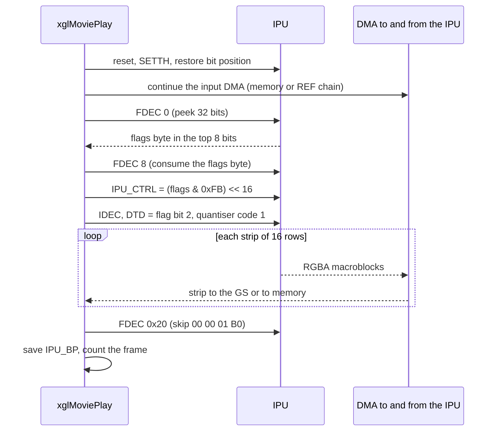

### 3.6 Variants and statistics

The small movies come in four sizes. Most are 128 × 112 pixels, a quarter of
the screen in each direction, or 256 × 224 pixels, half of the screen.

| Size | Files | Flags values |
| --- | --- | --- |
| 128 × 112 | 82 | `0x62` (73), `0x80` (5), `0x76` (4) |
| 256 × 224 | 48 | `0x62` (25), `0x80` (19), `0x76` (3), `0x60` (1) |
| 128 × 64 | 1, `mvs1003.ipu` | `0x62` |
| 512 × 448 | 2, the logos | `0x76` (`namco`), `0x62` (`logo_msi`) |

The frame count of a small movie is between 1 and 450. 150 frames, five
seconds at 30 frames per second, is the most common count (55 files). Six
files have a single frame, so they are still pictures stored as movies. The
monitor unit can also hold each frame for several game frames, so the length
of a small movie on screen is not fixed by the file.

| Statistic | Value |
| --- | --- |
| Files | 133, all in group 00 |
| Total size | 95,724,540 bytes |
| Small movies | 131 files, 90,190,926 bytes, 14,302 frames by their headers |
| Frame counts | 150 (55 files), 30 (11), 60 (9), 120 (6), 1 (6), 90 (5), 7 (5), 2 (5) |
| Longest small movie | `mvs0048.ipu`, 450 frames |
| Largest file | `mvs4209.ipu`, 4,375,499 bytes |
| Smallest file | `mvs8059.ipu`, 4,853 bytes |
| Bytes per macroblock | 16 (`mvs0076`) to 239 (`mvs8055`) |
| `namco.ipu` | 512 × 448, 121 frames, 1,772,616 bytes, 4,914 to 21,885 bytes per frame |
| `logo_msi.ipu` | 512 × 448, 228 frames, 3,760,998 bytes, 4,732 to 24,904 bytes per frame |

At one frame per game frame, the Namco logo lasts about 4.0 seconds and the
Monolith Soft logo about 7.6 seconds.

`mvs0101.ipu` is truncated on the disc. Its header announces 93 frames and a
file of 3,123,245 bytes, but the archive directory gives it only 1,384,448
bytes, exactly the 676 sectors up to the start of `mvs0102.ipu`. The stored
part holds 42 complete frames and ends in the middle of frame 43. No script
names this movie, so the damage is never seen.

### 3.7 Which small movies are used

The scene resource scripts name 70 different small movies in 112 `loadmovie`
commands, spread over 42 scripts (99 commands in `ev*.txt` scripts and 13 in
`cf*.txt` scripts). Every movie they name exists. The Java event scripts
contain the matching resource ids (20000 + number) as `sipush` constants, and
the event volume usually belongs to the same scene. For example the ids of
`mvs3001` to `mvs3031` appear in `SCE02042.evt`, and `ev2420.txt` loads those
movies. Five more movies appear only as such constants: `mvs0069` (in six
`SCE01` volumes), `mvs0072` (`SCE02064.evt`), `mvs0079` (three volumes),
`mvs0097` (`SCE01003B1.evt`) and `mvs1000` (`SCE01041.evt`). These are
probably used too, loaded by the monitor unit directly from the disc.

The scene archive `data\scene\cf1060.a` contains a byte-identical copy of
`mvs0023.ipu` at offset 2,109,696. Its script `cf1060.txt` has
`loadmovie 0023`, so the movie is read from the archive when the archive is
open.

The remaining 56 small movies are not named by any scene script or Java
constant: `mvs0006`, `0008`–`0011`, `0019`, `0022`, `0024`–`0030`, `0032`,
`0034`, `0037`, `0039`, `0044`, `0046`, `0048`, `0049`, `0052`, `0054`,
`0055`, `0057`, `0059`, `0060`, `0062`, `0063`, `0068`, `0070`, `0071`,
`0073`, `0075`, `0076`, `0080`, `0081`, `0083`, `0090`, `0091`,
`0093`–`0096`, `0098`, `0101`–`0109` and `1001`. A search of the 209 map files
(`data\map\*.id`) for the same resource ids found only unrelated table
offsets. These movies are probably unused.

## 4. JPEG pictures

### 4.1 The pictures

The disc holds 13 loose JPEG files and five more inside `data\yajima\hddi.bin`
([section 4.4](#44-the-install-pictures-in-hddibin)). All of them are baseline
JPEG (marker `SOF0`) with 8-bit samples and three components (Y, Cb and Cr).
None is progressive. The table also gives the chroma sampling, the IJG quality
whose scaled standard tables equal the file's tables, and the pixel density
written in the JFIF header.

| File | Size | Pixels | Sampling | Quality | Density | Read by |
| --- | --- | --- | --- | --- | --- | --- |
| `data\title.jpg` | 23,445 | 512 × 448 | 4:4:4 | 80 | 96 dpi | `Title` (OV02) |
| `data\monologo.jpg` | 28,113 | 512 × 448 | 4:4:4 | 80 | 96 dpi | nothing |
| `data\endou\new_d.jpg` | 3,352 | 128 × 112 | 4:2:0 | 80 | 72 × 1 | save screen, slot 99 |
| `data\endou\n_use.jpg` | 3,092 | 128 × 112 | 4:2:0 | 80 | 72 × 1 | save screen, slot 100 |
| `data\endou\brk_d.jpg` | 4,015 | 128 × 112 | 4:2:0 | 80 | 72 × 1 | save screen, slot 101 |
| `data\endou\otr_d.jpg` | 3,224 | 128 × 112 | 4:2:0 | 80 | 72 × 1 | nothing |
| `data\yajima\im00.jpg` | 29,798 | 512 × 448 | 4:2:0 | 75 | 300 dpi | `Intermission` |
| `data\yajima\im01.jpg` | 38,259 | 512 × 448 | 4:4:4 | 80 | 96 dpi | `Intermission` |
| `data\yajima\im02.jpg` | 29,716 | 512 × 448 | 4:2:0 | 75 | 300 dpi | `Intermission` |
| `data\yajima\im03.jpg` | 27,032 | 512 × 448 | 4:2:0 | 75 | 300 dpi | `Intermission` |
| `data\yajima\end.jpg` | 6,175 | 512 × 448 | 4:4:4 | 80 | 96 dpi | `GameEnd` |
| `data\yajima\gameov.jpg` | 4,996 | 512 × 448 | 4:4:4 | 80 | 96 dpi | game over screen |
| `data\yajima\mnt_set.jpg` | 24,164 | 512 × 448 | 4:4:4 | about 95, not IJG | 72 dpi | display adjustment screen |

The full-screen pictures have the size of the frame buffer, 512 × 448. The
save-screen pictures in `data\endou\` have the size of a save thumbnail,
128 × 112, and each is smaller than the 4,096 bytes (`FILE_THUMBNAIL_SIZE`) of
a thumbnail slot. The save screen loads `new_d.jpg`, `n_use.jpg` and
`brk_d.jpg` into the thumbnail slots 99, 100 and 101 of `FileObjectData`
(`newDataThumbnailPath`, `unusedDataThumbnailPath` and
`brokenDataThumbnailPath` in `src/main/file.c`). They stand in for the
thumbnail of a new save, an unusable slot and broken data. The fourth picture
of the same series, `otr_d.jpg`, is never loaded. The chapter pictures
`im00.jpg` to `im03.jpg` are chosen by `Intermission(chapter)` in
`src/main/game_over.c`, which writes the chapter number into the digits of
the name. The density "72 × 1" of the four save-screen pictures is a real
value in their JFIF headers, 72 horizontal and 1 vertical, and is probably a
quirk of the tool that saved them.

The pictures come from at least three different encoders. The pictures with
quality 80 use the IJG standard tables, two quantization tables in separate
segments, and JFIF 1.01. The three chapter pictures with quality 75 use 4:2:0
sampling and 300 dpi, so they were probably saved from a print-resolution
source. `mnt_set.jpg` was saved by Adobe Photoshop. It has JFIF 1.02, a
Photoshop `APP13` segment of 4,762 bytes that contains its own small
thumbnail JPEG, an Adobe `APP14` segment, a restart interval of 64 MCUs with
55 restart markers, and non-standard tables of about quality 95.

### 4.2 What the game decoder accepts

`xglJpegDecode` in `src/main/xgl_jpeg.c` is a small decoder written for these
files. It does not check much, so a JPEG file must follow its assumptions
exactly. The parser scans the data for the next `FF` byte, reads the marker
after it and calls a handler. It stops at the first `RST0` or `EOI` marker
outside the entropy-coded data. The table lists what each handler expects.

| Marker | Handler | What it accepts |
| --- | --- | --- |
| `SOI` | none | ignored |
| `DQT` | `DefineQuantizeTable` | one 8-bit table per segment. It copies `length - 3` values into the luminance table when the table id byte is 0 and into the chrominance table otherwise |
| `SOF0` | `StartOfFrame` | height and width, and the sampling factors of the first component only: `0x11` (4:4:4), `0x21` (4:2:2) or `0x22` (4:2:0, also the default) |
| `DHT` | `DefineHuffmanTable` | several tables per segment. Class and id `0x00` is DC luminance, `0x01` DC chrominance, `0x10` AC luminance, anything else AC chrominance |
| `DRI` | `DefineRestartInterval` | restart interval, restart markers inside the scan are handled |
| `SOS` | `StartOfScan` | skips a fixed 12 bytes, so the scan must name exactly three components. The tables are chosen by component, not by the selectors in the scan header |
| others | default | skipped by their length (`APPn`, `COM` and so on) |

`StartOfFrame` reads neither the sample precision nor the component count,
so a 12-bit or greyscale picture would be decoded wrongly. There is no
handler for progressive JPEG (`SOF2`), and only one luminance and one
chrominance set of tables exist. Every
picture on the disc meets these limits except in one detail, described in the
next section.

The diagram below shows the parse loop.

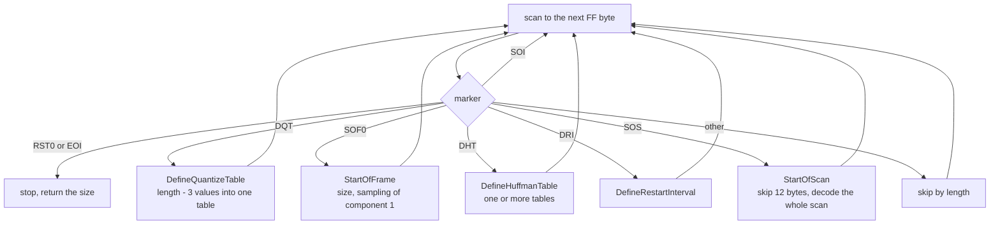

### 4.3 The quantization tables of `mnt_set.jpg`

`mnt_set.jpg` is the picture of the display adjustment screen
(`src/main/tya_display_setting.c`). It shows a dark frame with arrows to each
edge, a "CENTER" label, and the button legend "○ : accept", "× : cancel" and
"□ : default" in the lower right corner. Photoshop wrote both quantization
tables into one `DQT` segment of length 132, the luminance table (id 0)
followed by the chrominance table (id 1). The JPEG standard allows this, but
the game decoder reads one table per segment.

`DefineQuantizeTable` sees the id byte 0 and copies `132 - 3 = 129` values
into the luminance table. `JpegWork` keeps that table at offset `0xD0` as 64
floats, and the chrominance table follows directly at `0x1D0`. The first 64
values fill the luminance table correctly. The 65th value is the id byte of
the second table, 1, and it lands in the first entry of the chrominance
table. The real chrominance values follow one place too late, and the last of
them is written to the float after the chrominance table, at offset `0x2D0`.
That area belongs to the encoder, which rebuilds it before every encode, so
the overflow itself is harmless.

| Entry (zig-zag order) | 0 (DC) | 1 | 2 | 3 | 4 | 5 | 6 | 7 |
| --- | --- | --- | --- | --- | --- | --- | --- | --- |
| Chrominance table in the file | 3 | 3 | 3 | 5 | 4 | 5 | 9 | 6 |
| Chrominance table in the game | 1 | 3 | 3 | 3 | 5 | 4 | 5 | 9 |

The chrominance DC coefficient of every block is therefore scaled by 1
instead of 3, and each AC coefficient uses the step of its neighbour. The
average colour of every 8 × 8 block thus loses two thirds of its saturation.
A decode of the file with the game's tables, made for this page with the same
standard decoder for both versions, lowers the average chroma distance from
neutral grey from 3.89 to 1.25. The bluish grey background becomes neutral
grey and the button symbols lose most of their colour. The game decoder
probably shows the picture in the same faded way, so the effect is visible
but small on this mostly grey picture.

### 4.4 The install pictures in `hddi.bin`

`data\yajima\hddi.bin` holds the five background pictures of the HDD
install screen, one for each fifth of the progress. The install screen is
described in
[Boot and title screen: HDD installation](../game/title-and-boot.md#8-hdd-installation).
The file is a `0x40`-byte header of 16 little-endian words, followed by five
JPEG files. Each picture is padded with 2 to 61 bytes after its `EOI` marker,
so the next one starts on a 64-byte boundary.

| Word | Offset | Value | Meaning |
| --- | --- | --- | --- |
| 0 | `0x00` | `0x14` | unknown, never read |
| 1 | `0x04` | `0xE200` | start of picture 1, relative to `0x40` |
| 2 | `0x08` | `0x18140` | start of picture 2 |
| 3 | `0x0C` | `0x1E6C0` | start of picture 3 |
| 4 | `0x10` | `0x23B00` | start of picture 4 |
| 5 | `0x14` | `0x2C600` | end of picture 4, `0x40 + 0x2C600` = file size, never read |
| 6–15 | `0x18` | 0 | unused |

`TitleHddInstall` decodes picture 0 directly from offset `0x40`. During the
copy, `HddInstallCB` computes `step = percent / 20` and decodes picture
`step` from `base + word[step] + 0x40` whenever the step changes, for steps 1
to 4. Word 0 is therefore never used. Its value `0x14` would point 20 bytes
into picture 0, past its `SOI` and `APP0` segments, to its first `DQT`
segment. Because the decoder starts by scanning for a marker, a decode from
there would still work. The value may be a picture offset that the tool wrote
in another way, or simply the number 20, the percentage per picture.

All five pictures are 512 × 448, 4:4:4, IJG quality 80 and 96 dpi, the same
settings as `title.jpg`. Their sizes are 57,856, 40,768, 25,984, 21,568 and
35,584 bytes including the padding.

```
offset  bytes                                   meaning
0000    14 00 00 00                             word 0 = 0x14 (not read)
0004    00 E2 00 00                             picture 1 at 0x40 + 0xE200 = 0xE240
0008    40 81 01 00                             picture 2 at 0x40 + 0x18140
000C    C0 E6 01 00                             picture 3 at 0x40 + 0x1E6C0
0010    00 3B 02 00                             picture 4 at 0x40 + 0x23B00
0014    00 C6 02 00                             end at 0x40 + 0x2C600 = 0x2C640
0018    00 ... 00                               zero up to 0x40
0040    FF D8 FF E0 00 10 4A 46 49 46 00 01     picture 0: SOI, APP0 "JFIF" 1.01
004C    01 01 00 60 00 60 ...                   units dpi, density 96 x 96
E23B    7F                                      last byte of the entropy data of picture 0
E23C    FF D9                                   EOI of picture 0
E23E    00 00                                   padding up to the 64-byte boundary
E240    FF D8 FF E0 ...                         picture 1
```

The diagram below shows how the install screen picks a picture.

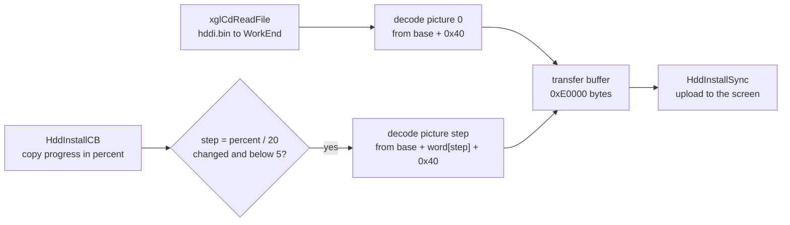

## 5. The 3D icon format

Both icon templates contain a 3D icon in the PS2's standard icon format, the
format that the console's memory card browser draws. The format is the same
in both files, so it is described once here. All values are little-endian.
The icon is a model of `vertex count` vertices, drawn as triangles in vertex
order. It has several *shapes*, which are complete sets of vertex positions,
and an animation that blends between them.

| Offset | Size | Field | `carddata.new` | `hdd.res` |
| --- | --- | --- | --- | --- |
| `0x00` | 4 | identifier | `0x00010000` | `0x00010000` |
| `0x04` | 4 | number of shapes | 4 | 4 |
| `0x08` | 4 | texture type | 3 | 3 |
| `0x0C` | 4 | float, always 1.0 | 1.0 | 1.0 |
| `0x10` | 4 | vertex count, a multiple of 3 | 1,482 | 1,494 |
| `0x14` | | vertex records | | |

Each vertex record holds one position for every shape, then one normal, one
texture coordinate pair and one colour. With four shapes a record is
`4 × 8 + 16 = 48` bytes. Positions and normals are signed 16-bit numbers.
The texture coordinates of the HDD icon run from 0 to `0x1000`, so the
format probably uses fixed point with 12 fraction bits. The fourth component
of every position and normal in both files is 1,024.

| Size | Field |
| --- | --- |
| 8 per shape | position x, y, z and w, 16-bit signed |
| 8 | normal x, y, z and w, 16-bit signed |
| 4 | texture u and v, 16-bit, `0x1000` = 1.0 |
| 4 | colour red, green, blue and alpha, one byte each |

The animation section follows the vertices. It starts with a 20-byte header,
then one record per animated shape. Each record has a shape number, a key
count and that many keys. A key is a time in frames and a weight, both floats.

| Offset | Size | Field | `carddata.new` | `hdd.res` |
| --- | --- | --- | --- | --- |
| `0x00` | 4 | animation identifier | 1 | 1 |
| `0x04` | 4 | frame length | 29 | 39 |
| `0x08` | 4 | animation speed (float) | 1.0 | 1.0 |
| `0x0C` | 4 | play offset | 0 | 0 |
| `0x10` | 4 | number of frame records | 4 | 4 |
| `0x14` | 8 | record: shape number, key count | | |
| | 8 per key | key: time (float), weight (float) | | |

In both icons the four shapes take turns. Shape 0 has weight 1 at time 0,
shape 1 at a quarter of the cycle, shape 2 at a half and shape 3 at three
quarters, and each weight falls to 0 at the neighbouring keys. The icon thus
probably morphs through four poses and back to the first. The cycle is 30 frames in
`carddata.new` (keys at 0, 7.5, 15, 22.5 and 30) and 40 frames in `hdd.res`
(keys at 0, 10, 20, 30 and 40).

In the PS2 icon format a texture follows the animation only when bit 2
(`0x04`) of the texture type is set, and it is compressed when bit 3 (`0x08`)
is set. Both icons have texture type 3, and both end directly after their
last animation key, so they carry no texture. They are coloured by their vertex
colours alone, with 6 different colours in the card icon and 8 in the HDD
icon. The two icons are different models.

```
.ico file
+------------------------------------------------------------+
| header, 20 bytes: 0x00010000, shapes, texture type, 1.0, n  |
+------------------------------------------------------------+
| vertex 0: shape 0 xyzw | shape 1 xyzw | ... | normal | uv | rgba
| vertex 1: ...                                              |
| ... n vertices, (shapes x 8 + 16) bytes each               |
+------------------------------------------------------------+
| animation header, 20 bytes: 1, frame length, speed, ...    |
| frame record: shape, key count, keys (time, weight) ...    |
| ... one record per shape                                   |
+------------------------------------------------------------+
| texture, only when texture type & 4 (absent here)          |
+------------------------------------------------------------+
```

The diagram below shows how the parts of an icon depend on each other.

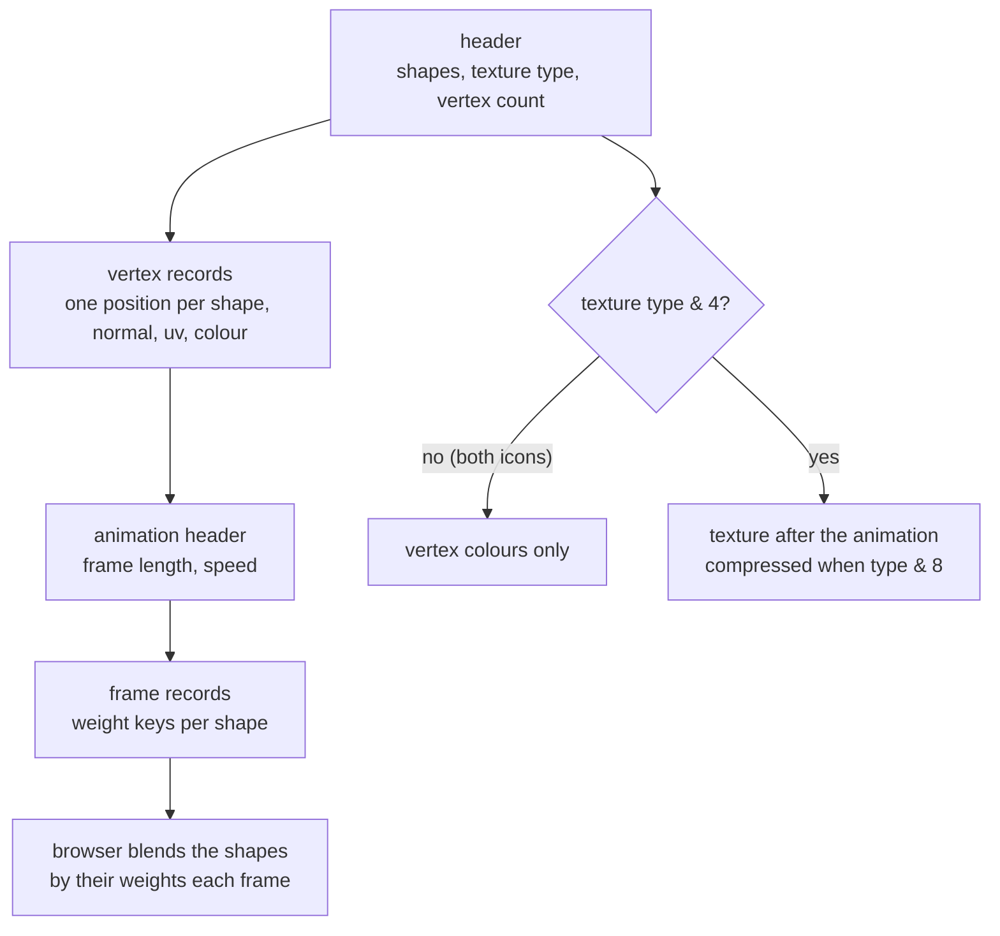

## 6. carddata.new, the memory card icon template

### 6.1 Layout

`data\carddata.new` is the template for every save folder. It holds the
`icon.sys` file and the 3D icon `xenosaga.ico` in the layout that the save
code writes. Its name has nothing to do with the Xeno Card minigame. The save
screen reads it into `FileCardDataBuf` when it opens in save mode
([Save data: the icon files](../architecture/save-data.md#the-icon-files)).

The file starts with a header of three words, padded with zeros to `0x40`.
The `start` and `end` words count from offset `0x40`, the start of `icon.sys`.

| Offset | Size | Field | Value |
| --- | --- | --- | --- |
| `0x00` | 4 | unknown | 8 |
| `0x04` | 4 | `start`, offset of the icon from `0x40` | `0x400` |
| `0x08` | 4 | `end`, end of the data from `0x40` | `0x11AC0` |
| `0x0C` | `0x34` | zero | |
| `0x40` | 964 | `icon.sys` | `PS2D` |
| `0x404` | `0x3C` | zero | |
| `0x440` | 71,320 | `xenosaga.ico` | `0x00010000` |
| `0x11AD8` | 40 | zero | |

The code knows this header as `McSaveHeader` in `src/main/xgl_mc.c` and as
`HddTransferInfo` and `HddSaveImage` in `src/main/xgl_hdd.c` and
`include/main/xgl_hdd.h`. None of them reads the first word.

### 6.2 icon.sys

The `icon.sys` part is the standard 964-byte description of a PS2 save
(`MC_ICON_SYS_SIZE`). The browser shows its title and uses its colours and
lights to draw the icon.

| Offset in `icon.sys` | File offset | Size | Field | Value |
| --- | --- | --- | --- | --- |
| `0x000` | `0x040` | 4 | identifier | `PS2D` |
| `0x004` | `0x044` | 2 | reserved | 0 |
| `0x006` | `0x046` | 2 | title line break, in bytes | 16 |
| `0x008` | `0x048` | 4 | reserved | 0 |
| `0x00C` | `0x04C` | 4 | background alpha | 64 |
| `0x010` | `0x050` | 4 × 16 | background colours of the four corners (RGBA words) | black, black, grey 128, grey 128 |
| `0x050` | `0x090` | 3 × 16 | light directions (float x, y, z, w) | (0.5, 0.5, 0.7071), 0, 0 |
| `0x080` | `0x0C0` | 3 × 16 | light colours (float r, g, b, a) | (0.8, 0.8, 0.8), 0, 0 |
| `0x0B0` | `0x0F0` | 16 | ambient light (float r, g, b, a) | (0.3, 0.3, 0.3) |
| `0x0C0` | `0x100` | 68 | title, Shift-JIS | `ＸｅｎｏｓａｇａＥＰＩＳＯＤＥ１−００` |
| `0x104` | `0x144` | 64 | icon file for the list | `xenosaga.ico` |
| `0x144` | `0x184` | 64 | icon file for copying | `xenosaga.ico` |
| `0x184` | `0x1C4` | 64 | icon file for deleting | `xenosaga.ico` |
| `0x1C4` | `0x204` | 512 | reserved | zero |

The title is written in full-width Shift-JIS characters of two bytes each.
The line break value 16 splits it after the eighth character, so the browser
shows "Ｘｅｎｏｓａｇａ" on the first line and "ＥＰＩＳＯＤＥ１−００" on the
second. The two digits at the end are the bytes `82 4F 82 4F` at `icon.sys`
offsets `0xE2` to `0xE5`.

```
offset  bytes                                            meaning
0040    50 53 32 44                                      "PS2D"
0044    00 00 10 00                                      reserved, line break at byte 16
0048    00 00 00 00 40 00 00 00                          reserved, background alpha 64
0050    00 00 00 00 00 00 00 00 00 00 00 00 00 00 00 00  corner colour 0: black
0070    80 00 00 00 80 00 00 00 80 00 00 00 00 00 00 00  corner colour 2: grey 128
0090    00 00 00 3F 00 00 00 3F F3 04 35 3F 00 00 00 00  light 0 direction (0.5, 0.5, 0.7071)
00C0    CD CC 4C 3F CD CC 4C 3F CD CC 4C 3F 00 00 00 00  light 0 colour 0.8
00F0    9A 99 99 3E 9A 99 99 3E 9A 99 99 3E 00 00 00 00  ambient 0.3
0100    82 77 82 85 82 8E 82 8F 82 93 82 81 82 87 82 81  "Ｘｅｎｏｓａｇａ"
0110    82 64 82 6F 82 68 82 72 82 6E 82 63 82 64 82 50  "ＥＰＩＳＯＤＥ１"
0120    81 7C 82 4F 82 4F 00 00                          "−００", bytes 0x123 and 0x125 are patched
0144    78 65 6E 6F 73 61 67 61 2E 69 63 6F 00 ...       "xenosaga.ico"
```

### 6.3 The icon

The icon at `0x440` uses the format of [section 5](#5-the-3d-icon-format).
It has 4 shapes and 1,482 vertices (494 triangles), no texture and an
animation cycle of 30 frames. Its positions range from -6,125 to 6,125 in x,
-19,736 to 0 in y and -10,240 to 10,240 in z. All y values are zero or
negative, so the model probably stands on the origin with its height along
negative y. The animation
section starts at icon offset 71,156, and the animation speed float sits at
icon offset 71,164, file offset `0x11A3C`. The icon ends at file offset
`0x11AD8`, followed by 40 zero bytes up to the `end` offset.

```
offset  bytes                                            meaning
0440    00 00 01 00 04 00 00 00 03 00 00 00 00 00 80 3F identifier, 4 shapes, type 3, 1.0
0450    CA 05 00 00                                      1,482 vertices
0454    F6 FF 59 D6 BD 03 00 04                          vertex 0, shape 0: (-10, -10663, 957, 1024)
...
11A30   FF FF FF 80                                      colour of the last vertex
11A34   01 00 00 00 1D 00 00 00                          animation 1, frame length 29
11A3C   00 00 80 3F                                      speed 1.0, replaced at random by the game
11A40   00 00 00 00 04 00 00 00                          play offset 0, 4 frame records
11A48   00 00 00 00 04 00 00 00                          shape 0, 4 keys
11A50   00 00 00 00 00 00 80 3F 00 00 F0 40 00 00 00 00  (0, 1.0), (7.5, 0) ...
```

### 6.4 How a save folder uses it

When the player creates a save, `MC_REQUEST_CREATE` runs `create_sub2` in
`src/main/xgl_mc.c` with the loaded template as its buffer. It writes the
964 bytes from `0x40` as `icon.sys` and then the icon from `0x440` as
`xenosaga.ico`. The steps are described in
[xgl: creating a save folder](../libraries/xgl.md#creating-a-save-folder).
Two values change on the way.

`xglMcWriteMapName(buffer, slot)` writes only two bytes into `icon.sys`. It
sets byte 229 to `'O' + (slot + 1) % 10` and byte 227 to
`'O' + (slot + 1) / 10 % 10`. These are the second bytes of the two
full-width digits `０` (`82 4F`), and adding the digit to `0x4F` turns them
into the full-width digits of the slot number plus one. A save in slot 0 is
therefore titled "Ｘｅｎｏｓａｇａ" over "ＥＰＩＳＯＤＥ１−０１". Despite its
name, the function does not write a map name. `xglMcSetMapName` builds a
Shift-JIS map name into `mapNameBuffer`, but no code reads that buffer.

Before the icon is written, the float at `payload + (shapes × 8 + 16) ×
vertices + 28` is set to `(xglFRand() - 1.5) × 0.6 + 1`, a random value from
0.7 to 1.3, because `xglFRand` returns a value from 1 to 2. Here `payload`
is the icon at `0x440`. `shapes × 8 + 16` is the
size of a vertex record, so the formula skips the 20-byte header, the vertex
records and 8 bytes of the animation header, and lands on the animation
speed. The source calls this float `checksum`, but it is the speed of the
icon animation. Each save folder therefore animates at its own speed.

The memory card path writes `end - start - 40` bytes of icon, 71,320 bytes,
which is exactly the icon without the 40 zero bytes. The HDD path
`xglHddMcCreate` in `src/main/xgl_hdd.c` uses the same buffer. It also calls
`xglMcWriteMapName`, but it writes `end - start` bytes (71,360, including
the 40 zero bytes) and does not change the animation speed. The HDD save path
is probably unreachable in the released game
([Save data: the icon files](../architecture/save-data.md#the-icon-files)).

The diagram below shows the two copies of the template.

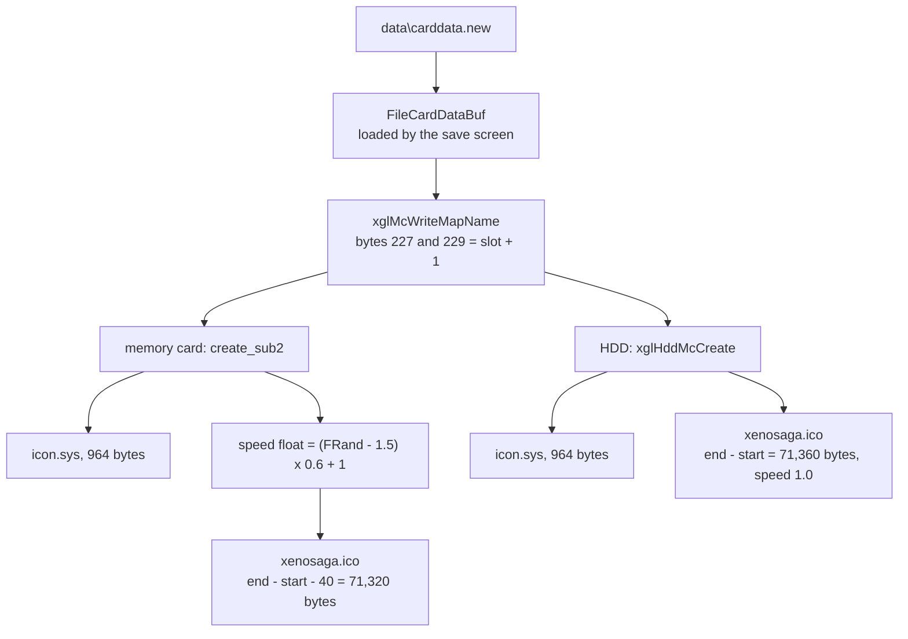

## 7. hdd.res, the hard disk icon

### 7.1 Layout

`data\hdd.res` is the header that the HDD install writes at the start of the
game's partition. The PS2's hard disk browser probably reads it to show the
installed game. It starts with the text `PS2ICON3D` and a table of four
(offset, size) pairs at `0x10`. All offsets count from the start of the file.

| Offset | Size | Field | Value |
| --- | --- | --- | --- |
| `0x00` | 9 | identifier | `PS2ICON3D` |
| `0x09` | 7 | zero | |
| `0x10` | 8 | `SYSTEM.CNF` text: offset, size | `0x200`, `0x50` |
| `0x18` | 8 | `icon.sys` text: offset, size | `0x400`, `0x21C` |
| `0x20` | 8 | 3D icon: offset, size | `0x800`, `0x118D8` |
| `0x28` | 8 | 3D icon: offset, size | `0x800`, `0x118D8` |
| `0x30` | | zero up to `0x200` | |
| `0x200` | 80 | `SYSTEM.CNF` text | `BOOT2 = cdrom0:\SLPS_290.02;1` and so on |
| `0x400` | 540 | `icon.sys` in text form | `PS2X` |
| `0x800` | 71,896 | 3D icon | `0x00010000` |
| `0x120D8` | 296 | zero up to the file size `0x12200` | |

The two icon entries point to the same data. They are probably the normal
icon and the icon shown while deleting, the same pair as in a memory card
`icon.sys`.

```
offset  bytes                                            meaning
0000    50 53 32 49 43 4F 4E 33 44 00 00 00 00 00 00 00  "PS2ICON3D", zero
0010    00 02 00 00 50 00 00 00                          SYSTEM.CNF at 0x200, 0x50 bytes
0018    00 04 00 00 1C 02 00 00                          icon.sys at 0x400, 0x21C bytes
0020    00 08 00 00 D8 18 01 00                          icon at 0x800, 0x118D8 bytes
0028    00 08 00 00 D8 18 01 00                          icon at 0x800, 0x118D8 bytes
0800    00 00 01 00 04 00 00 00 03 00 00 00 00 00 80 3F  icon: identifier, 4 shapes, type 3, 1.0
0810    D6 05 00 00                                      1,494 vertices
```

### 7.2 The SYSTEM.CNF copy

The `SYSTEM.CNF` text in the file is the boot configuration of the Japanese
release. It names the Japanese product code.

```
BOOT2 = cdrom0:\SLPS_290.02;1
VER = 1.00
VMODE = NTSC
HDDUNITPOWER = NICHDD
```

`xglHddInstall` replaces these 80 bytes before it writes the header. It copies
80 bytes of `system_cnf`, the copy of the disc's own `SYSTEM.CNF` that
`xglCdInitial` reads at start-up, over offset `0x200`
(`HddInstallImage.systemCnf`). The North American `SYSTEM.CNF` names
`SLUS_204.69`, has `VER = 1.0` and is 79 bytes long, so the 80th byte comes
from the zero-filled buffer. The installed header therefore boots the disc
that made the install. The partition name built by the HDD code also keeps
the Japanese product code, as described in [xgl: HDD](../libraries/xgl.md#hdd).

### 7.3 The text icon.sys

The HDD browser uses a text form of `icon.sys`, which starts with `PS2X` and
lists `key = value` lines in UTF-8. The file has this text, in Japanese,
with the English meaning added in the right column.

| Key | Value | English |
| --- | --- | --- |
| `title0` | ゼノサーガ　エピソード１ | Xenosaga Episode 1 |
| `title1` | アプリケーションデータ | application data |
| `bgcola` | 64 | background alpha |
| `bgcol0`, `bgcol1` | 0,0,0 | black upper corners |
| `bgcol2`, `bgcol3` | 128,128,128 | grey lower corners |
| `lightdir0` | 0.5, 0.5, 0.5 | light direction |
| `lightdir1`, `lightdir2` | 0.0, 0.0, 0.0 | unused lights |
| `lightcolamb` | 40, 40, 40 | ambient light |
| `lightcol0` | 96, 96, 96 | light colour |
| `lightcol1`, `lightcol2` | 0, 0, 0 | unused lights |
| `uninstallmes0` | ゼノサーガのアプリケーションデータを | Xenosaga's application data |
| `uninstallmes1` | 削除します。 | will be deleted. |
| `uninstallmes2` | セーブデータは削除されません。 | Save data is not deleted. |

The text is not localized in the North American release. The background and
light settings are the same as in the memory card `icon.sys`, written as
integers from 0 to 255 instead of floats, apart from the light direction.

### 7.4 How the install writes it

`xglHddInstall` reads `hdd.res` to `0x01000000` and copies the `SYSTEM.CNF`
bytes into it. It then computes the number of bytes to write as
`(word[0x28] + word[0x2C] + 511) & -512`. These two words,
`lastEntryOffset` and `lastEntrySize` in `struct HddInstallImage`
(`src/main/xgl_hdd.c`), are the offset and the size of the last table entry,
the second icon.
The sum `0x800 + 0x118D8` rounded up to 512 bytes is `0x12200`, exactly the
size of the file, so the whole file is written. The install writes it with
`sceWrite` into the partition right after creating it, before formatting the
file system. It probably lands in the partition's attribute area, the part
that the browser reads. The install steps are described in
[xgl: install](../libraries/xgl.md#install).

The icon at `0x800` has 4 shapes, 1,494 vertices (498 triangles), no texture
and an animation cycle of 40 frames. Its positions range from -7,825 to
7,660 in x, -18,184 to -1 in y and -7,893 to 10,032 in z. It is a different
model from the memory card icon.

The diagram below shows the install path of the file.

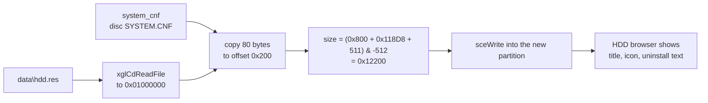

## 8. Save thumbnails

The picture shown for each save in the save and load screen is not stored on
the disc. `GameSnapShotSaveThumbnail` encodes it at run time with
`xglJpegEncode`, 128 × 112 pixels at quality 30, and the save stores it in
the save data. Only the three placeholders of
[section 4.1](#41-the-pictures) come from the disc. The thumbnails are
described in
[Save data: thumbnails and snapshots](../architecture/save-data.md#thumbnails-and-snapshots).

## 9. CASINO.res

`data\tanaka\CASINO.res` has the same extension but is unrelated to the icon
files. It belongs to the network casino minigame and is described in
[Minigame data](minigame-data.md).

## 10. Files and paths that nothing uses

These files are on the disc, but no code or script that was examined names
them.

| File | Notes |
| --- | --- |
| `data\monologo.jpg` | a still of the Monolith Soft logo with the full name "MONOLITHSOFT" on a dark lined background, stored next to the logo movies. The logo movie `logo_msi.ipu` shows the same emblem but ends on the letters "M.S.I.". No string in the executable or the overlays names the picture |
| `data\endou\otr_d.jpg` | a fourth save-screen placeholder beside `new_d`, `n_use` and `brk_d`, probably "other data" |
| 56 small movies | listed in [section 3.7](#37-which-small-movies-are-used), including the truncated `mvs0101.ipu` |

These paths are built by the code, but the disc has no such files.

| Path | Built by | Notes |
| --- | --- | --- |
| `data\movie\full\mvNNNN.ipu` | `Movie.start(int)` in `src/main/movie.c` | no event volume calls `start`. Seven volumes (`SCE01004`, `SCE010B01`, `SCE03005`, `SCE03021`, `SCE03024`, `SCE03032`, `SCE03039B`) only create `xeno.Movie` objects and use `init`, `update`, `alpha` and `transparent` |
| `data\simajiri\movie\NAME` | the movie command of the effect scripts, `src/main/sc_get.c` | played through OV01 `MMvPlay`, the folder does not exist |
| `data\movie\mpeg2\NAME.cap` | `GameMpeg2Play` | no caption file exists, the movies play without captions |

The strings `eventmovie/` and `movie00` to `movie19` in many event volumes are
not video files. No file or folder of those names exists, and they probably
name in-engine cutscene parts.

## 11. Open questions

- The first word of `carddata.new` (8) and the 40 zero bytes after its icon
  have no known use. The memory card path skips the 40 bytes, and the HDD
  path writes them.
- Word 0 of `hddi.bin` (`0x14`) is never read. It is either an offset into
  picture 0 or the number 20.
- The size word at offset 4 of an IPU file is never read by the player.
- The bytes `0x09` to `0x0F` of `hdd.res` are zero and their meaning is not
  known.
- Types 5 to 9 of the `libmpeg` sub-stream table have no names in the code.
  Their meaning is inferred from the DVD sub-stream numbers.
- The meaning of the 56 small movies that no script names, and of the five
  movies found only as Java constants, would need a check of the monitor
  units placed by each event.

## Source files

| File | Content |
| --- | --- |
| `src/main/xgl_1.c` | both movie players: `xglMovieOpen`, `xglMoviePlay`, `xglMovieMakeXtxHeader`, `xglMpeg2InfoInit2`, `xglMpeg2Open`, `xglMpeg2Play`, the audio and video callbacks, `XglMovieSourceHeader` |
| `src/main/game_movie.c` | `GameMpeg2Play`, the caption parser, `GameMovieInit`, `GameMovieMain`, `GameMoviePlay` |
| `src/main/res_get_path.c` | the scene commands `loadmovie`, `mpeg2`, `mpeg2_btl` and `mpeg2_nofade`, the movie path bases |
| `src/main/runtime.c` | `Runtime.mpeg2` and `Runtime.mpeg2AfterCrossFade` |
| `src/main/movie.c` | the `xeno.Movie` natives and the unused `data\movie\full\` path |
| `src/main/unit6003.c` | the monitor unit and its movie setup |
| `src/main/sc_get.c` | the effect script movie command |
| `src/ov01/m_mv.c`, `src/ov01/m_mv2.c` | the OV01 movie players |
| `src/ov01/battle_init.c` | the names of the battle movies |
| `src/ov02/logo.c` | `ipuplay` and the logo movie paths |
| `src/main/xgl_jpeg.c` | `xglJpegDecode` and its segment handlers |
| `src/ov02/title.c` | `title.jpg` |
| `src/ov02/title_hdd_install.c` | `hddi.bin` and the install pictures |
| `src/main/file.c` | `carddata.new` and the save-screen placeholders |
| `src/main/game_over.c` | the chapter, end and game over pictures |
| `src/main/tya_display_setting.c` | `mnt_set.jpg` |
| `src/main/xgl_mc.c` | `McSaveHeader`, `create_sub2`, `xglMcWriteMapName`, `xglMcSetMapName` |
| `src/main/xgl_hdd.c`, `include/main/xgl_hdd.h` | `hdd.res` install, `HddInstallImage`, `HddTransferInfo`, `HddSaveImage`, `xglHddMcCreate` |
| `config/symbols/main.txt`, `config/symbols/ov11.txt` | `_type2id` and the `libmpeg` table `_strmap` |
