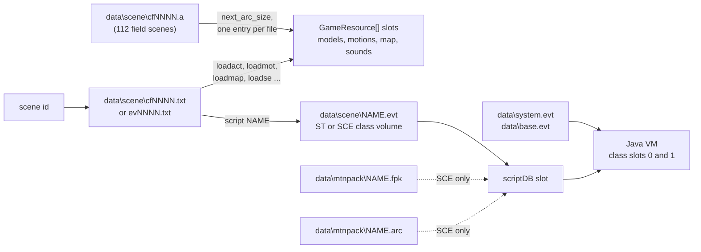
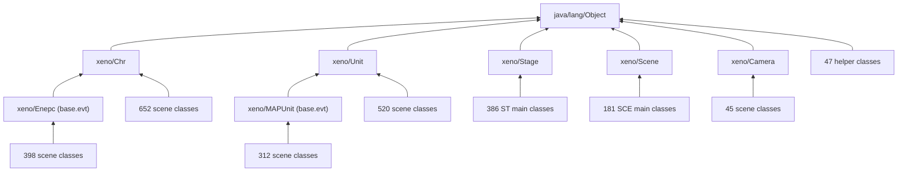
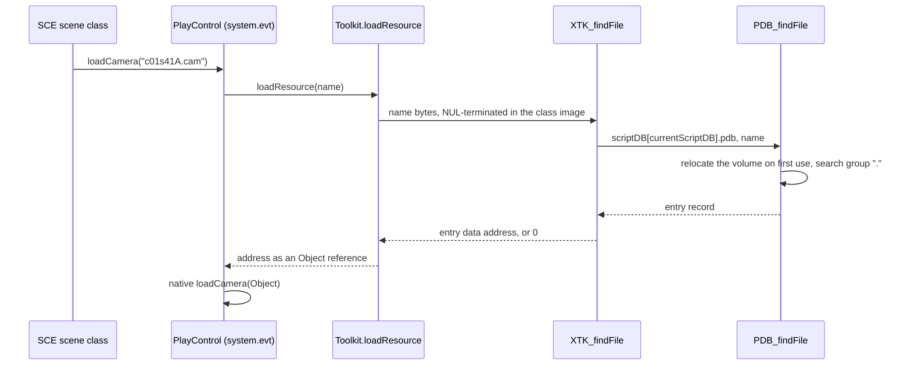
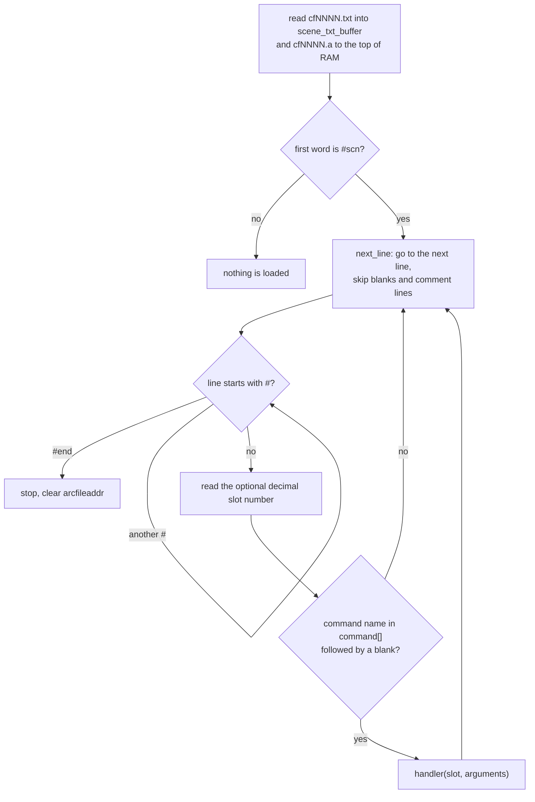
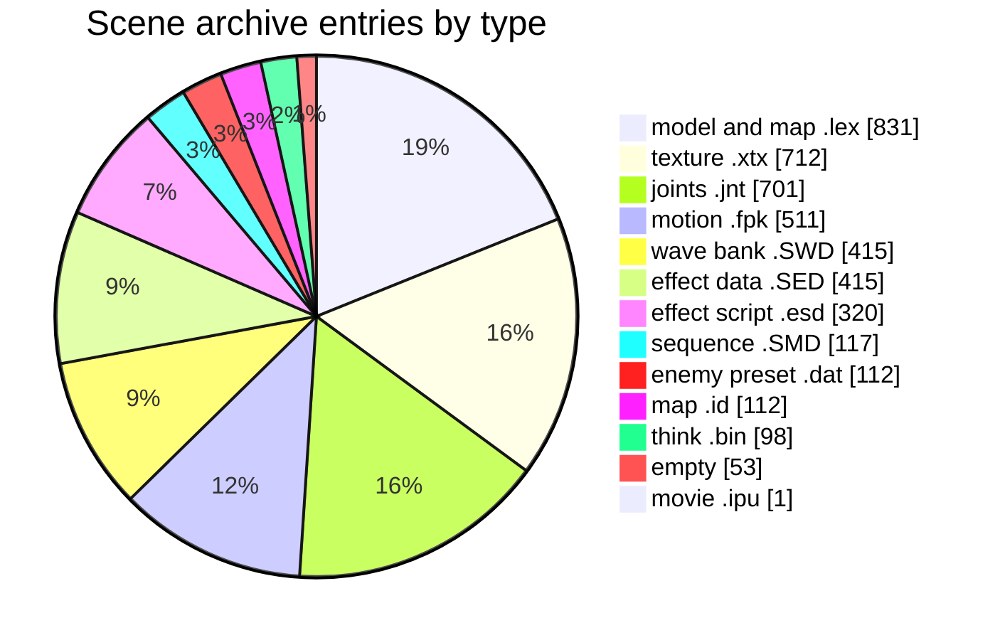
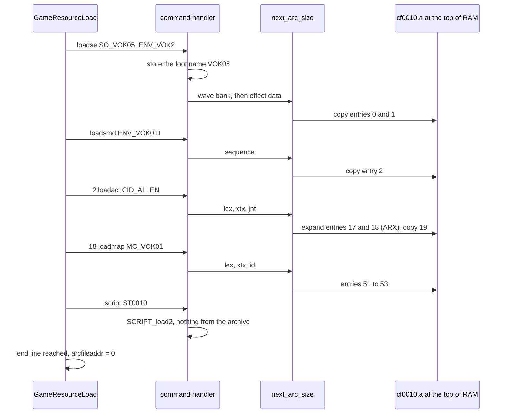

# Scripts and scene archives

Xenosaga Episode I runs its field scenes, events and cutscenes from four kinds
of file. A scene resource script (`cfNNNN.txt` or `evNNNN.txt`) is a short text
file that lists the models, motions, sounds, effects and map a scene needs and
names the Java script that runs the scene. A scene archive (`cfNNNN.a`) holds
copies of exactly those files in load order, so that a field scene loads with
one long DVD read instead of many seeks. The Java scripts are compiled Java
class files stored in FL00 volumes (`.evt`), a small read-only file system the
game also uses for a fourth kind of file: the resource volumes (`.arc`) that
carry the camera curves and motion packs of the story events.

All layouts below hold for every one of the 569 `.evt`, 77 `.arc`, 568 scene
`.txt` and 112 `.a` files of the North American disc, parsed and checked
field by field, and they follow the code that reads them. The behaviour of
the Java VM, of events and of the resource system is described on the pages
linked from each section.

[← Back to the overview](../README.md) · [Files and resources](../architecture/files-and-resources.md)

## Contents

- [How the files fit together](#how-the-files-fit-together)
- [PDB volumes](#pdb-volumes)
- [Java class files](#java-class-files)
- [The library volumes](#the-library-volumes)
- [Scene volumes](#scene-volumes)
- [Resource volumes (.arc)](#resource-volumes-arc)
- [Scene resource scripts (.txt)](#scene-resource-scripts-txt)
- [Scene archives (.a)](#scene-archives-a)
- [Leftovers and unused files](#leftovers-and-unused-files)
- [Unknowns](#unknowns)
- [Source files](#source-files)

## How the files fit together

A field scene starts when the game calls `GameResourceLoad(scene_id)` in
`src/main/res_get_path.c`. The scene id selects a resource script in
`data\scene\`: `cf` and four digits for a field scene, `ev` and four digits
for a cutscene (ids above `0x0FFFFFFF`). If a file with the same name and the
extension `.a` exists, the whole archive is read to the top of EE RAM first.
Each line of the script then loads one resource into a numbered slot of the
resource table `GameResource[]`, taking the bytes from the next archive entry
when an archive is open and from the named file otherwise. The last command,
`script`, names a Java volume in `data\scene\` (`STNNNN.evt` for a field stage,
`SCEnnnnn.evt` for a story event). `loadScriptCD2` in `src/main/script.c`
reads it into one of the two script slots together with the motion pack
`data\mtnpack\NAME.fpk` and the resource volume `data\mtnpack\NAME.arc` when
they exist.

The classes of a scene volume extend and call the library classes of
`data\system.evt` and `data\base.evt`, which `SCRIPT_init` loads once into
class slots 0 and 1. The resource system is described in
[Files and resources](../architecture/files-and-resources.md#the-field-resource-system),
the script slots in [Events and cutscenes](../scripting/events.md#script-files-and-script-databases)
and the VM in [The Java virtual machine](../scripting/java-vm.md).

| Format | Files | Archive group | Location | Packed on disc | Read by |
| --- | --- | --- | --- | --- | --- |
| Scene resource script `.txt` | 568 (387 `cf`, 181 `ev`) | 00 | `data\scene\` | no | `GameResourceLoad`, `GameResourcePreLoad` |
| Scene archive `.a` | 112 (all `cf`) | 00 | `data\scene\` | no (entries may be ARX streams) | `next_arc_size` |
| Class volume `.evt` | 569: 2 library, 386 `ST`, 181 `SCE` | 00 (library, `ST`), 10 and 20 (`SCE`) | `data\`, `data\scene\` | no | `JNI_loadClassDB`, `loadScriptCD2`, `findClass` |
| Resource volume `.arc` | 77 (44 in group 10, 33 in group 20) | 10, 20 | `data\mtnpack\` | ARX, all 77 | `loadScriptCD2`, `XTK_findFile` |

The diagram below shows which file leads to which during a scene load.



## PDB volumes

A PDB volume is a read-only file system packed into one buffer. The code
calls it a PDB (`src/main/pdb.c`) and its magic is `FL00`. It holds named
groups, which play the role of directories, and each group holds named
entries, which play the role of files. The `.evt` volumes hold Java class
files, one entry per class, with the package path as the group name. The
`.arc` volumes hold data files in a single group named `.`.

`PDB_getEntry(volume, &groups, &count)` returns the group table and checks the
magic. On its first call it turns every name and data offset of the volume
into an absolute pointer and writes 1 into the version field, so a volume is
relocated in place and only once. `PDB_findFile(volume, path)` splits the path
at its last `/` (a path without a slash uses the group `.`), finds the group
and then the entry, and returns the entry record. `JNI_searchClasses` and
`JNI_loadClassLibrary` in `src/main/jni.c` walk all entries of a class volume,
and `XTK_findFile` in `src/main/script.c` looks a name up in the resource
volume of the running script.

### Layout

A volume has three parts. A 12-byte header comes first, followed by the
record table. The table starts with the record of group 0, followed by the
records of its entries, then the record of group 1 and its entries, and so on.
The data of all entries follows the table directly, in record order. Each
data item starts on a 4-byte boundary, so 0 to 3 zero bytes may separate two
items. The name table comes last, also on a 4-byte boundary. It holds the
names as NUL-terminated strings in record order: the name of group 0, the
names of its entries, the name of group 1 and so on. The file ends right after
the last NUL, so its size is often not a multiple of 4 (422 of the 569 `.evt`
files and 63 of the 77 `.arc` files).

```
0x00        +---------------------------------------------+
            | header: "FL00", version, group_count, size  |  12 bytes
0x0C        +---------------------------------------------+
            | group 0 record                       8 bytes |
            |   entry record 0                    16 bytes |
            |   entry record 1                            |
            |   ...                                       |
            | group 1 record                              |
            |   entry records of group 1 ...              |
first data  +---------------------------------------------+
            | data of entry 0                             |
            | 0-3 zero bytes (next item 4-byte aligned)   |
            | data of entry 1 ...                         |
name table  +---------------------------------------------+  4-byte aligned
            | "java/lang\0" "Object.class\0" ...          |
            | names in record order, NUL-terminated       |
size        +---------------------------------------------+  end of file
```

### Header

All fields are little-endian.

| Offset | Size | Type | Field (`PDBHeader`) | Meaning | Values seen |
| --- | --- | --- | --- | --- | --- |
| `0x00` | 4 | char[4] | `magic` | `"FL00"`, `PDB_MAGIC` `0x30304C46` | all files |
| `0x04` | 2 | u16 | `version` | 0 on disc, `PDB_getEntry` writes 1 after relocation | 0 in all files |
| `0x06` | 2 | u16 | `group_count` | number of groups | 1 (all 567 scene volumes and all `.arc`), 2 (`base.evt`), 4 (`system.evt`) |
| `0x08` | 4 | u32 | `unmodeled_08` | total size of the volume in bytes | equals the file size in all 646 volumes |

`PDB_getEntry` never reads the size field, but the debug loader `loadScript`
does: it reads the first 12 bytes of an `.evt` file from the host file system
and then reads `size - 12` more bytes, so the field is the total size.

### Group and entry records

| Offset | Size | Type | Field (`PDBGroup`) | Meaning |
| --- | --- | --- | --- | --- |
| `0x00` | 4 | u32 | `name` | offset of the group name in the file, a pointer after relocation |
| `0x04` | 2 | u16 | `name_length` | length of the name without its NUL |
| `0x06` | 2 | u16 | `entry_count` | number of entry records that follow |

| Offset | Size | Type | Field (`PDBEntryRecord`) | Meaning | Values seen |
| --- | --- | --- | --- | --- | --- |
| `0x00` | 4 | u32 | `name` | offset of the entry name, a pointer after relocation | |
| `0x04` | 2 | u16 | `name_length` | length of the name without its NUL | |
| `0x06` | 2 | u16 | `unmodeled_06` | never read | 0 in all 3878 entries |
| `0x08` | 4 | u32 | `data` | offset of the entry data, a pointer after relocation | |
| `0x0C` | 4 | u32 | `data_length` | size of the data in bytes | |

### Lookup rules

`PDB_findFile` compares names with `strncmp(searched, stored, stored_length)`.
This is a prefix test: a stored name matches any searched name that starts
with it. The group test is made the same way, so a stored group `xeno` would
also match the directory `xeno/util`. The search does not stop at the first
group that matches, it moves on to the next group when no entry fits, so a
prefix hit on a group is harmless. No volume on the disc contains two names
where one is a prefix of another in a way that would give a wrong entry: a
lookup of every class and resource name the scripts use returns the same
entry as an exact search.

Inside each group of every `.evt` volume the entries are sorted by byte value
(`ST0010$Dummy.class` comes before `ST0010.class` because `$` is `0x24` and
`.` is `0x2E`). The groups themselves are not sorted (`system.evt` lists
`java/lang`, `xeno/util`, `xeno/vm` and then `xeno`). In the `.arc` volumes 46
groups are sorted, 1 is sorted without regard to case and 30 keep an
arbitrary order, probably the order in which the files were listed when the
volume was built. Nothing in the code depends on the order, since both
searches are linear.

### Example

The first 48 bytes of `data\system.evt` (31,766 bytes):

```
00000000: 464c 3030 0000 0400 167c 0000 8c7a 0000  FL00.....|...z..
00000010: 0900 0300 967a 0000 0c00 0000 dc01 0000  .....z..........
00000020: f300 0000 a37a 0000 0c00 0000 d002 0000  .....z..........

0x00  46 4c 30 30   magic "FL00"
0x04  00 00         version 0 (not yet relocated)
0x06  04 00         4 groups
0x08  16 7c 00 00   total size 0x7C16 = 31766
0x0C  group 0:  name 0x7A8C ("java/lang"), name_length 9, 3 entries
0x14  entry 0:  name 0x7A96 ("Object.class"), name_length 12, 0,
                data 0x1DC, data_length 0xF3 (243)
0x24  entry 1:  name 0x7AA3 ("String.class"), name_length 12, 0,
                data 0x2D0, data_length 0x82E (2094)
```

The record table of `system.evt` holds 4 groups and 27 entries, 12 + 4 x 8 +
27 x 16 = `0x1DC` bytes, so the first class starts at `0x1DC`. It ends at
`0x2CF`, and one zero byte aligns `String.class` to `0x2D0`. The last entry
(the 24-byte stub `XenoConstants.class`, see
[Empty stub classes](#empty-stub-classes)) ends at `0x7A8C`, where the name
table starts with `java/lang\0Object.class\0String.class\0`.

## Java class files

Every entry of an `.evt` volume is a standard Java class file of version
45.3, the format of the Java 1.0 and 1.1 compilers, in all 3211 entries (the
`InnerClasses` attributes point to a Java 1.1 compiler). A class file is
big-endian, unlike the PDB around it. It starts with the magic `0xCAFEBABE`,
the minor and major version, and the constant pool, a table of numbered
constants (names, numbers, strings and references to classes, fields and
methods) that the bytecode refers to by index. Then come the access flags,
the indices of the class and of its superclass, the interfaces, the fields,
the methods and the class attributes. Each method carries a `Code` attribute
with its bytecode. How `readClass` in `src/main/init_class_db.c` turns these
into VM records is described in
[Reading a class file](../scripting/java-vm.md#reading-a-class-file).

Of the 3211 entries, 2542 are real classes and 669 are 24-byte empty stubs.
The real classes hold 26,810 methods: 401 are native and the other 26,409
carry bytecode, 4,680,958 bytes in total.

### Constant pool

The constant pool uses only the eight kinds of constant below. There are no
`Long`, `Double` or `InterfaceMethodref` constants, which matches a VM that has
no 64-bit arithmetic and no interface method calls.

| Tag | Kind | Entries in all volumes |
| --- | --- | --- |
| 1 | `Utf8` (text) | 242,956 |
| 3 | `Integer` | 8,758 |
| 4 | `Float` | 58,556 |
| 7 | `Class` | 24,026 |
| 8 | `String` (a string literal, points to a `Utf8`) | 44,606 |
| 9 | `Fieldref` | 53,702 |
| 10 | `Methodref` | 51,759 |
| 12 | `NameAndType` | 100,191 |

The `Utf8` constants differ from standard Java in one point. A standard
`Utf8` constant stores its length and its bytes, without a terminator. In the
Xenosaga volumes 242,954 of the 242,956 `Utf8` constants end with a NUL byte
that is counted in the length. `readConstantPool` passes `length - 1` to
`loadConstString`, which keeps a pointer into the loaded class image instead
of copying the text, and `checkClass` in `src/main/jni.c` compares class names
with `memcmp(name, wanted, length - 1)`. The NUL makes every constant a C
string in place. The native `Toolkit.loadResource(String)` hands the string
bytes straight to `XTK_findFile`, which treats them as a C string, and
`Window.print(String)` passes the same bytes with their length to
`MSG_print2` without a copy. The tool that built the volumes probably
appended the NUL to every string when it converted the compiler output.

The two exceptions are empty string literals (`""`) with length 0, one in
`ST0210.evt` and one in `ST2230.evt`. For them `readConstantPool` passes
`-1`, and `loadConstString` treats a negative length as "measure with
`strlen`". The bytes after the empty constant are the next constant's tag and
length (`01 00 02 0A 00` in `ST0210.evt` at file offset `0xDDE`), so `strlen`
returns 1 and the literal probably becomes the one-character string `0x01`
instead of an empty string. Both literals are stored into a `String` array in
the class's `<init>` method. A literal stored the normal way, as a lone NUL
with length 1, would become a null string (length 0 makes `loadConstString`
return 0), but no class contains one.

10,389 `String` literals contain bytes above `0x7F`. All of them decode as
EUC-JP, the encoding the message system uses. The encoding, the text tags
and the escapes are described in [Text, fonts and U.M.N. data](text-and-fonts.md).

### Empty stub classes

669 entries are 24-byte class files with an empty constant pool. They stand
for interfaces that only declared constants (`static final` fields). A Java
compiler copies the value of such a constant into every class that uses it,
so the interface is no longer needed at run time, and the build tool probably
stripped it down to a header to save space. The stubs keep the access flags
`0x0601` (public, interface, abstract) and the class and superclass indices
of the original file, which now point into a constant pool that no longer
exists.

| Offset | Size | Value | Meaning |
| --- | --- | --- | --- |
| `0x00` | 4 | `CA FE BA BE` | class file magic |
| `0x04` | 2 | `00 03` | minor version 3 |
| `0x06` | 2 | `00 2D` | major version 45 |
| `0x08` | 2 | `00 00` | constant pool count 0 |
| `0x0A` | 2 | `06 01` | access flags: public, interface, abstract |
| `0x0C` | 2 | varies | this class index, left over from the original file |
| `0x0E` | 2 | varies | superclass index, left over |
| `0x10` | 2 | `00 00` | no interfaces |
| `0x12` | 2 | `00 00` | no fields |
| `0x14` | 2 | `00 00` | no methods |
| `0x16` | 2 | `00 00` | no attributes |

The stub `xeno/XenoConstants` at offset `0x7A74` of `data\system.evt`:

```
00007a74: cafe babe 0003 002d 0000 0601 0029 0028  .......-.....).(
00007a84: 0000 0000 0000 0000                      ........
```

The code copes with the stubs without a special case. `readConstantPool`
sets an empty pool when the count is 0. `checkClass` cannot find a class name
in an empty pool and returns 0, so `JNI_loadClassLibrary` skips the stubs and
`JNI_searchClasses` never takes one for a scene class. When a class lists a
stubbed interface, `processClass` in `src/main/find_native_method.c` loads it
as an empty class. It also accepts an interface that exists in no volume at
all (`getClass` returns 0 and the loop skips it), which happens 655 times:
the scene classes reference the interfaces `JNT_Human` (124 constants in 96
volumes) and `JNT_Accesories` (42 constants in 40 volumes) in the default
package, which exist only as `xeno/plan/JNT_Human` and
`xeno/plan/JNT_Accesories` stubs, and one interface per map,
`xeno/map/MC_<map>_PRJ` (489 constants in 463 volumes), which exists in no
volume.

| Stub | Volumes | What it stood for (from its name and its users) |
| --- | --- | --- |
| `xeno/XenoConstants` | `system.evt` | engine constants, implemented by 584 classes |
| 24 `xeno/plan/*` stubs | `base.evt` | game constants: `CfConstants` (387 implementers), `EventConstants` (197), `ChrNo`, `EneNo`, `FlagNo`, `MapNo`, `MtnNo`, `SceneNo`, `PartyData` and others |
| `Xbufnum` | 180 SCE volumes | resource slot numbers |
| `FLS<character>` (`FLSallen`, `FLSshion_h` ...) | 72 SCE volumes | motion numbers of the scene's motion pack, see [the leftover Java sources](#resource-volumes-arc) |
| `Pack<number>` | a few SCE volumes | motion pack constants, probably |

### Attributes and debug data

The classes carry six attribute types. The VM reads two of them, `Code` and
`ConstantValue`. `readAttributes` skips the others by their length, so they
are compiler debug data that ships on the disc unused.

| Attribute | Attached to | Count | Bytes | Read by the VM |
| --- | --- | --- | --- | --- |
| `Code` | method | 26,409 | 4,680,958 of bytecode | yes, `addCode` |
| `LineNumberTable` | `Code` | 26,409 | 2,733,400 | no |
| `ConstantValue` | field | 3,027 | 24,216 | yes, `setFieldValue` |
| `Synthetic` | field | 1,928 | 11,568 | no |
| `SourceFile` | class | 2,542 | 20,336 | no |
| `InnerClasses` | class | 2,439 | 50,360 | no |

Every `Code` attribute has an empty exception table, and there are no
`Exceptions` or `LocalVariableTable` attributes. The line number tables alone
take 2.7 MB, 19 percent of all `.evt` bytes.

The `SourceFile` attribute names the Java source file of each class, and it
shows how many scene scripts were made. In 158 scene volumes the classes
carry a name different from the volume, and in every one of them the source
file is named after the volume: `ST0239.evt` holds the class `ST0231`
compiled from `ST0239.java`. The variant scripts were therefore made by
copying a source file and leaving the class name as it was. Sixteen SCE
volumes also contain the classes `STool` and `STool$Lightwork`, compiled from
a shared `STool.java`, a helper class of 158 methods (camera history, fades,
absolute values and others).

### Bytecode

The scripts use 116 of the instruction opcodes. The most frequent are
`aload_0` (395,726), `getfield` (311,669), `ldc` (190,942) and
`invokevirtual` (178,331), which reflects code that mostly reads fields of
the scene object and calls natives. No script uses `wide`, `jsr`, `ret`,
`goto_w`, `jsr_w`, `invokeinterface`, `swap` or `pop2`. The largest method is
`SCE03021.__set_position` in `SCE03021.evt` with 15,056 bytes of bytecode,
below the 65,535 that `addCode` can store in its 16-bit `codeLength`. The
largest values elsewhere are `max_stack` 14 (`ST0810.init`), `max_locals` 41
(`SCE03004.CameraThread` in `SCE03006C.evt`), 166 methods in one class
(`SCE02030`), and 499 fields and 3,582 constants in one class (`ST2110`).

Three opcodes appear in the scripts but have no case in the interpreter of
`src/main/init_vm.c`: `f2d`, `dconst_1` and `dcmpl`. They occur once each, in
the method `idle` of the class `ST1480$Mapunits`, which exists in
`ST1480.evt` and its copy `ST1489.evt`:

```
224  17 05      fload 5
226  8d         f2d
227  0f         dconst_1
228  97         dcmpl
229  9b 00 28   iflt +40      (Java: if (value >= 1.0) { ... })
```

The source compared a float with the double literal `1.0`. The interpreter
fetches each opcode with `pc = frame->pc++` and a switch without a default
case, so an unknown one-byte opcode is skipped. The three instructions are
1 byte each, the stack stays balanced, and `iflt` tests the bit pattern of
the float as an integer. It jumps only when the sign bit is set, so the game
probably runs the guarded code whenever the value is not negative instead of
when it is at least 1.0.

### Native methods

The library classes of `system.evt` declare 401 native methods (`Chr` 99,
`Unit` 70, `Runtime` 68, `Camera` 39, `Effect` 20, `Stage` 17, `Window` 13,
`PlayControl` 12, `Menu` 8, `Format` 7, `Sound` 7, `Light` 6, `Toolkit` 6,
`System` 6, and 2 to 4 for the others). `resolveNativeMethod` builds a name
from each declaration (described in
[Native methods](../scripting/java-vm.md#native-methods)) and looks it up in
the 401-row table `default_native[]` of `src/main/runtime.c`.

| Result | Count | Methods |
| --- | --- | --- |
| Found | 397 | |
| Found through the second, `_` for `[`, name form | 1 | `Stage.setCFBG(II[F)V` |
| Declared but not in the table | 3 | `Chr.invalidate()V`, `Chr.validate()V`, `vm.System.exit(I)V` |
| In the table but declared nowhere | 3 | `Chr.rotCNS(int, Object)`, `Unit.move(Object, float, boolean)`, `Toolkit.call(Object, String)` |

The three missing natives would leave a null function pointer, but no script
references them, so the game never calls one. Every one of the 51,759 method
references and 53,702 field references of all volumes resolves through the
class hierarchy (system, base and the scene volume). The scripts reach 286
different natives. The other 115 table entries are never called by any
script on the disc, among them `Runtime.addGold`, `Runtime.execBattle`,
`Runtime.minigameExec`, `Movie.start`, `Movie.stop`, `Sound.sequencePlay`,
`Window.closeWaitKey` and most of the `rotX`/`rotZ`/`sclX` variants of `Chr`
and `Unit`.

### Dialogue and other strings

The story text lives in the `String` constants of the scene classes. Each
literal is a `String` constant pointing to a `Utf8` constant that holds the
bytes and the trailing NUL. The 567 scene volumes hold 44,603 `String`
constants with 1,156,151 bytes of text, 12,223 different strings once
duplicates across volumes are removed (500,655 bytes). A scene class usually
builds each speech as a `String[]` field in its `<init>` method and passes the
array to `Window.print` later. This part of `<init>` in `ST0010.evt` builds
the field `msg0013`:

```
375  2a        aload_0
376  06        iconst_3
377  bd 0106   anewarray java/lang/String          new String[3]
380  59 03     dup, iconst_0
382  12 60     ldc #96   "/[label(John Bell)]"
384  53        aastore
385  59 04     dup, iconst_1
387  12 7a     ldc #122  "Chief, I understand you have your reasons, ..."
389  53        aastore
390  59 05     dup, iconst_2
392  12 67     ldc #103  "/[waitkey(64)]/[close()]"
394  53        aastore
395  b5 0178   putfield msg0013
```

The method `Talk_npc4_1` then calls `Window.print(msg0013, 0)` and
`waitPage(window, 64)`. The constant `#832` that `#96` points to sits at file
offset `0x20B6`:

```
000020b6: 0100 142f 5b6c 6162 656c 284a 6f68 6e20  .../[label(John
000020c6: 4265 6c6c 295d 00                        Bell)].

0x20B6  01        tag Utf8
0x20B7  00 14     length 20: 19 characters and the NUL
0x20B9  "/[label(John Bell)]" 00
```

Where the loaded strings go shows what they are. Of the literals loaded by
`ldc` and `ldc_w` in the scene volumes, 24,031 go to `System.println` (debug
output, which prints nothing in the retail game), 18,036 are stored into
string arrays (mostly speeches for `Window.print`), 9,128 go to
`Menu.addItem`, 1,555 straight to `Window.print`, 1,016 to `Chr.talkto` and
417 to `Menu.addQuery`. The text tags inside the strings (`/[label(...)]`,
`/[waitkey(n)]` and others) and their counts are described in
[Text, fonts and U.M.N. data](text-and-fonts.md).

## The library volumes

`SCRIPT_init` reads `data\system.evt` and `data\base.evt` into two buffers of
`0x8000` bytes each (`SCRIPT_EVT_FILE_BUFFER_SIZE`) and registers them as
class slots 0 and 1. `system.evt` is 31,766 bytes, 1,002 bytes short of its
buffer, and `base.evt` is 15,485 bytes.

| Volume | Group | Entries |
| --- | --- | --- |
| `system.evt` | `java/lang` | `Object`, `String`, `StringBuffer` |
| | `xeno/util` | `Format`, `Input`, `Layout`, `Menu`, `Runtime`, `Spline`, `TCHParams`, `Toolkit`, `Vector4f`, `Window` |
| | `xeno/vm` | `Math`, `System`, `Thread` |
| | `xeno` | `Camera`, `Chr`, `Effect`, `Light`, `Movie`, `PlayControl`, `Scene`, `Sound`, `Stage`, `Unit`, and the stub `XenoConstants` |
| `base.evt` | `xeno/plan` | `Base` (the only real class) and 24 stubs: `CfConstants`, `CfMtnNo`, `ChrNo`, `EneNo`, `EventConstants`, `F_Fuji`, `F_Gash`, `F_Koji`, `F_Kojima`, `F_Konishi`, `F_Nakahara`, `F_Sakisako`, `F_Yone`, `FlagNo`, `JNT_Accesories`, `JNT_Human`, `JumpNoCF`, `MapNo`, `MtnNo`, `Particle`, `PartyData`, `SEvent`, `SceneNo`, `UwaNo` |
| | `xeno` | `Enepc`, `MAPUnit`, `Monitor`, `Uwamono` |

The `F_<name>` stubs are named after staff members, the same names as the
per-developer scene folders of the debug menu. They were probably constant
interfaces in which each event designer kept his own numbers, and like the
other `xeno/plan` stubs they no longer contain anything.

All library classes extend `java/lang/Object` directly except four in
`base.evt`: `Enepc` extends `Chr`, and `MAPUnit`, `Monitor` and `Uwamono`
extend `Unit`. `Chr` and `Unit` are separate classes, neither extends the
other. The scene classes extend the library classes as shown below, with the
number of scene classes of each kind.



## Scene volumes

The 567 scene volumes sit in `data\scene\` and each holds one group `.`.

| Kind | Files | Group | Total size | Main class extends | Run by |
| --- | --- | --- | --- | --- | --- |
| `STNNNN.evt`, field stages | 386 (`ST0010` to `ST3170`, `ST9001` to `ST9055`) | 00 | 5.84 MB | `xeno/Stage` | `cfNNNN.txt` |
| `SCEnnnnn.evt`, story events | 181 | 10 (92), 20 (89) | 8.55 MB | `xeno/Scene` | `evNNNN.txt` |

Group 10 holds `SCE01001` to `SCE01045`, `SCE010B00` to `SCE010B02`,
`SCE02000` to `SCE02043` and `SCE02047` (92 files). Group 20 holds
`SCE010OP`, `SCE02044A` to `SCE02046`, `SCE02048` to `SCE02064` and
`SCE03000` to `SCE03058D` (89 files). The split follows the disc layout
rather than the event numbers. Letters after the number mark
variants of one event (`SCE03003D`), and the last digit of an `ST` number
usually marks a variant of one stage (`ST0230`, `ST0231` and `ST0239`). The smallest volume is
2,111 bytes (`SCE010OP.evt`) and the largest 171,810 bytes (`SCE03003D.evt`),
which is below the `0x2D000` (184,320) bytes of a script slot's class image
(`SCRIPT_CLASS_IMAGE_SIZE`).

Each volume contains exactly one subclass of `xeno/Scene` or `xeno/Stage`,
the main class that `JNI_searchClasses(image, "xeno/Scene:xeno/Stage", 2, ...)`
finds. The other classes of a volume are its inner classes
(`ST0010$Player`, `ST0010$NPC_NORMAL` ...) and the stubs. In 158 volumes the
main class is not named after the file:

| Main class | Volumes | Note |
| --- | --- | --- |
| `SCEDummy` | 72 | placeholder scene, see below |
| `JumpBattle` | 17 | `ST90xx` stages that start battles |
| another `ST` number | 68 | stage variants, `ST0239.evt` holds `ST0231` |
| `SCE03004` | 1 | `SCE03006C.evt` |

`SCEDummy` is a 2.2 KB placeholder scene. Its strings name the event it
stands for, in EUC-JP full-width text (`ＳＣＥ０１００５：仮のものです`, "SCE01005:
this is a temporary one") and in ASCII (`XEVEFLAG:EV01005_F`,
`XEVEJNAME:SCE01006`). It calls `Runtime.setFlags` and `Runtime.jumpEvent`.
All 72 `SCEDummy` volumes are started by `ev` scripts that first play an
MPEG-2 movie, so the placeholder probably only sets the event's flag and
jumps on to the next event once the pre-rendered movie has played.

## Resource volumes (.arc)

The 77 files `data\mtnpack\SCEnnnnn.arc` are PDB volumes with one group `.`
that hold data files instead of classes. Every one of them belongs to an SCE
event and comes with a motion pack `data\mtnpack\SCEnnnnn.fpk` of the same
name. The disc has 107 such motion packs, so 30 events have a motion pack
without a resource volume and 74 events have neither. No `ST` stage has
either file. All 77 volumes are ARX-packed on the disc (16.9 MB stored,
26.0 MB unpacked, 902 to 1,003,121 bytes each when unpacked). The file library expands
them while reading, see
[Packed files (ARX)](../architecture/files-and-resources.md#packed-files-arx).

`loadScriptCD2` loads the volume into a resource slot with
`RES_loadFile(RES_LOAD_ANY_BLOCK, RES_TYPE_FILE, "mtnpack\NAME.arc", 0)`,
which reads the file directly and never takes it from a scene archive. The
scripts fetch one file at a time by name with `Toolkit.loadResource(String)`.
The native calls `XTK_findFile(name)`, which calls `PDB_findFile` on the
resource volume of the current script and returns the address of the entry's
data, or 0. The camera curves and time charts go through two Java wrappers in
`system.evt`, `PlayControl.loadCamera(String)` and
`PlayControl.loadTimeChart(String)`, which call `Toolkit.loadResource` and
pass the result to the natives `loadCamera(Object)` and
`loadTimeChart(Object)` described in
[Native methods](../scripting/natives.md). The sequence below shows a scene
loading one camera curve.



The 77 volumes hold 667 entries of four types:

| Extension | Entries | Content |
| --- | --- | --- |
| `.fpk` | 338 | motion packs (`FPK`, format 3 in 334 and format 2 in 4), mostly named `FLS<character>.fpk`, see [Animation](../libraries/animation.md) |
| `.cam` | 307 | camera curves, described below |
| `.java` | 21 | Java source files, a build leftover |
| `.tch` | 1 | `c01s42.tch` in `SCE01042.arc`, a 32-byte time chart that holds only a header (`TCH\0`, then mostly zero bytes) |

The `.java` entries are the sources of the motion number interfaces that the
class volumes carry as stubs. For example `FLSallen.java` in `SCE03021.arc`
begins:

```
public interface FLSallen
{
	final static int FLSallenF011         = 1;
	final static int FLSallenF012         = 2;
	final static int FLSallenF021         = 3;
	...
```

They appear in four volumes: `SCE03021.arc` (5 files), `SCE03024.arc` (8),
`SCE03031A.arc` (5) and `SCE03032.arc` (3). The build tool probably packed
every file of the event's folder, and the sources happened to lie next to the
motion packs. No script names them.

### Camera curves (.cam)

A `.cam` file is an FCV2 curve file with the signature `CAM\0` and eight
curve channels. `PLAY_SOURCE_FORMAT_MAC` (`0x004D4143`) in
`src/main/play.h` is that signature read as a little-endian word, and the
time chart player calls `TCAMERA_transMPack2(camera, source, time)` in
`src/main/tcamera.c` for it. The function resets an FCV2 pack reader on the
file (`FCV2_resetPack`) and reads the eight channels in order with
`FCV2_getPackValue`: the camera position, the point it looks at, the roll and
the field of view. It derives the yaw and pitch from the two points. The
general FCV2 curve format is described in
[Animation](../libraries/animation.md).

| Offset | Size | Type | Field (`FCV2CurveData`) | Meaning | Values seen |
| --- | --- | --- | --- | --- | --- |
| `0x00` | 4 | char[4] | `common.signature` | `"CAM\0"` | all 307 |
| `0x04` | 2 | u16 | `format` | curve format | 1 in all |
| `0x06` | 2 | u16 | `frame_count` | read only for format 2 and above | two ASCII characters: `O_` (240 files), `am` (22), `OS` (11), `03` (11), `as` (9) ... |
| `0x08` | 2 | u16 | `first_frame` | first frame of the clip | 0 in all |
| `0x0A` | 2 | u16 | `last_frame` | last frame of the clip | 15 to 4953 |
| `0x0C` | 2 | s16 | `frame_offset` | read only for format 2 and above | leftover characters |
| `0x0E` | 2 | | (padding) | aligns the channels to 4 bytes | leftover characters |
| `0x10` | | | channels | eight FCV2 channel streams, back to back | |

The bytes at `0x0C`–`0x0F` read `AL_2` in 226 files, `ion0` in 22, `AL_3` in
12, `ROOM` in 11 and other text in the rest. Together with the two characters
at `0x06` they are probably pieces of a text string that was in the
converter's output buffer before it wrote the header. Format 1 never reads
these fields.

Each channel starts with a 4-byte header, a u16 key count and a u16 type
whose low 4 bits select the kind of channel. The key times are 16-bit
fractions of the clip: the reader multiplies them by
`(last_frame - first_frame) / 65535` and by `1/30`, so `0xFFFF` is the last
frame.

| Channel type | Meaning | Size |
| --- | --- | --- |
| 0 | no data, the value is 0.0 | 4 bytes |
| 1 | constant: one f32 after the header | 8 bytes |
| 3 | key list: `key_count` keys after the header | 4 bytes plus the keys |

| Key type | Layout | Size | Keys seen |
| --- | --- | --- | --- |
| 0, 2, 3 | u16 type, u16 time, f32 value | 8 bytes | type 2: 1,948, type 0: 899 |
| 4 | type, time, value and one tangent used on both sides | 12 bytes | 865 |
| 1 | type, time, value, in tangent and out tangent, as in the [motion key types](skeletons-and-motion.md#key-types) | 16 bytes | 2 |

| Channel | Field set by `TCAMERA_transMPack2` | Type 0 / 1 / 3 in the 307 files |
| --- | --- | --- |
| 0, 1, 2 | camera position x, y, z | mostly constant (211–238), keyed in 69–85 |
| 3, 4, 5 | look-at point x, y, z | mostly constant, keyed in 68–83 |
| 6 | roll | no data in 287, constant 14, keyed 6 |
| 7 | field of view | constant 281, keyed 26 |

Walking the eight channels this way ends exactly at the end of each of the
307 files. The files are 68 to 4,864 bytes long, with 2 to 87 keys per keyed
channel. This is `c01s41A.cam` in `SCE01041.arc` (264 bytes):

```
0000: 43 41 4d 00 01 00 55 54 00 00 1c 02 00 09 01 cd
0010: 04 00 03 00 00 00 3c 00 cf fd 65 bf 00 00 c6 71
0020: 0e 95 0c c0 00 00 40 72 7d 0f d9 c0 00 00 ff ff
0030: 7d 0f d9 c0 04 00 03 00 00 00 3c 00 a1 33 01 3f

0x00  "CAM\0"            signature
0x04  01 00              format 1
0x06  55 54              "UT", unused frame_count
0x08  00 00              first_frame 0
0x0A  1c 02              last_frame 540
0x0C  00 09 01 cd        unused frame_offset and padding
0x10  04 00 03 00        channel 0 (position x): 4 keys, type 3
0x14  00 00 3c 00 ...    key: type 0, time 0x003C, value -0.898
0x1C  00 00 c6 71 ...    key: type 0, time 0x71C6, value -2.197
0x24  00 00 40 72 ...    key: type 0, time 0x7240, value -6.783
0x2C  00 00 ff ff ...    key: type 0, time 0xFFFF (end), value -6.783
0x34  04 00 03 00        channel 1 (position y): 4 keys, type 3 ...
```

### Use of the entries

The scripts name their resources with string literals (`"c01s41A.cam"`,
`"FLSallen.fpk"`). Comparing every entry with the literals of its own
script shows that 553 of the 667 entries are named and 114 are not: 65
`.cam`, 27 `.fpk`, the 21 `.java` sources and the `.tch`. Two volumes are
unused as a whole: `SCE02004D.arc` holds only `inu_cam.cam` and
`SCE02040A.arc` holds only `face.fpk`, and neither script names them. In the
other direction four SCE volumes (`SCE01043`, `SCE02039`, `SCE02043`,
`SCE02062`) call `Toolkit.loadResource(String)` but have no `.arc`. For them
`loadScriptCD2` gets an empty resource slot and the lookup probably returns 0.

## Scene resource scripts (.txt)

The 568 scene resource scripts sit in `data\scene\` in archive group 00. The
387 field scripts are `cf0010.txt` to `cf9999.txt` and the 181 cutscene
scripts `ev1000.txt` to `ev3583.txt`. `RES_getScenePath` builds the name: the
current scene directory (`data\scene\` unless the debug menu changed
`ScenePath`), `cf` for ids up to `0x0FFFFFFF` and `ev` above, the low four
decimal digits of the id and `.txt`. The other 19 directories of the table
(`data\scene\test\`, `data\scene\check\`, `data\scene\cf\`,
`data\scene\event\` and one per staff member such as `data\scene\kojima\`)
do not exist on the disc.

The files are plain text with CRLF line ends, 167 to 2,030 bytes long
(326,005 bytes in all). `GameResourceLoad` reads a script into
`scene_txt_buffer`, a union of a `u32` signature and `0x800` bytes of text.
The buffer is filled with `0xCDCDCDCD` before the read, and the script runs
only when its first word is `#scn` (`SCENE_TXT_SIGNATURE`, `0x6E637323`).
There is no length check, so a script must fit the 2,048 bytes. The largest,
`cf0160.txt`, leaves 18 bytes free. The comments are Japanese text in
Shift-JIS, unlike the EUC-JP of the class files (see
[Text, fonts and U.M.N. data](text-and-fonts.md)).

### Grammar

A script is a list of lines. The first line is `#scn` in all files and is
skipped. After each line, `next_line` moves to the end of the line, skips all
spaces, tabs and line ends, and skips every line that then starts with `;`.
So a comment needs `;` as its first non-blank character, and blank lines are
free. A line is:

```
[slot] command [arguments]
```

- `slot` is an optional decimal number, the resource slot the command loads
  into. Without one it is 0. The commands that do not load into a slot
  (`reset`, `script`, the sound and movie commands) are written without it.
- `command` must match a name of the table `command[24]` exactly and be
  followed by a space, tab or line end. A line whose command matches nothing
  is skipped silently.
- `arguments` are read by the command's handler, which receives the slot
  number and a pointer to the text after the blanks. Most handlers stop at
  the first blank, so a `;` comment after a blank at the end of the line is
  ignored. `loadse` and `loadsmd` are the exceptions: they read further
  fields up to the line end, so text after their arguments would be taken as
  one more sound name.
- `#end` ends the script. A line that starts with `#` but is not `#end` makes
  the loop `continue` without moving the cursor, so the game would hang. No
  file has one.

Anything after `#end` is never read. 446 of the 568 files have text there,
mostly an author block in Japanese with the headings `【作成者】` (author) and
`【更新履歴欄】` (change history), names (米坂, 中原, 冨士 and others) and dated
notes such as `6/5 MID_102追加` ("added MID_102"), and in some files old
command lines kept for reference.

The flowchart below shows the loop of `GameResourceLoad`.



### Commands

All 23 commands of the table are used by at least two files. The counts
below are lines and files across all 568 scripts. The last column gives the
number of scene archive entries the command takes while an archive is open,
which the [scene archives](#scene-archives-a) section relies on. The
behaviour of each command is summarised in
[Files and resources](../architecture/files-and-resources.md#scene-resource-scripts).

| Command | Lines | Files | Arguments seen | What it loads | Archive entries |
| --- | --- | --- | --- | --- | --- |
| `reset` | 568 | 568 | `0` in all, always the first line | frees slot 0 and all later slots | 0 |
| `loadse` | 363 | 363 | `SO_<foot>, <env>` 277, `SO_<foot>, <env>-` 85, one with an empty third field | stores the foot-step name for `player`, loads `data\sound\sed\<env>.SWD` and `.SED` | 2 (3 with a sequence, never used) |
| `loadsmd` | 362 | 362 | one name 356, two names 6, all but 6 names end in `+` | `data\sound\smd\<name>.SMD`, one per sequence slot | 1 per name |
| `npcse` | 609 | 236 | `CID_<key>, NPC_M` or `NPC_F`, a number | NPC sound bank `.SWD` and `.SED` | 2 |
| `enese` | 126 | 92 | `EID_<key>, <bank>` | enemy sound bank `.SWD` and `.SED` | 2 |
| `player` | 384 | 384 | slot 0 | party leader model and foot-step bank, from the loose files | 0 |
| `dummy` | 384 | 384 | slot 1 | reserves an empty slot | 0 |
| `loadact` | 2,282 | 444 | model key | model `.lex`, `.xtx`, `.jnt` | 3, 2 or 1 |
| `loadface` | 962 | 241 | model key | face model `<name>_face.lex` and `.jnt` | 2 |
| `loadmot` | 1,121 | 302 | motion name, the foot-step number is never given | `data\motion\<name>.fpk` | 1 |
| `loadmap` | 516 | 487 | `MC_<map>`, the `-` prefix is never used | map `.lex`, `.xtx`, `.id` and its think file | 3 or 4 |
| `loadtex` | 99 | 58 | four digits | `data\texture\fmNNNN.xtx` | 1 |
| `loadmovie` | 112 | 42 | four digits | `data\movie\small\mvsNNNN.ipu` | 1 |
| `loadeffect` | 901 | 286 | effect name | effect script (`.esd`) | 1 |
| `loadene` | 365 | 365 | preset name | enemy preset (`data\matumoto\<name>.dat`) | 1 |
| `script` | 568 | 568 | volume name, always the last command | `data\scene\<name>.evt` | 0 |
| `mpeg2` | 61 | 60 | movie name | `data\movie\mpeg2\<name>.pss` | 0 |
| `mpeg2_btl` | 10 | 10 | movie name | movie that leads into a battle | 0 |
| `mpeg2_nofade` | 2 | 2 | movie name | movie without a fade | 0 |
| `event_btl` | 6 | 6 | none | event battle | 0 |
| `player_lock` | 4 | 4 | none | player lock flag | 0 |
| `save` | 4 | 4 | `0` to `3` (`ev2000`, `ev3000`, `ev1410`, `ev2310`) | chapter picture and save offer | 0 |
| `disk` | 2 | 2 | `2` (`ev2000`), `3` (`ev3000`) | `GameDiskChange(n)` | 0 |

A model takes up to three entries in the order `.lex`, `.xtx`, `.jnt`. An
empty `.lex` entry stops the model there, a face model has no `.xtx`, and an
empty `.xtx` or `.jnt` entry only means the file is absent. `loadmap` takes a
fourth entry, the enemy think file `data\yamamoto\think\*.bin`, when
`dataThinkNameGet` (`func_A1CF18`, in `src/ov01/data_unit_org_get.c`) finds
one for the map. 98 of the 112 archived maps have one. `player` takes no
entry because the party leader depends on the save data, so
`GameCfPlayerLoadResource` always reads its files directly.

The slot numbers run from 0 to 99 (`cf9999.txt`), against the 128 slots of
`GameResource[]`, and no script has more than 57 lines with a slot number. `npcse` and `enese`
fill the 8 rows of `EnemySeBank` (`ENEMY_SE_BANK_COUNT`) and five scripts use
all 8. Every script contains exactly one `script` command, and every scene
volume on the disc is named by exactly one script, except `ST0890`, which
`cf0890.txt` and the test scene `cf9999.txt` (its history reads `PCのみ`,
"player characters only") both start.

### Model keys and typos

`loadact`, `loadface`, `npcse` and `enese` read a model key such as
`CID_ALLEN` with `search_key`, which walks the three-level table `model[]` of
`src/main/res_get_path.c` (described in
[Model keys and model ids](../architecture/files-and-resources.md#model-keys-and-model-ids)).
The table text is lower case and converted to upper case for the compare, the
script text is compared as it is, and a key must be followed by `,`, a space,
a tab or a line end. A name entry `+shion,shion4` is matched as `SHION` and
loads the body file `shion4` and the face file `shion_face`. A key that does
not match gives the id 0, which loads the `dummy` model of the category
(`data\char\dummy.lex` and so on, which are byte copies of Shion's model
files). The scripts contain 14 keys in 9 files that do not match:

| Script | Line | Text | Problem |
| --- | --- | --- | --- |
| `cf0322`, `cf0680`, `cf0681`, `cf0691` | 26 to 34 | `loadface CID_SHION4` | `SHION4` is a file name, the key is `SHION` |
| `cf0560`, `cf0561` | 18 | `loadact CID_ALEN` | spelling of `CID_ALLEN` |
| `cf2050`, `cf2051` | 17 to 22 | `CID_INN_GIRL;`, `CID_BABA_B;`, `CID_OBA_A;` | a `;` glued to the key |
| `ev2120` | 8, 9 | `loadact` and `loadface CID_ANDREW1_H` | no such key |

In each case the game loads the dummy model. Of these scripts only
`cf0680.txt` has a scene archive, and it holds `data\char\dummy_face.lex` and
`dummy_face.jnt` at the position of the bad `loadface`, so the archive builder
resolved the keys the same way. One more typo is harmless:
`cf1840.txt` line 9 reads `n;pcse CID_ROBOT,NPC_M`, an attempt to comment out
the line with the `;` one character too late. `n;pcse` matches no command,
so the line is skipped as if it were a comment.

### Example

`data\scene\cf0010.txt` (the comments are translated here):

```
#scn
reset	0

loadse		SO_VOK05, ENV_VOK2         foot steps VOK05, environment bank ENV_VOK2
loadsmd		ENV_VOK01+                 sequence ENV_VOK01 at normal volume

npcse		CID_VEC_W, NPC_F,27
npcse		CID_ALLEN, NPC_M, 8
...                                    (five more npcse lines)

;buffer	command	argument
0		player				;player
1		dummy				;player
2		loadact		CID_ALLEN
3		loadmot		allen_cf
...
17		loadene		people01	;townspeople algorithm
18		loadmap		MC_VOK01	;load the map data, given as MC_xxxx
19		loadface	CID_ALLEN
...
25		loadmot		sit_m_k_e	;new sitting motion set (male)

;start the script
script	ST0010

#end

【作成者】 (author)
	米坂
【更新履歴欄】 (change history)
7/24	新バージョン作成  (new version made)
...
```

Cutscene scripts are shorter. `ev1000.txt` plays two movies and starts the
first event:

```
#scn
reset 0
mpeg2		prologue
mpeg2		10OP
script	SCE010OP
#end
```

## Scene archives (.a)

A scene archive packs the files of one field scene in the order its
resource script loads them. There are 112, all in `data\scene\` in archive
group 00 and all for `cf` scripts: 112 of the 387 field scripts have one and
no cutscene script does. They are 1.87 MB (`cf1059.a`) to 10.5 MB
(`cf1800.a`) long, 448 MB in all, which makes them the largest file type of
archive group 00 (the models `.lex` follow with 261 MB). The archives
themselves are not ARX-packed, but many of their entries are.

`GameResourceLoad` (or `GameResourcePreLoad` ahead of time, for example on
the battle result screen) reads the archive in one piece to
`EE_RAM_END - size` rounded up to a 2,048-byte sector, and stores the address
in `arcfileaddr`. While it is set, every loader in `RES_loadFileSub`,
`RES_loadFileSubMap` and the sound commands calls `next_arc_size(address)`
instead of opening a file. The function copies the next entry to `address`,
or expands it with `xglArxExtract` when it starts with `ARX\0`, and returns
its size. The archive carries no names, only the order connects an entry to
a command. When a scene has no `.a` file, the same loaders read the named
files one by one.

### Layout

| Offset | Size | Type | Meaning |
| --- | --- | --- | --- |
| `0x00` | 4 | u32 | size of the end table in bytes, 4 x N, where N is the number of entries |
| `0x04` | 4 x N | u32[N] | end offset of entry 0 to N-1, relative to the data base |
| `4 + 4 x N` | to `base` | | zero bytes |
| `base` | | | entry data, each entry padded with zeros to a 64-byte boundary |

The data base is `base = (word0 + 0x40) & ~0x3F`, the first 64-byte boundary
after the end table. Entry `i` runs from `base + end[i-1]` (0 for the first)
to `base + end[i]`. Since every end offset is a multiple of 64, every entry
starts on a 64-byte boundary. The file ends exactly at `base + end[N-1]` in
all 112 archives.

```
0x000           +----------------------------------------------+
                | word 0      4 x N (size of the end table)    |
                | word 1..N   end offset of entry 0 .. N-1     |
4 + 4 x N       +----------------------------------------------+
                | zero bytes                                   |
base            +----------------------------------------------+  (word0 + 0x40) & ~0x3F
                | entry 0: stored bytes of one disc file       |
                |          (ARX stream or raw), zero padding   |
base + end[0]   +----------------------------------------------+  64-byte aligned
                | entry 1 ...                                  |
                | (an empty entry has end[i] == end[i-1])      |
base + end[N-1] +----------------------------------------------+  end of file
```

Each entry is a byte copy of the stored form of a group 00 file: a file that
is ARX-packed on the disc appears as the same ARX stream, a raw file as the
same raw bytes. Then come 0 to 63 zero bytes to the next 64-byte boundary.
Every one of the 4,345 non-empty entries matches a disc file this way (189
match more than one file with identical contents). For a raw entry
`next_arc_size` returns the padded size, so the loader sees up to 63 zero
bytes more than the original file holds. For an ARX entry it returns the
expanded size from the ARX header.

The archives hold 9 (`cf0339.a`) to 102 (`cf1800.a`) entries, 34 in the
median, 4,398 in all. 1,864 entries are ARX streams (778 `.lex`, 603 `.xtx`
and 483 `.fpk`), the others are raw. 53 entries in 37 archives are empty:
they stand for a file the scene asks for that does not exist, and the loader
treats size 0 as a missing file.

The pie chart below shows the entry types of all 112 archives.



The `.lex` and `.xtx` counts include the 112 maps, and the `.xtx` count the
39 field textures `fmNNNN.xtx`. The entries come from `data\char\`,
`data\enemy\`, `data\obj\`, `data\robo\`, `data\motion\`,
`data\sound\sed\` and `data\sound\smd\`, `data\simajiri\esd\` (effects),
`data\matumoto\` (enemy presets), `data\map\`, `data\yamamoto\think\`,
`data\texture\` and `data\movie\small\`.

### Example

The start of `data\scene\cf0010.a` (6,780,928 bytes, 67 entries):

```
00000000: 0c01 0000 80a7 1100 80af 1100 80b0 1100  ................
00000010: 40d7 1100 40d8 1100 0039 1200 003a 1200  @...@....9...:..
...
00000100: 40dc 6400 40b2 6600 80be 6600 c076 6700  @.d.@.f...f..vg.
00000110: 0000 0000 0000 0000 0000 0000 0000 0000  ................
...
00000140: 7377 646d 73db ecbf 80a7 1100 5002 0201  swdms.......P...

0x000  0c 01 00 00   end table of 0x10C bytes = 67 entries
0x004  80 a7 11 00   entry 0 ends at 0x11A780 (ENV_VOK2.SWD, 1,156,992 bytes)
0x008  80 af 11 00   entry 1 ends at 0x11AF80 (ENV_VOK2.SED, 2,048 bytes)
0x00C  80 b0 11 00   entry 2 ends at 0x11B080 (ENV_VOK01.SMD, 256 bytes)
...
0x10C  c0 76 67 00   entry 66 ends at 0x6776C0
0x110  zero bytes up to base = (0x10C + 0x40) & ~0x3F = 0x140
0x140  entry 0, a raw SWD wave bank ("swdm")
```

The file size is `0x140 + 0x6776C0 = 0x677800`. Replaying `cf0010.txt` gives
the order of the 67 entries:

| Script line | Entries | Files |
| --- | --- | --- |
| `loadse SO_VOK05, ENV_VOK2` | 0, 1 | `data\sound\sed\ENV_VOK2.SWD`, `.SED` |
| `loadsmd ENV_VOK01+` | 2 | `data\sound\smd\ENV_VOK01.SMD` |
| 7 x `npcse` | 3 to 16 | `NPC_F` or `NPC_M` `.SWD` and `.SED`, stored again for every line |
| `0 player`, `1 dummy` | none | |
| `2 loadact CID_ALLEN`, `3 loadmot allen_cf` | 17 to 20 | `data\char\npc\allen.lex`, `.xtx`, `.jnt`, `data\motion\allen_cf.fpk` |
| slots 4 to 16 | 21 to 49 | further models and motion packs |
| `17 loadene people01` | 50 | `data\matumoto\people01.dat` |
| `18 loadmap MC_VOK01` | 51 to 53 | `data\map\MC_VOK01.lex`, `.xtx`, `.id` (this map has no think file) |
| 6 x `loadface` | 54 to 65 | `<name>_face.lex` and `.jnt` |
| `25 loadmot sit_m_k_e` | 66 | `data\motion\sit_m_k_e.fpk` |
| `script ST0010` | none | |

The same bank appears once per `npcse` line: `cf0010.a` stores `NPC_M.SWD`
five times, because each line loads its own copy into its own sound bank.

### How the script consumes the entries

The archive works only if the script takes exactly the entries in the order
the archive holds them, since a single extra or missing entry shifts every
later file. A replay of all 112 scripts with the consumption rules of the
command table above (one entry per file, the `.lex` stop for empty models,
the think file only when the map has one) consumes the archives exactly in
109 cases. In the other three (`cf1040.a`, `cf1050.a`, `cf1802.a`) the last
command is a `loadface` for a character without a face model, and the archive
ends with two empty entries for it (the `.lex` and the `.jnt`). The game reads
the empty `.lex`, stops the model and never reads the last entry. The tool
that built the archives therefore did not share this rule, so it was
probably a separate program rather than the game's own loader recording its
reads. The leftover entry does no harm because it is the last one.

The sequence below shows the start of the replay of `cf0010.txt`.



### Header overflow

`next_arc_size` copies the end table into the static array `archeader` on
its first call, `N + 1` words from the start of the archive. The array has
`ARC_HEADER_WORDS` = 64 words (`0x100` bytes at `0x004DD3C0`), enough for
63 entries. Fifteen archives have more: `cf0413.a` (65), `cf0010.a`,
`cf1210.a` and `cf2070.a` (67), `cf0381.a` and `cf0382.a` (68), `cf0411.a`
(70), `cf0060.a` (71), `cf0419.a` (72), `cf1843.a` (76), `cf1842.a` (78),
`cf1802.a` (79), `cf1752.a` and `cf1753.a` (83) and `cf1800.a` (102). For
them the copy runs past the array into `GameResourceWorkReloadTable`
(`0x80` bytes at `0x004DD4C0`) and, for `cf1800.a`, 28 bytes into `mi`, the
`MovieInfo` at `0x004DD540`. `cf1800.a` writes 412 bytes, 156 past the end of
`archeader`. The later reads of `archeader[arcno + 1]` take the end offsets
back from the same overrun memory, so the archive itself loads correctly as
long as nothing writes there during the load.

The overflow is probably harmless in the retail game. Only
`GameResourceWorkReloadTable[0]` is ever used, as a flag that
`GameResourceWorkAlloc` writes when a menu asks for memory and
`GameResourceWorkReload` reads when the menu closes, and the
bytes of `mi` that are hit (`+0x00` to `+0x1B`) lie in the part of
`MovieInfo` whose use is unknown, before the `state` field at `+0x40`. The
entry counter `arcno` is a `u8`, which limits an archive to 255 entries.

## Leftovers and unused files

- **Debug data in the classes.** Line number tables (2.7 MB), source file
  names, inner class tables and synthetic markers are skipped by the VM. The
  source file names show that 158 scene scripts were made by copying another
  script.
- **Constant interfaces.** 669 stub classes keep only their header. Their
  constants live on inside the classes that used them.
- **Unused natives.** 115 natives of the table are never called by a script,
  three table rows have no declaration, and three declarations have no
  table row.
- **Java sources.** 21 `.java` files in four `.arc` volumes are the sources
  of motion number interfaces.
- **Unnamed resource entries.** 114 `.arc` entries are never named by their
  script, including the whole volumes `SCE02004D.arc` and `SCE02040A.arc`.
- **A header-only time chart.** `c01s42.tch` in `SCE01042.arc` is 32 bytes
  with no events.
- **Leftover archive entries.** The last entry of `cf1040.a`, `cf1050.a` and
  `cf1802.a` is never read.
- **Placeholders.** 72 `SCEDummy` volumes stand for events that became
  movies.
- **Author notes.** 446 resource scripts end with an author and change
  history block after `#end`, and the `.cam` headers carry pieces of text
  from the converter.
- **Script typos.** 14 model keys in 9 scripts load the dummy model, a copy
  of Shion.
- **Debug paths.** The scene directory table lists 19 folders that do not
  exist on the disc, and the older loader `loadScriptCD` (used by
  `SCRIPT_load` in `src/main/disp_on.c`) looks for `<map>.evt` in
  `data\map\`, where no `.evt` file exists.

## Unknowns

- The u16 at `+0x06` of each PDB entry record is 0 in all 3,878 entries and
  is never read. It may have been reserved for flags.
- The text at `+0x06` and `+0x0C` of the `.cam` headers is probably a
  converter leftover, but its source is not known.
- The meaning of the 16-byte key type 1 (two keys on the disc) and the exact
  role of the extra value of key type 4 belong to the FCV2 interpolation code
  and were not traced byte by byte.
- `c01s42.tch` holds a header only. Whether it was meant as an empty chart
  or is a broken export is not known.
- Whether the `loadResource` calls of the four SCE volumes without an `.arc`
  run at all depends on their game logic and was not traced.
- The archive builder tool is not on the disc. Its behaviour is known only
  from the 112 archives it produced.

## Source files

| File | What it does for these formats |
| --- | --- |
| `src/main/pdb.c`, `src/main/pdb.h` | `PDB_getEntry` (relocation), `PDB_findFile` (lookup), the PDB record types |
| `src/main/jni.c` | `JNI_loadClassDB`, `checkClass`, `skipConstantPool`, `JNI_searchClasses`, `JNI_loadClassLibrary` |
| `src/main/init_class_db.c` | `findClass`, `readClass`, `readConstantPool`, `readAttributes`, `addCode` |
| `src/main/string_utf_get_hash.c` | `loadConstString`, the string constants kept inside the class image |
| `src/main/find_native_method.c` | `resolveNativeMethod`, `processClass` (missing and stub interfaces) |
| `src/main/runtime.c` | `default_native[]`, the native method table |
| `src/main/init_vm.c` | the bytecode interpreter |
| `src/main/script.c` | `SCRIPT_init`, `loadScriptCD2`, `loadScriptCD`, `loadScript`, `XTK_findFile` |
| `src/main/toolkit.c` | `Java_xeno_util_Toolkit_loadResource__Ljava_lang_String_` |
| `src/main/res_get_path.c` | `RES_getScenePath`, `GameResourcePreLoad`, `GameResourceLoad`, `next_line`, `search_key`, the command handlers, `next_arc_size`, `RES_loadFileSub`, `RES_loadFileSubMap`, `RES_GetMdlFileName` |
| `src/main/look_at_player.c` | the scene directory names, the model key strings, `GameCfPlayerLoadResource` |
| `src/ov01/data_unit_org_get.c` | `dataThinkNameGet`, the think file of a map |
| `src/main/play.c`, `src/main/play.h` | the time chart player, `PLAY_SOURCE_FORMAT_MAC` |
| `src/main/tcamera.c` | `TCAMERA_transMPack2`, the `.cam` channel order |
| `src/main/fcv2.c` | `FCV2_resetPack`, `FCV2_getPackValue`, `FCV2_getPackVal`, the curve reader |
