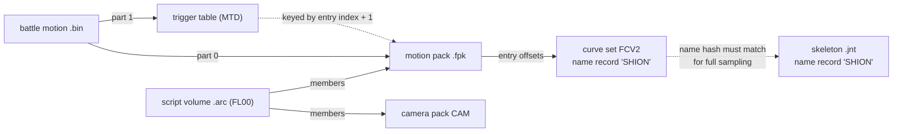
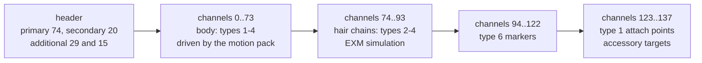
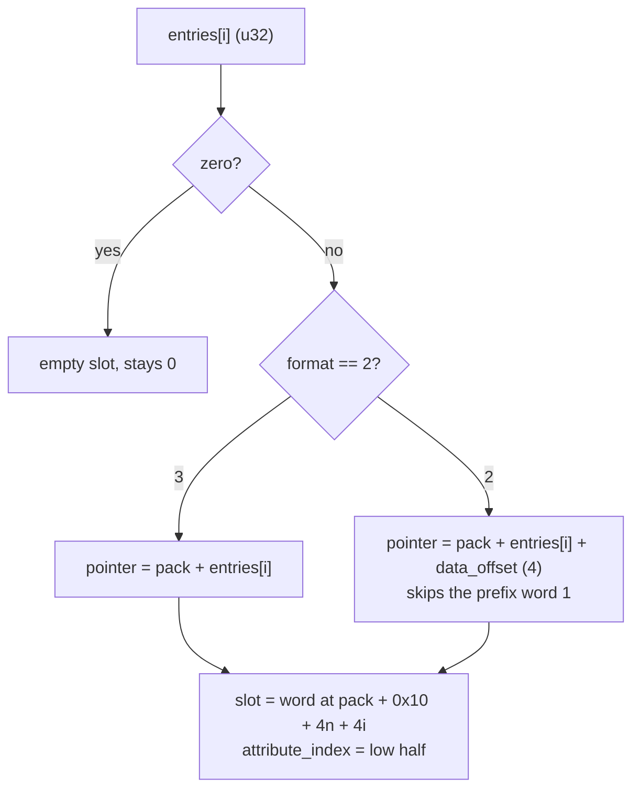
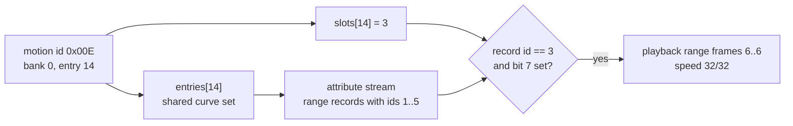
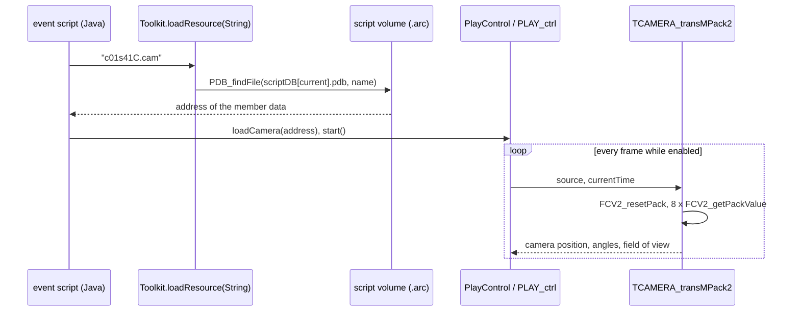
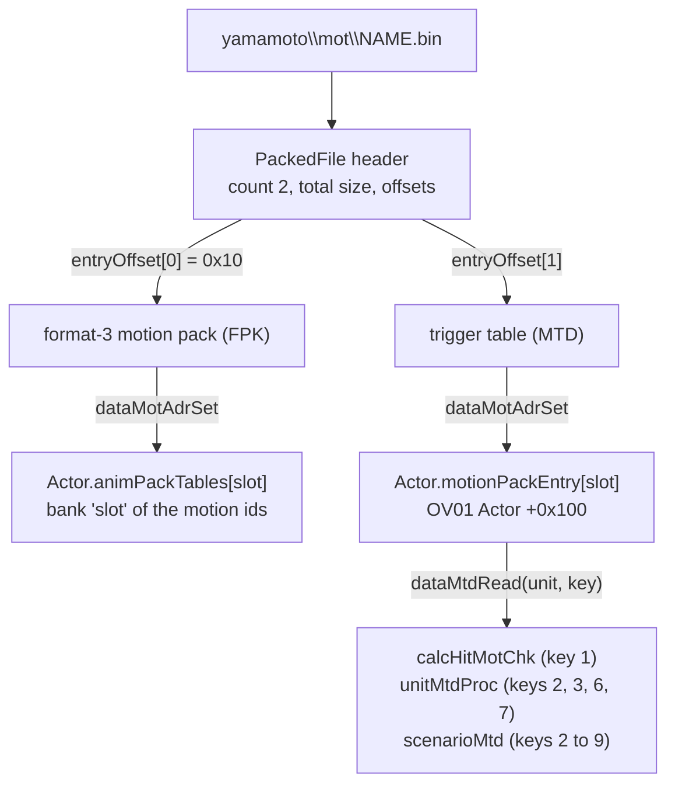

# Skeletons and motion

Every animated thing in Xenosaga Episode I is a model hung on a skeleton and
moved by curves. The skeleton is a `.jnt` file, a flat list of 64-byte joint
records. The movement comes in motion packs (`.fpk`), which collect curve sets
in the FCV2 format, one curve set per motion. Event cameras use a third,
smaller kind of curve file with the magic `CAM`. Battles wrap their motion
packs in a small container of their own (`data\yamamoto\mot\*.bin`) that also
carries per-motion trigger frames for hits and weapon changes.

Every layout below was checked against all copies of these files on the
disc. How the game evaluates them at run time (the motion clock, blending,
the joint work area, hair simulation) is described in
[Animation](../libraries/animation.md). Fields carry the names of the
recovered source code wherever one exists.

[← Back to the overview](../README.md) · [Files and resources](../architecture/files-and-resources.md)

## The files at a glance

The motion data is spread over several directories and containers. The table
lists every place where the disc stores it. Sizes are the decoded sizes.
"ARX" is the game's own compression, described in
[Files and resources](../architecture/files-and-resources.md#packed-files-arx).

| Format | Magic | Where | Files | Total size | Packing | Read by |
| --- | --- | --- | --- | --- | --- | --- |
| Skeleton | `JNT\0` | `data\char`, `data\enemy`, `data\robo`, `data\weapon`, `data\obj` | 760 | 3.0 MB | never packed | the model loader, `jnt.c`, `act_2.c` |
| Motion pack | `FPK\0` | `data\motion` | 176 | 11.1 MB | 162 ARX | `ACT_loadMotion`, scene `loadmot` |
| Event motion pack | `FPK\0` | `data\mtnpack\SCE*.fpk` (groups 10 and 20) | 107 | 30.1 MB | 99 ARX | `loadScriptCD2` |
| A.G.W.S. motion pack | `FPK\0` | `data\nisimori` | 7 | 1.7 MB | never packed | OV12 (`xrg_actor.c`) |
| Script resource volume | `FL00` | `data\mtnpack\SCE*.arc` (groups 10 and 20) | 77 | 26.0 MB | all ARX | `loadScriptCD2`, `Toolkit.loadResource` |
| Face motion pack | `FPK\0` | members of the volumes | 338 | 25.9 MB | inside the volume | `Toolkit.loadResource` |
| Camera motion pack | `CAM\0` | members of 27 volumes | 307 | 54.5 KB | inside the volume | `PlayControl.loadCamera`, `PLAY_ctrl` |
| Battle motion file | none | `data\yamamoto\mot` | 447 | 17.2 MB | never packed | OV01 `dataUnitFileLoadMot`, `dataMtdRead` |

Copies of the same formats also sit inside other containers. The 112 scene
archives `data\scene\cf*.a` (see
[Files and resources](../architecture/files-and-resources.md#scene-archives))
carry the JNT and FPK files of their scene. The battle model packs in
`data\yamamoto\pc` and `data\yamamoto\wpn` (57 files) each embed the skeleton
of their model. The 14 five-section party packs also embed a second skeleton,
the face skeleton of the character, with the same joint counts as its field
`*_face.jnt` (see
[Battle model packs](game-tables.md#battle-model-packs-pc-and-wpn)). Those
containers are not repeated here. The JNT, FPK and FCV data inside them has
the same layout.

The diagram below shows how the formats refer to each other. A skeleton and a
curve set are matched by the skeleton name stored in both. A motion pack
holds curve sets. The containers only add a directory around them.



## Conventions shared by all formats

All numbers are little-endian, as everywhere on the PlayStation 2. Floats are
32-bit IEEE 754. Angles are in radians. Positions are in world units. In the
rest pose of `kosmos.jnt`, joint 10 (probably the hips) sits at y = 1.077, so
one unit is probably close to one metre.

Motion time is counted in frames of 1/30 second. The game converts frames to
seconds with the constant 0.033333335 (`ANM_TIME_FRAME_DURATION`,
`FCV2_PACK_OFFSET_FRAME_TIME`). Key times inside a curve are not stored in
frames. They are 16-bit fractions of the curve length, where 0 is the start
and 65535 the end. The section on [key times](#key-times) gives the exact
formula.

Packs are used in place. The loader reads a file into a buffer and never
copies or parses it into other structures. Offsets inside the file become
pointers the first time the code touches the pack, by adding the buffer
address. A flag bit in the header records that this has been done. This is
called relocation below. The general mechanism is described in
[Files and resources](../architecture/files-and-resources.md#packs-used-in-place).

## Skeleton files (JNT)

### Purpose and location

A skeleton file describes the joints of one model: their parents, their rest
pose, how each joint is built and which joints accessories attach to. Every
animated model has one, stored beside the model (`.lex`) and texture (`.xtx`)
with the same base name. The model loader reads it as the third file of a
model block (resource type `RES_TYPE_MODEL`, or `RES_TYPE_JOINTS` for the
skeleton alone, see
[Files and resources](../architecture/files-and-resources.md#resource-types)).
The skeleton is kept as `Actor.move` (`+0x8d8`), and `ACT_allocMatrix` uses
its channel count as the number of joint matrices.

The disc has 760 skeleton files, 3,008,064 bytes in all. None is ARX-packed.
The smallest is `data\obj\aobj000\acc_001.jnt` (224 bytes, 3 joints) and the
largest `data\char\pc\kosmos_h3.jnt` (13,568 bytes, 208 joints).

| Directory | Files | Contents |
| --- | --- | --- |
| `data\char\pc` | 58 | Party characters, their variants and their faces |
| `data\char\npc` | 121 | Named non-player characters and their faces |
| `data\char\ppl` | 97 | Generic people |
| `data\char\citi` | 46 | Town people |
| `data\char` | 2 | `dummy.jnt`, `dummy_face.jnt` |
| `data\enemy\*` | 93 | Enemies (`boss` 26, `guno` 26, `utma` 12 and others), plus `dummy.jnt` |
| `data\robo\ag`, `vx`, `etc` | 21 | A.G.W.S. and other robots |
| `data\weapon\pc`, `robo`, `enemy` | 86 | Weapons |
| `data\obj\mobj000` | 158 | Map objects |
| `data\obj\aobj000` | 78 | Accessory objects |

Most characters come as a pair: the body skeleton `<name>.jnt` and a face
skeleton `<name>_face.jnt`. A `_h` in the name probably marks the
higher-detail event version, for example `shion_h.jnt` and
`shion_h_face.jnt`. The face is a separate actor attached to the body's head
joint (`ACT_setFace`).

### Layout

A skeleton file has three parts in a fixed order: a 16-byte header, an
attribute block and the channel array. The attribute block starts with its
own byte size, so the channel array begins at `0x10` plus that size. The
channel array is the last thing in the file. In all 760 files the file size is
exactly `0x10 + block size + 64 × channel count`.

```
+0x00  header (16 bytes)
         "JNT\0", version, channel_limit, four range counts
+0x10  attribute block
         u32 byte size of the block (counted from +0x10, including itself)
         records {u16 size, u16 type, payload} ...
         optional terminator record (type 0) and zero padding
+0x10 + block size
       channel array: channel_limit records of 64 bytes (JntStaticChannel)
end of file
```

### Header

The header is read as `JntHairIdSource` (`include/main/jnt.h`). Its four
counts split the channel array into four consecutive ranges. They always add
up to `channel_limit`.

| Offset | Size | Type | Field | Meaning | Values seen |
| --- | --- | --- | --- | --- | --- |
| `+0x00` | 4 | char[4] | (magic) | `JNT\0` | all 760 |
| `+0x04` | 2 | u16 | `version` | Format version | 3 in all files |
| `+0x06` | 2 | u16 | `channel_limit` | Number of channels (joints) | 3 to 208 |
| `+0x08` | 2 | u16 | `primary_id` | Joints in the body range | 2 to 142 (74 for humans, 41 for faces) |
| `+0x0A` | 2 | u16 | `secondary_id` | Joints in the hair range that follows | 0 to 82 |
| `+0x0C` | 2 | u16 | `additional_primary_count` | Joints in the third range | 1 to 59 |
| `+0x0E` | 2 | u16 | `additional_secondary_count` | Joints in the fourth range | 0 to 23 |
| `+0x10` | 4 | u32 | `attribute_size` | Byte size of the attribute block. The channels start at `0x10` plus this value | 16 to 320 |

The name `attribute_size` comes from `JntHairIdSource`. The same word is
called `accessory_size` in `JntMoveResource`, where `JNT_getAccessories` uses
it as the limit of its record walk. It is the size of the block that sits
between the header and the channels.

The four ranges hold different joint kinds. The tally over all 760 files is
below. The channel type numbers are explained in the
[channel record](#the-channel-record) section.

| Range | Channel types seen | Files |
| --- | --- | --- |
| Body (`primary_id`) | types 1, 2, 3 and 4 | 547 |
| Body (`primary_id`) | type 1 only | 213 (objects, weapons, small props) |
| Hair (`secondary_id`) | empty | 630 |
| Hair (`secondary_id`) | types 2, 3 and 4 (chains) | 130 |
| Third range | type 6 only | 508 |
| Third range | type 5 only | 251 (objects and weapons) |
| Third range | 41 of type 5, then 2 of type 6 | 1 (`data\robo\ag\ag_04.jnt`) |
| Fourth range | empty | 511 |
| Fourth range | type 1 only | 249 (the accessory attach points) |

A motion pack drives the body range and, depending on the skeleton's hair
tag, none, some or all of the hair range (see
[the hair tag record](#the-hair-tag-record)). The rest of the hair range is the chain the
[EXM hair code](../libraries/animation.md#extra-motion-exm-hair-cloth-and-wind)
simulates. The third range holds type-6 marker joints (characters) or type-5
model-matrix joints (objects). The fourth range holds the joints that
accessories and weapons attach to. Every accessory id in the
[accessory record](#the-accessory-record) points into this range.

The diagram below shows the ranges of `shion.jnt` (138 channels).



### Attribute records

After the size word, the block holds a list of records. Each record starts
with `{u16 size, u16 type}`, where `size` includes these four bytes.
`JNT_readAttribute` and `JNT_getAccessories` walk the list until a record of
type 0 or until the summed sizes reach the block size. The order on the disc
is always name, then accessories or limits, then hair tags.

| Type | Size | Contents | Files | Reader |
| --- | --- | --- | --- | --- |
| 1 | 12 | Skeleton name, 8 bytes, zero-padded | 751 | `JNT_readAttribute` |
| 4 | 196 | Accessory joint table | 249 | `JNT_getAccessories` |
| 3 | 44 to 188 | Rotation limits and shape bindings | 99 | channels point into it directly |
| 5 | 16 or 20 | Hair tag list | 100 | `JNT_readAttribute`, `JNT_hairID` |
| 0 | 0 or 8 | End of the list | 364 | both walkers |

The record sequences found on the disc are: name alone (350 files), name,
accessories and end (206), name, limits and end (95), name and hair tags (46),
name, accessories, hair tags and end (43), name, hair tags and end (11), and
nine files with no name record at all (5 with only an end record, 4 with a
limit record and an end record). Files without a terminator simply end the
list at the block size.

#### The name record

The payload is the skeleton name, up to 8 characters, padded with zero bytes
(`KOSMOS\0\0`, `SHION_H\0`, `MOBJ116_`). There are 564 different names among
751 named files, because variants of one character share a name. The name is
turned into a 32-bit key: `word0 * 31 + word1`, where the words are the two
little-endian 32-bit halves of the 8 bytes. Every FCV2 curve set carries the
same kind of name record. `JNT_computeMatrix` compares the two keys to choose
between full sampling and the static-chain variant (see
[Animation](../libraries/animation.md#the-skeleton-file)).

#### The accessory record

The type-4 record maps accessory ids to joint indices.
`JNT_getAccessories` returns the address just after the record header. The
code then reads this address as `ActorAccessoryJointTable`: 32 bytes it does
not use, followed by `jointId[0x29]`, one 32-bit joint index per accessory
id. `ACT_jointGetAccessories` returns `jointId[id]` for ids below
`ACT_ACCESSORY_COUNT` (0x29).

| Offset in record | Size | Contents |
| --- | --- | --- |
| `+0x00` | 4 | `{196, 4}` header |
| `+0x04` | 32 | Zero in all 249 files |
| `+0x24` | 160 | `jointId[0..39]`, one u32 per accessory id. 0 means no joint |

The record is 196 bytes, so it holds only 40 joint ids. Id 40, which the
table type and `ACT_ACCESSORY_COUNT` still allow, reads the 4 bytes after the
record (the next record header or padding). Between 0 and 23 ids are
non-zero per file. In every file all non-zero ids point at type-1 joints of the
fourth range, and the largest id word is always below `channel_limit`.

#### The hair tag record

The type-5 record decides where the motion pack stops driving the skeleton
and the hair simulation takes over. `JNT_readAttribute` keeps a pointer to its
payload, which the code reads as `JntChannelTag {int word_count, int tag}`. On the
disc the payload is a word count followed by that many words. All words but
the last are tags of the form `kind << 16 | value`. The last word repeats the
size of the hair range (`secondary_id`) in all 100 records.

| Offset in record | Size | Field | Contents |
| --- | --- | --- | --- |
| `+0x00` | 4 | | `{16 or 20, 5}` header |
| `+0x04` | 4 | `word_count` | Number of words that follow, 2 or 3 |
| `+0x08` | 4 | `tag` | First tag: kind in the high half, a channel count in the low half |
| `+0x0C` | 4 | | Second tag (20-byte records only) |
| last | 4 | | Size of the hair range |

`JNT_hairID` returns the end of the sampled range, the channel where the
pack stops. It starts at `primary_id`. When `word_count` is 0 it adds
`secondary_id`. When the tag kind is `0x8A` (`JNT_TAG_KIND_HAIR_OFFSET`) it
adds the tag's low half. A skeleton without a type-5 record points at an
all-zero dummy tag, so the pack drives the body and the whole hair range. A
skeleton with a type-5 record always has a non-zero `word_count`,
so the pack drives the body plus, for kind `0x8A`, the first `value` hair
channels. `kosmos.jnt` has the tag `0x8A0015`: the pack drives channels 0 to
94 and the remaining 25 hair channels are simulated.

The first tags on the disc have the kinds `0x8A` (62 records), `0x87` (37)
and `0x89` (1). For the last two kinds the pack stops at the end of the body
range. The 15 records of 20 bytes carry a second tag, always of kind `0x8A`,
which the code never reads. The meaning of kinds `0x87` and `0x89` is not
known.

#### Rotation limits and shape bindings

The type-3 record is a pool of small structures that channels point to.
A channel's `rotation_limits_offset` is a negative byte offset counted from
the start of the channel record itself. It lands on a 4-byte
`JntRotationLimitHeader`, which in turn points forward to either a limit
record or a shape binding. 344 channels use this, 313 for limits and 31 for
bindings.

| Offset | Size | Type | Field | Meaning |
| --- | --- | --- | --- | --- |
| `+0x00` | 2 | u16 | `values_offset` | Offset of the limit record from this header. 0x10 for limits, 0 for bindings |
| `+0x02` | 2 | u16 | `deferred_offset` | Offset of the shape binding from this header. 0x10 for bindings, 0 for limits |
| `+0x04` | 12 | | | Zero |

The limit record (`JntRotationLimits`) clamps the three rotation angles of a
type-2 joint after sampling (`JNT_getVal`).

| Offset | Size | Type | Field | Meaning |
| --- | --- | --- | --- | --- |
| `+0x00` | 12 | float[3] | `minimum` | Lowest angle about z, y and x, in the order of `rotate` |
| `+0x0C` | 2 | u16 | `flags` | Bits 0 to 2 enable the minimum of the first, second and third angle (z, y, x). Bits 3 to 5 enable the maximum |
| `+0x0E` | 2 | | | Zero |
| `+0x10` | 12 | float[3] | `maximum` | Highest angle about z, y and x |
| `+0x1C` | 4 | | | Zero |

Disabled axes hold ±17.453 (±1000 degrees), which is the exporter's value for
"unlimited". With the header, one limit entry occupies 48 bytes. On the disc
the limited joints are the eyes (channels 5 and 8 of face skeletons, 98 each,
flags `0x1B`, the z and y angles clamped both ways), a joint near the jaw
(channel 20, 79 skeletons, flags `0x8`, only a maximum on the z angle) and
channels 23 and 26 (19 skeletons each, flags `0x8` or `0x9`).

The shape binding (`ActorShapeBinding` in `act_2.c`) is used by type-1 joints
58 (14 files), 59 (15) and 60 (2) of 15 high-detail face skeletons
(`*_h_face.jnt`).

| Offset | Size | Type | Field | Meaning |
| --- | --- | --- | --- | --- |
| `+0x00` | 2 | u16 | | Zero |
| `+0x02` | 2 | u16 | `jointIndex` | The joint whose matrix gives the value. Always the binding joint itself |
| `+0x04` | 2 | u16 | `shapeId` | Shape target number passed to nml: 0, 1 or 2 |
| `+0x06` | 10 | | | Zero |

With its header and padding one binding occupies 32 bytes. The joint queues
the binding during evaluation, and `ACT_modelDrawSub` later calls
`nmlModelSetShapeId(shapeId, value)` with the z translation of that joint's
matrix (`jointMatrices[jointIndex][3][2]`). The motion therefore drives a
morph target through the z position of an otherwise unused joint. This is
probably how the mouth and eyelid shapes of event faces are animated.

The `size` field of a type-3 record is smaller than the space its entries
really use. For example `allen_h_face.jnt` has a type-3 record of size 44 at
`0x20`, but its two bindings reach to `0x70`, where the channels start. The
code never needs the size, because channels reach the entries through their
own offsets. A record walker that trusts the size lands inside the pool,
reads zero bytes there and stops as if it had met the terminator.

### The channel record

After the attribute block come `channel_limit` records of 64 bytes, read as
`JntStaticChannel`. A channel is one joint. Its index in the array is the
joint number used everywhere else (parents, accessory ids, motion channels).

| Offset | Size | Type | Field | Meaning | Values seen |
| --- | --- | --- | --- | --- | --- |
| `+0x00` | 2 | u16 | `type` | How the joint is built (table below) | 1 to 6 (no type 0 on the disc) |
| `+0x02` | 2 | u16 | `interpolation_flags` | Read only for type 4: non-zero blends the joint as a quaternion during motion blending (`JNT_interpolate`) | 0 to 19 |
| `+0x04` | 4 | s32 | `rotation_limits_offset` | 0, or a negative offset from this record into the type-3 pool | 0 or -464 to -3872 |
| `+0x08` | 6 | | | Zero in all 45,510 records | 0 |
| `+0x0E` | 2 | u16 | `matrix_index` | Parent joint | always below the record's own index, `0xFFFF` or 0 for type 6 |
| `+0x10` | 16 | float[4] | `translation` | Rest translation relative to the parent. w is 0 | |
| `+0x20` | 12 | float[3] | `rotate` | Rest rotation about z, y and x, applied as Rz·Ry·Rx | |
| `+0x2C` | 4 | | | Zero in all records | 0 |
| `+0x30` | 16 | | | Depends on the type (below) | |

The channel types are the joint kinds of the skeleton code. Their meaning is
given in [Animation](../libraries/animation.md#channels) and summarised here
with the counts over all files.

| Type | Joint kind | Records | Use of `+0x30..+0x3F` |
| --- | --- | --- | --- |
| 1 | Ordinary joint | 6,675 | zero |
| 2 | Chain link | 13,011 | four floats. `+0x38` is `translation_direction`, whose sign selects the chain direction. `+0x30` and `+0x3C` are not read by the recovered code |
| 3 | Chain root | 8,914 | zero |
| 4 | Chain end | 8,914 | zero |
| 5 | Model matrix | 1,058 | two 8-byte names, see below |
| 6 | Skip (marker) | 6,938 | two 8-byte names, see below |

Types 3 and 4 always come in pairs, so the counts are equal. Type-5 and type-6
records, and only they, carry a group name at `+0x30` and a label at `+0x38`,
both 8 bytes of ASCII, zero-padded. There are 152 different group names. The
common ones are `BODY` (2,097 records), `FACE` (1,671) and `TOP` (1,580),
followed by `1`, `MOVE`, `L`, `R` and model-specific prefixes such as `M1_F`
or `002_`. The 1,986 different labels are mostly Japanese part names: `L` and
`R`, `FACE`, `KUTI` (mouth), `MATU` (eyelashes), `EYE_L`, `EYE_R`, `KUBI`
(neck), `HA` (teeth), `TE00_L` (hand), `HAIRA`, `KUTU` (shoes), `ZUBON`
(trousers). No skeleton code reads them. `FACE` is also the name of the model
part that `ACT_setFace` hides, so the labels probably name the model parts
bound to these joints.

The `interpolation_flags` values found per type are 0 to 8 for type 1, 1 to
19 for type 2 (12,074 of them are 1), always 1 for type 3, 0 to 17 for type 4
and always 0 for types 5 and 6. Only the type-4 values have a known effect.

### Example: kosmos.jnt

The header and the start of the attribute block of
`data\char\pc\kosmos.jnt` (11,136 bytes):

```
00000000: 4a4e 5400 0300 aa00 4a00 2e00 2000 1200   "JNT\0", version 3, 170 channels
                                                     body 74, hair 46, third 32, fourth 18
00000010: f000 0000 0c00 0100 4b4f 534d 4f53 0000   block size 0xF0, record {12, 1} "KOSMOS"
00000020: c400 0400 0000 0000 0000 0000 0000 0000   record {196, 4}, 32 unused bytes start
00000044: (jointId[0])
00000064: a700 0000 a300 0000 a600 0000 a000 0000   jointId[8..11] = 167, 163, 166, 160
000000e4: 1000 0500 0200 0000 1500 8a00 2e00 0000   record {16, 5}, 2 words: tag 0x8A/21, 46
000000f4: 0000 0000 0000 0000 0000 0000             terminator, padding to 0x100
00000100: 0100 0200 0000 0000 0000 0000 0000 0000   channel 0: type 1, flags 2, parent 0
```

The accessory joints 152 to 169 are the last 18 channels, the fourth range.
The hair tag `0x8A0015` names channel 21. Channel 13, a chain link, shows the
type-2 extra floats:

```
00000440: 0200 0300 0000 0000 0000 0000 0000 0c00   type 2, flags 3, no limits, parent 12
00000450: 0000 0000 0000 0000 0000 0000 0000 0000   translation 0, 0, 0, 0
00000460: da0f c9bf 0000 0000 da0f c9bf 0000 0000   rotate z = -pi/2, y = 0, x = -pi/2
00000470: da0f c9bf 0000 0000 da0f c9bf 0000 0000   +0x30 = -pi/2, +0x38 direction = -pi/2
```

### Statistics and leftovers

- All 760 files are version 3, all sizes add up exactly, and no file has
  bytes after the channel array.
- All 38,572 parent indices are smaller than the joint's own index, so a
  single forward pass can build the skeleton.
- The w component of every rest translation is 0, and `+0x08..+0x0D` and
  `+0x2C` are zero in every record. They are probably fields of the exporter's
  structure that the game never needed.
- The body motions of one character do not match his skeleton. The four
  skeletons of Matthews are named `MATEHWS` (`matehws.jnt`, `matehws1.jnt`,
  `matehws_face.jnt`, `matehws_h_face.jnt`), and his face packs
  (`FLSmatehws.fpk`) use the same spelling. His 86 body curve sets, in
  `data\motion\matehws_cf.fpk`, the shared sets `sit_m`, `sit_e`, `eat` and
  others and 13 event packs, are named `MATHEWS`. The keys differ, so his
  body is always sampled through `JNT_getVal_staticChain`, the variant
  without face-record blending. A few other curve sets name variants that
  have no skeleton of their own (`RW_M`, `SHION_1`, `MOMO_1` and similar).

## Motion packs (FPK)

### Purpose and location

A motion pack collects the motions of one character, one object or one event
script. Each entry of the pack is one motion, stored as an
[FCV2 curve set](#curve-sets-fcv2). An actor holds up to eight packs at once
in `Actor.animPackTables[8]`. A motion id selects a pack (bits 8 to 10, the
bank) and an entry (bits 0 to 7). The banks and ids are described in
[Animation](../libraries/animation.md#motion-ids-and-banks).

| Set | Files | Entries per pack | Loaded by | Bank |
| --- | --- | --- | --- | --- |
| `data\motion\*.fpk` | 176 | 1 to 64 | `ACT_loadMotion` through `RES_loadFile(-1, RES_TYPE_MOTION, id)`, and the `loadmot` command of scene resource scripts | 0 |
| `data\mtnpack\SCE*.fpk` | 107 | 5 to 163 | `loadScriptCD2` (`src/main/script.c`), one per event script | 1 for every actor (`ACT_initExMotion(0, 1, pack)`) |
| `data\nisimori\*_all.fpk` | 6 | 80 | OV12, the A.G.W.S. Battle simulator (`s_aDatTbl_1` in `xrg_actor.c`) | 0 |
| `data\nisimori\weponall.fpk` | 1 | 86 | OV12 (`battleCommonDataWeaponArchiveFileName`) | 1 |
| face packs in `SCE*.arc` | 338 | 2 to 54 | scripts, through `Toolkit.loadResource` | chosen by the script |
| inside `yamamoto\mot\*.bin` | 447 | 1 to 59 | OV01 battle (`dataMotAdrSet`) | 0 to 4 |

The names in `data\motion` are the motion sets of the field. `<name>_cf.fpk`
is the field set of a character (`shion_cf`, `kosmos_cf`), and the plain
names are shared sets (`sit_m`, `eat`, `work`) or map objects (`mobj_060`).
For a numeric id, `RES_GetMotBaseName` finds the set name in the table
`cfMtnList` (`src/main/res_get_path.c`), and the file is
`data\motion\<name>.fpk`. Scene scripts name packs directly, for example
`loadmot allen_cf` in `data\scene\cf0010.txt` (see
[scene resource scripts](../architecture/files-and-resources.md#scene-resource-scripts)).
When a scene archive is open, the loader takes the next archive entry instead
of reading the named file.

Each event script `SCExxxxx.evt` may have a motion pack
`data\mtnpack\SCExxxxx.fpk` with the motions only that event uses. Of the 181
event scripts in groups 10 and 20, 107 have one. `loadScriptCD2` loads it and
installs it in bank 1 of all actors, so event motion ids are `0x100` plus the
entry index. Scripts that have no pack get a null bank 1.

### Header

The header is `FpkFcvPack` in `src/main/anm.c`. The same layout is used by
every pack on the disc, with two values of `format`.

| Offset | Size | Type | Field | Meaning | Values seen |
| --- | --- | --- | --- | --- | --- |
| `+0x00` | 4 | u32 | `magic` | `FPK\0`. The code sets the top byte to `0x01` (`FPK_RELOCATED`) after relocation | `FPK\0` |
| `+0x04` | 2 | u16 | `format` | Pack format | 3 in all 290 disc packs and 334 volume members, 2 in 4 volume members |
| `+0x06` | 2 | u16 | | Not read | 0 |
| `+0x08` | 4 | u32 | `entry_count` | Number of entries | 1 to 163 |
| `+0x0C` | 2 | u16 | | Not read | 0 |
| `+0x0E` | 2 | u16 | `data_offset` | Added to every entry in format 2 | 4 in every pack, also format 3 |
| `+0x10` | 4 × n | u32[n] | `entries` | Offset of each entry's curve set, 0 for an empty slot | |
| `+0x10 + 4n` | 4 × n | | attribute slots (format 3) | One word per entry, see below | |

### Format 3: the entry and slot tables

In format 3 the entry offsets count from the start of the pack. The entry
table is followed by a table of the same length, one 32-bit word per entry,
read as `FpkAnimationAttributeSlot`. Its low half is the `attribute_index`
of the entry, and its high half is 0 in every file. The curve sets follow
directly. In every pack the lowest entry offset is exactly `0x10 + 8n`, the
end of the two tables.

```
+0x00          "FPK\0" 03 00 00 00  n  00 00 04 00
+0x10          entries[0..n-1]          offsets from the pack start
+0x10 + 4n     slots[0..n-1]            {u16 attribute_index, u16 0}
+0x10 + 8n     curve set of the lowest entry
               curve sets, back to back, no gaps
end of file
```

`ANM_getEntry` copies the slot's `attribute_index` into the clock. The curve
set then uses it to choose its [range records](#range-records-and-attribute-slots).
On the disc the slot value is always the occurrence number of the curve set:
the first entry that uses a given curve set gets 1, the second entry that
shares it gets 2, and so on. Entries that share a curve set are common (148
of the 290 disc packs share at least one, and `SCE01044A.fpk` reuses 73
entries). The entry order is not sorted by offset in 139 disc packs. Empty
slots never occur in disc packs, but 323 of the 447 battle packs have them.

Every curve set ends exactly where the next one (in offset order) begins, and
the last one ends at the end of the file. Over all 628 standalone and volume
packs there are 11,342 distinct curve sets and no unused byte between them,
apart from the prefix words of the four format-2 packs described next.

### Format 2: the prefix words

Four packs inside the script volumes use format 2: `enemy.fpk`
(`SCE01003.arc`), `face.fpk` (`SCE02040A.arc`), `idle.fpk` (`SCE03003D.arc`)
and `shion.fpk` (`SCE03009B.arc`). Here every curve set is preceded by a
4-byte word with the value 1, and the entry offsets point at that word. The
code adds `data_offset` (4) to each entry during relocation, which skips the
word and lands on the curve set. There is no slot table. The prefix word of
the first curve set sits where a format-3 slot table would begin.

```
+0x00          "FPK\0" 02 00 00 00  n  00 00 04 00
+0x10          entries[0..n-1]          offsets of the prefix words
+0x10 + 4n     u32 1                    prefix of curve set 0
+0x14 + 4n     curve set 0
               u32 1, curve set 1, u32 1, curve set 2, ...
```

`ANM_getEntry` reads the slot word after the entry table for every format.
For a format-2 pack it gets the prefix word (1) for entry 0, and bytes of the
first curve set for the other entries (`0x4346` from the `FC` of its magic for
entry 1, its format 3 for entry 2, its frame count for entry 3). This shows
that the slot table belongs to format 3 only. The curve sets inside format-2
packs are themselves format 3. Two of the four packs have range records
(`idle.fpk` 5 and `shion.fpk` 1). In `idle.fpk` the words read for entries 12
and 14 have a low half of 0, so those two entries pick up their reset range
(see [range records](#range-records-and-attribute-slots)). The other entries
match nothing.

The diagram below shows how an entry offset becomes a curve set address in
the two formats.



### Relocation and the format test

`ANM_getEntry`, `PACK_getEntry` and `PACK_getAttr` relocate with the test
`format == 2`. `PACK_getSize` tests `format >= 2`, so it would treat a
format-3 pack as format 2 and add `data_offset` to every entry. This never
happens in the game, because `PACK_getSize` is only called from `ANM_update`
on a pack that `ANM_reset` has already relocated. `PACK_unlink` undoes the
relocation of format-3 packs only.

### Example: shion_cf.fpk

The start of `data\motion\shion_cf.fpk` (227,884 bytes, 32 entries):

```
00000000: 4650 4b00 0300 0000 2000 0000 0000 0400   "FPK\0", format 3, 32 entries, data_offset 4
00000010: 1001 0000 a811 0000 282f 0000 f061 0000   entries 0..3: 0x110, 0x11A8, 0x2F28, 0x61F0
...
00000090: 0100 0000 0100 0000 0100 0000 0100 0000   slots 0..3: attribute_index 1
...
00000110: 4643 5600 0300 5a00 0000 5900 0000 0000   first curve set (entry 0), at 0x10 + 8 x 32
```

### Statistics

| Measure | Value |
| --- | --- |
| Packs on the disc (standalone) | 290, 261 of them ARX-packed |
| Packs inside script volumes | 338 (334 named `FLS<character>[_h].fpk`, 4 format 2) |
| Packs inside battle files | 447 |
| Distinct curve sets (standalone and volume packs) | 11,342 |
| Distinct curve sets (battle packs) | 2,460 |
| Most common entry counts (standalone and volume packs) | 32 (147 packs), 18 (89), 10 (49), 2 (42), 12 (41) |
| Header words `+0x06` and `+0x0C` | 0 in every pack |

## Curve sets (FCV2)

### What a curve set holds

A curve set is one motion. It has a short header, an attribute stream with
data that is not a curve (the skeleton name, playback ranges) and then the
curves, grouped by joint. For each joint, a channel record says which of the
ten components (three translations, three rotations, three scales and a flag)
have data, and one key header per component follows with either a constant
or a run of spline keys. Curve sets never appear as separate files on the
disc. They live inside motion packs, and the same layout without the
attribute stream is used by the [camera packs](#camera-motion-packs-cam).

The behaviour of the curve reader is described in
[Animation](../libraries/animation.md#fcv2-curves). The older FCV format that
`fcv2.c` can also read (`FCV_getValue`, `FCV_getPackValue`, see
[Animation](../libraries/animation.md#the-older-fcv-format)) is not used by
any file on the disc.

```
+0x00  header (16 bytes): "FCV\0", format, frame_count, first_frame,
       last_frame, frame_offset, 2 zero bytes
+0x10  attribute stream: u32 byte size, records {u16 size, u16 type, payload}
+0x10 + stream size
       channel 0: record {u16 size, u16 4, channel_flags, value_mask [, links]}
                  one key header per set mask bit, each with its keys
       channel 1: ...
       ...
       end record {4, 4, 0xFFFF, 0} (missing in 441 sets, see below)
```

### Header

The header is `FCV2CurveData` (`src/main/fcv2.c`). `anm.c` reads the same
bytes as `FpkAnimationEntry`.

| Offset | Size | Type | Field | Meaning | Values seen |
| --- | --- | --- | --- | --- | --- |
| `+0x00` | 4 | u32 | `signature` | `FCV\0` (`FCV_MAGIC`, `0x564346` in the low 3 bytes) | all |
| `+0x04` | 2 | u16 | `format` | 2 and higher have an attribute stream | 3 in all 13,802 curve sets |
| `+0x06` | 2 | u16 | `frame_count` | Length of the curve in frames. Sets the key time scale | 2 to 5,009 |
| `+0x08` | 2 | u16 | `first_frame` | First frame of the default playback range | 0 in all sets |
| `+0x0A` | 2 | u16 | `last_frame` | Last frame of the default playback range | 0 to 4,953 |
| `+0x0C` | 2 | s16 | `frame_offset` | Shift of the sampling time, in frames | 0 in 10,046 sets, -2,900 to 1,843 otherwise |
| `+0x0E` | 2 | | | Zero | 0 |
| `+0x10` | | | `attributes` | Attribute stream | |

`ANM_reset` plays from `first_frame` to `last_frame` (multiplied by 1/30)
unless a range record overrides them. `frame_count` only scales the key
times. The two lengths agree in most sets: `frame_count` equals `last_frame`
in 7,675 of the 11,342 standalone and volume sets and `last_frame + 1` in
1,472. In the other 2,195 sets they differ by more, in both directions, and
in 1,296 sets `frame_offset` is not 0. Such a set is probably a clip cut out of
a longer take: the keys keep the timing of the take and the offset moves the
playback window into it.

### Key times

A key stores its time as a 16-bit fraction `frame` of the curve length.
`FCV2_resetPack` turns it into seconds:

| Format | Key time in seconds | Sampling shift |
| --- | --- | --- |
| 2 and higher (all motion curve sets) | `frame × frame_count / 65535 / 30` | `+ frame_offset / 30` added to the clock time |
| 0 and 1 (camera packs) | `frame × (last_frame − first_frame) / 65535 / 30` | none |

The scale constants are `FCV2_CURSOR_COUNT_SCALE` and
`FCV2_RANGE_COUNT_SCALE` (both 1/65535) and the 1/30 frame time. Key time
0xFFFF is the end of the curve. 170,935 of the 265,038 spline runs end on
exactly 0xFFFF, and 236,978 start at 0. The resolution of a key time is
`frame_count / 65535` frames, so for a 90-frame motion about 1/728 of a
frame.

### The attribute stream

The stream starts with a u32 byte size that counts the size word itself.
Records follow, each `{u16 size, u16 type, payload}`, where `size` includes
the 4-byte record header. `FCV2_readAttribute` reads records until a type-0
record or until the summed sizes reach the byte size. The channel data starts
at the stream start plus the byte size.

| Type | Size | Payload | Read into |
| --- | --- | --- | --- |
| 1 | 12 | Skeleton name, 8 bytes. Hashed as `word0 * 31 + word1`, like the [JNT name](#the-name-record) | `FCV2Pack.attribute_hash` |
| 2 | 12 | Range record (`FcvPlaybackRange`, below) | `attribute_flagged` or `attribute_unflagged` |
| 3 | 12 | 8 bytes of user data | `attribute_data`, then the clock's user data |
| 0 | any | End | |

Three stream sizes occur in the 11,342 standalone and volume sets. A 16-byte
stream holds one record, the name in 10,593 sets and a range record without
a name in 21 sets. A 28-byte stream holds the name and one range record (496
sets). The remaining 232 sets have an 8-byte stream, which has room for one
4-byte word after its
size. In 80 sets the word is 0, an end record. In 152 sets it is
`0x7800EF03`, which reads as a record of type `0x7800` and size `0xEF03`. The
reader ignores the unknown type, adds the huge size and stops because it has
passed the byte size. The battle packs have the same leftover in 24 sets, 16
with `0x7800EF06` and 8 with `0x7800EF03`. These words are probably
uninitialised memory of the exporter. A set with an 8-byte stream or a
range-only stream has no name, so its hash stays 0 and never matches a
skeleton.

Type-3 user data appears once, in `data\yamamoto\mot\fema_001.bin`
(entry 6, payload `02 00 01 00 13 00 01 00`). `ANM_reset` stores its address
as the clock's `attribute_data`, which is `ActorAnimationState.animUserData`.
`ACT_animGetUserData` returns it, but nothing in the recovered code calls
that function.

### Range records and attribute slots

A type-2 record is a `FcvPlaybackRange`:

| Offset in payload | Size | Type | Field | Meaning |
| --- | --- | --- | --- | --- |
| `+0x00` | 1 | u8 | `selector` | Bits 0 to 6: attribute id. Bit 7: playback range (set) or reset range (clear) |
| `+0x01` | 1 | s8 | `speed` | Playback speed in units of 1/32. 32 is normal speed |
| `+0x02` | 2 | u16 | `first_frame` | First frame of the range |
| `+0x04` | 2 | u16 | `last_frame` | Last frame of the range |
| `+0x06` | 2 | | | Zero |

`FCV2_readAttribute` keeps only the records whose attribute id equals the
`attribute_index` of the entry being played, the value of the entry's slot in
the pack (see [format 3](#format-3-the-entry-and-slot-tables)). A playback
range (bit 7 set) replaces the clock limits with `first_frame / 30` and
`last_frame / 30` and sets the clock speed to `speed / 32 / 30` seconds per
tick. A reset range (bit 7 clear) sets the bounds a looping clock returns to.
This is how one curve set can serve several motions: the pack lists it under
several entries, each entry gets its own slot number, and each slot number
selects its own range record.

The motion packs of the field and the events do not use this. All 517 range
records in standalone and volume packs have selector 0 (attribute id 0, reset
range) and speed 32, while every slot of a format-3 pack on the disc is 1 or
higher. The records therefore never match, with one accidental exception:
entries 12 and 14 of the format-2 pack `idle.fpk`, whose garbage slot words
read 0 (see [format 2](#format-2-the-prefix-words)). Otherwise they would only
apply to a curve set loaded on its own as an FCV file, which `ANM_getEntry`
plays with attribute index 0. In 457 of them the range ends before
`last_frame` and in 331 it starts after frame 0, so they probably mark the
looping part of the motion.

The battle packs do use it. In the packs of the party (`chao.bin`, `jr.bin`,
`kosm.bin`, `momo.bin`, `shio.bin`, `virg.bin`, `zigg.bin`) and of
`boss_016.bin`, entries 12 to 16 share one curve set and entries 17 to 21
share another. Their slots are 1 to 5, and each of the two curve sets holds
five playback ranges with ids 1 to 5. In `chao.bin` the 18-frame curve set is
split into frames 0 to 4, 5, 6, 7 and 8 to 16, one phase per entry. What the
phases represent is not known.

The diagram below shows how entry 14 of `chao.bin` reaches its range.



### Channel records

After the attribute stream come the channels, one per joint of the
skeleton in joint order. Each starts with a type-4 record read by
`FCV2_getPackAttribute` as `FcvPackAttribute`. Here the `size` field counts
only the bytes after the 4-byte header, and the reader advances by `4 +
size`.

| Offset | Size | Type | Field | Meaning | Values seen |
| --- | --- | --- | --- | --- | --- |
| `+0x00` | 2 | u16 | (size) | Bytes after the header | 4 (685,726 records, end records included) or 12 (32,048) |
| `+0x02` | 2 | u16 | (type) | Always 4 | 4 |
| `+0x04` | 2 | u16 | `channel_flags` | Flags, or `0xFFFF` for the end record | table below |
| `+0x06` | 2 | u16 | `value_mask` | Which components have a key header | `0x1F8`, `0`, `0x3F`, `0x1FF`, `0x3FF` |
| `+0x08` | 2 | u16 | `translation_index` | Joint to copy the translation from (12-byte records) | |
| `+0x0A` | 2 | u16 | `pivot_index` | Joint to use as pivot | |
| `+0x0C` | 2 | u16 | `rotation_index` | Joint to copy the rotation from | |
| `+0x0E` | 2 | | | Zero | 0 |

The bits of `channel_flags`:

| Bit | Name | Meaning |
| --- | --- | --- |
| `0x0001` | | Not read by the code. Set exactly on the channels whose constant and zero key headers carry bit 15 (see [key headers](#key-headers)) |
| `0x0002` | `JNT_KEY_LINK_PIVOT` | Use `pivot_index` |
| `0x0004` | `JNT_KEY_LINK_TRANSLATION` | Copy the translation of `translation_index` |
| `0x0008` | `JNT_KEY_LINK_ROTATION` | Copy the rotation of `rotation_index` |
| `0x8000` | `JNT_CHANNEL_FLAG_INHERIT` | The root channel, see below |

The values found are 0 (619,427 records), 1 (48,494), 5 (13,699), 4 (7,023),
`0x8000` (6,904), 8 (6,750), `0x800C` (4,195), `0x8004` (242), 3 (126), 12 (8),
2 (4) and `0x8008` (1). A 12-byte record goes with each link bit.

The ten bits of `value_mask` name the components in the order their key
headers follow: bits 0 to 2 are translation x, y and z, bits 3 to 5 the
rotation angles about z, y and x (the order of `rotate` in the channel
record, applied as Rz·Ry·Rx), bits 6 to 8 scale x, y and z, and bit 9 the
flag curve. The skeleton side decides which bits are read. `JNT_getVal`
reads, for a channel of the skeleton's type:

| JNT channel type | Components read | Mask usually seen |
| --- | --- | --- |
| 0, 1 (ordinary joint) | translation, rotation, scale | `0x1FF` |
| 2 (chain link) | rotation, scale (translation bits are skipped) | `0x1F8` |
| 3 (chain root) | translation, rotation | `0x3F` |
| 4 (chain end) | none | `0` |
| 5 (model matrix) | translation, rotation, scale | `0x1FF` or `0` |
| 6 (marker) | none | `0` |

Only set bits consume a key header. A component whose bit is clear takes the
joint's rest value (scale takes 1.0). The reader has no way to skip a header,
so the mask must agree with the skeleton's channel types or every later
channel is read from the wrong place. Checked against every skeleton of the
same name, 4,689 of the 4,810 field and event curve sets whose skeleton name
exists agree with at least one of those skeletons in every channel.

Exactly one channel per curve set has the inherit flag `0x8000`, always with
the full mask `0x3FF`. For it, `JNT_getVal` reads all ten components whatever
the joint type: translation, rotation, scale and then the flag curve, whose
value sets or clears bit 0 of the joint work flags. It also records this
channel as `channel_start_index`. `JNT_computeMatrix` stops the first sampling
pass there, builds the matrices so far and clip-tests that joint against the
view (see [Animation](../libraries/animation.md#jnt_computematrix-step-by-step)).
The channel is 11 in 3,709 of the 5,710 curve sets of the standalone packs,
the joint just before the first chain root of a human skeleton, and other
indices (0, 1, 9 and more) in the rest. In the face packs of the script
volumes it is channel 0 in 5,611 of the 5,632 sets.

`get_fcvpack_flag` is called with `value_mask >> 1` after two 3-bit shifts,
so it tests bit 7 of the original mask (scale y) instead of bit 9. This only
works because every inherit channel on the disc has the full mask `0x3FF`.

The channel list ends with the record `{4, 4, 0xFFFF, 0}`. When the reader
meets it, the work flag `JNT_WORK_PACK_ENDED` makes all remaining joints take
their rest values. 441 sets have no end record. 403 of them are followed
directly by the next curve set, whose header does not have type 4 in the
place of a record type, and 3 by the prefix word 1 of a format-2 pack, which
reads as size 1 and type 0. In both cases `FCV2_getPackAttribute` returns its
built-in `defaultAttr`, whose `channel_flags` is `0xFFFF`, which ends the
list in the same way. The other 35 are the last set of their pack. They probably have
exactly as many channels as their skeleton samples, so the reader never looks
past them.

### Key headers

Each set bit of the mask is followed by one `FCV2KeyHeader`.

| Offset | Size | Type | Field | Meaning |
| --- | --- | --- | --- | --- |
| `+0x00` | 2 | u16 | `key_count` | Number of keys of a spline run |
| `+0x02` | 2 | u16 | `type_flags` | Low 4 bits: 0 zero, 1 constant, 3 spline run. Bit 15: see below |
| `+0x04` | 4 | f32 | `value_or_spline_data` | The constant (type 1), or the first key (type 3). Absent for type 0 |

| Header type | Length | Value returned by `FCV2_getPackValue` | Count |
| --- | --- | --- | --- |
| 0 | 4 bytes | 0.0 | 1,412,112 |
| 1 | 8 bytes | the float at `+0x04` | 1,578,599 |
| 3 | 4 bytes plus the keys | the spline at the sampling time | 265,038 |

Any other type would read as 0.0 and advance 4 bytes. None occurs. A zero
header gives exactly 0.0, not the rest value, because its mask bit is set.

`FCV2_getPackValue` masks `type_flags` with `0xF`, so bit 15 has no effect.
It is set on 324,494 zero and constant headers and never on a spline header.
Within one channel it is set on all non-spline headers or on none, and it is
set exactly on the channels whose `channel_flags` has bit 0. The two bits are
probably one exporter marker written twice.

`key_count` is also filled in for most zero and constant headers that came
from keyed curves (137,951 constants and 173,747 zero headers have a non-zero
count). The reader ignores it there. It is probably the number of keys the
curve had before the exporter found them all equal and wrote a constant.

### Key types

A spline run is `key_count` keys of variable length, read as `FCV2Sample`.
Every key starts with its type and its time, then 1 to 3 floats.

| Offset | Size | Type | Field |
| --- | --- | --- | --- |
| `+0x00` | 2 | u16 | `type` |
| `+0x02` | 2 | u16 | `frame` (16-bit key time, see [key times](#key-times)) |
| `+0x04` | 4 | f32 | `value` |
| `+0x08` | 4 | f32 | `in_tangent` (types 1 and 4) |
| `+0x0C` | 4 | f32 | `out_tangent` (type 1) |

| Key type | Size | Floats | Interpolation from this key to the next | Count |
| --- | --- | --- | --- | --- |
| 0 | 8 | value | Linear | 18,322 |
| 1 | 16 | value, in tangent, out tangent | Hermite, leaves with `out_tangent` | 48,543 |
| 2 | 8 | value | Hermite with zero tangents (ease in and out) | 956,597 |
| 3 | 8 | value | Step: hold the value | 226 |
| 4 | 12 | value, tangent | Hermite, the one tangent on both sides | 2,871,342 |

Tangents are in value units per second, because the Hermite basis in
`FCV2_getPackVal` uses the time since the previous key in seconds. The
incoming tangent of the next key is its `in_tangent` for types 1 and 4 and 0
for types 0 and 2.

A step key (type 3) as the next key is a special case in the code. The switch
that loads the next key's value handles types 0, 1, 2 and 4, and a type-3
next key falls to the default, which uses value 0 and tangent 0. A curve that
goes from a linear or Hermite key to a step key therefore heads towards 0, not
towards the step key's value. This occurs at 13 places on the disc. Of the
other step keys, 190 follow another step key and 23 begin their run, so they
are not affected.

Keys never go back in time, but 9,397 pairs of neighbouring keys have the same
time, probably two keys that fell on the same 16-bit time after
quantisation.

### Example: the first curve set of shion_cf.fpk

The curve set of entry 0 of `data\motion\shion_cf.fpk`, at `0x110`:

```
00000110: 4643 5600 0300 5a00 0000 5900 0000 0000   "FCV\0", format 3, frame_count 90,
                                                     first 0, last 89, frame_offset 0
00000120: 1000 0000 0c00 0100 5348 494f 4e00 0000   stream size 16, record {12, 1} "SHION"
00000130: 0400 0400 0000 ff01 0000 0000 0000 0000   channel 0: {4, 4}, flags 0, mask 0x1FF,
                                                     T x zero, T y zero
00000140: 0000 0000 0000 0000 0000 0000 0000 0000   T z, R x, R y, R z zero
00000150: 0000 0100 0000 803f 0000 0100 0000 803f   S x constant 1.0, S y constant 1.0
00000160: 0000 0100 0000 803f 0400 0400 0000 ff01   S z constant 1.0, channel 1 begins
```

Channel 6, at `0x2b0`, has spline runs:

```
000002b0: 0400 0400 0100 ff01 0200 0080 0400 0300   flags 1, mask 0x1FF, T x zero (count 2,
                                                     bit 15), T y spline of 4 keys
000002c0: 0200 0000 f71f 843f 0200 dd5d bbdb 833f   key type 2 at 0x0000 = 1.0322,
                                                     type 2 at 0x5DDD = 1.0302
000002d0: 0400 5ab0 af15 843f 074e 983a 0200 fcff   type 4 at 0xB05A = 1.0319 tangent 0.0012,
000002e0: f71f 843f 0400 0300 0400 0000 d78e 17b6   type 2 at 0xFFFC = 1.0322, T z spline
                                                     of 4 keys, first key type 4 at 0x0000
```

Channel 11, at `0x484`, is the inherit channel with links:

```
00000484: 0c00 0400 0c80 ff03 0600 0000 0600 0000   {12, 4}, flags 0x800C, mask 0x3FF,
                                                     translation 6, pivot 0, rotation 6
```

The pack ends with an empty channel and the end record:

```
00037a1c: 0400 0400 0000 0000 0400 0400 ffff 0000   flags 0 mask 0, then {4, 4, 0xFFFF, 0}
```

### Statistics

| Measure | Value |
| --- | --- |
| Channel records (standalone and volume packs) | 706,873, plus 10,901 end records |
| Channels per curve set | 1 to 162, most often 61 (2,917 sets), 74 (2,554) and 41 (1,790) |
| Value masks | `0x1F8` 237,265, `0` 202,909, `0x3F` 193,158, `0x1FF` 62,199, `0x3FF` 11,342 |
| Spline runs | 265,038, most often 4 or 5 keys, at most 1,713 |
| Keys | 3,895,030 |
| Last key of a run | type 2 in 201,068 runs, type 4 in 60,401 |

## Camera motion packs (CAM)

### Where they are

The real-time cutscenes move the camera with small curve files of 8 curves.
They are not separate files in the archive directory. All 307 of them are
members of the [script resource volumes](#script-resource-volumes)
`data\mtnpack\SCExxxxx.arc` of 27 event scripts, for example
`c01s41C.cam` in `SCE01041.arc`. Their names follow the pattern
`c<chapter>s<scene><cut>.cam` (`c03s27cut05.cam`, `c03s31acut02_holo.cam`),
plus a few free names such as `inu_cam.cam` in `SCE02004D.arc`. They range
from 68 to 4,864 bytes, 54,540 bytes in all.

### How they are loaded

A script fetches a camera pack by name with `Toolkit.loadResource(String)`,
which calls `XTK_findFile` to look the name up in the current script's
volume and returns the address of the member's data. It passes that address
to `PlayControl.loadCamera(Object)`, which stores it as the play's `source`.
While the play is enabled, `PLAY_ctrl` samples the source every frame at the
play's `currentTime`. A source whose first word is `PLAY_SOURCE_FORMAT_MAC`
(`0x004D4143`, the bytes `CAM\0`) goes to `TCAMERA_transMPack2` after
`FCV2_setStep(frameStep)`. Any other source would go to `TCAMERA_transMPack`
and the older FCV reader, but no such file exists. The player and the camera
handlers are described in
[Scenes and time charts](../scripting/scenes-and-timecharts.md#event-cameras).

`TCAMERA_transMPack2` calls `FCV2_resetPack` on the file and reads the eight
components in order. The motion modes `CAMERA_MODE_MOTION_PACK` (0x11) and
`CAMERA_MODE_MOTION_PACK2` (0x15) of `TCAMERA_update` read the same kind of
data from a camera channel, but no code in the recovered source sets a camera
channel to these modes or fills its source.

The sequence below shows the path from the script to the camera.



### Layout

A camera pack is a curve set of format 1 with no attribute stream and no
channel records. Eight key headers follow the header directly, and the file
ends right after the last one in all 307 files.

| Offset | Size | Type | Field | Meaning | Values seen |
| --- | --- | --- | --- | --- | --- |
| `+0x00` | 4 | u32 | `formatTag` | `CAM\0` | all |
| `+0x04` | 2 | u16 | `format` | 1, so no attribute stream | 1 in all |
| `+0x06` | 2 | | | Not read. Leftover bytes, mostly `O_` | `O_` 240, `am` 22, `OS` 11, `03` 11 and others |
| `+0x08` | 2 | u16 | `startFrame` | First frame | 0 in all |
| `+0x0A` | 2 | u16 | `endFrame` | Last frame. Sets the key time scale | 15 to 4,953 |
| `+0x0C` | 4 | | | Not read. Leftover bytes, mostly `AL_2` | `AL_2` 226, `ion0` 22, `AL_3` 12, `ROOM` 11, `ut10` and others |
| `+0x10` | | | | Eight key headers | |

The field names come from `PlaySource` in `src/main/play.h`. The leftover
bytes at `+0x06` and `+0x0C` look like pieces of names (`_all`, `ROOM`,
`cut10`), probably stale contents of the exporter's buffer.

The eight components, in file order:

| Index | Component | Unit | Header kinds seen |
| --- | --- | --- | --- |
| 0, 1, 2 | Camera position x, y, z | world units | constant 211 to 238, spline 69 to 85, zero 0 to 11 |
| 3, 4, 5 | Look-at point x, y, z | world units | constant 212 to 238, spline 68 to 83, zero 0 to 12 |
| 6 | Roll | radians | zero 287, constant 14, spline 6 |
| 7 | Field of view | radians | constant 281, spline 26. Common values 0.436 (25°), 0.524 (30°), 0.349 (20°) |

`TCAMERA_transMPack2` derives yaw and pitch from the vector between position
and look-at, stores roll as the z rotation and the last value as the field of
view. Of the 307 files, 196 are fixed cameras with no spline at all (178 of
them are constants with roll zero). 31 move both points with a fixed roll and
field of view, and 17 more also animate the field of view. The other 63 move
only some components, for example only the look-at point (12 files, like the
example below) or only the position (11). Spline keys are of types 2 (1,948), 0 (899), 4 (865) and 1
(2). Key times follow the format-1 rule: `frame × endFrame / 65535 / 30`
seconds.

### Example: c01s41C.cam

The whole file (116 bytes), a 240-frame shot whose look-at point drifts in x
and z:

```
00000000: 4341 4d00 0100 3031 0000 f000 5f61 6c6c   "CAM\0", format 1, leftover "01",
                                                     start 0, end 240, leftover "_all"
00000010: 0200 0100 40c6 1d3f 0200 0100 6787 36be   pos x constant 0.616, pos y -0.178
00000020: 0200 0100 e5e0 8241 0200 0300 0400 0100   pos z 16.36, look x spline of 2 keys:
00000030: a5d3 12c0 7f47 a1be 0400 ffff 4273 00c1   type 4 at 1 = -2.29, tangent -0.315,
00000040: cd8e 95be 0200 0100 3f33 2d3f 0200 0300   type 4 at 0xFFFF = -8.03, look y 0.677
00000050: 0400 0100 ba3f 1c41 ac6a 3a3f 0400 ffff   look z spline: 9.77 at 1,
00000060: 8dbd ab41 8c4e 233f 0000 0000 0200 0100   21.47 at 0xFFFF, roll zero, fov constant
00000070: 4e51 a53f                                  1.292 rad
```

## Script resource volumes

### Purpose and location

An event script `SCExxxxx.evt` (groups 10 and 20) can have two companion
files in `data\mtnpack`: its event motion pack `SCExxxxx.fpk` and a resource
volume `SCExxxxx.arc`. 77 of the 181 event scripts have a volume. The
volumes are ARX-packed and decode to 902 to 1,003,121 bytes (26.0 MB in all).
`loadScriptCD2` loads the volume with `RES_loadFile`, which expands ARX, and
keeps it as the script's `pdb`. Scripts then read members by name with
`Toolkit.loadResource(String)`. The general PDB format is described in
[Files and resources](../architecture/files-and-resources.md#pdb-volumes).
Only the PDB volume on the disc is shown here.

### Layout

Every volume on the disc has a single group named `.`. The header, the group
and the entry table come first, then the member data, 4-byte aligned, and the
zero-terminated names last.

| Offset | Size | Type | Meaning | Values seen |
| --- | --- | --- | --- | --- |
| `+0x00` | 4 | char[4] | `FL00` | all |
| `+0x04` | 2 | u16 | Version, 1 once relocated | 0 on the disc |
| `+0x06` | 2 | u16 | Group count | 1 |
| `+0x08` | 4 | u32 | Total size of the volume | equals the decoded file size in all 77 |
| `+0x0C` | 8 | | Group: u32 name offset, u16 name length, u16 entry count | name `.`, 1 to 57 entries |
| `+0x14` | 16 × n | | Entries: u32 name offset, u16 name length, u16 0, u32 data offset, u32 data length | all 667 data offsets 4-aligned |

The example below is `SCE02004D.arc` (2,330 bytes), a volume with one camera
pack:

```
00000000: 464c 3030 0000 0100 1a09 0000 0c09 0000   "FL00", version 0, 1 group, size 0x91A,
                                                     group name at 0x90C
00000010: 0100 0100 0e09 0000 0b00 0000 2400 0000   name length 1, 1 entry, entry: name at 0x90E,
00000020: e808 0000 4341 4d00 0100 4f5f 0000 b007   length 11, data at 0x24, 0x8E8 bytes,
                                                     the CAM file starts at 0x24
...
0000090c: 2e00 696e 755f 6361 6d2e 6361 6d00        ".", "inu_cam.cam"
```

### Members

The 77 volumes hold 667 members: 338 motion packs, 307 camera packs, 21
`.java` files and one `.tch` time chart.

| Member | Count | What it is |
| --- | --- | --- |
| `FLS<character>.fpk`, `FLS<character>_h.fpk` | 334 | Face motion packs. Their curve sets are named after the face skeleton (`SHION`, `SHION_H`) and drive its body range (41 channels for `SHION`, 61 for `SHION_H`) |
| `enemy.fpk`, `face.fpk`, `idle.fpk`, `shion.fpk` | 4 | Format-2 motion packs |
| `*.cam` | 307 | Camera packs |
| `FLS*.java` | 21 | Java source text, see below |
| `c01s42.tch` | 1 | A time chart, in `SCE01042.arc` |

The `.java` members (in `SCE03021`, `SCE03024`, `SCE03031A` and `SCE03032`)
are plain Java source with CRLF line ends, one interface per face pack, for
example:

```
public interface FLSshion
{
	final static int FLSshionF011         = 1;
	final static int FLSshionF012         = 2;
	...
	final static int FLSshionF402         = 18;
}
```

The constants run from 1 to the entry count of the matching pack (18 for
`FLSshion.fpk`, 54 for `FLSshion_h.fpk`). They are the names the script
writers used for the face motions. Java constants are compiled into the
scripts as numbers, so these files are build leftovers that nothing reads.

A script installs a face pack by asking for its address with
`Toolkit.loadResource(String)` and probably storing it in an actor resource
slot with `Toolkit.loadResource(Object, Object, int)`. That native writes
slot `index` of the 11 resource pointers at `Actor +0x8d0`
(`ACTOR_RESOURCES`), where slots 3 to 10 are `animPackTables[0..7]`.

## Battle motion files

### Purpose and location

The battle overlay OV01 does not use `data\motion`. Each battle unit loads
its motions from `data\yamamoto\mot\<name>.bin`. A battle motion file is a
small container of two parts: a normal format-3 motion pack and a trigger
table that marks frames of the motions where the battle code must act (a hit
lands, a weapon appears or disappears, the hand pose changes, the hair wind
starts or stops). The game calls the table "MTD" in its
debug message `** MTD id=%d frame=%d **`, probably short for motion trigger
data.

There are 447 files, 288 to 449,620 bytes, 17,153,780 bytes in all. None is
ARX-packed. The battle itself is described in [Battle](../game/battle.md).

| Name family | Files | Owner |
| --- | --- | --- |
| `chao`, `kosm`, `shio`, `zigg`, `momo`, `jr`, `virg` and their `_sp1`..`_sp8`, `_wp1`..`_wp6` | 59 | Party characters, their special techniques and weapon techniques |
| `skj_*` | 7 | Probably combination techniques (`skj_jr1`, `skj_shion1` and others) |
| `v1_`, `v2_`, `v3_`, `v4_`, `v6_`, `a2_`, `a4_`, `a5_` prefixed | 275 | A.G.W.S. weapon motions, see below |
| `vx01` to `vx04`, `vx06`, `ag02`, `ag04`, `ag05` | 8 | A.G.W.S. base motions |
| `guno_*`, `utma_*`, `utso_*`, `utro_*`, `utre_*`, `fema_*`, `fere_*`, `fero_*`, `feso_*` | 69 | Enemies |
| `boss_*` | 28 | Bosses |
| `sld` | 1 | Probably a soldier unit |

### How the name is built

`dataMotNameGet` and `dataMotNameGetSub` (`src/ov01/data_unit_org_get.c`)
build the path from the battle motion id. The motion id is not the bank and
entry id of the field. It is a battle number from the technique record
(`dataTecGet(tecId)->motionId`) or the unit record.

1. The path starts with `data\yamamoto\mot\` (`motNameBase`).
2. For ids below `0x157`, the suffix is `motFile[id - 1]`, a table of 303
   names. Ids from `0x12E` use `motFile[id - 0x2A - 1]` instead.
3. For a unit with flag `0x40` (an A.G.W.S.) and an id from `0x103`, the
   name is `agwsName[charaId - 0x11]` (`v1_` .. `v6_`, `a1_` .. `a6_`,
   `uk_`), then the suffix (one of 42 weapon suffixes such as `ax0`, `bd0`
   and `mg0`), then
   `agwsLRName[side]` (`r`, `l` or `d`). The side is `d` for ids from `0x12E`
   and otherwise `l` or `r`, chosen by a byte of the unit record for the
   weapon slot. This gives names such as `a2_bd0l.bin`.
4. `.bin` (`motNameExt`) ends the path.

442 of the 447 files can be built this way. The other five are listed under
[files that nothing loads](#files-that-nothing-loads).

### How it is loaded

`dataUnitFileLoadMot(unit, motionId, slot, file)` reads the file into one of
five motion slots of the unit. Slots 0 and 4 have their own buffers. Slots 1
to 3 are placed downwards from `0x40000` bytes (party) or `0x32000` bytes
(enemies) above the slot-0 buffer, each rounded up to whole CD sectors. The
read is non-blocking (`dataFileLoadNB`). The raw file address goes into the
actor's resource slot `3 + slot`, which is `animPackTables[slot]`.

When the data has arrived, `dataMotAdrSet(actor, slot)` resolves the
container in place. It reads the two part offsets, stores the address of the
motion pack in `animPackTables[slot]` and the address of the trigger table in
`motionPackEntry[slot]` (OV01 `Actor +0x100`). From then on the motion pack
is an ordinary bank `slot` of the actor, played with motion ids
`slot << 8 | entry`. `dataUnitFileLoadMotSp2` also hands the same pack to the
unit's weapon actors.

The diagram below shows the container and where its parts end up.



### The container

The header is `PackedFile` in `data_unit_org_get.c`. The same header, with
more parts, starts the battle model packs in `data\yamamoto\pc` and `wpn`.

| Offset | Size | Type | Field | Meaning | Values seen |
| --- | --- | --- | --- | --- | --- |
| `+0x00` | 4 | u32 | | Number of parts | 2 in all 447 |
| `+0x04` | 4 | u32 | | Total size | equals the file size in all 447 |
| `+0x08` | 4 | u32 | `entryOffset[0]` | Offset of the motion pack | `0x10` in all |
| `+0x0C` | 4 | u32 | `entryOffset[1]` | Offset of the trigger table | right after the last curve set in all |

The motion pack inside is format 3 with `data_offset` 4, like the field
packs. Its entry offsets count from the pack start (file offset `0x10`), not
from the file start. It has 1 to 59 entries (5 in 174 files, 1 in 114, 33 in
31, 30 in 24). Unlike the field packs, 323 of the 447 battle packs have empty
entries, because the entry number is a fixed battle motion number and not
every unit has every motion. The 2,460 curve sets are named after the battle
skeletons (155 names such as `BOSS004`, `UTRE004`, `VX02`, `SHION` and
`KOSMOS`), except 24 sets with an 8-byte attribute stream and no name. The
battle packs are also the only packs that use
[range records](#range-records-and-attribute-slots) for real.

### Motion trigger data (MTD)

The trigger table is a directory of motions followed by one list of trigger
records per motion. All offsets count from the table start and all numbers
are 16-bit.

```
+0x00   u16 directory offset (always 2)
+0x02   directory: {s16 id, u16 offset} ... {0, 0}
          id = pack entry index + 1, offset = start of its trigger list
        trigger lists, one per directory entry:
          {u16 key, s16 count, s16 frame[count]} ... {0}
        zero padding to a multiple of 4 bytes
```

`dataMtdRead(unit, key)` looks a trigger up for the motion the unit's actor
is playing. It takes the bank from bits 8 to 10 of
`animation.slot.currentDataId` (rejecting banks 5 and up) and the entry from
bits 0 to 7, finds the directory record whose id is the entry plus 1, and
walks that motion's records. The current frame is the clock time
`animation.slot.frame` (in seconds) divided by the frame time 1/30 and
rounded. It returns 1 when the
record for `key` lists the current frame (and prints the debug line), 2 when
the record exists but does not list the frame, and 0 when there is no table,
no directory record or no record for the key.

| Key | Records on the disc | Read by | Effect |
| --- | --- | --- | --- |
| 1 | 506 | `calcHitMotChk` (`calc.c`), for command selectors 1 to 3 | The hit frame. The battle flow deals the hit when it returns 1 (see [Battle](../game/battle.md)) |
| 2 | 23 | `unitMtdProc` (`unit_cmd.c`), `scenarioMtd` (`battle_init.c`) | `transWepIn(unit, default weapon)`: fade the weapon in. In a scripted scene, `spWepDispOn` shows the default weapon |
| 3 | 25 | `unitMtdProc`, `scenarioMtd` | `transWepOut(unit, default weapon)`: fade it out. In a scripted scene, `spWepDispOff` hides it |
| 4 | 0 | `scenarioMtd` | `ACT_setHand(actor, 0)`: hand pose 0 |
| 5 | 0 | `scenarioMtd` | `ACT_setHand(actor, 1)`: hand pose 1 |
| 6 | 1 | `unitMtdProc`, `scenarioMtd` | `transWepIn` of the default weapon and of weapon slot 1. In a scripted scene, `spWepDispOn(exec, 1)` |
| 7 | 2 | `unitMtdProc`, `scenarioMtd` | `transWepOut(unit, 1)`. In a scripted scene, `spWepDispOff(exec, 1)` |
| 8 | 2 | `scenarioMtd` | `hairWindOn(unit)`: start the hair wind. Only in `kosm_sp4.bin` and `kosm_sp5.bin` |
| 9 | 2 | `scenarioMtd` | `hairWindOff(unit)`: stop it. Only in `kosm_sp4.bin` and `kosm_sp5.bin` |

A hit record lists one frame per hit. 342 of the 506 hit records have one
frame, 58 have two and the largest has 15 (`jr_sp4.bin`, frames 46 to 202 in
steps of 12, then 246). Multi-hit attacks such as `a2_glg0d.bin` list
ten frames 6 apart. `unitMtdProc` reads key 6 twice, once for each weapon.
`scenarioMtd` runs during the scripted battle scenes
(`scenarioBatExecPhase20` and `scenarioBatExecPhase40`) and reads keys 2 to 9.
Keys 8 and 9 hold the frames 1 and 100 (`kosm_sp4`) and 50 and 230
(`kosm_sp5`), so the hair wind of those two KOS-MOS motions blows between
them. No file has a record for keys 4 or 5.

73 files have an empty directory (`{2, 0, 0, 0}`, 8 bytes). 273 have one
motion, 78 two and the party files up to 11 (`jr.bin`: ids 7 to 12, 31, 33,
35, 36 and 39). Four directory records point at motions the pack does not
have: id 8 of `boss_025.bin` and ids 1 and 2 of `v3_vsd0l.bin` name empty
entries, and id 7 of `shio_sp7.bin` lies beyond its 3 entries. Those triggers
can never fire.

### Examples

`data\yamamoto\mot\sld.bin` (56,304 bytes), a pack of 23 entries with one hit
on entry 6:

```
00000000: 0200 0000 f0db 0000 1000 0000 dcdb 0000   2 parts, total 0xDBF0, FPK at 0x10, MTD at 0xDBDC
00000010: 4650 4b00 0300 0000 1700 0000 0000 0400   "FPK\0", format 3, 23 entries
00000020: c800 0000 0000 0000 0000 0000 2427 0000   entry 0 at pack + 0xC8, entries 1 and 2 empty
0000dbdc: 0200 0700 0a00 0000 0000 0100 0100 2000   directory at 2: id 7 at 10, end {0, 0}
                                                     key 1, 1 frame: 32
0000dbec: 0000 0000                                  end of list, padding
```

`data\yamamoto\mot\a2_bd0l.bin`, an A.G.W.S. weapon motion with two entries
that each hit once:

```
00004530: 0200 0100 0e00 0200 1600 0000 0000 0100   directory: id 1 at 14, id 2 at 22, end
00004540: 0100 1400 0000 0100 0100 1300 0000 0000   at 14: key 1, frame 20, end
                                                     at 22: key 1, frame 19, end, padding
```

## Files that nothing loads

The names below are not reached by any code path or script found. The
search covered every string in the recovered code (including `cfMtnList`,
`motFile` and the OV12 tables), the `loadmot` lines of all 588 scene resource
scripts and the constant pools of all 569 event scripts. Members of a
script volume count as used only when the volume's own script names them,
because `Toolkit.loadResource(String)` searches only the volume of the
running script.

| Where | Files |
| --- | --- |
| `data\motion` | 15 packs: `chief_cf`, `cm03_cf`, `fried_cf`, `guno_101`, `guno_102`, `heisi_01`, `kebin_cf`, `miyuki_cf`, `mobj_013`, `mobj_039`, `mobj_040`, `mobj_049`, `mobj_120`, `moriyama_cf`, `nurse_cf` |
| `data\yamamoto\mot` | 5 files the name builder cannot produce: `boss_103`, `boss_104`, `guno_101`, `guno_102`, `guno_103` |
| Script volumes, camera packs | 65 of 307: 31 in `SCE03027.arc` (cuts 02 to 39), 7 in `SCE03016.arc`, 6 in `SCE03019.arc`, 5 in `SCE03031B.arc`, 3 in `SCE03030.arc`, 2 each in `SCE01041`, `SCE03031A`, `SCE03038` and `SCE03051`, 1 each in `SCE02004D` (`inu_cam.cam`), `SCE02012A`, `SCE03024`, `SCE03029` and `SCE03050C1` |
| Script volumes, motion packs | `face.fpk` (`SCE02040A.arc`, format 2) and `FLSalbelt.fpk` (`SCE03032.arc`), which no script names. 25 more face packs are named by other scripts but not by the script of their own volume, for example `FLSkosmos_h.fpk` in `SCE01002.arc` and three packs in `SCE03027.arc` |
| Script volumes, other | the 21 `.java` sources and `c01s42.tch` |

The camera packs that are never named are probably cuts that were re-shot or
dropped: `SCE03027.arc` keeps 31 unused cuts next to the 10 its script uses.

The opposite also happens. `motFile` names battle motions for which the disc
has no file: `ag01`, `ag03`, `boss_006`, `boss_008`, `boss_022`, `boss_027`,
`boss_028`, `boss_031`, `boss_032`, `cath`, `ceci`, `fema_003`, `fema_004`,
`fema_006`, `fere_003`, `jr_sp8`, `kosm_wp6`, `shit` and `shit_sp1` to
`shit_sp8`, `skj_shion4`, `ukn`, `utma_010`, `utma_014`, `utre_001`,
`utre_006`, `vx05`, `zigg_wp3` and `zigg_wp4`. The scene scripts use four
`loadmot` names with no pack in `data\motion` (`allen_ex1`, `guno_301`,
`man_ex1`, `woman_ex1`). When a scene archive is open the loader takes the
archive entry instead of the named file, so these may be served from an
archive.

## Unknowns

- The meaning of the JNT hair tag kinds `0x87` and `0x89`, and of the second
  tag in 20-byte hair records.
- What the unread bit 0 of `channel_flags` and the matching bit 15 of the key
  headers mean to the exporter.
- What the five phases of the shared battle curve sets (entries 12 to 21 of
  the party packs) represent.
- The use of the floats at `+0x30` and `+0x3C` of type-2 JNT channels, and of
  the type-5 and type-6 joint labels.
- The meaning of the constants in the `FLS*.java` leftovers (`F011`,
  `F012`, ...), probably expression and variant numbers.

## Source files

| File | What it reads |
| --- | --- |
| `src/main/anm.c` | FPK headers, relocation (`ANM_getEntry`, `PACK_getEntry`, `PACK_getAttr`, `PACK_getSize`, `PACK_unlink`), range records (`ANM_resetTime` and the other resets) |
| `src/main/fcv2.c`, `include/main/fcv2.h` | FCV2 header, attribute stream (`FCV2_readAttribute`), channel records (`FCV2_getPackAttribute`), key headers and keys (`FCV2_getPackValue`, `FCV2_getPackVal`), time scale (`FCV2_resetPack`), the older FCV reader |
| `src/main/jnt.c`, `include/main/jnt.h` | JNT header, attribute records (`JNT_readAttribute`, `JNT_getAccessories`), hair tags (`JNT_hairID`), channel records, value masks and the inherit channel (`JNT_getVal`, `JNT_getVal_staticChain`, `get_fcvpack*`), rotation limits |
| `src/main/act_2.c`, `include/main/act_1.h` | Pack banks (`ACT_loadMotion`, `ACT_initExMotion`), accessory lookup (`ACT_jointGetAccessories`), shape bindings (`ACT_modelDrawSub`), user data (`ACT_animGetUserData`) |
| `src/main/res_get_path.c` | Motion pack names (`cfMtnList`, `RES_GetMotBaseName`, `motionFpkPathFormat`), `loadmot` |
| `src/main/script.c` | Event motion packs and resource volumes (`loadScriptCD`, `loadScriptCD2`, `loadScript`), `XTK_findFile` |
| `src/main/toolkit.c` | `Toolkit.loadResource` natives |
| `src/main/pdb.c` | Resource volume lookup (`PDB_getEntry`, `PDB_findFile`) |
| `src/main/play.c`, `src/main/play.h`, `src/main/playcontrol.c` | Camera pack playback (`PLAY_ctrl`, `PlaySource`, `PlayControl.loadCamera`) |
| `src/main/tcamera.c` | Camera pack sampling (`TCAMERA_transMPack2`, `TCAMERA_transMPack`) |
| `src/ov01/data_unit_org_get.c`, `src/ov01/data_unit_org_get_data.inc` | Battle motion names (`dataMotNameGet`, `motFile`, `agwsName`), loading (`dataUnitFileLoadMot`, `dataMotAdrSet`), triggers (`dataMtdRead`) |
| `src/ov01/calc.c`, `src/ov01/unit_cmd.c`, `src/ov01/battle_init.c` | Trigger users (`calcHitMotChk`, `unitMtdProc`, `transWepIn`, `transWepOut`) |
| `src/ov12/xrg_actor.c`, `src/ov12/rg_battle_common_data.c` | A.G.W.S. motion packs in `data\nisimori` |
