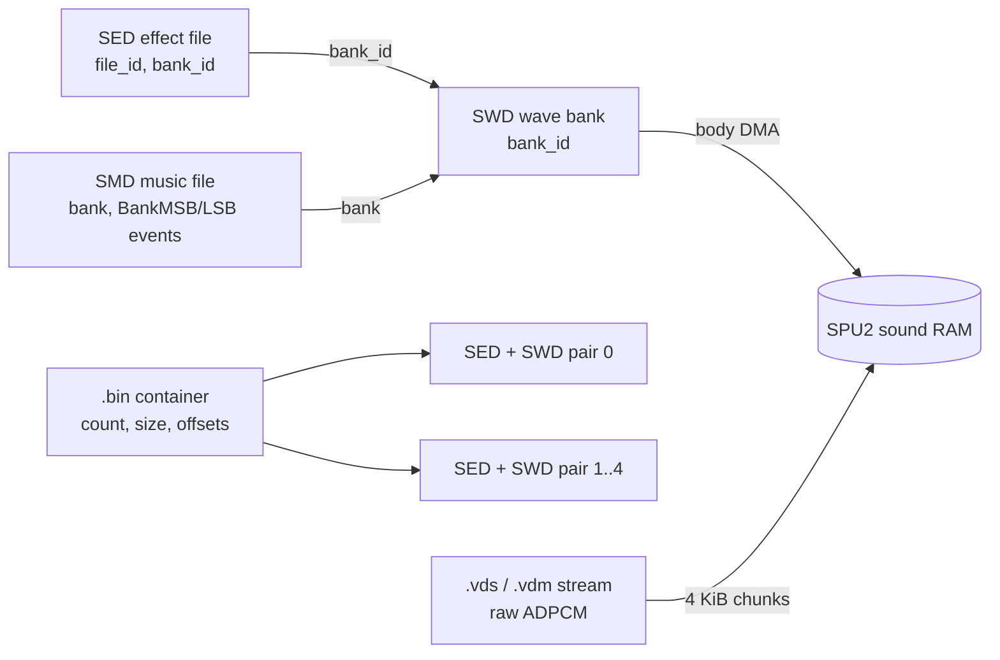
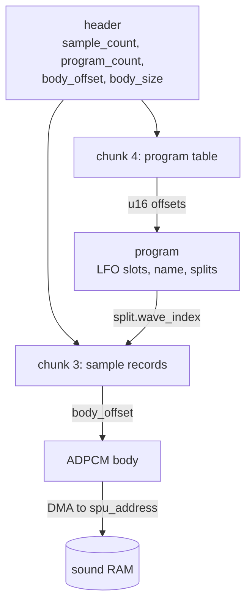
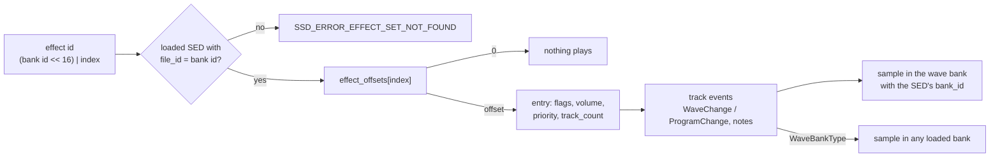
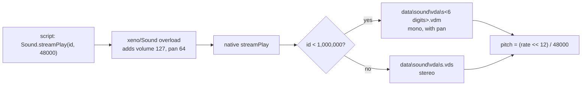
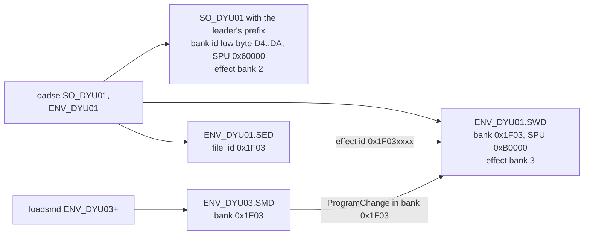

# Sound files

The sound data on the disc uses the three file types of the game's sound
driver, the `SSD.IRX` and `RSSD.IRX` modules on the IOP (SSD names itself
"Digital Sound Element for PS2 Edition"): the wave banks (`.swd`, magic
`swdm`), the sound effect sequences (`.sed`, magic `seds`) and the music
sequences (`.smd`, magic `smdm`). The music files name Procyon Studio as the
studio that made the sound. Next to them sit the battle sound
containers in `data\yamamoto\snd\sed\*.bin`, which pack several effect and
wave bank pairs into one file, and the headerless ADPCM streams (`.vds` stereo
and `.vdm` mono) that carry the cutscene soundtracks, a few field sounds and
the game over voice.

The layouts below hold for every file of each type on the disc and match the
recovered driver code in `src/audio/ssd/` and `src/audio/rssd/`. How the game
and the driver use the data at run time is described in
[Audio](../architecture/audio.md) and
[The IOP sound driver](../architecture/iop-sound-driver.md).

[← Back to the overview](../README.md) · [Files and resources](../architecture/files-and-resources.md)

## Contents

- [Files at a glance](#files-at-a-glance)
- [The common header](#the-common-header)
- [SWD wave banks](#swd-wave-banks)
- [SPU ADPCM](#spu-adpcm)
- [SED effect files](#sed-effect-files)
- [SMD music files](#smd-music-files)
- [Event operand sizes](#event-operand-sizes)
- [Battle sound containers](#battle-sound-containers)
- [VAG streams](#vag-streams)
- [How the files refer to each other](#how-the-files-refer-to-each-other)
- [Unused, missing and duplicate files](#unused-missing-and-duplicate-files)
- [Source files](#source-files)

## Files at a glance

All sound files sit in the archives as plain files. None of them is
ARX-packed (the archive packing is described in
[Files and resources](../architecture/files-and-resources.md)). The banks and
sequences live in archive group 00. The voice and music streams of the
cutscenes live in groups 10 and 20 next to the cutscenes that play them, and
the game over voice is in group 00.

| Type | Extension | Magic | Directory | Files | Bytes | Read by |
| --- | --- | --- | --- | --- | --- | --- |
| Wave bank | `.SWD` (`.swd` once) | `swdm` | `data\sound\sed\` (285), `data\sound\smd\` (1), `data\yamamoto\snd\smd\` (3) | 289 | 49,002,944 | `xglSoundLoadSwd`, `xglSoundSendSwd`, the resource commands |
| Effect sequence | `.SED` (`.sed` once) | `seds` | `data\sound\sed\` | 284 | 138,168 | `xglSoundLoadEffect`, `xglSoundSendSed` |
| Music sequence | `.SMD` | `smdm` | `data\sound\smd\` (110), `data\yamamoto\snd\smd\` (5) | 115 | 178,812 | `xglSoundSendSmd2`, `command_loadsmd`, the battle overlay |
| Battle sound container | `.bin` | none | `data\yamamoto\snd\sed\` | 535 | 79,857,736 | `dataSndSeLoadSub`, `sndSeTrans` in `src/ov01/snd.c` |
| Stereo stream | `.vds` | none | `data\sound\vda\` (groups 10 and 20), `data\yajima\` | 137 | 559,224,832 | `Sound.streamPlay`, the game over screen |
| Mono stream | `.vdm` | none | `data\sound\vda\` (group 10) | 11 | 1,792,000 | `Sound.streamPlay` |

The two lower-case names are `Minislot.sed` and `Minislot.swd`, the effects of
the Network Casino. The casino overlay names them with these exact paths
(`miniSlotSedPath`, `miniSlotSwdPath` in `src/ov11/mini_g.c`).

The files work together through numeric ids, not through names. A wave bank
carries a bank id. An effect file names the bank id whose samples it plays and
carries its own file id, which must equal that bank id. A music file names a
bank id too, and its events can switch to other banks. A battle container is
only a wrapper around effect and wave bank pairs. The streams stand apart:
they are raw ADPCM and need no bank. The diagram below shows these links.



## The common header

The SWD, SED and SMD files start with the same sixteen bytes. The driver's
structures model only some of them (the rest are `unmodeled_*` fields in the
source). The table gives the layout and the values found in all 289 wave banks,
284 effect files, 115 music files and the 1,586 files inside the battle
containers.

| Offset | Size | Type | Source field | Meaning | Values seen |
| --- | --- | --- | --- | --- | --- |
| `0x00` | 4 | char[4] | `signature` / `magic` | `swdm`, `seds` or `smdm` | always one of the three |
| `0x04` | 4 | u32 | (unmodeled) | Checksum word, see below | any |
| `0x08` | 4 | u32 | `size` | File size in bytes | always the exact file length |
| `0x0C` | 2 | u16 | (unmodeled) | Probably a format version | `0x0250` in every file |
| `0x0E` | 2 | u16 | `file_id` | File id. In an SWD it repeats the bank id | always equal to the bank id in SWD files |

The checksum word makes the sum of all 32-bit little-endian words of the file
equal to zero (modulo 2^32). `SsdCheckData` and `SsdGetCheckSum` in
`src/audio/ssd/ssd_err.c` add the words over `size` bytes and refuse a file
whose sum is not zero. The driver calls this check for effect files
(`SsdAddEffectData`) and music files (`SsdAddSequenceData`), but
`SsdAddWaveData` never checks a wave bank. The wave banks carry a valid
checksum anyway: all 289 loose SWD files and 783 of the 793 SWD blocks in the
battle containers sum to zero. The ten that do not are described under
[Battle sound containers](#battle-sound-containers).

The version halfword reads `50 02` on disc. As a number this is `0x0250`,
which is probably version 2.50 of the authoring tool's format. No code reads
it.

## SWD wave banks

### Where the files are and who loads them

A wave bank holds the ADPCM samples of a set of sounds, a table describing
each sample and, for banks used by music, a table of programs (instruments).
`SsdAddWaveData` in `src/audio/ssd/ssd_wave.c` copies the two tables into IOP
memory and sends the sample body to sound RAM by DMA. The EE side sends banks
with `xglSoundSendSwd` and loads named banks with `xglSoundLoadSwd` and
`xglSoundLoadEffect` in `src/main/xgl_sound.c`. The uploading process and the
bank slots are described in [Audio](../architecture/audio.md#5-sound-banks)
and [The IOP sound driver](../architecture/iop-sound-driver.md#7-wave-banks).

The loose banks fall into a few groups. The groups are visible in the names
and in the preferred sound RAM address of the header, which matches the bank
slot each group is loaded into.

| Group | Names | Files | SPU address | Loaded by |
| --- | --- | --- | --- | --- |
| System sounds | `REGIST` | 1 | `0x8000` | `ControlEntry` (`src/main/control_entry.c`), effect bank 0 |
| Extra boot bank | `REGIST2` | 1 | `0x1E0000` | `ControlEntry`, sent alone with `SsdAddWaveData` |
| Common field and minigame effects | `REGISTCF`, `MINIBAT`, `Minicard`, `Minislot` | 4 | `0x20000` | `GameCFSoundReload` and the minigame overlays, effect bank 1 or 2 |
| Leader footsteps | `SO_`, `KM_`, `CS_`, `MO_`, `JR_`, `Z8_` plus a floor name | 178 | `0x60000` | `GameCfPlayerLoadResource`, effect bank 2 |
| Enemy, NPC and party "C" banks | `BOSS003C`, `GUNO002C`, `CF_KOS`, `NPC_F`, `DUMMY_C` and others | 61 | `0x70000` | `command_enenpcse`, effect banks 4 to 11 |
| Map environment | `ENV_*` | 40 | `0xB0000` | `command_loadse`, effect bank 3 |
| U.M.N. music | `Umnmode` (in `data\sound\smd\`) | 1 | `0xB0000` | `src/ov02/tsk_umn_object_task_main.c` |
| Battle music | `BATTLE1` to `BATTLE3` (in `data\yamamoto\snd\smd\`) | 3 | `0xD8000` | `dataSndMuLoad` in `src/ov01/snd.c` |

`REGIST2.SWD` is the only bank with no SED partner. `ControlEntry` loads it
with `xglSoundLoadSwd("sed\\REGIST2")` and adds it directly with
`SsdAddWaveData`. Its bank id is `0x0100`, and no effect file names it in its
header. Its seven samples (`elc_switch.aif`, `denki48775a.aif`, `EXP0201`,
`8002_29.aif`, `45006.aif`, `EXP0221`, `EXP0222`) are played by the system
sounds of `REGIST.SED` instead: effects 9, 33, 34, 35, 56 and 58 switch their
tracks to bank `0x0100` with the WaveBankType command (see
[Effect tracks](#effect-tracks)). The bank stays resident for the whole game,
so these effects work everywhere.

### Layout

An SWD file has four parts. A 64-byte header comes first. A chunk list
follows, with the sample table (chunk type 3), the program table (chunk type
4) and an end marker (chunk type 0). The ADPCM body follows the end chunk and
runs to the end of the file. The end chunk's size is chosen so that the body
starts exactly at `body_offset`, and `body_offset + body_size` is always the
file size.

```
SWD file
+0x0000  header (0x40 bytes)                     "swdm", ids, counts, SPU address
+0x0040  chunk type 3, size 16 + 32 x sample_count
           16-byte chunk header
           sample records, 32 bytes each
+....    chunk type 4, size 16 + program table
           16-byte chunk header
           u16 offset table, then the programs
+....    chunk type 0, size 4 to 64                 pads the header area
+body_offset
         ADPCM body (body_size bytes)               starts with 16 zero bytes
+size    end of file
```

### Header

The header is `SsdWaveFileHeader` in `src/audio/ssd/ssd_wave.c`. Bytes
`0x00` to `0x0F` are the [common header](#the-common-header).

| Offset | Size | Type | Source field | Meaning | Values seen |
| --- | --- | --- | --- | --- | --- |
| `0x00` | 16 | | `signature`, `unmodeled_04` | Common header | |
| `0x10` | 2 | u16 | `flags` | Bit 0 `SSD_WAVE_FLAG_DYNAMIC_ADDRESS` | 0 in 281 files, 1 in 8 |
| `0x12` | 2 | u16 | `bank_id` | Id of the bank in the driver | equals the halfword at `0x0E` in every file |
| `0x14` | 1 | u8 | `sample_count` | Number of sample records | 1 to 221 |
| `0x15` | 1 | u8 | `program_count` | Number of program slots | 0 to 30 |
| `0x16` | 10 | | | Zero | always zero |
| `0x20` | 4 | u32 | `spu_address` | Preferred address in sound RAM | see the table above |
| `0x24` | 4 | u32 | `body_size` | Bytes of ADPCM data | |
| `0x28` | 4 | u32 | `body_offset` | File offset of the body | `0xC0` to `0x2840` |
| `0x2C` | 20 | | | Zero | always zero |
| `0x40` | | | `first_chunk` | First chunk | always type 3 |

`SsdSpuWaveMalloc` decides where the body goes. When the header's address is
the base of a registered [segment allocation mode](../architecture/audio.md#segment-allocation-modes),
the bank goes into the first free segment there. Otherwise bit 0 of `flags`
selects `SsdSpuMallocAdrsDynamic`, and without it the bank is placed at the
fixed address with `SsdSpuMallocAdrs`. The eight flagged banks are `CF_JR`,
`CF_KOS`, `CF_SHION`, `CF_Z8`, `DUMMY_C`, `NPC_F`, `NPC_M` and `WOO_C`. All of
them use address `0x70000`, which the field registers as a segment mode, so in
the field the flag has no effect on them. Eleven SWD blocks in the battle
containers also carry the flag.

### Chunks

Each chunk starts with a 16-byte header (`SsdWaveChunk`): a u16 type, a u16
size that counts the whole chunk including its header, and twelve bytes that
are zero in every file. `SsdAddWaveData` walks the chunks by their sizes until
it meets type 0. It records the payload of type 3 as the sample table and the
payload of type 4 as the program table. Every file on the disc has exactly the
sequence 3, 4, 0. A bank without programs still has a type 4 chunk, with size
16 and no payload (24 loose files).

The end chunk's size varies between 4 and 64 bytes in the loose files. It
fills the gap so that the body starts on the `body_offset` written in the
header. The 12 bytes after its type and size are zero too, even when the
chunk is only 4 bytes long, because the body then starts with its own zero
packet.

### Sample records

The sample table is an array of `SsdWaveSample` records (`include/ssd/ssd_wave.h`),
32 bytes each, indexed from 0. Programs and effect events refer to samples by
this index.

| Offset | Size | Type | Source field | Meaning | Values seen |
| --- | --- | --- | --- | --- | --- |
| `0x00` | 4 | u32 | `body_offset` | Start of the sample in the body, in bytes | multiple of 16 |
| `0x04` | 4 | u32 | `loop_offset` | Loop point word, see below | low half always 0 |
| `0x08` | 1 | u8 | `volume` | Default volume. 0 marks an empty slot | 127 (5,057), 100, 105, 110, 115, 135 |
| `0x09` | 1 | u8 | `pan` | Default pan, 64 is the centre | 64 |
| `0x0A` | 2 | s16 | `base_pitch` | Pitch offset in 1/256 semitones | -4868 to 0 |
| `0x0C` | 2 | u16 | `adsr1` | First SPU2 envelope word | `0x80FF` (5,048), `0xB4FF` (39) |
| `0x0E` | 2 | u16 | `adsr2` | Second SPU2 envelope word | `0xDFE6` (5,045), `0xDFEF`, `0xDFEA`, `0xCE26`, `0xDFEE` |
| `0x10` | 16 | char[16] | `name` | Name of the source sample, Shift-JIS | |

Of the 13,377 records in the loose files, 8,291 have volume 0. The driver
treats a volume of 0 as "no wave" (`SsdSetChannelWave` in
`src/audio/ssd/ssd_chan.c`), so these are empty slots. 155 of the 289 banks
contain such slots, and in 8,290 of them every byte is zero. The remaining
5,086 records are real samples. The empty slots keep the indexes of the real
samples stable, which suggests that the banks were cut down from larger
banks with the same numbering.

The base pitch sets the playback rate. A note is computed as
`key × 256 + base_pitch` in the 8.8 note format of the driver, and key 60
with a base pitch of 0 plays at 48,000 Hz (the SPU2 pitch `0x1000`). A base
pitch of `-3072` is one octave lower. The value therefore probably encodes the
rate the sample was recorded at, as `48000 × 2^(base_pitch / 3072)`. The
common values match standard rates exactly.

| `base_pitch` | Samples | Rate it gives |
| --- | --- | --- |
| -4868 | 1,888 | 16,004 Hz |
| -3447 | 1,434 | 22,053 Hz |
| -4106 | 448 | 19,006 Hz |
| -2388 | 307 | 28,005 Hz |
| -3879 | 277 | 20,005 Hz |
| -1796 | 188 | 32,007 Hz |
| -375, -374 | 147 | 44,106 Hz |
| 0 | 113 | 48,000 Hz |
| -3071 | 80 | 24,005 Hz |

The loop word is never used. The driver computes a `loop_start` from it
(`body_offset + loop_offset`) when it keys on a voice, but no code writes that
value to the SPU2 loop address register (`SsdSetVoiceLoopStartAddress` in
`src/audio/ssd/ssd_dev.c` has no caller). Loops come from the flags inside the
ADPCM data instead (see [SPU ADPCM](#spu-adpcm)). The files still fill the
word consistently. Its high halfword is twice the index of the packet that
carries the loop start flag, counted from the sample's first packet, and its
low halfword is zero. That is the loop start in 8-byte units, the address unit
of the SPU2 registers, placed in the upper half of the word. 5,083 of the
5,086 real samples follow this rule. The three others have no loop start
packet at all and hold other values. One-shot samples have their loop start
flag on packet 1, which gives the very common word `0x00020000`.

Sample names keep the names of the source files, often with a cut extension
because only 16 bytes are kept: `sine857.aif`, `Tri1575Hz.vag`, `VOK02_loop.L`,
`big_fire01`, `dummy28samples`. Extensions seen are `aif`, `vag`, `wav`, `L`
and `R` (stereo halves), and many are cut to `a`, `ai`, `va` or `v`. Japanese
names are Shift-JIS. No name has bytes after its terminating zero.

### The wave body

The body is a series of SPU ADPCM packets of 16 bytes. Each sample is a run of
packets starting at its `body_offset`. The body starts with 16 zero bytes,
which is the zero packet in front of sample 0. Every real sample has the same
shape:

- a packet of 16 zero bytes,
- a first data packet with flag `0x04` (loop start) for a one-shot sample, or
  flag `0x02` (repeat) for a looping sample,
- the data packets, with flag `0x00` in a one-shot sample and `0x02` in a
  looping one, and the flags `0x06` on the loop start packet of a looping
  sample,
- a last packet with flag `0x01` (end) for a one-shot sample or `0x03` (end
  and repeat) for a looping one.

4,382 real samples end with `0x01` and 697 with `0x03`. Seven end with `0x07`,
a packet that is loop start, repeat and end at once, which loops one packet
forever (for example `Tri1575Hz.vag` in `ENV_ELS1.SWD`, a three-packet test
tone). No two samples overlap, and samples follow each other without gaps.
After the last sample the body ends with 0 to 64 unused bytes.

The diagram below shows how the parts of a bank point at each other.



### Programs

A program is an instrument for music and for some effects. The program chunk
payload starts with a table of `program_count` u16 offsets. Each offset is
relative to the start of the payload, and 0 means that the program slot is
empty. The programs follow the table. They are not stored in index order:
`DUMMY_C.SWD`, for example, stores program 2 first. The driver finds a
program through this table (`SsdSetChannelProgram` in
`src/audio/ssd/ssd_chan.c`).

A program is an `SsdProgram` (`include/ssd/ssd_chan.h`) of 96 bytes followed
by its splits.

| Offset | Size | Type | Source field | Meaning | Values seen |
| --- | --- | --- | --- | --- | --- |
| `0x00` | 3 | u8[3] | `properties` | Bytes 0 and 1 zero, byte 2 the program's own index | byte 2 equals the slot index in every program |
| `0x03` | 1 | u8 | `split_count` | Number of splits | |
| `0x04` | 2 | u16 | `adsr1` | Default envelope word 1 | |
| `0x06` | 2 | u16 | `adsr2` | Default envelope word 2 | |
| `0x08` | 2 | u8[2] | `voice_range` | First and last voice the program may use | 0-23 (1,794), 0-47 (191), 24-47 (14), 0-0 (2) |
| `0x0A` | 6 | u8[6] | `synthesis_properties` | Unused | always zero |
| `0x10` | 64 | | `lfo[4]` | Four LFO slots of 16 bytes | |
| `0x50` | 16 | char[16] | `name` | Name of the program | |
| `0x60` | 16 × n | | `splits` | The splits | |

The 16 bytes at `0x50` are modelled in the source as an LFO tail, but they are
a NUL-terminated program name in every file. The footstep banks name their
programs after the floor and the step, for example `w_l`, `w_r`, `r_l`, `r_r`,
`rl`, `rr`, `met_w`, `conc_r_l`, `jr_sandconc_wr`, `jyu_wl`, `hashigo`. These
are probably walk and run, left and right, on metal, concrete, sand and
carpet (`jyu`, from *jūtan*), and a ladder (*hashigo*). Other banks have names
such as `wind`, `cv1_walk`, `cv2_run`, `utso001c_foot`, `utso001c_voice`. No
code reads the name.

Each LFO slot is an `SsdLfoParam` (`include/ssd/ssd_lfo.h`). The driver copies
a slot into the channel only when its flags are not zero
(`SsdInitLfoParam` in `src/audio/ssd/ssd_lfo.c`).

| Offset | Size | Type | Source field | Meaning | Values seen |
| --- | --- | --- | --- | --- | --- |
| `0x00` | 2 | u16 | `flags` | `0x01` enabled, `0x10` single cycle | 0 in 7,924 of 8,004 slots, `0x0011` in the other 80 |
| `0x02` | 1 | u8 | `target` | 0 pitch, 1 volume, 2 pan | 0, 1, 2 |
| `0x03` | 1 | u8 | `waveform` | Index into the waveform table | 0, 2, 3 |
| `0x04` | 4 | s32 | `depth` | Depth | |
| `0x08` | 2 | u16 | `period` | Period | |
| `0x0A` | 2 | u16 | `delay` | Delay | |
| `0x0C` | 2 | u16 | `fade_step` | Fade-in step | |
| `0x0E` | 2 | | (padding) | Not read | byte `0x0F` is `0x01` in 7,726 slots |

The last byte of a slot is 1 in most slots, even in disabled ones. It is
probably a default value written by the authoring tool. The structure's
alignment makes these two bytes padding, and the driver never reads them.

### Program splits

A split (`SsdProgramSplit`, 16 bytes) maps a key range to one sample. When a
note plays a program, the driver starts one voice for every split whose range
contains the key, so splits can overlap to layer samples. The behaviour is
described in [The IOP sound driver](../architecture/iop-sound-driver.md#devices-and-channels).

| Offset | Size | Type | Source field | Meaning | Values seen |
| --- | --- | --- | --- | --- | --- |
| `0x00` | 1 | u8 | `wave_index` | Sample index in this bank | see below |
| `0x01` | 1 | u8 | `root_key` | Key that plays the sample at its base pitch | |
| `0x02` | 1 | u8 | `lower_key` | Lowest key of the range | |
| `0x03` | 1 | u8 | `upper_key` | Highest key of the range | |
| `0x04` | 1 | u8 | `volume` | Split volume | |
| `0x05` | 1 | u8 | `panpot` | Split pan | |
| `0x06` | 1 | u8 | `effects` | Mask for the channel's effect bits | `0xFF` in all 4,870 splits |
| `0x07` | 1 | u8 | `properties` | Unused | always 0 |
| `0x08` | 2 | u16 | `adsr1` | Envelope word 1 | |
| `0x0A` | 2 | u16 | `adsr2` | Envelope word 2 | |
| `0x0C` | 4 | u8[4] | `synthesis_parameters` | Unused | `00 00 00 2F` in every split |

The footstep programs split the keyboard into four ranges, each pointing at a
different step sample. The effect files then play them with the `RandomNote`
event (`0xAE`), so a random key picks one of the four variants on each step.

Many banks keep programs whose splits name samples that the bank does not
have. 141 splits in 26 loose banks, and 554 splits in 189 SWD blocks of the
battle containers, point at a `wave_index` equal to or larger than
`sample_count`. `DUMMY_C.SWD` has one sample (an empty slot) and
four programs that name samples 0 to 7, and the `GUNO002C`, `GUNO003C`,
`GUNO007C` and `GUNO008C` banks and many other "C" banks name samples 2 to 4
while holding one or two. `SsdKeyonChannelProgram` does not check the index,
so such a split would read a record past the end of the sample table. These
programs are probably left over from the full banks the "C" banks were cut
from.

### Example: REGIST.SWD

`REGIST.SWD` is the system sound bank (99,008 bytes, 24 samples, no programs).
Its first bytes are:

```
0x0000  73 77 64 6d  4b d1 5b 30  c0 82 01 00  50 02 00 00   "swdm", checksum, size 0x182C0, 0x0250, id 0
0x0010  00 00 00 00  18 00 00 00  00 00 00 00  00 00 00 00   flags 0, bank 0, 24 samples, 0 programs
0x0020  00 80 00 00  40 7f 01 00  80 03 00 00  00 00 00 00   spu 0x8000, body_size 0x17F40, body_offset 0x380
0x0040  03 00 10 03  00 00 00 00  00 00 00 00  00 00 00 00   chunk 3, size 0x310 = 16 + 24 x 32
0x0050  00 00 00 00  00 00 06 00  7f 40 00 00  ff 80 e6 df   sample 0: offset 0, loop word 0x00060000,
0x0060  73 69 6e 65  38 35 37 2e  61 69 66 00  ...            vol 127, pan 64, pitch 0, ADSR 80FF DFE6, "sine857.aif"
0x0340  64 75 6d 6d  79 32 38 73  61 6d 70 6c  65 73 00 00   end of the last name, "dummy28samples"
0x0350  04 00 10 00  00 00 00 00  00 00 00 00  00 00 00 00   chunk 4, size 16, no programs
0x0360  00 00 20 00  00 00 00 00  00 00 00 00  00 00 00 00   chunk 0, size 0x20, ends at 0x380
0x0380  00 00 00 00  00 00 00 00  00 00 00 00  00 00 00 00   body: zero packet
0x0390  46 02 30 44  54 55 65 65  56 55 45 24  23 1f ed bc   first data packet: filter 4, shift 6, flag 0x02
```

Sample 0 is a looping sine. Its loop word `0x00060000` has the high half 6,
and the loop start flag sits on packet 3 of the sample.

The program table of `DUMMY_C.SWD` shows the out-of-order storage. Its payload
starts at `0x80`:

```
0x0080  08 01 88 01  08 00 88 00                            offsets of programs 0..3: 0x108, 0x188, 0x008, 0x088
0x0088  00 00 02 02  ff 80 e6 df  00 17 ...                 program 2: index 2, 2 splits, ADSR, voices 0-23
0x00D8  72 6c 00 ...                                        program name "rl"
0x00E8  00 3c 00 40  7f 40 ff 00  ff 80 e6 df  00 00 00 2f   split: wave 0, root 60, keys 0-64, vol 127, pan 64
0x00F8  01 3c 41 7f  7f 40 ff 00  ff 80 e6 df  00 00 00 2f   split: wave 1, root 60, keys 65-127
```

### Statistics and leftovers

- 289 loose banks, 13,377 sample records of which 5,086 are real, 2,001
  programs in 265 banks with 4,870 splits.
- Sizes range from 2,816 bytes (`UTRE004C.SWD`) to 1,172,480 bytes
  (`ENV_KUK03B.SWD`).
- `ENV_UMN.SWD` and `Umnmode.SWD` are byte-identical (1,032,384 bytes).
- Five bank ids are shared by several files: `0x0002` (`ENV_UMN`, `ENV_VOK`,
  `ENV_VOK1`, `Umnmode`), `0x2940` (`UTMA002C`, `UTMA009C`), `0x5109`
  (`Z8_PRO01`, `Z8_PRO02`), `0x5305` (`KM_PRO03`, `KM_PRO04`) and `0x7931`
  (`GUNO022C`, `GUNO023C`). The driver refuses to load a second bank with an
  id that is already loaded and returns the old one, so two such banks cannot
  be resident at the same time.
- Unused fields: bytes `0x16` to `0x1F` and `0x2C` to `0x3F` of the header,
  the 12 bytes of every chunk header, the loop word, the program name, the
  LFO padding, `synthesis_properties`, split `properties` and
  `synthesis_parameters`.

## SPU ADPCM

All sample data of this family, in wave banks and in streams, uses the ADPCM
format that the SPU2 decodes in hardware (often called VAG after Sony's file
format). The data is a series of 16-byte packets. Each packet holds 28
samples of 4 bits.

```
packet (16 bytes)
+0x00  u8  coding     high nibble = filter (0 to 4), low nibble = shift (0 to 12)
+0x01  u8  flags      bit 0 end, bit 1 repeat, bit 2 loop start
+0x02  14 bytes       28 nibbles, low nibble first
```

To decode a packet, each nibble is sign-extended, shifted left by 12 and right
by `shift`, and then the prediction of the selected filter is added:

```
s = (nibble << 12) >> shift
s = s + (h1 * K0[filter] + h2 * K1[filter]) / 64
clamp s to -32768 .. 32767, then h2 = h1 and h1 = s

K0 = 0, 60, 115, 98, 122
K1 = 0,  0, -52, -55, -60
```

Every packet in every bank and stream on the disc has a filter of 4 or less
and a shift of 12 or less.

The flags control looping on the SPU2. The loop start flag stores the packet
address as the voice's loop address. At a packet with the end flag the voice
jumps to that loop address. If the repeat flag is set as well it keeps
playing, otherwise the voice is released and goes silent. This is why a
one-shot sample ends with `0x01` and a looping one with `0x03`. The packet of
zero bytes in front of each sample has flags 0. The SPU2 itself is described
in [The IOP sound driver](../architecture/iop-sound-driver.md#sound-ram).

## SED effect files

### Where the files are and who loads them

An effect file holds the programs of the sound effects of one bank. Each
effect is a small sequence of one or more tracks. `SsdAddEffectData` in
`src/audio/ssd/ssd_sec.c` checks the magic and the checksum, copies the whole
file into IOP memory and links it into the driver's list of effect sets through
the `next` field at `0x30`. On the EE the file is sent by `xglSoundSendSed`,
usually together with its wave bank by `xglSoundLoadEffect`, which loads
`<name>.SWD` and `<name>.SED` from `data\sound\sed\`.

Every SED in `data\sound\sed\` has an SWD of the same name next to it. The
playing of effects is described in
[The IOP sound driver](../architecture/iop-sound-driver.md#11-sound-effects)
and [Audio](../architecture/audio.md#9-sound-effects-and-the-se-queue).

An effect is addressed by a 32-bit id. On the IOP the upper half is the file
id of an effect file and the lower half the index of the effect inside it.
The EE builds the upper half from the wave bank handle of the effect bank
slot, which is the SWD's bank id (`SoundWork.effect_banks[n].handle` in
`src/main/xgl_sound.c`). `SsdPlayEffectParam` then searches the loaded effect
files for one whose `file_id` equals that half. An effect file is therefore
only reachable when its `file_id` equals the bank id of the SWD loaded with
it, which is true for all but two loose pairs (see
[How the files refer to each other](#how-the-files-refer-to-each-other)).

### Layout

The header is 0x34 bytes, followed by the offset table and the effect entries.
The entries follow each other without gaps, and the last one ends exactly at
the file size.

```
SED file
+0x00  common header ("seds", checksum, size, 0x0250, file_id)
+0x10  zero bytes
+0x1A  u16 effect_count
+0x1C  u16 bank_id
+0x20  char[16] tool file name, "xxx.sav"
+0x30  u32 next (0 on disc, a link pointer once loaded)
+0x34  u16 effect_offsets[effect_count]
       0 or 2 bytes of padding to a 4-byte boundary
       effect entries, each followed by its track events
+size  end of file
```

### Header

The header is `SsdEffectData` in `include/ssd/ssd_sec.h`.

| Offset | Size | Type | Source field | Meaning | Values seen |
| --- | --- | --- | --- | --- | --- |
| `0x00` | 16 | | `magic`, `size`, `file_id` | Common header | |
| `0x10` | 10 | | `unmodeled_10` | Zero | always zero |
| `0x1A` | 2 | u16 | `effect_count` | Number of entries in the offset table | 5 to 170 (8,257 in all) |
| `0x1C` | 2 | u16 | `bank_id` | Bank whose samples the effects play | equals `file_id` in every loose file |
| `0x1E` | 2 | | (part of `unmodeled_1e`) | Zero | always zero |
| `0x20` | 16 | char[16] | (part of `unmodeled_1e`) | Name of the authoring tool's project file | ends in `.sav` in every file |
| `0x30` | 4 | u32 | `next` | Link to the next loaded effect set | 0 in every file |
| `0x34` | 2 × n | u16[] | `effect_offsets` | Byte offsets of the entries from the file start | |

The name at `0x20` is the name of the bank followed by `.sav`, in lower case
in 243 files (`regist.sav`, `minislot.sav`) and in mixed case in the others.
The blocks inside the battle containers carry names like `boss004m.sav`. It is
probably the project file of the sound tool, and the driver never reads it.
Two loose files carry the name of another bank, which shows where they were
copied from (see the statistics below).

`effect_offsets[0]` is 0 in every file, so effect 0 never exists. 4,978 of the
8,257 offsets are 0 in the loose files, and an offset of 0 makes
`SsdPlayEffectParam` return without playing anything. A file therefore often
has holes in its effect numbering. The table is padded with two zero bytes
when `effect_count` is odd (73 files).

### Effect entries

An entry is an `SsdEffectEntry` followed by its track offsets and then the
event streams of its tracks.

| Offset | Size | Type | Source field | Meaning | Values seen |
| --- | --- | --- | --- | --- | --- |
| `0x00` | 1 | u8 | `flags` | `0x04` stop every instance, `0x20` use the low 24 tracks, bit 0 unknown | `0x21` (2,692), `0x01` (550), `0x25` (37) |
| `0x01` | 1 | u8 | `volume` | Starting velocity of every track | 0 to 255, 120 entries above 127 |
| `0x02` | 1 | u8 | `priority` | Priority when tracks are stolen | 0, 5, 13, 14, 15 |
| `0x03` | 1 | u8 | `track_count` | Number of tracks | 0 to 7 |
| `0x04` | 2 | u16 | (part of `unmodeled_04`) | Zero | always 0 |
| `0x06` | 2 | u16 | (part of `unmodeled_04`) | Size of the entry with its events and padding | always exact |
| `0x08` | 2 × n | u16[] | `track_offsets` | Offset of each track's events from the entry start | |

The flags are read by `SsdSaechSeqFreeTrack`. `SSD_EFFECT_FLAG_STOP_ANY_MODE`
(`0x04`) stops the effect in every mode before it restarts, and
`SSD_EFFECT_FLAG_LOW_TRACKS` (`0x20`) searches free tracks among the first 24
tracks of the effect sequence instead of the last ones. Bit 0 is set in every
entry on the disc, and no code tests it. The volume is loaded as the
starting velocity of each track (`entry->volume << 16`). 48 entries have
`track_count` 0, and the driver does not play them.

The halfword at `+0x06` is the distance from this entry to the next one. It
is never read, but it always matches the real size, including the zero bytes
that round every entry to a 4-byte boundary.

### Effect tracks

The tracks of an effect use the same command bytes as music (see
[Event operand sizes](#event-operand-sizes)), but notes are coded differently.
The effect sequence runs `SsdEffectTrackSequence` in `src/audio/ssd/ssd_main.c`
instead of the music routine, and its note event is three bytes long:

```
effect note (first byte < 0x80)
  byte 0   key within the octave (0 to 15), added to the track's octave
  byte 1   duration, low byte
  byte 2   duration, high byte
  The duration (u16, little-endian) is both the note length and the wait
  before the next event. The velocity is the track's current velocity.
```

This differs from the music note in three ways. The effect note has no
velocity byte, its duration is always two little-endian bytes, and it also
sets the track's wait, while a music note leaves the wait to the delta
commands. The upper nibble of the first byte is 0 in all 4,716 notes of the
loose files. Before a note sounds, the routine looks ahead over the following
commands to decide on slurs and ties, using the length table
`SsdSeqFuncLength` in `src/audio/ssd/ssd_data.c`.

The commands used most in effect tracks are `0x90` Stop (7,929 times),
`0xAA` WaveChange (5,929), `0xE0` VolumeAbsolute (3,139), `0xD9` Vibrate2,
`0xCA` ReverbOn, `0xAC` ProgramChange and `0xAE` RandomNote. An effect picks its
sample with WaveChange (an index into the bank's sample table) or picks a
program with ProgramChange.

A third way reaches samples outside the effect's own bank. WaveBankType
(`0xAB`) takes three bytes: a sample index, then a bank id stored high byte
first (`SsdSeqWaveBankType` computes `events[1] << 8 | events[2]`). The
channel then looks the bank up by id among all loaded wave banks
(`SsdSetChannelWave`). The command occurs 83 times, and every operand names
an existing bank only in this byte order:

| Effect file | Effects | Bank bytes | Bank it selects |
| --- | --- | --- | --- |
| `REGIST.SED` | 9, 33, 34, 35, 56, 58 (12 tracks) | `01 00` | `0x0100`, `REGIST2.SWD` |
| `ENV_VOK3.SED` | 136, 141, 148 | `19 30` | `0x1930`, `GUNO001C.SWD` |
| `ENV_VOK3.SED` | 147 | `39 20` | `0x3920`, `BOSS003C.SWD` |
| `ENV_VOK3.SED`, `GUNO024C.SED` | 138, and 6 and 7 | `03 00` | `0x0300`, `REGISTCF.SWD` |
| 9 loose files (`ENV_UTA02.SED` has 28 of the uses) and 7 battle containers | 57 uses | `00 00` | `0x0000`, `REGIST.SWD` |

An effect that names an enemy bank this way plays only while that enemy's
bank is loaded. `REGIST.SWD`, `REGIST2.SWD` and, in the field, `REGISTCF.SWD`
are always present.

This is the only multi-byte command operand that is not little-endian (see
[Event operand sizes](#event-operand-sizes)).

The flowchart below follows an effect id from the EE to the sample it plays.



### Example: REGIST.SED

`REGIST.SED` (3,456 bytes) holds the system sounds of bank 0. Its header and
the first entry read:

```
0x0000  73 65 64 73  57 87 63 8d  80 0d 00 00  50 02 00 00   "seds", checksum, size 0xD80, 0x0250, file_id 0
0x0010  00 00 00 00  00 00 00 00  00 00 65 00  00 00 00 00   effect_count 101, bank_id 0
0x0020  72 65 67 69  73 74 2e 73  61 76 00 00  00 00 00 00   "regist.sav"
0x0030  00 00 00 00  00 00 00 01  5c 01 90 01  a8 01 0c 02   next 0, offsets 0, 0x100, 0x15C, 0x190, 0x1A8, 0x20C
...
0x0100  01 82 00 04  00 00 5c 00  10 00 21 00  38 00 46 00   effect 1: flags 0x01, volume 130, priority 0,
                                                             4 tracks, size 0x5C, tracks at +0x10 +0x21 +0x38 +0x46
0x0110  d3 14 00  aa 12  b2 2b  b7 0c 03  b5 32  96  00 64 00  90
        Detune    Wave 18 AR    DRSL      SR     Oct+ note 0, 100 ticks  Stop
```

The 101 offsets take 202 bytes from `0x34`, and two bytes of padding bring the
first entry to `0x100`. The second track at `0x121` starts with `88 26 00`, a
38-tick rest, so the four tracks play two pairs of layered notes, the second
pair slightly later.

### Statistics and leftovers

- 284 loose files with 8,257 effect slots, 3,279 of them real entries. The
  largest file is `REGIST.SED` (3,456 bytes), the smallest 176 bytes.
- 793 more SED blocks sit inside the battle containers. They have 2 to 43
  slots, flags `0x01` (one entry has `0x05`), up to 13 tracks per entry and
  priorities 0, 10, 11 and 15.
- `ENV_PRO03.SED` has file id `0x5102` and the tool name `ENV_PRO01.sav`,
  but its wave bank `ENV_PRO03.SWD` has bank id `0x5302`. `0x5102` is the bank
  id of `ENV_PRO01.SWD`, so this file was probably made from `ENV_PRO01.SED`
  and never renumbered.
- `ENV_UMN.SED` is a byte-identical copy of `ENV_KUK01.SED` (tool name
  `ENV_KUK01.sav`, file id `0x3303`), while `ENV_UMN.SWD` has bank id
  `0x0002`. Its effects can only play while `ENV_KUK01.SWD` is loaded.
- Unused fields: `0x10` to `0x19`, `0x1E`, the tool name, the zero halfword
  and the size halfword of every entry, and bit 0 of the entry flags.

## SMD music files

### Where the files are and who loads them

A music file is a sequence of tracks. `SsdAddSequenceData` in
`src/audio/ssd/ssd_musc.c` checks the magic and the checksum, copies the file
into IOP memory and creates a sequence with one MIDI device. The playback is
described in [The IOP sound driver](../architecture/iop-sound-driver.md#9-the-sequencer)
and [Audio](../architecture/audio.md#8-music-sequences).

Most of the 115 files are not music in the usual sense. 103 of the 110 files
in `data\sound\smd\` are short environment sequences of about 200 bytes,
named `ENV_<map>.SMD`, that play long looped ambience samples from the map's
environment wave bank. Their comment strings call them "base noise"
(ベースノイズ) or give the map name. The real pieces of music are few.

| Files | Title in the file | Composer string | Tracks |
| --- | --- | --- | --- |
| `ENV_ELS02B`, `ENV_KUK03B`, `ENV_VOK3` | `Escape!` | Yasunori Mitsuda | 37 |
| `ENV_UMN`, `Umnmode` (identical) | `U.M.N.Mode` | Yasunori Mitsuda | 29 |
| `ENV_GNK02` | 天の車 | Yasunori Mitsuda | 29 |
| `ENV_UTA02` | ネピリムの歌声 | Yasunori Mitsuda | 29 |
| `BATTLE1` | `Battle1` | Yasunori Mitsuda | 31 |
| `BATTLE2` | `Battle1` | Yasunori Mitsuda | 31 |
| `BATTLE3` | `LastBattle` | Yasunori Mitsuda | 31 |
| `JINGLE1`, `JINGLE2` | `Jingle2` | template text | 29 |

The three `Escape!` files differ only in their header (file id, bank,
timestamp and checksum). Their tracks are identical, so each plays the piece
with the samples of a different map's environment bank. Their comment
reads 容量減らしVer. ("reduced size version"). `ENV_GNK02` and `ENV_UTA02` are
only 616 bytes, so these titles probably play long recorded samples rather
than sequenced notes.

The field loads the environment sequences with the `loadsmd` scene command
(`command_loadsmd` in `src/main/res_get_path.c`). The battle overlay loads the
battle music and jingles from `data\yamamoto\snd\smd\` (`muName` and
`mu2Name` in `src/ov01/snd.c`), and the U.M.N. overlay loads
`data\sound\smd\Umnmode.SMD` with its wave bank.

### Layout

An SMD file is a 0x28-byte header followed by chunks. Each chunk starts with
a u16 type and a u16 size that counts the whole chunk. The chunks are always
in the order metadata (type 2), the tracks (type 3, one per track) and end
(type 0, size 4). The driver also knows a patch chunk (type 4), but no file
on the disc has one.

```
SMD file
+0x00  common header ("smdm", checksum, size, 0x0250, file_id)
+0x10  authoring date and time
+0x18  playback settings (priority, options, bank, track count, voice range, reverb)
+0x28  chunk 2: metadata strings
+....  chunk 3: track 0
+....  chunk 3: track 1 ...
+....  chunk 0: end (size 4)
+size  end of file
```

### Header

The header is `SsdMusicData` in `include/ssd/ssd_musc.h`.

| Offset | Size | Type | Source field | Meaning | Values seen |
| --- | --- | --- | --- | --- | --- |
| `0x00` | 16 | | `signature`, `size`, `file_id` | Common header | |
| `0x10` | 2 | u16 | (part of `unmodeled_10`) | Year | 2001 (99 files), 2002 (16) |
| `0x12` | 1 | u8 | | Month | |
| `0x13` | 1 | u8 | | Day | |
| `0x14` | 1 | u8 | | Hour | |
| `0x15` | 1 | u8 | | Minute | |
| `0x16` | 1 | u8 | | Second | |
| `0x17` | 1 | u8 | | Day of the week, Sunday = 1 | |
| `0x18` | 1 | u8 | `priority` | Sequence priority | 0 |
| `0x19` | 1 | u8 | `options` | Bit 0 reverb on core 0, bit 1 on core 1 | 1 (113), 0 (2) |
| `0x1A` | 2 | | `unmodeled_1a` | Zero | always zero |
| `0x1C` | 2 | u16 | `bank` | Wave bank the tracks start with | |
| `0x1E` | 1 | u8 | `track_count` | Number of track chunks | 3 (98), 5 (5), 29 (6), 31 (3), 37 (3) |
| `0x1F` | 1 | u8 | `channel_priority` | Priority of the MIDI device | 7 (103), 1 (9), 0 (3) |
| `0x20` | 1 | u8 | `unmodeled_20` | Unknown, never read | 0 to 127 |
| `0x21` | 1 | u8 | `settings.voice_range` (first) | First voice of the device | 0 |
| `0x22` | 1 | u8 | `settings.voice_range` (last) | Last voice of the device | 23 (104), 47 (10), 24 (1) |
| `0x23` | 1 | u8 | `reverb_mode` | Reverb type | 4 (most), 1, 2, 3 |
| `0x24` | 1 | u8 | `reverb_depth` | Reverb depth | 0 to 80 |
| `0x25` | 1 | s8 | `reverb_parameters[0]` | Reverb delay | 0 |
| `0x26` | 1 | s8 | `reverb_parameters[1]` | Reverb feedback | 0 |
| `0x27` | 1 | u8 | `midi_channel_count` | Channels of the MIDI device | always the highest track channel + 2 |
| `0x28` | | | `chunks` | First chunk | always type 2 |

The eight bytes at `0x10` are a timestamp written by the authoring tool. In
`ENV_DYU01.SMD` they read `d1 07 0c 18 10 05 25 02`, which is 24 December 2001,
16:05:37, and day 2. That day was a Monday, so the tool counts the week from
Sunday = 1, as the classic Mac OS date record does. The dates run from late
2001 to early 2002. The fourteen `ENV_VOK*B` files are all dated 29 November
2001.

The voice range bytes are read twice. `SsdNewMidiDevice` takes them as the
voice range of the device, and `SsdInitSequence` reads the same two bytes as
`settings.master.note` and `settings.master.pan` and passes them to
`SsdSetMidiDevicePriority`. The environment sequences keep to voices 0 to 23
and the music uses 0 to 47.

`midi_channel_count` is used when it is not zero, otherwise the driver counts
the channels itself (`SsdCheckMidiChannel`). In every file it is one more than
the channels the tracks use, so each device gets one spare channel.

The byte at `0x20` varies between 0 and 127 and looks like a volume or a
tempo setting of the tool, but no code reads it. Its meaning is unknown.

### Metadata chunk

The type 2 chunk holds five NUL-terminated strings in code page 932
(Shift-JIS): the title, the game, the composer, the studio and a comment. The
environment sequences read `ゼノサーガ`, `ゼノサーガ`, `金子昌晃、黒田淳也`,
`PROCYON STUDIO` and the map or "base noise" comment. The music files name
`Yasunori Mitsuda`. `JINGLE1.SMD` and `JINGLE2.SMD` still hold the tool's
template text: `新規プロジェクト` (new project), `著作者（個人名）` (author,
personal name), `著作者（組織名）` (author, organisation) and `コメント`
(comment). `BATTLE1` has the comment `IBENT BATTLE` and `BATTLE2` the comment
`EVENT BATTLE` with the title `Battle1`. The chunk is padded to a 4-byte
boundary.

`SsdSetDataAddress` stores a pointer to the strings in `sequence->metadata`,
but nothing reads them afterwards.

### Track chunks

A track chunk starts with eight bytes, then the track's event stream.

| Offset | Size | Type | Source field | Meaning | Values seen |
| --- | --- | --- | --- | --- | --- |
| `0x00` | 2 | u16 | `type` | 3 | |
| `0x02` | 2 | u16 | `size` | Size of the chunk | multiple of 4 |
| `0x04` | 2 | u8[2] | `track.parameters` | Unknown, never read | `00 00` (238), `01 00` (122), `01 01`, `01 02` ... `02 09` |
| `0x06` | 1 | u8 | `track.midi_channel` | MIDI channel of the track | 0 to 37 |
| `0x07` | 1 | u8 | `track.attributes` | Initial track flags | 0 in every chunk |
| `0x08` | | | `track.events` | Event stream | |

The event stream ends with a Stop command (`0x90`). 0 to 3 zero bytes follow
to fill the chunk to a 4-byte boundary. Every track on the disc contains a
Repeat command (`0x91`) and a Stop, so all music and all environment
sequences loop forever. Track 0 of every file begins with
`fd 00 00 00 00 00` (an SMPTE offset of 0, four files use an offset of one
hour), a Measure command and a tempo command.

### Music events

Music tracks use the note format of `SsdNormalTrackSequence` in
`src/audio/ssd/ssd_main.c`, which is described in
[The IOP sound driver](../architecture/iop-sound-driver.md#event-format):

```
music note (first byte < 0x80)
  byte 0   velocity (0 to 127)
  byte 1   bits 6-7: number of duration bytes (0 to 3)
           bits 4-5: octave change + 1 (0 = down one, 1 = none, 2 = up one, 3 = up two)
           bits 0-3: key within the octave
  bytes    duration, big-endian, or none to reuse the previous duration
```

The duration bytes of a note are big-endian, while the 16-bit operands of
commands such as Delta2 (`0x85`), Rest (`0x88`) and Tie (`0x89`) are
little-endian. On the disc, 14,238 notes reuse the previous duration, 11,323
carry one byte and 944 carry two. No note uses three bytes. A note does not
set the wait. The wait until the next event comes from the delta commands
`0x80` to `0x86`.

The command bytes and their operand sizes are listed in
[Event operand sizes](#event-operand-sizes). In music, the most frequent are
DeltaForAfterDelta (`0x81`, 17,867 times), Delta1 (`0x84`, 12,994),
VolumeAbsolute (`0xE0`, 8,601), DeltaForGate (`0x80`, 4,849) and
PanpotAbsolute (`0xE8`, 4,616).

The bank commands work against their names. `SsdSeqBankMSB` (`0xA8`) sets the
low byte of the channel's 16-bit bank id and `SsdSeqBankLSB` (`0xA9`) the high
byte. `BATTLE2.SMD` uses `a8 01 a9 02` to select bank `0x0201`, which is the
id of `BATTLE2.SWD`. In the files the bank commands always select the bank the
header already names, except in the jingles, which also select `0x0001`, a
bank id that no file on the disc has.

### Tempo and timing

The tempo command `0x9C` takes one byte, the tempo in beats per minute. The
sequencer runs 96 ticks per beat at a 2 ms interrupt (see
[Timing](../architecture/iop-sound-driver.md#timing)), so durations in the
events are in ticks of 1/96 beat. A whole note is 384 ticks.

| Tempo (BPM) | Files |
| --- | --- |
| 180 then 60 | 103 environment sequences |
| 91, 98, 121, 122, 144, 154, 164, 168 | the pieces of music |

The environment sequences set tempo 180 and then 60 at once, so they run at
60 BPM, where one tick is about 10.4 ms.

The Measure command `0xA0` has two operands. The files store the beats per
bar first and the note value second: the pairs seen are 4/4 (120 times), 1/8
(103, the environment sequences), 3/4 (20), 6/4 (7) and 2/4 (2).
`SsdSeqMeasure` reads the first byte as the denominator and divides 384 by it,
and takes the second byte as the number of beats. The two readings agree only
for 4/4, so the driver's measure counter (`SsdGetPlayMeasure`) is probably
wrong for the other signatures. Playback speed does not depend on it.

### Example: ENV_DYU01.SMD

`ENV_DYU01.SMD` is a whole environment sequence in 196 bytes:

```
0x0000  73 6d 64 6d  06 54 52 96  c4 00 00 00  50 02 03 1f   "smdm", checksum, size 196, 0x0250, file_id 0x1F03
0x0010  d1 07 0c 18  10 05 25 02  00 01 00 00  03 1f 03 07   2001-12-24 16:05:37 Mon, priority 0, options 1,
                                                             bank 0x1F03, 3 tracks, channel priority 7
0x0020  41 00 17 04  28 00 00 03                             byte 0x41, voices 0-23, reverb 4 depth 40, 3 channels
0x0028  02 00 44 00  83 5b 83 6d  ...                         metadata chunk, 0x44 bytes: ゼノサーガ ...
0x006C  03 00 20 00  00 00 00 00                              track 0, channel 0
0x0074  fd 00 00 00 00 00  a0 01 08  9c b4  9c 3c  a0 04 04  85 f4 08  91  85 00 06  90
        SMPTE offset 0     1/8       180    60     4/4       wait 2292 Rep wait 1536 Stop
0x008C  03 00 24 00  01 00 00 00                              track 1, channel 0
0x0094  ac 00  d4 00 00  e0 3d  e8 40  df 7f  bf 7f  94 05  7f 90 06 00  85 f4 08  91  85 00 06  90
        Prog 0 Bend 0    Vol 61 Pan 64 Expr   Sust   Oct 5  vel 127, key 0, 1536 ticks
0x00B0  03 00 10 00  00 00 01 00  85 f4 08 91  85 00 06 90   track 2, channel 1, waits only
0x00C0  00 00 04 00                                           end chunk
```

Track 1 selects program 0 of bank `0x1F03` (`ENV_DYU01.SWD`, the
environment bank loaded for the map), sets volume, pan and expression, and
plays one long note. The sample itself loops in its ADPCM data, so the note
keeps the ambience going. After 2,292 ticks the track reaches its repeat point
and then idles forever.

### Statistics and leftovers

- 115 files from 196 to 23,960 bytes. 98 environment sequences have three
  tracks and five (`ENV_VOK13`, `ENV_VOK13B`, `ENV_VOK24` to `ENV_VOK26`) have
  five. The music has 29 to 37.
- All files are valid: checksums, chunk sizes and track counts match.
- Byte-identical copies: `ENV_UMN.SMD` = `Umnmode.SMD`. `BATTLE1` and
  `BATTLE2` have the same size and differ in their ids, `JINGLE1` and
  `JINGLE2` likewise.
- Pairs that share a file id: `ENV_ELS07` and `ENV_ELS11`, `ENV_PRO01` and
  `ENV_PRO02`, `ENV_UTA06_2` and `ENV_UTA07`, `ENV_VOK25` and `ENV_VOK26`,
  `ENV_UMN` and `Umnmode`. `SsdAddSequenceData` refuses a second sequence with
  a loaded id.
- Unused fields: the timestamp, the byte at `0x20`, `0x1A`, the track
  `parameters`, the metadata strings.

## Event operand sizes

SED and SMD tracks share one command set. A byte of `0x80` or more is a
command, handled by `SsdSeqFuncTrap[byte - 0x80]` in
`src/audio/ssd/ssd_trap.c`. The handler reads its operands and returns the new
stream position. The names and meanings are listed in
[Event format](../architecture/iop-sound-driver.md#event-format). The table
below gives the number of operand bytes each handler consumes, which is what
a reader of the files needs to walk a stream. Codes not listed are
`SsdSeqDummy`, which takes no operand, and none of them occurs on the disc.

| Operand bytes | Commands |
| --- | --- |
| 0 | `80` `81` `90` `91` `96` `97` `99` `9A` `B0` `C0` `C1` `C2` `C3` `C6` `C7` `CA` `CB` `DA` `DB` `DD` `E6` `E7` `EE` `EF` `F8` |
| 1 | `82` `83` `84` `94` `95` `98` `9C` `9D` `A8` `A9` `AA` `AC` `B2` `B3` `B4` `B5` `B6` `B8` `B9` `BA` `BB` `BC` `BF` `C4` `C5` `D0` `D1` `D2` `D7` `DF` `E0` `E1` `E3` `E8` `E9` `EB` `F6` `F7` `F9` `FE` |
| 2 | `85` `88` `89` `A0` `A1` `A6` `B7` `C9` `D3` `D4` `F2` `FB` |
| 2 (signed jump distance) | `92` Jump |
| 3 | `86` `AB` `AE` `B1` `C8` `D5` `D8` `D9` `E2` `E4` `E5` `EA` `EC` `ED` `F0` `F1` `FA` |
| 3 (byte, then signed distance) | `93` If |
| 5 | `FD` SMPTEOffset |

The walker in the effect routine uses `SsdSeqFuncLength` in
`src/audio/ssd/ssd_data.c`, which lists the same sizes plus one for the command
byte. Multi-byte operands are little-endian, with one exception: the bank id
in the last two bytes of WaveBankType (`0xAB`) is stored high byte first (see
[Effect tracks](#effect-tracks)). Several 2- and 3-byte commands hold separate
one-byte values rather than one number, for example Measure (`0xA0`), whose
two bytes are the beats per bar and the note value. Every track of every SED,
SMD and battle container walks cleanly to its Stop with these sizes.

## Battle sound containers

### Where the files are and who loads them

The battle overlay keeps the sounds of each unit in one file in
`data\yamamoto\snd\sed\`. A file holds one to five SED and SWD pairs, one
pair per sound bank of the unit. `dataSndSeLoadSub` in `src/ov01/snd.c`
builds the name, loads the file whole with `dataFileLoadNB` and records its
size rounded up to whole sectors. `dataSndSeLoad2` and `dataSndSeRegLoad2`
turn the header offsets into the SED and SWD pointers of each bank, and
`sndSeTrans` sends a pair to an effect bank slot with `xglSoundSendSed` and
`xglSoundSendSwd`. How the battle uses its banks is described in
[Audio](../architecture/audio.md#13-sound-in-the-overlays) and
[Battle](../game/battle.md).

### Layout

The file starts with a small header of 32-bit words: the number of offset
words, the total size, and the offsets themselves. The blocks follow without
gaps and alternate SED and SWD. Each block is a complete file of its kind,
with its own header and checksum, and its `size` field is exactly the
distance to the next block. The other battle containers of
`data\yamamoto` start with the same kind of header, a part count, the total
size and one offset per part: the battle motion files (see
[Skeletons and motion](skeletons-and-motion.md#the-container)) and the battle
model packs (see [Game tables](game-tables.md#battle-model-packs-pc-and-wpn)).
Unlike the model packs, the sound containers do not pad the header, so the
first SED starts right after the last offset.

```
.bin container
+0x00  u32 count                 number of offset words (2 x pairs)
+0x04  u32 total                 file size
+0x08  u32 offset[0]             SED of pair 0 (always 8 + 4 x count)
+0x0C  u32 offset[1]             SWD of pair 0
+0x10  u32 offset[2], offset[3]  pair 1 ...
+....  "seds" block, "swdm" block, "seds" block, "swdm" block ...
+total end of file
```

| Offset | Size | Type | Source field | Meaning | Values seen |
| --- | --- | --- | --- | --- | --- |
| `0x00` | 4 | u32 | `count` (low half) | Number of offset words | 2 (418 files), 4 (36), 6 (37), 8 (28), 10 (16) |
| `0x04` | 4 | u32 | `count` (high half) | Size of the file | always the file length |
| `0x08` | 4 | s32 | `offset.sed` | SED of pair 0, from the file start | always the end of the header |
| `0x0C` | 4 | s32 | `offset.swd` | SWD of pair 0 | |
| `0x10` | 8 × (n - 1) | | | Further pairs | |

`SndSeBankHeader` in `src/ov01/snd.h` declares the first two words as one
64-bit `count`, and `dataSndSeRegLoad2` divides that 64-bit value by 2 to get
the pair count. The result is right only because the size word is always even:
the size ends up in bit 31 of the quotient when it is odd. The code
never reads the size otherwise. `sndSeTrans` checks the `seds` and `swdm`
magics of the pair it sends and refuses an SED larger than 64 KiB.

### Naming

`dataSndSeNameGet` builds the file name of a unit's bank from tables in
`src/ov01/snd.c` and lowers it with `strlwr`. The tool names inside the SED
blocks (`+0x20`) show which bank each pair is. Of the 535 files, 117 are named
after a unit, 130 after a unit and a bank type, and 286 after a special
effect.

| Pattern | Files | Examples | Meaning |
| --- | --- | --- | --- |
| Unit base name | 117 | `so`, `km`, `cs`, `jr`, `mo`, `z8`, `bg`, `boss004`, `guno001`, `ag_02`, `vx_01` | Base file of a party member, an A.G.W.S. or an enemy (`plChaBaseSeName`, `plAgwsBaseSeName`, `enemyBaseSeName`) |
| Base name + bank type | 130 | `so_at3_4`, `km_sp3`, `jr_wp2`, `bg_at5_6` | Separate attack, special and weapon banks of a party member (`plChaMidSeName`) |
| Start and end names | (in the 130) | `so_bst1`, `cs_bed4` | Battle start and end banks (`btst`, `bted`, `dataSndStEdNameGet`), with a digit chosen by `dataSndStEdNum`. `entryPhase31` plays the start voice when a battle begins and `entryPhase51` the end voice when it ends |
| Effect names | 286 | `amp02`, `ax00`, `bd00`, `boss0011`, `boss0044`, `etko01` | Names of the special effects in `data\simajiri\seffect.esp`, chosen through a technique or a weapon (`sefGetEffectName`) |

A base file packs the first banks of its unit. `so.bin` holds five pairs
whose tool names are `so_mv`, `so_dm`, `so_at1`, `so_at2` and `so_cv`. They are
probably the movement, damage, first two attack and voice banks of the
mid-name table.
`boss004.bin` holds `boss004m` and `boss004d`, and `guno001.bin` holds
`guno001m`, `guno001d` and the effect bank `guno0011`. `dataSndSeRegLoad2`
gives pair `i` to bank record `i` of the unit, and `sndConvRegNo` maps the
sound types 1 to 5 and `0x17` to these records. The other bank types of a
party member (`_AT3_4`, `_AT5_6`, `_SP1` to `_SP8`, `_WP1` to `_WP6`) are
separate files.

### Example: boss004.bin

`boss004.bin` (1,192 bytes) holds two pairs:

```
0x0000  04 00 00 00  a8 04 00 00  18 00 00 00  98 00 00 00   4 offset words, size 0x4A8, SED 0x18, SWD 0x98
0x0010  58 02 00 00  e8 02 00 00                             SED 0x258, SWD 0x2E8
0x0018  73 65 64 73  f1 0f e3 95  80 00 00 00  50 02 20 48   "seds", size 0x80, file_id 0x4820
0x0028  00 00 00 00  00 00 00 00  00 00 05 00  20 48 00 00   5 effects, bank 0x4820
0x0038  62 6f 73 73  30 30 34 6d  2e 73 61 76  00 00 00 00   "boss004m.sav"
0x0098  73 77 64 6d  4e ab 06 91  c0 01 00 00  50 02 20 48   "swdm", size 0x1C0, id 0x4820
```

The SED block's size `0x80` takes it exactly to the SWD block at `0x98`.

### Statistics and leftovers

- 535 files, 412 to 336,460 bytes, 793 pairs in all.
- The SWD blocks use SPU addresses `0x48000` (483), `0x98000` (117),
  `0xA8000` (117) and `0x20000` (76).
- Ten SWD blocks fail the checksum: the single SWD of `boss0044`,
  `boss0045`, `boss0094`, `boss0095`, `boss0104`, `boss0105`, `boss0114`,
  `boss0115`, `boss0124` and `boss0125`. These are ten of the eleven SWD
  blocks with the dynamic-address flag, all with two samples at SPU address
  `0x20000` (the eleventh, in `etem31`, is valid). The `n5` file of each pair
  is the `n4` file with both id fields raised by `0x0100` and the checksum
  word lowered by `0x01000000`, so the copy compensates only one of the two
  changed ids. The `n4` files are already wrong by a larger amount, so their
  headers were probably edited after the checksum was computed. The driver
  does not check SWD checksums, so this has no effect.
- In seven pairs the SED's file id differs from the SWD's bank id: pair 0 of
  `boss0095`, `boss0114`, `etem11`, `utro005` and `z8_wp3`, and pair 1 of
  `boss011` and `utro005`. Because effect ids are built from the SWD's bank
  id, the driver probably cannot find these effect sets, and their effects
  probably stay silent.
- Some banks with different names and contents share a bank id, for example
  `etko01` to `etko05` and `km_wp1` to `km_wp5` (ids `0x2110` to `0x2510`),
  `etzi02` to `etzi04` and `z8_wp1` to `z8_wp4` (`0x2214` to `0x2414`, with
  `z8_wp2` and `z8_wp3` both at `0x2314`), `vx_02`
  and `vx_03` (`0xD019`), and `ag_04` and `vx_04` (`0xE019`). Only one bank of
  each id can be loaded at a time, so these are probably meant for units that
  never meet in one battle.

## VAG streams

### Where the files are and who plays them

The stream files hold long sounds that are never loaded whole: the music and
voice tracks of the cutscenes, some field sounds and the game over voice. The
CD layer reads them through a ring buffer and the sound layer passes 4 KiB
chunks to the driver, which plays them on the reserved voices 44 to 47. The
playback path is described in [Audio](../architecture/audio.md#11-streams)
and [The IOP sound driver](../architecture/iop-sound-driver.md#15-the-vag-stream).

The files have no header and no magic. They are pure [SPU ADPCM](#spu-adpcm)
data. A `.vds` file holds two channels and a `.vdm` file one.

| Family | Group | Files | Bytes | Played by |
| --- | --- | --- | --- | --- |
| `s190xxx.vds` | 10 | 30 | 132,304,896 | cutscenes `SCE01xxx` |
| `s191xxx.vds` | 10 | 7 | 28,180,480 | cutscenes `SCE01001` to `SCE01003B1`, `SCE02002A`, `SCE02004A`, `SCE02004B` |
| `s195xxx.vds` | 10 | 16 | 15,394,816 | field stage scripts (`ST0740`, `ST1510`, `ST1800`, `ST2790` and others), looping |
| `s196xxx.vdm` | 10 | 11 | 1,792,000 | field stage scripts `ST0040`, `ST0324`, `ST0325`, `ST0329`, `ST0381`, `ST0382` |
| `s290xxx.vds` | 10, 20 | 39 + 10 | 216,707,072 | cutscenes `SCE02xxx` |
| `s390xxx.vds` | 20 | 34 | 162,756,608 | cutscenes `SCE03xxx` |
| `gameover.vds` | 00 | 1 | 3,880,960 | the game over screen (`src/main/game_over.c`) |

### Ids and file names

The scripts start a stream with `Sound.streamPlay`. The native in
`src/main/sound.c` writes the last six decimal digits of the id after
`data\sound\vda\s` and opens `.vdm` (mono) when the id is below 1,000,000, or
`.vds` (stereo) otherwise. The scripts pass every stereo stream as 1,000,000
plus its six digits (for example `1190024` for `s190024.vds`) and every mono
stream as the six digits alone (`196011` for `s196011.vdm`). No script uses a
larger millions digit.

The Java class `xeno/Sound` in `data\system.evt` has three overloads that
call the four-argument native with defaults:

| Java call | Native call |
| --- | --- |
| `streamPlay(id)` | `streamPlay(id, 44100, 127, 64)` |
| `streamPlay(id, rate)` | `streamPlay(id, rate, 127, 64)` |
| `streamPlay(id, rate, volume)` | `streamPlay(id, rate, volume, 64)` |

165 of the 166 calls of the two-argument form in the scene and stage scripts
pass a rate of 48,000, so every stream on the disc plays at 48 kHz (pitch
`0x1000`). The remaining call, in `SCE02001A`, passes 44,100 with the id
`201004`, which has no file.

The scene scripts also contain 371 calls of the one-argument form with mono
ids that have no file: `s107001` to `s107028`, `s201001` to `s201082`,
`s210101` to `s210148`, `s241001` to `s241044`, `s302001` to `s302062`,
`s314001` to `s314021` and others, in 13 cutscenes from `SCE01007A1` to
`SCE03051`. The numbers encode the cutscene and a line number (`s1 07 001` for
line 1 of `SCE01007A1`), so they were probably per-line voice files. Every
such call is guarded by a field `snd_chk` that the class constructor sets.
Ten classes set it to 1 and test for 0, and three (`SCE02010B`, `SCE02041`,
`SCE03014`) set it to 0 and test for 1, so none of these calls can run. The
same cutscenes play one whole-scene stereo stream instead (for example
`1190060` in `SCE01007A1`). The id scheme of the shipped streams probably
follows the same idea: the first digit is the part of the story (`SCE01`,
`SCE02`, `SCE03`) and the `9` marks a whole-scene mix. A helper class `STool`
in several cutscene volumes also calls the one-argument form, with a variable
id and behind a debug field `Soundstream_DebugNum`.

The flowchart below shows how an id from a script becomes a file name.



### Channel data

Each channel is the body of a standard one-shot ADPCM sample, without the
48-byte `VAGp` header that Sony's `.vag` files have:

- a packet of 16 zero bytes,
- the data packets, all with flag `0x00`,
- a last data packet with flag `0x01` (end),
- the terminator packet `00 07 77 77 77 77 77 77 77 77 77 77 77 77 77 77`,
- zero bytes up to the end of the channel's last 1 KiB block.

The driver does not rely on these flags. It overwrites the flags of the last
packet of every 1 KiB block it transfers, and of the first packet when the
stream starts (`SsdVagStreamDmaTransfer` in `src/audio/ssd/ssd_vag.c`), to
build its own double-buffered loop in sound RAM. The end packet usually sits
inside the block and is kept, so on the SPU2 it probably releases the voice at
the end of the data. The EE ends the stream when the CD ring is exhausted
(`stream_check` in `src/main/xgl_sound.c`).

### Stereo layout

A `.vds` file interleaves its two channels in blocks of 1,024 bytes (64
packets), left first. The SSD driver's stereo stream copies each 4 KiB chunk
into a buffer and transfers it as `L R L R`, one 1 KiB block per voice
(`transfer_stride = channels × 1024`), and the RSSD module de-interleaves with
the same block size (`RSSD_VAG_INTERLEAVE_SIZE` in
`src/audio/rssd/rssdstrm.c`). Both channels have the same length, so a file is
a whole number of 2 KiB pairs. 68 files are also a whole number of 4 KiB
chunks and 69 end in the middle of one.

```
.vds file
+0x0000  left  block 0   (1 KiB, starts with the zero packet)
+0x0400  right block 0   (1 KiB, starts with the zero packet)
+0x0800  left  block 1
+0x0C00  right block 1
...
         left  last block   ... end packet 0x01, terminator 0x07, zeros
         right last block   ... end packet 0x01, terminator 0x07, zeros
```

Both channels end at the same position inside their last block. A test that
decodes the left and right halves at several interleave sizes confirms the
1 KiB blocks: the two channels correlate strongly only at that size (for
example 0.95 for `s190024.vds`, against 0.04 at 512 bytes and -0.01 at 2 KiB).

### Mono layout

A `.vdm` file is one channel in a single run, padded with zeros to a 1 KiB
boundary. `xglSoundStreamOpenVagMultiParam` opens it as a one-channel stream,
and `SsdSetVagStreamDataMono` copies its 4 KiB chunks into the buffer one
1 KiB block at a time. The sizes are multiples of 1 KiB (3 files are also
multiples of 4 KiB).

### Looping streams

The sixteen `s195xxx.vds` files are encoded differently. Every packet has flag
`0x02` (repeat), there is no zero packet, no end packet and no terminator, and
most of them start with silent packets `0c 02 00 00 ...`. Their sizes are
multiples of 2 KiB with no padding. They were probably encoded as looping
sounds by the tool. The driver ignores the flags, so to the game they are
ordinary streams. They are played by the map unit classes (`ST0740$Mapunits`
and others) of field stages, which suggests ambience or machine sounds tied
to map objects. `s195009.vds` starts with an audible packet `3b 02` instead of
silence.

### Example: gameover.vds

`data\yajima\gameover.vds` is 3,880,960 bytes (`0x3B3800`):

```
0x000000  00 00 00 00  00 00 00 00  00 00 00 00  00 00 00 00   left: zero packet
0x000010  0c 00 00 00  00 00 00 00  00 00 00 00  00 00 00 00   left: silent data packet, flag 0
0x000400  00 00 00 00  00 00 00 00  00 00 00 00  00 00 00 00   right: zero packet
0x000410  0c 00 00 00  00 00 00 00  00 00 00 00  00 00 00 00   right: silent data packet
0x000800  49 00 77 66  36 47 57 35  04 12 00 20  4e 3f 42 40   left block 1
...
0x3B3260  0c 01 00 00  00 00 00 00  00 00 00 00  00 00 00 00   left: end packet (flag 0x01)
0x3B3270  00 07 77 77  77 77 77 77  77 77 77 77  77 77 77 77   left: terminator (flag 0x07)
0x3B3660  0c 01 ff ff  ff ff ff ff  ff ff ff ff  ff ff ff ff   right: end packet
0x3B3670  00 07 77 77  77 77 77 77  77 77 77 77  77 77 77 77   right: terminator
0x3B3680  00 00 ...                                            zeros to 0x3B3800
```

### Statistics

- 148 files, 561,016,832 bytes. The largest is `s290052.vds` (19,904,512
  bytes, about 6 minutes of stereo sound at 48 kHz). The smallest is
  `s196012.vdm` (38,912 bytes).
- 121 stereo files and all 11 mono files have the end and terminator packets
  in each channel. The 16 looping `s195` files have flag `0x02` everywhere.
- The zero padding after the terminator is always less than 1 KiB.

## How the files refer to each other

Three kinds of numbers tie the files together. The bank id of a wave bank is
its identity in the driver. The file id of an effect file must equal the bank
id of the wave bank that is loaded with it, because the EE builds effect ids
from the bank id. The bank field of a music file names the wave bank its
programs come from at the start, and the bank commands can switch a channel
to another bank. An effect track can name any bank directly with
WaveBankType, as `REGIST.SED` does for `REGIST2.SWD` (see
[Effect tracks](#effect-tracks)).

The ids are not chosen at random. The low byte of the id groups the banks:
38 of the 41 banks at `0xB0000` have a low byte of `02` or `03` (`0x1F03` for
`ENV_DYU01`, `0x3302` for `ENV_ELS01`), the footstep banks use `D4` to `DA`
(110 banks) or `04` to `0A` (68), and the enemy and NPC banks values such as `30`, `31`, `0C` and `40`.
The high byte then numbers the banks within a group. The environment
sequences of a map use the id of the map's
environment bank, which the `loadse` command has loaded into effect bank 3.
For example `ENV_DYU01.SMD` to `ENV_DYU08.SMD` all name bank `0x1F03`
(`ENV_DYU01.SWD`), and `ENV_KUK02.SMD` names `0x3303` (`ENV_KUK01.SWD`). The
jingles use the banks of the battle music (`0x0101` and `0x0201`).

The field resource code also reads the halfword at `0x0E` of a loaded SWD
(`SoundLoadBuffer.sequence_id` in `src/main/res_get_path.c`) to decide whether
a `-` entry of `loadse` can keep the bank that is already loaded. Since this
halfword always equals the bank id, the check compares bank ids.

The diagram below shows the ids of one field map's sound set, taken from a
real scene script line. The first `loadse` name is the footstep bank, which
`RES_GetLeaderSeName` renames for the current party leader, and the second
is the environment bank.



## Unused, missing and duplicate files

The scene resource scripts (`data\scene\*.txt`), the event scripts and the
code name the sound files they load. Comparing those names with the disc
gives the following lists.

Effect banks in `data\sound\sed\` that nothing names: `CF_MOMO`, `CS_ELS09`,
`ENV_ELS1`, `ENV_ELS2`, `ENV_GNU`, `ENV_KOU`, `ENV_PRO`, `ENV_UTK`, `JR_ELS09`,
`KM_DYU09`, `KM_ELS09`, `MO_ELS09`, `SO_DYU09`, `SO_ELS09`, `SO_VOK21`,
`SO_VOK22`, `SO_VOK25`, `SO_VOK26`, `UTMA001C`, `UTRE005C`, `UTRO003C`,
`UTRO004C`, `UTSO002C`, `Z8_ELS09`, `Z8_PRO02`, `Z8_PRO05`, `Z8_PRO07`,
`Z8_PRO09`. `ENV_VOK` is named only by the debug module `karakama_test`.

Music files that nothing names: `ENV_PRO08`, `ENV_UTA06_2` and all fourteen
`ENV_VOK*B` files (`ENV_VOK03B`, `ENV_VOK04B`, `ENV_VOK04_2B`, `ENV_VOK05B`,
`ENV_VOK06B`, `ENV_VOK06_2B`, `ENV_VOK07B` to `ENV_VOK10B`, `ENV_VOK12B`,
`ENV_VOK12_2B`, `ENV_VOK13B`, `ENV_VOK14B`). These `B` versions are dated
29 November 2001 and carry ids ending in `04`, so they are probably an older
set. `Umnmode.SMD` and `Umnmode.SWD` in `data\sound\smd\` are loaded by
the U.M.N. overlay, and their identical copies `ENV_UMN.SMD` and `ENV_UMN.SWD`
are named by the scene scripts, so both copies are used.

Names that the scripts use but that are not on the disc: the effect banks
`BOSS001C`, `BOSS005C`, `ENV_DRL`, `NPC_W`, `UTMA012C`, `UTSO007C` and the
music `ENV_DRL` and `ENV_KUK01`. Loading them fails quietly.

Battle containers: 533 of the 535 names can be built from the name tables of
`src/ov01/snd.c` and the effect names in `seffect.esp`. `drl00.bin` and
`sub00.bin` cannot, so they are probably not loaded.

Streams: `s195007.vds` and eight of the eleven mono files (`s196012`,
`s196013`, `s196022`, `s196023`, `s196032`, `s196033`, `s196041`,
`s196051`) are not named by any script. Only `s196011`, `s196021` and
`s196031` are played. The 371 per-line voice ids described under
[Ids and file names](#ids-and-file-names) have no file at all.

## Source files

| File | What it reads |
| --- | --- |
| `src/audio/ssd/ssd_wave.c`, `include/ssd/ssd_wave.h` | SWD header and chunks (`SsdAddWaveData`), sample records, SPU placement (`SsdSpuWaveMalloc`) |
| `src/audio/ssd/ssd_chan.c`, `include/ssd/ssd_chan.h` | Programs and splits (`SsdSetChannelProgram`, `SsdKeyonChannelProgram`, `SsdKeyonChannelWave`) |
| `src/audio/ssd/ssd_lfo.c`, `include/ssd/ssd_lfo.h` | Program LFO slots (`SsdInitLfoParam`) |
| `src/audio/ssd/ssd_sec.c`, `include/ssd/ssd_sec.h` | SED header and entries (`SsdAddEffectData`, `SsdPlayEffectParam`, `SsdSaechSeqFreeTrack`) |
| `src/audio/ssd/ssd_musc.c`, `src/audio/ssd/ssd_seq.c`, `include/ssd/ssd_musc.h` | SMD header and chunks (`SsdAddSequenceData`, `SsdSetDataAddress`, `SsdInitSequence`) |
| `src/audio/ssd/ssd_main.c` | Music and effect note formats (`SsdNormalTrackSequence`, `SsdEffectTrackSequence`) |
| `src/audio/ssd/ssd_trap.c`, `src/audio/ssd/ssd_data.c` | Command handlers and operand lengths (`SsdSeqFuncTrap`, `SsdSeqFuncLength`) |
| `src/audio/ssd/ssd_err.c` | Checksum (`SsdCheckData`, `SsdGetCheckSum`) |
| `src/audio/ssd/ssd_vag.c`, `src/audio/rssd/rssdstrm.c` | Stream blocks and interleave |
| `src/main/xgl_sound.c` | Loading and sending banks and sequences, effect ids, stream feeding |
| `src/main/sound.c` | `Sound.streamPlay` and the stream file names |
| `src/main/res_get_path.c` | `loadse`, `loadsmd`, `enese` and `npcse` scene commands |
| `src/main/control_entry.c` | `REGIST` and `REGIST2` at boot |
| `src/ov01/snd.c`, `src/ov01/snd.h` | Battle containers, bank names and battle music |
| `src/ov02/tsk_umn_object_task_main.c`, `src/ov10/calc_vert_out_vec_edge.c`, `src/ov11/mini_g.c`, `src/ov12/xrg_sound.c` | U.M.N. and minigame banks |
