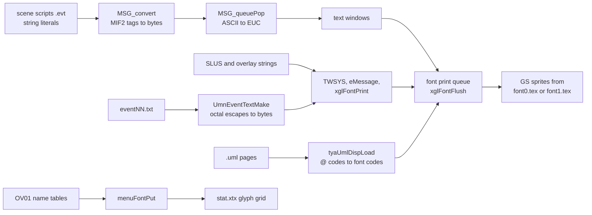
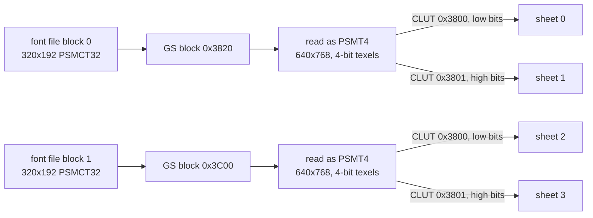
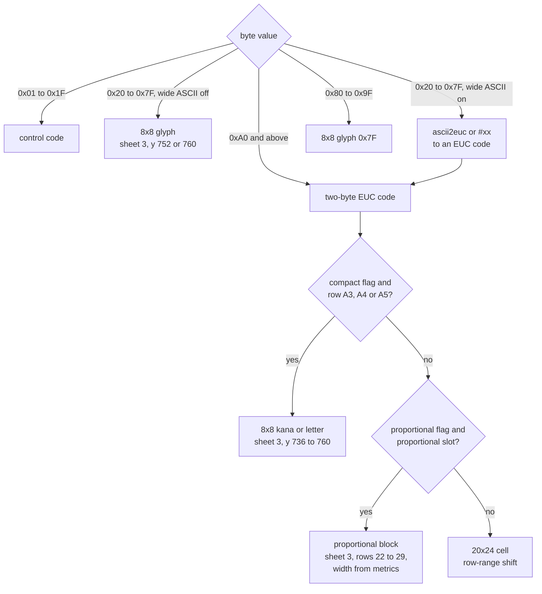
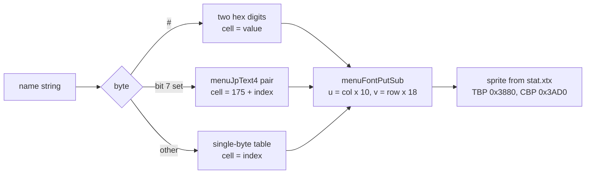
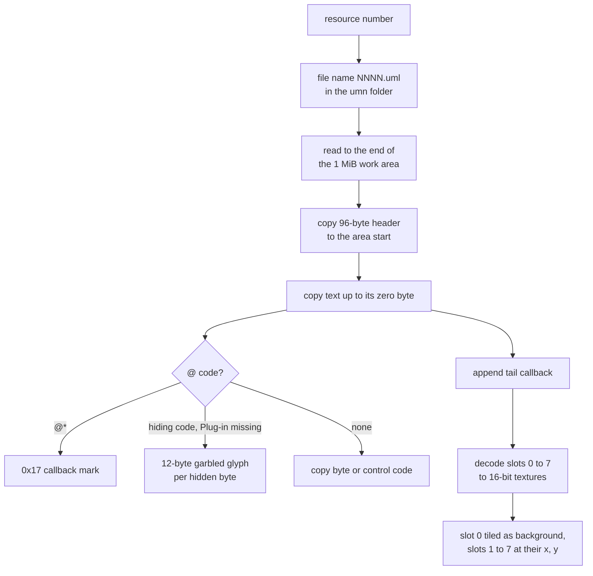
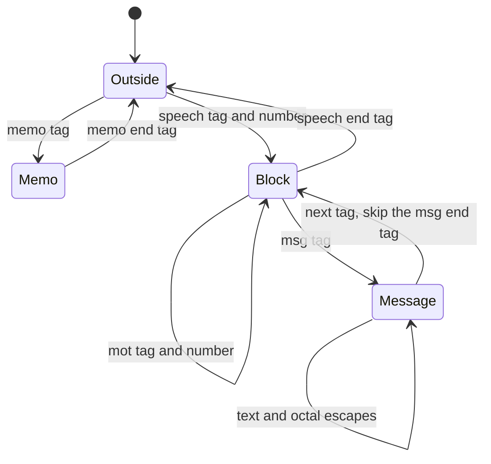
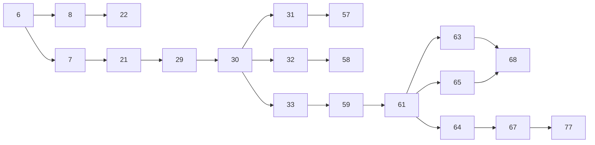

# Text, fonts and U.M.N. data

This page is the byte-level reference for the files and encodings that carry
the game's text. It covers the two kanji fonts `font0.tex` and `font1.tex`,
the small bitmap font of the battle screen, the data of the U.M.N. (the
in-game network terminal with its mails, database pages and dialogue texts),
and the encoding and control codes shared by every text string in the game.
The dialogue of the story scenes is stored as string constants inside the
scene scripts. Their container, the `.evt` script archive, is described in
[Script archives](scripts-and-archives.md), and only the text inside them is
described here.

Every file of this family sits in archive group 00 and none of them is
ARX-packed. How the engine uses them at run time (the print queue, the text
windows, the U.M.N. screens) is described in [xgl.md](../libraries/xgl.md#text),
[ui-windows.md](../libraries/ui-windows.md#text-fonts-and-encoding),
[events.md](../scripting/events.md#message-text-and-the-mif2-interface) and
[umn.md](../game/umn.md). This page explains what is in the files and how each
byte is laid out.

[← Back to the overview](../README.md) · [Files and resources](../architecture/files-and-resources.md)

## Contents

1. [Files at a glance](#files-at-a-glance)
2. [Where text lives](#where-text-lives)
3. [Character encoding](#character-encoding)
4. [Font control codes](#font-control-codes)
5. [MIF2 message tags](#mif2-message-tags)
6. [Kanji fonts](#kanji-fonts)
7. [Battle font](#battle-font)
8. [UML pages](#uml-pages)
9. [Header lists](#header-lists)
10. [Keyword list](#keyword-list)
11. [Event texts](#event-texts)
12. [History tree](#history-tree)
13. [Plug-in texts](#plug-in-texts)
14. [Unused files and leftovers](#unused-files-and-leftovers)
15. [Source files](#source-files)

## Files at a glance

All sizes are the sizes stored on the disc, which equal the loaded sizes
because nothing here is packed.

| Files | Count | Size in bytes | Content | Loaded by |
| --- | --- | --- | --- | --- |
| `data\font0.tex`, `data\font1.tex` | 2 | 492,096 each | kanji fonts with proportional metrics | `xglFontLoad` (`src/main/xgl_font.c`) |
| `data\yamamoto\stat\stat.xtx` | 1 | 237,696 | battle status sheet that holds the battle font | `dataXtxLoad` (`src/ov01/data_unit_org_get.c`) |
| `data\umn\0000.uml` to `0080.uml` | 81 | 4,096 to 153,952 | mail bodies | `tyaUmlDispLoad` (`src/ov02/tya_uml.c`) |
| `data\umn\9000.uml` to `9244.uml` | 245 | 5,936 to 7,280 | database (Keywords) pages | `tyaUmlDispLoad` |
| `data\umn\header.lst` | 1 | 13,248 | mail header list | `UmnMailHeaderCreate` (`src/ov02/umn_event_text_symbol_check.c`) |
| `data\umn\dbheader.lst` | 1 | 42,616 | database header list | `dbheader_load` (`src/ov02/tya_uml.c`) |
| `data\umn\db_fileno.txt` | 1 | 2,684 | order and grouping of the keyword list | `dbfileno_load` (`src/ov02/tya_uml.c`) |
| `data\umn\event00.txt` to `event18.txt` | 19 | 239 to 7,044 | manzai dialogues of the U.M.N. | `UmnEventTextMake` |
| `data\endou\umn\histree.bin` | 1 | 512 | mail thread tree | `UmnHistoryTreeLoad` |
| `data\endou\umn\umntxt.bin` | 1 | 768 | Plug-in names and descriptions | `UmnTextLoad` |

The 326 UML files total 2,877,824 bytes (1,344,000 for the mails and
1,533,824 for the database pages). Every UML size is a multiple of 16.

## Where text lives

The game keeps its text in four kinds of places, and each kind reaches the
screen through its own converter before it ends in the font engine's print
queue.

| Text | Where it is stored | Markup | Converted by | Drawn with |
| --- | --- | --- | --- | --- |
| Scene dialogue, item and event messages | string constants of the scene scripts (`.evt`), 44,606 literals in 569 archives | ASCII, MIF2 tags `/[...]`, `#xx` escapes | `MSG_convert` and `MSG_queuePop` (`src/main/msg_init.c`) | font0 in event scenes, font1 on the field |
| Menu, system and battle window text | C strings in `SLUS_204.69` and the overlays | ASCII, raw font control bytes, EUC symbols | printed directly (`TWSYS`, `eMessage`, `xglFontPrint`) | font1 |
| Names of characters, enemies, items and Ethers | C string tables in OV01, for example `src/ov01/data_eth_name_get.c` | ASCII, `#XX` in the battle HUD | menus, and `menuFontPut` in battle | font1, or the battle font |
| U.M.N. mails, database pages and dialogues | `data\umn` and `data\endou\umn` | ASCII, EUC symbols, raw font control bytes, `@` codes, octal escapes | `tyaUmlDispLoad`, `UmnEventTextMake`, `UmnMailHeaderCreate` | font1 |

The scene scripts hold the bulk of the story text. Menus and windows use
strings compiled into the executables. The U.M.N. keeps its own text files.
The battle screen draws unit names with a separate bitmap font. The diagram
shows which converter each kind of text passes through.



## Character encoding

### EUC-JP

The game was written for Japanese and its text encoding is **EUC-JP**. In
EUC-JP a byte below 0x80 is plain ASCII. A character of the Japanese
character set JIS X 0208 takes two bytes, both in the range 0xA1 to 0xFE. The
first byte selects one of 94 rows and the second one of 94 columns: row
`first − 0xA0` and column `second − 0xA0`. Rows 1 and 2 hold punctuation and
symbols, row 3 full-width digits and Latin letters, rows 4 and 5 hiragana and
katakana, row 6 Greek, row 7 Cyrillic, row 8 box-drawing lines, rows 16 to 47
the common (level 1) kanji and rows 48 to 84 the rarer (level 2) kanji. The
code `0xA1A1` is the full-width space.

The font engine draws every EUC character it knows from the kanji font. The
English release keeps this scheme and adds two things on top of it: an
**ASCII to EUC table** that turns English letters into font glyphs, and a
**proportional block** of 256 Latin glyphs placed on code points that the
Japanese font left to rare kanji. See [Kanji fonts](#kanji-fonts) for where
each code is drawn from.

### The ASCII to EUC table

`xglFontAscii2Euc` in `src/main/xgl_font.c` converts one ASCII byte through
the static table `ascii2euc[96]` (at `0x004908D0` in `SLUS_204.69`, one
16-bit EUC code per character from 0x20 to 0x7F). Digits and letters become
the full-width codes of row 3, the space becomes `0xA1A1`, and the punctuation
marks become codes in rows 0xD1 and 0xD2, which in the font hold the
proportional punctuation glyphs instead of kanji.

| ASCII | EUC code | ASCII | EUC code | ASCII | EUC code |
| --- | --- | --- | --- | --- | --- |
| space | `A1A1` | `0`–`9` | `A3B0`–`A3B9` | `A`–`Z` | `A3C1`–`A3DA` |
| `a`–`z` | `A3E1`–`A3FA` | `!` | `D1B5` | `"` | `D1C2` |
| `#` | `D1E5` | `$` | `D2A9` | `%` | `D1E6` |
| `&` | `D2A8` | `'` | `D1C0` | `(` | `D1CB` |
| `)` | `D1CC` | `*` | `D1B4` | `+` | `D1FE` |
| `,` | `D1BA` | `-` | `D1FD` | `.` | `D1B9` |
| `/` | `D1D4` | `:` | `D1BC` | `<` | `D1C7` |
| `=` | `D1FC` | `>` | `D1C8` | `?` | `D1B7` |
| `@` | `D1AD` | `[` | `D1CD` | `\` | `D1A5` |
| `]` | `D1CE` | `^` | `D1D8` | `_` | `D1D3` |
| `` ` `` | `D1DA` | `{` | `D1CF` | `\|` | `D1D1` |
| `}` | `D1D0` | `~` | `D1E8` | 0x7F | `A1A1` |

The semicolon maps to `D1BB`. The table is read through `KanjiClutEnv`,
the packet just before it, as `KanjiClutEnv.code_by_character[c]`, which
lands on `ascii2euc[c − 32]`. This is a modelling artifact of the recovered
source and not a second table.

### The hash escape

`xglFontAscii2Euc` gives the character `#` a special meaning. `#` followed by
two hexadecimal digits `xx` produces the code that lies `0x20 + xx` places
after `0xD0A1`, counting 94 codes per row. `#00` is therefore `0xD0C1`, `#3D`
is `0xD0FE`, `#3E` is `0xD1A1`, and so on up to `#FF`. `##` produces the
`#` glyph itself (table entry `D1E5`, which is also `#82`). Text written in
ASCII can reach all 256 glyphs of the proportional block this way.

The English text uses the escape for letters that ASCII lacks. All uses found
in the scene scripts and the UML pages are listed below. The glyph names come
from rendering the font cells (see [The proportional block](#the-proportional-block)).

| Escape | Glyph | Uses | Example |
| --- | --- | --- | --- |
| `#23` | ä | 11 in scripts, 8 in UML | `D#23mmerung` (Dämmerung) |
| `#27` | ç | 3 in scripts | `Fran#27ois` |
| `#28` | é | 2 in scripts, 2 in UML | `p#28ch#28` (péché, database title 9152) |
| `#29` | ê | 1 in UML | `p#29che` (pêche, database title 9151) |
| `#2b` | è | 1 in scripts | `resum#2b` (shows "resumè") |
| `#47` | ™ | 11 in UML | `Ninja Assault#47` |
| `#48` | © | 3 in UML | `PAC-MAN#48` |
| `#49` | ® | 4 in UML | `Tekken#494` (Tekken®4) |
| `#4a` | @ | 1 in UML | `bunnie#4anamco.com` |
| `#52` | ! | 1 in UML | `On Sale Now#52` |
| `#82` | # | 2 in scripts, 3 in UML | `Card Pack #821` (Card Pack #1) |
| `#86` | — (em dash) | 12 in scripts | `#86#86#86 46 hours later #86#86#86` |
| `#91` | β | 1 in scripts, 2 in UML | `DIG-#91` |
| `#93` | Š | 1 in scripts | `member #93 143` (shows "member Š 143") |
| `#ad` | Ⅰ (font 1 only, blank in font 0) | 1 in UML | `Episode #ad` |

Database page 9006 writes `Unit ##667`, which uses `##` for a plain `#` and
shows "Unit #667".

`resum#2b` uses the grave accent where "résumé" needs `#28`, and
`member #93 143` in `ST2040` draws an Š where the text probably meant a
number sign (`##93`). Both are slips of the English script.

### Characters of the English text

The English strings are almost pure ASCII. The 44,606 literals of the scene
scripts never use the ASCII characters `<`, `@`, `^`, `` ` `` and `~`, and
contain no raw control byte other than newlines and six TAB bytes. The EUC characters found
in them are Japanese labels written by the developers for debug output, and
the middle dot `・` (`A1A6`) of the weapon names `R・DRILL` and `F・SCYTHE`
in the U.M.N. dialogues and `R・BLADE` in OV01. The UML pages use 40 distinct
EUC characters, nearly all of them lines and symbols: the horizontal bar `―`
(`A1BD`, 5,887 times), the box-drawing set of row 8 (`━` 5,009 times, `─`,
`┃`, the corners `┏ ┓ ┗ ┛` and the junctions), and `◆ ▼ ▽ △ ■ ● ★ ※ ←`.
Menu strings in the executables use EUC for the controller symbols, for
example `○` (`A1FB`) and `×` (`A1DF`).

## Font control codes

Bytes 0x01 to 0x1F inside any string are **control codes** for the font
engine. Each code is followed by a fixed or computed number of operand bytes.
`xglFontGetSPcodeSize` returns that number from the table `spcode_0[32]` in
`src/main/xgl_font.c`. Code 8 counts its operands from a flag byte and
code 21 from a length byte. The meaning of each code is described in
[xgl.md](../libraries/xgl.md#control-codes), and the table below gives the
byte layout.

| Code | Name in the source | Operand bytes | Layout and values |
| --- | --- | --- | --- |
| 0x01–0x03 | `FONT_OP_POS_X_0` to `_2` | 1 | X = (code << 8) + operand − 0x100, also sets the line origin |
| 0x04–0x05 | `FONT_OP_POS_Y_0`, `_1` | 1 | Y = (code << 8) + operand − 0x400 |
| 0x06 | `FONT_OP_DEPTH` | 3 | 24-bit GS depth, high byte first |
| 0x07 | `FONT_OP_NOP` | 0 | nothing |
| 0x08 | `FONT_OP_POSITION` | 1 + by flags | flag byte, then X (2 bytes, flag 0x01), Y (2, flag 0x02), depth (3, flag 0x04), X step (2, flag 0x08), Y step (2, flag 0x10), all high byte first. Flag 0x80 keeps the line origin |
| 0x09 | `FONT_OP_TAB` | 0 | next multiple of 64 pixels |
| 0x0A | `FONT_OP_NEWLINE` | 0 | new line |
| 0x0B | `FONT_OP_RESET` | 0 | default style |
| 0x0C | `FONT_OP_COLOR` | 3 | R, G, B, where 0x80 is neutral |
| 0x0D | `FONT_OP_EFFECT_MODE` | 1 | 0 and 1 plain (each with its own GS setup packet), 2 shadow, 3 outline, 4 bold |
| 0x0E | `FONT_OP_EFFECT_PARAMS` | 5 | effect X, effect Y, R, G, B |
| 0x0F | `FONT_OP_BLEND` | 3 | primitive flags, blend mode, alpha |
| 0x10 | `FONT_OP_HEX_DIGITS` | 5 | digit count and a 32-bit value |
| 0x11 | `FONT_OP_NUMBER` | 6 | radix, digit count and a 32-bit value or float |
| 0x12 | `FONT_OP_SCALE` | 2 | X scale, Y scale, where 16 is 1.0 |
| 0x13 | `FONT_OP_EFFECT_PACKET` | 2 | horizontal and vertical masks of a region-repeat texture clamp, 0 for off, bit 0x80 adds a random offset |
| 0x15 | `FONT_OP_CONFIG` | 1 + length | length, sub-command, values: 1 line height, 2 default width, 3 wrap width (2 bytes), 4 proportional mode, 5 horizontal shift (italic slant) |
| 0x17 | `FONT_OP_CALLBACK` | 7 | 24-bit function address and 32-bit argument, high byte first |
| 0x18 | `FONT_OP_COMPACT` | 1 | non-zero draws kana and some symbols with the 8-pixel glyphs |
| 0x19 | `FONT_OP_STYLE` | 1 | bit 0 proportional, bit 1 wide ASCII |
| 0x1B | `FONT_OP_GLYPH` | 1 | one 8x8 glyph by number |
| 0x14, 0x16, 0x1A, 0x1C–0x1F | none | 0 | no action, see below |

The draw loop `xglFontFlushCore` has an empty case for the free codes 0x14,
0x16, 0x1A and 0x1C to 0x1F that does not step past the byte, so a string that
reached the font with one of them would never finish drawing. The UML pages
use only the codes 8, 10 to 13, 18, 21, 24 and 25. Two of the free codes have
a meaning in paged text drawn by `eMessage` (`src/main/e_message.c`), which
also draws the U.M.N. dialogues and consumes these two codes before printing.
Byte 30 (0x1E) is followed by an icon number and
draws a sprite in place of a full-width space. Icons 0 to 3 map to the sprite
ids 513, 512, 514 and 515. Byte 31 (0x1F) ends a page and waits for a key.

A typical style prefix is `0B 19 03 0D 00`: reset, proportional and wide
ASCII, no effect. Many menu strings in the executable start with it. The question
of the game-over screen reads, byte by byte:

```
0B 19 03 0D 00  "Save clear data?" 0A 0A  0C 80 20 20  A1 FB
reset style 3   text                newlines red        ○ (EUC)
0B 19 03 0D 00  " Button: Yes" 0A 0A  0C 20 20 80  A1 DF  0B 19 03 0D 00  " Button: No" 00
                                       blue         × (EUC)
```

The string is `GameEndSaveQuestion` in `src/main/game_over.c`. The circle is
drawn in red and the cross in blue, the colours of the controller buttons.

The table entry for each code counts operand bytes. The code itself is one
more byte, so a parser that walks a string steps over `1 + spcode_0[code]`
bytes (with the two computed cases). Searching for the first zero byte does
not find the end of a string, because operands such as `0D 00` and
`15 02 04 00` contain zeros. The end is the first zero byte found while
stepping over whole codes.

## MIF2 message tags

Script text is converted by the message interface that the source calls MIF2
(`src/main/msg_init.c`). Its behaviour is described in
[events.md](../scripting/events.md#text-tags) and
[ui-windows.md](../libraries/ui-windows.md#message-tags). This section gives
the bytes and what the real scripts contain.

A tag is written `/[name(arguments)]`. Several tags can share one bracket,
separated by the semicolon character (0x3B). The bracket is split at the four
characters of the string `tokenDelimiters`: comma, opening and closing
parenthesis, and semicolon. A name that is not in the table `mfunc[]` is
copied into the output as plain text.

| Tag | Output bytes | Uses in the scene scripts |
| --- | --- | --- |
| `label(text)` | `/[` `0x85` text `]` | 557 |
| `waitkey(n)` | `/[` `0x80` n `]` | 532 |
| `close()` | `/[` `0x84` `]` | 323 |
| `color(0xRRGGBB)` | `0C` R G B | 254 |
| `clear()` | `/[` `0x81` `]` | 233 |
| `wait(n)` | `/[` `0x83` n `]` | 31 |
| `code(n)` | the single byte n | 6 |
| `font(text)` | `19 01` text `19 00` | 4 |
| `ruby(base, reading)` | `0x17` callbacks and `0x18` | 0 |
| `gaiji(n)` | `AD` and `160 + n` | 0 |
| `signal()`, `tips()` | nothing | 0 |

`font` does not take a number. It wraps its text argument in style 1 and
style 0, so the text in between is drawn with the proportional flag set and
the wide ASCII flag cleared. The four uses are `/[font(A.G.W.S.)]` (three
times in `ST0621`) and `/[font(KOS-MOS)]` (`ST1210`). In the English text the
argument is plain ASCII, which the message queue already converts to EUC and
measures as proportional, so the tag probably changes nothing visible there.
It is probably a leftover of the Japanese script, where these names would be
written in full-width characters.

`code(n)` writes raw control bytes. Its six uses form two scaling commands in
`ST2110`:

```
/[code(18)]/[code(20)]/[code(20)]IN-VIN-CIBLE/[code(18)]/[code(16)]/[code(16)] giant robot!
12 14 14 = scale 20/16 = 1.25            12 10 10 = scale 1.0
```

`MSG_queuePop` converts each ASCII byte (anything below 0xA0) with
`xglFontAscii2Euc`, so the hash escape works in script text, and counts it as
a proportional glyph. Text that is already EUC is counted as proportional only
while the queue's control flag is set, which happens after `19` with a
non-zero operand.

`MSG_convert` copies raw control bytes found in script text with its own
operand table (`_copyCTRLCode`). That table knows codes 1 to 6, 8, 12 to 15,
18 and 23 to 25 only, and for code 8 it reads the flag byte without copying it
and honours only flags 1, 2 and 4. The scene scripts contain no raw control
byte other than newline and TAB, so these gaps have no effect on the shipped
text.

Debug placeholders `/[$n]` and `/[#n]` appear in strings printed with
`System.println` and are expanded by that native (`src/main/system.c`), not
by MIF2. One string in `ST2160` reads `/[waitkey(64)]/[closelear()]`. The
name `closelear` is not in the table, so the converter copies the word
`closelear` into the window text as plain characters. It is probably a typo
for `close` or `clear`.

## Kanji fonts

### Purpose and loading

`data\font0.tex` and `data\font1.tex` are the two kanji fonts of the game.
Each holds 4,096 glyph cells of 20 by 24 pixels with four grey levels, a
block of 256 proportional Latin glyphs among them, a strip of 8x8 glyphs, and
a table of horizontal metrics. Both files are 492,096 bytes and unpacked.
`font1.tex` is the first file of group 00 (sector 83) and `font0.tex` sits at
sector 304,697.

`xglFontLoad(index, flags)` reads one of them into the static `FontImage`
(`FontImageStorage`, `0x78800` bytes, so 0x5C0 bytes stay unused after the
file). `xglFontInitial` loads font 1 at boot. `InitCfSystem` in
`src/main/game.c` loads font 1 when the top four bits of the current event id
are clear (the field) and font 0 otherwise, and `Runtime.jumpEvent` adds
`0x10000000` to the event id, so the story scenes are drawn with font 0. The
main menu loads font 1 with `MenuFontLoad(1, 1)` and restores the font it
replaced when it closes. Battle, the title screen and the U.M.N. use font 1.
The debug font test page in `src/main/yajima_test.c` switches between the two
with Circle and Cross.

The two fonts have the same layout. Font 0 has bold strokes and uses all four
grey levels. Font 1 has thin strokes and uses only levels 0, 1 and 3. The
8x8 strip is identical in both.

### File layout

The file is two GS upload packets followed by the metrics table. Each packet
starts with one 16-byte VIF quadword and one 16-byte GIF tag that the code
sends to the hardware unchanged (see
[the hardware path](../architecture/rendering.md#the-hardware-path) for VIF
and GIF). The VIF quadword holds three `NOP` codes and a `DIRECTHL` code that
passes the next 15,361 quadwords to the GIF. The GIF tag announces an image
transfer of 15,360 quadwords, which is the 245,760 bytes of pixels that
follow.

| Offset | Size | Type | Field | Meaning | Value seen |
| --- | --- | --- | --- | --- | --- |
| `0x00000` | 12 | u32[3] | VIF codes | three `NOP` codes | 0 |
| `0x0000C` | 4 | u32 | VIF code | `DIRECTHL`, immediate = quadword count | `0x51003C01` (15,361) |
| `0x00010` | 16 | u128 | GIF tag | NLOOP 15,360, EOP 1, FLG 2 (IMAGE) | `0x0800000000000000_000000000000BC00` |
| `0x00020` | `0x3C000` | u32[61440] | `kanji_texture_0` | block 0, 320 x 192 PSMCT32 pixels | glyph data |
| `0x3C020` | 16 | | VIF codes | same as at `0x00000` | |
| `0x3C030` | 16 | | GIF tag | same as at `0x00010` | |
| `0x3C040` | `0x3C000` | u32[61440] | `kanji_texture_1` | block 1, 320 x 192 PSMCT32 pixels | glyph data |
| `0x78040` | `0x200` | u8[256][2] | `proportional_widths` | left and right edge of each proportional glyph | see below |
| `0x78240` | | | | end of file | |

In `struct FontImage` (`src/main/xgl_font.c`) each `kanji_texture_N` array is
`0x3C020` bytes long and includes its 32-byte VIF and GIF header.

```
font0.tex
00000000: 0000 0000 0000 0000 0000 0000 013c 0051   three VIF NOPs, then 0x51003C01 = DIRECTHL 15361
00000010: 00bc 0000 0000 0008 0000 0000 0000 0000   GIF tag: NLOOP 0x3C00 + EOP (0xBC00), FLG = 2 (byte 7 = 0x08)
00000020: 0000 0000 0000 0000 0000 0000 0000 0000   block 0 pixels start
...
0003c020: 0000 0000 0000 0000 0000 0000 013c 0051   second packet header
0003c030: 00bc 0000 0000 0008 0000 0000 0000 0000
0003c040: 0040 0040 0000 0040 0000 4040 4000 4040   block 1 pixels start
...
00078040: 040f 070e 050f 0610 0510 050f 050f 0510   metrics: slot 0 = (4, 15), slot 1 = (7, 14), ...
```

The layout of the whole file, drawn to scale by size, is:

```
0x00000 +----------------------------------------------+
        | VIF NOP x3, DIRECTHL 15361 | GIF IMAGE tag   |  32 bytes
0x00020 +----------------------------------------------+
        | block 0: 320 x 192 PSMCT32 (245,760 bytes)   |  -> GS block 0x3820
        |   low 2 bits  = sheet 0                      |
        |   high 2 bits = sheet 1                      |
0x3C020 +----------------------------------------------+
        | VIF NOP x3, DIRECTHL 15361 | GIF IMAGE tag   |  32 bytes
0x3C040 +----------------------------------------------+
        | block 1: 320 x 192 PSMCT32 (245,760 bytes)   |  -> GS block 0x3C00
        |   low 2 bits  = sheet 2                      |
        |   high 2 bits = sheet 3                      |
0x78040 +----------------------------------------------+
        | 256 x (left, right) metrics, 512 bytes       |
0x78240 +----------------------------------------------+
```

### Two-bit sheets inside a four-bit texture

The pixel blocks are uploaded as 32-bit colour data but read back by the GS
as a 4-bit indexed texture. The GS stores each pixel format in its own
swizzled order inside video memory, so the same bytes form a different image
when they are read in another format (see
[video memory](../architecture/rendering.md#video-memory)). The upload packets
`KanjiTex0Env_8` and `KanjiTex1Env_9` in the executable set `BITBLTBUF` to
block `0x3820` (block 0) or `0x3C00` (block 1) with a buffer width of 5
(320 pixels) in PSMCT32, and `TRXREG` to 320 by 192. The glyph sprites read
the same memory as `PSMT4` with a buffer width of 10 (640 pixels), so each
block becomes a 640 by 768 image of 4-bit texels.

Each 4-bit texel stores two 2-bit pixels of two different glyph sheets. The
low two bits belong to one sheet and the high two bits to another. Two
16-entry colour tables (CLUTs) select which half is visible: the CLUT at
block `0x3800` maps entry `i` to grey level `i & 3`, and the CLUT at block
`0x3801` maps it to level `i >> 2`. So the two blocks hold four sheets of
640 by 768 pixels with four grey levels each.

| Grey level | Colour (R, G, B, A) |
| --- | --- |
| 0 | 0, 0, 0, 0 (transparent) |
| 1 | 0x55, 0x55, 0x55, 0x80 |
| 2 | 0xAA, 0xAA, 0xAA, 0x80 |
| 3 | 0xFF, 0xFF, 0xFF, 0x80 |

The CLUTs are not in the font file. The packet `KanjiClutEnv` in the
executable (`0xF0` bytes at `0x004907E0`) uploads them: a VIF `DIRECTHL` of
14 quadwords, a GIF tag with four register writes (`BITBLTBUF` to block
`0x3800`, width 5, PSMCT32, `TRXPOS` 0, `TRXREG` 16 by 2, `TRXDIR`), a GIF
image tag of 8 quadwords, and 32 colours. The first 16 colours form the CLUT
at `0x3800` and the second 16 the CLUT at `0x3801`. The font occupies GS
blocks `0x3800` to `0x3FBF`, 496 KiB near the top of the 4 MiB video
memory.

Each glyph sprite sets `TEX0` with TBP0 `0x3820` or `0x3C00`, TBW 10, PSM
`PSMT4`, a 1024 by 1024 texture size, TCC 1 outside debug mode, CBP `0x3800`
or `0x3801`, CPSM `PSMCT32` and CLD 1. The draw call's two attribute bits
pick the block (bit 1) and the CLUT (bit 0), which is the sheet number.



### Glyph cells and code mapping

Each sheet is a grid of 32 by 32 cells of 20 by 24 pixels, 1,024 cells. A
cell number from 0 to 4,095 addresses the four sheets in order: the sheet is
`cell >> 10`, and inside it `x = (cell & 31) × 20` and
`y = ((cell >> 5) & 31) × 24`.

`xglFontFlushCore` turns a two-byte EUC code into a cell. It computes the
linear JIS index `(row − 1) × 94 + (column − 1)` and then shifts it by a
constant that depends on the first byte, which packs the sparse JIS rows
tightly into the cells.

| First byte | JIS rows | First cell of the row range | Content |
| --- | --- | --- | --- |
| `A1`–`A6` | 1 to 6 | 0 | symbols, full-width digits and letters, hiragana, katakana, Greek |
| `A7`–`AC` | 7 to 12 | 528 (36 cells earlier than linear) | row 7 Cyrillic at 528, row 8 box drawing at 622 |
| `AD`–`AF` | 13 to 15 | 658 | row 13 special symbols (target of `gaiji`) |
| `B0`–`CF` | 16 to 47 | 752 | 2,965 level-1 kanji, last one `CFD3` at cell 3716 |
| `D0` and above | 48 and above | 3744 | 32 level-2 kanji (`D0A1`–`D0C0`), then the proportional block |

Each shift places a row range on cells that the previous rows leave unused.
Row 6 uses only 48 of its 94 codes, so row 7 starts 36 cells early. Rows 9 to
12 are empty in JIS X 0208, and row 13 follows the 32 box-drawing characters
of row 8. Cells 3717 to 3743, after the last level-1 kanji, hold a placeholder
mark. Cells that belong to no character elsewhere hold a placeholder too
(font 0 uses a small dot, font 1 the same square as in 3717 to 3743), so the
fonts have hardly any blank cells.

Cells 3744 to 3775 hold 32 level-2 kanji (`巫 彷 徨` and others), the only
level-2 kanji in the font. Cells 3776 to 4031 hold the proportional block
and cells 4032 to 4095 the 8x8 glyphs.



### The proportional block

Cells 3776 to 4031 are the 256 glyphs `#00` to `#FF` of the hash escape, in
order: cell `3776 + xx`. They fill rows 22 to 29 of sheet 3, eight rows of 32.
Each glyph is a narrow Latin character drawn at the left of its 20-pixel
cell.

| Escape range | Sheet 3 row | Content (font 1) |
| --- | --- | --- |
| `#00`–`#1F` | 22 | Æ À Â Ä Á Å Ã Ç É Ê Ë È Í Î Ï Ì Ð Ñ Œ Ó Ô Ö Ò Õ Ø Ú Û Ü Ù Ý Ÿ |
| `#20`–`#3F` | 23 | æ à â ä á å ã ç é ê ë è fi fl í î ï ì ñ œ ó ô ö ò õ ø ú û ü ù ý ÿ |
| `#40`–`#5F` | 24 | \| £ ¥ ƒ $ ¢ € ™ © ® @ ª º † ‡ § ¶ * ! ¡ ? ¿ . , and quotation marks |
| `#60`–`#7F` | 25 | low quotes, …, < > « » ( ) [ ] { }, bars, / \ · and the accents ´ ^ ¨ ` ˚ ~ ¯ ˘ |
| `#80`–`#9F` | 26 | ¸ ˛ # % ‰ ~ — 〔 〕 【 】 ○ × △ □ Þ þ β ^ Š š ± ¹ ² ³ = − + × ÷ |
| `#A0`–`#BF` | 27 | – ê é & $ ð µ ¼ ½ ¾ ¤ ¦ ø Ⅰ, then empty cells |
| `#C0`–`#DF` | 28 | 0 1 2 3 4 5 6 7 8 9 . A to U |
| `#E0`–`#FF` | 29 | V W X Y Z, space, a to z |

The ASCII punctuation codes of the `ascii2euc` table point into rows 24 to
27: `!` (`D1B5`) is `#52`, `#` (`D1E5`) is `#82`, `&` (`D2A8`) is `#A3`.

`xglFontCheckProportional` decides which codes are proportional and returns a
**slot** number from 0 to 255. The full-width digits, capitals and small
letters of row 3 get slots 0 to 9, 11 to 36 and 38 to 63, the full-width
period `A1A5` slot 10, the full-width space slot 37, and the Cyrillic codes
`A7A1`, `A7A3` and `A7A6` slots 64 to 66, whose cells hold `–`, `ê` and `é`.
A code from `D0A1` up gets the slot built from its
escape number `xx`: slot row `~(xx >> 5) & 7` with rows 0 and 1 swapped, and
column `xx & 31`. So escape rows 6 and 7 (`#C0`–`#FF`, the digits and
letters) become slot rows 0 and 1, which is why the row-3 letters and the
escapes `#C0` to `#FF` share glyphs. The 32 level-2 kanji `D0A1` to `D0C0`
also produce slots (32 to 63) and would be drawn as Latin letters when the
proportional flag is set, so they can only be drawn with it cleared.

When the cursor's proportional flag is set, the glyph comes from sheet 3 at
`u = (slot & 31) × 20 + left − 1` and slot row `r = slot >> 5`, drawn at cell
row 28 for `r = 0`, 29 for `r = 1`, and `29 − r` for `r ≥ 2` (the code writes
`row = 1 − row` for rows 2 and up, and adds 672 pixels). Slot rows 0 to 7
land on cell rows 28, 29, 27, 26, 25, 24, 23 and 22. The drawn and advanced
width is `right − left + 3` pixels, one pixel of margin on each side of the
inked columns.

### The metrics table

The 512 bytes at `0x78040` are `proportional_widths[256]`, indexed by slot.
Each entry is two bytes: the first inked column (`left`) and the last inked
column (`right`) of the glyph inside its 20-pixel cell. `xglFontGetProportionalSize`
adds `0xFF` to the 16-bit entry, which yields `left − 1` in the low byte and
`right + 1` in the high byte.

| Offset in table | Size | Type | Field | Meaning | Range seen |
| --- | --- | --- | --- | --- | --- |
| `slot × 2` | 1 | u8 | left | first inked column, 0 = no metrics | 1 to 15, or 0 |
| `slot × 2 + 1` | 1 | u8 | right | last inked column | 3 to 19, always 19 when left is 0 |

An entry with `left = 0` has no metrics. All such entries are stored as
`00 13` (left 0, right 19), but the engine ignores the right byte and uses
the current default width (4 after a reset), so the glyph is drawn and
advanced 5 pixels wide. Font 0 has 27 such entries and font 1 has 26. When `proportional_mode` is non-zero (code `15 02 04 n`), every glyph
instead takes a fixed 10-pixel box centred on the average of its edges.

The metrics were checked against the pixels of both fonts: for every slot with
metrics (229 in font 0, 230 in font 1) the two bytes equal the first and last
inked column of the cell. Three inked glyphs have the entry `00 13` in both
fonts: slot 102 (`#86`, the em dash `D1E9`), slot 143 (`#6F`, `D1D2`, a long
bar) and slot 144 (`#70`, `D1D3`, the underscore). Their ink really spans
columns 0 to 19, so the stored values are their true edges, but a left edge
of 0 is the engine's mark for a missing entry. Drawn proportionally they get
the 5-pixel default box, so only the left 5 pixels of the 20-pixel bar are
drawn. The em dash appears 12 times in the scene scripts as `#86#86#86` and
the underscore is the target of ASCII `_`, so these characters probably show
short on screen whenever the proportional style is on.

```
font0.tex at 0x78040
00078040: 04 0f | 07 0e | 05 0f | 06 10 | 05 10 | 05 0f | 05 0f | 05 10
          '0'     '1'     '2'     '3'     '4'     '5'     '6'     '7'
          left 4  left 7
          right 15 right 14
```

### Eight-by-eight glyphs

Sheet 3 rows 30 and 31 (pixel rows 720 to 767) hold six strips of 8 by 8
glyphs. The code addresses 64 glyphs per strip. Rows 720 to 735 are empty in
both fonts. The strips are read as follows.

| Pixel row | Content | Used by |
| --- | --- | --- |
| 736 | compact katakana | code `18 01` with row `A5` |
| 744 | compact hiragana and symbols, dakuten marks at x 496 and 504 | code `18 01` with row `A4`, `・` and `ー` |
| 752 | glyphs 0 to 63: hex digits 0 to F (0 to 15), minus (16), point (17), controller and box icons (21 to 31), then ASCII 0x20 to 0x3F | debug print, numbers (codes 16 and 17), ASCII with wide ASCII off |
| 760 | glyphs 64 to 127: ASCII 0x40 to 0x7F | ASCII with wide ASCII off |

An ASCII byte drawn without the wide ASCII style uses glyph `c & 63` at row
752 (for `c < 64`) or 760, doubled to 16 by 16 pixels outside debug mode.
Bytes 0x80 to 0x9F draw glyph 0x7F of row 760. Code `1B n` draws glyph `n`
directly, which reaches the icons. The table `kanaFontCodeTable` maps the
column of a kana code to its 8x8 glyph and flags the voiced marks.

### Glyph examples

The cells below were decoded from the files with the layout above and printed
with one character per pixel: blank for level 0, `.` for 1, `+` for 2 and `#`
for 3. They are font 0 cell 283 (`あ`, `A4A2`), font 0 cell 622 (`─`, `A8A1`),
font 0 cell 3979 (proportional `A`, slot 11), font 1 cell 3979 (the same
glyph in the thin face) and font 1 cell 3816 (`é`, `#28`). Rows 3 to 21 of 24
are shown.

```
|                    |  |                    |  |                    |  |                    |  |                    |
|       .            |  |                    |  |                    |  |                    |  |                    |
|      ++            |  |                    |  |                    |  |          .         |  |          .#.       |
|    .++#+++++++.    |  |                    |  |                    |  |          #.        |  |         .##        |
|   +++#+....++++    |  |                    |  |        .####.      |  |         .##        |  |         #.         |
|      +   .+        |  |                    |  |        +####+      |  |         .##.       |  |                    |
|      #+#####+.     |  |                    |  |       .######.     |  |         #..#       |  |         .##.       |
|    .##.  #  .+#.   |  |                    |  |       +######+     |  |         #..#       |  |        ##..##      |
|   ++ +. +.     #.  |  |                    |  |       ####+###     |  |        .#  #.      |  |       .#.   #.     |
|  ++  ++.+      .+  |  |####################|  |      .###+.###.    |  |        .#  #.      |  |       .#    .#     |
|  #    ##.       #  |  |....................|  |      +###. .##+    |  |        #.  .#      |  |       ########     |
| .+    #.        #  |  |                    |  |      ####. .###    |  |        #.  .#      |  |       #.......     |
| .#  .#+#       ++  |  |                    |  |     .##########.   |  |       .######.     |  |       #.           |
|  #++#. +.     +#.  |  |                    |  |     +##########+   |  |       .#....#.     |  |       .#    .#     |
|   +.       ++##.   |  |                    |  |     ####++++####   |  |       #.    .#     |  |       .#.   #.     |
|           .##+.    |  |                    |  |    .####.   ####.  |  |       #.    .#     |  |        ##..##      |
|                    |  |                    |  |    +###+    .###+  |  |       #      #     |  |         .##.       |
|                    |  |                    |  |    ....      ....  |  |                    |  |                    |
```

The proportional `A` of font 0 has ink in columns 4 to 17, and its metrics
entry (slot 11, at `0x78056`) is `04 11`: left 4 and right 17.

Four glyphs of the 8x8 strip, `0`, `A`, `?` and `g`, drawn from rows 752 and
760 (the same in both fonts):

```
 #####    #####    #####
#    ##  #     #  #     #
#   # #  #     #        #    ###
#  #  #  #     #      ##    #   #
# #   #  # #####     #      #   #
##    #  #     #             ## #
 #####   #     #     #          #
                             ###
```

### Statistics and leftovers

| Property | font0.tex | font1.tex |
| --- | --- | --- |
| Grey levels used | 0, 1, 2, 3 | 0, 1, 3 |
| Slots with metrics | 229 | 230 |
| Inked slots stored as `00 13` (read as no metrics) | 3 (102, 143, 144) | 3 (102, 143, 144) |
| Blank cells | 25: cell 0 and 24 cells of the proportional block (`#1F`, `#7F`, `#9E`, `#9F`, `#AD`–`#BF`, `#E5`) | 24: the same without `#AD`, which holds `Ⅰ` |
| Placeholder cells | 27 squares (3717–3743), small dots in other unassigned cells | 133 squares (3717–3743 and unassigned cells of JIS rows 2 to 13) |

The function `xglFontGetKanjiClutUV` computes cells with an older mapping
(one shift for all rows below `AD`) and has no caller in the recovered
source. The 0x5C0 bytes of `FontImageStorage` after the file are never
filled.

## Battle font

### Purpose and location

The battle screen does not draw unit names with the kanji fonts. It has its
own small bitmap font of 10 by 18 pixel cells, stored inside the battle
status sheet `data\yamamoto\stat\stat.xtx` (237,696 bytes, unpacked). OV01
loads the sheet with `dataXtxLoad` (`src/ov01/data_unit_org_get.c`) together
with `manu.xtx` and `cur.xtx`. The table `xtxFile` sends it to
`0x01B13800` in main memory, and the GS addresses used by the battle
interface come from the table `xtxAdr[19]` in the same file. Name drawing is
done by `menuFontPut` in `src/ov01/menu.c`.

### The sheet

An `.xtx` file is a texture container, described in
[XTX texture sets](models-and-textures.md#xtx-texture-sets). `stat.xtx` holds two 32-bit
sub-images that share a 512-pixel-wide buffer: a 384 by 128 image at the
start of the buffer and a 128 by 80 image to its right. The battle code binds
the sheet at GS block `0x3800`.

```
stat.xtx
00000000: 5854 5800 80a0 0300 0200 0000 1000 0000   "XTX\0", total size 0x3A080, 2 sub-images, table at 0x10
00000010: 8001 0800 8000 0000 0000 0000 0230 0000   sub 0: width 384, buffer width 8, height 128, GS offset 0, 0x3002
00000020: 4000 0000 8000 0800 5000 0000 0030 0000   sub 0 data at 0x40 | sub 1: width 128, buffer width 8, height 80, GS offset 0x3000
00000030: 020a 0000 6000 0300 ...                   sub 1: 0x0A02, data at 0x30060
00000060: a658 76f4 9858 76f4 7658 49f4 7658 09f4   sub 0 pixels (data offset + 0x20)
```

The fourth word of each entry (`0x3002`, `0x0A02`) is the length of the
transfer packet in quadwords, the pixel data (`0x3000` and `0xA00` quadwords)
plus the two quadwords of the VIF and GIF header.

### Texture setup

`menuFontEnvMake` sets `TEX0_1` from `xtxAdr[11]` = `0x3880` (texture base)
and `xtxAdr[12]` = `0x3AD0` (CLUT base) and the constant
`0x2000000629340000`: buffer width 16 (1,024 pixels), format `PSMT8` (8-bit
indexed), a 1,024 by 256 texture, TCC 1, modulate, CLUT format `PSMCT32` in
CSM1 and CLD 1. It also sets `ALPHA_1` to `0x44` (the other battle
environments use 0) and `TEST_1` to `0x3000D`.

The sheet is uploaded as 32-bit pixels with a 512-pixel buffer and the font
reads it as 8-bit pixels with a 1,024-pixel buffer. A GS page holds 8 KiB in
both formats (64 by 32 pixels in 32-bit, 128 by 64 pixels in 8-bit) and both
buffers are eight pages wide, so the 8-bit view is the same sheet at twice the
width and height. Block `0x3880` is 128 blocks, four pages, after `0x3800`,
which is 8-bit x = 512. The font texture is therefore the 8-bit image that
starts at 8-bit (512, 0), the 32-bit columns 256 to 383 of the first
sub-image.

The CLUT block `0x3AD0` is the 16 by 16 tile at 32-bit (416, 64), inside the
second sub-image. The glyph pixels use 13 of its entries.

| Index | R, G, B, A | Role |
| --- | --- | --- |
| 0 | 0, 0, 0, 0 | transparent |
| 4 | 212, 212, 213, 128 | solid stroke |
| 5–15 | 200 down to 32 grey, alpha 128 down to 80 | anti-aliased edge shades |

### Glyph grid and lookup

The font is a grid of 25 columns of 10 by 18 pixel cells. Cell `n` is at
`u = (n mod 25) × 10` and `v = (n div 25) × 18` in the font texture.
`menuFontPutSub` draws it as one sprite with `menuStatSprite` in neutral grey.

`menuFontPut(packet, x, y, text)` walks the string and advances 10 pixels per
glyph:

1. `#` followed by two hexadecimal digits is read with `sscanf("%X")` and
   draws that cell number directly. The escape uses three bytes.
2. A byte with bit 7 set starts a two-byte character. `menuDFontIdxGet`
   looks the pair up in `menuJpText4` and returns 175 plus its index.
3. Any other byte is looked up in the single-byte table
   `menu0123456789ABCDEFGHIJKLMNOPQRSTUVWXYZabcdefghijklmnopqrstuvwxyzText`
   by `menuFontIdxGet`, first match wins.
4. A character found in neither table draws nothing but still advances
   10 pixels.

| Single-byte table index | Character |
| --- | --- |
| 0 | space |
| 1–10 | `0` to `9` |
| 11–36 | `A` to `Z` |
| 37–62 | `a` to `z` |
| 147 | `.` |
| 152 | `'` |
| 175 | `/` |
| 195 | `-` |
| other indexes up to 228 | space |

The table string has 229 characters and a final zero (OV01 file offset
`0x47AF8`). The two-byte table `menuJpText4` (40 bytes) holds 16 EUC pairs,
`／` (`A1BF`), `A1A1`, `・` (`A1A6`), `A1A1`, `＾` (`A1B0`) and eleven more
`A1A1`, followed by 8 zero bytes. `menuDFontIdxGet` loops over 230 pairs, so
after the table it compares the bytes that follow it in memory. Because `A1A1` matches first at
index 1, only cells 175, 176, 177 and 179 are reachable through it.

The cells hold more glyphs than the tables reach. Cells 1 to 123, 125 to 148,
150 to 173 and 175 to 228 are inked (225 cells). Cells 63 to 123 hold
accented Latin letters and ligatures (`Æ` at 63, `À` at 64, `é` at 100), and
cells 125 to 228 hold symbols and punctuation (`£ ¥ € ™ © ®`, quotation marks,
brackets, `○ × △ □`, fractions and others) among which sit the four marks of
the single-byte table. The set follows the proportional block of the kanji
fonts in the same order but leaves out some of its glyphs, for example `à`
and `â` (cells 94 to 97 are `æ ä á å`). Only the `#XX` escape can draw these
glyphs, and no string in OV01 contains such an escape. Cell 176 holds a
backslash, although the two-byte table maps the full-width space there.

`monsNameDisp` places a name at `x + (16 − strlen(name)) × 5`, which centres
it in a 16-glyph field by its byte count. An `#XX` escape is three bytes for
one glyph, so each escape in a name moves it 10 pixels to the left.

### Glyph examples

Cells 11 (`A`), 1 (`0`), 63 (`Æ`), 100 (`é`), 175 (`/`) and 177 (`・`),
decoded from `stat.xtx` as described above. `#` marks index 4, `+` any shade
from 5 to 15, blank index 0.

```
|          |  |          |  |          |  |          |  |          |  |          |
|          |  |          |  |          |  |          |  |          |  |          |
|    ++    |  |    +++   |  |   ++ ++++|  |    +#    |  |        + |  |          |
|    +#+   |  |  ++###+  |  |   +######|  |   +#+    |  |       ++ |  |          |
|   ++#+   |  |  +#+++#+ |  |   ++#++++|  |   +++    |  |       ++ |  |          |
|   +##+   |  |  +#+ +#+ |  |  ++##+   |  |          |  |      ++  |  |          |
|   +#++   |  |  +#+ +#+ |  |  +#+#+   |  |   ++++   |  |      ++  |  |          |
|   +#+#+  |  |  +#+ +#+ |  |  +#+#++  |  |  +####+  |  |     ++   |  |          |
|   #++#+  |  |  +#+ +#+ |  |  +++#++++|  | +++++#+  |  |     ++   |  |    ++    |
|  +#++#+  |  |  +#+ +#+ |  | +++++####|  | +#+ +++  |  |    ++    |  |    ++    |
|  +#+ #+  |  |  +#+ +#+ |  | +#+ +#+++|  | +#####+  |  |    ++    |  |          |
|  +#+++#  |  |  +#+ +#+ |  | +++ +#+  |  | +++++++  |  |   ++     |  |          |
|  +#++##+ |  |  +#+ +#+ |  | +#####+  |  | +#+  ++  |  |   ++     |  |          |
| +#++++++ |  |  +#+ +#+ |  | #++++++  |  | +#+ +#+  |  |  ++      |  |          |
| +#+  +#+ |  |  +#+++#+ |  | ++  +++++|  |  +#++#+  |  |  ++      |  |          |
| +#+   #+ |  |  ++###+  |  | #+   +###|  |  +###++  |  |  +       |  |          |
| ++    ++ |  |    +++   |  | +    ++++|  |   ++++   |  |          |  |          |
|          |  |          |  |          |  |          |  |          |  |          |
```

The lookup path of one name, from the string to the sprite, is:



## UML pages

### Purpose and location

The U.M.N. shows mails and database pages as UML pages ("U.M.N. markup
language" is a probable reading of the extension, the source never spells it
out). Each page is one file `data\umn\NNNN.uml` with a four-digit decimal
number. There are 326 files, all unpacked:

| Numbers | Count | Content | Sizes |
| --- | --- | --- | --- |
| `0000` to `0080` | 81 | mail bodies, numbered like the mail ids | 4,096 to 153,952 bytes |
| `9000` to `9244` | 245 | database (Keywords) pages | 5,936 to 7,280 bytes |

`tyaUmlDispLoad` in `src/ov02/tya_uml.c` loads a page. It writes the four
digits of the resource number into the name `data\umn\0000.uml`, reads the
whole file into the end of a 1 MiB work area at `0x01000000` (rounded to
whole 2,048-byte sectors), copies the 96-byte header to the start of the
area, copies the text behind it while converting the `@` codes, and then
decodes each picture behind the text. The behaviour of the mail and database
screens is described in [umn.md](../game/umn.md#7-mail) and
[umn.md](../game/umn.md#keywords-and-the-uml-text-format).

### Layout

A page is a 32-byte header, a 64-byte picture table, the text, and the
pictures. The text ends with a zero byte, found by stepping over whole
control codes (see [Font control codes](#font-control-codes)). The first
picture starts at the next 16-byte boundary after that zero byte, each later
picture at the next 16-byte boundary after the previous picture's JPEG end
marker, and the file ends at the 16-byte boundary after the last picture.
All gaps are zero bytes, with one exception listed under
[Unused files and leftovers](#unused-files-and-leftovers).

```
0x00 +-----------------------------------------+
     | "UML\0" "@@@@"                          |
     | reply ids, attachment, limit or flag,   |  header, 32 bytes
     | discount, cost, zeros                   |
0x20 +-----------------------------------------+
     | picture table: 8 x {offset, x, y}       |  64 bytes
0x60 +-----------------------------------------+
     | text: ASCII, EUC, control codes, @ codes|
     | ... 00                                  |
     +---- zero padding to 16 bytes -----------+
     | picture 0: JPEG, 48 x 48 tile           |
     +---- zero padding to 16 bytes -----------+
     | picture 1 to 7: JPEG (mails only)       |
     +---- zero padding to 16 bytes -----------+
```

### Header

The loader copies the 96 bytes as they are. The mail list reads the fields of
the same header from its copy in `header.lst` (structure `UmnMailListBody` in
`src/ov02/umn_event_text_symbol_check.c`, whose offsets count from the start
of the header), and the database list reads the flag from its copy in
`dbheader.lst`.

| Offset | Size | Type | Field in the source | Meaning | Values seen |
| --- | --- | --- | --- | --- | --- |
| `0x00` | 4 | char[4] | | magic `UML\0` | all 326 pages |
| `0x04` | 4 | char[4] | | filler `@@@@` | 324 pages, zeros in the dummies 0062 and 0073 |
| `0x08` | 3 | u8[3] | `reply_ids[3]`, copied to `UmnMailHeader.reply_ids` | mail ids of up to three prepared replies, 0 for none | 8 mails: (3, 4), (7, 8), (13, 14, 15), (26, 27, 28), (31, 32, 33), (35, 36, 37), (50, 51, 52), (63, 64, 65) |
| `0x0B` | 1 | u8 | `attachment`, copied to `attach` | attachment id, 0 for none | 1 to 23 in 24 mails (10 in both 0044 and 0060) |
| `0x0C` | 2 | u16 | `scenario_limit`, copied to `scenario_limit` | mails: replies allowed while the story progress is below it | set in the 8 mails with replies: 23 (mail 2), 35 (6), 29 (12), 126 (25), 500 (30), 159 (34), 304 (49), 500 (61), 0 elsewhere |
| `0x0C` | 2 | u16 | `flag` in `TyaUmlTextRecord` | database pages: game flag that unlocks the entry | 41 distinct values from 2 to 390 |
| `0x0E` | 1 | u8 | `plugin` | discount: slot `value >> 5` (1 to 4) gets level `(value & 3) + 1` in `kosmos_items` | 0, 32 (mails 18, 19, 20), 96 (mail 38), 128 (mails 45, 47) |
| `0x0F` | 1 | u8 | | unused | 0 |
| `0x10` | 4 | s32 | `cost`, copied to `cost` | money needed to send the reply | 0, 500 (mail 12), 1000 (25), 2000 (34), 6000 (49) |
| `0x14` | 12 | | | unused | zero |
| `0x20` | 64 | entry[8] | `TyaUmlTableEntry` | picture table | see below |

Database pages have zero replies, attachment, discount and cost.

### Picture table

| Offset in entry | Size | Type | Field | Meaning |
| --- | --- | --- | --- | --- |
| `0x0` | 4 | u32 | `dataOffset` | file offset of the JPEG, 0 for an empty slot |
| `0x4` | 2 | u16 | `originX` | x of the picture in the page, in pixels |
| `0x6` | 2 | u16 | `originY` | y of the picture in the page, in pixels |

Slot 0 is special. Its picture is tiled across the whole render rectangle as
the page background (`tyaUmlDispType3Sub0`), and slots 1 to 7 are drawn once
at their position when they overlap the visible part. In every page that has
pictures, slot 0 is a 48 by 48 tile at (0, 0): all 245 database pages and 79
of the 81 mails. Only 11 mails carry real pictures in slots 1 to 7:

| Pictures | Mails |
| --- | --- |
| none at all | 0062, 0073 (dummies) |
| background only | 68 mails |
| background and 1 picture | 0005, 0010, 0017, 0024, 0042, 0056, 0075, 0076 |
| background and 3 pictures | 0080 |
| background and 5 pictures | 0079 |
| background and 7 pictures | 0078 |

The 23 pictures are 22 to 400 pixels wide and 26 to 415 pixels high. Their y
positions go up to 2,472, far below the first screen, because the pictures
scroll with the text.

All 347 JPEGs are baseline JPEGs with three components, in three marker
sets. 327, among them all 324 background tiles, carry the comment "File
written by Adobe Photoshop® 5.1", an `APP13` "Photoshop 3.0" segment, an ICC
profile in `APP2`, an Adobe `APP14` segment and a restart interval (`DRI`).
11 pictures have the same segments without the comment. The other 9, all
pictures of the mails 0078, 0079 and 0080, carry only the JFIF `APP0`
segment, the tables and the frame header.
`xglJpegDecode` (see [xgl.md](../libraries/xgl.md#jpeg)) decodes each into 16-bit
pixels behind the text, and a 16-byte DMA and VIF header is written in front
of each for the upload.

### Text

The text starts at `0x60` and is plain ASCII with EUC symbols and raw font
control codes. Lines end with `0x0A`. The page is drawn with the style
`tyaUmlType3FontText` = `0D 00 | 15 02 01 0C | 0C 80 80 80 | 15 02 02 04 |
19 03 | 15 03 03 00 00`: no effect, line height 12 (24 pixels on screen),
neutral colour, default width 4, proportional with wide ASCII, no wrap. The
codes found in the 326 pages are:

| Bytes | Count | Meaning |
| --- | --- | --- |
| `0A` | 6,371 | new line |
| `0C 54 54 48` | 523 | dark grey colour |
| `0C 80 80 80` | 513 | neutral colour |
| `0D 00` / `0D 02` | 347 / 325 | shadow off and on, used around titles |
| `0C 78 2A 2A` | 183 | red |
| `0C 30 80 80` | 98 | cyan |
| `15 02 04 00` / `01` / `07` | 79 / 42 / 38 | proportional mode off, or fixed 10-pixel boxes |
| `0C 80 80 40` and 20 more colours | 43 and fewer | other colours, a gradient in mail 0009 |
| `0B` | 20 | style reset |
| `19 03` | 20 | proportional with wide ASCII |
| `15 02 05 07` / `15 02 05 00` | 18 / 18 | italic slant of 7 pixels on and off, used for book titles in database pages |
| `08 88 00 08` | 2 | move right 8 pixels without moving the line origin |
| `18 2C ... 18 00`, `12 10 10` | mail 0006 | compact kana, scale 1.0 |

A mail starts with two lines, `Subject: ` and `Sender: `, that become the
folder entries (see [Header lists](#header-lists)). After a blank line the
body switches on fixed boxes with `15 02 04 07` or `15 02 04 01`, often after
an `@*` mark and together with the grey colour `0C 54 54 48`. So the subject
and sender are drawn proportionally and the body in fixed 10-pixel boxes,
which keeps the box-drawing frames of the mails aligned. A database page starts
with its title between `0D 02` and `0D 00` and a ruler line of `―`
(`A1BD`).

The loader converts four `@` codes while copying the text:

| Code | Uses | Effect |
| --- | --- | --- |
| `@*` | 120 | inserts a callback `17 mark owner` that records a line mark for scrolling |
| `@(` and `@)` | 4 pairs | hide the text in between unless Plug-in bit 4 (`0x10`) is set |
| `@<` and `@>` | 2 pairs | hide the text in between unless Plug-in bits 4 and 5 (`0x30`) are both set |

The hiding codes appear only in mail 0061, the hint mail, for example
`@(There is a@) bridge` and `There is a @(fountain.@)`. Each hidden byte is
replaced by 12 bytes that draw a garbled glyph:

```
13 83 83   effect packet on, both masks 0x83 (random offsets)
57         'W'
08 88 FF F5 position, flags 0x88: x step of -11 pixels, keep the line origin
xx         one of 'O', 'Q', 'V', 'Y' (tyaUmlEffectCodeTable, picked by xglSRand)
13 00 00   effect packet off
```

So a hidden letter appears as a jittering `W` overprinted with a random
`O`, `Q`, `V` or `Y`. The loader names the two hiding states `shake` and
`bold`, but both produce the same bytes. Control codes inside a hidden run
are copied normally, and each byte of an EUC character becomes its own
garbled glyph. At the end the loader appends a `tail` callback and a zero.

### Example

The start of mail `0002.uml`, a mail with two reply choices:

```
00000000: 554d 4c00 4040 4040 0304 0000 1700 0000   "UML\0" "@@@@" | replies 3, 4, 0 | attach 0 | limit 23 | discount 0 | 0
00000010: 0000 0000 0000 0000 0000 0000 0000 0000   cost 0 | unused
00000020: 900a 0000 0000 0000 0000 0000 0000 0000   slot 0: JPEG at 0xA90, at (0, 0) | slot 1: empty
00000030: 0000 0000 0000 0000 0000 0000 0000 0000   slots 2 to 7 empty
...
00000060: 5375 626a 6563 743a 200d 0253 6563 7265   "Subject: " 0D 02 "Secre
00000070: 7420 456d 6169 6c0a 5365 6e64 6572 3a20   t Email" 0A "Sender: "
00000080: 4d69 7975 6b69 2049 7473 756d 690a 0a20   "Miyuki Itsumi" 0A 0A " 
00000090: 2020 1502 0407 0c54 5448 5368 696f 6e2c     " 15 02 04 07 (fixed boxes) 0C 54 54 48 (grey) "Shion,
```

The steps of loading a page are:



## Header lists

### Purpose and location

`data\umn\header.lst` (13,248 bytes) and `data\umn\dbheader.lst` (42,616
bytes) let the U.M.N. build its lists without opening every UML page. Each
holds one record per page with a copy of the page's 96-byte header and its
first two text lines. `UmnMailHeaderCreate` reads `header.lst` once into the
work area and fills a table of 128 `UmnMailHeader` records of `0x90` bytes.
`dbheader_load` reads `dbheader.lst` and `find_text` searches it by id.

### Record layout

| Offset | Size | Type | Field | Meaning |
| --- | --- | --- | --- | --- |
| `0x00` | 4 | s32 | `size` | bytes after this word, the next record starts at `size + 4` |
| `0x04` | 4 | s32 | `id` / `mail_id` | page number: 0 to 80 or 9000 to 9244 |
| `0x08` | 96 | | header | exact copy of bytes `0x00`–`0x5F` of the UML page |
| `0x68` | n | char[] | first text line | the page's first line, ended by a zero byte instead of `0x0A` |
| | m | char[] | second text line | the page's second line, ended by a zero byte |
| | 0–3 | | padding | zeros up to a multiple of 4 |

A record with `size` 0 ends the list. `header.lst` has 81 records and ends
with that zero word at `0x33BC`, and `dbheader.lst` has 245 records. Every
record's header and lines were compared with its UML page and match. The
database flag sits at record offset `0x14` (header offset `0x0C`), which is
where `find_text` reads it. The records of `header.lst` are in id order
except the last two (`..., 80, 27, 57`), and `dbheader.lst` is sorted.

For a mail, the first line is `Subject: ...` and the second `Sender: ...`.
`UmnMailHeaderCreate` copies the subject from line 1 plus 9 bytes into
`UmnMailHeader.subject` and line 2 plus 8 bytes into `UmnMailHeader.sender`,
which skips the words `Subject: ` and `Sender: `. The longest copied subject is 43 bytes and the
longest sender 26 bytes, both within the 64-byte fields. Mails 13 and 14 (the
reply mails "I Will Invest in Hasegawa" and "I Will Invest in Vector") start
both lines with two spaces, so the fixed skips leave `: ` in front of the
copied subject and sender, which probably shows as a stray colon in the mail
folder.

For a database page, the first line is the title between `0D 02` and `0D 00`
and the second is the ruler line of `―` characters.

```
header.lst
00000000: b000 0000 0000 0000 554d 4c00 4040 4040   size 0xB0 | mail id 0 | copy of 0000.uml header
00000010: 0000 0000 0000 0000 0000 0000 0000 0000
00000020: 0000 0000 0000 0000 200b 0000 0000 0000   (header 0x20: slot 0 JPEG at 0xB20)
...
00000060: 0000 0000 0000 0000 5375 626a 6563 743a   line 1 at 0x68: "Subject:
00000070: 200d 024e 6577 2043 6f6e 6e65 6374 696f    " 0D 02 "New Connectio
00000080: 6e20 4765 6172 204d 6f64 656c 7320 416e   n Gear Models An
00000090: 6e6f 756e 6365 6400 5365 6e64 6572 3a20   nounced" 00 | line 2: "Sender: 
000000a0: 5665 6374 6f72 2043 6f6d 2e2c 2049 6e63   Vector Com., Inc
000000b0: 2e00 0000 9400 0000 0100 0000 554d 4c00   ." 00 | pad 00 | next record: size 0x94, id 1

dbheader.lst
00000000: b000 0000 2823 0000 554d 4c00 4040 4040   size 0xB0 | id 9000 | header copy
00000010: 0000 0000 4601 0000 0000 0000 0000 0000   flag 0x0146 = 326 at record 0x14
...
00000060: 0000 0000 0000 0000 0d02 4141 4120 636c   line 1: 0D 02 "AAA cl
00000070: 6173 7320 656e 6372 7970 7469 6f6e 0d00   ass encryption" 0D 00
00000080: 00a1 bda1 bda1 bda1 bda1 bda1 bda1 bda1   00 | line 2: ― ― ― ...
```

## Keyword list

`data\umn\db_fileno.txt` (2,684 bytes, 308 lines, plain ASCII with `0x0A`
line ends) sets the order of the database's keyword list and splits it into
letter groups. `dbfileno_load` reads it into the work buffer and parses it
line by line:

- a line that starts with a digit gives one entry, the decimal number at its
  start (`9000.uml,` gives 9000),
- a line that starts with `-` gives a separator (-1),
- any other line is skipped,
- the end of the file adds the end marker -2.

The file starts with an empty line, then 25 groups. Each group is a comment
line `//`, a TAB and the group letter, then one `NNNN.uml,` line per entry,
then `-1,` (once `-1` without the comma). The groups are A to Z without Q
and X, then `#` for titles that do not start with a letter. The last group
has no separator. The 245 entries are the ids 9000 to 9244, each once, in
ascending order, so the alphabetical order lives in the numbering of the
database pages.

```
(empty line)
//<TAB>A
9000.uml,
9001.uml,
...
-1,
//<TAB>B
...
//<TAB>#
9238.uml,
...
9244.uml,
```

The list shows an index bar from `umlIndexLetters`, a string of 26 two-byte
entries: the 24 letters `A` to `Z` without `Q` and `X`, each followed by a
zero byte, then `##`, which the hash escape draws as `#`.
`TYA_UML_INDEX_COUNT` is 26, so the 26th entry of the bar is empty, one more
than the 25 groups of the file.

## Event texts

### Purpose and location

`data\umn\event00.txt` to `event18.txt` (19 files, 239 to 7,044 bytes,
25,491 bytes in all) are the manzai dialogues of the U.M.N.:
short comic exchanges between the procurator (`UKUN`) and Shion that start
when the player presses Cross on certain mails. `UmnMailEventCheck` finds the
mail in `event_tbl` and `UmnManzaiInit(n)` loads `eventNN.txt` with
`UmnEventTextMake`, where `NN` is the 1-based index in the table.

| File | Mail | File | Mail | File | Mail |
| --- | --- | --- | --- | --- | --- |
| event01 | 0 | event07 | 29 | event13 | 60 |
| event02 | 9 | event08 | 41 | event14 | 61 |
| event03 | 6 | event09 | 44 | event15 | 67 |
| event04 | 5 | event10 | 57 | event16 | 68 |
| event05 | 17 | event11 | 58 | event17 | 71 |
| event06 | 22 | event12 | 59 | event18 | 77 |

When a file fails to load, `UmnManzaiInit(0)` loads `event00.txt` instead.

### Format

The file is ASCII text with `0x0A` line ends and seven tags written between
`<` and `>`. `UmnEventTextSymbolCheck` matches a tag name and skips one more
byte, the closing `>`.

| Tag | Value | Content |
| --- | --- | --- |
| `<speech>` | 1 | starts a block, followed by a decimal number |
| `<char>` | 2 | speaker name: `UKUN` (value 1) or `SHION` (value 2) |
| `<msg>` | 3 | the message, up to the next `<` |
| `<mot>` | 4 | decimal motion number for the speaker's model |
| `</speech>` | 5 | ends the block |
| `<memo>` | 6 | comment, skipped up to `</memo>` |
| `</memo>` | 7 | ends the comment |

Inside a message, a backslash followed by octal digits gives one byte. These
escapes carry the font control codes, and `eMessage` draws the message page by
page (byte 31 ends a page, see [Font control codes](#font-control-codes)).
After the parser copies a message up to the `<`, it skips six bytes, which
are the closing `</msg>`. Every message in the files ends with `</msg>`.

| Escape | Bytes | Meaning | Count in the files |
| --- | --- | --- | --- |
| `\37` | `1F` | end of page, wait for a key | 259 |
| `\15\2` and `\15\0` | `0D 02`, `0D 00` | shadow on and off | 125 and 124 |
| `\14\200\200\200` | `0C 80 80 80` | neutral colour | 36 |
| `\14\200\100\100` | `0C 80 40 40` | red tint | 32 |
| `\14\170\052\052` | `0C 78 2A 2A` | dark red | 2 |
| `\14\100\100\200` | `0C 40 40 80` | blue tint | 1 |
| `\36\0`, `\36\1`, `\36\2` | `1E n` | icon 0, 1 or 2 | 1 each |

The counts include the blocks inside `<memo>` comments.

There are 135 blocks: 71 spoken by Shion and 64 by the procurator. The
speech numbers are not used by the parser and contain duplicates and gaps.
`<mot>` appears once, with value 2. Every other block has no `<mot>` tag and
gets motion 0.

```
event04.txt
<speech>01
<char>UKUN
<msg>
\15\2This must be the interesting email someone mentioned
I'd be getting earlier!\15\0\37
</msg>
</speech>

<speech>02
<char>SHION
<msg>
\15\2It sounds like fun!\37
I enjoy video games.\15\0\37
</msg>
</speech>
```

`UmnEventTextMake` reads the file twice: the first pass counts blocks and the
second fills 8-byte `UmnEventTextRecord` entries (speaker, page count, motion,
text pointer) followed by the converted texts. The parse of one block runs
through these states:



### Contents

`event00.txt` is a developer test: its 13 blocks list CPU names (`MC68000`
to `ULTRASPARC`) with repeated speech numbers. It is only loaded as the
fallback. `event01.txt` (mail 0) contains a `<memo>` block from byte 1,450 to
byte 4,734 that disables 24 of its 43 speech blocks, a cut part of the
dialogue about the Porters and the U.M.N. archive. Only 19 blocks remain
active. Two files contain EUC: the middle dot of `R・DRILL` (event08) and
`F・SCYTHE` (event17).

## History tree

`data\endou\umn\histree.bin` (512 bytes) links the mails into threads.
`UmnHistoryTreeLoad` reads it into a 2,048-byte block and
`UmnHistoryTreeGet(id)` returns the 4-byte node of a mail id.

| Offset | Size | Type | Field | Meaning |
| --- | --- | --- | --- | --- |
| `id × 4` | 3 | s8[3] | children | mail ids that follow this mail, -1 (`0xFF`) for none |
| `id × 4 + 3` | 1 | u8 | | unused, always `0xFF` |

The file has 128 nodes, one per possible mail id (`UMN_MAIL_COUNT`). No node
above 70 has children. 42 nodes have children, 56 links in all, and the children
of a node are always packed at the front. The links include both prepared
replies (mail 2 has the reply mails 3 and 4) and follow-up mails (mail 3 leads
to mail 11). The structure is not a strict tree: mail 68 is a child of both
63 and 65. The thread roots, mails with children but no parent, are 2, 6, 12,
17, 25, 34, 41 and 49. Mails 0, 1, 5, 9, 10, 23, 24, 42, 44, 56, 60, 62, 73,
75, 76, 78, 79 and 80 have no link at all.

```
histree.bin
00000000: ffff ffff ffff ffff 0304 ffff 0bff ffff   mail 0: none | 1: none | 2: 3, 4 | 3: 11
00000010: 10ff ffff ffff ffff 0708 ffff 15ff ffff   4: 16 | 5: none | 6: 7, 8 | 7: 21
00000020: 16ff ffff ffff ffff ffff ffff 47ff ffff   8: 22 | 9: none | 10: none | 11: 71
```

The longest thread starts at mail 6 and runs through the replies and
follow-ups to the hint mail 61 and its three replies:



## Plug-in texts

`data\endou\umn\umntxt.bin` (768 bytes) holds the names and descriptions of
the six Plug-ins shown by the Plug-in screen. `UmnTextLoad` reads it into a
2,048-byte block and `UmnPluginTextGet(id)` returns the record of Plug-in
`id`, or the first record for any id above 5.

| Offset in record | Size | Type | Meaning |
| --- | --- | --- | --- |
| `0x00` | 32 | char[32] | name, zero-terminated and zero-padded |
| `0x20` | 96 | char[96] | description of two lines separated by `0x0A`, zero-padded |

| Record | Plug-in bit | Name | Maker in the description |
| --- | --- | --- | --- |
| 0 | `0x01` | Mail Plug-in | Vector Com., Inc. |
| 1 | `0x02` | Database Plug-in | Omega Byte Store, Inc. |
| 2 | `0x04` | Sprinkle ("enables multi-array computing") | Magnelli Systems, Inc. |
| 3 | `0x08` | EVS (Environmental Simulator) | Vector Industries, Inc. |
| 4 | `0x10` | Code Disarm Key Plug-in ("used to decipher coded messages") | Vector Com., Inc. |
| 5 | `0x20` | Code Disarm Key Support Plug-in | Vector N.S.S., Inc. |

The record order follows the bits of `plugin_unlock_flags` described in
[umn.md](../game/umn.md#10-plug-ins). Record 4 names the Plug-in that reveals
the `@(` text of the UML pages and record 5 the one that, together with it,
reveals the `@<` text. Record 2, Sprinkle, is the Plug-in of bit 2, for which
the code has no reader.

```
umntxt.bin
00000000: 4d61 696c 2050 6c75 672d 696e 0000 0000   "Mail Plug-in" and zeros
00000010: 0000 0000 0000 0000 0000 0000 0000 0000
00000020: 4120 636c 6965 6e74 2077 6869 6368 2065   "A client which e
...
00000050: 732e 0a4d 616e 7566 6163 7475 7265 6420   s." 0A "Manufactured 
00000060: 6279 2056 6563 746f 7220 436f 6d2e 2c20   by Vector Com., 
00000070: 496e 632e 0000 0000 0000 0000 0000 0000   Inc." and zeros
00000080: 4461 7461 6261 7365 2050 6c75 672d 696e   record 1: "Database Plug-in"
```

## Unused files and leftovers

- `event00.txt` is loaded only when another event file fails to load, which
  does not happen with the files on the disc. It is a developer test.
- `0062.uml` and `0073.uml` are identical 4,096-byte dummy pages with the
  text `Subject: Dummy` and `Sender: Dummy`, no `@@@@` filler and no
  pictures. They are listed in `header.lst` but appear in no thread of
  `histree.bin`, and they are probably never delivered.
- The `<memo>` block of `event01.txt` keeps 24 cut speech blocks.
- `0079.uml` has the five bytes `P=C:\` in the gap after picture 4, where
  every other gap is zero. It is probably a fragment of a path left in the
  authoring tool's buffer.
- The 26th entry of the keyword index bar has no group in `db_fileno.txt`.
- The battle font holds 156 accented letters and symbols that only a
  `#XX` escape reaches, and no name in OV01 uses one.
- The font cells `D0A1` to `D0C0` (32 level-2 kanji) cannot be drawn
  proportionally, and the English text never uses them.
- The script string `/[closelear()]` in `ST2160` puts the word `closelear`
  into its window text.

### Open points

- The fourth word of each `.xtx` sub-image entry is probably a quadword
  count, but no code that reads it was traced for this page.
- The mails use both `15 02 04 01` and `15 02 04 07` for the fixed-box mode.
  The engine only tests the value for zero, so the two values probably mean
  the same.
- The short drawing of the em dash and the underscore follows from the code
  and the metrics, but was not observed in the running game, and it depends
  on the style of the window that prints the text.
- The JPEGs of the UML pages come in three marker sets (see
  [Picture table](#picture-table)). The 9 plain JFIF pictures of mails 0078
  to 0080 were probably saved with another tool or export setting. All
  decode the same way.

## Source files

| File | What it reads |
| --- | --- |
| `src/main/xgl_font.c` | `font0.tex`, `font1.tex`, the control codes, `ascii2euc`, the hash escape, the cell mapping, the metrics |
| `src/main/msg_init.c` | MIF2 tags, raw control bytes in script text, the message queue |
| `src/main/e_message.c` | paged text, icon byte 30, page end byte 31 |
| `src/main/game.c` | font choice in `InitCfSystem` |
| `src/main/game_over.c` | an example of a menu string with control codes |
| `src/main/yajima_test.c` | the debug font test page (`#00` to `#7f`) |
| `src/ov01/menu.c` | the battle font: `menuFontPut`, `menuFontIdxGet`, `menuDFontIdxGet`, `menuFontEnvMake` |
| `src/ov01/data_unit_org_get.c`, `src/ov01/data_unit_org_get_data.inc` | `stat.xtx` loading and the `xtxAdr` GS addresses |
| `src/ov02/tya_uml.c` | UML pages, `dbheader.lst`, `db_fileno.txt`, the index bar |
| `src/ov02/umn_event_text_symbol_check.c` | `header.lst`, `eventNN.txt`, `histree.bin`, `umntxt.bin`, `event_tbl` |
| `src/ov02/umn_procurator.c` | `UmnManzaiInit` |
| `src/ov02/tsk_umn_mail_pas.c` | the event check and the fallback to `event00.txt` |
