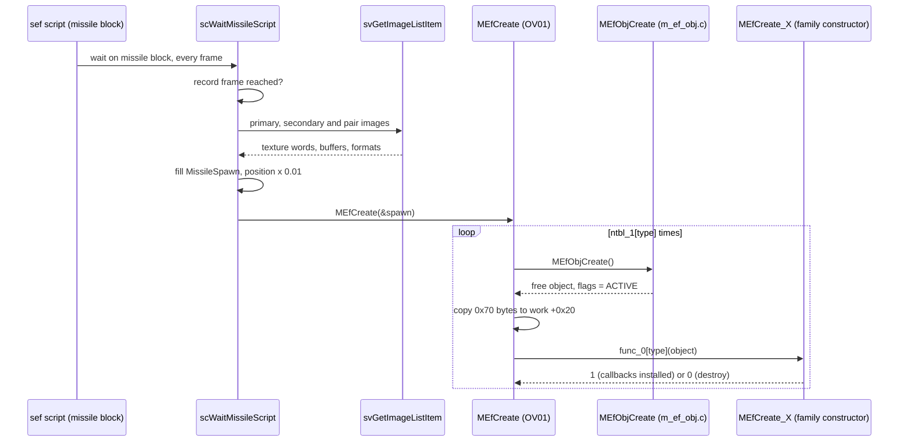
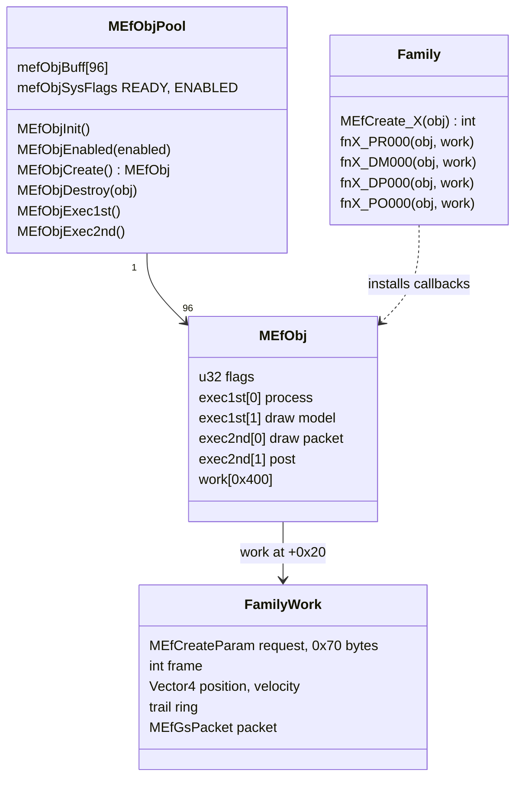
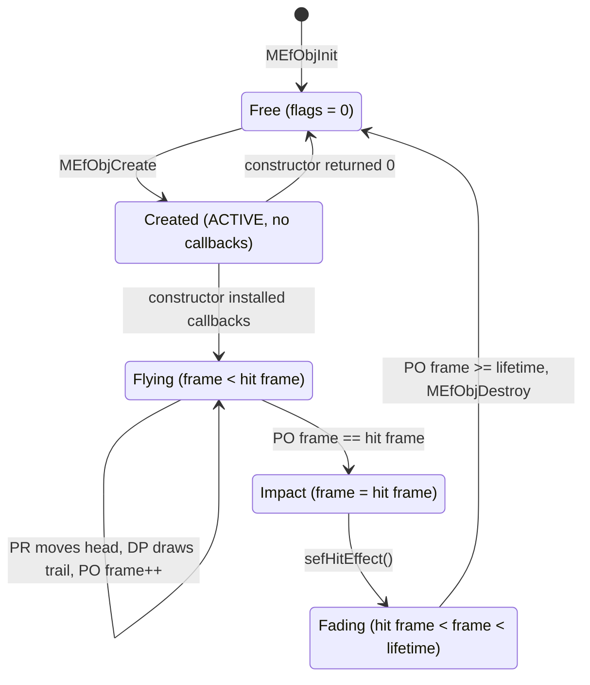
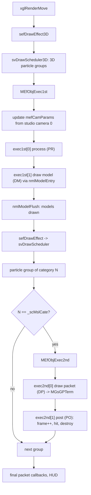
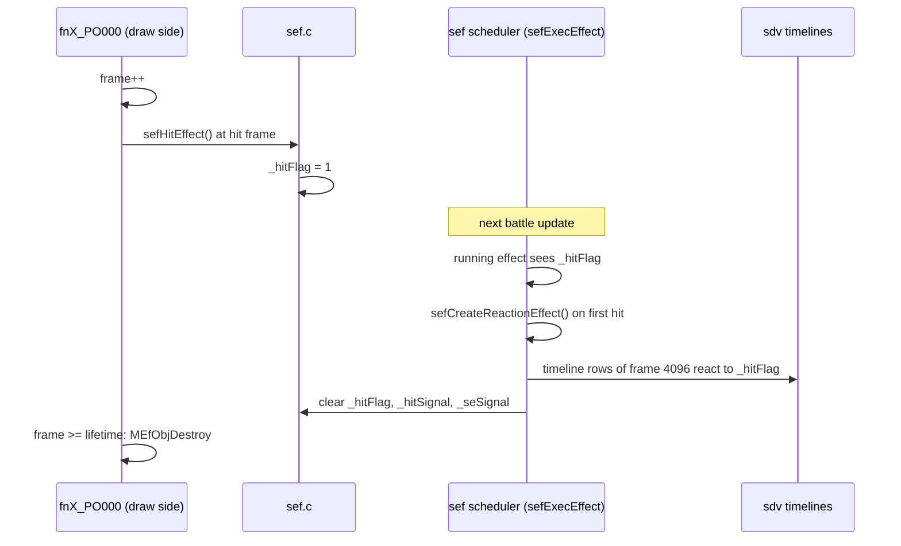
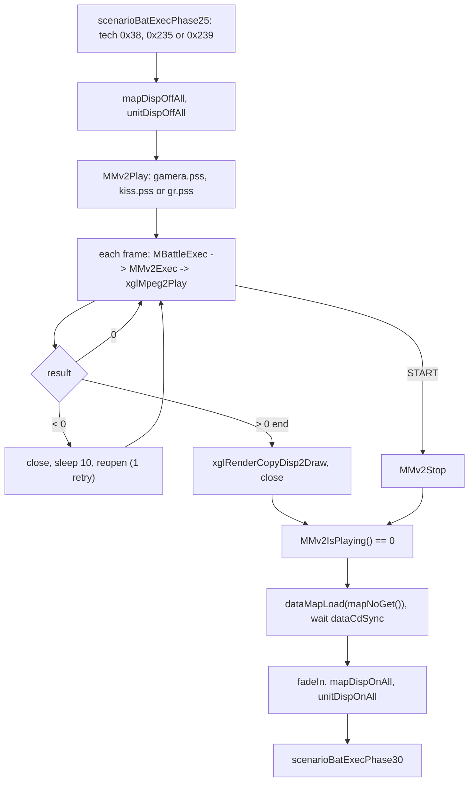
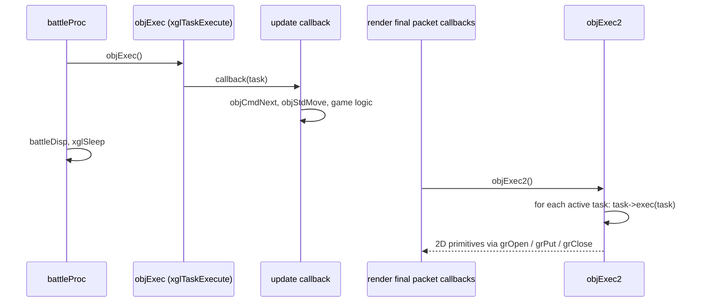

# Battle effects

The battle effects in OV01 are a set of hand-written visual effects for
specific techniques: missiles, beams, smoke trails and energy ribbons. The
source calls them M effects (`MEf*`). Each effect family is one C file that
computes its own geometry every frame and sends its own GS packets. They are
small programs, unlike the data-driven effects of the generic effect engine
sef.

M effects do not run on their own. A sef effect script starts them with its
"missile" command, they draw inside the sef draw passes, and they report their
impact back to sef. The same overlay also contains the other battle visuals:
the encounter transition, the fades, the 2D packet builder, the movie players
used by cinematic techniques, and the small object system that drives the HUD
and the battle units.

[← Back to the overview](../README.md)

## M effects and sef

The generic effect engine sef (see [sef](../libraries/sef.md)) plays effects
described by data: particle groups, images, models, sounds and camera moves,
all ordered by effect scripts. An effect that needs custom motion, such as a
missile that flies along a curve and leaves a ribbon trail, is hard to express
as data. For these, the effect script issues a missile command, and sef hands
the work to OV01 through `MEfCreate`.

The parts of the M effect system are spread over the main executable and
OV01:

| Part | File | Role |
| --- | --- | --- |
| Missile command | `src/main/sc_wait_parse_script.c` | Reads the missile records of an effect script and calls `MEfCreate` |
| Object pool | `src/main/m_ef_obj.c` | 96 effect objects with four callback slots each |
| Draw hooks | `src/main/sv_get_image_item.c` | Calls `MEfObjExec1st` and `MEfObjExec2nd` from the sef draw passes |
| Dispatcher | `src/ov01/m_ef_create.c` | `MEfCreate`: picks the family and runs its constructor |
| Helpers | `src/ov01/m_ef.c` | Actor coordinates, angles, model drawing, billboard corners |
| GS packets | `src/ov01/m_gs.c` | `MGsGPInit` and `MGsGPTerm`: packet buffer and send |
| Families | `src/ov01/m_ef_create_*.c` | One file per effect family, 14 in total |
| Math | `src/main/m_math.c` | `MMath*` vectors, matrices, Hermite curves, random numbers |

The pool lives in the main executable, so it exists even when OV01 code is not
running. The families live in OV01, at the end of its text section
(0x00A33F08 to 0x00A3AAC8). The `MMath*` library is explained in
[Math](../libraries/math.md).

## How an effect is spawned

A sef effect script can contain a missile command block. While the script
waits on that block, `scWaitMissileScript` in
`src/main/sc_wait_parse_script.c` runs once per frame. The block holds a list
of records, each with a start frame, a position and flags. When the frame
counter reaches a record's frame, the function builds a `MissileSpawn` request
and calls `MEfCreate`, which the main executable knows as `func_A33648`. A
frame value of `MISSILE_END_FRAME` ends the block. The block is a 12-word
header followed by six-word entries (layout in
[missile blocks](../formats/effects.md#missile-blocks)). The shipped effect
scripts hold 23 such blocks with 4 to 40 entries each.

Building the request takes several steps:

1. It finds the effect's image mapper with `sefSearchMapperIndex` and reads
   the primary and secondary images with `svGetImageListItem`. Their texture
   words go into the request.
2. For each of three image pairs, it packs the buffer pointer, buffer width,
   pixel format (8-bit or 4-bit), size and the CLUT buffer of the pair into
   one 64-bit GS texture register value (`pair_registers`).
3. It sets the source and target actors from the script's spawn contexts and
   the coordinate selectors from the record's flags and the command kind.
   One command kind targets all targets of the attack through
   `sefCaclAllTarget`.
4. It scales the record position by 0.01 and stores it with w = 1.

The request is 0x70 bytes. The layout below shows the fields the spawn side
writes and the names that the MSP00 family uses for the same bytes.

```
MissileSpawn (sc_wait_parse_script.h)         MSP00Effect view (work +0x20)
+0x00 command_value    effect type 0..13
+0x04 spawn_context0
+0x08 spawn_context2   source actor           actor
+0x0C command_flag     source coordinate      actorCoordinate
+0x10 position[4]      creation offset        creationOffset
+0x20 spawn_parameter
+0x24 spawn_context1   target actor           targetActor
+0x28 command_type     target coordinate      targetCoordinate
+0x30 target[4]        all-target list
+0x40 primary_image_word
+0x44 secondary_image_word
+0x48 pair_registers[3] GS texture registers  texture[2]
+0x68 tail_parameters[2]
```

`MEfCreate(param)` in `src/ov01/m_ef_create.c` reads only the type. It refuses
a type of 14 or more. The table `ntbl_1` gives the number of objects for each
type. For each one, `MEfCreate` takes an object from the pool with
`MEfObjCreate`, copies the whole 0x70-byte request into the object's work area
at +0x20 and calls the family constructor from `func_0[type]`. A constructor
that returns 0 has its object destroyed at once. Families with several objects
(BP00, ECM02, GAMERA, DORA) get the same request in each object, and each
constructor draws its own random values, so the copies spread out.

The sequence diagram below shows the spawn path.



## The effect object pool

The pool is `mefObjBuff` in `src/main/m_ef_obj.c`: 96 (0x60) records of 0x420
bytes each. Every record has a flag word, four callback pointers and a work
area of 0x400 bytes.

```
MEfObj (0x420 bytes)
+0x000  u32   flags            bit 0 = ACTIVE
+0x004  fn    exec1st[0]       process        (fnX_PR000)
+0x008  fn    exec1st[1]       draw model     (fnX_DM000)
+0x00C  fn    exec2nd[0]       draw packet    (fnX_DP000)
+0x010  fn    exec2nd[1]       post           (fnX_PO000)
+0x014  ...   unused here
+0x020  u8    work[0x400]      creation request, then family state
```

Each callback is called as `callback(object, object->work)`. The first 0x70
bytes of the work area hold the creation request, and every family places its
own state after it: positions, velocities, trail rings, a frame counter and
an `MEfGsPacket`. `MEfCheckWorkSize` in `src/ov01/m_ef.c` rejects a family
state larger than 0x400 bytes.

The pool has two system flags in `mefObjSysFlags`. `MEFOBJ_SYS_READY` (1) is
set by `MEfObjInit`, which also clears all records. `MEFOBJ_SYS_ENABLED` (2)
is set and cleared by `MEfObjEnabled`. Objects can be created when the pool
is ready, but the callbacks run only when it is ready and enabled. The battle
controls these flags through `src/ov01/m_battle.c`. `MBattleInit` calls
`MEfObjInit` once at start-up. `MBattleCreate` clears the pool again and
enables it when a battle starts. `MBattleDestroy` disables it at the end.

`MEfObjCreate` returns the first record without the ACTIVE bit. It sets the
flag and clears the four callbacks, so a new object does nothing until its
constructor installs them. When the pool is full it prints "MEfObjCreate:
Failed to create an Object". `MEfObjDestroy` clears the callbacks and the
ACTIVE bit, and it warns when the object is not alive.

The class diagram below shows the pool and the callbacks that a family
installs.



## Effect lifecycle

All families follow one pattern, visible in their function names. The
constructor `MEfCreate_X` reads the request, computes the start position and
direction, clears the trail, prepares the GS packet with `MGsGPInit` and
installs the callbacks. It returns 1. The four callbacks then do this:

- `fnX_PR000` (process) moves the effect. It advances the head along a
  straight line, an arc or a Hermite curve and shifts the trail history by one
  slot. BP00 and SMP01 later replace it with a second process function,
  `fnX_PR010`, for a second phase of motion.
- `fnX_DM000` (draw model) draws a model through `MEfDrawModel`. Only five
  families have a model: MSP00, SMP01, AMP02, MSP02 and KOSBW02. The other
  families leave this slot empty.
- `fnX_DP000` (draw packet) projects the trail points and writes GS
  primitives into the packet, then sends it with `MGsGPTerm`.
- `fnX_PO000` (post) runs last. It increments the frame counter, calls
  `sefHitEffect()` when the counter equals the family's hit frame and calls
  `MEfObjDestroy` when it reaches the lifetime.

There is no other way to end an effect. The pool does not track owners, and
`MBattleDestroy` only disables the pool, so a battle that ends early leaves
the records to be cleared by the next `MBattleCreate`.

The state diagram below shows the life of one effect object.



## Frame timing

The pool runs entirely on the draw side of the frame. Neither the battle loop
nor `sefExecEffect` calls the M effect callbacks. Instead, the two halves run
inside the sef draw passes in `src/main/sv_get_image_item.c`.

`MEfObjExec1st` runs at the end of `svDrawScheduler3D`, the sef 3D pass that
`sefDrawEffect3D` starts. `xglRenderMove` calls `sefDrawEffect3D` before
`nmlModelFlush` (see [Rendering](../architecture/rendering.md)). The function
first refreshes the effect camera `mefCamParams` from camera 0 of the current
studio: the camera record, its view matrix, its rotation and a basis matrix
built with `MMathRotateMatrixYXZ`. The billboard helpers use this basis. Then
it runs `exec1st[0]` (process) and `exec1st[1]` (draw model) for every active
object. The model draws are queued with the model library, so they are drawn
by the following `nmlModelFlush` with the rest of the scene (see
[nml](../libraries/nml.md)).

`MEfObjExec2nd` runs in `svDrawMissile(category)` during the full sef particle
pass `svDrawScheduler`. The model library starts this pass from
`nmlModelFlush` through `sefDrawEffect`, after the models, with a depth test
of "greater or equal". `svDrawMissile` is called after each particle group
(image, weapon, combo, battle image), but it runs the pool only when the group
matches `_scMslCate`. That value is the resource category of the effect that
issued the missile command, set by `srsAnalyzeEftNo` in `src/main/sc_get.c`.
So the trails are drawn in the same layer as the particles of the effect that
fired them. This pass runs `exec2nd[0]` (draw packet) and `exec2nd[1]`
(post).

Because the post callback counts the frames, an effect's age is the number of
frames that were drawn while the pool was enabled. Its timing is tied to the
display, not to the battle update.

The flowchart below shows where the four callbacks run in one rendered frame.



## The hit signal

An M effect tells the rest of the game about its impact with one call:
`sefHitEffect()` in `src/main/sef.c`. The function only sets the global flag
`_hitFlag` to 1. The sef scheduler reads the flag on its next update in
`sefExecEffect`. For a running effect, a set flag (or the other global signal
`_hitSignal`) creates the reaction effects of the effect's binding with
`sefCreateReactionEffect`, on the first hit only, and counts the hit on the
binding. The timelines of the effect in `src/main/sdv.c` (sound, screen
filters, trails and camera keys) also react to the flags. A timeline row
with the frame 4096 waits until `_hitFlag` or `_hitSignal` is set, but only
when the special flag of the battle request (byte 22 of the battle data) is
set. Without it the row is skipped and never fires (see
[timelines](../formats/effects.md#timelines)). At the end of `sefExecEffect`
both flags are cleared.

The battle's own hit timing is separate. `scenarioBatExecMain` in
`src/ov01/battle_init.c` watches each target through `sefIsHitActor`, which
reports a per-actor counter that sef raises when one of its own effect
elements with a hit-signal category reaches its frame, and through the attack
motion. When a target is hit, the battle also calls `sefHitEffect()` itself,
so the same reaction path runs. The complete battle side is described in
[Attack playback](battle.md#attack-playback), and the sef side in
[sef](../libraries/sef.md).

The sequence diagram below shows an M effect impact.



## Shared helpers

`src/ov01/m_ef.c` holds the helpers that the families share:

- `MEfGetActorMatrix(dest, actor, coordinate)` returns the world matrix of one
  point of an actor. A coordinate of -1 is the actor's own position and yaw.
  -2 is the same point raised to a fixed height of 1.5. Values 0 to 0x27 are
  accessory joints, copied from the actor's matrix block. Anything else, or a
  null actor, gives the identity. `MEfGetActorCoord` returns only the
  translation of that matrix. The actor matrices are explained in
  [Actors](../libraries/actors.md).
- `MEfCalcWeaponCoord` applies an actor matrix to a local weapon position.
  DORA starts from it.
- `MEfCalcAngle(dest, from, to)` gives the pitch and yaw that turn one point
  toward another. `MEfCalcAngleMatrix` recovers pitch and yaw from a matrix.
- `MEfCalcCircumXZ(out, center, radius)` picks a random point on a horizontal
  circle around a centre. The families use it to aim at a random spot next to
  the target, so repeated shots do not overlap.
- `MEfScatterXY` scatters a point in the plane that faces an actor.
- `MEfMake4Vertex` and `MEfMake4Vertex2` build the four corners of a camera-
  facing square around a point, from the basis in `mefCamParams`, and project
  them. The second version rotates the corners by an angle. They return how
  many corners the clipper rejected.
- `MEfDrawModel(place, entry, texture)` binds a texture when one is given,
  sets the placement matrix and draws a model entry with the model library
  (`nmlModelSetTexture`, `nmlModelSetPlace`, `nmlModelEntry`).

`McEfSTQtbl` in `src/ov01/m_ef_create.c` holds the STQ texture coordinates of
the four corners of a quad. Several families also look up textures by name with
`svGetPrmFromName`, which builds a texture parameter from the bitmap and CLUT
resources of the loaded sef data. The cloud textures `de_cld01` and
`de_cld02` are used this way by SMP01, AMP02, MSP02 and KOSBW02.

## GS packets

The families draw with GIF packets that they build by hand. `src/ov01/m_gs.c`
has the two functions that manage the buffer:

- `MGsGPInit(packet, address, size)` sets up an `MGsPacket`. With an address
  of 0 it uses the scratchpad (`SCRATCHPAD_BASE`) with a capacity of 0x400
  bytes. Otherwise it uses the caller's buffer and size.
- `MGsGPTerm(packet)` sends the queued data when there is any. It writes a VIF
  FLUSH code and a DIRECTHL block into the current VIF1 packet of
  `xglPacketGetCurrent`, copies the queued quadwords into it with
  `sceVif1PkAddDirectDataN` and resets the counters.

Each family has its own small writers (for example `bp00OpenTag`,
`bp00SetRegister` and `bp00CloseTag`) that add a GIF tag, A+D register writes
and vertex data. The common register values are named in
`include/ov01/m_ef_create.h`:

| Constant | Value | Meaning |
| --- | --- | --- |
| `MEF_GS_SETUP_TAG` | 0x1000000000008000 | GIF tag for the A+D set-up block |
| `MEF_GS_STRIP_PRIM` | 0x4C | Gouraud triangle strip with alpha blending |
| `MEF_GS_TEXTURED_STRIP_TAG` | 0x302A400000008000 | GIF tag for a textured strip |
| `MEF_GS_TEST_1_ALPHA_GREATER_ZGEQUAL` | 0x5000D | Alpha test "greater", depth test "greater or equal" |
| `MEF_GS_ZBUF_1_PSMZ24_NO_DEPTH_WRITE` | 0x131000000 | 24-bit depth buffer, no depth write |
| `MEF_GS_ALPHA_1_ADDITIVE` | 0x48 | Additive blending: source × alpha + destination |
| `MEF_GS_TEX1_1_LINEAR_FILTER` | 0x60 | Linear texture filtering |

So the trails are drawn additively, are hidden behind closer geometry, and do
not hide each other. The vertices are projected on the CPU with
`MMathRotTransPersClip`, which also reports clipped points. The GS registers
themselves are explained in [Rendering](../architecture/rendering.md).

## Effect families

There are 14 effect types. The type number is the index into `func_0` and
`ntbl_1`. The family names are the original constructor names. Their
meanings are not documented in the code, so only the behaviour is described.

| Type | Family | Objects | Callbacks | Hit frame | Lifetime |
| --- | --- | --- | --- | --- | --- |
| 0 | MSP00 | 1 | PR, DM, DP, PO | 18 | 28 |
| 1 | BP00 | 2 | PR000 then PR010, DP, PO | 33 | 45 |
| 2 | SMP01 | 1 | PR000 then PR010, DM, DP, PO | 15 | 25 |
| 3 | EAC00 | 1 | none (constructor returns 0) | | |
| 4 | AMP02 | 1 | PR, DM, DP, PO | 30 | 40 |
| 5 | MSP02 | 1 | PR, DM, DP, PO | 20 | 30 |
| 6 | SOLB | 1 | PR, DP, PO | 23 | 53 |
| 7 | ECM01 | 1 | PR, DP, PO | 60 | 90 |
| 8 | ECM02 | 4 | PR, DP, PO | 35 | 55 |
| 9 | GAMERA | 6 | PR, DP, PO | 24 | 51 |
| 10 | EAD00 | 1 | PR, DP, PO | 70 | 70 |
| 11 | SO14 | 1 | none (constructor returns 0) | | |
| 12 | DORA | 6 | PR, DP, PO | 15 | 48 |
| 13 | KOSBW02 | 1 | PR, DM, DP, PO | 25 | 35 |

The two stubs, EAC00 and SO14, are one-line constructors that return 0. A
request for them takes a pool object and gives it back at once, so nothing is
drawn. They are probably effects that were cut or moved to sef data.

### MSP00

MSP00 is a missile with a model and a ribbon trail. The constructor takes the
source actor's matrix at the requested coordinate, applies the creation
offset to get the spawn point, and picks a random point on a circle of radius
1 around the target. The velocity is the distance divided by 18 flight
frames. `fnMSP00_PR000` moves the head and spins it around its axis during
flight, and shifts a trail of 10 slots with 3 points each. `fnMSP00_DM000`
draws the model scaled to (0.04, 0.04, 0.2), a long thin shape along the
flight direction. `fnMSP00_DP000` draws the trail as strips. The hit comes at
frame 18, the moment the head arrives, and the object is removed at frame 28
after the trail fades.

### BP00

BP00 uses two objects. Each one draws five strands of seven points. The
constructor places the effect at the creation offset on the actor and points
the first strand back along the actor's facing. The first process function
shifts the history of that strand and extends it while its counter is below
18. At a counter of 24 it restarts all five strands and switches to
`fnBP00_PR010`, which extends the strands while the counter is below 16 and
shifts their history. The strands are drawn as strips with their own tag
writers (`bp00OpenTag`, `bp00SetRegister`, `bp00CloseTag`). The hit comes at
frame 33.

### SMP01

SMP01 is a smoke trail. The constructor places the smoke at the source actor,
aims at a point on a circle around the target and clears the smoke trails. The
first process function moves along a rising arc, starts updating the smoke
puffs (`updateSmoke`) from phase 4 and switches to `fnSMP01_PR010` at phase 5
for the second leg. It draws a model and textured cloud quads. The hit comes
at frame 15.

### AMP02

AMP02 flies for 30 frames from the source actor's matrix toward a point near
the target, with a trail of 10 single points. It draws a model and textured
cloud quads built with `MEfMake4Vertex2`. The hit comes at frame 30, at the
end of the flight, and the object lives 10 more frames.

### MSP02

MSP02 is a missile with two emitters. The constructor places it at its spawn
point, aims its velocity at a random circle point over 20 frames, loads the two
cloud textures and installs the four callbacks. The helper `adjAngle` keeps the
angles in range while the head turns. The trail has 10 slots of 2 points. The
hit comes at frame 20.

### SOLB

SOLB follows a Hermite curve. The constructor builds the path
(`makePath`, `makeHermiteParam`) and the tangents of the first segment. The
head travels for 23 frames. The trail keeps 30 points, and the drawing pass
builds six fibres around it as ribbons and halos. The hit comes at frame 23 and
the object lives until frame 53 while the ribbons fade.

### ECM01

ECM01 is the slowest family. The constructor places it at the creation offset
on the actor, sets a small motion per step toward the target coordinate and
randomises its angle and size. For 60 frames it
records a history of 31 positions, which the draw pass shows as two fading line
strips. The hit comes at frame 60 and the object ends at frame 90.

### ECM02

ECM02 uses four objects. Each picks a random colour (three channels that add up
to at most 128, with alpha 255) and a random start angle for its head. Until
frame 35 the process function grows the head's radius and angle, so the head
moves on a spiral. The last 20 trail points are drawn as a two-sided ribbon.
The hit comes at frame 35.

### GAMERA

GAMERA uses six objects. Each builds a path of four Hermite points with random
offsets and moves along it in segments of 8 frames for 24 frames. The trail
keeps 28 points, and 27 segments are drawn in four ribbon passes. The hit comes
at frame 24. The technique 0x38 plays the movie `gamera.pss` (see
[Movie players](#movie-players)), so this family probably belongs to the same
attack.

### EAD00

EAD00 draws four rays of 51 segments each, as 12 ribbons. It fades out from
frame 62. Its hit frame and its lifetime are both 70, so the post callback
signals the hit and destroys the object in the same call.

### DORA

DORA uses six objects and starts from a weapon point (`MEfCalcWeaponCoord`)
instead of an actor joint. Each object builds Hermite control points and
moves along them in segments of 5 frames for 15 frames. The trail has 34
slots, drawn as 33 strip segments. The hit comes at frame 15 and the objects
fade until frame 48.

### KOSBW02

KOSBW02 is a beam from the source to the target. The constructor stores the
start, the midpoint and a rotation from the two actors. The process function
moves the beam along an arc through the midpoint. The draw functions use a
model and textured quads built with `MEfMake4Vertex` and `MEfMake4Vertex2`. The
name probably means a KOS-MOS beam weapon. The hit comes at frame 25.

## Other battle visuals

Not every battle visual is an M effect. The HUD, the cursors, the fades and the
encounter transition are battle objects (see
[The battle object system](#the-battle-object-system)) that draw with the 2D
packet builder in `src/ov01/gr_gp_init.c`.

`grGpInit` sets up a packet in the scratchpad at 0x70000000. Each primitive
type has an open, put and close function: flat triangles and quads (`F2`,
`F4`), textured quads (`FT4`), textured quads with STQ coordinates (`FT4STQ`)
and sprites (`Spr`). `grPacketSend` sends the packet. `grVramCopy` and
`grVramCopyFBtoFB` copy rectangles of video memory. `grRotTransPers` and
`grCalcMatrix` project 3D points for HUD elements that follow units.
`GS_REG_SET` writes single registers, and other helpers return frame buffer
indexes.

The encounter transition in `src/ov01/entry_first_init.c` uses these
primitives. When the battle starts, `cfSnap` copies the last field image.
`encEffObjInit` then creates an object that cuts this image into a 64 × 64
grid of `FT4` quads with 65 lattice points per side. `encEffObj` rotates,
warps and fades the grid, and `encEffObjDraw` draws it, so the field seems to
break apart while the battle stage appears behind it. `fadeIn` and `fadeOut`
create an object that draws a full-screen `F2` quad with a changing alpha.
`vramCopyObjCreate` creates an object that copies frame buffers.

The damage numbers (`objDmgNumCreate`, 30 frames), the critical indicator and
the GTW portraits are HUD objects in `src/ov01/menu.c`. They are described in
[Battle HUD and map](battle.md#battle-hud-and-map).

## Movie players

OV01 has two movie players. Both play MPEG movies through the movie code in
`src/main/xgl_1.c` (see [xgl](../libraries/xgl.md)), and both are stepped once
per frame by `MBattleExec`.

`src/ov01/m_mv.c` (`MMv*`) uses the `xglMovie*` functions. `MMvPlay(filename)`
plays a movie in the full 512 × 448 frame. `MMvPlay2(options)` takes an
`MvPlayOptions` record with a flag (full frame or movie size), the file name
and a frame rectangle (`frame_x`, `frame_y`, `frame_width`, `frame_height`).
It uses an arena at
0x01D9E000 of 0x40000 bytes and frame buffers at 0x01E1E000 and 0x01E2A000,
and it refuses a decode buffer larger than 0xC00. `MMvExec` decodes one frame
with `xglMoviePlay`, then sends a GIF environment that copies the picture to
the display with `xglDmaDirectNormal` on DMA channel 2. Holding SELECT and
pressing ✕ skips the movie when skipping is enabled (`MMvSkipEnabled`). The
other functions are `MMvStop`, `MMvIsPlaying` and `MMvGetTime`. Its only
caller is the `MOVIE` command of the effect scripts in `sc_get.c`, which
plays `data\simajiri\movie\NAME` with `MMvPlay` when no event scene runs
(`_nowEvent` is 0). The script wait `WAITMOVIE` in `sc_wait_parse_script.c`
and the sef scheduler both pause while `MMvIsPlaying` (`func_A33248`) reports
a movie. In the shipped data this player is never used: no effect script
contains a `MOVIE` command and the folder `data\simajiri\movie\` is not on
the disc (see [IPU movies](../formats/movies-images-and-icons.md#3-ipu-movies)).

`src/ov01/m_mv2.c` (`MMv2*`) uses the `xglMpeg2*` functions. Its arena is at
0x01B9E000, the same address where battle stages are loaded, with a CD
stream ring of 0x80000 bytes. START skips the movie. When a decode fails,
`MMv2Exec` closes the stream, sleeps for 10 frames and opens it again, with
one retry. When the movie ends, it copies the display buffer to the draw
buffer with `xglRenderCopyDisp2Draw`, so the last picture stays on screen.
The battle uses this player for the cinematic techniques, with the PSS
movies of `data\yamamoto\mv\` (format in
[PSS movies](../formats/movies-images-and-icons.md#2-pss-movies)): 0x38
(`gamera.pss`), 0x235 (`kiss.pss`) and 0x239 (`gr.pss`) in
`scenarioBatExecPhase25`, and `momo_a.pss` and `momo_b.pss` in the transform
flow `specHensinProc`. Because the movie uses the stage memory, the battle
reloads the stage with `dataMapLoad` after each movie.

The flowchart below shows how a cinematic technique uses MMv2.



## The battle object system

`src/ov01/obj.c` is a small object system built on the xgl task scheduler
(see [xgl](../libraries/xgl.md)). Every battle unit, cursor, HUD element, fade
and damage number is one object.

It has two pools. `taskBuf` holds 50 task nodes of 0x80 bytes, managed by the
scheduler `taskMan`. `objWork` (0x00A51970) holds 60 work records of 0x110
bytes. `objInit` clears both. `objEntrySub` takes a task node from the
scheduler and a free work record from `objWorkGet`, and links them. If either
pool is empty it prints an error and returns 0.

An object has two callbacks. The update callback is the scheduler callback of
the task, and `objExec` runs all of them with `xglTaskExecute` during the
battle update. The draw callback is stored at +0x18 of the task node by
`objEntry2(update, draw)`, and `objExec2` runs all of them on the render side,
because `battleProc` installs `objExec2` as a final packet callback.
`objEntry` creates an object without a draw callback. `objEntryRev` and
`objEntry2Rev` insert the object at the head of the list instead of the tail,
which changes the update and draw order. `objEntryPure` creates a task without
a work record. `objRemove` frees the work record and removes the task.

```
ObjectWork (0x110 bytes)
+0x00  int    flags        bit 0 in use, bit 1 command pending
+0x04  ObjectCommandEntry entries[5]   20 bytes each
+0x68  int    writeIndex, readIndex
+0x70  int    two more queue words
+0x78  ...    object-specific (battle units: +0x84 = CalcUnitParam*)
+0x90  ObjectWorkTransform
       +0x00 position     +0x30 scale        +0x40 velocity
       +0x50 acceleration +0x60 target
```

`objStdInit` clears the transform, sets the scale to 1 and empties the command
queue. `objStdMove` adds the acceleration to the velocity and the velocity to
the position, and snaps each axis onto `target` when it arrives or overshoots.
It returns non-zero when all three axes have arrived. `objHatoVec` sets the
velocity so that the object reaches its target in a given number of steps,
and snaps each axis that is already within 0.5 of the target.

Each object has a queue of five 20-byte commands: `objCmdPush`, `objCmdPop`,
`objCmdNext`, `objCmdClear`, `objCmdPtrGet` and `objCmdTailGet`. A command
starts with a selector and an argument. The HUD objects push short command
lists into their own queue, for example the ATB window when it is created, and
the battle units use the queue for their unit commands (see
[Unit commands](battle.md#unit-commands)). The `Fifo` functions at the end of
the file (`fifoInit`, `fifoPush`, `fifoPop`, `fifoNumGet`) manage a ring of
indexes. The battle's global command list `fifoCmd` uses it.

The diagram below shows how an object is driven through one frame.



## Debug notes

Two OV01 files are developer test entries. `src/ov01/yamamoto_test.c` holds
`YamamotoTest`, which starts the battle systems and runs a loop that draws a
test screen grid. `src/ov01/matuzawa_test.c` holds `MatuzawaTest`, an empty
function. The names are probably the names of the programmers of the battle
core and the M subsystems. The debug loops in `src/main/set_path.c` also hold
sef effect viewers (`seffectDebugBattle`, `seffectDebugCf`, `seffectDebugDb`)
next to the debug battle `sbattleDebug`. The debug tools are
described in [Debug tools](debug-tools.md).
