# Battle system

The battle system is the turn-based combat of Xenosaga Episode I. It lives in
the overlay OV01, which is linked at 0x00A00000 and stays loaded during normal
play. A battle starts when the player touches an enemy on the field or when an
event script calls the `execBattle` native. OV01 then runs its own blocking
loop, `battleProc`, until the battle is won, lost or escaped, and hands a
result code back to the field.

OV01 holds more than the battle itself. It also contains the game-data tables
and accessors (`batdat.bin`, character records, item, ether and technique
names) that the main menus read, the battle camera that field scripts drive,
the movie players and the M effects (see [Battle effects](battle-effects.md)).
This is probably why OV01 stays resident instead of being loaded only for
battles.

[← Back to the overview](../README.md)

## What OV01 contains

OV01 has 37 source files in `src/ov01/`. The text ranges below come from
`config/objects/ov01.layout.json`. The order is the original link order, so
the battle core comes first and the effect families come last.

| File | Text range | Role |
| --- | --- | --- |
| `yamamoto_test.c` | 0x00A00000–0x00A00218 | Debug test entry `YamamotoTest` |
| `obj.c` | 0x00A00218–0x00A00D60 | Object tasks, work pool, per-object command queues, FIFO |
| `unit_cmd.c` | 0x00A00D60–0x00A07770 | Battle units and the handlers of their commands |
| `battle_init.c` | 0x00A07770–0x00A10BB8 | Battle control, turn order, input, attack playback, end check |
| `calc.c` | 0x00A10BB8–0x00A191C0 | Unit parameters, hit and damage, status, AP, Boost, wait time |
| `data_unit_org_get.c` | 0x00A191C0–0x00A1D348 | Battle data tables, character records, file loading |
| `cmd.c` | 0x00A1D348–0x00A22628 | The think VM for enemy AI and camera scripts |
| `entry_first_init.c` | 0x00A22628–0x00A24A98 | Entry points, `battleProc`, entry phases, fades |
| `gr_gp_init.c` | 0x00A24A98–0x00A26018 | GS packet builder for 2D sprites and quads |
| `menu.c` | 0x00A26018–0x00A2C3A0 | Battle HUD, battle menu, Event Slot, damage numbers |
| `map_disp.c` | 0x00A2C3A0–0x00A2C5A8 | Drawing of the battle stage model |
| `data_eth_name_get.c` | 0x00A2C5A8–0x00A2C9B8 | Name tables for ether, items, skills, weapons, characters |
| `result.c` | 0x00A2C9B8–0x00A2C9F8 | Thin wrappers around the result screen |
| `snd.c` | 0x00A2C9F8–0x00A2E4B0 | Battle music and sound effects |
| `debug_entry.c` | 0x00A2E4B0–0x00A31340 | Debug battle configuration screen |
| `matuzawa_test.c` | 0x00A31340–0x00A31348 | Empty test function |
| `m_battle.c` | 0x00A31348–0x00A314B8 | Start-up and per-frame step of the M subsystems |
| `m_cam.c` | 0x00A314B8–0x00A32DB8 | Battle camera |
| `m_gs.c`, `m_mv.c`, `m_mv2.c` | 0x00A32DB8–0x00A33648 | GS packet send and the two movie players |
| `m_ef_create.c`, `m_ef.c` | 0x00A33648–0x00A33F08 | Effect creation and effect helpers |
| `m_ef_create_*.c` (14 files) | 0x00A33F08–0x00A3AAC8 | One file per effect family |

The files with the `m_` prefix form a separate layer, the M subsystems:
camera (`MCam*`), movies (`MMv*`, `MMv2*`), GS packets (`MGs*`) and
effects (`MEf*`). They are probably the work of a different programmer than
the battle core, because they use their own naming style and their own debug
print (`MOutputDebugStringWarn`). Field event code in the main executable also
calls them.

Many function names come from the original debug strings. Several source
files use Japanese words written in Latin letters: `seisan` (settlement, the
result screen), `nusumu` (steal), `syoukan` (summon), `hensin` (transform),
`inori` (prayer), `futtobi` (knockback), `tuigeki` (follow-up attack) and
`yuka`/`ten` (floor and sky).

## How a battle starts

There are two ways into a battle. Both end in the same function,
`battleProc` in `src/ov01/entry_first_init.c`. The main executable knows it
only by address (`func_A22668`).

The first way is a field encounter. `Check_Encount` in
`src/main/set_motion.c` runs when the player touches a field enemy. It fills
the encounter record in `GameLoopState` (described in
[Encounter data](#encounter-data)) and sets bit 0 of
`GameLoopState.event_sub_id`. The field mode function `GameModeCfMain` in
`src/main/game.c` sees the non-zero value on its next pass and starts the
battle. The enemy side of this check is explained in
[Field enemies](field-enemies.md).

`GameModeCfMain` does these steps in order:

1. `Game_Data_Push()` saves the field state. It copies the 64-entry actor
   array, calls `GameCFSoundPurge` to free field sound, calls
   `GameStateSave`, pushes the sef effect state with `sefPushEffect` and
   records which model parts were hidden.
2. It sets `GameLoopState.kind` to `GAME_MODE_BATTLE`.
3. `nmlModelSendSignalStartBattle()` tells the model library that a battle
   starts (see [nml](../libraries/nml.md)).
4. `xglSoundStreamStop(0)` stops the field music stream, and the controller
   vibration is stopped.
5. It calls `battleProc`. This call blocks until the battle is over.
6. It sets `GAME_FLAG_BATTLE`, resets the message system with `MSG_init` and
   the window system with `TWSYS_init` (see
   [UI windows](../libraries/ui-windows.md)).
7. If the debug abort chord set `GAME_FLAG_EXIT`, it returns at once.
8. It reads the result with `battleRetCodeGet` (`func_00A0B5F0`) and handles
   it as described in [How a battle ends](#how-a-battle-ends).

The second way is the Java native `Java_xeno_util_Runtime_execBattle__II` in
`src/main/runtime.c`, which event scripts call (see
[Natives](../scripting/natives.md)). It takes two integers. The first is the
battle map number and goes to `mapNoSet` (`func_00A0B728`). The second is the
monster set number and goes to `monsSetNoSet` (`func_00A0B708`). Both setters
write fields of the encounter record. The native then saves only the light
game state with `GameStateSave`, calls `battleProc`, rebuilds the actor scene
with `ACT_resourceInit`, `ACT_initScene` and `ACT_initMTNResource`, starts a
fade-in with `nmlModelSetFadeIn` and `FX_ScreenMask`, and calls
`GameStateRestore`. It does not call `Game_Data_Push` or `Game_Data_Pop`, and
it does not read the battle result. The script itself is responsible for what
happens next.

`GameStateSave` stores the game mode, the state of the controlled actor, the
map number and the camera and light settings. `GameStateRestore` puts the mode
and the camera and light settings back. `Game_Data_Pop`, used only on the
field encounter path, waits for the CD, reloads the field sound with
`GameCFSoundReload`, restarts sef with `sefInitEffectCf`, reloads the field
resources with `GameResourceLoad`, restores the saved actors and their motions,
and calls `GameStateRestore`. Memory reuse across this switch is explained in
[Memory](../architecture/memory.md).

The sequence diagram below shows a field encounter from contact to return.

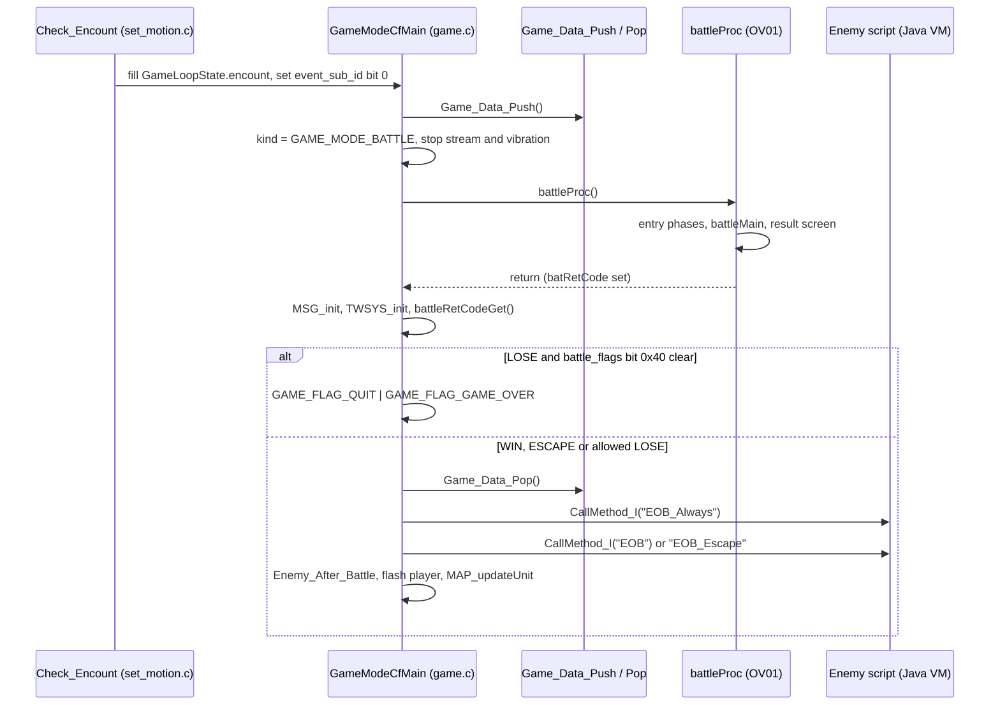

A third entry point prepares OV01 itself. `entryFirstInit` (`func_A22628`) is
called from the `Game()` set-up in `src/main/game.c`. It calls
`sefInitEffect`, `MBattleInit`, loads `batdat.bin` with `dataBatDatLoad`,
fills the default party records with `dataPlUnitInit`, and resets the think
number and the battle map number (`thinkNoSet(0)`, `mapNoSet(1)`). This
happens once, long before any battle.

## Encounter data

All battle parameters that cross from the field into OV01 live in one small
record inside `GameLoopState`, at offset 0x29F90. The field calls it
`encount` (`EncountRecord` in `src/main/set_motion.c`). OV01 reads the same
bytes through its own getters in `src/ov01/battle_init.c`.

```
GameLoopState + 0x29F90   EncountRecord
+0x00  short  monster_set_number   OV01: monsSetNoGet / monsSetNoSet
+0x02  short  map number           OV01: mapNoGet / mapNoSet (battle stage)
+0x04  short  encounter_side       side of contact (front, side or back)
+0x06  u8     trigger_flags        OV01: cfEncountGet
+0x07  u8     event_flags          OV01: cfEventGet (game.c: battle_flags)
+0x08  short  entry_value          the enemy's encounter_value
+0x0A  (2 bytes not modeled)
+0x0C  ptr    enemy                the field enemy that started the battle
```

`Check_Encount` picks the monster set at random from the up to eight
`monster_set_numbers` of the field enemy. It computes `encounter_side` from
the facing of the player and of the enemy through a 3×3 table. It copies
`encounter_event_flags` from the enemy parameters into `event_flags`.

`trigger_flags` (cfEncount) records how the enemy was touched. The field sets
0x02 when the enemy was stunned ("stiff"), 0x01 for an electric stun and 0x04
for a seal. In battle, `calcCfEncount` gives the party a first strike: flag
0x01 sets the wait count of every party member to 0 and sets the Event Slot to
1, and flag 0x02 sets the wait counts to 0 and gives each party member one
extra boost. `encountEffDisp` shows the effects 0xA42, 0xA43 and 0xA44 for the
three bits when the battle opens. The AI scripts can also read the byte
through a think register. The field side of stunning enemies is explained in
[Field enemies](field-enemies.md).

`event_flags` (cfEvent) configures the battle itself. The bits used in the
code are these:

| Bit | Effect in the code |
| --- | --- |
| 0x01 | Player attacks on enemies deal 0 damage (`calcHitDmg`). Probably a scripted battle that cannot be won by force |
| 0x04 | The A.G.W.S. command of the battle menu is refused |
| 0x08 | Boss battle: boss music, and the Goodbye ether (3) and the Escape Pack item (0x10) are refused |
| 0x10 | No result screen. An empty enemy side counts as ESCAPE. Also turns off the boss music of bit 0x08 |
| 0x20 | An empty enemy side counts as ESCAPE |
| 0x40 | A loss is allowed and does not end the game (`game.c`) |

The enemy list comes from the monster set. The battle map number in the
record is replaced by the map number stored in the monster set entry when that
entry is non-zero (`thinkInit`, see [Enemy AI](#enemy-ai-and-the-think-vm)).

## The battle loop

`battleProc` is the main function of a battle. It never returns until the
battle is over, so it replaces the field main loop for the whole battle. It
first prints a start message and seeds the random generator by calling
`rnd(0)` (clock seconds × 100) times. `rnd(max)` in `src/ov01/calc.c` returns
`xglSRand() % (max + 1)`, so it covers 0 to max inclusive. It then turns on
the frame clear with `xglRenderClearOn`, installs `objExec2` as the object
draw hook in `sRender.objExecHook` (the seventh final packet callback, see
[Rendering](../architecture/rendering.md)), and sets the sequence pointer
`battleSeq` to `entryPhase00`.

Each frame then runs the same order:

1. A debug abort chord. Holding SELECT, L1 and R1 and pressing START sets
   `GAME_FLAG_EXIT`, stores result 1, calls `battleProcEnd` and stops the music.
2. `pauseProc()` decides if the battle runs. In the retail code it always
   returns 1.
3. `battleSeq()` runs the current entry phase. A return of 0 ends the loop.
4. `thinkProcessExec()` runs the think VM processes (AI and camera scripts).
5. `objExec()` runs the update callbacks of all battle objects.
6. `ACT_update()` advances the actor library (see
   [Actors](../libraries/actors.md)).
7. `sefExecEffect()` advances sef effects (see [sef](../libraries/sef.md)).
8. When paused, the loop instead prints "PAUSE" and calls `ACT_pauseUpdate`.
9. `nmlModelSendPauseSignal(pauseFlag)` passes the pause state to the model
   library.
10. `battleDisp()` builds the frame's 3D scene.
11. `GameSnapShotCheck()`, then `frameCnt++`.
12. `xglSleep()` ends the frame and yields to the other threads (see
    [xgl](../libraries/xgl.md)).

`battleDisp` works from `battleDispMode`. Mode 0 draws nothing. Mode 1 is the
normal battle view: `MBattleExec` runs the camera and the movie players, then
the active camera is flushed with `xglStudioFlushActiveCamera`, the stage is
drawn with `mapDisp(mapNoGet())`, and the actors and shadows are drawn with
`ACT_draw` and `GameDrawShadow`. Mode 2 is the result screen and calls
`SeisanDisp`.

The 2D parts and the effects are drawn later in the frame, on the render side.
`xglRenderMove` clears the screen, draws sef 3D effects with
`sefDrawEffect3D`, flushes the models with `nmlModelFlush`, then runs the
final packet callbacks. One of them is `objExec2`, which runs the draw
callback of every battle object (HUD, cursors, fades, damage numbers). The M
effect objects are drawn inside the sef passes, as explained in
[Battle effects](battle-effects.md#frame-timing).

The flowchart below shows one battle frame on the game side and the render
side.

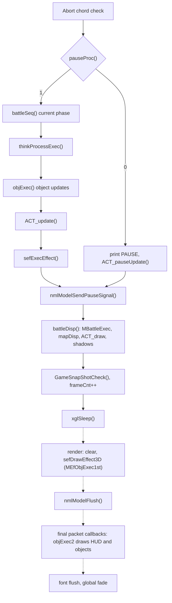

`battleProcEnd` undoes the set-up when the battle closes. It turns the frame
clear off, removes the draw hook, stops the think VM with `thinkSysInit`,
destroys the sef effects with `sefDestroyEffect`, shuts the M subsystems with
`MBattleDestroy`, gives the camera back with `MCamReleaseControl`, turns off
smooth hair and the culling override, resets the actor library with `ACT_init`
and `ACT_initSequence`, and stops the sound effect channels 1 to 14 and bank 0.

## Entry phases

`battleSeq` is a function pointer. Each phase function does a small amount of
work per frame, sets `battleSeq` to the next phase when its step is done, and
returns 1. Only the last phase returns 0. This lets loading and fading run
over many frames while the loop keeps drawing.

The first phases build the battle:

- `entryPhase00` clears everything. It calls `UnduInit`, resets the actor
  library and shadows, calls `objInit`, `dataCdSyncClear`, `battleInit` and
  `sefInitEffectBattle`, turns on smooth hair and the culling override, sets
  studio 0 with one parallel light and an ambient of 0.5, copies the field
  image with `cfSnap`, starts the battle windows with `eBattleWinInit` and the
  think VM with `thinkInit`, and takes the camera with `MCamTakeControl`. It
  prints the map, monster set, think number, cfEncount and cfEvent, blurs the
  screen with `GameDefocusQuickSet` and plays system sound 0x25.
- `entryPhase10` checks the leader and the enemy models, starts the loads,
  chooses the music (kind 2 for the last boss on map 0x34, kind 1 for a boss
  battle, kind 0 otherwise), loads it with `dataSndMuLoad`, starts a fade and
  creates the encounter transition object with `encEffObjInit`.
- `entryPhase15` waits for the loads, starts the battle music with
  `sndMuTransPlay(0)` and loads the HUD textures with `dataXtxLoad`.
- `entryPhase16` loads the battle stage with `dataMapLoad`.
- `entryPhase20` initialises the stage and the camera, fires camera event 4,
  switches `battleDispMode` to 1 and tells the transition object to finish.
- `entryPhase25` and `entryPhase26` create the party units one by one with
  `unitPlCreate`, wait for their files and fire camera event 0x17 for each.
  The last one also creates the HUD with `menuStatDispCreate`.
- `entryPhase30` and `entryPhase31` pick a random living party member and play
  its battle-start voice (sound 0x18).
- `entryPhase35` and `entryPhase36` create up to five enemies from the monster
  set with `unitEnCreate`, then load their files.
- `entryPhase40` applies cfEncount with `calcCfEncount`, runs the enemy
  initial scripts with `thinkInitExec`, saves the ambient light with
  `sdvSaveAmbient` and prepares sef with `sefSetupEffect`.
- `entryPhase45` waits until no enemy is hidden, shows the encounter effects
  and resets `frameCnt`.

The battle itself is one phase. `entryPhase50` calls `battleMain()` every
frame until it returns 0. `battleMain` runs `battleCtrl`, `battleExec` and
`battleEndChk` (see [Battle control](#battle-control)). On a win, the phase
loads the victory voice (sound 0x19) of a party member, stops the battle music
and plays the victory jingle, except after the last boss.

The closing phases are these:

- `entryPhase51` plays the victory voice.
- `entryPhase60` calls `battleAfter()` until it returns 0, then fades out.
- `entryPhase70` waits for the fade. On a win or an escape without cfEvent bit
  0x10, it copies HP and EP back to the character records with
  `calcPara2Org`, switches `battleDispMode` to 2 and starts the result screen
  with `resultProcInit`. Otherwise it skips the result screen. Both paths call
  `battleProcEnd`.
- `entryPhase80` prints the gains of every defeated enemy.
- `entryPhase90` runs the result screen with `resultProc` until it returns 0.
- `entryPhase100` gives 1 HP to dead party members with `calcDeadReset`,
  reloads the field leader model with `dataLeaderReload`, stops the music and
  returns 0.

The state diagram below shows the order of the phases.

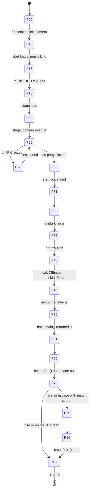

The encounter transition is drawn by three objects in the same file.
`encEffObjInit` creates an object that cuts the field image saved by `cfSnap`
into a 64 × 64 grid of textured quads (65 lattice points per side), then
rotates, warps and fades the grid over the first frames of the battle. `fadeIn`
and `fadeOut` create an object that draws a full-screen flat quad with a
changing alpha. `vramCopyObjCreate` copies frame buffers with
`grVramCopyFBtoFB`. These objects use the packet builder in
`src/ov01/gr_gp_init.c` (see [Battle effects](battle-effects.md#other-battle-visuals)).

## Battle units

A battle unit is one combatant: a party member, an enemy or an A.G.W.S. Each
unit is a battle object (see
[The battle object system](battle-effects.md#the-battle-object-system)) with an
update callback, a work record and a motion actor from the actor library.

`BattleUnit` in `include/ov01/battle_init.h` is the object task itself. Its
main fields are `work` at +0x10, the battle actor record whose first word holds
the unit flags, `actor` at +0x14, the motion actor, `weapon[4]` at +0x1C, one
actor per weapon slot, and `subActor` at +0x2C.

The unit table `unitTbl[8]` holds every unit. Slots 0 to 2 are the party and
slots 3 to 7 are enemies. `unitTblGet(side, &table)` returns the table start
and the count for a side: 3 for side 0, 5 for side 1 and 8 for side 2 (all).

The first word of the battle actor record holds flags that the whole battle
reads. The ones with source names are `ACTOR_FLAG_CMD_PENDING` (0x2, a command
is queued), `ACTOR_FLAG_ENEMY` (0x40), `ACTOR_FLAG_DEAD` (0x80) and
`ACTOR_FLAG_GUARD` (0x800). Other bits seen in the code are 0x8 (the unit is
acting this turn), 0x10 (the unit is in the action stock), 0x20 (controlled by
the AI), 0x400 (boosted), 0x1000 (a follow-up attack is open) and 0x2000 (the
last hit was critical).

The numbers of a unit live in `CalcUnitParam` (`include/ov01/calc.h`). The
battle reaches it with `calcUPGet(unit)`, which reads the pointer at +0x84 of
the battle actor record. Its important fields are listed below.

```
CalcUnitParam (battle copy of a character record)
+0x00 maxHp          +0x02 maxEp          +0x04 baseAtk       +0x06 phyDefense
+0x08 magAttack      +0x0A magDefense     +0x0C hitStat       +0x0D evadeStat
+0x0E agility        +0x0F moveKindId     +0x14 level         +0x16 counterRate
+0x18 conditions     +0x1A specDef        +0x1C flags (0x40 = A.G.W.S.)
+0x24 statProtect[8]
+0x34 currentHp      +0x36 currentEp      +0x38 charaId
+0x3A AP (source name dblActKind)         +0x3B bcLimit       +0x3C bcValue
+0x3D bpGauge        +0x3E turnBias       +0x40 waitCount     +0x42 waitCountBase
+0x44 posId          +0x50 linkedUnit     +0x54 baseCharaId
+0x5E weaponId[3]    +0x64 accessoryId[3] +0x6A attachmentId
+0x76 normalTechniqueId[6]                +0x82 tech slots (Tech Attacks)
+0x8E etherId[12]    +0xA6 skillId[3]
+0xAC statActiveMask[8]                   +0xCC statTurnCount[8][16]
+0x15C statEffUnits[8]                    +0x17C wpnAtkAdj
```

The record is filled from the character's origin record, which
`dataUnitOrgGet` returns from a table at 0x004227C0 with a stride of 0x180.
The origin records hold the permanent state that the main menu also reads and
writes. Growth, equipment and learning are explained in
[Character growth](character-growth.md). After a won or escaped battle,
`calcPara2Org` copies the current HP and EP back into the origin records.

Character ids follow `playerNameTbl` in `src/ov01/data_eth_name_get.c`: 1
chaos, 2 KOS-MOS, 3 Shion, 5 Ziggy (shown as Ziggurat 8 before a scenario
point), 6 MOMO, 7 Jr., 10 Virgil and 11 Mary. Ids 0x11 to 0x20 are A.G.W.S.
(VX-01 to VX-06, AG-01 to AG-06 and others).

`unitCreate(pl, side, func)` builds a unit. It calls `objEntry` for the task,
`objStdInit` for the transform and `unitParaInit` for the parameters. It turns
party units to 270° and enemies to 90°. It marks enemies with the flags 0x40
and 0x20. It places the unit from `dataPosTblGet(posId)` and mirrors the x
coordinate for enemies. Then it creates the motion actor with `ACT_create` and
a shadow. The party comes from the three attack slots of the party record
(`plUnitTblGet` reads `PartyDataGet()->attack_slots`). `unitPlCreate` handles
a special case: when the character id is an A.G.W.S., it also creates the
pilot as a linked unit, found by `unitAgwsPilotGet`, and stores it in
`linkedUnit`.

The update callbacks are `unitPlFunc` for the party and `unitEnFunc` for
enemies. Each frame they run the unit's current command through
`unitCmdExec`, advance the status visuals with `statEffProc` and update the
clipping with `unitClipSet`.

The class diagram below shows how a unit is put together.

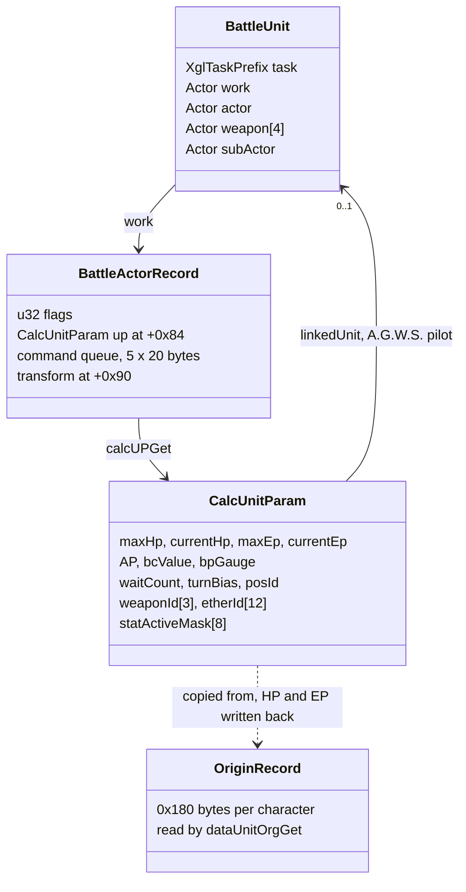

## Turn order and the action stock

The game shows the turn order in the Group Turn Window (GTW), the row of
portraits at the lower right of the screen. In the code this order is the
action stock, `struct ActStock` in `src/ov01/battle_init.c`.

```
ActStock
stock[4]      units that will act next, in order
boost[2]      boost slots, boost[1] is the slot that Boost uses
max           stock size: half of the able units, rounded up, at most 4
pickCursor    next stock entry to serve
lastPicked    the unit served last
pickSource    0 = next in stock, 1 = refill, 2 = boost slot
```

Every unit has a wait count (`waitCount`). `actStockMake` fills the stock. It
loops over all units, and `calcWctDec` lowers the wait count of each able unit
by 1, or by 2 with a 30% chance. A unit that reaches 0 and is not already in
the stock (flag 0x10) is added. The loop repeats until the stock is full.

`actStockPick` serves the next actor. It serves the boost slots first, then
the stock in order, and calls `actStockMake` again when the stock is empty.
This is why a Boost lets a unit act at once.

After a unit acts, `calcTurnEnd` resets it. It clears the per-turn flags
(0x6418), computes a new wait count with `calcWct`, stores it in `waitCount`
and `waitCountBase`, clears `turnBias` and advances the status turn counters
with `calcStatTurn`. The wait count formula is:

```
waitCount = (turnBias - agility) * 9 + 0xB4      then haste and slow statuses
```

`turnBias` is the delay that the last action added. `unitJobTypeAtk` adds the
per-technique delay `calcPlusAglGet` to it, so heavy techniques push the unit
further back in the GTW.

## AP

AP (Action Points) pay for every action. The value is stored at +0x3A of
`CalcUnitParam`. The source names this field `dblActKind`, but `calcAp` and
`keyCmdChk` use it as AP and clamp it to 6.

At the start of a turn, `calcTurnStart` adds 4 AP, or 6 with certain
statuses. It halves the amount under other statuses and adds 1 under one more.
AP that is not spent stays for the next turn, up to the cap of 6. This matches
the official rule of 4 AP per turn and a maximum of 6. If the unit still has
the guard flag from its last turn, `calcTurnStart` also queues a motion
command to end the guard pose.

The AP costs used by the input code are listed below.

| Action | AP | Source |
| --- | --- | --- |
| One attack press (□ or △) | 2 | `keyCmdChk` |
| Subweapon Attack (○ alone, KOS-MOS and Ziggy) | 6 | `keyCmdTblCha` |
| Guard, Move | 2 | `keyCmdApGet` |
| Item | 3 | `keyCmdApGet` |
| Ether, A.G.W.S. | 4 | `keyCmdApGet` |
| W-Item (two items) | 6 | `keyCmdApGet` |
| A.G.W.S. weapons | from the weapon data | `keyCmdApGet` |

## Battle control

`battleMain` runs three functions every frame: `battleCtrl` decides who acts
and what they do, `battleExec` carries the decisions out, and `battleEndChk`
checks for the end of the battle. They talk through the global record
`batCtrl`. Its field `field00` is the control state, `field04` is the
execution phase and `field08` is the phase to resume after a wait.

`battleCtrl` first handles two inputs that work at any time. L1 or L2 cycles
the help display (`battleCtrlHelp`). R1 or R2 opens the boost selection
(`battleCtrlBoostPl`, see [Boost](#boost)). Then it runs the control state:

- `ACT_SELECT` (1). If either side has no living units, nothing happens. If
  no unit is acting (flag 0x8), the state moves to `STOCK_PICK`. Otherwise
  the acting unit chooses an action. A confused unit uses
  `battleCtrlConfusion`, which picks a random weapon or technique target. A
  unit under status (4, 0x40) skips its turn half of the time with
  `battleCtrlJunk`, which shows a "cannot move" message. An AI unit (flag
  0x20) uses `battleCtrlThink`, which runs its attack script. A player unit
  uses `battleCtrlMan`. When the chosen handler returns 0, the state moves to
  `ACT_WAIT`.
- `STOCK_PICK` (2). `actStockPick` picks the next unit. The GTW portraits
  animate (next, start or boost). The unit gets flag 0x8. `calcTurnStart`
  gives its AP, `thinkTurnStartExec` runs the turn-start AI scripts,
  `camEventTurnStartSet` fires the turn-start camera event, and
  `battleCtrlBoostEn` lets enemies try a Boost. The state returns to
  `ACT_SELECT`.
- `ACT_WAIT` (3). The control waits until the unit has finished (flag 0x8
  cleared), the execution phase is back to `EXEC_QUEUE`, the think VM is idle
  and the battle messages are done. Then it fires camera event 7 and returns
  to `ACT_SELECT`.

The state diagram below shows the control states.

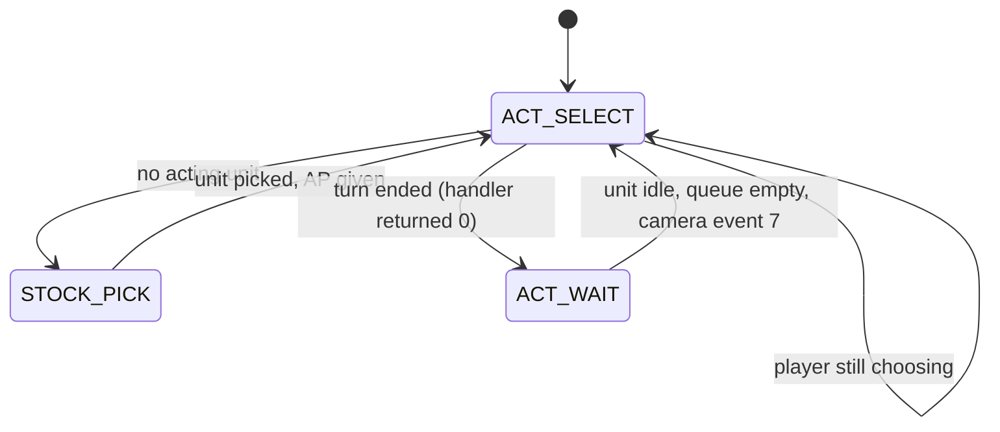

## Battle execution phases

`battleExec` runs the commands that the control queued. The decisions travel
in two steps. `battleCtrlMan` and `battleCtrlThink` push entries into the
global command FIFO `fifoCmd` (`cmdList`), where each entry is a unit and a
20-byte command. `battleExecNorm` later moves each entry into the unit's own
command queue with `unitCmdSet`, and the unit runs it from its update
callback. This keeps the order of actions strict even when the player enters
several commands in one turn.

The phase in `batCtrl.field04` selects what `battleExec` does:

| Phase | Value | Work |
| --- | --- | --- |
| `EXEC_QUEUE` | 1 | `battleExecNorm` moves the next FIFO entry to its unit |
| `SCENARIO_START` | 2 | Starts attack playback if an attack left results |
| `SCENARIO_RUN` | 3 | `scenarioBatExec` plays the attack until it is done |
| `STAT_PROC_1` | 4 | `stat1Proc` applies per-turn HP and EP status effects |
| `DEAD` | 5 | `battleExecDead` removes defeated units |
| `STAT_PROC_2` | 6 | `menuTimeNext` turns the Event Slot, `stat2Proc` handles revival and similar |
| `WAIT_BUSY` | 7 | Waits while a unit is busy, then resumes `field08` |
| `WAIT_UNIT` | 8 | Waits while the executing unit has a command pending |
| `WAIT_FRAMES` | 9 | Waits for idle units and a frame countdown |

`battleExecNorm` pops the head of the FIFO, waits if the unit is still moving,
and hands the command to the unit. When the command is `CMD_END`, the turn is
over. It runs the turn-end AI scripts with `thinkTurnEndExec`, resets the unit
with `calcTurnEnd` and remembers it as `pLastUnit`. The next phase is then
`STAT_PROC_1` (through `WAIT_BUSY`). For any other command it is
`SCENARIO_START`.

The flowchart below shows the path of one command from input to the unit.

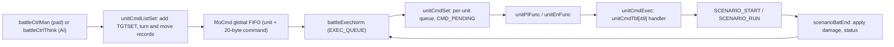

The state diagram below shows the execution phases for one turn.

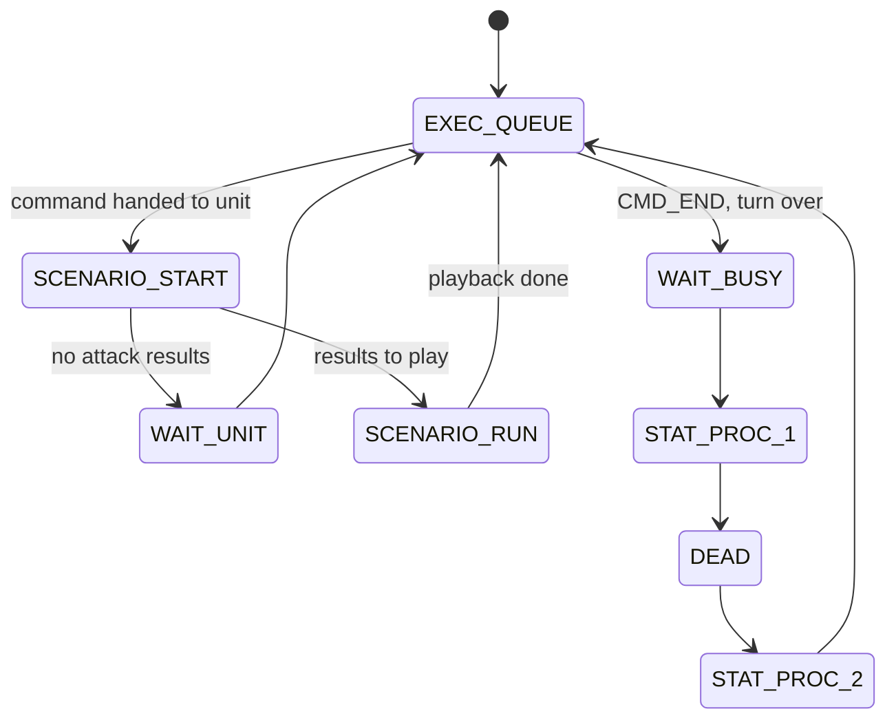

## Player input and Tech Attacks

A party member attacks with the face buttons. The input code is
`keyCmdGet` and its helpers in `src/ov01/battle_init.c`. Every press of □, △
or ○ is appended to the key buffer `keyBuff[8]` by `keyBuffSet`, which maps
the buttons through `keyItemTbl` (□ = 128, △ = 16, ○ = 32). `keyBuffChk` then
compares the whole buffer with a table of sequences. Characters use
`keyCmdTblCha[16]` and A.G.W.S. use `keyCmdTblAgws[13]`. The first halfword of
each sequence is its length. The source writes the lengths 1, 2 and 3 as the
pad constants `PAD_L2`, `PAD_R2` and `PAD_L2|PAD_R2`, which is probably only a
reuse of existing constants with the right values.

The character table maps sequences to command numbers:

| Sequence | Command | Kind |
| --- | --- | --- |
| □ | 1 | Normal attack |
| △ | 2 | Normal attack |
| □□, □△, △△, △□ | 3, 4, 5, 6 | Two-hit combos |
| □○, △○ | 11, 12 | Two-press Tech Attack (4 AP), probably the upgraded form |
| □□○, □△○, △△○, △□○ | 13, 14, 15, 16 | Tech Attack (6 AP) |
| □○○, △○○ | 17, 18 | Tech Attack after a follow-up status |
| ○ alone | 7 | Subweapon Attack (6 AP) |

`keyCmd2tid` turns a command number into a technique id. Commands 1 to 6
read `normalTechniqueId` in `CalcUnitParam`. Commands 11 to 16 read the tech
slots at +0x82, which hold the character's six Tech Attack assignments.
Commands 17 and 18 read slots 2 and 4 of the same array and need the follow-up
status (`calcTuigekiChk`, status category 7, mask 0x80). Command 7 reads the
technique of the second weapon. It needs unit flag 0x10 and ammunition
(`calcWpnEnableChk`). In the official rules only KOS-MOS and Ziggy have this
Subweapon Attack. Each press costs 2 AP, so a three-press Tech Attack costs
6 AP and a two-press one costs 4 AP. The official rules give 6 AP for a Tech
Attack and 4 AP for an upgraded one, so the two-press sequences are probably
the upgraded form.

`keyCmdGet` also ends the turn on its own. It ends the turn when the unit has
fewer than 2 AP (3 for an A.G.W.S.) or when a follow-up chance has run out. It
returns nothing while R1 or R2 is held, because those buttons open the boost
selection. After a choice, ✕ ends the turn.

`keyCmdChk` checks if a command is allowed. It refuses when a seal status
blocks attacks (three masks in category 0 for characters and three in
category 4 for A.G.W.S.), when the AP is too low and when `calcAtkChk` fails.
`calcAtkChk` carries the row rule. A party member whose position is not on
line 0 or 1 can only use techniques of range class 2. A target that stands
behind a living ally on a lower line number (`calcLineChk`) can only be hit
by range class 2. This matches the official rule that the back row cannot use
normal or Tech Attacks. Movement between positions follows the table
`moveTbl` (`calcMoveChk`), which limits a character to a few neighbouring
positions.

`battleCtrlMan` turns an accepted key into commands. It calls `convKey2unit`
to build the command, `unitCmdListSet` to queue it, `calcWpnUse` to spend
ammunition for a weapon attack, and `calcAp(-ap)` to pay. `KEY_CMD_END` queues
`CMD_END` and returns 0, which ends the turn. The key codes above the weapon
range are `KEY_CMD_ATTACK` 0x13, `ETHER` 0x14, `ITEM` 0x15, `GUARD` 0x16,
`AGWS` 0x17, `MOVE` 0x18, `ITEM_WIDE` 0x19, `END` 0x1A and `CANCEL` 0x1B.

The sequence diagram below shows a player turn with a Tech Attack.

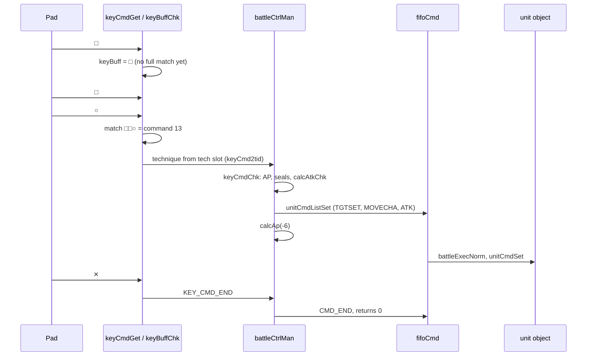

## The battle menu

✕ in the root state of the manual input opens the battle menu
(`menuOpenBat`, five entries). The manual input is a small state machine
(`manInput`, `ManSelectState` values 0 to 0xF) that also drives the target
cursors. The menu returns 1 for Ether, 2 for Item, 3 for Guard, 4 for
A.G.W.S., 5 for Move and 6 for the A.G.W.S. W-ACT attack. Opening each
submenu fires its own camera event (0xD to 0x12 and 0x16), so the camera
frames the acting unit while the player chooses.

`menuCmdExecChk` decides which entries are available:

- Ether is refused under one status and when the unit has learned no ether.
  The ether submenu is `menuOpenEth`. `calcEthEnableChk` checks each ether
  for targets, EP and disabled slots.
- Item needs items in the inventory and is not available to an A.G.W.S. The
  submenu is `menuOpenItm`. W-Item (`KEY_CMD_ITEM_WIDE`) uses two items for
  6 AP.
- A.G.W.S. is refused by cfEvent bit 0x04 and needs a unit that can board or
  leave an A.G.W.S.
- Move needs a free position (`curPosProcInit`).
- The W-ACT entry needs `calcDblActChk`.

Ether is the battle magic of Episode I. Its data, learning and the menu
outside battle are explained in [Character growth](character-growth.md).

## A.G.W.S. in battle

An A.G.W.S. (Anti-Gnosis Weapon System) is a combat mech that some characters
can board. In the code an A.G.W.S. is a unit with a character id in the range
0x11 to 0x20 and the `CalcUnitParam` flag 0x40. Its pilot is a second, linked
unit. In the official rules KOS-MOS and Ziggy cannot board an A.G.W.S.

An A.G.W.S. uses the table `keyCmdTblAgws`. Its buttons select weapon slots
instead of normal techniques: □ fires slot 0, △ slot 1 and ○ slot 2. The AP
cost comes from the weapon data. Commands 3, 5 and 10 use the weapon's
multi-hit technique (`tecIdMultiHit`). The menu attack (`KEY_CMD_ATTACK`) is
W-ACT, which fires the same weapon on both arms. `calcDblActChk` allows it only
with 6 AP and the same weapon on both arms, and the technique is
`tecIdDblAct`. Boosting an A.G.W.S. needs accessory 0x83.

Boarding and leaving use the commands `CMD_AGWS` and `CMD_AGWS2`, and the unit
swap is `CMD_UNITCHANGE`. The separate A.G.W.S. battle minigame is a different
system (see [A.G.W.S. battle](minigames/agws-battle.md)).

## Unit commands

Every action of a unit is a command. A command is a 20-byte record whose first
word is the command number. The names come from the debug string table
`cmdStrTbl`.

| Range | Commands |
| --- | --- |
| 0–8 | `FREE`, `ATK`, `ETHER`, `ITEM`, `GUARD`, `AGWS`, `MOVE`, `STAND`, `END` |
| 9–16 | `DMG`, `EVA`, `DEF`, `DEAD`, `MOT`, `TGTSET`, `TURNCHA`, `TURNPOS` |
| 17–36 | `MOVECHA` and `MOVEPOS` with the move styles `NORM`, `RUN`, `JUMP`, `HOVER`, `WARP`, `JUMP2`, `HOVER2`, `FLOAT`, `HOVER3` |
| 37–48 | `BTST`, `BTED`, `REC`, `WAKE`, `STAT`, `READWAIT`, `UNITCHANGE`, `TURNCENTER`, `AGWS2`, `ESCAPE`, `FADEIN`, `FADEOUT` |

`DMG`, `EVA` and `DEF` are the reactions of a target: take damage, evade,
block. `BTST` and `BTED` are the battle-start and battle-end poses. `REC` is a
recovery reaction. `WAKE` brings a unit back to life.

`unitCmdListSet` wraps the chosen command with movement. For a technique, it
first queues `TGTSET` to set the target. A ranged technique then turns the
unit toward the target (`TURNCHA`) or the centre of the targets
(`TURNCENTER`). A melee technique queues one `MOVECHA` to run to the target.
`CMD_END` queues `MOVEPOS` or `TURNPOS` to bring the unit back to its place.

Each unit has a queue of five commands in its work record (`objCmdPush`,
`objCmdPop`, `objCmdNext` in `src/ov01/obj.c`). `unitCmdSet` pushes a command
and sets `ACTOR_FLAG_CMD_PENDING`. `unitCmdExec` runs the head command through
`unitCmdTbl[49]` until the handler reports that it is done.

## Attack playback

An attack is computed first and shown afterwards. The source calls the
playback a "scenario".

`unitCmdAtk` runs on the first frame of an `ATK` command. Its helper
`unitCmdAtkSub` reads the technique with `dataTecGet` and calls
`unitJobTypeAtk` for the technique's job type (0 to 7). The unit pays EP with
`calcEp(-calcTakeEpGet())`, fills its boost gauge with `calcBp2Tid`, and the
technique's use counter is increased.

`unitJobTypeAtk` loops over the targets with `tgtFindNext`. For each target it
calls `calcHitDmg`, which returns the hit and the damage (see
[Damage calculation](#damage-calculation)). It picks the target reaction: 0xA
(evade) for a miss, 9 or 0xB (damage or block) for damage, 0x27 or 0x28 for a
heal, and 0x29 for status modes. It stores the result as a 0x28-byte
destination record with `scenarioDstSet` (up to 12 records). It also writes the
attacker and the technique into the target's `CalcUnitParam` (+0x150 and
+0x154), so that AI damage scripts can read who hit them. At the end it stores
the source with `scenarioSrcSet` and adds the technique delay to `turnBias`.

The scenario then plays in phases. `scenarioPtrFuncSet` installs the next
phase function:

1. `scenarioBatExecPhase10` hides the status visuals, chooses the camera
   (event 0x14 for items, 2 or 3 by range for techniques), loads the sef
   effect with `sefLoadEffect` and loads the sound.
2. `scenarioBatExecPhase20` loads the motions and other resources.
3. `scenarioBatExecPhase25` handles three cinematic techniques (0x38, 0x235
   and 0x239). It hides the stage and the units, plays `gamera.pss`,
   `kiss.pss` or `gr.pss` from `data\yamamoto\mv\` with `MMv2Play`, reloads
   the stage after the movie, shows everything again and fades in.
4. `scenarioBatExecPhase30` starts the attack motions and sounds and calls
   `scenarioEffCall` to start the effect.
5. `scenarioBatExecPhase40` runs `scenarioBatExecMain` until all hits are
   delivered, or runs a special flow (`flowSpecProcInit`, `flowSpecProc`) for
   escape, steal, analyze, summon, transform and prayer actions. It ends with
   `unitCmdAtkEnd`.
6. `scenarioBatExecPhase50` waits until the effect is finished
   (`sefIsFinishEffect`), fires camera event 1, shows the status visuals again
   and moves to the next scenario with `scenarioBatNext`.

`scenarioBatExecMain` waits for a hit signal for each destination. The signal
comes from the attack motion (`calcHitMotChk`) or from the sef effect
(`sefIsHitActor`, a per-actor counter that sef raises when an effect element
marked as a hit signal reaches its frame). When it fires, `scenarioBatExecDst`
turns the result into a target command (`DMG`, `EVA`, `DEF` or a heal
reaction). For anything but a miss it also calls `sefHitEffect`, which makes
sef create the hit reaction effects (see
[Battle effects](battle-effects.md#the-hit-signal)). The hit sound plays and,
on the last hit, `dmgValPut` shows the damage numbers. A critical hit also
shows the critical indicator with `menuCritDispOn`.

The motion signals come from the **motion trigger table** (MTD) of the
battle motion files in `data\yamamoto\mot\`. Each file holds a motion pack
and an MTD table, which lists for some motions the frames at which a
numbered trigger key fires (layout in
[motion trigger data](../formats/skeletons-and-motion.md#motion-trigger-data-mtd)).
`dataMtdRead(unit, key)` looks at the motion the unit plays and returns 1
when the current frame is listed under the key, 2 when the key exists for
that motion without the current frame, and 0 otherwise. The keys and their
readers are:

| Key | Reader | Effect when the frame is reached |
| --- | --- | --- |
| 1 | `calcHitMotChk` (`calc.c`), for command selectors 1 to 3 | The hit frame. The scenario delivers the next hit |
| 2, 3 | `unitMtdProc` (`unit_cmd.c`), `scenarioMtd` (`battle_init.c`) | Fade the default weapon in or out (`transWepIn`, `transWepOut`), or show and hide the special weapon of a Tech Attack (`spWepDispOn`, `spWepDispOff`) |
| 4, 5 | `scenarioMtd` | Hand pose 0 or 1 (`ACT_setHand`) |
| 6, 7 | `unitMtdProc`, `scenarioMtd` | The same for weapon slot 1 |
| 8, 9 | `scenarioMtd` | Turn the hair wind of the unit on or off (`hairWindOn`, `hairWindOff`) |

`unitMtdProc` runs during unit commands. `scenarioMtd` runs during
scenario phases 20 and 40. In the shipped files key 1 has 506 lists and the
other keys only a few: keys 8 and 9 appear only in two KOS-MOS Tech Attack
motions.

`scenarioBatEnd` applies the stored results: HP and EP changes through
`calcHpDmg`, items, statuses, revival, wait time changes, the AI damage
scripts (`thinkUnitDmgExec`) and counter attacks (`counterProc`).

The transform special flow (`specHensinProc`) swaps a unit with
`CMD_UNITCHANGE`. When the new unit is MOMO (character id 6), it plays
`momo_a.pss` or `momo_b.pss` with `MMv2Play`, depending on the technique. This
is probably a story transformation scene.

The sequence diagram below shows the playback of one attack.

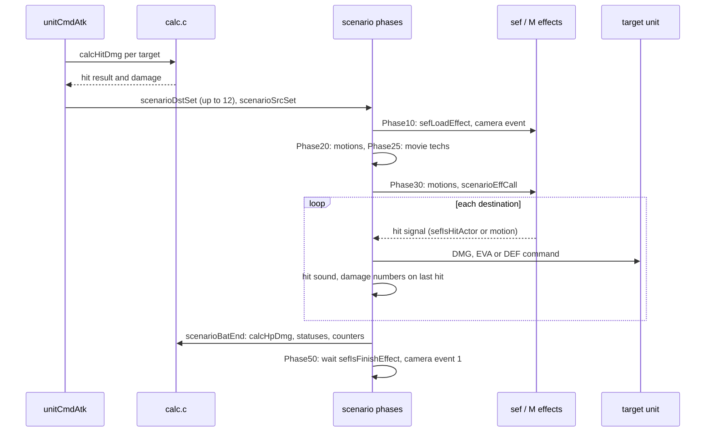

## Damage calculation

All hit and damage rules are in `src/ov01/calc.c`. The entry point is
`calcHitDmg(user, cmd, hit)`. It first calls `calcHit`. A result of 0 is a
miss and prints "DMG: EVA". On a hit it calls `calcDmg`. Two special cases
follow. When cfEvent bit 0x01 is set, a party attack on an enemy deals 0. The
debug option "PL ICHIGEKI" (one-hit kill) sets the damage to the target's
maximum HP.

`calcHit` works from the technique's `effectType`:

| effectType | Meaning | Hit mode |
| --- | --- | --- |
| 0 | Attack. Rolls for a hit unless the target's flag 0x80 skips the roll | 1 (HP damage) or 3 (EP damage) |
| 1 | Heal | 2 (HP) or 4 (EP) |
| 2 | Percentage heal | 2 with flag 0x800 |
| 3, 4 | Status-only | 5, 6 |
| 5, 6 | Drain | 7 or 9, 8 or 10 |

The low byte of the result is the hit mode. The upper byte holds flags. Value
2 in the upper byte (bit 0x200) marks a blocked hit, which reduces the damage.
`calcRevHit` swaps damage and heal (1 and 2, 3 and 4) for elemental
absorption.

`calcHitRate` decides between a clean hit, a block and an evasion:

1. The hit value is the attacker's `hitStat`, changed by statuses
   (`calcHitParaGet`). The evade value is the target's `evadeStat`, also
   changed by statuses.
2. A target with 0 HP returns 0. A guarding target (`ACTOR_FLAG_GUARD`) always
   blocks. A technique with `TEC_FLAG_NO_HIT_ROLL` always hits.
3. `margin = hit - evade`. If `rnd(100) - margin >= 90`, the attack is evaded,
   unless the unit or the technique forbids evasion.
4. Otherwise, if a second `rnd(100) - margin >= 85`, the attack is blocked.
5. Otherwise it is a clean hit.

`calcDmg` computes the amount. It first applies status changes to the attack
and defence values. Then the formula depends on the technique:

- Physical attack (`effectType` 0, `doubleDamageKind` 0). The attack value is
  `a = baseAtk + calcWpnAtkGet()` (or `hitStat` plus the weapon for techniques
  with flag 0x80). The defence value is `d = phyDefense + calcPhyDefGet()`.
  Both are changed by statuses by a fifth or a quarter. Then
  `dmg = 4a × calcPowLevGet() / 20 − 3d`, plus `rnd(dmg/10 + 2)`. A blocked
  hit loses 50%, or 20% when `calcAtrChg` reports bit 2 for the attack's
  attribute.
- Ether attack (`doubleDamageKind` 1).
  `dmg = 5 × magAttack × calcPowLevGet() / 20 − 4 × (magDefense + magArm)`,
  plus the same random part. Statuses can double it or change it by a quarter
  or a half. A blocked hit loses 20%.
- EP attack (hit mode 3). `maxEp × powLevBase / 20`.
- Heal (`effectType` 1). `magAttack × powLev`, doubled against one status.
- Percentage heal (`effectType` 2). `maxHp × powLev / 10`.
- Drain (`effectType` 5). `maxPoint × powLevBase / 20`, at most the current
  value. `effectType` 6 takes everything but 1 point.

After the formula, `calcDmg` runs these steps in order: `calcStat` and
`calcStatAtk` (statuses inflicted by the technique), `calcStatClr` (statuses
removed), `calcCrit` (critical hits), `calcSpec` (elements and resistances)
and `calcLinePos` (rows). Then the special effects apply. A DEATH status sets
the damage to the current HP. A GRAV status sets it to a quarter of the
current HP, and technique 0x23E always uses GRAV. Two statuses halve the
damage taken or multiply the damage dealt by 1.5. `futtobiChk` decides a
knockback. Technique flag 8 forces 9999. The final damage is capped at 9999.

The flowchart below shows the damage calculation.

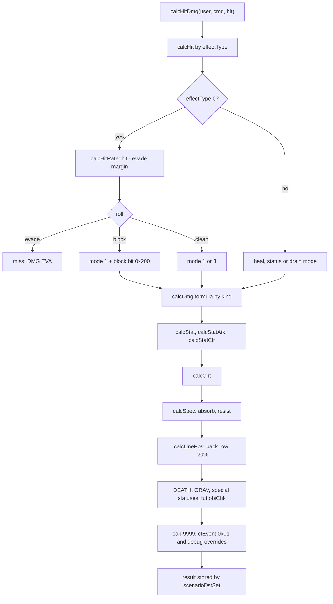

## Critical hits, elements and rows

`calcCrit` handles critical hits. It only acts on a clean HP damage hit. The
base rate is 10% with a damage multiplier of 1.5. A status, the Event Slot
value 1 and a critical on the previous hit raise the rate to 50% or 80%. A
weakness (the target's `conditions` matching the technique's attribute) raises
it to 100% with a larger multiplier. Monster kinds, one status and skills add
more. On a critical, the result gets bit 0x100 and the attacker gets flag
0x2000, which `scenarioBatExecMain` uses to show the critical indicator.

`calcSpec` handles elements. An absorbing element turns the damage into a heal
with `calcRevHit` and scales it by a quarter, a half or three quarters. A
resistance (`specDef`) removes 0, a quarter, a half or three quarters of the
damage. Skills can reduce damage further.

`calcLinePos` handles rows. Each position (`posId`) belongs to a battle line
(`dataPosLineGet`), and line 2 is the back row. A party member in the back
row takes 20% less damage.
`futtobiChk` knocks a front-row party member (position below 4) backwards when
the technique has the knockback flag and the position behind it (`posId + 3`)
is free. The result is marked with `ichigekiHit = 2`.

## Status effects

A status is a bit in one of eight 16-bit categories. `statActiveMask[8]` in
`CalcUnitParam` holds the active bits, `statTurnCount[8][16]` the remaining
turns of each bit and `statProtect[8]` the bits the unit is immune to.
`calcStatGet(unit, category, mask)` tests one status. Most battle rules in
`calc.c` are written as such tests, so the code names statuses only by
category and mask.

`stat1Proc` (phase `STAT_PROC_1`) applies the per-turn HP and EP effects after
each turn. `stat2Proc` (phase `STAT_PROC_2`) handles revival and similar
effects. `calcStatTurn` counts the turns down. The status icons and visual
effects on the units are `statEffProc`, `statEffOn` and `statEffOff`, and the
icons in the HUD are `menuStatIconPut`.

## Boost

Boost lets a unit act at once, ahead of the GTW order. Each party member has
a boost gauge `bpGauge` (+0x3D), a boost count `bcValue` (+0x3C) and a limit
`bcLimit` (+0x3B).

The gauge fills when a party member uses a technique. `calcBp2Tid` adds 4, 6
or 10 points for the technique kinds 0, 1 and 2, three times as much with the
Event Slot value 2. Enemies do not fill a gauge. `calcBp` converts every 50
points into one boost with `calcBc`.

While R1 or R2 is held, `battleCtrlBoostPl` shows the boost menu, and □, △ or
○ picks the party member in slot 0, 1 or 2. `calcBoostChk(unit, 1)` refuses
when the unit is already boosted or acting, when the boost slot is taken, when
the unit has 0 HP or no boost, when a status blocks it, when the unit is
already in the stock, or when an A.G.W.S. lacks accessory 0x83. `calcBoost`
then spends one boost, sets flag 0x400, puts the unit into `actStock.boost[1]`,
shows effect 0x64 and plays sound 9. The next `actStockPick` serves the
boosted unit first.

Enemies boost in `battleCtrlBoostEn` with a chance byte at +0x20 of their
`CalcUnitParam`. Counter attacks use `calcCounter`, which combines
`counterRate` with skills, and `counterProc` in `scenarioBatEnd`. The AI
command `cmdCounterBoost` probably makes an enemy use the official Counter
Boost, a boost that interrupts the opponent.

## Event Slot

The Event Slot is the battle-wide bonus shown in a ring of the HUD. The code
calls it the event timer. The value `eventTimer` in `src/ov01/menu.c` is set
at random (`menuTimeSet(rnd(3))`) when the HUD is created and turns to the
next value with `menuTimeNext` in the phase `STAT_PROC_2` after every turn.
The electric first strike sets it to 1.

| Value | Debug name | Official name | Code |
| --- | --- | --- | --- |
| 0 | | No Effect | |
| 1 | EventTimer R | Critical Hit Rate Up | `calcCrit` uses a rate of 50% |
| 2 | EventTimer G | BG (Boost Gauge) Increase Rate Up | `calcBp2Tid` points × 3 |
| 3 | EventTimer B | Point Bonus | `monsGainSet` multiplies T, E and S points |

For value 3, `menuTimeXGet` gives the multiplier (2, 4 or 10, from a random
roll), and `battleExecDead` shows it with `menuCritDispOn` when an enemy falls.
The AI command `cmdEventSlotGet` lets enemy scripts read the slot.

## Enemy AI and the think VM

Enemies and the battle camera are driven by scripts in a small bytecode
machine called "think" (`src/ov01/cmd.c`). It has 16 processes in
`processBuf` and two contexts: context 0 for AI and context 1 for the camera.
Each context has a return stack of 16 entries and a value stack of 32 entries.
There are 99 opcodes (`THINK_COMMAND_COUNT`). A handler returns 2 to wait (the
program counter is moved back so the opcode runs again next frame) and 1 to
end the process.

Registers from 0x8000 up expose the battle to scripts. Some of them are
`UNIT` (0x8010), `COMMAND` (0x8011), `ARG` (0x8012), `TARGET` (0x8013),
`ATTACKER` (0x8014), `ACCEPT` (0x8018), the living counts `LIVE0` and `LIVE1`
(0x8019, 0x801A) and `CAMERA_FLAG` (0x801B). `cmdThinksetSub` turns the
values of 0x8011 to 0x8013 into a real command for the unit.

The script data comes from the field map. `MapReset` in `src/main/map_1.c`
calls `dataThinkDataSet`, which copies 0x4000 bytes of the map's think data
into `thinkBuf` (0x00436F40) for the maps listed in `thinkMapTbl`. The data is
the file `data\yamamoto\think\thinkNNN.bin` of the map, and the copy is
0x4000 bytes even when the file is shorter (see
[map think data](../formats/maps-and-field-data.md#map-think-data) for the
map-to-file table). In battle, `thinkInit` reads the monster set table at the
start of the buffer. Each `MonsTblEntry` holds the spawn list (character id
and position of each enemy), a battle map number and three scripts: initial,
turn start and turn end. A map number of 0 keeps the current map. Each enemy
also has an `AtkTblEntry` with an attack script and a damage script. The 100
think files hold 1,040 monster sets, and each set has its own spawn list of
1 to 5 enemies. The byte layout of the files, the operand encoding and the
use count of each opcode are in
[enemy AI programs](../formats/game-tables.md#enemy-ai-programs-think-files).

The scripts run at fixed points of the battle:

- `thinkInitExec` in `entryPhase40`, once.
- `thinkTurnStartExec` when a unit's turn starts.
- `thinkUnitAtkExec`, from `battleCtrlThink`, when an enemy chooses its action.
- `thinkUnitDmgExec` from `scenarioBatEnd`, when an enemy is hit.
- `thinkTurnEndExec` when a turn ends.

The flow of the language and the script tools in other parts of the game are
explained in [Events](../scripting/events.md). The battle think VM is a
separate machine from the Java VM (see [Java VM](../scripting/java-vm.md)).

## Battle camera

The battle camera is `src/ov01/m_cam.c` (`MCam*`). `MCamTakeControl` saves
0x5F0 bytes of the system camera and takes it over. `MCamReleaseControl`
restores the saved bytes. The camera has two points, the eye and the target,
plus a bank (roll) and a perspective. Each point is computed from a base
coordinate and an offset. The base can be a static point, a joint of an
actor, an interpolation between two points or the range between two points
(`MCamCalcBaseCoord`). The offset can be XYZ or polar. `MCamMove` moves the
camera with linear or sine interpolation (`LINEAR`, `SINE_IN_OUT`, `SINE_IN`,
`SINE_OUT`). `MCamShake` shakes it, with a hold time and then a decay.
`MCamExec` runs the control and then writes the parameters into the studio
camera. The studio and camera model is explained in
[xgl](../libraries/xgl.md).

The camera work itself is scripted. The battle stage file holds camera data
(`dataMapCameraAdrGet`, at offset +0x10 of the map header): a `CamTopEntry`
with a table offset and an initial script, and tables of (event type, script)
pairs. `camEventExec(type)` starts the matching script as a context 1 think
process when `cameraFlag` is set. The `cmdCam*` opcodes call the `MCam*`
functions. Event types seen in the code are 1 (action end), 2 and 3 (technique
by range), 4 (battle entry), 5 (victory), 6 (turn start), 7 (end of a turn
wait), 8 (target cursor), 0xD to 0x12 and 0x16 (menus), 0x14 (item), 0x17
(unit created) and 0x19 (AI).

`m_battle.c` groups the M subsystems. `MBattleInit` initialises the effect
pool, the camera and both movie players once. `MBattleCreate` resets and
enables the effect pool at the start of a battle. `MBattleExec` runs
`MCamExec`, `MMvExec` and `MMv2Exec` every frame. `MBattleDestroy` disables
the effects, stops the movies and clears the pause flag. The field also uses
the camera: `sc_get.c` and `sdv.c` in the main executable call `MCamSet`,
`MCamMove`, `MCamShake` and `MCamGetCurrentCoord`.

## Battle HUD and map

The HUD is a set of battle objects created by `menuStatDispCreate` in
`src/ov01/menu.c` when the last party member enters. Each object has an update
callback and a draw callback.

- A pre object (`menuStatPreObj`) uploads the HUD textures.
- The ATB window (`menuATBObj`) draws the Event Slot ring and the radar map of
  unit positions (`menuMapDisp`, `menuMapItemDisp`), with a line to the
  selected target and its HP (`menuTgtLineDisp`).
- The key guide (`menuKeyGuideObj`) shows the button help that L1 and L2
  cycle.
- The boost ring (`menuBoostObj`) shows the boost selection.
- The critical indicator (`menuCritObj`).
- The stock (`menuStockObj`) draws five portraits. This is the GTW, and
  `menuStockStart`, `menuStockNext`, `menuStockBoost` and `menuStockDead`
  animate it.
- One status panel per party member (`menuStatObj`) shows HP, EP, an AP bar of
  six cells (`menuApBarPut`), the boost bar (`menuBpBarPut`), the level and the
  status icons.

Damage numbers are separate objects. `objDmgNumCreate` creates one that lives
30 frames. `dmgNumPut` draws up to four digits and `dmgMsgPut` draws a text
such as a miss. The cursors are battle objects in `battle_init.c`
(`objEnCurCreate`, `curEnProc`, `curPosProc`, `curTgtProc`). All of them draw
through the packet builder in `gr_gp_init.c`. The message windows of battle
(for example "cannot move") use `eBattleWin` (see
[UI windows](../libraries/ui-windows.md)).

The 3D battle stage is drawn by `src/ov01/map_disp.c`. `dataMapLoad` loads
`map%03d.bin` from `data\yamamoto\map\` to 0x01B9E000 (layout in
[battle stage files](../formats/maps-and-field-data.md#battle-stage-files)).
The disc has 55 stages from `map000.bin` to `map056.bin`. Only `map000.bin`
is ARX-packed. Some stages share their model and textures and differ only in
their camera scripts. `mapDisp(mapNo)` sets the
stage texture, places the model at the origin, applies a colour multiplier
(`mapMulSet`, `mapMulGet`) and draws it with `nmlModelEntry`. The model has
two named parts, `ten` (sky) and `yuka` (floor), which `mapDispOn`,
`mapDispOff`, `mapDispOnAll` and `mapDispOffAll` show or hide. The movie
techniques hide both parts while a movie plays. `sdv.c` and `sef.c` in the
main executable also call these functions.

## Sound and music

`src/ov01/snd.c` handles battle sound. There are three battle tracks in
`muName`: `BATTLE1` (normal), `BATTLE2` (boss) and `BATTLE3` (last boss). The
victory jingles in `mu2Name` are `JINGLE1` and `JINGLE2`. Each is a pair of
`.SMD` (sequence) and `.SWD` (wave bank) files in `data\yamamoto\snd\smd\`,
loaded to `sndMuDat` (0x01904000). `sndMuTransPlay(0)` starts the battle music
and `sndMuTransPlay(1)` the jingle. `sndMuStop` fades the music out over 2000
units.

Sound effects come in six registrations (`sndSeRegDat`, 0x68 bytes each). Each
unit has its own bank from `snd\sed\`, which holds its voices and attack
sounds. `sndSePlay` plays one, `sndConvSpid` and `sndConvHitSe` map ids to
sounds, and `sndSysSePlay` plays the system sounds below 0x26. The voice ids
0x18 and 0x19 are the battle-start and victory lines. The sound system
underneath is explained in [Audio](../architecture/audio.md).

## Battle data and files

`dataBatDatLoad` loads `data\yamamoto\batdat.bin` into `batDatBuf`
(0x00426F40, 0x10000 bytes) at start-up. The file (57,552 bytes) begins with a
header of offsets to its 18 sections. Every section and record layout is in
[battle data](../formats/game-tables.md#battle-data-batdatbin). The accessors in `src/ov01/data_unit_org_get.c` return
records from them:

| Table | Accessor | Record size |
| --- | --- | --- |
| Unit, normal, special and ether initial data | `dataUnitInitGet`, `dataNormInitGet`, `dataSpecInitGet`, `dataEtherInitGet` | |
| Experience and parameter tables | `dataExpTblGet`, `dataParaTblGet` | |
| Default equipment, special table | `dataDefEquipGet`, `dataSpecTblGet` | |
| Techniques | `dataTecGet` | 0x18 |
| Weapons | `dataWpnGet` | 0x20 |
| Ammunition (section `att`) | `dataAttGet` | 0x0E |
| Ether | `dataEthGet` | 0x0C |
| Items | `dataItmGet` | 0x14 |
| Accessories | `dataAccGet` | 0x10 |
| Frames, engines (A.G.W.S. parts), skills | `dataFrmGet`, `dataEngGet`, `dataSklGet` | |
| Enemy gains | `dataGainGet` | 0x14 |

The name tables are in `src/ov01/data_eth_name_get.c`. Each getter returns a
pointer to a name and its description: `dataEthNameGet`, `dataItmNameGet`,
`dataSklNameGet`, `dataAccNameGet`, `dataWepNameGet`, `dataBltNameGet`,
`dataNrmNameGet`, `dataSpcNameGet`, `dataEnemyNameGet`, `dataStatNameGet`,
`dataPlayerNameGet`, `dataEngNameGet` and `dataFrmNameGet`.

The main menus call many of these functions directly, for example
`dataUnitOrgGet`, `dataPlChaGet`, `dataTecGet`, `dataItmGet`,
`calcTotalParaMenu`, `calcUseItemMenu` and `calcUseEtherMenu`. This is why
the main menu needs OV01 loaded (see [Main menu](main-menu.md)).

The other battle files are under `data\yamamoto\`: `mot\` (motions),
`map\` (stages), `think\` (think data), `stat\` (`cur.xtx`, `manu.xtx`,
`stat.xtx`, the HUD textures), `pc\` (character models), `wpn\` (weapon
models, see
[battle model packs](../formats/game-tables.md#battle-model-packs-pc-and-wpn)), `snd\sed\` and `snd\smd\` (sound) and `mv\` (movies). File loading
uses non-blocking reads (`dataFileLoadNB`) and `dataCdSync` to wait. The CD
layer is explained in [Files and resources](../architecture/files-and-resources.md).

## How a battle ends

`battleEndChk` checks for the end only when no unit is busy and the execution
phase is `EXEC_QUEUE`. If the party has no living member, the result is
`LOSE` (2). If the enemy side is empty, the result is `WIN` (1), or `ESCAPE`
(3) when cfEvent bit 0x10 or 0x20 is set. If `escapeFlag` is set by an escape
action, the result is `ESCAPE`. The result is stored in `batRetCode`, and
`battleMain` returns 0.

`battleAfter` plays the end. On a win it fires camera event 5 on the last unit
that acted, sends `CMD_BTED` (the victory pose) to every living party member,
removes the HUD and the cursors, and waits for ○ or for the units to finish.
On an escape or a loss it prints a message and removes the HUD.

Rewards are collected during the battle. When an enemy dies, `battleExecDead`
removes it from the stock, shows effect 0x68 and adds its rewards with
`monsGainSet` (experience, money, T, E and S points, and items). It also adds
the enemy to the U.M.N. database with `UmnDataBaseMonsterSet`, except for some
character ids (see [U.M.N.](umn.md)). The result screen in
`src/ov01/result.c` is only a wrapper. `resultProcInit` calls `SeisanInit` and
`resultProc` calls `SeisanMain` in the main executable, which apply the gains
and level-ups. That screen is explained in
[Character growth](character-growth.md).

After the result screen, `entryPhase100` gives dead party members 1 HP,
reloads the field leader model and ends `battleProc`.

Back on the field, `GameModeCfMain` handles the result. A loss without cfEvent
bit 0x40 sets `GAME_FLAG_QUIT | GAME_FLAG_GAME_OVER`, which leads to the game
over screen. Every other result calls `Game_Data_Pop` and then the method
`EOB_Always` of the enemy's script. A win then calls `Enemy_After_Battle(1)`
and the method `EOB`. An escape calls `Enemy_After_Battle(3)` and
`EOB_Escape`. An allowed loss is treated like a win for the enemy. If one of
these methods started an event, the function returns. Otherwise the player
flashes for a few frames, the look-at system is reset and the map units are
updated. `Enemy_After_Battle` deactivates the enemy and its linked actors
after a win. After an escape it sets the enemy's `battle_state` to 16.

The state diagram below shows the result paths from the end check to the
field.

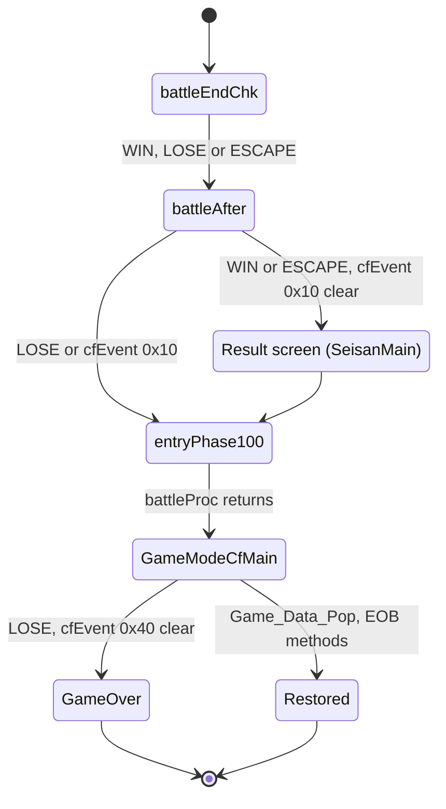

## Debug tools

OV01 keeps a full debug battle set-up in `src/ov01/debug_entry.c`.
`debugBattleConfig` is a configuration screen for the party and positions,
the monster set, the battle map, the camera, the think number, cfEncount and
cfEvent, equipment, ether and skills. It also has invincibility switches for
each side (`plMuteki`, `enMuteki`), the one-hit kill `plIchigeki` and an inn
heal ("Yadoya"). `debugCmdPrint` and `debugThinkPrint` print the command and
think traces. The debug loop `sbattleDebug` in `src/main/set_path.c` calls
`debugBattleConfig` and then `battleProc`. `YamamotoTest` in
`src/ov01/yamamoto_test.c` starts the battle systems and loops a test grid
screen. These tools are described in [Debug tools](debug-tools.md).
