# Character growth

Characters in Xenosaga Episode I grow in several separate ways. Battles give
experience, money, items and three kinds of points: T.Pts, E.Pts and S.Pts.
The player spends those points in the main menu. T.Pts raise the basic
parameters of a character and improve Tech Attacks, E.Pts evolve and
transfer Ether, and S.Pts extract Skills from accessories and raise a
character's skill level. Equipment is bought in shops and fitted on the
Characters and A.G.W.S. screens.

All of this code lives in the main executable (`src/main/`), next to the
[main menu](main-menu.md) that hosts most of the screens. The battle data
itself (unit tables, ether and technique tables, the stat calculation) is in
overlay OV01, so OV01 must be loaded whenever these screens run. The battle
side of growth (how experience and points are earned in combat) is described
in [battle](battle.md).

[← Back to the overview](../README.md)

## Where growth data lives

Growth data sits in four places. The unit records, the player records and
the inventory are arrays in main memory that are copied into the save data
when the game is saved. The party data lives directly inside the save data,
so it needs no copy.

### Unit records

`orgData` (defined in `src/main/sdv.c`) is an array of 33 **unit records** of
0x180 bytes, one per unit id 1 to 33. Characters (1 to 12), the BIC soldiers
(13 to 16) and A.G.W.S. (17 to 32) all use the same record. The OV01
accessor `dataUnitOrgGet(id)` (`src/ov01/data_unit_org_get.c`) returns
`&orgData[id - 1]`. The menu code reaches it through small typed views of
the same record (`UnitOrgWeapons`, `CharParaData`, `EtherUnitRecord` and
others), each naming only the fields its file uses.

```
Unit record (orgData[id - 1], 0x180 bytes), fields used by the menus
+0x00 maxHp           +0x02 maxEp
+0x04 attack ...      the eight basic parameters (see Character stats)
+0x14 level           +0x17 capUsed (ether Wt in use)
+0x34 hp              +0x36 ep
+0x54 agwsId          A.G.W.S. this character pilots
+0x56 engineId        A.G.W.S. generator (A.G.W.S. records)
+0x58 frameId         A.G.W.S. frame (A.G.W.S. records)
+0x5A weaponMount[3]  mount code of each weapon
+0x5E weapon[3]       equipped weapons
+0x64 accessory[3]    equipped accessories
+0x6A bullet[3]       ammunition per weapon
+0x82 techniqueId[6]  Tech Attacks set in the six slots
+0x8E etherId[12]     ethers set (12 slots)
+0xA6 skillId[3]      skills set (3 slots)
```

### Player records

`plChaData` is an array of **player records** of 0xA8 bytes, returned by
`dataPlChaGet(cid)` as `&plChaData[cid - 1]`. It holds what a character has
earned and learned, as opposed to what it has equipped.

```
Player record (plChaData[cid - 1], 0xA8 bytes)
+0x00 exp             experience
+0x04 next_exp        experience still needed for the next level
+0x08 wait_offset     +0x0A wait_count
+0x0C tech_points     T.Pts
+0x10 ether_points    E.Pts
+0x14 skill_points    S.Pts
+0x18 growth[8]       per-parameter growth values
+0x28 learnedEther[16]  bitmap, bit (id - 1) for ether ids 1..128
+0x38 learnedSkill[16]  bitmap, bit (id - 1) for skill ids
+0x48 special[8]      eight 12-byte special-technique slots
      +0x00 id  +0x04 levelAdjustment  +0x06 waitAdjustment ...
```

The bitmaps are read and written with `dataEtherLearnGet/Set` and
`dataSkillLearnGet/Set`, which accept character ids below 0x11. The special
slots are the character's Tech Attacks. `dataSpecLearnSet(cid, id)` writes a
learned id into the slot `id - dataSpecBaseGet(cid)`, and the tech screen
writes the level and wait adjustments of slot *n* at `+0x4C + n * 12` and
`+0x4E + n * 12`.

### Party data

The **party data** (`PartyDataPrefix`, `include/main/party.h`) is a 0x188-byte
block that lives directly inside the save data at `SaveData + 0x10078`.
`PartyDataGet()` returns its address. It holds the party membership, the
battle formation, the technique levels and the skill levels.

```
PartyDataPrefix (SaveData + 0x10078, 0x188 bytes)
+0x24  lock_party_mask   bit (id - 1), ids 1..12 except 4
+0x26  out_friend_mask   members temporarily out of the party
+0x28  friend_mask       recruited members, ids 1..7 except 4
+0x2A  take_agws_mask    bit (id - 17), A.G.W.S. ids 17..32
+0x2C  leader_battle_id  battle id of the field leader
+0x2E  radar_disp        field radar on or off
+0x30  attack_slots[3]   party_id (u16) and attack_position (s8)
+0x3C  tech_records[8]   TecInitEntry per character 1..8
         level[8] speed[8] wait[8] levelLimit[8]
+0x140 skill_levels      skill level per character 1..8
+0x148 next_level_points[8]  64-bit S.Pts still needed per character
```

### Inventory, money and other save bytes

The inventory boxes and the money are arrays in `src/main/data.c`, described
on the [main menu](main-menu.md#inventory-boxes-and-item-pickups) page. A few
more growth values are single bytes of the save data: the sort method of each
item tab (`SaveData + 0x10254`), five shop discount levels
(`SaveData + 0x102DC`) and the play time (`SaveData + 0x68`).

### Saving and loading

`GamePushSaveDataUser()` (`src/main/game.c`) copies `orgData`, the first 16
records of `plChaData`, the five inventory boxes and `moneyBox` into the
`GameUserSave` area at `SaveData + 0x50`. `GamePopSaveDataUser()` copies them
back after a load. The party data, the discount levels and the play time need
no copy, because they already live inside `SaveData`. The layout of the save
data and the save screen are described in
[save data](../architecture/save-data.md).

The class diagram below summarises the records and the code that owns them.

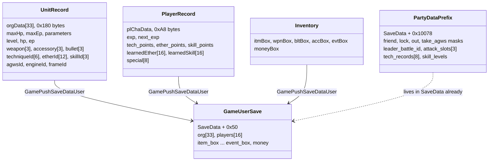

The flowchart below shows which screen reads and writes which data. Every
arrow into a record is a write.

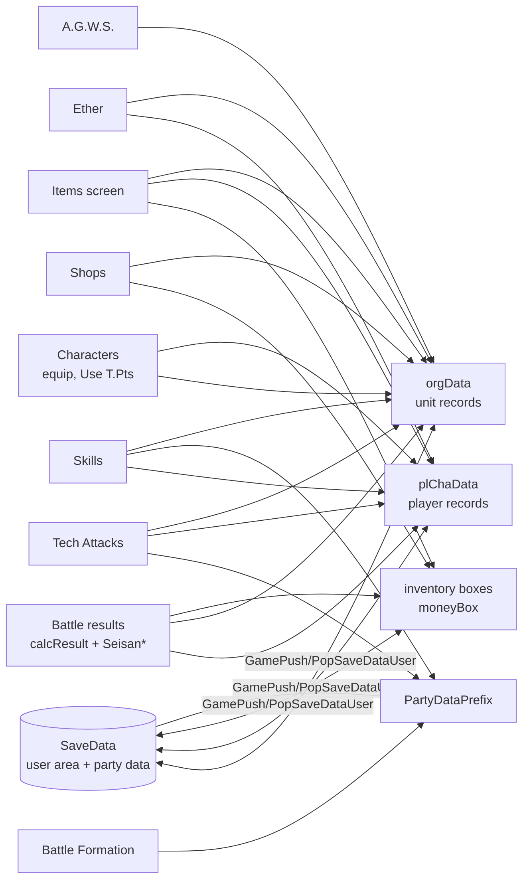

## Points and experience

Each character has an experience total and three point pools in its player
record:

| Pool | Field | Spent on |
| --- | --- | --- |
| T.Pts (tech points) | `tech_points`, +0x0C | basic parameters (Characters screen) and Tech Attack upgrades |
| E.Pts (ether points) | `ether_points`, +0x10 | evolving and transferring Ether |
| S.Pts (skill points) | `skill_points`, +0x14 | extracting Skills, which also raises the skill level |

All three pools are capped at 9999 and experience at 9,999,999. The money
box never holds more than 999,999,999. Points come from two sources. Battles
add them through the result calculation (see
[Battle results](#battle-results)). Items add them too: an item with
attribute bit 0x800 adds T.Pts, 0x400 adds E.Pts and
0x200 adds S.Pts, and the item screen refuses such an item when the pool is
already at 9999 (see [main menu](main-menu.md#using-an-item)).

The level and `next_exp` fields belong to the battle system. `calcLvUp` in
`src/ov01/calc.c` handles a level up after a battle. The experience needed
for the next level comes from the `experience` section of `batdat.bin` and is
10 × (level + 1)², so 40 at level 1 and 98,010 at level 98. Each basic
parameter grows through a hidden counter that starts at a start value and
reaches a fixed target at level 99. At every level the counter moves by
`((target - counter) * 100 / (100 - level) + 25) / 50` and the parameter gains
the same step, up to 999 for the four attack and defence values, 99 for Dex,
Eva and EP and 9,999 for HP. The steps are larger at low levels. A level up
also teaches every Tech Attack of the character's special technique table
whose level has been reached. The tables are in
[experience and level-99 targets](../formats/game-tables.md#experience-and-level-99-targets)
and [special technique table](../formats/game-tables.md#special-technique-table).
The result screen animates `next_exp` while it counts experience. The flowchart below
shows where points come from and where they go.

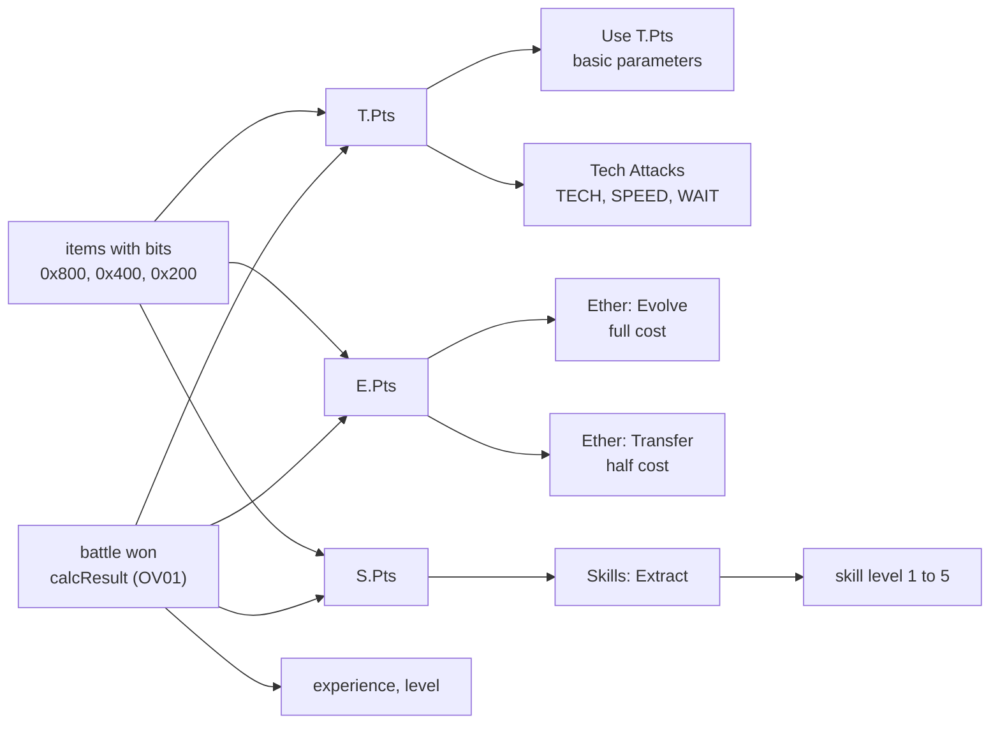

## Battle results

When a battle is won, OV01 shows the result screen, which the code calls the
**settlement** ("seisan"). Its code is in `src/main/seisan_count_init1.c` and
the battle overlay drives it from `src/ov01/result.c`: `resultProcInit`
calls `SeisanInit()` once, then `resultProc` calls `SeisanMain()` every frame
until it returns 0. The battle display code (`src/ov01/entry_first_init.c`)
calls `SeisanDisp()` to draw it (see [battle](battle.md)).

### SeisanInit

`SeisanInit()` builds the screen and prepares the numbers.

1. It takes its memory from `MenuWorkEndGet()`, aligned to 128 bytes, and
   creates the background (`MenuBgTaskInit(work, 3)`) and a 16-slot task
   scheduler `SeisanTask`. Its widgets are tasks: `SeisanTimeEx` (play time
   and money), `tskSeisanButton`, `tskSeisanItem` and three `tskSeisanStatus`
   panels, one per party slot. It then carves the fade block `SeisanFade`, the
   control block `SeisanWork`, an eight-entry item list `SeisanItemBox` and the
   result block `SeisanResult`.
2. `SeisanCountInit1()` remembers `next_exp` of characters 1 to 12.
3. It takes a snapshot of T.Pts, E.Pts, S.Pts and experience of characters 1
   to 12 and of the money.
4. It calls `calcResult(SeisanResult)` (`src/ov01/calc.c`), which hands out
   the rewards and writes one `SeisanHissatuEntry` row per living unit (see
   below). `monsGainPtrGet()` returns `SeisanMg`, the battle's gain record
   (`monsGain`) with the money and the items.
5. It clamps each gain in the rows so that snapshot plus gain stays within
   9999 points, 9,999,999 experience and 999,999,999 money, which makes the
   shown gains match the capped records.
6. `SeisanCountInit2()` stores the current (final) level, HP, EP,
   experience, `next_exp` and points of each party slot as count targets.
   It then subtracts the gains from the live records and restores the old
   `next_exp`. The records are therefore back at their pre-battle values,
   and the count-up animation will move them to the targets.
7. It turns the gained items into encoded ids and groups equal ids into the
   eight entries of `SeisanItemBox` for display.
8. It counts the party size, freezes the battle picture
   (`endPrintDirectFrameCopy`), loads font 1 and the menu window texture, and
   starts preloading the field resources (`GameResourcePreLoad`).

`calcResult` is where growth really happens. It first adds the dropped items
to the inventory boxes (`dataBoxInc`) and the money (`dataMoneyBoxInc`). Then
every living unit of the party receives its share: experience, T.Pts, E.Pts
and S.Pts of `monsGain`, each divided by the number of living units and
raised by a percentage when the unit has the matching reward skill
(`calcSkill` with bits 0x4000 experience, 0x2000 T.Pts, 0x1000 E.Pts and
0x800 S.Pts). `calcResultSub` adds the shares to the player record and caps
them at 9,999,999 and 9999. An A.G.W.S. passes its share to its pilot.
`calcLvUp` then applies any level-up and the row records the level, maximum
HP and maximum EP gained. Recruited members who did not fight get three
quarters of the experience and no points. The battle side of these rules is
described in [battle](battle.md).

Each `SeisanHissatuEntry` row (0x3C bytes) holds the character number, the
gains in experience, T.Pts, E.Pts and S.Pts, levels, HP and EP, and
`learnedIds[6]` with `count`, the new techniques or ethers learned in this
battle. The source names the fields at +0x10 and +0x14 `skillPoints` and
`specialPoints`, but the panel captions and the player record show that they
hold E.Pts and S.Pts.

### Count-up and pages

`SeisanCountMain` runs the count-up. Each frame it steps every displayed
value toward its target with `SeisanNumberCount(current, target, step,
&moving)`. Experience moves `next_exp` down by 2 per frame and starts a new
level from the OV01 experience table when it reaches 0, which shows the
"Level up" caption. Money counts up by 5 per frame into `countedMoney`.
CIRCLE during the count jumps to the end values.

`subSeisanMain()` is the page state machine. It works like a menu screen:
`requestedState` becomes `state` at the top of a frame and sets an enter flag
for one frame. On each enter `subSeisanCheck()` chooses the next page by
falling through a chain of checks, and CIRCLE moves to it once the 16-tick
transition is over.

| State | Value | Page | Shown when |
| --- | --- | --- | --- |
| `RESULTS` | 0x20 | experience, points, level, money count-up | always |
| `SKILLS` | 0x50 | learned entries, first page | some party member has `count != 0` |
| `ETHERS` | 0x58 | learned entries, second page | some party member has `count >= 5` |
| `ITEMS` | 0x60 | acquired items | never, no check returns 0x60 |
| `HINT` | 0x80 | closing hint page | always |
| `CLOSING` | | 16-tick fade, then `MenuBgTaskBreak` | after the hint |
| `FINISHED` | | `SeisanMain()` returns 0 | |

The names of the 0x50 and 0x58 states come from the source and do not fit
the checks well. Both checks only look at the number of learned entries, so
the second page probably continues the list when a character learned five or
more things. The captions "New attack!" and "New Ether!" label the learned
entries. `subSeisanEtherCheck` always returns 0 and `subSeisanItemCheck`
always returns the hint page, so the item page is never selected. The items
are probably shown by `tskSeisanItem` on the results page instead.

The state diagram below shows the page order.

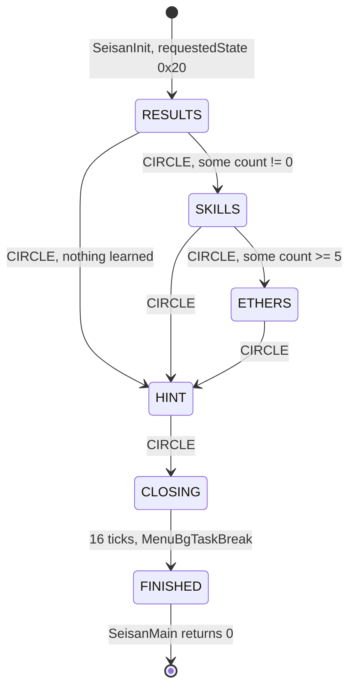

`ShopTest` and `SeisanTest` in `src/main/endou_test.c` are debug entries
that open the shop and this screen outside a battle (see
[debug tools](debug-tools.md)).

## Character stats

`MenuCharactor(mode)` in `src/main/menu_para_pt_rate_get.c` is both the
Characters screen (`mode` 0, level 3) and the Battle Formation screen
(`mode` 1, level 5). This section covers the Characters screen, and the
formation part is in [Party and formation](#party-and-formation).

### States and commands

The screen shows the party on the left and a command window with "Equip /
Unequip / Use T.Pts".

| State | Value | Step |
| --- | --- | --- |
| `STATUS` | 0x10 | choose a character |
| `COMMAND` | 0x20 | choose a command |
| `EQUIP` | 0x40 | choose a slot (weapon, accessory, ammunition) |
| `EQUIP_LIST` | 0x52 | choose a weapon or accessory |
| `BULLET_LIST` | 0x54 | choose ammunition for a gun |
| `PARA` | 0x80 | choose a parameter to raise |
| `AMOUNT` | 0x82 | choose how many steps |
| `CONFIRM` | 0x84 | confirm |
| `DONE` | 0x86 | show the result |
| `DENIED` | 0x87 | show why it is impossible |
| `EXIT` | 0xF0 | close |

### Equipment rules

Each character has three weapon slots, three accessory slots and one
ammunition choice per weapon in its unit record. The equip functions in
`src/main/menu_1.c` check every change:

- A weapon must allow the character in its `characterEquipMask`.
- Jr. (id 7, `CHR_DUAL_WEAPON`) can hold two weapons at once.
- Shion's weapon (id 3, `CHR_FIXED_WEAPON`) is fixed. Only its ammunition
  can change.
- `MenuAccessoryEquipCheck` refuses accessories whose category conflicts
  with one already worn.
- `MenuBulletCheck` lists only the ammunition a gun accepts (guns carry flag
  0x100 in their weapon record).

After every change `MenuCharParaSet` recalculates the displayed values with
`calcTotalParaMenu` (OV01), which combines the unit record with the
equipment bonuses.

### Use T.Pts

"Use T.Pts" raises one of eight basic parameters of the unit record by
spending T.Pts. The parameters are indexed 0 to 7: `maxHp`, `maxEp`,
`attack`, `phyDefense`, `magAttack`, `magDefense`, `hitStat` and
`evadeStat` in the `CharParaData` view of the unit record. The six indexes
after HP and EP are Str, Vit, Eatk, Edef, Dex and Eva, the labels of the
status window. The column order of the cost file confirms it.

The costs come from `data\endou\para\paraup.bin`, loaded into `ParaDataBuf`
(layout in [T.Pts costs](../formats/game-tables.md#tpts-costs-paraupbin)).
It holds two tables of 8 halfwords per character, a rate table at offset 0
and a base table at offset 0x80. The code reaches the base table as
`ParaDataBuf + 56 + chr * 8 + column` halfwords with a character number that
starts at 1, which is why the source seems to put it 56 halfwords after the
rate table. The columns are Str, Vit, Eatk, Edef, Dex, Eva, HP and EP, and
`ParaDataChangeTbl = {6, 7, 0, 1, 2, 3, 4, 5}` maps a parameter index to its
column. All eight character rows of the shipped file are the same, so every
character pays the same price: rates 200, 140, 200, 180, 200, 180, 200, 200
and bases 10, 8, 10, 9, 10, 8, 20, 20 in column order.

| Function | Result |
| --- | --- |
| `MenuParaPtNowGet(chr, i)` | the current value of parameter `i` |
| `MenuParaPtRateGet(chr, i)` | rate from `paraup.bin` |
| `MenuParaPtBaseGet(chr, i)` | base cost from `paraup.bin` |
| `MenuParaNextPointGet(chr, i, n)` | cost of the step after `n` more steps: `base + rate * value / 99`, where `value` is the parameter after those steps (for HP, divided by 10 first) |
| `MenuParaUpMaxGet(i)` | the ceiling: the highest current value of `i` among the recruited characters 1 to 7, rounded down to tens for HP and to twos for EP |
| `MenuParaUpCheck(chr, i)` | -2 at the ceiling, -1 when T.Pts are short, 0 when allowed |
| `MenuParaUp(chr, i)` | one step: HP +10, EP +2, others +1 (`ParaPointTbl = {10, 2, 1, ...}`), HP and EP clamped to the ceiling, cost subtracted from T.Pts |

The ceiling is the most unusual rule. A parameter can never be raised above
the highest value that any recruited main character currently has for it. A
character who already holds the best value of a parameter cannot raise that
parameter at all. The cost grows with the current value, so each step costs a
little more than the last.

The flowchart below shows one "Use T.Pts" purchase.

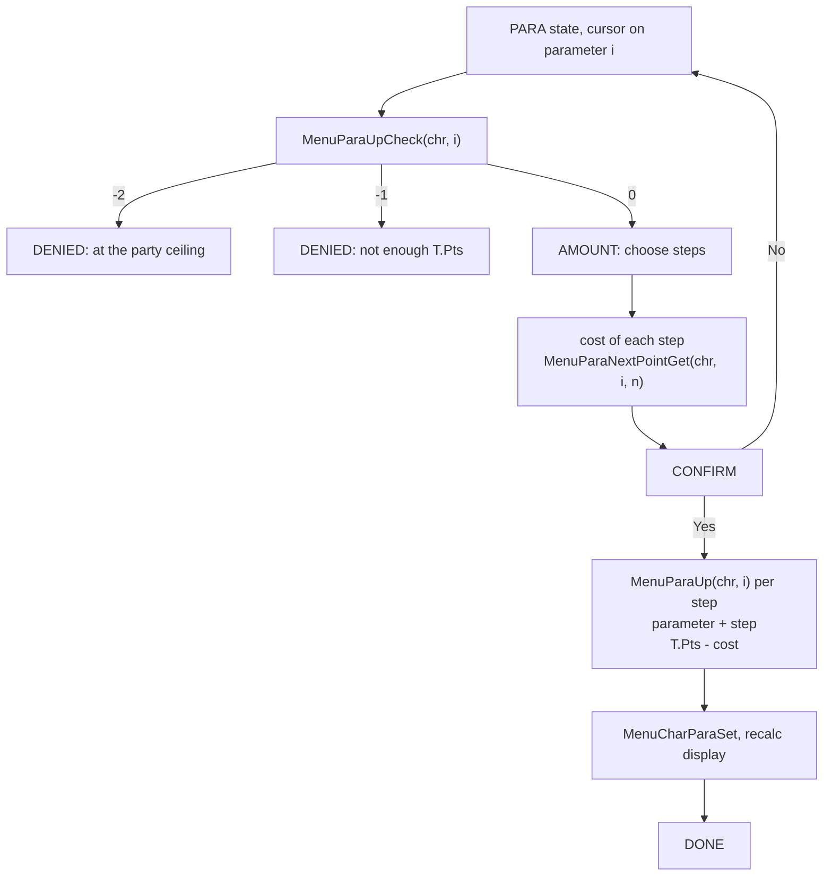

## Tech Attacks

Tech Attacks are the special attacks of each character. The screen is
`MenuTec()` in `src/main/menu_tec.c` (level 9). Its help texts are "Set Tech
Attack. Note: Attacks must be set to use." and "Use T.Pts to improve Tech
Attacks."

### Technique data

Each character from 1 to 8 has eight technique records in the party data.
`MenuTecSaveDataGet(chr)` returns its `TecInitEntry` at `party->tech_records
[chr - 1]`. The four arrays of eight bytes hold, per technique, the level,
the speed (1 means HI), the wait value and the level limit. `PartyDataInit`
loads the start values from `data\endou\tec\tecinit.bin`.

The upgrade costs come from `data\endou\tec\tecdata.bin`, which the screen
loads into `MenuTecDataBuf` in its init state. `MenuTecDataGet(chr)` returns
one `MenuTecData` record of 64 bytes per character:

```
MenuTecData (tecdata.bin, one per character 1..8)
+0x00 basePower[8]             u8, not used by the menu
+0x08 levelPointIncrement[8]   u8
+0x10 levelPointBase[8]        u16
+0x20 speedPointCost[8]        u16
+0x30 waitPointCost[8]         u16
```

The first eight bytes repeat the base power of each technique from its
battle record in `batdat.bin`. The menu never reads them. The records of
characters 4 and 8 are all zero. The byte layout is in
[technique costs](../formats/game-tables.md#technique-costs-tecdatabin), and
the start values in `tecinit.bin` are in
[technique start values](../formats/game-tables.md#technique-start-values-tecinitbin).

Techniques have global ids 45 to 98, grouped by character.
`BitToTecNo(id)` turns a global id into the index 0 to 7 inside its group.
The six technique slots of a character are `techniqueId[6]` at +0x82 of its
unit record.

### Improving a technique

"Use T.Pts" offers three improvements for the chosen technique, each paid
from the character's T.Pts (player record +0x0C).

| Row | Condition | Cost | Effect |
| --- | --- | --- | --- |
| TECH | `level < levelLimit` | `levelPointBase + levelPointIncrement * (level + 1)` | `level + 1`, and the special slot's `levelAdjustment` becomes `level * 3 - 3` ("Increases attack power") |
| SPEED | `speed != 1` | `speedPointCost` | `speed = 1`, the technique becomes HI ("Enables Tech Attack to be set in HI Slot") |
| WAIT | `wait != 0` | `waitPointCost` | `wait - 1`, copied to `waitAdjustment` ("Recover faster after using Tech Attack") |

`MenuTecCharTLevUpCheck`, `MenuTecCharSpeedUpCheck` and
`MenuTecCharWaitUpCheck` test the condition and the T.Pts. The upgrade rows
show the wait value as a full-width digit from 0 to 9.

### Setting a technique

The six slots are of two kinds. Slots 0 and 1 are **HI slots** and accept
only techniques whose SPEED is HI. Slots 2 to 5 are **LW slots** and accept
any technique. Each slot also has a range, Near or Far, from the table
`MenuTecTrgTbl00 = {0, 1, 0, 0, 1, 0}`. A technique can only go into a slot
whose range matches its own (`MenuTecTrgCheck`). Jr. uses
`MenuTecTrgTbl01 = {1, 1, 1, 1, 1, 1}`, so all his slots have the same
range, probably Far because he fights with guns. The help texts explain the
refusals: "Because this Tech Attack's SPEED is LW, it cannot be set in this
slot." and "Because this Tech Attack conflicts with the slot range, it
cannot be set here."

### States

The state diagram below shows the tech screen.

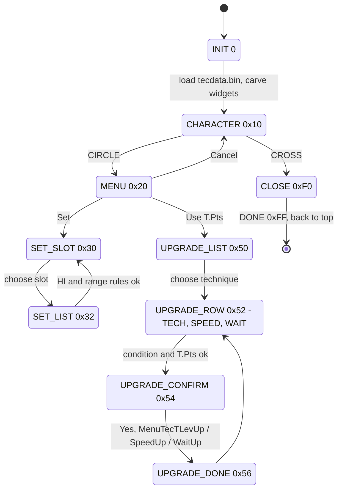

## Ether

Ether is the game's magic. The screen is `MenuEther()` in
`src/main/menu_ether.c` (level 2), with the help text "Use, set, and evolve
Ether. Transfer Ether to other characters."

### Ether data

Ether ids run from 1 to 80. Each ether has an `EtherStatus` record in the
OV01 tables (read through `dataEthGet`): `flags` (+2, bit 0x4000 means the
ether cannot be transferred), `capCost` (+4, its Wt), `tecId` (+6, the
technique record that holds its EP cost and effect type) and `pointCost`
(+8, the E.Pts needed to evolve it).

Every ether has an **owner**, decided only by its id (`MenuEtherWhoCheck`):

| Ids | Owner |
| --- | --- |
| 1 to 16 | Shion (3) |
| 17 to 26 | KOS-MOS (2) |
| 27 to 36 | chaos (1) |
| 37 to 48 | MOMO (6) |
| 49 to 58 | Jr. (7) |
| 59 to 71 | id 4, a character that does not exist in the game |
| 72 to 79 | Ziggy (5) |
| 80 | nobody |

A character knows an ether when its bit is set in `learnedEther` of its
player record. To be usable in battle an ether must also be **set** in one
of the 12 `etherId` slots of the unit record. The Wt (`capCost`) of all set
ethers may total at most 12 (`ETHER_CAP_MAX`), tracked in `capUsed` (+0x17).
The help text insists on this step: "Set Ether. Caution: You must complete
this step in order to utilize any Ether skill."

`data\endou\ether\etree.bin` defines how ethers evolve. It holds one 4-byte
record per ether id (`MenuEtherDataGet(id)`). The first three bytes are the
ids of the ethers it can evolve into, 0 meaning no child. The fourth byte is
not used by the menu.

### Commands

The command window offers "Use / Set / Use E.Pts / Cancel".

- **Use** casts an ether outside battle. Only six ethers can: ids 1, 8 and
  0x25 on one living party member, ids 4 and 0x1C on the whole party, and
  id 0x4A on the caster. The EP cost comes from `calcTakeEpGetMenu` and the
  effect from `calcUseEtherMenu`, both in OV01. Other ethers show "This Ether
  skill is only available during battle."
- **Set** toggles ethers in the 12 slots, within the Wt limit
  (`MenuEtherCapSet`, `MenuEtherListMake01`). The ether tree is shown while
  this list is open.
- **Use E.Pts** lists the character's ethers with their E.Pts cost and opens
  "Evolve / Transfer / Cancel". A row is enabled when the character owns the
  ether and has at least half its `pointCost`.

**Evolve** requires that the character is the owner, has at least
`pointCost` E.Pts and that at least one child in `etree.bin` is not learned
yet. The player picks one of those children in the tree. On confirmation the
child is learned (`dataEtherLearnSet`) and `pointCost` is subtracted from
E.Pts.

**Transfer** gives a copy of the ether to another party member. It requires
that the character is the owner, has at least `pointCost / 2` E.Pts, the
ether has no 0x4000 flag (`MenuEtherJoutoCheck`), the party has at least two
members and the target does not know it yet. On confirmation the target
learns it and the giver pays `pointCost / 2` ("Uses 1/2 E.Pt"). Because only
the owner can evolve or transfer, a transferred ether stays as it is:
"Transferred Ether skills cannot be evolved or transferred to others."

The flowchart below shows the checks of the E.Pts actions.

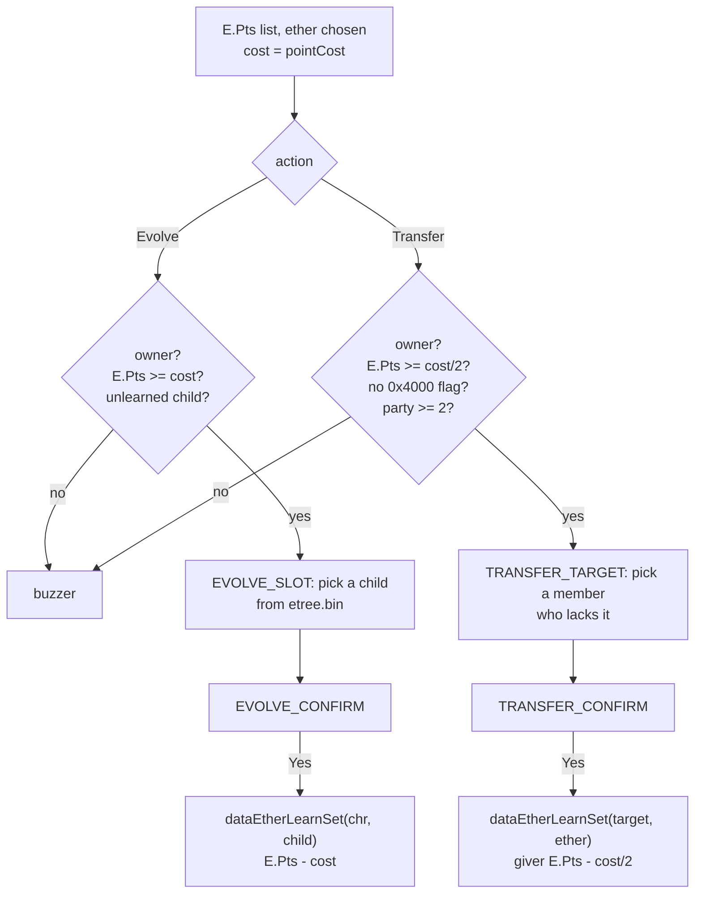

### States

| State | Value | Step |
| --- | --- | --- |
| `CHARACTER` | 0x10 | choose a character (L1 and R1 change it) |
| `COMMAND` | 0x20 | Use, Set, Use E.Pts, Cancel |
| `USE_LIST`, `USE_TARGET` | 0x30, 0x32 | Use: choose ether and target |
| `EQUIP` | 0x50 | Set: toggle ethers, tree visible |
| `EPTS_LIST`, `EPTS_ACTION` | 0x70, 0x72 | Use E.Pts: choose ether and action |
| `EVOLVE_SLOT`, `EVOLVE_CONFIRM`, `EVOLVE_DONE` | 0x74, 0x76, 0x78 | Evolve |
| `TRANSFER_TARGET`, `TRANSFER_CONFIRM`, `TRANSFER_DONE` | 0x82, 0x84, 0x86 | Transfer |
| `LEAVE`, `EXIT` | 0xF0, 0xFF | close |

The state diagram below shows the same flow.

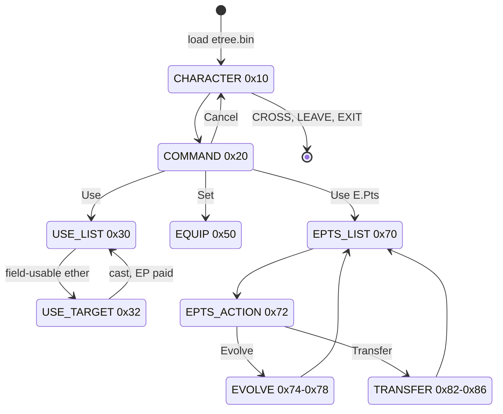

## Ether tree

The ether tree is the diagram of a character's ethers drawn on the Set and
Use E.Pts pages. Its code is `src/main/ether_tree.c`, and it runs as part of
the ether screen.

### Structure

Each character has one to three **root ethers**, listed in
`EtherTreeFirstData`: chaos 27, KOS-MOS 17, Shion 1, id 4 has 59, Ziggy 72,
MOMO 37, 43 and 46, and Jr. 49 and 57. The tree is the full set of ethers
reachable from the roots through the child ids of `etree.bin`, whether
learned or not. That file holds three child ids for each of the ethers 1 to
80 (layout in [ether tree](../formats/game-tables.md#ether-tree-etreebin)).
Its records form nine separate trees, one per root ether. Every child id is
larger than its parent and no ether has two parents. The root 59 of
character 4 is a "Reserve" ether with no children, and the ethers 13 to 16
and 59 to 80 that are not roots or children belong to no tree.

`EtherTreeInit` carves its arena from the menu work: a system block (0x80),
an object table of 80 nodes of 0x70 bytes (0x2300), a line table (0x1900),
a second line table (0x140), two right-hand panels (0x80) and a black fade
block (0x40). Each node is an `EtherTreeObjectData`:

```
EtherTreeObjectData (0x70 bytes)
+0x00 id            ether id
+0x04 parent        parent node
+0x08 childCount
+0x0C children[3]   child nodes
+0x18 flags         0x01 learned, 0x02 set, 0x04 child node,
                    0x08 drawn, 0x10 dimmed (not learned), 0x20 root
+0x1A displayType   0, 1 or 2 from the technique type
+0x20 position      x, y, z
+0x30 sprite        node icon
+0x45 isSet         +0x46 lampBrightness
+0x50 lamp          lamp sprite
```

### Building the tree

`EtherTreeObjectSet(chr)` rebuilds the tree whenever the character changes.

1. It clears the tables. If the character has learned no ether at all (all
   16 bitmap bytes are zero), it stops and nothing is drawn.
2. `subParentChildSet()` creates an invisible root node with the `ROOT` flag
   and one child per root ether. `sub2ParentChildSet(node)` then recurses:
   for each non-zero child id in the node's `etree.bin` record it takes the
   next free node (`EtherTreeObjectWorkGet`), links parent and child and
   recurses again.
3. `subPosSet` lays the tree out from left to right. Children sit 57 units to
   the right of their parent, and each node's vertical position is pushed 36
   units away per extra leaf below it. `subPosSet2` and `subPosSet3` then
   adjust the vertical positions, placing a parent between its first and last
   child.
4. `subJoutoPosSet` adds the **transferred** ethers ("jouto" means transfer):
   every learned ether whose owner is another character becomes a node in a
   grid of four columns, 72 units below the bottom of the tree.
5. `EtherTreeParaSet` marks each node. Every child node gets flag 8. A node
   gets flag 2 when the ether is in one of the 12 slots, flags 1 and 8 (and
   loses 0x10) when it is learned, and 0x10 (dimmed) when it is a child node
   that is not learned. Its display type (0, 1 or 2) comes from the ether's
   technique type.
6. `EtherTreeLineSet` collects every child node into the line table, and
   `EtherTreeTargetChange` centres the view on the first root.

The diagram below shows the tree of MOMO as `etree.bin` defines it. Her three
roots hang under the invisible root node. Learned ethers are lit and the
others are dimmed. Ethers transferred from other characters sit in the grid
below the tree.

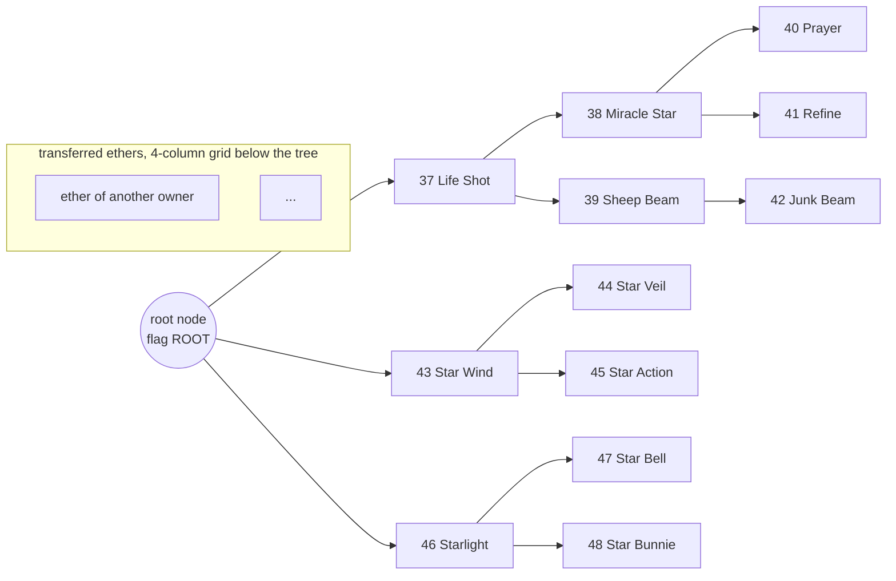

### Reacting to the ether screen

`EtherTreeMain` reads the ether screen's state every frame. It opens the
tree on `EQUIP` and `EPTS_LIST`. On `EVOLVE_SLOT` it shows the second line
table and the two right panels, which circle the possible children. On the
transfer states it previews the result: it sets the target's learned bit
temporarily, rebuilds the tree to show where the ether would appear, and
clears the bit again. `RoboEtherCheck` returns true for ethers 13 to 16
(Shion's range), and the tree then stops following the cursor. The name
suggests robot-related ethers. They are probably the ethers that events
teach Shion through `dataEtherTecSet`, which have no node of their own in her
tree.

## Skills

Skills are passive abilities. They come from accessories: a character
**extracts** the skill of an accessory once, and can then set it without
the accessory. The screen is `MenuSkill()` in `src/main/menu_skill.c`
(level 10), with "Extract / Set / Cancel" as commands.

### Skill data

`data\endou\skill\skilldat.bin` describes the skills. `PartyDataInit` reads it
at a new game to initialise the skill levels, and the skill screen reads it
again in its init state.

```
skilldat.bin (MenuSkillData)
+0x000 level_cap_by_skill_id[0x7E]  u8, entry id - 1: skill level needed
+0x07E point_cost_by_skill_id[0x80] u16, entry id: S.Pts to extract
+0x17E next_level_points[5]         u16, S.Pts from skill level n to n + 1
```

`SkillSetLvGet(id)` reads the first table at `id - 1` and `SkillGetPtGet(id)`
reads the second at `id` itself. The source names them "by skill id", but the
skill screen passes the accessory id. The skill itself is the
`prerequisite` field of the accessory record (`dataAccGet`, +0x0E), and 0
means the accessory carries no skill. The two arrays cover the character
accessories only. The 19 A.G.W.S. parts that carry a skill have no level or
cost entry. The shipped values of `next_level_points` are 0, 200, 800, 1,800
and 4,500. The byte layout and examples are in
[skill learning](../formats/game-tables.md#skill-learning-skilldatbin).

Each character from 1 to 8 has a **skill level** from 1 to 5 in
`party->skill_levels` and a counter `party->next_level_points[chr - 1]`.
`SkillCharSkillLvGet(chr)` returns the level.

### Extracting a skill

On the Extract page the player picks an accessory from three tabs. The
extraction is allowed only when:

- the accessory carries a skill,
- the character's skill level is at least `SkillSetLvGet(accessory)`,
- the character has not extracted that skill yet (`dataSkillLearnGet`),
- the character has at least `SkillGetPtGet(accessory)` S.Pts.

On confirmation `dataSkillLearnSet` marks the skill as learned, sound effect
22 plays and `SkillCharPointPlus(chr, cost)` pays the cost. That function
subtracts the cost from S.Pts (never below 0) and, while the skill level is
below 5, also from the counter. When the counter reaches 0 the level rises
by one with the decide sound, and the counter is reloaded from
`next_level_points` with the overflow carried over. At level 5 the counter
stays 0. The S.Pts spent on extraction are therefore also the experience of
the skill level.

The flowchart below shows one extraction.

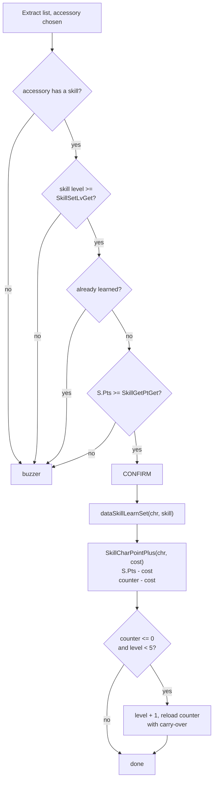

### Setting skills

The Set page toggles learned skills in the three `skillId` slots of the unit
record (`MenuSkillEquipCheck` finds a skill's slot, `MenuSkillEquip` writes
it). SQUARE jumps to the next set row. The character list contains the
attack line and the available reserve members, and only ids 1 to 7 can be
chosen.

| State | Value | Step |
| --- | --- | --- |
| `CHARACTER` | 0x10 | choose a character |
| `COMMAND` | 0x20 | Extract, Set, Cancel (L1 and R1 change the character) |
| `LEARN` | 0x30 | accessory list, three tabs |
| `CONFIRM` | 0x32 | confirm the extraction |
| `EXTRACT` | 0x34 | show " has been extracted." |
| `EQUIP` | 0x40 | set and unset skills |
| `LEAVE`, `EXIT` | 0xF0, 0xFF | close |

## A.G.W.S.

A.G.W.S. are the mechs the party can pilot. They are units 17 to 32 and use
the same unit records as characters. Which ones the party owns is the
bitmask `take_agws_mask` (bit `id - 17`), changed by `PartyTakeAgwsOn` and
`PartyTakeAgwsOff`. `PartyAgwsGet` lists them. Buying an A.G.W.S. in a shop
calls `MenuBoxInc` with an A.G.W.S. id, which turns into `PartyTakeAgwsOn`.

### The A.G.W.S. screen

`MenuAgws()` in `src/main/menu_agws_para_set.c` (level 4) is the setup
screen: "Equip A.G.W.S. weapons and accessories. Assign pilots." It shows a
3D model of the unit through the menu model code (memory layout 11, see
[main menu](main-menu.md#menu-models)) and moves the camera with
`MenuAgwsCameraSet` and `MenuAgwsCameraMove`.

| State | Value | Step |
| --- | --- | --- |
| `SELECT` | 0x10 | choose the A.G.W.S. |
| `COMMAND` | 0x22 | command list |
| `EQUIP` | 0x40 | equipment slots |
| `WEAPON_MOUNT` | 0x42 | choose the mount position |
| `WEAPON_LIST` | 0x44 | choose a weapon |
| `AMMO_LIST` | 0x46 | choose ammunition |
| `ACCESSORY_LIST` | 0x62 | choose an accessory |
| `PILOT_LIST` | 0xC2 | assign or remove the pilot |
| `CLOSE`, `CLOSE_WAIT`, `EXIT` | 0xF0, 0xF1, 0xFF | close |

### Weapons and mounts

An A.G.W.S. carries up to three weapons. Each weapon is fitted on a **mount**
(L. Arm, R. Arm, L. Alt, R. Alt), stored as a mount code in `weaponMount[3]`.
`MenuWeaponEquipPosCheck(unit, weapon, position, replacedSlot)` decides
whether a weapon fits at a position:

1. The weapon must allow the unit in its `characterEquipMask`.
2. The total `equipWeight` of the weapons, the new one included and the
   replaced one excluded, may not exceed 3 (2 for AG-05).
3. The weapon's `mountMask` must offer the position, and the position must
   not be taken or blocked by the mount pair of another weapon.

The function returns the mount code, or 0 when the weapon does not fit.
`MenuAgwsWaglGet(unit)` adds up the `wagl` value of the three weapons, which
the status panel shows as WAGL.

### Pilots

A character pilots an A.G.W.S. when its unit record's `agwsId` (+0x54) holds
that A.G.W.S. id. `MenuAgwsPilotCheck(agws)` returns the pilot by searching
characters 1 to 12. The pilot list assigns or removes a pilot with sound
effects 0x12 and 0x13.

### Parameters, frames and generators

`MenuAgwsParaSet(unit, state)` refreshes the parameter panels. It calls
`calcTotalParaMenu` (OV01), which returns the unit's parameters and arrays of
attack and defense bonuses, and `ParaSet` fills a display block: maximum HP,
attack plus three attack bonuses, `phyDefense` and `magDefense` plus one
bonus each, WAGL and two more values. The block `MenuAgwsPara2` is refreshed
on every call, while `MenuAgwsPara` is refreshed only in states 0 and 10, so
the screen can probably compare values before and after a change. State 10
also keeps the unit's current HP.

An A.G.W.S. also has a **frame** (`frameId`, +0x58) and a **generator**
(`engineId`, +0x56). They cannot be changed on this screen. They are bought
and fitted in shops (see [Shops](#shops)). The script natives
`Runtime.charAllRecovery()` and `Runtime.AGWSAllRecovery()` refill HP and EP
of characters 1 to 11 or of A.G.W.S. 17 to 32 to their recalculated maximum
(`CharactorAllRecovery`, `AgwsAllRecovery` in `src/main/window_tex_load.c`).

## Party and formation

### Party membership

`src/main/party.c` manages who is in the party. The masks of the party data
work together:

- `friend_mask` holds the recruited main characters (ids 1 to 7, never 4).
  `PartyFriendOn`, `PartyFriendOff` and `PartyFriendCheck` change and test it.
- `out_friend_mask` marks members who are temporarily away, and
  `lock_party_mask` (ids 1 to 12) marks members who may not be moved.
- `PartyFriendLockCheck(id, flags)` starts from `friend_mask` and removes the
  out members (flag 1) and the locked members (flag 2).
- `attack_slots[3]` are the three members who fight. Each slot holds a
  `party_id` and an `attack_position`, the place on the battle grid.
- `leader_battle_id` is the battle id of the character shown on the field.

`PartyAllPartyGet(out, mode)` collects member ids: mode 0 gives the attack
line followed by the reserve line, mode 1 every friend who is not locked out
(at most six) and mode 2 every recruited friend (at most six).
`PartyAttackerGet`, `PartyReserveGet` and `PartyAttackerCheck` serve the
attack line. `PartyAttackerCheck` maps id 11 (Mary) to 20 (VX-20000) and 12
(the Soldier) to 19 (VX-9000), because those two only fight in their
A.G.W.S.

`PartyLeaderSet(id)` stores the battle id of the new leader. A costume table
`CostumData` can replace it, and the high halfword of the argument selects
costume 1 or 2. `PartyBattleChange(id)` (script native
`Runtime.battleChangeParty`) gives the attack slot of member `id` to the
first reserve member, who also becomes leader if `id` was the leader. At a
new game `PartyDataInit`
clears everything and loads the technique and skill tables, and
`PartyDataInit2` recruits Shion, chaos and KOS-MOS (3, 1, 2), puts them in
the attack slots with positions 1, 2 and 3 and clears the leader.

The diagram below shows how the masks combine into the lists the menus use.

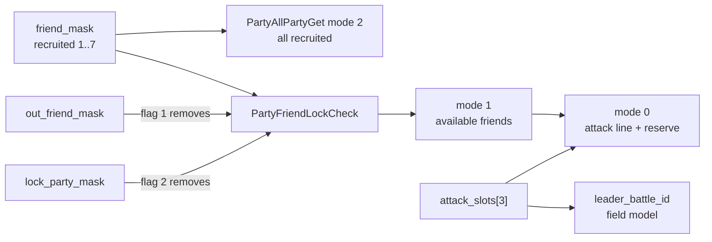

### Battle Formation screen

`MenuCharactor(1)` shows the formation. The top menu prepares it before
leaving: it switches the menu model pool to layout 12 (three full unit
regions), loads the menu motions and creates a model for each member in the
attack slots. The formation command list is "Formation / Replace / Cancel".
The file also holds a "Draw / Set / Cancel" list and the caption "Set Lead
Character", which probably belong to the choice of the field leader.

| State | Value | Step |
| --- | --- | --- |
| `FORMATION` | 0xA0 | choose a member |
| `FORMATION_MENU` | 0xA2 | Formation, Replace, Cancel |
| `MOVE`, `EXCHANGE`, `PLACE` | 0xB2, 0xB4, 0xB6 | move a member on the battle grid |
| formation done | 0xBF | apply |
| `RESERVE_PICK`, `RESERVE`, `RESERVE_MODEL` | 0xC0, 0xC2, 0xC4 | swap with a reserve member and rebuild its model |

`MenuCharLeaderMask(chr)` decides who may lead. In scenarios 1 to 34, 46 to
48, 126 and 142 to 144 only Shion can lead, and in scenarios 159 and 160
only Shion, chaos or Ziggy. Outside ids 1 to 7 nobody can lead, a member must
be in the attack line, and the current leader is reported separately. When
the menu closes, `MenuGameDataPop()` loads the new leader's field model if
it changed (see [main menu](main-menu.md#restoring-the-field)).

### Play time

The play time is an `XglClock` at `SaveData + 0x68`. `PartyTimeUpDate()` adds
the clock ticks since its previous call and clamps the total with
`PartyTimeLimitCheck` to day 5, 3:59:59. `PartyTimeDispChange` folds the days
into the hours (days start at 1), so the displayed maximum is 99:59:59.
`PartyTimePauseStart` updates the time when the pause screen opens and
`PartyTimePauseEnd` takes a new reference, so time spent paused is not
counted.

## Shops

Shops sell and buy items and equipment and service A.G.W.S. The code is in
`src/main/menu_shop.c`. A shop is a separate screen built from the same
pieces as the main menu, not a menu level.

### Opening a shop

There are two ways in. On the field, CIRCLE on a shop symbol calls
`MenuShopMain(shopNo)` with the shop id of the map unit (default 1), see
[map and units](map-and-units.md). Scripts call the native
`Runtime.enterShop(int)` (`src/main/runtime.c`). Both save and restore the
camera and lights around the call.

`MenuShopMain(shopType)` mirrors `MainMenu()`:

1. It freezes the field picture, sets the menu-open flag `0x04000000`, clears
   the render callbacks (`MenuCfTaikiPush`) and saves the field
   (`MenuGameDataPush`).
2. It takes its work area from `MenuWorkEndGet()`: an 8 KiB buffer
   `ShopDataBufTop` for the shop table, the 128-byte control block
   `MenuShopWork`, the background, a 16-slot scheduler `MenuShopTask` and one
   task per widget (Pas, Info, List, Select, Ex, Ex2, Ex02, Seisan, Seisan02,
   Icon, Parameter, Line and the model task).
3. It allocates 0x180000 bytes of game resource memory for the menu models
   and selects model layout 20.
4. It loads font 1, both menu window textures and
   `data\endou\shop\shopdata.bin`, and waits for the loads with the
   background running.
5. It copies record `shopType - 1` of `shopdata.bin` into `ShopData`. Shop 20
   only buys from the player and shows no categories to buy from. Shop 6 does
   the same while the equipment is taken away (`MenuEquipStealMaskCheck`).
6. It reads the party (`PartyAllPartyGet(ids, 1)`), the owned A.G.W.S.
   (`PartyAgwsGet`) and the scenario number.
7. It runs `MenuShopCore()` and the task list every frame until the state is
   `SHOP_STATE_END`.
8. It tears down, reloads the field resources and calls `MenuGameDataPop()`.

Each `shopdata.bin` record is 0x170 bytes: nine columns of 20 halfword ids
(0x28 bytes each) and a tail of four A.G.W.S. unit ids. A column has no count
and ends at its first 0. The columns hold, in order, items, character
weapons, character accessories, character ammunition, A.G.W.S. weapons,
A.G.W.S. accessories, A.G.W.S. ammunition, frames and generators
(`menuShopRecordSortTable`). The source models a column as
`ShopDataCategory`, an array of 20 ids, and tests `ids[0]` to know whether the
column is empty. The shop offers
A.G.W.S. tuning only when the party owns an A.G.W.S. and column 7
(`SHOP_RECORD_FRAME`, the frames) is not empty. A non-empty tail makes the
shop free its models on exit. Shops 19 and 20 are empty in the shipped file,
and shop 8 is identical to shop 10. The byte layout and an example shop are
in [shop lists](../formats/game-tables.md#shop-lists-shopdatabin).

### Categories and modes

The mode window offers Buy, Sell, Tune A.G.W.S. and Quit. A shop sells up to
nine categories, shown as icons: items, character weapons, character
accessories, character ammunition, A.G.W.S. weapons, A.G.W.S. accessories,
A.G.W.S. ammunition, A.G.W.S. units and cards. The cards category holds the
event items 0x35 and 0x36 from scenario 0x73 on, and 0x37 from scenario
0x12D on. They cost 400, 100 and 100 and are probably the card packs of
[Xeno Card](minigames/xeno-card.md).

`MenuShopSortSet` builds the list of a category from the shop table, and
`MenuShopParameter` compares the current equipment with the selected item on
a stat panel (seven rows for character gear, six for A.G.W.S. gear).
`subMenuShopEquipCheck` marks which party members can use the item.

### Prices

`MenuBoxMoneyGet(encoded, mode)` in `src/main/menu_1.c` gives every price.
The base price comes from the OV01 record of the item, weapon, ammunition,
accessory, frame or generator. In mode 0 (buying) it is multiplied by a
**discount rate** of its price class:

| Class | Index | Applies to |
| --- | --- | --- |
| item | 0 | consumable items |
| A.G.W.S. | 1 | A.G.W.S. units |
| A.G.W.S. weapon | 2 | A.G.W.S. weapons and their ammunition |
| A.G.W.S. accessory | 3 | A.G.W.S. accessories |
| character gear | 4 | character weapons, their ammunition and accessories |

The rate is `1 - level * 0.1`, never below 0.5, where `level` is the byte
`SaveData[0x102DC + index]`. No C code writes these bytes, so the scripts
probably set them, for example through `Runtime.setPartyData`, which can
address any byte after the party data. In mode 1 (selling) every rate is 1
and the price is halved, so an item sells for half its undiscounted price.
A.G.W.S. units have fixed prices: VX-4000 (22) 50,000, AG-04 (26) 80,000 and
AG-05 (27) 300,000.

### Buying and selling

Buying is refused with the buzzer when the unit price is above the available
money or the player already holds 99 of the item. Otherwise the quantity
window (`MenuShopSeisan`) lets the player choose between 1 and `99 - held`,
with the total price shown. Selling is refused for items with the no-sale
flag 0x1000 (`MenuShopNoSaleCheck`). On confirmation the shop calls
`MenuBoxInc` once per unit bought and `dataMoneyBoxDec(price * quantity)`, or
`MenuBoxDec` once per unit sold and `dataMoneyBoxInc(price * quantity)`.

The sequence diagram below shows a purchase.

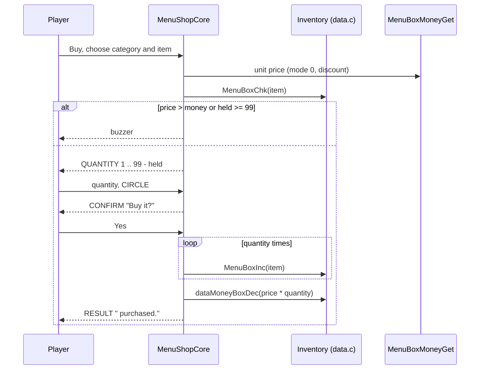

### A.G.W.S. tuning

"Tune A.G.W.S." opens a second command list: Buy Frame, Buy Generator,
FHP Restoration and Quit. The shop names the maker of each line, "Hyams
Heavy Industries - AG Series" or "Vector Industries - VX Series".

- **Buy Frame** and **Buy Generator** list the frames or generators on sale
  with their stats. The player then picks one of the owned A.G.W.S. that can
  take the part. On confirmation the shop writes the new `frameId` or
  `engineId` into the unit record, recalculates it with `MenuAgwsParaSet`
  and pays the price of the part. The old part is not kept.
- **FHP Restoration** refills the HP of one A.G.W.S. to its recalculated
  maximum for 100 credits (`SHOP_RESTORE_COST`). It is offered while the
  money covers it and the unit is damaged.

### Shop states

The state diagram below shows the shop's state machine (`MenuShopWork->state`).

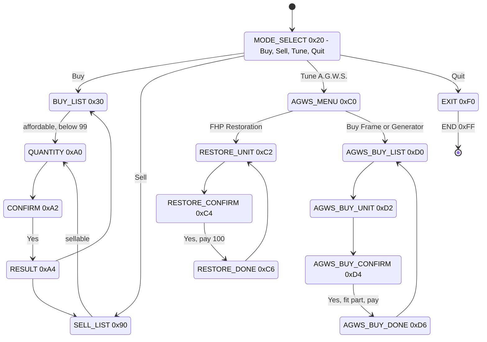

## Script access

Event scripts change the party and its growth through natives of
`xeno.util.Runtime` (`src/main/runtime.c`, see
[natives](../scripting/natives.md)):

| Native | Calls |
| --- | --- |
| `setFriend`, `resetFriend`, `checkFriend` | `PartyFriendOn/Off/Check` |
| `setLockParty`, `resetLockParty`, `checkLockParty` | lock mask |
| `setOutFriend`, `resetOutFriend`, `checkOutFriend` | out mask |
| `setTakeAgws`, `resetTakeAgws`, `checkTakeAgws` | owned A.G.W.S. |
| `battleChangeParty` | `PartyBattleChange`, a reserve member takes an attack slot |
| `getPartyData`, `setPartyData` | any byte, halfword, word or doubleword of the party data (selector with a table and an offset) |
| `addItem`, `removeItem`, `checkItem`, `addItemWin` | inventory, with or without a window |
| `enterShop` | `MenuShopMain` |
| `etherTecSet` | `dataEtherTecSet`, teaches story ethers and techniques (selectors 1 to 8) |
| `charAllRecovery`, `AGWSAllRecovery` | full HP and EP |

The character natives map a script character id to a party id first
(`cid2bic`, through a table of party ids).

## Source files

| File | Content |
| --- | --- |
| `src/main/party.c`, `include/main/party.h` | party data, masks, attack line, leader, play time, `PartyDataInit` |
| `src/main/seisan_count_init1.c` | battle result screen |
| `src/main/menu_para_pt_rate_get.c` | Characters and Battle Formation screens, Use T.Pts |
| `src/main/menu_tec.c` | Tech Attacks screen |
| `src/main/menu_ether.c` | Ether screen |
| `src/main/ether_tree.c`, `src/main/ether_tree.h` | ether tree display |
| `src/main/menu_skill.c`, `src/main/menu_skill.h` | Skills screen, skill levels |
| `src/main/menu_agws_para_set.c` | A.G.W.S. screen |
| `src/main/menu_shop.c` | shops |
| `src/main/menu_1.c` | prices, equipment checks, mounts |
| `src/ov01/data_unit_org_get.c` | unit and player record accessors, learned bitmaps |
| `src/ov01/calc.c` | `calcResult`, `calcTotalParaMenu` and the menu calculations |
| `src/main/game.c` | save copies of the records |
