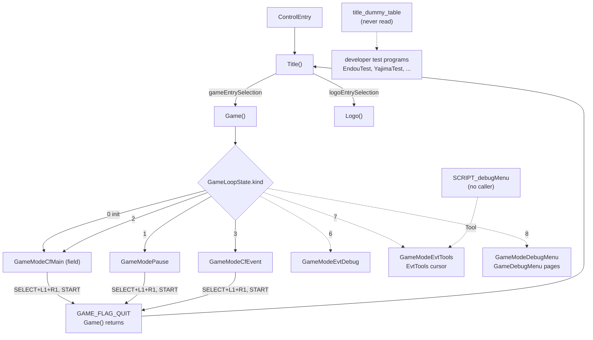
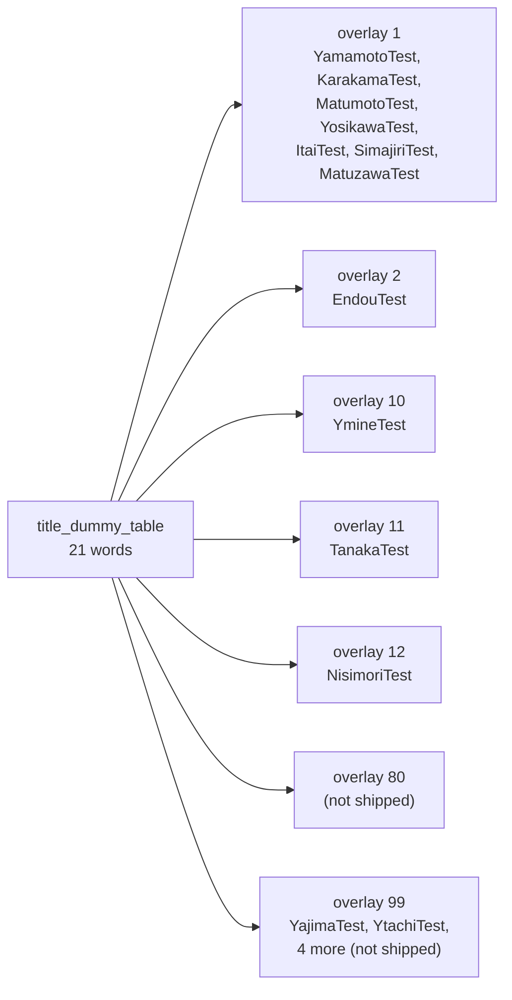
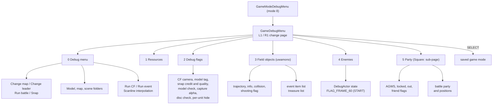

# Debug tools and test programs

The retail executable of *Xenosaga Episode I* still contains a large amount of
code that the developers used while they built the game. There are test
programs named after their authors, an in-game debug menu with six pages, a
script debug menu with light and wind editors, a camera cursor tool, an effect
viewer, a battle configuration screen and many trace messages. Almost none of
it can be used in the shipped game. The code is complete and compiled, but
the entry points are not connected and the debug text is switched off.

The leftovers are still useful. They show how the team tested single systems
in isolation, which files they loaded from their development PCs, and how the
work was split between programmers. The overlays and the title screen
mentioned here are described in [title-and-boot.md](title-and-boot.md).

[← Back to the overview](../README.md)

## 1. Why the debug code is invisible

Most debug screens draw their text with `xglFontDebugPrintf` or
`xglFontDebugHex` (see [xgl.md](../libraries/xgl.md#debug-print)). Both
functions queue text only when two bits of the font state are set:
`FONT_STATE_ENABLED` (1) and `FONT_STATE_DEBUG_PRINT` (2). The font start-up
code sets the state to `FONT_STATE_ENABLED | FONT_STATE_CLIP`, without the
debug bit. The only function that changes the state later is
`xglFontSetFlags(flags)` in `src/main/xgl_font.c`, and it always clears the
debug bit:

```c
void xglFontSetFlags(int flags)
{
    FONT_STATE_FLAGS = flags & (0xFFFF & ~FONT_STATE_DEBUG_PRINT);
}
```

Some callers still ask for it. `src/main/tya.c` calls
`xglFontSetFlags(xglFontGetFlags() | 3)`, but the mask removes bit 1 again.
So every `xglFontDebugPrintf` call in the game does nothing. This mask is
probably the switch the team used to build the release version, because the
rest of the debug code was left in place.

Other debug output goes to places a player never sees:

- `printf` writes to the console (TTY) of a development kit. Many debug
  helpers use it: the battle command traces, `MATRIX_print`, `tracePrint`,
  the casino entry messages and the disc change message.
- `MOutputDebugString` and `MOutputDebugStringWarn`
  (`src/main/m_output_debug_string.c`) wrap a message in ANSI colour codes
  (`ESC[1;36mMDMSG:` in cyan, or magenta for warnings) and print it with
  `vprintf`. The modules with the `m_` prefix (`m_battle`, `m_cam`, `m_ef`,
  `m_mv` and others, mostly in OV01) use the warning form.
- Several functions are empty in the retail build: `LOG` in `src/main/log.c`,
  `sefPrintVector` and `sefPrintMatrix` in `src/main/sef_print.c`,
  `GameSnapShotCheck` in `src/main/game_snap_shot.c`, and the two output
  sinks behind `XrgVLog` in `src/ov12/xrg_v_log.c`. For example the map loader
  still calls `LOG` with the Japanese message "モデルが見つかりませんでした。"
  ("The model could not be found."), and the call does nothing.

Finally, the entry points of the bigger tools have no caller. Section 2 lists
them.

## 2. What can be reached

The table below shows each debug feature, how the developers reached it and
whether the retail game can reach it.

| Feature | Entry | Reachable in retail |
| --- | --- | --- |
| Test programs (section 4) | `title_dummy_table` (section 3) | no, the table is never read |
| In-game debug menu (section 5) | game mode 8, `GameModeDebugMenu` | no, nothing sets mode 8 |
| Event tools and cursor (section 6) | game mode 7, from `SCRIPT_debugMenu` | no, `SCRIPT_debugMenu` has no caller |
| Event debug mode | game mode 6, `GameModeEvtDebug` | no, nothing sets mode 6 |
| Return to the title screen | SELECT + L1 + R1 held, START pressed | **yes** |
| Actor cycling with L2 + L1 | `FLAG_FRAME_60` not 0 | no, only the enemy debug page sets the flag |
| Casino debug start-up | `debug_mode` field of `data\tanaka\CASINO.res` | no, the field is 0 on the disc |
| Casino test mode | casino mode 7 | no, nothing selects it |
| AGWS mode shortcut (OV12) | `RgDebugFlags.modeEnabled` | no, it is always 0 |
| Debug text | `xglFontDebugPrintf` | no, see section 1 |

The game modes are the values of `GameLoopState.kind`, which `Game()` in
`src/main/game.c` uses to pick the handler of each frame. The flowchart below
shows the modes and the launcher, with the paths that the retail game takes
drawn as solid lines and the unconnected paths as dotted lines.



## 3. The developer launcher: `title_dummy_table`

`Title()` returns a 32-bit selection to `ControlEntry`. The high byte is the
overlay to load and the low 24 bits are the address of the function to call
(see [title-and-boot.md](title-and-boot.md#3-the-control-loop-and-the-title-return-value)).
The shipped game uses only two such values. Next to the title code, OV02 also
holds the array `title_dummy_table` in `src/ov02/title.c` with 21 more values
in the same format. Nothing in the game reads it.

Decoded with the function index, the table is a list of test programs:

| Index | Value | Overlay | Entry | Source file |
| --- | --- | --- | --- | --- |
| 0 | `0x00000000` | none | none | |
| 1 | `0x63257EC0` | 99 | `YajimaTest` | `src/main/yajima_test.c` |
| 2 | `0x0AA003F8` | 10 | `YmineTest` | `src/ov10/calc_vert_out_vec_edge.c` |
| 3 | `0x6325A1C0` | 99 | `YtachiTest` | `src/main/ytachi_test.c` |
| 4 | `0x0BA00070` | 11 | `TanakaTest` | `src/ov11/tanaka_test.c` |
| 5 | `0x01A00000` | 1 | `YamamotoTest` | `src/ov01/yamamoto_test.c` |
| 6 | `0x0226F4D8` | 2 | `EndouTest` | `src/main/endou_test.c` |
| 7 | `0x012BCE98` | 1 | `KarakamaTest` | `src/main/karakama_test.c` |
| 8 | `0x012CB1A8` | 1 | `MatumotoTest` | `src/main/matumoto_test.c` |
| 9 | `0x012D9100` | 1 | `YosikawaTest` | `src/main/yosikawa_test.c` |
| 10 | `0x012DC3F0` | 1 | `ItaiTest` | `src/main/log.c` |
| 11 | `0x012DD8F8` | 1 | `SimajiriTest` | `src/main/set_path.c` |
| 12 | `0x01A31340` | 1 | `MatuzawaTest` | `src/ov01/matuzawa_test.c` |
| 13 | `0x0CA00000` | 12 | `NisimoriTest` | `src/ov12/nisimori_test.c` |
| 14 | `0x50A00000` | 80 | `0x00A00000` | not on the disc |
| 15 | `0x00000000` | none | none | |
| 16 to 19 | `0x63A02090`, `0x63A0E228`, `0x63A0ABE8`, `0x63A039A8` | 99 | four overlay addresses | not on the disc |
| 20 | `0x00000000` | none | none | |

Most entries live in the main executable but name an overlay anyway, because
the test probably needs that overlay's code. For example `EndouTest` asks
for OV02, which holds the U.M.N. event text parser used by its text test, and
the tests that ask for OV01 probably use the battle or field code. The disc only holds overlays 1, 2, 10,
11 and 12, so overlays 80 and 99 were probably development overlays that were
never shipped. `YtachiTest` calls `func_00A0A5F0`, an overlay address that
matches no shipped overlay function, which fits this.

The zero entries look like separators or unused slots. The table was probably
the item list of a developer title menu: choosing an item made `Title()`
return the value, and `ControlEntry` loaded the overlay and started the test.
When the test returned, the title screen came back. The diagram below groups
the entries by overlay.



## 4. The developer test programs

Each test program is a function named after a programmer, with the suffix
`Test`. Most of them show a menu with `xglFontDebugPrintf` and run small test
functions until the player holds an exit chord. The common exit chord is
SELECT held with START pressed. The table below summarises them, and the
following subsections describe the larger ones.

| Program | Overlay | What it tests |
| --- | --- | --- |
| `EndouTest` | 2 | menus, messages, numbers, models, textures, JPEG, battle windows, save and load, shops |
| `YajimaTest` | 99 | fonts, UML display, HDD, memory card, Database, movies, XTX decoding |
| `KarakamaTest` | 1 | CF field test, texture test, sound effect packets |
| `YosikawaTest` | 1 | hair, wind and collision tests |
| `SimajiriTest` | 1 | effect viewer |
| `YamamotoTest` | 1 | battle test with the battle configuration screen |
| `YmineTest` | 10 | starts the Xeno Card game |
| `TanakaTest` | 11 | starts the casino (also the real casino entry) |
| `NisimoriTest` | 12 | prints the author's name only |
| `ItaiTest` | 1 | clears the screen and waits forever |
| `YtachiTest` | 99 | calls one function of the missing overlay 99 |
| `MatumotoTest`, `MatuzawaTest` | 1 | empty functions |

### `EndouTest`

`EndouTest` in `src/main/endou_test.c` sets a dark green clear colour and then
shows one line per test, each started by its own button:

| Button | Test | Function |
| --- | --- | --- |
| Triangle | settlement screen | `SeisanTest` |
| Square (held) | event text | `TextTest`, loads OV02 and shows the U.M.N. event texts in a message window |
| Cross | message window | `eMessageTest` |
| Circle | numbers | `eNumberTest` |
| L1 | menu model | `eModelTest` |
| L2 | load screen | `MenuFileMain(1)` |
| R1 | textures | `TexturTest` |
| R2 | JPEG decoding | `JpegTest` |
| Up | battle windows | `BattleWindowTest` |
| Down | save screen | `MenuFileMain(0)` |
| Right | models | `ModelTest` |
| Left | shops | `ShopTest`, reads `shopdata.bin` (20 shop records) |

The same file also holds the party debug pages of the in-game debug menu
(section 5). Part of the U.M.N. data, the Plug-in texts, the mail history
tree and the cube models, lives in the folder `data\endou\umn\`, and the
rest of `data\endou\` holds menu textures and texts, the growth and shop
tables and the placeholder pictures of the save screen. So
Endou probably wrote the U.M.N. and parts of the menu system (see
[umn.md](umn.md) and [main-menu.md](main-menu.md)). The U.M.N. pages and
mails themselves are in `data\umn\`.

### `YajimaTest`

`YajimaTest` in `src/main/yajima_test.c` sets the stick dead zone and opens a
list menu with the `xglMenu` debug menu system (see
[xgl.md](../libraries/xgl.md#debug-menus)). While the menu waits it prints the
date and time of the real-time clock. The menu has seven items:

| Item | Function | What it does |
| --- | --- | --- |
| FONT | `FontTest` | font pages, switched with Left and Right. Its helper `FontTestSub` builds a kanji table (see below) |
| UMLDISP | `UmlDispTest` | chooses a UML file by number (`UMLDISP %4x`) and shows it scrolled. Triangle dumps the mail header records |
| HDD | `HddTest` | formats the hard disk, creates the test partition `hdd0:PP.SLPS-99999.DUMMY.DUMMY` of 1 GB and saves or loads on it |
| MEMCARD | `MemcardTest` | selects a port, formats, unformats, saves and loads memory card files |
| DATABASE | `DatabaseTest` | runs the keyword database browser |
| MOVIE | `XenoMovieCheck` | a movie player with a list of 103 movies from `data\movie\mpeg2\` (see [PSS movies](../formats/movies-images-and-icons.md#2-pss-movies)) |
| XTX DECODE | `XtxDecode` | decodes an XTX texture file named in the start-up options |

`FontTestSub` reads a table of two-byte characters from
`data\yajima\nisui.euc` and the script text `data\yajima\scenario.txt`. It
adds every kanji of the script with an EUC-JP lead byte above `0xD0` that the
table lacks, then writes the table to the PC as `host0:nisui.txt`. Neither
input file is on the retail disc, so there the first read fails and the
function does nothing. Lead bytes
from `0xD0` up hold the second level of JIS kanji (*dai-ni suijun*), so
*nisui* probably stands for that level. The tool probably built the list of
rare kanji that the game font had to contain.

The UML display and the keyword browser are the ones that the U.M.N. uses (see
[umn.md](umn.md#8-database)). Their files are described in
[UML pages](../formats/text-and-fonts.md#uml-pages) and
[Keyword list](../formats/text-and-fonts.md#keyword-list). Their function prefix `tya` probably comes from
Yajima too. The hard disk test uses the same `xglHdd` layer as the HDD
installation (see [xgl.md](../libraries/xgl.md#hdd)). The partition name uses
`SLPS`, the product code prefix of Japanese releases, with the placeholder
number 99999.

### `KarakamaTest`

`KarakamaTest` in `src/main/karakama_test.c` prints its author's name in
kanji (唐鎌, Karakama) and three tests: Circle runs `CfTest` (a CF field scene
test), Triangle runs `TexTest` and Square runs `SePacketTest` (sound effect
packets). Cross returns. On entry it prints the `sizeof` values of several
game structures, probably to check the memory layout. The folder
`data\karakama\` holds `evtitem.dat` and `itembox.dat`, the names of the
event items and the contents of every item box. The field reads both at
start and uses them in normal play, and the field-object debug page lists
them (section 5). Their layout is described in
[Item box tables](../formats/maps-and-field-data.md#item-box-tables).

### `YosikawaTest`

`YosikawaTest` in `src/main/yosikawa_test.c` shows a list of three tests,
moves the cursor with the shoulder buttons and starts the selected test with
Circle: `HairTest` (`src/main/hair_test.c`), `WindTest`
(`src/main/wind_test.c`) and `ColliTest` (`src/main/colli_test.c`). They
exercise the hair and wind simulation of the character models and the
collision code (see [actors.md](../libraries/actors.md)).

### `SimajiriTest`: the effect viewer

`SimajiriTest` in `src/main/set_path.c` is a viewer for the special effects
of the `sef` library (see [sef.md](../libraries/sef.md)). It loops through
three steps:

1. A file browser built on `xglCdFileSelect` (see
   [xgl.md](../libraries/xgl.md#debug-file-selector)). Its base path is
   `host0:/home/xeno/work/`, so it reads files from the development PC.
2. A mode menu with five entries: Battle, Battle debug, CF debug, Debug and
   Title. The exit chord or Title leaves the viewer.
3. The chosen viewer. Effects are selected by number: Left and Right change
   it by 1, L1 and R1 by 10, L2 and R2 by 50. CF effects use the numbers 601
   to 1999, weapon effects 2800 to 2999 and the "db" test effects 3041 to
   3070. START pauses the effect, and while it is paused the effect advances
   only while SELECT is held.

The viewer uses fixed EE memory above 16 MiB (`0x1000000` to about
`0x1173000`) for its file list, a grid model, a test model and a CF script.
The file holds the build date string `Sep  5 2002`.

### `YamamotoTest` and the battle configuration

`YamamotoTest` at the start of OV01 (`src/ov01/yamamoto_test.c`) is a battle
test bench. It initialises the party with `entryFirstInit` and
`PartyDataInit2`, then loops forever: it runs the battle configuration screen
`debugBattleConfig`, draws a test grid of lines every 7 and 8 pixels with
`testScreen`, and runs one battle with `battleProc` (see
[battle.md](battle.md)).

The configuration code is in `src/ov01/debug_entry.c`. Its page functions set
the party members and their positions, the monster set, the battle map, the
camera, status and equipment, a per-character page named `configGain`, and
several cheats:
`plMuteki` (party cannot be hurt), `enMuteki` (enemies cannot be hurt) and
`plIchigeki` (party attacks kill in one hit). *Muteki* means "invincible" and
*ichigeki* means "one blow". The damage code in `src/ov01/calc.c` still checks
these three switches through `plMutekiGet`, `enMutekiGet` and
`plIchigekiGet`, but they stay 0 in the retail game. Further pages choose
the enemy AI program (`thinkNoSet`), CF encounter and event options and an
inn option.

Two trace printers in the same file are called by the live battle code:
`debugCmdPrint` from `src/ov01/unit_cmd.c` prints each unit command and
`debugThinkPrint` from `src/ov01/cmd.c` prints AI script steps when
`cmdPutFlag` is 1. Both use `printf`, so their output goes only to a
development console.

### The minigame tests

Three tests start the minigames of the overlays 10 to 12:

- `YmineTest` (OV10) calls `CardGameRoot`, the Xeno Card game (see
  [xeno-card.md](minigames/xeno-card.md)). The game itself is started by
  another entry (`func_00A00338`). The card code prints the debug text
  `Build:Nov 24 2002 11:02:50`.
- `TanakaTest` (OV11) is both a test and the real entry of the casino (see
  [network-casino.md](minigames/network-casino.md)). The main menu
  (`mini_game_no` 14 in `src/main/window_tex_load.c`) and the script native
  `Runtime.minigameExec(14)` call it at `0x00A00070`. It prints
  `Casino Entry` and `Casino Exit` with `printf`, sets up the camera and
  light, and runs the casino until it returns a non-zero value.
- `NisimoriTest` (OV12) only prints 西森 (Nishimori) with
  `xglFontDebugPrintf` until SELECT + START. The AGWS battle game of OV12 is
  started by `func_00A01EA8` (see [agws-battle.md](minigames/agws-battle.md)).

## 5. The in-game debug menu: `GameDebugMenu`

`GameDebugMenu()` in `src/main/game_debug_menu.c` is a debug menu that runs on
top of the paused field. It is the handler of game mode 8,
`GameModeDebugMenu` in `src/main/game.c`. That handler pauses the actors,
runs `GameDebugMenu()` each frame and returns to the saved mode when SELECT is
pressed. No code in the retail game sets mode 8.

L1 and R1 cycle through six pages, stored in `GameLoopState.debugPage`:

| Page | Function | Content |
| --- | --- | --- |
| 0 | `PauseMenuPage3` | debug menu of actions and folders |
| 1 | `PauseMenuPage0` | resources: the end of the work area (`WrkEnd`), the use ids of the first 16 actors, Cross dumps the resource list |
| 2 | `PauseMenuPage2` | debug flags |
| 3 | `PauseMenuPageUwamono` | field objects (`src/main/pause_menu_page_uwamono.c`) |
| 4 | `PauseMenuPageEnemy` | field enemies (`src/main/pause_menu_page_enemy.c`) |
| 5 | `PauseMenuPagePartyDebug` | party roster (`src/main/endou_test.c`) |

The rows of the debug menu page (page 0) have Japanese labels. Up and Down
choose a row, Left and Right change its value (Cross multiplies the step) and
Circle runs it:

| Row | Label (English) | Effect |
| --- | --- | --- |
| 0 | Change map | `MapChange` to the chosen map number |
| 1 | Change leader | stores the chosen leader in the save data and reloads the player model |
| 2 | Run battle | saves the game state, runs a battle, restores the state |
| 3 | Snap | chooses the snapshot file number |
| 4 | Model folder | `data\[path]` or `data\test\[path]` for models |
| 5 | Map folder | normal, check or test map folder (`UseTestPath`) |
| 6 | Scene folder | scene folder |
| 7 | Run CF | jumps to the chosen CF script |
| 8 | Run event | starts the chosen event script |
| 9 | Scanline interpolation | changes `ScanLineInterpolate` |

The debug flag page (page 2) toggles seven values:

| Row | Label (English) | Value |
| --- | --- | --- |
| 0 | CF camera switch | bit 1 of the CF camera flags |
| 1 | Model number tag | `GAME_FLAG_DISP_TAG`, which makes `GameDispTag` draw name tags over the actors and map units |
| 2 | Snap credit | `SnapDrawCreditFlag`, draws a credit on snapshots |
| 3 | Snap quality | JPEG quality of snapshots |
| 4 | Model number check | chooses an actor or map unit number. Circle hides every other actor and map unit, a second Circle shows them again |
| 5 | Alpha on capture | toggles the `RUNTIME_CAPTURE_ALPHA` bit (bit 25) of the game flags |
| 6 | Disc check | `GameDiskChangeT10K`, only printed by the disc change code |

On its first call the flag page records which actors and map units are
visible, so that the model number check can restore them.

The field-object page (page 3, *uwamono* means "things on top") toggles a shot
trajectory display, a field object information display and output, a
collision display and a shooting flag. Circle opens the list of event items
or of treasure chest contents with their money, probability and "already
obtained" state. For each map unit it shows the part or model number and
whether it is a door, a breakable object (with self-destruction and enemy
destruction settings), a collision, a sound source or a trap.

The enemy page (page 4) shows the state of one field enemy, `DebugActor`,
which Left and Right move through the actor list. It names the enemy states
(discovered, chasing, stiffened, returning home, tentacle active), the enemy
types (tentacle, guard, gatekeeper, route, round trip, wall, float, flee) and
the directions. START cycles `FLAG_FRAME_60` through three values: 0 for the
normal 30 frames per second, 1 for 60 frames per second (the renderer waits
for one vertical sync instead of two) and 2 for a debug 30 frames mode. Field
enemies are described in [field-enemies.md](field-enemies.md).

The party page (page 5) has five sub-pages that Square cycles. Four of them
toggle a flag of the selected roster member (takes an AGWS, locked in the
party, out of the party, friend). The fifth sets the characters and attack
positions of the battle party. The party data is described in
[character-growth.md](character-growth.md).

The diagram below shows the menu tree.



## 6. The script debug menu and the event tools

A second debug menu belongs to the script system. `SCRIPT_debugMenu` in
`src/main/script.c` opens a script menu window (`TMENU_create`) with seven
items. Each item creates a debug task in the game's task scheduler. No code
calls `SCRIPT_debugMenu`. The script system is described in
[events.md](../scripting/events.md).

| Item | Task | What it does |
| --- | --- | --- |
| ScriptExec | `DB_scriptFileSelect` | opens the file selector. A `.evt` file is loaded with `SCRIPT_load_DBG` and run. A `.rc` file is loaded as a resource and run with `JS_exec` |
| BgChange | `DB_stageSelect` | a map slider and an entrance slider, then loads that map at that entrance |
| VirtualM | `DB_vmSwitch` | toggles switches of the script virtual machine (see [java-vm.md](../scripting/java-vm.md)) |
| Tool | `initCursor` | switches to game mode 7, the event tools |
| Light | `DB_light` | light editor (below) |
| MemoryInfo | `DB_memory` | draws a heap usage bar each frame until Cross |
| Wind | `DB_wind` | edits the wind parameters of the hair simulation, Cross applies them |

### The event tools (game mode 7)

The Tool item calls `initCursor()` and sets the game mode to 7. Its handler
`GameModeEvtTools` in `src/main/game.c` runs `EvtTools()` from
`src/main/db_light_write.c` each frame. START returns to the saved mode.

`EvtTools()` is a free camera and cursor tool for placing things in a scene:

1. SELECT + Triangle toggles whether the game keeps running (scripts, player,
   actors and map units) or stays frozen.
2. `MAP_serach()` shows the parts of the map model. Up and Down choose a part,
   its matrix is printed and the part blinks.
3. `updateCursor()` moves a 3D cursor. Circle or Square with Up and Down
   cycles the cursor mode, L3 puts the cursor at the origin, R3 resets the
   camera, and R1 and R2 change how the camera follows. In the plane mode,
   holding Cross snaps the cursor to the ground height.
4. `drawCursor()` draws the cursor with a ground grid (`drawGrid`), axis
   markers (`drawAxis`) and text tags (`drawTags`).

The functions `VW_setCursorMode`, `VW_setCursorFunc`, `VW_setCursor` and
`VW_getCursor` give other code access to the same cursor.

### The light editor

`DB_light` edits the studio lights of the current scene. It saves and clears
the light flags of the actors and lets the developer change the colour and
direction of three lights, the ambient colour, the clear colour and a stage
colour (`updateLight`). Triangle starts a save. `DB_lightSave` lets the
developer choose a file number and writes `lgtNN.rc` with Square.
`DB_lightWrite` writes the settings into that file as script lines. A light
setup saved this way could then be run again through ScriptExec, because
ScriptExec runs `.rc` files. The light editor was probably used to tune the
lighting of each scene.

### The event debug mode (game mode 6)

`GameModeEvtDebug` only updates the script window system and the camera
callback, with the same START handling as the event tools. Nothing sets mode
6, and no other code is attached to it.

## 7. Other debug hooks

### Return to the title screen

The one debug feature that works in the retail game is a reset chord. When
SELECT, L1 and R1 are held and START is pressed, the field handler
`GameModeCfMain`, the pause handler `GameModePause` and the event handler
`GameModeCfEvent` set `GAME_FLAG_QUIT`. `Game()` then leaves its loop, and
`ControlEntry` shows the title screen again (see
[title-and-boot.md](title-and-boot.md#3-the-control-loop-and-the-title-return-value)).
The event handler accepts the chord only while `GameLoopState.status` is 0.

### Actor cycling

In `GameModeCfMain`, when `FLAG_FRAME_60` is not 0, holding L2 and pressing L1
moves the player control to the next actor in use (`NowTester`). The flag is
set only by the enemy debug page, so this is not reachable in retail.

### Snapshots

`src/main/game_snap_shot.c` can encode the displayed frame as a JPEG.
`GameSnapShotExecute(quality, flags)` writes it to
`host0:/home/xeno/work/snap/game0000.jpg`, with the file number taken from
the Snap row of the debug menu, and optionally a `.bin` file with metadata.
The pause handler `PauseMenu` in `src/main/game_pause_disp.c` also has two
credit steps and a snapshot step that writes the image with
`GameSnapShotSaveFile`. No code sets the pause mode to these steps, and
`GameSnapShotCheck`, called at the end of every field frame and every U.M.N.
frame, is empty. Snapshots were probably taken for screenshots and
documentation.

### OV12 debug flags

The AGWS battle overlay has its own debug flag block, `RgDebugFlags` in
`src/ov12/rg_debug_flags.c` (see
[agws-battle-engine.md](minigames/agws-battle-engine.md)):

| Field | Default | Use |
| --- | --- | --- |
| `flags[1]` | 1 | background objects are drawn only while it is set |
| `flags[3]` | 1 | picture lists are loaded and written only while it is set |
| `flags[0]`, `[2]`, `[4]` | 1 | no reader found |
| `modeEnabled` | 0 | when set, SELECT + START ends the current mode (`_IsEndOfMode` in `src/ov12/rg_main.c`) |

Because the flags default to 1, the shipped game behaves normally. The source
path in the assertions is `../rg_debug_flags.euc.c`.

### Casino debug start-up and test mode

The casino in OV11 reads a `debug_mode` word from its resource file
`data\tanaka\CASINO.res` (see
[CASINO.res](../formats/minigame-data.md#casinores)). The word is 0 on the
disc, so the retail game never takes this path. When it is not 0, `InitWork` in `src/ov11/mini_g.c`
sets four game flags (`0x73`, `0x12D`, `0x185` and `0x187`), adds 999,999,999
to the party's money and 9,999,000 coins. The casino mode table also has a
`CASINO_TEST_MODE` (7) that draws a test background, but nothing selects it.
Each casino frame prints `Ver Nov 24 2002` with `xglFontDebugPrintf`. The
casino is described in [network-casino.md](minigames/network-casino.md).

### Print and dump helpers

| Function | File | Behaviour in retail |
| --- | --- | --- |
| `MOutputDebugString`, `MOutputDebugStringWarn` | `src/main/m_output_debug_string.c` | `vprintf` with an `MDMSG:` tag and ANSI colours |
| `LOG` | `src/main/log.c` | empty |
| `tracePrint` | `src/main/sef_print.c` | `printf` of a formatted line, used by `sef`, `srs` and `sc_get` |
| `sefPrintVector`, `sefPrintMatrix` | `src/main/sef_print.c` | empty |
| `MATRIX_print` | `src/main/matrix_print.c` | `printf` of a 4 × 4 matrix (the rest of the file is ordinary matrix code) |
| `XrgVLog`, `XrgVOut` | `src/ov12/xrg_v_log.c` | pass the text to empty output sinks |
| `GameResourceDump` | resource manager | lists the loaded resources (debug page 1) |
| `debugCmdPrint`, `debugThinkPrint` | `src/ov01/debug_entry.c` | `printf` battle traces |

The file `src/main/debug.c` is not debug code despite its name. It holds the
drop shadow definitions that the actor code uses to place character shadows
(see [actors.md](../libraries/actors.md)).

## 8. What the code reveals about the developers' workflow

### Programmers' names

The test programs and several data folders carry the surnames of the
programmers. The spelling follows Kunrei-shiki romanization, which writes
*si*, *ti*, *tu* and *zi* where the more common Hepburn style writes *shi*,
*chi*, *tsu* and *ji*, and writes long vowels as *ou*:

| In the code | Hepburn | Evidence |
| --- | --- | --- |
| endou | Endō | `EndouTest`, `data\endou\` |
| yajima | Yajima | `YajimaTest`, `data\yajima\` |
| karakama | Karakama | `KarakamaTest`, `data\karakama\`, name printed as 唐鎌 |
| yosikawa | Yoshikawa | `YosikawaTest` |
| simajiri | Shimajiri | `SimajiriTest`, `data\simajiri\` |
| yamamoto | Yamamoto | `YamamotoTest`, `data\yamamoto\` |
| matumoto | Matsumoto | `MatumotoTest`, `data\matumoto\` |
| matuzawa | Matsuzawa | `MatuzawaTest` |
| tanaka | Tanaka | `TanakaTest`, `data\tanaka\` |
| nisimori | Nishimori | `NisimoriTest`, `data\nisimori\`, name printed as 西森 |
| ymine, ytachi, itai | probably Y. Mine, Y. Tachi and Itai | `YmineTest`, `YtachiTest`, `ItaiTest` |

The data folders match the work of each programmer. `data\endou\` holds
menu textures and texts, the growth and shop tables, the save screen
placeholders and part of the U.M.N. data,
`data\yamamoto\` the battle data (`batdat.bin`, maps, motions, movies),
`data\tanaka\` the casino, `data\nisimori\` the AGWS battle files,
`data\karakama\` the event item and item box tables, and `data\matumoto\` the
field enemy presets of each map (`MC_*.dat`, see
[Field enemy presets](../formats/maps-and-field-data.md#field-enemy-presets)).
The same folder keeps an older preset table, `enemy.dat`, and four small
marker models, `bikkuri.lex` (surprise), `hatena.lex` (question mark),
`maru.lex` (circle) and `sikaku.lex` (square). Only enemy debug code draws
the markers: the homing graph editor `Disp_Homing`, and a ring of `maru`
models around an enemy while the enemy debug flag is set (see
[Marker models](../formats/maps-and-field-data.md#marker-models)). The retail
game still loads files from these folders, so the developers' folder
structure went into the final disc unchanged.

### Work from a host PC

During development the PlayStation 2 kit read and wrote files on a PC through
the `host0:` device. Several paths point to a Unix-style home folder of a user
named `xeno`: `host0:/home/xeno/work/` (effect viewer, snapshot output and a
resource path in `src/main/ew_sprt_set_cursor_uv.c` and `src/main/srs.c`) and
`host0:/home/xeno/script/` (script slider tool). The ANSI colour codes of
`MOutputDebugString` also need a terminal on the host. The flag name
`GameDiskChangeT10K` probably refers to the DTL-T10000 development kit.

### Japanese sources

Debug labels and messages are Japanese text in the EUC-JP encoding, and some
source files are named `*.euc.c`, for example `../rg_debug_flags.euc.c` in the
OV12 assertions. The font test reads `data\yajima\nisui.euc`. The HDD test
creates a partition with the Japanese product prefix `SLPS`.

### Build dates

Two dates appear in the code: `Sep  5 2002` in the effect viewer and
`Nov 24 2002` in the casino and the card game (`Build:Nov 24 2002 11:02:50`).
The Japanese release of the game came out in February 2002, so these dates
probably come from the work on this North American version.

### Testing in isolation

The launcher table and the test programs show the method. Each programmer had
a function that started directly from the title screen, set up only the
systems needed, and tested one feature in a loop: a window, a model, the hard
disk, a battle, an effect. The battle test bench, the effect viewer and the
event tools let designers tune data (battles, effects, lights, wind) without
playing through the story. Two overlays of the launcher (80 and 99) were
never shipped, so some test code was kept out of the release.

## Source files

| File | Content |
| --- | --- |
| `src/ov02/title.c` | `title_dummy_table` |
| `src/main/endou_test.c` | `EndouTest` and its tests, party debug pages |
| `src/main/yajima_test.c` | `YajimaTest` and its seven tests |
| `src/main/karakama_test.c` | `KarakamaTest`, `CfTest`, `TexTest`, `SePacketTest` |
| `src/main/yosikawa_test.c` | `YosikawaTest` |
| `src/main/hair_test.c`, `src/main/wind_test.c`, `src/main/colli_test.c` | hair, wind and collision tests |
| `src/main/set_path.c` | `SimajiriTest`, the effect viewer |
| `src/main/log.c` | `LOG`, `ItaiTest` |
| `src/main/ytachi_test.c`, `src/main/matumoto_test.c` | `YtachiTest`, `MatumotoTest` |
| `src/ov01/yamamoto_test.c` | `YamamotoTest`, `testScreen` |
| `src/ov01/debug_entry.c` | battle configuration, cheats and battle traces |
| `src/ov01/matuzawa_test.c` | `MatuzawaTest` |
| `src/ov10/calc_vert_out_vec_edge.c` | `YmineTest` |
| `src/ov11/tanaka_test.c` | `TanakaTest` |
| `src/ov11/mini_g.c` | casino `debug_mode` and test mode |
| `src/ov12/nisimori_test.c` | `NisimoriTest` |
| `src/ov12/rg_debug_flags.c` | `RgDebugFlags` |
| `src/ov12/xrg_v_log.c` | `XrgVLog` and its empty sinks |
| `src/main/game_debug_menu.c` | `GameDebugMenu`, pages 0 to 2 |
| `src/main/pause_menu_page_uwamono.c` | field-object page |
| `src/main/pause_menu_page_enemy.c` | enemy page, `FLAG_FRAME_60` |
| `src/main/game.c` | game modes 6 to 8, reset chord, actor cycling, `GameDispTag` |
| `src/main/script.c` | `SCRIPT_debugMenu` and the `DB_` tasks |
| `src/main/db_light_write.c` | `EvtTools`, cursor, light and wind editors |
| `src/main/game_snap_shot.c`, `src/main/game_pause_disp.c` | snapshots, pause screen |
| `src/main/xgl_font.c` | debug print gate |
| `src/main/m_output_debug_string.c` | `MOutputDebugString` |
| `src/main/sef_print.c`, `src/main/matrix_print.c` | print helpers |
| `src/main/debug.c` | drop shadow definitions (not debug code) |
