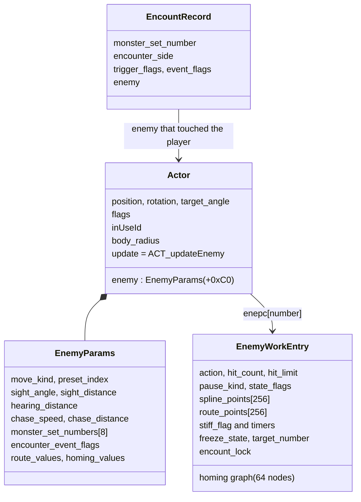
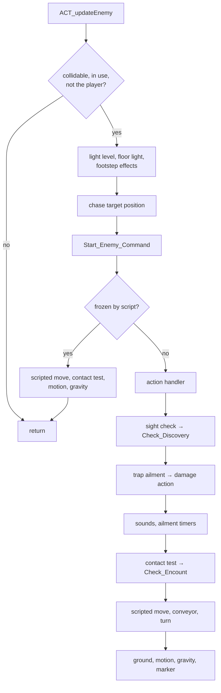
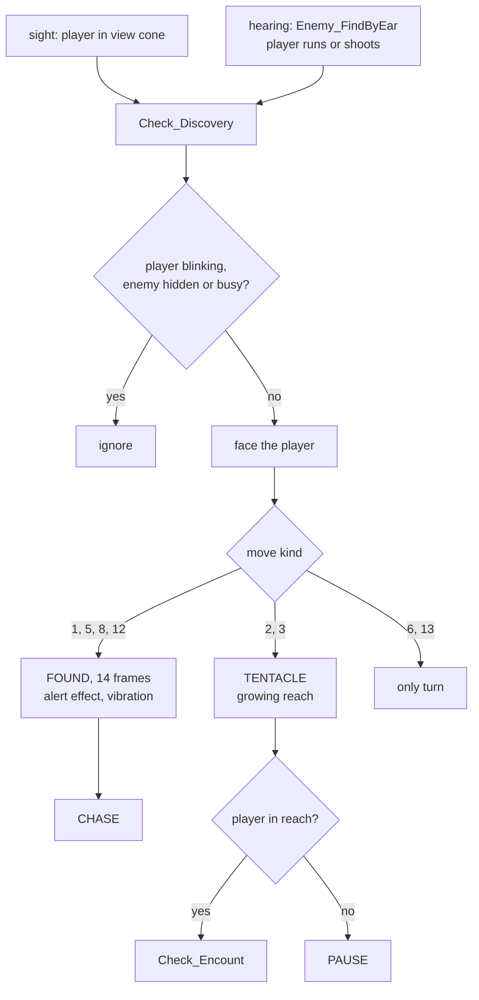
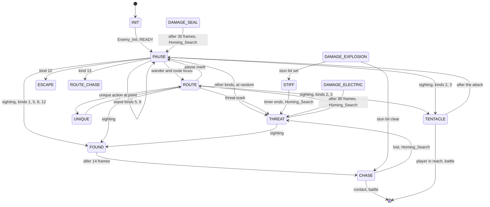
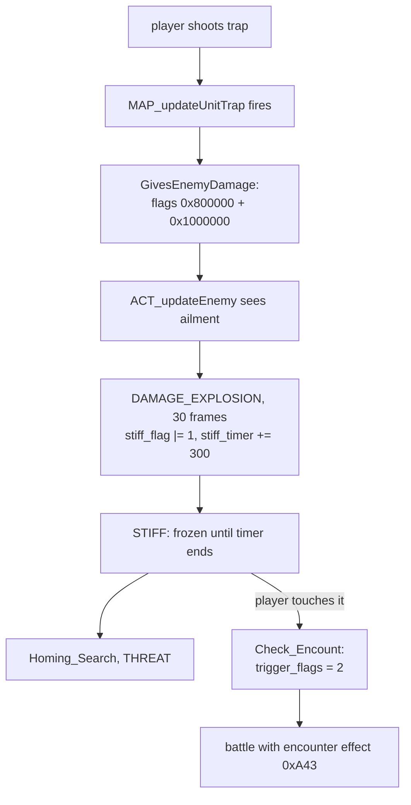
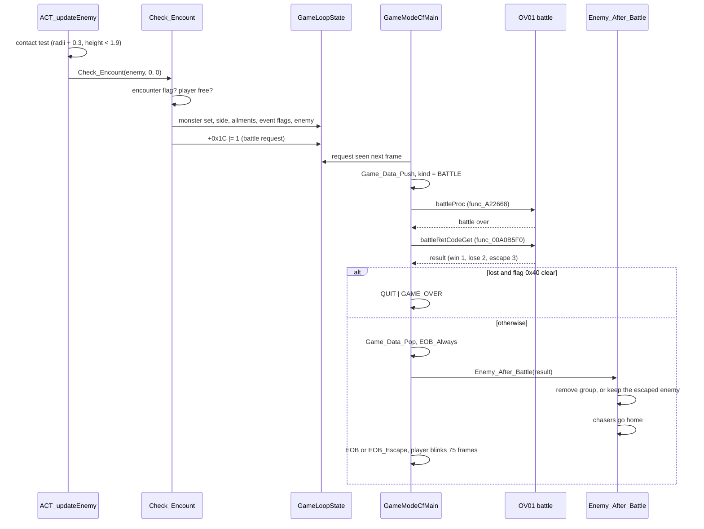

# Field enemies

In Xenosaga Episode I the enemies are visible on the field. They stand guard,
walk patrol routes, notice the player by sight or sound, give chase and start a
battle when they touch the player. Field traps can stun, shock or seal them
before that, and the trap's effect carries into the battle. This style is
usually called a symbol encounter: no random encounter code was found in the
field, so every battle starts from contact with a visible enemy or from a
script.

The enemy code is in `src/main/enemy_1.c`, `enemy_2.c`, `enemy_3.c`,
`enemy_system_init.c` and `set_motion.c`. The same code also drives the
people the player talks to. The battle itself runs in the OV01 overlay and is
described in [Battle](battle.md). The maps, traps and objects that enemies
interact with are described in [Maps and units](map-and-units.md), and the
field loop that starts the battle in [The field game](field.md). Motions and
skeletons are described in [Animation](../libraries/animation.md).

[← Back to the overview](../README.md)

## Source files

| File | Contents |
| --- | --- |
| `src/main/enemy_system_init.c` | Loading enemy data, presets, `ACT_createEnemy` |
| `src/main/enemy_1.c` | `enepc[16]`, `Enemy_Init`, the behaviour functions, `ACT_updateEnemy`, movement checks |
| `src/main/enemy_2.c` | The enemy command queue (`Start_Enemy_Command` and `Enemy_Command_*`) |
| `src/main/enemy_3.c` | `Enemy_ActionReady`, which starts an action |
| `src/main/set_motion.c` | Motion and sound helpers, sight and hearing, encounters, homing graphs, talk hooks |
| `src/main/pause_menu_page_enemy.c` | The enemy debug page of the pause menu |

## Enemies and NPCs

Every character on the field is an actor (see [Actors](../libraries/actors.md)).
Scripts create characters as objects of the Java class `xeno.Chr`. Objects of
its subclass `xeno.Enepc` become enemy actors, and plain `xeno.Chr` objects
are set up by `getPeer_Chr` instead. The name Enepc probably stands for "enemy
and NPC", because the same records and update function serve both. The
actor's id (`inUseId`) tells them apart. Ids `0x4000` to `0x4F22` are enemies, and only they react to trap
damage and use the enemy collision layer of the map. Other ids are NPCs.

An enemy is therefore made of three pieces of data:

- the **actor** in `actor[]`, with position, rotation, motion, model and
  flags,
- the **enemy parameters**, a block inside the actor at `+0xC0`
  (`struct EnemyParams`), which the script fills,
- the **enemy work record** `enepc[n]`, where `n` is the actor's number
  (`struct EnemyWorkEntry`, `0x38B0` bytes each, 16 records).

The class diagram below shows how they connect.



The player is actor 0 and also has an enemy work record, `enepc[0]`. The ladder
code keeps its state there, at the offset that enemies call `encount_lock`
(`+0x3830`). So when enemy code checks that the player's `encount_lock` is 0,
it really checks that the player is not on a ladder (see
[Ladders](map-and-units.md#ladders)).

## The enemy work record

`EnemyWorkEntry` in `include/main/enemy_1.h` holds everything an enemy needs
while it runs. Its most important fields are:

| Offset | Field | Meaning |
| --- | --- | --- |
| `+0x0000` | `locator_distance` | Reach of the tentacle attack |
| `+0x0006` | `locator_start_frame`, `locator_end_frame` | Frames in which the reach grows |
| `+0x000A` | `wall_attribute` | Territory number |
| `+0x0010` | `goback[4]` | Last step, undone when a move is blocked |
| `+0x0040` | `spline_parameter` | Position on the current path |
| `+0x0044` | `hit_count`, `hit_limit` | Frame counter and length of the current action |
| `+0x0048` | `action` | Current action (`ENEMY_ACT_*`) |
| `+0x0049` | `move_result` | Why the last move failed |
| `+0x004A` | `pause_kind` | Move kind (`ENEMY_MOVE_*`) |
| `+0x004E` | `stiff_timer`, `elec_timer`, `status_4_timer` | Countdowns of stun, shock and seal |
| `+0x0054` | `route_marks[2][8]`, `route_cursor[2]` | Where on the route to pause and threaten |
| `+0x0068` | `encounter_side`, `encounter_value` | Values for the encounter record |
| `+0x006A` | `stiff_flag` | Bits 1 stunned, 2 electrified, 4 sealed |
| `+0x006C` | `chase_frame_limit`, `chase_frame` | Chase time limit |
| `+0x0070` | `map_index` | Collision layer, `0x304` enemies, `0x300` NPCs |
| `+0x0080` | `spline_points[256]` | The path being followed |
| `+0x1090` | `route_points[256]` | The patrol route |
| `+0x2090` | `action_motion_table[256][4]` | Motions of the unique actions per route point |
| `+0x2890` | `motion_id_table[256][4]` | Lengths of those unique actions |
| `+0x30A0` | homing graph | 64 positions with up to 4 links each |
| `+0x37A2` | `freeze_state`, `turn_lock`, `target_number` | Script control |
| `+0x37B8` | `event_type` | Script id of the enemy |
| `+0x37C0` | `escape_target` | Chase target and scale animation |
| `+0x37E0` | `state_flags` | `ENEMY_STATE_FLAG_*` |
| `+0x37F0` | `last_player_position` | Where the player was last seen |
| `+0x3800` | `sac_move`, `turn` | Scripted move and turn |
| `+0x3830` | `encount_lock` | Ladder state, for the player's record |
| `+0x38A0` | `stiff_effect` | Effect of the current ailment |
| `+0x38AC` | `sense_block_timer` | Frames during which the enemy ignores the player |

The state flags configure an enemy:

| Flag | Name | Meaning |
| --- | --- | --- |
| `0x1` | `ENEMY_STATE_FLAG_ENCOUNTER` | Touching it starts a battle |
| `0x4` | `ENEMY_STATE_FLAG_BELT` | Moved by conveyor floors |
| `0x8` | `ENEMY_STATE_FLAG_TERRITORY_LOCK` | May leave its territory only while chasing |
| `0x10` | `ENEMY_STATE_FLAG_ALERT_RAISE` | Walks its route faster |
| `0x20` | `ENEMY_STATE_FLAG_AIRBORNE` | Follows the route's height instead of the ground |
| `0x100` | `ENEMY_STATE_FLAG_CUSTOM_BLEND` | Uses its own motion blend weight |
| `0x10000` | `ENEMY_STATE_FLAG_SCRIPT_ACTIVE` | A scripted move or turn runs |

## Loading enemy data

`Enemy_SystemInit()` runs when `Game()` starts. It clears the battle request
word and reads six files from `data\matumoto\` into memory at `WorkEnd`:

| File | Pointer | Contents |
| --- | --- | --- |
| `enemy.dat` | `AdrsEnemyPreset` | Default preset table, in an older record format |
| `spline.dat` | `AdrsEnemySpline` | B-spline weight table for paths |
| `bikkuri.lex` | `AdrsEnemyExclamation` | "!" marker model |
| `hatena.lex` | `AdrsEnemyQuestion` | "?" marker model |
| `maru.lex` | `AdrsEnemySphere` | Circle marker model |
| `sikaku.lex` | `AdrsEnemySquare` | Square marker model |

"Bikkuri" means surprise and "hatena" question mark in Japanese. "Maru"
means circle and "sikaku" square. The four models look like markers to show
above an enemy, but in the retail code only the debug displays draw them,
through `Debug_Mark` (see [Debug features](#debug-features)).
`Set_EnemyMark` stores a mark number in the enemy's work, but nothing calls
it. `Disp_EnemyMark`, which the enemy update calls when a mark is set, only
copies three of the model pointers into a local table and draws nothing. The
models are described in
[marker models](../formats/maps-and-field-data.md#marker-models).

A preset is a ready-made set of behaviour values, so that many enemies of the
same kind share one definition. The scene resource command `loadene NAME`
loads `data\matumoto\NAME.dat` with `Enemy_LoadPreset`, replacing the preset
table. When a scene archive is open, `command_loadene_sub` copies the next
file of the archive there instead (`next_arc_size`). The table starts with a
4-byte record count that the code never reads, and `AdrsEnemy` points at the
`0x50`-byte records after it (`struct EnemyPreset`). The 80 map presets
`MC_*.dat` and `people01.dat` use this layout. The start-up table `enemy.dat`
still has the 64-byte records of an older version, so only its first record
lines up with the `0x50` stride of the code. It is probably always replaced
by `loadene` before an enemy reads it. The record layout and the files are
in [field enemy presets](../formats/maps-and-field-data.md#field-enemy-presets). A preset holds the route
step length, chase distance and speed, sight angle and distance, hearing
distance, body radius, pause and threat intervals and durations, the move kind,
the chase frame limit, the initial motion, the tentacle reach and frames, and
the state flags.

## Creating an enemy

Scene scripts create enemies and NPCs as `xeno.Enepc` objects. When the script
asks `Toolkit.getPeer` for the object's engine side, `getPeer_Enepc` in
`src/main/toolkit.c` reads the object's `id` field, calls
`ACT_createEnemy(-1, id)`, sets up its motion and starts a script thread for
the object. It copies the object's position fields (`px`, `py`, `pz`) and
rotation fields into the actor, converting the rotation from degrees to
radians. Last it creates a `xeno.Light` object for the actor's light and
stores it in the Java object.

`ACT_createEnemy(number, id)` takes the first actor slot with id 0 when
`number` is negative. It fills the parameters with defaults:

| Parameter | Default |
| --- | --- |
| move kind | 1 (wander) |
| body radius | 0.35 |
| sight distance, sight angle | 4.0, 90 |
| hearing distance | 10.0 |
| chase distance, chase speed | 10.0, 0.07 |
| move speed | 0.15 |
| route step length | 15.0 |
| pause length, threat length | 30 and 20 frames |
| pause interval, threat interval | 4, 4 |
| tentacle reach and frames | 4.0, frames 5 to 25 |
| light level | 1000 (opaque) |
| monster sets | all -1 |

It also clears the homing graph and the action tables, sets the enemy's target
to the player, installs `ACT_updateEnemy` as the actor's update, and sets the
action to `ENEMY_ACT_INIT`. After creation the script fills the parameters it
needs with `Chr.setArgs`, which writes into the actor's argument area at
`+0xC0`.

On the first update `Enemy_Init` finishes the setup:

1. With a preset (`preset_index` not -1) it copies the preset's values into the
   parameters and the work record. Without one it uses the placement values.
2. It turns the route values (three floats per point) into route points. For
   the back-and-forth move kinds it appends the inner points in reverse, so the
   enemy walks the route forward and back as one loop.
3. It adds the homing positions given by the script (`Homing_Add`).
4. The route kinds 3, 8, 12 and 13 start on their route spline
   (`Set_Spline_By_Route`). All others start a random four-point spline at
   their position (`Set_Spline_By_Random`).
5. It places one pause mark and one threat mark at random positions on the
   route.
6. It selects the collision layer (`0x304` for enemy ids, `0x300` for others)
   and loads an extra motion set when one is given.
7. It starts the ready action, which plays the idle motion and switches to the
   pause action.
8. It calls the script method `Final_init` with the enemy's event type (100 for
   the player), so the scene script can finish its own setup.
9. It snaps the enemy to the floor.

## The per-frame update

`ACT_updateEnemy(actor)` is the update function of every Enepc actor. Each
frame it does the following:

1. Saves the position when the enemy stands on valid ground, counts down the
   sense block timer, and returns at once for actors that are not collidable,
   not in use, or the player.
2. Applies the light level: below 1000 the enemy becomes translucent with a
   transparency of `light_level / 1000`. It applies the floor light
   (`GameIdLightSet`).
3. While the enemy moves, it creates footstep effects (dust, splashes) for the
   floor under it from the `EfTab_*` tables, scaled by its size.
4. Updates the chase target: the player's ground position (`EnemyTarget`,
   written by the player's move code) or the position of another actor chosen
   by the script.
5. Runs the queued script commands (`Start_Enemy_Command`).
6. Applies a running scale animation and the head look-at.
7. If the script froze the enemy, it only runs the scripted move, the contact
   test, the motion and gravity, and returns.
8. Otherwise it runs the handler of the current action (see below).
9. Checks sight: when the player is inside the enemy's view cone,
   `Check_Discovery` reacts.
10. Switches to a damage action when a trap has hit the enemy.
11. Plays the enemy's movement sounds.
12. Counts down the shock and seal timers.
13. Tests contact with the player and starts an encounter (`Check_Encount`).
14. Runs the scripted move and turn, the conveyor push and the turn toward
    `target_angle`. A normal enemy turns a sixth of the remaining angle per
    frame, an electrified one a thirty-sixth.
15. Puts the enemy back to its last valid position if it left the ground,
    updates the motion, applies gravity and draws its marker.

The flowchart below shows this order.



## Behaviour

### Actions

The behaviour of an enemy is a state machine. `EnemyWorkEntry.action` holds
the current state, which the code calls an action. `Enemy_ActionReady(actor,
action)` in `src/main/enemy_3.c` starts one: it stores the action, resets
`hit_count`, sets `hit_limit` (the action's length in frames), and starts the
action's motion, sound and effects. Each frame the handler of the action counts
`hit_count` up and, at `hit_limit`, starts the next action. Actions only start
for actors with flag `0x10000`.

| Value | Name | Handler | Debug page text |
| --- | --- | --- | --- |
| 0 | `ENEMY_ACT_INIT` | `Enemy_Init`, then pause | Not initialized |
| 1 | `ENEMY_ACT_PAUSE` | `Enemy_Pause` | On alert: pose |
| 2 | `ENEMY_ACT_THREAT` | `Enemy_Threat` | On alert: intimidation |
| 3 | (turn) | none | On alert: turning |
| 4 | `ENEMY_ACT_ROUTE` | `Enemy_Route` | On alert: moving along route |
| 5 | `ENEMY_ACT_FOUND` | `Enemy_Found` | |
| 6 | `ENEMY_ACT_CHASE` | `Enemy_Chase` | |
| 7 | `ENEMY_ACT_STIFF` | `Enemy_Stiff` | |
| 9 | `ENEMY_ACT_UNIQUE` | `Enemy_Unique` | Unique action |
| 10 | `ENEMY_ACT_TENTACLE` | `Enemy_Tentacle` | |
| 11 | `ENEMY_ACT_DAMAGE_EXPLOSION` | `Enemy_Damage_Explosion` | Taking explosion damage |
| 12 | `ENEMY_ACT_DAMAGE_ELECTRIC` | `Enemy_Damage_Electric` | Taking electric shock damage |
| 13 | `ENEMY_ACT_DAMAGE_SEAL` | `Enemy_Damage_Seal` | Taking seal damage |
| 14 | `ENEMY_ACT_ESCAPE` | `Enemy_Escape` | Fleeing along route |
| 15 | `ENEMY_ACT_ROUTE_CHASE` | `Enemy_Route_Chase` | Pursuing along route |
| 16 | `ENEMY_ACT_READY` | (becomes pause) | |

The texts in the last column are the Japanese state names of the enemy debug
page, translated. Action 3 picks a random free direction and plays a turning
motion, but `ACT_updateEnemy` has no handler for it, so it is probably unused.

### Move kinds

`pause_kind` (the parameter `move_kind`) decides how an enemy moves between
pauses and how it reacts when it sees the player.

| Value | Name | Movement | On sighting |
| --- | --- | --- | --- |
| 1 | `ENEMY_MOVE_WANDER_A` | Random walk | Found, then chase |
| 2 | `ENEMY_MOVE_WANDER_B` | Random walk | Tentacle attack |
| 3 | `ENEMY_MOVE_ROUTE_A` | Patrol route | Tentacle attack |
| 4 | `ENEMY_MOVE_ROUTE_BACK_AND_FORTH_A` | Becomes 3 with a mirrored route | |
| 5 | `ENEMY_MOVE_STAND_A` | Stands still | Found, then chase |
| 6 | `ENEMY_MOVE_STAND_B` | Stands still | Only turns to the player |
| 8 | `ENEMY_MOVE_ROUTE_B` | Patrol route | Found, then chase |
| 9 | `ENEMY_MOVE_ROUTE_BACK_AND_FORTH_B` | Becomes 8 with a mirrored route | |
| 12 | `ENEMY_MOVE_ROUTE_THEN_ESCAPE` | Pauses, then flees along its route | Found, then chase |
| 13 | `ENEMY_MOVE_ROUTE_THEN_ROUTE_CHASE` | Pauses, then pursues along its route | Only turns to the player |

### Pause, threat and route

An enemy that has nothing to react to cycles through three actions.

**Pause** plays the idle motion for the pause length (30 frames by default).
Standing enemies turn to face the player when they have noticed it. When the
pause ends, a standing enemy pauses again, a wandering or patrolling enemy
returns to its route, and the escape and route-chase kinds start fleeing or
pursuing. Other kinds pick the route or a threat at random.

**Threat** plays motion 27, an intimidation pose, with the enemy's threat
sound, for the threat length (20 frames by default), then returns to the
route.

**Route** follows the current path. A path is a looping B-spline through up to
256 points, and `spline_parameter` advances 128 steps per point.
`GetBSplineLoop` evaluates the curve with the uniform cubic weights of
`spline.dat`, which holds five blocks of weights of which the code reads only
the middle one (see
[the B-spline weight table](../formats/maps-and-field-data.md#the-b-spline-weight-table)). At every
point the enemy checks three things in order:

1. If the script attached a unique action to this point, it runs it (see
   [Unique actions](#unique-actions)).
2. A cursor walks over the pause marks: every `pause_interval` points, one
   random point is marked, and reaching it starts a pause.
3. Threat marks work the same way with `threat_interval`.

Then the enemy moves to the next spline position and checks the move with
`TM_Check_Move`. A blocked enemy that is returning home searches its homing
graph again, a route enemy waits, and a wandering enemy uses `Check_Wall` to
find the free directions among 16 and starts a new spline in one of them.
Wandering enemies also keep extending their spline: at each point they add a
new one two points ahead, `route_step_length` away in a random free direction.
Airborne enemies get a random height of 3 to 5 units above the ground there.
The enemy walks or runs depending on how far the spline moved it this frame.
Alerted enemies (`ENEMY_STATE_FLAG_ALERT_RAISE`) advance the spline faster.

### Seeing and hearing the player

An enemy notices the player in two ways.

**Sight.** If `sight_distance` is not zero, `ACT_updateEnemy` tests every frame
whether the player is inside a view cone in front of the enemy
(`Check_InsideFan`, with `sight_distance` and `sight_angle`). A negative angle
puts the cone behind the enemy. Two special enemy ids use a variant of the
test (`Check_InsideFan_Wooo`). The test is skipped while the enemy is hidden,
during its sense block time and while the player is on a ladder.

**Hearing.** `Enemy_FindByEar(source, position)` is called when the player
runs and when the player's shot breaks an object. Every other actor with a
hearing distance that is not frozen and not blocked notices the noise when it
is within that distance. Holding L3 makes the function return at once, which
is probably a leftover debug switch that lets the player sneak.

Both lead to `Check_Discovery(enemy)`. It ignores the player while the player
blinks after a battle. It also ignores actors that are not in use, enemies
that are going home with a negative chase frame limit, and enemies that are
hidden, already reacting, stunned, damaged, initialising or fleeing.
Otherwise it sets the actor's face-the-player flag and starts the reaction of
the move kind (see the table above): the found action, the tentacle attack,
or nothing.

**Found** plays a surprise motion and sound for 14 frames, then starts the
chase. If the enemy can start battles and no alert effect is showing yet, it
creates effect 727 and gives a weak 30-frame vibration. The effect is kept in
`GameLoopState.effect`. The player's move code (`GameCfPlayerMove`) deletes it
once no enemy that can start a battle is in the found, chase or tentacle
action (`Check_EnemyFound`). The enemy also records where it saw the player.

**Tentacle** is a reach attack. The enemy plays motion 30 with effect 1681
attached. Between `locator_start_frame` and `locator_end_frame` (5 and 25 by
default) its reach grows from its body radius to `locator_distance` (4.0 by
default). Objects inside the reach are broken (`SendBrokenSignal`), and a
player inside it starts an encounter. Afterwards the enemy pauses.

The flowchart below shows the detection path.



### Chasing

`Enemy_ActionReady(actor, ENEMY_ACT_CHASE)` starts the chase. It sets the run
motion, the run sound, a random drift and actor flag `0x200000`, and clears
the homing flag.

`Enemy_Chase` runs each frame:

1. It runs toward the target at `chase_speed`. Close to it, or while
   electrified, it walks at two thirds of that speed.
2. It tests whether the way to the target is clear, both against the
   collision mesh (`Check_Undu`) and against map objects
   (`CrossPointUwamono`). With a clear view it heads straight for the player.
   With an object in the way it heads for the crossing point, and with a wall
   in the way it looks for a way around (`Check_MoveSquare`). It remembers the
   chosen point in `last_player_position`.
3. It steps toward that point (`TM_Enemy_Move_Step`). Airborne enemies also
   move toward the target's height.
4. The chase ends when the player is farther than `chase_distance`, when the
   enemy reaches the border of its territory (without the territory lock),
   when the chase frame limit runs out, or when the enemy is blocked close to
   the point it is heading for. Then the enemy clears its path, searches its
   way home (`Homing_Search`) and threatens. A chase frame limit of 0 means
   no limit.
5. While the chase goes on, the enemy prints which way it chose (straight,
   around a map object, or a new point) with the debug font.

### Escape and route chase

The move kinds 12 and 13 never leave their route. They use a finer spline with
32 steps per point. Each frame `Enemy_Escape` compares three positions on the
route: one step back, the current one and one step ahead. It moves to the one
farthest from the target. `Enemy_Route_Chase` does the same with the nearest
one. When the enemy stays where it is, it turns to face the target. Each step
sets a cooldown counter to 16. While the enemy stays put the counter runs
down, and the enemy keeps the run motion until it reaches zero. Then it
switches to the walk motion.

### Homing graphs

After a chase an enemy has to find its way back. Each enemy has a small graph
of up to 64 positions with up to four links each. The script gives it as the
enemy's homing values, four floats per node: the position and the index of
the node it links to (-1 for none). `Enemy_Init` adds each node with
`Homing_Add`, which links the two nodes in both directions.
`Refresh_Homing` rebuilds all links from the stored link targets.

`Homing_Search(enemy)` plans the way back:

1. It blocks sight and hearing for 60 frames (`sense_block_timer`), so the
   enemy does not turn around at once.
2. It sorts the nodes by distance and takes the nearest one that it can reach in
   a straight line (`Check_Straight_ID`, 32 steps).
3. From there it follows the links toward node 0, each time to a neighbour with
   a smaller index.
4. It builds a new spline from the enemy's position along these nodes, with a
   point every 5 units, sets the homing flag (`0x80000000`) and starts the
   route action.

When the enemy is three points from the end of the homing path,
`Enemy_Route` clears the homing flag and starts a new path. An enemy of move
kind 8 returns to its route. Every other kind starts a random walk, even
kind 3.

`Disp_Homing()` runs every frame from `Game()`. It is a debug editor for the
homing graph of the debug actor. The debug actor is chosen on the enemy page
of the pause menu and is the player by default, and the editor does nothing
while it is the player. Otherwise it uses the player's position as a cursor.
R1 clears the selection, square selects the nearest node or links the
selected node to it, a full analog press moves the selected node, cross
deletes it and circle inserts a new node. It marks every node with one of the
four marker models: "!" for the selected node, "?" for the nearest one, a
square for an unlinked node and a circle for a linked one.

### Territories and movement checks

`TM_Check_Move` checks every step and undoes it with the stored `goback` step
when it fails. The reason goes into `move_result`:

| Result | Reason |
| --- | --- |
| `0x40` | No ground under the new position, or the mesh blocks the way |
| `0x50` | Left the territory (territory lock set, not chasing) |
| `0x58` | Left the territory (no territory lock) |
| `0x60` | A map object is in the way |
| below 64 | The number of the actor in the way |
| 99 | Free |

A territory is a floor area. `wall_attribute` indexes `EneTerritoryID[]`, which
gives the floor attribute of the enemy's territory (see
[Floor attributes](map-and-units.md#floor-attributes)). An enemy may not leave
it. With `ENEMY_STATE_FLAG_TERRITORY_LOCK` it may leave only while chasing,
and without the flag even a chase stops at the border. Territory 0 means no
territory, and an enemy that is going home ignores its territory. When the
object in the way is breakable, the enemy breaks it (`SendBrokenSignal`).

### Unique actions

Scripts can attach special motions to route points with the command
`Enemy_Command_Action`, which writes into `action_motion_table`. When the
enemy reaches such a point, `Enemy_Unique` plays the motions of that point one
after another, each for its own length, and then returns to the route.

### The whole state machine

All transitions of the enemy AI fit in one picture. An enemy starts in the
init action and settles into the pause. From there the move kind decides
whether it stands, patrols, wanders, flees or pursues along its route. A
sighting or a noise leads to the found action and the chase, or to the
tentacle attack. A chase that fails ends in a threat, and the homing search
started with it brings the enemy back along its homing graph. Trap damage can
interrupt any of these actions (see [Trap damage](#trap-damage)), and each
damage action ends in a threat, a pause or the stiff action. Contact with the
player leaves the state machine and starts a battle from any action.

Most transitions happen when `hit_count` reaches `hit_limit`. The route action
switches at route points, the chase switches when it loses the player, and
the stiff action ends when its timer runs out. The escape and route-chase
actions have no exit of their own. They last until the script, a trap or a
battle changes them.

The state diagram below shows these transitions.



## Trap damage

Traps on the map hurt enemies around them (see
[Traps](map-and-units.md#traps)). `GivesEnemyDamage` sets an ailment flag
together with `ACTOR_FLAG_AILMENT_ACTIVE` (`0x800000`) on each enemy within
the trap's radius. In its next update, an enemy (ids `0x4000` to `0x4F22` only)
switches to the matching damage action:

| Trap | Actor flag | Damage action | Length | Then |
| --- | --- | --- | --- | --- |
| Explosion | `0x1000000` | `ENEMY_ACT_DAMAGE_EXPLOSION` | 30 frames | Stiff |
| Electric | `0x2000000` | `ENEMY_ACT_DAMAGE_ELECTRIC` | 90 frames | Threat, then home |
| Seal | `0x8000000` | `ENEMY_ACT_DAMAGE_SEAL` | 30 frames | Pause, then home |

Starting a damage action clears the actor flag again, replaces the enemy's
effect with a pair of damage effects (741 and 736, 740 and 735, or 742 and
737) and sets an ailment in `stiff_flag` with a timer:

- **Explosion** sets bit 1 and adds 300 frames to `stiff_timer`. It starts no
  motion of its own. After the 30 damage frames the enemy becomes **stiff**: `Enemy_Stiff` holds its animation
  at speed 0 until the timer runs out, then removes the effect, searches its
  way home and threatens. A stunned enemy does not notice the player.
- **Electric** sets bit 2 and adds 300 frames to `elec_timer`, with motion 29.
  While the bit is set the enemy chases only at walking speed and turns six
  times more slowly. When the timer runs out the bit is cleared, the effect is
  removed and the looping electric sound (`0x10008`) stops.
- **Seal** sets bit 4 and sets `status_4_timer` to 300 frames, with motion 28.
  When the timer runs out the bit is cleared and the seal sound (`0x1000B`)
  stops.

A fall trap sets the actor flag `0x4000000` instead, but no enemy reaction to
it was found in `ACT_updateEnemy`. The player's move code stops the looping explosion
and electric sounds once no enemy is burning or electrified any more
(`Check_EnemyBurn`, `Check_EnemyElec`).

The ailment bits matter when the battle starts. If the player touches an enemy
while it is stunned, electrified or sealed, `Check_Encount` turns the bits
into the encounter's trigger flags (stunned 2, electrified 1, sealed 4). The
battle shows a matching encounter effect for each set bit (`encountEffDisp`
in `src/ov01/entry_first_init.c`, effects `0xA42` to `0xA44`). Then
`calcCfEncount` in `src/ov01/calc.c` rewards the trap with a first strike.
For an electrified enemy it sets the wait count of every party member to 0
and calls `menuTimeSet(1)`. For a stunned enemy it sets the wait counts to 0
and adds one boost to each party member. The seal bit has no effect there, but
the battle AI can read the flags (see [Encounter data](battle.md#encounter-data)).

The flowchart below follows an explosion trap.



## Enemy commands

Scripts control an enemy through a command queue in the actor's argument area:
a count at `+0x120`, up to 16 command types at `+0x140` and five parameter
rows at `+0x180`. The script writes the queue with `Chr.setArgs`, probably
through helper methods of the `xeno.Enepc` class. At the start of every enemy
update `Start_Enemy_Command` runs all queued commands in order and empties the
queue.

| Type | Function | Effect |
| --- | --- | --- |
| 0–3 | `Enemy_Command_Motion` | Play a motion once (0, 2) or looped (1, 3). Types 2 and 3 also give a frame range and a speed in percent |
| 4 | `Enemy_Command_Freeze` | Set the freeze state |
| 5 | `Enemy_Command_Turn` | Set, clear or toggle the turn lock |
| 6 | `Enemy_Command_Type` | Set the move kind and run the pause logic |
| 7 | `Enemy_Command_Code` | Set the command code and rerun `Enemy_Init` |
| 8 | `Enemy_Command_Target` | Chase the player (100) or another actor by id |
| 9 | `Enemy_Command_LookAt` | Look at the player (100), another actor, or release (-1) |
| 10 | `Enemy_Command_Scale` | Scale to a percentage, at once or eased over frames |
| 11 | `Enemy_Command_Action` | Add a unique action to a route point |
| 12 | `Enemy_Command_Light` | Set, clear or toggle the light switch |
| 13 | `Enemy_Command_Stop_FreeFall` | Stop or allow free fall |
| 14 | `Enemy_Command_Encount` | Start an encounter with a given side |
| 15 | `Enemy_Command_Sac_Move` | Move to a point, at once or over frames |
| 16–18 | `Enemy_Command_Sac_Turn` | Turn around X, Y or Z, at once or over frames |
| 19 | `Map_Command_Ladder` | Set the direction, height and bottom exit of a ladder |

The last command has nothing to do with the enemy. It fills the ladder tables
of the map (see [Ladders](map-and-units.md#ladders)) and probably uses the
enemy queue only because it is a convenient way to pass four numbers to the
engine.

The freeze states hand the enemy to the script:

| State | Name | Effect |
| --- | --- | --- |
| 0 | `ENEMY_FREEZE_RELEASE` | Normal behaviour, saved animation speed restored |
| 1 | `ENEMY_FREEZE_SCRIPTED` | Behaviour stops, the script moves the enemy, animation runs |
| 2 | `ENEMY_FREEZE_STOP` | Behaviour and animation stop |
| 3 | `ENEMY_FREEZE_SLOW` | Animation at a slow fixed speed, only the motion sequence runs |

The scripted move and turn (`Enemy_Command_Sac_Move` and `Sac_Turn`) are
played by `Script_Action`, which interpolates the position or angle over the
given number of frames and starts a fresh spline at the end of a move.

## Talking NPCs

NPCs share this code, and two hooks prepare them for a conversation.
`Before_Talk` runs when a talk starts (from `src/main/script.c`) and
`After_Talk` when it ends (from `game.c`). Three bits of the actor's talk flags
select what they do: `0x1` switches to the talk motion and back, `0x4` makes
the actor look at the player and release the look-at afterwards, and `0x10`
freezes the actor for the script during the talk.

## Enemy sounds

Each enemy model can have a sound bank. The scene resource commands `enese`
and `npcse` in `src/main/res_get_path.c` register one: they take the model,
the sound file and a footstep pattern number, load the sound bank and store
the entry in `EnemySeBank[8]`. `enese` marks the bank as an enemy bank (type
0) and `npcse` as an NPC bank (type 1). `RES_GetEnemySeBank(inUseId)` finds the
bank of an actor. Sounds are numbered from the bank start:

| Offset | Sound |
| --- | --- |
| 1 | Idle (pause) |
| 2, 3 | Walk, second step |
| 4, 5 | Run, second step |
| 6 | Found |
| 7 | Threat |

`EnemySound(actor, index, play, ignore_type)` plays one at the enemy's
position on channel `number + 1`, unless the enemy is hidden. The two bank
types sound different:

- For NPC banks, `Sound_FootStep` plays step sounds in time with the walk and
  run animations during the route and chase actions, using the frame
  thresholds in the `FootStep` table. `EnemySound` refuses the plain walk and run sounds for these banks
  unless the caller asks it to ignore the type.
- For enemy banks, `ACT_updateEnemy` loops the walk sound (offset 2) during
  the route action, once the scene has run for three frames, and the run sound
  (offset 4) during the chase. It stops each loop when the action ends.

`EnemySound_Stop` fades out one enemy's channels 1 to 7 with a fade length of
300, or stops them at once. `EnemySound_StopAll` does that for all 16 enemies
and also stops the three damage sounds. It is called when the field system is set up
(`InitCfSystem`), when the field sound banks are purged
(`GameCFSoundMenuPurge`) and when a script starts a screen fade
(`Stage.setFade`). Sound banks and channels are described in
[Audio](../architecture/audio.md).

## Starting a battle

### Contact

`ACT_updateEnemy` tests contact every frame, also while the enemy is frozen.
The enemy touches the player when both are within their body radii plus 0.3
units, less than 1.9 units apart in height, the player is not blinking after a
battle, the player is not on a ladder, and the debug mode is off (see
[Debug features](#debug-features)). Then
`Check_Encount(enemy, 0, 0)` runs. The tentacle attack calls it when the player
is inside the reach, and the script command `Enemy_Command_Encount` calls it
directly with its own side value.

`Check_Encount` does nothing for an enemy without
`ENEMY_STATE_FLAG_ENCOUNTER`, so NPCs and harmless creatures can be touched
freely. It also does nothing while a floor script runs or the player is locked
(`GAME_FLAG_ENTERED_SCRIPT` and `GAME_FLAG_PLAYER_LOCK`, see
[Game flags](field.md#game-flags)). Otherwise it fills the encounter record
and requests the battle. The script command and the battle native
`Runtime.execBattle` are the only other ways into a battle. No random
encounter code was found in the field.

### The encounter side

`Check_Encount` measures two angles: where the enemy is as seen from the
player's facing, and where the player is as seen from the enemy's facing. Each
is classified as front (within 70 degrees), side, or back (beyond 150
degrees). The side value is then:

| Player seen from the enemy | Enemy seen from the player | Side |
| --- | --- | --- |
| front | front | 0 |
| front | side | 1 |
| front | back | 2 |
| side | any | 3 |
| back | any | 4 |

The value probably decides who has the advantage at the start of the battle:
the enemy catching the party from the side or back (1 and 2) or the party
catching the enemy from the side or back (3 and 4). No reader of the value in
the battle code was identified.

### The encounter record

The request lives in `GameLoopState` (see [field](field.md#gameloopstate)).
The 16-byte record at `+0x29F90`:

```
GameLoopState + 0x29F90  encounter record
+0x0  monster_set_number   short   which enemy group to fight
+0x2  (map number)         short   battle stage, not written here
+0x4  encounter_side       short   0 to 4, see above
+0x6  trigger_flags        u8      ailments: 1 shock, 2 stun, 4 seal
+0x7  event_flags          u8      low byte of encounter_event_flags
+0x8  entry_value          short   the enemy's encounter_value
+0xC  enemy                Actor*  the enemy that touched the player
```

An enemy can list up to eight monster sets in `monster_set_numbers`.
`Check_Encount` counts the entries that are not -1 and picks one of the first
that many at random, so the script must fill the list from the front. A
monster set number identifies the group of monsters the battle loads. The
battle reads it with `monsSetNoGet`, the map number with `mapNoGet`, the
trigger flags with `cfEncountGet` and the event flags with `cfEventGet` (all
in `src/ov01/battle_init.c`). `Check_Encount` does not write the map number.
Only the script native `Runtime.execBattle` sets it, and the battle can
replace it with the map number of the monster set. The meaning of each event
flag is listed in
[Encounter data](battle.md#encounter-data). Event flag `0x40`, for example,
means that losing the battle does not end the game.

Finally `Check_Encount` sets bit 0 of `GameLoopState + 0x1C`, the battle
request. The item get tasks clear that word every frame while their window is
open, so no battle can start while the "obtained" window shows.

### From contact to battle and back

On the next frame `GameModeCfMain` sees the request, saves the field and runs
the battle in OV01. The steps are described in
[Battles started from the field](field.md#battles-started-from-the-field).
When the field comes back, `Enemy_After_Battle(result)` cleans up. A win
passes 1, an escape 3, and a loss that does not end the game is handled like
a win.

- After a **win** the enemy is switched off (`active_state = 0`) together with
  up to four linked actors, so a whole group disappears. An enemy whose first
  link is -2 stays.
- After an **escape** the enemy stays on the map. Its actor field `+0x696` is
  set to 16. The motion update counts this field down and does not blend
  motions while it runs, so the enemy probably switches to its next motion
  without blending from its pose before the battle.
- In both cases every encounter enemy that is still chasing gets a fresh path,
  threatens and goes home. Running shock and seal timers end on the next
  frame, and stunned enemies wake up.

Unless a script has switched to the CF event mode meanwhile, the field then
makes the player blink for 75 frames. Enemies ignore a blinking player, which
gives the player time to walk away.

The sequence below shows the whole encounter flow.



## Debug features

The enemy code contains several development aids.

The main one is the variable `FLAG_FRAME_60`, defined in
`src/main/Undulate.c`. The enemy page of the pause menu
(`src/main/pause_menu_page_enemy.c`) cycles it through three values with
START and gives a strong vibration each time:

| Value | Page text | Effect |
| --- | --- | --- |
| 0 | | Normal play |
| 1 | "Welcome to the 60-Frame world!" | Debug mode, and the render loop waits for one vertical sync per frame instead of two, so the game runs at 60 frames per second |
| 2 | "30-Frame Debug Mode" | Debug mode at the normal 30 frames per second |

Any value other than 0 turns on these enemy debug features:

- Every enemy draws its body radius as a pillar (`DispPillar`).
- Touching an enemy does not start a battle.
- Holding L3 stops `Check_Discovery` after the enemy turns to the player, so
  enemies notice the player but do not react.
- Pressing L2 resets every enemy to a new path from where it stands, a threat
  and a homing search.
- While L2 is held, enemies treat the actor selected with L2 and L1 as the
  player. Holding L2 and pressing L1 makes the next live actor the controlled
  actor (`NowTester`, see [CF main](field.md#cf-main-free-field-control)).
- Event locators in `src/main/call_java_method.c` draw circle locators as
  pillars, and holding L3 turns their checks off.
- While a tentacle attack is in its reach frames, `Enemy_Tentacle` draws a
  ring of 64 `maru` markers (`Debug_Mark`) around the enemy, at the radius
  the reach has grown to.

`Debug_Mark` in `src/main/pause_menu_page_enemy.c` is the only function that
draws the four marker models. Other aids do not depend on the flag:

- `ACT_updateEnemy` prints the animation values of the debug actor
  (`DebugActor`), and `Enemy_Chase` prints which way it chose.
- `Disp_Homing` is the homing graph editor described above.
- `Enemy_FindByEar` ignores all noise while L3 is held, in every mode.

The pause menu pages are described in [Debug tools](debug-tools.md).
