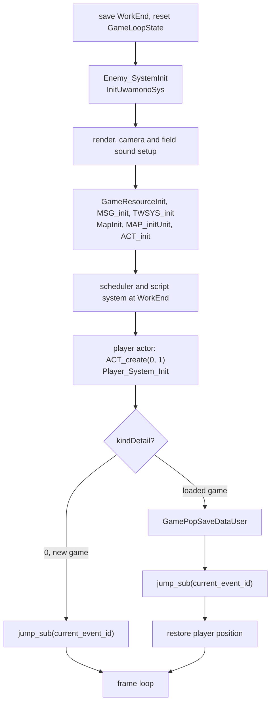
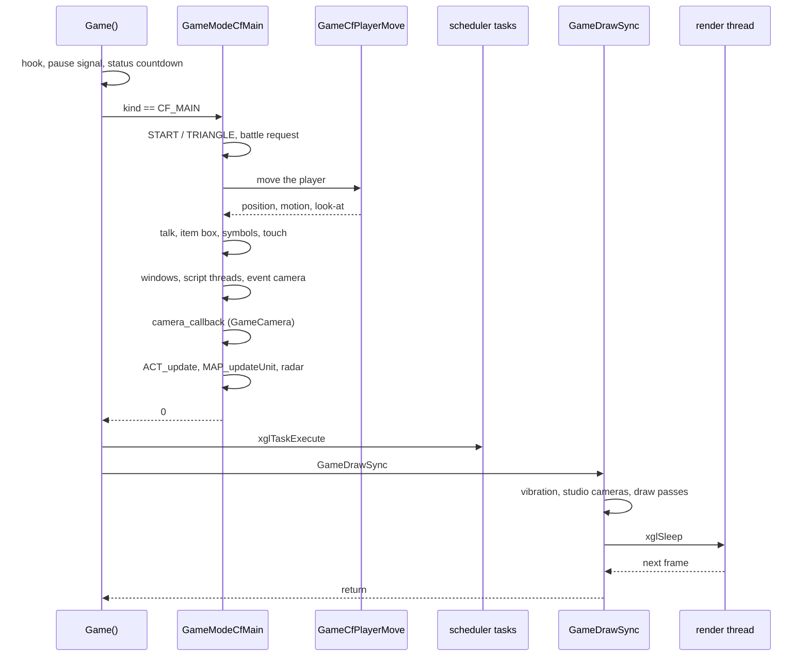
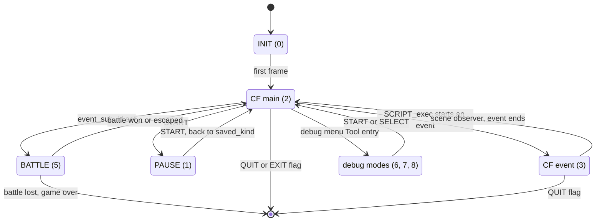
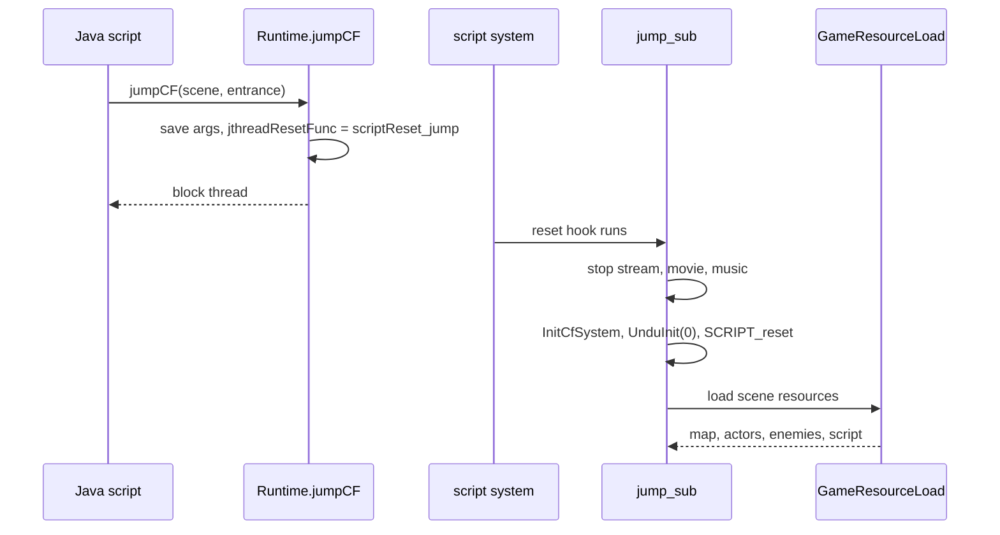
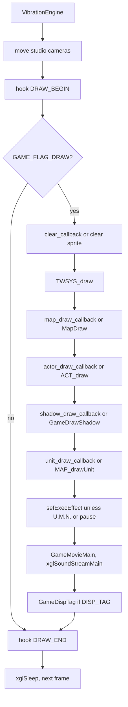
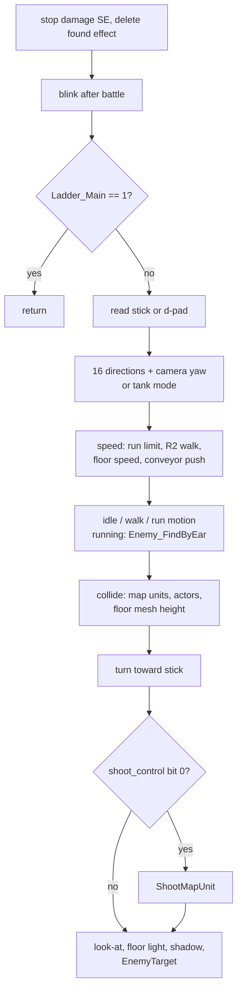
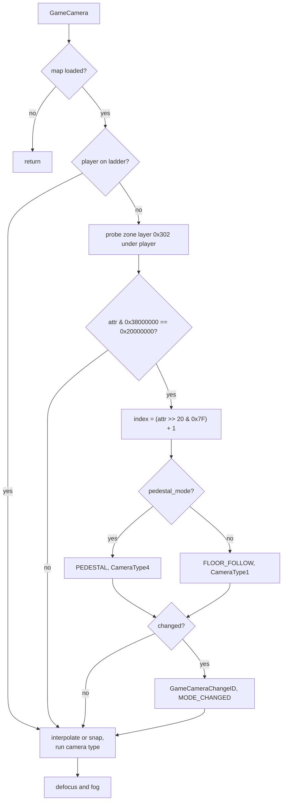
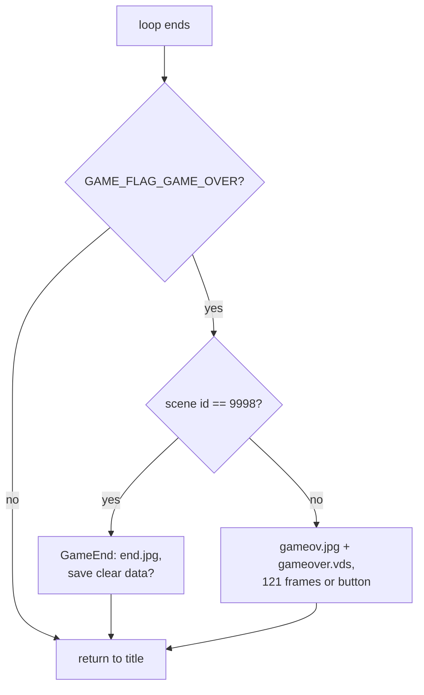

# The field game

The field is the part of Xenosaga Episode I where the player walks through
maps, talks to people, opens item boxes, saves at save points and runs into
enemies. All of it runs inside one function, `Game()` in `src/main/game.c`.
Free field control, scripted events, the pause screen and even battles are
modes of that one loop. The battle code lives in the OV01 overlay, which stays
loaded during play, and the field calls it like a normal function.

The source code calls field play "CF". The maps and the objects placed on them
(doors, item boxes, traps, save points) are described in
[Maps and units](map-and-units.md), and the enemies that walk the maps in
[Field enemies](field-enemies.md).

[← Back to the overview](../README.md)

## Source files

| File | Contents |
| --- | --- |
| `src/main/game.c` | `Game()`, the mode handlers, `GameDrawSync`, state push and pop, talk, item box and symbol checks |
| `src/main/look_at_player.c` | Player setup (`Player_System_Init`), movement (`GameCfPlayerMove`), the player's look-at, the leader's model files |
| `src/main/game_camera.c` | The field camera (`GameCamera`) |
| `src/main/game_init_camera.c` | An older camera setup, pad and debug print helpers |
| `src/main/game_radar.c` | The radar |
| `src/main/game_bg_draw_type.c` | Background draw types, light presets table |
| `src/main/game_id_light_set.c` | Lights chosen by the floor under an actor |
| `src/main/game_pause_disp.c` | The pause screen |
| `src/main/game_over.c` | Game over, the ending screen, chapter intermissions |
| `src/main/game_disk_change.c` | The disc change prompt |
| `src/main/game_movie.c` | Movies inside a scene and full-screen MPEG2 movies |
| `src/main/vibration.c` | Controller vibration |
| `src/main/game_snap_shot.c` | Screenshot helpers |

`src/main/pp_init.c` sounds like player code but is not. It holds a small
particle helper (`ppInit`, `ppMove`, `ppCheckWall`) used only by the test
files `colli_test.c`, `hair_test.c` and `wind_test.c`.

## What "CF" means

The abbreviation appears all over the field code: `GameModeCfMain`,
`InitCfSystem`, `GameCFSoundReload`, `CfCameraDefine`, `sefInitEffectCf`,
`Runtime.jumpCF` and `Stage.setCFBG`. The code never spells it out, but the
script ids show what it covers.

Every scene of the game has a 32-bit id, kept in
`GameLoopState.current_event_id`. Ids below `SCRIPT_ID_EVENT_BASE`
(`0x10000000`) are field scenes, and the debug menu names their script files
`cfNNNN`. Ids from `0x10000000` up are event scenes (cutscenes), named
`evNNNN`. "CF" is therefore the field side of the game, as opposed to events
("ev") and battles.

Two game modes carry the name. **CF main** is free field control, where the
player moves. **CF event** is the field running under a script, for a cutscene
or a scripted moment inside a field scene. Both modes share the same map,
actors and units, so an event can start and end without loading anything.

## GameLoopState

`GameLoopState` is a single global record of `0x2A030` bytes that holds the
state of the whole play session. It is not declared once. Each source file
declares a "view" struct that names only the bytes it uses, so the same offset
can carry different names in different files. For example, `game.c` calls the
byte at `+0xC1` `move_mode`, while `game_camera.c` calls it `camera_flags`,
which is what it really holds.

The most important fields are shown below, with the name used in `game.c`
where one exists.

```
GameLoopState (0x2A030 bytes)
+0x00000  saved_work_end       WorkEnd when Game() started
+0x00004  controlled_actor     the player actor ("player" in other files)
+0x00008  scheduler            per-frame task list
+0x0000C  kind, kindDetail     game mode and sub-mode (u16 each)
+0x00010  flags                GAME_FLAG_* bits
+0x00014  base_flags           second word, read with flags as one u64
+0x00018  current_event_id     scene id (cf below 0x10000000, ev above)
+0x0001C  event_sub_id         non-zero = a battle is requested
+0x00020  shoot_control        bit 0 enables shooting at map units
+0x00028  camera_callback      field camera, run each frame
+0x0002C  clear_callback       replaces the screen clear (background types)
+0x00030  map_draw_callback    replaces MapDraw
+0x00034  actor_draw_callback  replaces ACT_draw
+0x00038  shadow_draw_callback replaces GameDrawShadow
+0x0003C  unit_draw_callback   replaces MAP_drawUnit
+0x00040  frame_hook(stage)    optional hook, called 4 times per frame
+0x00050  map_number           current map, -1 for none
+0x00054  model                scene model resource (map parts)
+0x00060  params[8]            script parameters (saved with the game)
+0x000B8  frame_countdown
+0x000C0  camera_mode, camera_flags, camera_id, camera_index
+0x00164  hidden_parts[32]     bitmask of hidden map parts
+0x001F0  saved player flags, state, position, rotation, map number
+0x00250  saved_actors[64]     actor copies for Game_Data_Push/Pop
+0x29E50  saved_light
+0x29F40  status               input lock countdown in frames
+0x29F44  shoot_range
+0x29F50  debug_menu           16 bytes, the first one is pause_mode
+0x29F60  saved_kind           mode to return to after pause
+0x29F90  encounter record     monster set, side, flags, enemy (16 bytes)
+0x29FA0  ladder tables        direction, bottom exit, height (16 each)
+0x2A000  vibration state
+0x2A014  effect               shared "enemy found" effect
+0x2A018  user_word            scene id saved before a U.M.N. simulation
+0x2A020  user_longs[2]        player position saved at the same time
```

The encounter record is explained in
[Field enemies](field-enemies.md#the-encounter-record), and the ladder tables
in [Maps and units](map-and-units.md#ladders).

## Starting a session

The title screen ends by returning the address of `Game()` with OV01 as the
overlay to load (see the [overview](../README.md)). Before that it has already
set `current_event_id` to the first scene of a new game, or loaded a save and
set `kindDetail` to a non-zero value.

`Game()` then prepares the field step by step:

1. It records `WorkEnd` in `saved_work_end`, so everything the session
   allocates can be released at the end. Memory and `WorkEnd` are described in
   [Memory](../architecture/memory.md).
2. It resets the state: no map (`map_number = -1`), no frame hook, no draw
   callbacks, mode `GAME_MODE_INIT`, and `flags = GAME_FLAG_DRAW | 0x300`. Bit
   `0x100` lets the display on and off tasks work and bit `0x200` lets the map
   loader task work (see [Maps and units](map-and-units.md#loading-a-map)).
3. It loads the enemy system data (`Enemy_SystemInit`) and the resident map
   object models (`InitUwamonoSys`).
4. It resets rendering, fades and the clear colour, selects studio 0, resets the
   field camera (`GameCameraReset`) and loads the field sound banks
   (`GameCFSoundReload`).
5. It creates the resource pool (`GameResourceInit`), the message and window
   systems (`MSG_init`, `TWSYS_init`), the map (`MapInit`), the 64 map unit
   records (`MAP_initUnit`) and the actors (`ACT_init`).
6. It turns off depth-of-field blur, sets background type 0, runs the OV01
   battle setup function `func_A22628` and clears the field effects.
7. It allocates the frame scheduler (`xglTaskInitial`, 64 tasks) and the script
   system (`SCRIPT_init`) at `WorkEnd`.
8. It loads the radar texture, sets the player's default walk and run speeds,
   creates the player actor in slot 0 (`ACT_create(0, 1)`) and initialises it
   (`Player_System_Init`). Input is locked for 16 frames.
9. It jumps to the scene `current_event_id` with
   `Java_xeno_util_Runtime_jump_sub`. For a loaded game it first restores the
   saved data (`GamePopSaveDataUser`), then puts the player back at the saved
   position and sets camera flags `0xA0`, which make the camera snap to the
   player.

The diagram below shows this order.



The jump itself is described in [Changing scenes](#changing-scenes).

## The frame loop

After the setup, `Game()` runs one loop pass per frame. Each pass does the
following:

1. Calls `frame_hook(GAME_HOOK_FRAME_START)` if a hook is installed. No shipped
   code installs one, so this is probably a development aid. The hook is also
   called with `GAME_HOOK_DRAW_BEGIN`, `GAME_HOOK_DRAW_END` and
   `GAME_HOOK_FRAME_END` inside `GameDrawSync`.
2. Tells the model library whether the game is paused
   (`nmlModelSendPauseSignal`).
3. Counts down the script's scene change timer (`SCRIPT_sceneChangeTimeDec`).
4. Runs `Disp_Homing`, a debug editor for enemy return paths that does nothing
   in normal play (see [Field enemies](field-enemies.md#homing-graphs)).
5. Counts `status` down. While `status` is not zero, the pause and menu buttons
   are ignored. This stops one button press from being seen twice when a
   screen opens or closes.
6. Runs the handler of the current mode (`GameLoopState.kind`).
7. Leaves the loop if `GAME_FLAG_QUIT` or `GAME_FLAG_EXIT` is set.
8. Runs the frame's tasks with `xglTaskExecute(GameLoopState.scheduler)`. Map
   loading, display on and off, event timers and many script tasks run here.
9. Calls `GameDrawSync()`, which builds the frame's draw packets and waits for
   the next frame.

The diagram below follows one frame of free field control, from the mode
handler to the frame switch.



When the loop ends, `Game()` stops the sound stream and any movie, clears
depth-of-field and effects, resets the CD queue and the culling map, releases
the field sound banks, resets the script timers, fades and studio camera,
rebuilds the model library and restores `WorkEnd`. If `GAME_FLAG_GAME_OVER` is
set it then shows the game over screen (`GameOver`). Finally it sets the mode
back to `GAME_MODE_INIT`, waits two frames and returns to the control thread,
which runs the title screen again.

## Game modes

`GameLoopState.kind` selects what the loop does each frame. The values are in
`include/main/game.h`.

| Value | Name | Handler | Meaning |
| --- | --- | --- | --- |
| 0 | `GAME_MODE_INIT` | none | First frame, switches to CF main |
| 1 | `GAME_MODE_PAUSE` | `GameModePause` | Pause screen |
| 2 | `GAME_MODE_CF_MAIN` | `GameModeCfMain` | Free field control |
| 3 | `GAME_MODE_CF_EVENT` | `GameModeCfEvent` | Field under a script |
| 5 | `GAME_MODE_BATTLE` | none | Set while a battle runs |
| 6 | `GAME_MODE_EVT_DEBUG` | `GameModeEvtDebug` | Event debug mode |
| 7 | `GAME_MODE_EVT_TOOLS` | `GameModeEvtTools` | Event tools (lights editor) |
| 8 | `GAME_MODE_DEBUG_MENU` | `GameModeDebugMenu` | Debug menu |

The switch in `Game()` has no case for `GAME_MODE_BATTLE`. A battle runs from
start to end inside one call of `GameModeCfMain`, so the loop never sees that
value. Other code reads it to know that a battle is in progress.

The modes change in these places:

- The first frame turns `GAME_MODE_INIT` into CF main.
- START in CF main enters pause, and START in pause returns to `saved_kind`.
- `SCRIPT_exec` and `SCRIPT_exec2` in `src/main/script.c` set CF event when they
  start an event scene and CF main for a field script. The scene observer task
  sets CF main again when the event ends. Events are described in
  [Events](../scripting/events.md).
- A battle request in CF main sets `GAME_MODE_BATTLE` for the length of the
  battle, then the field state is restored.
- The script debug menu's "Tool" entry sets mode 7. No code that sets modes 6
  and 8 was found, so they are probably reached only from development builds.

The state diagram below shows these transitions.



Every mode handler accepts START together with SELECT, L1 and R1
(`GAME_PAD_COMBO`) and sets `GAME_FLAG_QUIT`. This is the soft-reset
combination that returns to the title screen.

### CF main: free field control

`GameModeCfMain` is the heart of field play. Each frame it does these steps in
order.

**Pause and main menu.** It clears `GAME_FLAG_PAUSE` and adds one to the
script's field timer (`SCRIPT_incCfTime`). START and TRIANGLE are only honoured
when nothing blocks them: no talk point lock, look-at, item hold or script end
flag, no open window, no scene change timer, no script entered, the player not
on a ladder, the CD queue idle, talking not ignored and `status` at zero.

- START plays sound effect 4, sets `GAME_FLAG_PAUSE`, saves the current mode in
  `saved_kind`, enters `GAME_MODE_PAUSE` and pauses the play time counter
  (`PartyTimePauseStart`).
- TRIANGLE locks input for 32 frames, saves the camera and light, tells the
  model library that a menu starts and calls `MainMenu()`. The menu runs its
  own loop (see [Main menu](main-menu.md)). When it returns, the camera and
  light are restored.

Two menu results start a field jump instead of returning to the map. A U.M.N.
Simulation (`UmnSimulationNo`) and the Driller Game (`MenuDrillCall`) both save
the current scene id in `user_word` and the player position in `user_longs`,
then call `Runtime.jumpCF`. A simulation jumps to the scene in the low 16 bits
of `UmnSimulationNo` with the entrance in the high bits. The Driller Game jumps
to scene `0xA0`, entrance 1. Both therefore run as field scenes, and the saved
values let the scene send the player back afterwards.

**Battle request.** When `event_sub_id` is not zero, an enemy has asked for a
battle. The steps are described in [Battles started from the field](#battles-started-from-the-field).

**Debug actor switch.** When the enemy debug flag `FLAG_FRAME_60` is set, L2
held with L1 pressed makes the next live actor the controlled actor. The flag
is described in [Field enemies](field-enemies.md#debug-features).

**Look-at changes.** When the look-at flag has just been cleared, the player's
sequence is cleared and its facing restored. When it has just been set, the
player starts looking at its target.

**Player control.** If the player is not holding an item (`ACTOR_HOLD`) and not
in a look-at, `GameCfPlayerMove` moves the player and `checkTalkPoint` handles
the CIRCLE button. During a look-at, `Actor_LookAt` turns the player instead.

**Floor scripts.** `checkAttr` reads the floor attribute under the player. When
bits 8 to 12 hold a number and bits 13 to 15 are clear, it runs the entered
script `SCRIPT_execEntered(number - 1)`. This is how stepping on a marked floor
area starts a script.

**Talk turning and touch.** The owner of an open message window turns to face
the player if its script asked for it. `checkTouch` runs a "touched" script
when the player walks into an actor that has one (see
[Talking, item boxes and symbols](#talking-item-boxes-and-symbols)).

**Symbols.** `CheckGameSymbol` tracks whether the player stands on a save,
shop, EVS or return symbol.

**Updates.** It updates the windows (`TWSYS_update`), the script threads
(`JTHREAD_cntl`) and the event camera (`TCAMERA_update`), and runs the field
camera callback when studio camera 0 is in its game state. Then it updates the
actors (`ACT_update`). While the player holds an item or actors are paused, it
only counts down the enemies' stiff and effect timers and calls
`ACT_pauseUpdate`. Last come the map units (`MAP_updateUnit`) and the radar
(`GameRadarDraw`).

### CF event mode

`GameModeCfEvent` is much shorter. It clears the pause flag, checks the
soft-reset combination, then updates windows, script threads, the time chart
player (`PLAY_ctrl`), the event camera, actors and map units. There is no
player control, no talk check and no camera callback. The script moves
everything. Time charts are described in
[Scenes and time charts](../scripting/scenes-and-timecharts.md).

### Pause mode

`GameModePause` waits for START, which plays sound effect 4, returns to
`saved_kind` and restarts the play time counter (`PartyTimePauseEnd`). Until
then it updates the windows and runs `PauseMenu()`. If the saved mode was a
field mode, `ACT_pauseUpdate` keeps the actors' pause animation alive. The
field camera keeps running, so the view stays correct. The screen itself is
described in [The pause screen](#the-pause-screen).

### Debug and tool modes

`GameModeEvtTools` runs `EvtTools()` from `src/main/db_light_write.c`, a light
editing tool. `GameModeEvtDebug` only updates windows and the camera.
`GameModeDebugMenu` runs `GameDebugMenu()` and returns to `saved_kind` on
SELECT. These tools are described in [Debug tools](debug-tools.md).

## Battles started from the field

A battle starts when `GameLoopState.event_sub_id` (offset `+0x1C`) is not zero.
Enemies set bit 0 of that word when the player touches them (see
[Field enemies](field-enemies.md#starting-a-battle)). `GameModeCfMain` then
does the following:

1. `Game_Data_Push()` saves the field: the mode, camera, light, actors and the
   player's state.
2. It sets `kind = GAME_MODE_BATTLE`, tells the model library that a battle
   starts, and stops the sound stream and all vibration. Then it calls the
   OV01 function `battleProc` (`func_A22668`), which runs the whole battle and
   returns when it is over. The battle is described in [Battle](battle.md).
3. It sets `GAME_FLAG_BATTLE`, resets messages and windows and clears
   `model`. Then it reads the result with the OV01 getter `battleRetCodeGet`
   (`func_00A0B5F0`).
4. If the result is a loss (2) and bit `0x40` of the encounter's event flags is
   clear, it sets `GAME_FLAG_QUIT | GAME_FLAG_GAME_OVER` and returns. The loop
   ends and `Game()` shows the game over screen. With bit `0x40` set, a lost
   battle simply returns to the field, which probably serves scripted battles
   that the story lets the party lose.
5. Otherwise `Game_Data_Pop()` restores the field. The script method
   `EOB_Always` is called with the enemy's script id. A win (1) then calls
   `Enemy_After_Battle(1)` and the script method `EOB`. An escape (3) calls
   `Enemy_After_Battle(3)` and `EOB_Escape`. Any other result is handled like a
   win without a script call.
6. Unless a script switched to CF event meanwhile, the player blinks for 75
   frames (`flash_timer`). Enemies ignore a blinking player, which gives time
   to walk away. The player's look-at is reset and the map units are updated
   once.

Scripts can also start battles directly with `Runtime.execBattle(map,
monsterSet)`. It writes both numbers into the encounter record, saves only
the light game state (`GameStateSave`), calls `battleProc`, rebuilds the actor
scene, fades back in and calls `GameStateRestore`. It does not read the battle
result (see [How a battle starts](battle.md#how-a-battle-starts)).

## Saving and restoring the field state

The field state is saved and restored in two situations: around a battle or
minigame, and in a save file.

`Game_Data_Push` and `Game_Data_Pop` keep the field in memory while another
screen uses the machine. `GameStateSave` records `kind` in `restoreKind`, the
player's flags, state, position, rotation and map number, and the camera and
light (`GameStateSaveCameraLight`). The push also copies all 64 actors into
`saved_actors`. The pop is more work, because the other screen has replaced
most resources:

1. It hides all map units by setting their serial to -1 for a moment, waits for
   the CD queue, reloads the field sound banks and effects and reloads the
   scene's resources (`GameResourceLoad(current_event_id)`).
2. It restores the mode, camera and light (`GameStateRestore`) and the broken
   state of breakable objects (`GameStateRestoreKoware`).
3. It copies the actors back and steps their motion twice so their poses are
   rebuilt. It restores the effects.
4. It clears the symbol flags, unlocks map units, removes map object effects
   and hides the map parts listed in `hidden_parts`.
5. It sets player status bit `0x1000`, clears the motion freeze, talk lock and
   battle flags, and sets camera flag `0x20` so the camera follows the player.

`GamePushSaveDataUser` and `GamePopSaveDataUser` move the field state into and
out of the save data: the scene id, the eight script parameters, the player
position and rotation, 33 character records (`0x180` bytes each), 16 party
records, the item, weapon, bullet, accessory and event item boxes (255 entries
each), the money and the U.M.N. return values. The pop also applies the sound
output mode, vibration setting and HDD setting from the options. The save data
layout is described in [Save data](../architecture/save-data.md).

## Changing scenes

A scene change is called a jump. `Java_xeno_util_Runtime_jump_sub(destination,
entrance)` in `src/main/runtime.c` does it:

1. It ends any screen capture, stops the sound stream, the movie and the
   depth-of-field effect, and fades out the music sequences unless the
   destination has the "keep sequences" bit.
2. It stores the entrance number, if one was given, and the new scene id.
3. It calls `InitCfSystem()`, which resets the field.
4. It clears the floor collision data (`UnduInit(0)`) and resets the script
   virtual machines (`SCRIPT_reset`).
5. Scene ids 9998 and 9999 set `GAME_FLAG_QUIT | GAME_FLAG_GAME_OVER`. These
   ids mean "end the session with the game over or ending screen".
6. It loads the scene's resource list with `GameResourceLoad`. That list loads
   the map, actors, enemies, sounds and the scene script. The resource system is
   described in [Files and resources](../architecture/files-and-resources.md),
   and the list itself, a text file `data\scene\cfNNNN.txt` or `evNNNN.txt`,
   in [Scene resource scripts](../formats/scripts-and-archives.md#scene-resource-scripts-txt).

Scripts do not call `jump_sub` directly. `Runtime.jumpCF(scene, entrance)` and
`Runtime.jumpEvent(id)` store the arguments, install a reset function in
`jthreadResetFunc` and block the calling script thread. The jump then happens
when the script system resets, outside any running script. `jumpEvent` adds
`0x10000000` to its argument, so it always reaches an event scene.

`InitCfSystem()` resets everything a scene owns. It loads the field font, stops
vibration and sound packets, stops all enemy sounds and positional object
sounds, clears the actors and the 64 map units, resets the field camera and
shooting (`shoot_control |= 0xF`, `shoot_range = 3.0`), clears many flags and
sets `GAME_FLAG_RADAR`. It also resets the shoot list, the effects, the symbol
effects, the light, the player (`Player_System_Init`), the 16 floor light
presets and `hidden_parts`, and copies the display buffer to the draw buffer
so the old image stays visible during loading.

The diagram below shows a jump requested by a script.



## GameDrawSync: drawing a field frame

`GameDrawSync()` builds the frame and then waits for the next one. It is called
by every mode, so pause, events and field control all draw the same way.

1. `VibrationEngine()` updates the controller motors.
2. `xglStudioMainCameraMove()` and `xglStudioMove()` move the studio cameras.
   Studios and cameras are part of [xgl](../libraries/xgl.md).
3. The `GAME_HOOK_DRAW_BEGIN` hook runs.
4. If `GAME_FLAG_DRAW` is set, the draw passes run. Each pass can be replaced by
   a callback in `GameLoopState`:
   - the clear pass: `clear_callback`, or a full-screen sprite in the clear
     colour,
   - the windows (`TWSYS_draw`),
   - the map: `map_draw_callback`, or `MapDraw`,
   - the actors: `actor_draw_callback`, or `ACT_draw`,
   - the shadows: `shadow_draw_callback`, or `GameDrawShadow`, which draws the
     shadow of every actor that has shadow flag `0x20` and is not hidden,
   - the map units: `unit_draw_callback`, or `MAP_drawUnit`,
   - the effects (`sefExecEffect`), except while the U.M.N. is open or the game
     is paused,
   - the scene movie (`GameMovieMain`) and the sound stream
     (`xglSoundStreamMain`),
   - the debug name tags (`GameDispTag`) when `GAME_FLAG_DISP_TAG` is set.
5. The `GAME_HOOK_DRAW_END` hook runs.
6. `GameSnapShotCheck()` runs. It is an empty stub in the shipped game.
7. `xglSleep()` hands the frame to the render thread and returns at the next
   frame. Around it, `StudioEntrySkip` is set so the studio thread does not add
   entries, and the global fog is reset afterwards.
8. `frame_countdown` is decremented and the `GAME_HOOK_FRAME_END` hook runs.

The flowchart below shows the draw passes and their replacement callbacks.



The draw pipeline behind these calls is described in
[Rendering](../architecture/rendering.md), actors in
[Actors](../libraries/actors.md) and effects in [sef](../libraries/sef.md).

## Game flags

`GameLoopState.flags` collects the switches of the session. Scripts set many of
them through `Runtime.enable` and `Runtime.disable`.

| Bit | Name | Meaning |
| --- | --- | --- |
| `0x1` | `GAME_FLAG_PAUSE` | Game paused |
| `0x2` | `GAME_FLAG_DRAW` | Draw passes run (display on) |
| `0x4` | `GAME_FLAG_DISP_TAG` | Debug name tags |
| `0x20` | (rescan ground) | The camera probes the ground again |
| `0x40` | `GAME_FLAG_BATTLE` | A battle runs or just ran |
| `0x100` | (display tasks) | Display on and off tasks may run |
| `0x200` | (loader) | The map loader task may run |
| `0x400` | `GAME_FLAG_NO_TALK` | Talking disabled |
| `0x1000` | `GAME_FLAG_TALKING` | A talk is running |
| `0x4000` | (motion freeze) | Actor motion frozen |
| `0x8000` | `GAME_FLAG_PLAYER_LOCK` | Player input and talk points disabled |
| `0x10000` | `GAME_FLAG_ACTOR_LOOK_AT` | The player is in a look-at |
| `0x20000` | `GAME_FLAG_ACTOR_HOLD` | The player holds an item (item get) |
| `0x40000` | `GAME_FLAG_ACTOR_PAUSE` | Actors paused |
| `0x80000` | `GAME_FLAG_RADAR` | Radar shown |
| `0x100000` | `GAME_FLAG_ENTERED_SCRIPT` | A floor script runs |
| `0x200000` | `GAME_FLAG_SCRIPT_END` | A script just ended |
| `0x400000` | `GAME_FLAG_ON_EVENT_SYMBOL` | Player on an EVS symbol |
| `0x800000` | `GAME_FLAG_ON_RETURN_SYMBOL` | Player on a return symbol |
| `0x4000000` | `GAME_FLAG_UMN` | The U.M.N. is open |
| `0x8000000` | `GAME_FLAG_GAME_OVER` | Show game over when the loop ends |
| `0x10000000` | `GAME_FLAG_EXIT` | Leave the session |
| `0x20000000` | `GAME_FLAG_ON_SAVE_SYMBOL` | Player on a save symbol |
| `0x40000000` | `GAME_FLAG_ON_SHOP_SYMBOL` | Player on a shop symbol |
| `0x80000000` | `GAME_FLAG_QUIT` | Leave the session (soft reset or game over) |

`base_flags`, the word after `flags`, is read together with it as one 64-bit
value. `GameModeCfMain` compares the look-at bit in both words to detect when
a look-at starts or ends.

## Player control

The player is actor 0, created by `Game()` and initialised by
`Player_System_Init` in `src/main/look_at_player.c`. That function sets the
locator flags, a scale of 1, clears the motion sequence and the effect slots,
clears the blink timer and the ladder state, resets the ladder tables and the
look-at. Actors in general are described in [Actors](../libraries/actors.md).

`GameCfPlayerMoveParamSet(walk, run, rate)` sets how the stick maps to
movement. Scripts call it through `Runtime.setPlayerMoveParam`. `walk` and
`run` are stick thresholds and `rate` converts stick deflection into speed. The
defaults from `GameCfPlayerMoveInit` are 32, 96 and `0.0008`. A deflection
below 32 (out of 128) means standing still, 32 to 95 means walking and 96 or
more means running. The speed in world units per frame is the deflection times
the rate, so a full push moves the player about 0.1 units per frame.

`GameCfPlayerMove()` runs every frame of CF main. Its steps are:

1. **Damage sounds and found effect.** If no enemy is burning or electrified
   any more, the looping damage sound effects stop. If no enemy is chasing the
   player, the shared "enemy found" effect is deleted.
2. **Blink.** While `flash_timer` counts down after a battle, the player is
   drawn translucent on odd frames.
3. **Ladders.** `Ladder_Main` runs first. If the player is on a ladder it
   handles the whole frame and the normal movement is skipped (see
   [Ladders](map-and-units.md#ladders)).
4. **Input.** Gravity of `-0.05` is applied. The left stick is read, or the
   d-pad as full deflection. Input is ignored while the player is locked
   (`0x8000`) or during the first three frames of the field timer.
5. **Direction.** In the normal mode the stick direction is snapped to one of
   16 directions (steps of π/8) and turned by the yaw of the current field
   camera, so "up" always walks away from the camera. In move mode 2 the stick
   works like a tank: left and right turn the player, up and down walk.
6. **Speed.** A walk-only floor attribute caps the deflection just below the
   run threshold. Holding R2 sets the deflection to about two thirds of that,
   a slow walk. A floor attribute can scale the speed by 1, 2, 0.5 or 3. A floor
   with a direction in its attribute instead pushes the player in one of eight
   directions every frame, which is how conveyor belts work.
7. **Motion.** The speed picks the idle, walk or run motion. When the player
   runs, `Enemy_FindByEar` lets enemies within hearing range notice the noise.
8. **Ground effects.** The floor attribute picks a footstep effect (dust,
   splashes) from the `EfTab_*` tables.
9. **Collision.** The new position is tested against map units with sliding
   (`HitCheckMapUnitWithNyuru`), against other actors (`HitCheckActor`, sliding
   around them), and against the floor mesh (`UnduCheck`), which gives the new
   height. If a map unit still blocks the position, the move is undone.
   Collision is described in [Maps and units](map-and-units.md#collision).
10. **Turning.** The player turns toward the stick direction, a quarter of the
    remaining angle per frame.
11. **Shooting.** If bit 0 of `shoot_control` is set, `ShootMapUnit` handles
    aiming and shooting at breakable objects (see
    [Maps and units](map-and-units.md#shooting-at-objects)).
12. **Look-at, light, shadow.** `LookAt_Player` turns the player's head toward
    the nearest visible actor or the aimed object. `GameIdLightSet` applies the
    floor light, `Set_Shadow` places the shadow, and `Get_EnemyIDPos` records
    the player's ground position in `EnemyTarget`, the point enemies chase.

The flowchart below summarises one call.



`GameCfPlayerLoadResource(use_cache)` loads the model of the party leader, whose
character id comes from the save data. Story flags can change it. When the
leader is character 1 (Shion, going by the file names), flag `0x19` set with
flag `0x1A` clear selects model 9 instead, and flag `0x73` set with flag `0x7B`
clear selects the motion set `data\motion\shion_curry.fpk`. The `.lex` model,
`.xtx` texture and `.jnt`
joint files are read to fixed addresses (`0x01000000`, `0x01070800` and
`0x010B1000`), and the file tags are compared so an already loaded model is not
read again. The leader's sound bank is loaded into bank 2.

## Talking, item boxes and symbols

Three checks give meaning to the CIRCLE button and to walking into things.

`checkTalkPoint()` runs on CIRCLE when input is free and the CD queue is idle.

- On a save symbol or an EVS symbol it saves the field state and opens the
  save screen (`MenuFileMain(0)`). EVS is the story's virtual reality space.
  The EVS symbol is probably the save point used inside it, since it behaves
  exactly like a save symbol here.
- On a return symbol it calls the script method `evsExit`, which leaves the
  EVS.
- On a shop symbol it opens the shop (`MenuShopMain`) with the symbol's shop
  number.
- Otherwise `checkTalk` looks for the nearest actor with a talk message. The
  actor must be within reach (squared distance below 1.25), within 60 degrees
  of the player's facing and at most 2 units higher or lower, and its script
  must accept talk. Then `SCRIPT_execTalkto` runs its talk script.
- If nobody can talk, `checkItemBox` looks for an item box in front of the
  player and sends it the open signal.

`checkTouch()` runs every frame. When the player comes within touching distance
of an actor that has a touch message and accepts touch, it runs
`SCRIPT_execTouchto` once, until the player touches a different actor.

`CheckGameSymbol()` watches the symbol units (save points, shop terminals and
EVS entry and exit points). When the player comes within 0.7 units of one, it
sets the matching `GAME_FLAG_ON_*_SYMBOL` flag, plays sound effect 12 and
creates a highlight effect (effect `0x2D8` for save and EVS symbols, `0x2D9`
for shop and return symbols). Leaving the radius clears the flag. The symbol
objects themselves are described in
[Maps and units](map-and-units.md#symbols-save-shop-evs-and-return).

## The field camera

The field camera is a callback, `GameCamera` in `src/main/game_camera.c`,
stored in `GameLoopState.camera_callback` and run by the mode handlers when
studio camera 0 is in its game state (state 4). Event scenes use other camera
code (`TCAMERA_update`, see [Events](../scripting/events.md)).

The camera is driven by data. Each map has up to 33 camera definitions,
`CfCameraDefine[33]` (`struct CfCameraDefinition` in `include/main/maptbl.h`).
Their main fields are:

| Field | Meaning |
| --- | --- |
| `pedestal_mode` | 0 for a following camera, else a fixed "pedestal" camera |
| `current_yaw` | Yaw used to turn the stick direction |
| `offset[3]` | Offset of the look-at point from the player |
| `perspective` | Field of view |
| `parameters` | Offset modes and values, or the pedestal position |
| `angles[4]` | Pitch, yaw, roll and distance |
| `lock_position[3]`, `lock_mode` | Axes held at a fixed value |
| `interpolation[2]` | How fast the camera follows |
| `fog_parameters[4]`, `fog_color` | Fog of the area |
| `defocus[3]` | Depth-of-field depth, width and height |

`GameCameraReset()` sets the defaults: 40 degrees field of view, a pitch of
-22.5 degrees, a distance of 3.0, an interpolation of 0.03 and an offset rate
of 0.05. It selects camera mode 1, installs `GameCamera` and sets the snap
flag.

Each frame `GameCamera()` does the following:

1. Without a map it returns.
2. Unless the player is on a ladder, it probes the camera zone layer under
   the player, list `0x302` of the map's `.id` file. An attribute that passes
   `(attr & 0x38000000) == 0x20000000`, that is bits 27 to 29 equal to 4,
   selects a camera definition: bits 20 to 26 hold its index minus 1. So the
   zone layer is painted with camera zones, and walking into a zone switches
   the camera. The values `0x28000000` and `0x29000000` that some maps use
   fail the test, so the camera keeps its index over those areas.
3. A pedestal definition uses `CAMERA_MODE_PEDESTAL` (`CameraType4`). The others
   use `CAMERA_MODE_FLOOR_FOLLOW` (`CameraType1`), whose heights follow the
   floor. A change sets `CAMERA_FLAG_MODE_CHANGED` and loads the new definition
   (`GameCameraChangeID`).
4. It restarts interpolation after a change, or jumps straight to the target
   when `CAMERA_FLAG_SNAP` is set. The look-at point is pushed ahead in the
   player's facing direction.
5. It runs the camera type function. `CalcLookAt` and `CalcCameraPos` probe
   the camera floor of the current definition, the mesh of list `0x100` whose
   identifier is the camera index (`GameCameraChangeID` takes the first camera
   floor when the map has none for that index). The camera stays over that
   mesh. In floor-follow mode its height is the height of the mesh, in the
   other modes the mesh caps it. The target height is 1.2 above the player's
   feet, or 3.0 for large actor types.
6. It applies the definition's depth-of-field (`GameCameraDefocus`) and fog
   (`nmlModelSetGlobalFogDist` and `nmlModelSetGlobalFogCol`).

The camera zones and the camera floors are both part of the map's collision
and layout file. Their layout on the disc, and the 13 maps whose zones name a
camera index without a matching camera floor, are described in
[The direct and second lists](../formats/maps-and-field-data.md#the-direct-and-second-lists).

The flowchart below shows how the floor selects a camera.



The camera flags (`camera_flags` at `+0xC1`) are `0x2` no ground probe, `0x8`
camera disabled, `0x20` track the player, `0x40` mode changed and `0x80` snap.
`GameCameraStateSave` and `GameCameraStateRestore` keep a copy for battles and
menus.

Scripts change the definitions through the `xeno.Camera` natives in
`src/main/camera.c`: `setCFAngle`, `setCFAnglePers`, `setCFHokan` (hokan means
interpolation), `setCFLock`, `setCFOffset`, `setCFPedestal`,
`setCFPedestalHokan`, `setMode`, `changeID` and `setFog`. An index below 0
changes all 33 definitions. Each call sets the mode-changed flag so the camera
picks up the new values. The natives are listed in
[Natives](../scripting/natives.md).

## Floor lights

`GameIdLightSet(actor, ...)` in `src/main/game_id_light_set.c` lets the floor
choose an actor's lighting. It probes the floor light layer of the map's `.id`
file (list `0x306`, see
[Record lists](../formats/maps-and-field-data.md#record-lists)). When the
attribute under the actor has type 3 in bits 13 to 15, bits 8 to 12 give a
light id. Id N selects preset
`GameIdLight[N - 1]`, one of 16 presets defined in
`src/main/game_bg_draw_type.c`. The actor's light blends toward the preset over
4 frames, so walking from a bright room into a dark corridor changes the
lighting smoothly. Scripts fill the presets with `Runtime.setIdLightCol`,
`setIdLightDir` and `setIdLightVec`. The player and every enemy call it each
frame.

## The radar

The radar is the small map display in the corner of the field screen.
`GameRadarInit` loads its texture `data\yajima\cf_rader00.xtx` (an XTX
texture set, see [XTX texture sets](../formats/models-and-textures.md#xtx-texture-sets)), and
`GameRadarDraw` in `src/main/game_radar.c` draws it every CF main frame.

The radar fades in and out with `radarRate`. It fades out when the radar option
in the save data is off, when `GAME_FLAG_RADAR` is clear, or while a window is
open. It is drawn in three parts:

- `DrawRadarPing` draws a ring of 24 segments that expands from the centre and
  restarts, like a sonar ping. It grows by 8 each frame unless the game is
  paused.
- `DrawRadarInfo` draws a marker for every live actor within the radar range
  (`0x380` by `0x300` radar units, 64 units per world unit). Enemies that can
  start a battle are yellow, or red and pulsing while they chase the player or
  reach out for it with their tentacle range. Other actors are green. The
  player is a red marker in the centre.
- An actor counts only if it is in use, not hidden and not attached to another
  actor (`CheckActorExist`).

## Background draw types

Some scenes have no map, for example a space background. For them,
`src/main/game_bg_draw_type.c` replaces two draw passes.

| Type | Function | Picture |
| --- | --- | --- |
| 0 | `GameBgDrawType0` | Normal map drawing (both callbacks cleared) |
| 1 | `GameBgDrawType1Entry` | Particles flying out from a spawn point at random speeds |
| 2 | `GameBgDrawType2Entry` | Four rotating textured bands with a star texture |

Types 1 and 2 install their drawing function as `background_draw`, the clear
pass at `+0x2C`, and an empty function as `background_sync`, the map pass at
`+0x30`. So the background replaces the screen clear and the map is not drawn.
Scripts choose the type with `Stage.setCFBG(type)` in `src/main/stage_2.c`.

## The pause screen

`PauseMenu()` in `src/main/game_pause_disp.c` draws the field pause screen. Its
behaviour depends on `pause_mode`, the first byte of the debug menu storage,
which entering pause sets to 0.

- Mode 0 prints "PAUSE" with a drop shadow in the middle of the screen over a
  background panel (`GamePauseDispCf` and `GamePauseDispBG`).
- Modes 100 and 101 show a credit overlay (`SnapDrawCreditFlag`), and mode 102
  then saves a screenshot (`GameSnapShotSave` and `GameSnapShotSaveFile`). No
  code that sets mode 100 was found, so this is probably a development
  feature.

Events have their own pause. `GamePauseDispEvent` adds the lines "Triangle
Button : Skip and proceed" and "START Button : Cancel PAUSE". The event
script code (`PauseSkipCheck` in `src/main/script.c`) and the movie player use
it to let the player skip a cutscene.

## Game over, the ending and intermissions

`GameOver()` in `src/main/game_over.c` runs after the loop ends with
`GAME_FLAG_GAME_OVER`. Both a lost battle and a jump to scene 9998 or 9999 set
that flag.

- If the scene id is 9998, it calls `GameEnd()`. This shows
  `data\yajima\end.jpg` and asks whether to save the clear data. CIRCLE opens
  the save screen, CROSS asks for confirmation and ends.
- Otherwise it shows `data\yajima\gameov.jpg`, plays the stream
  `data\yajima\gameover.vds`, fades in, waits 121 frames or until CIRCLE or
  START, and fades out together with the stream volume.

After `GameOver()` returns, `Game()` returns to the control thread and the
title screen runs again.

`Intermission(chapter)` shows a chapter picture (`data\yajima\imNN.jpg`) and
offers to save: CIRCLE opens the save screen, CROSS continues. It is skipped
when `kindDetail` is 1. The scene resource command `save` calls it between
chapters.

The flowchart below shows the end of a session.



## Disc change

The engine can split a game over several discs. `GameDiskChange(disc)` in
`src/main/game_disk_change.c` asks the player to insert disc 1, 2 or 3. It
identifies a disc by the archive on it (`XENOSAGA.10`, `.20` or `.30`) through
`xglCdDiskCheck`. On a dual-layer disc the check returns 127 and the function
returns at once, so no prompt appears. Episode I shipped on a single disc, so
the prompt is probably never seen in the released game. Its texts are Japanese
only, and START forces the game to continue. The scene resource command `disk`
calls it. Disc archives are described in
[Files and resources](../architecture/files-and-resources.md).

## Movies in the field

`src/main/game_movie.c` plays two kinds of movies.

**Scene movies** are drawn inside the 3D scene by `GameMovieMain`, which runs in
every `GameDrawSync`. Scripts set them up through the `xeno.Movie` natives
(`GameMovieInit`, `GameMoviePlay`). They can be transparent or blended, and the
map unit of type `0x6025` can show movie frames on in-game screens (see
[Maps and units](map-and-units.md#monitor-screens)).

**Full-screen movies** are played by `GameMpeg2Play(name, mode)`. It plays an
MPEG2 stream (`.pss`, see [PSS movies](../formats/movies-images-and-icons.md#2-pss-movies)) and can show subtitles from a `.cap` caption file
beside the movie, which lists texts with their time stamps. The disc holds no
`.cap` file, so no movie shows captions (see
[caption files](../formats/movies-images-and-icons.md#27-caption-files)). START pauses, then TRIANGLE skips and START
resumes. After a read error CIRCLE plays the movie again. SELECT, L1, R1 and
START together set a "skip all" flag (`0x10000000`). The `Runtime` natives and
the scene resource commands `mpeg2`, `mpeg2_btl` and `mpeg2_nofade` start
these movies. The movie decoder belongs to [xgl](../libraries/xgl.md).

## Vibration

`src/main/vibration.c` drives the two motors of the DualShock 2.

| Function | Effect |
| --- | --- |
| `Vibration_Stop()` | Stops both motors |
| `Vibration_Set_Weak(duration)` | Runs the small motor for `duration` frames |
| `Vibration_Set_Strong(start, end, duration)` | Runs the large motor, ramping linearly from `start` to `end` over `duration` frames |

The state lives at `GameLoopState + 0x2A000`. `VibrationEngine()` runs at the
start of every `GameDrawSync` and writes the motor levels to the pad. The
options screen can turn vibration off.

Field users include enemies that notice the player (weak, 30 frames), traps
(strong, 255 down to 32 over 90 frames, or 30 frames for a breakable),
breaking objects (strong, 255 to 32 over 30 frames), each shot at an object
(weak, 4 frames), incoming U.M.N. mail and the Driller Game.

## Snapshots

`src/main/game_snap_shot.c` saves screenshots for the developers. Files go to
`host0:/home/xeno/work/snap/gameNNNN.jpg`, a path on the development host PC,
and the number is set from the debug menu. `GameSnapShotCheck()` runs every
frame but is empty in the shipped game, so only the pause screen's debug modes
reach the save code.

## Field sound banks

`GameCFSoundReload()` and `GameCFSoundPurge()` load and release the sound banks
the field needs. `GameCFSoundMenuPurge()` and `GameCFSoundMenuReload()` do the
same around the main menu. The reload loads the map's ambient sound bank (name
from `RES_GetMapEnvSeName`) into bank 3 and the enemy sound banks (names from
`RES_GetEnemySeName`) from bank 4 up, and resumes the music sequences that the
purge stopped. The ambient bank is the second name of the scene command
`loadse`, for example `ENV_VOK2` in `loadse SO_VOK05, ENV_VOK2`, where the
first name gives the footstep sounds. A bank is an SED effect file with its
SWD wave bank in `data\sound\sed\`. The looping ambience of a map is a
separate SMD sequence that the command `loadsmd` loads, such as `ENV_VOK01`.
Sound banks are described in [Audio](../architecture/audio.md), and the files
in [Sound files](../formats/sound.md#sed-effect-files).

## Debug name tags

When `GAME_FLAG_DISP_TAG` is set, `GameDispTag` writes a name tag over every
actor and map unit. Actors are coloured by kind: orange for kind 1, blue for
class 0, green for ids with bit `0x4000` (enemies) and red for ids with bit
`0x2000`. Map units are gray for serial class `0x5000`, purple for `0x6000` and
yellow for `0x3000`. Other debug features are described in
[Debug tools](debug-tools.md).
