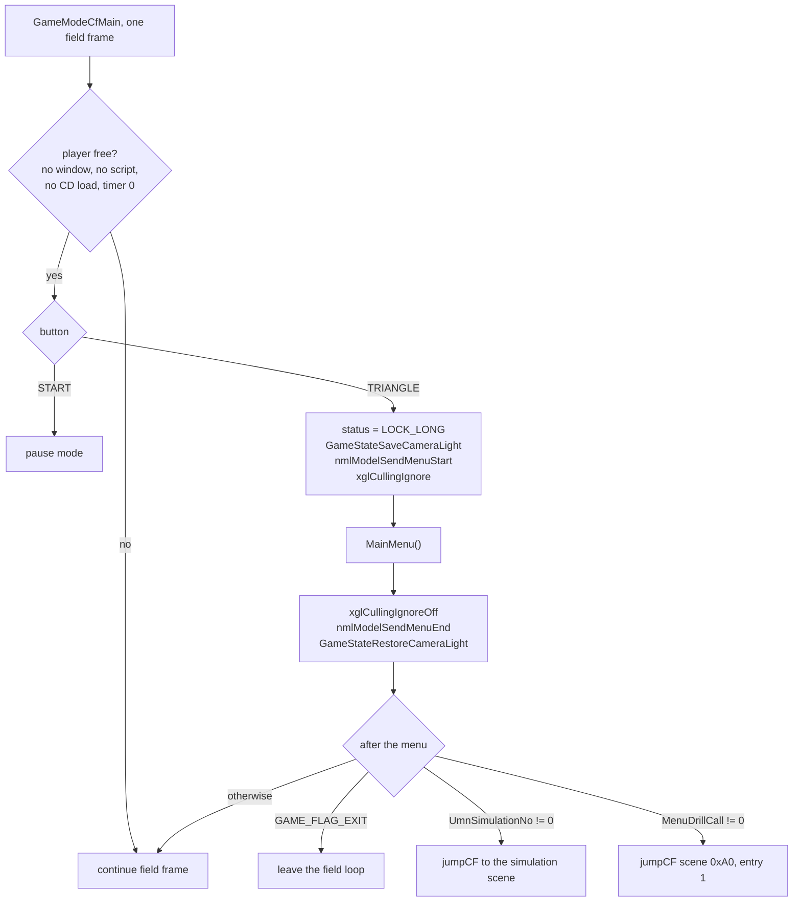
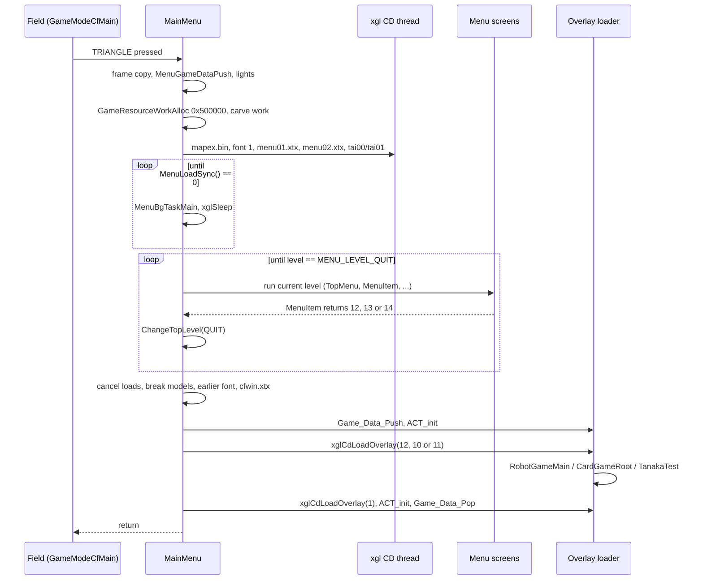
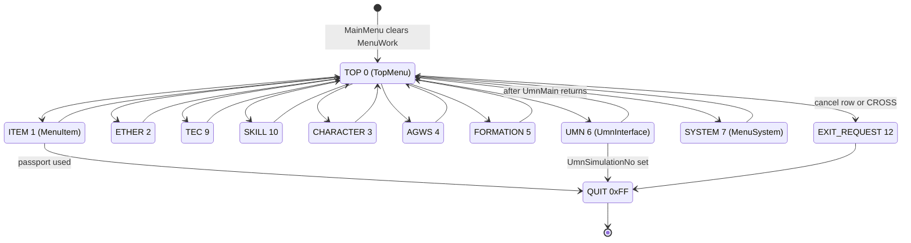
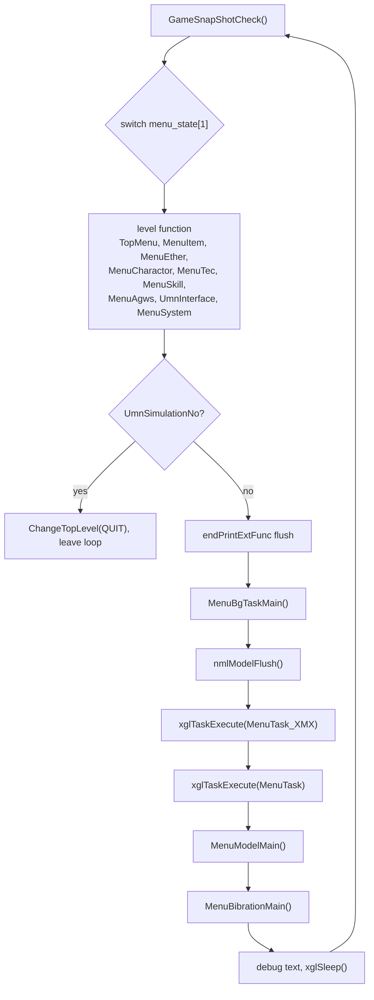
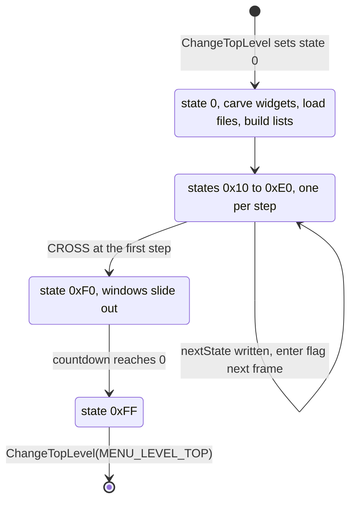
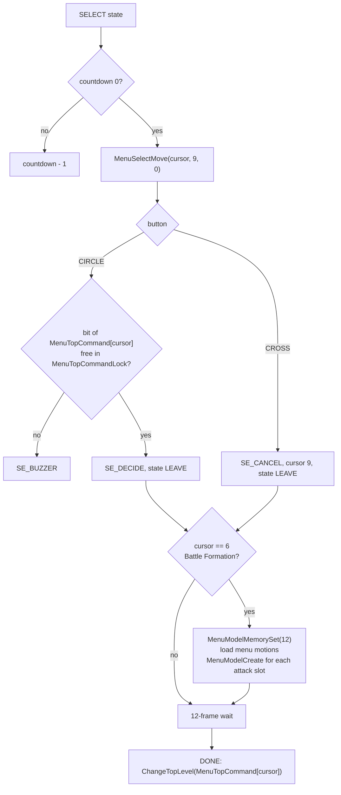
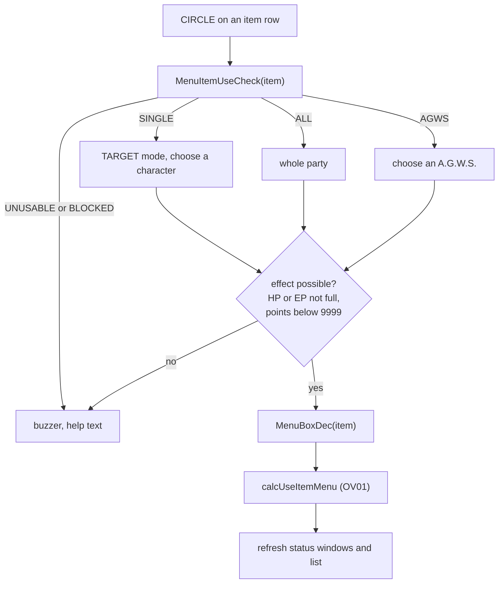
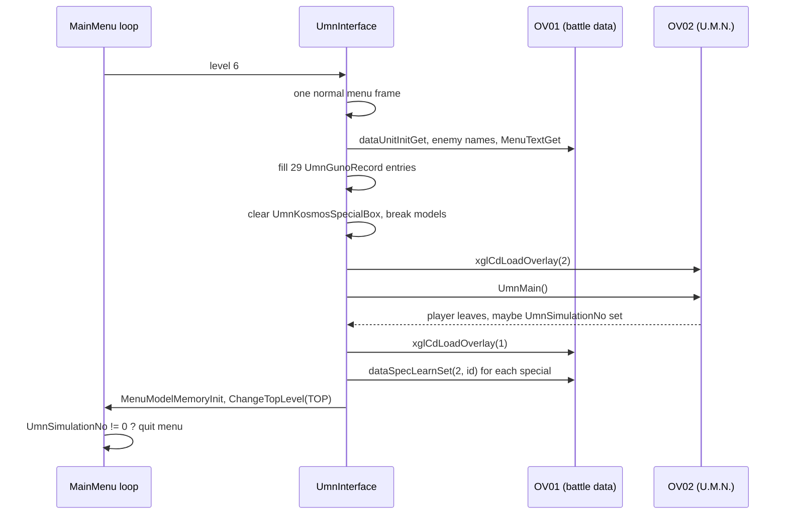
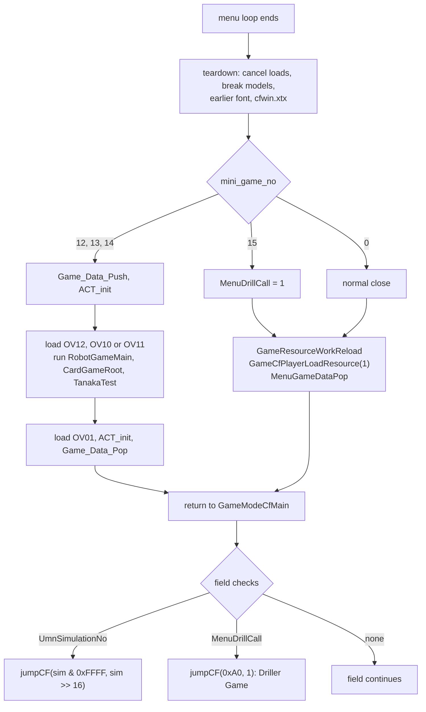
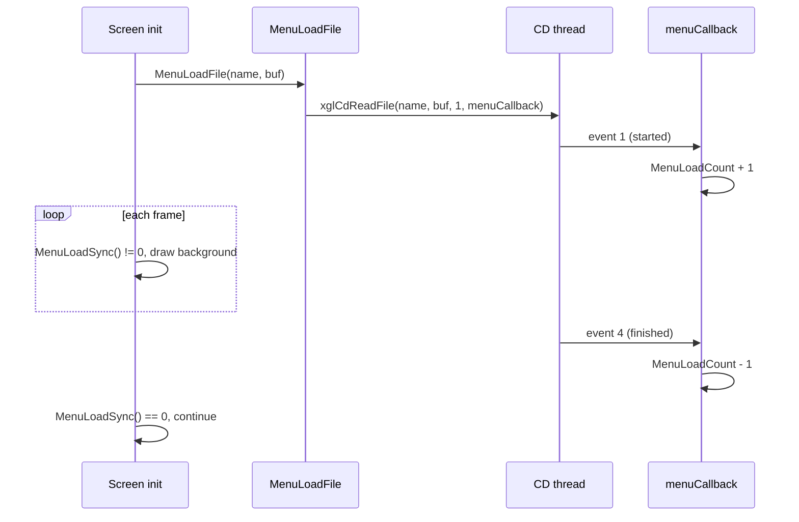

# Main menu

The main menu is the screen the player opens with TRIANGLE on the field. Its
top list offers Items, Ether, Tech Attack, Skills, Characters, A.G.W.S.,
Battle Formation, U.M.N. and Game Options. The whole menu runs inside one
function call, `MainMenu()` in `src/main/window_tex_load.c`. That function has
its own frame loop, so the field game stays frozen while the menu is open and
continues from the same frame when the menu closes.

The menu is also a launcher. Using a passport item starts a minigame overlay,
the U.M.N. row loads the U.M.N. overlay, and two flags set inside the menu make
the field jump to the Driller Game scene or to a U.M.N. Simulation scene after
the menu has closed. The growth screens it opens (Ether, Tech Attacks, Skills,
Characters, Battle Formation and A.G.W.S.) are described in
[Character growth](character-growth.md). Shops, the battle result screen and
the save screen are separate screens, but they reuse the same building blocks.

[← Back to the overview](../README.md)

## Opening the menu

The field game polls the controller once per frame in `GameModeCfMain`
(`src/main/game.c`, see [the field page](field.md)). Before it looks at START
or TRIANGLE it checks that nothing else owns the player. The menu can only
open when all of these hold:

- none of the field flags `GAME_FLAG_NO_TALK_POINT`, `GAME_FLAG_ACTOR_LOOK_AT`,
  `GAME_FLAG_ACTOR_HOLD` or `GAME_FLAG_SCRIPT_END` is set,
- no dialogue window is active (`WIN_checkActiveWindow() == 0`),
- the scene-change timer is zero (`SCRIPT_sceneChangeTimeGet() == 0`),
- the player has not entered a script (`GAME_FLAG_ENTERED_SCRIPT`),
- a controlled actor exists and its enemy-encounter record is not locked
  (`encount_lock == 0`),
- no CD request is pending (`xglCdSync() == 0`), talking is not ignored
  (`SCRIPT_talkIgnoreGet() == 0`) and `GameLoopState.status` is zero.

The scene-change timer doubles as a menu lock. The script native
`Runtime.setMenuLock()` (`src/main/runtime.c`) arms it with 62 frames, and the
menu stays closed until `SCRIPT_sceneChangeTimeDec` has counted it back to
zero. START opens the pause screen instead, which belongs to the field mode
(see [the field page](field.md)).

When TRIANGLE is pressed the field sets `GameLoopState.status` to
`GAME_STATUS_LOCK_LONG` (a non-zero status fails the last check above, so the field ignores these buttons until it is cleared), saves the
camera and lights (`GameStateSaveCameraLight`), tells the model library that a
menu starts (`nmlModelSendMenuStart`, see [nml](../libraries/nml.md)), turns
culling off (`xglCullingIgnore`) and calls `MainMenu()`. When `MainMenu()`
returns, the same calls are undone in reverse order. The field then checks
three results of the menu: the global exit flag `GAME_FLAG_EXIT`, the U.M.N.
Simulation request `UmnSimulationNo` and the Driller Game request
`MenuDrillCall`. The last two are explained in
[Minigames, Driller Game and U.M.N. Simulation](#minigames-driller-game-and-umn-simulation).

The diagram below shows the path from the TRIANGLE press to the end of the
menu call.



## One menu session step by step

`MainMenu()` does everything in a fixed order. It first freezes the picture
of the field, then builds its own world, runs its loop and finally restores
the field.

1. **Freeze the field picture.** `endPrintDirectFrameCopy` copies the current
   frame into the back texture of the print layer (see
   [UI windows](../libraries/ui-windows.md)). `GAME_LOOP_FLAG_UMN`
   (`0x04000000`) is set in `GameLoopState.flags` for the whole session, and
   one `xglSleep()` lets the copy reach the screen.
2. **Clear the requests.** `mini_game_no`, `UmnSimulationNo` and
   `MenuDrillCall` are set to zero, and the frame copy is done a second time.
3. **Save the field.** `MenuGameDataPush()` (`src/main/game.c`) saves the
   actors and calls `GameStateSave`. `GameCFSoundMenuPurge(0)` purges the
   field's sound effect banks (map and enemy effects) for the menu (see
   [audio](../architecture/audio.md)).
4. **Reset helpers.** `MenuLoadInit` clears the asynchronous load counter and
   `MenuBibrationInit` stops vibration. `xglStudioChange(0)` selects studio 0
   and the lights are set from `mainMenuLighting`: ambient 0.3 and three
   parallel lights of 0.5 (see
   [studios and lights](../libraries/xgl.md#studios-cameras-and-lights)).
5. **Allocate memory.** `GameResourceWorkAlloc(0x500000)` takes 5 MiB from the
   game resource area. The first 0x480000 bytes become the menu model pool
   (`MenuModelMemoryInit`, `MenuModelMemorySet(10)`) and the rest is the work
   area that starts at `MainMenuWorkEnd`. The four model output pointers
   `MenuModelOut[]` are cleared.
6. **Hide field effects.** `MenuCfTaikiPush()` saves and clears the eight
   final-packet render callbacks of `sRender`, so field fades and screen
   effects do not draw over the menu.
7. **Carve the work area.** The background scheduler, the two menu task
   schedulers, the U.M.N. database buffer and the formation model tasks are
   cut from `MainMenuWorkEnd` (see [Menu memory](#menu-memory)). `MenuWork`
   (0x80 bytes) is cleared, which puts the menu on level 0, the top menu.
8. **Start the loads.** `MenuMapExTextLoad` loads the segment and map texts
   (`data\endou\mapex.bin`, described in
   [Segment texts](../formats/game-tables.md#segment-texts-mapexbin)),
   `MenuFontLoad(1, 1)` switches to font 1,
   `WindowTexLoad` starts `menu01.xtx` and `menu02.xtx`, and `MenuTairetuLoad`
   starts the formation model files. All of these loads are
   asynchronous. Sound effect 1 plays.
9. **Wait.** While `MenuLoadSync()` reports pending reads, each frame runs only
   the background (`MenuBgTaskMain`) and `xglSleep()`.
10. **Read the story position.** `MenuScenarioNo = MenuScenarioNoGet()` finds
    the current scenario number from the event flags, and
    `MenuEquipStealMaskCheck()` checks the flag that hides equipment.
11. **Run the loop** until the level becomes `MENU_LEVEL_QUIT`. See
    [The menu frame](#the-menu-frame).
12. **Tear down.** `MenuLoadCancel` cancels any read, `MenuBgTaskBreak` stops
    the background and restores camera 3, both task lists run one last time
    so every window can close, `MenuModelAllBreak` frees the models, the pad
    repeat is reset (`xglPadSetRepeat(0, 0xf00c, 8, 1)`), the render callbacks
    come back (`MenuCfTaikiPop`), `MenuFontLoad(0, 0)` reloads the font that
    was in use before the menu opened and the field window texture
    `cfwin.xtx` is read again (`WindowTexLoad(0, 0)`).
13. **Launch or restore.** A minigame number other than 15 starts its overlay
    and returns through `Game_Data_Pop`. Otherwise the field resources are
    reloaded and `MenuGameDataPop()` restores the field (see
    [Minigames, Driller Game and U.M.N. Simulation](#minigames-driller-game-and-umn-simulation)).
14. `GAME_LOOP_FLAG_UMN` is cleared and `MainMenu()` returns.

The sequence diagram below shows a session in which the player uses a
passport item, so the menu ends by running a minigame overlay.



## Menu memory

The menu needs much more memory than the field leaves free, so it borrows the
game resource area for the duration of the session. `GameResourceWorkAlloc`
and `GameResourceWorkReload` belong to the game resource memory described in
[memory](../architecture/memory.md). After the menu, `GameResourceWorkReload`
and `GameCfPlayerLoadResource(1)` load the field resources back into the area
the menu used.

The 5 MiB block is split in two. The first 0x480000 bytes are the model pool
of `src/main/menu_model.c`, which `MenuModelMemorySet(state)` cuts into
regions for character and A.G.W.S. models (see [Menu models](#menu-models)).
The remaining 0x80000 bytes are a bump area. `MainMenuWorkEnd` always points
at the first free byte, and each consumer takes its block from there and
moves the pointer forward. Nothing is ever freed one block at a time. The
whole area is simply forgotten when the menu closes.

`MainMenu()` carves the long-lived blocks first. Each screen then carves its
own window and list blocks from the current `MainMenuWorkEnd` in its init
state. Those screen blocks are reused by the next screen, because
`MainMenuWorkEnd` is not advanced past them globally (each screen keeps its
pointers in its own globals such as `TopStatusWin` or `MenuTecPas`).

The layout below shows the block after `MainMenu()` has finished its setup.

```
MenuModelWorkTop = GameResourceWorkAlloc(0x500000)
+0x000000 +--------------------------------------------+
          | menu model pool (0x480000)                 |
          |   MenuModelMemoryInit / MenuModelMemorySet |
+0x480000 +--------------------------------------------+ <- MenuModelInit
          | menu model task pool (MenuModelInit)       |
          | MenuBgTask scheduler, 16 slots             |
          | MenuBgParam (128-aligned) + saved camera   |
          | MenuTask scheduler, 0x20 slots             |
          | MenuTask_XMX scheduler, 0x10 slots         |
          | UmnGunoDataBaseTop, 0xD00 bytes            |
          | MenuVecMat transforms (MenuBackModelSet)   |
          | mapex.bin text (up to 0x2000)              |
          | tai00.xtx 0x3000, tai01.xtx 0x800,         |
          | tai01.lex 0x1000, tai00.lex 0x800          |
          +--------------------------------------------+ <- MainMenuWorkEnd
          | per-screen windows, lists, data files      |
          | (carved again by each screen's init state) |
+0x500000 +--------------------------------------------+
```

There is a second, smaller scratch area. `MenuWorkEndGet()` clears and
returns the static 64 KiB array `MenuWorkEndTop`. It does not depend on the
menu being open, so other code uses it as a temporary buffer.
`PartyDataInit` loads `tecinit.bin` and `skilldat.bin` into it (see
[Growth tables](../formats/game-tables.md#growth-tables)), and the shop
and the battle result screen build their work areas in it. The window
textures use static memory as well: slot 2 (`menu02.xtx`) lives in the static
array `Menu02Tex` of 0x40800 bytes. `MenuWorkEndCheck()` is an empty function,
probably a debug overflow check emptied for the release build.

## Menu levels and MenuWork

A **level** is one screen of the menu, for example the top list, the item
screen or the ether screen. The current level is the byte
`MenuWork.menu_state[1]`. `MainMenu()` reads it every frame and calls the
function of that level. The level numbers come from `enum MENU_LEVEL` in
`include/main/window_tex_load.h`.

| Level | Value | Function | File |
| --- | --- | --- | --- |
| `MENU_LEVEL_TOP` | 0 | `TopMenu()` | `src/main/menu_top_command_check.c` |
| `MENU_LEVEL_ITEM` | 1 | `MenuItem()` | `src/main/menu_item.c` |
| `MENU_LEVEL_ETHER` | 2 | `MenuEther()` | `src/main/menu_ether.c` |
| `MENU_LEVEL_CHARACTER` | 3 | `MenuCharactor(0)` | `src/main/menu_para_pt_rate_get.c` |
| `MENU_LEVEL_AGWS` | 4 | `MenuAgws()` | `src/main/menu_agws_para_set.c` |
| `MENU_LEVEL_FORMATION` | 5 | `MenuCharactor(1)` | `src/main/menu_para_pt_rate_get.c` |
| `MENU_LEVEL_UMN` | 6 | `UmnInterface()` | `src/main/window_tex_load.c` |
| `MENU_LEVEL_SYSTEM` | 7 | `MenuSystem()` | `src/main/menu_system.c` |
| `MENU_LEVEL_TEC` | 9 | `MenuTec()` | `src/main/menu_tec.c` |
| `MENU_LEVEL_SKILL` | 10 | `MenuSkill()` | `src/main/menu_skill.c` |
| `MENU_LEVEL_EXIT_REQUEST` | 12 | none, becomes `QUIT` | |
| `MENU_LEVEL_QUIT` | 0xFF | ends the loop | |

Characters and Battle Formation are the same function. `MenuCharactor(0)`
opens the equipment and stats view, and `MenuCharactor(1)` opens the
formation view. Any unknown level value falls back to the top menu. Level 8
and level 11 are not used.

`ChangeTopLevel(level)` is the only way to switch levels. It writes the new
level to `menu_state[1]`, clears `menu_state[0]`, `menu_state[2]` and the
sub-state `menu_state[3]`, and zeroes the seven quadwords `reset_work[0..6]`
that start at `MenuWork + 0x10`. Each screen starts in its state 0 (its init
state) the next frame, with a clean scratch area.

`MenuWork` is a single 0x80-byte global. The common part is the same for all
screens, and the rest is a scratch area that every screen reads through its
own view of the structure (the item screen calls the fields `mode`, `busy`
and `selectedItem`, the tech screen calls them `nextState`, `inputDelay` and
`characterNo`, and so on).

```
MenuWork (MenuWorkState, 0x80 bytes)
+0x00 menu_state[0]   unused by MainMenu, cleared by ChangeTopLevel
+0x01 menu_state[1]   current level (MENU_LEVEL_*)
+0x02 menu_state[2]   cleared by ChangeTopLevel
+0x03 menu_state[3]   state of the current screen (0 = init, 0xFF = done)
+0x04 item_selection  cursor shown in the debug line
+0x05 sub_selection   second cursor shown in the debug line
+0x10 reset_work[7]   per-screen scratch, cleared on every level change
      (nextState, enter flags, countdowns, cursors, character number ...)
```

The diagram below shows the level changes. Every growth screen returns to the
top menu with `ChangeTopLevel(MENU_LEVEL_TOP)` when the player backs out.



## The menu frame

Each pass of the `MainMenu()` loop is one displayed frame. The order is fixed.

1. `GameSnapShotCheck()` is the hook of the screenshot feature in
   `src/main/game_snap_shot.c`, which the field calls too. It is an empty
   function in the release build, and `GameSnapShotExecute` does the actual
   JPEG capture (see [debug tools](debug-tools.md)).
2. The level function runs. It reads the controller, advances its state
   machine and updates the per-frame data of its windows.
3. If `UmnSimulationNo` became non-zero (the U.M.N. started a simulation), the
   level becomes `QUIT` and the loop ends at once, without drawing.
4. `endPrintExtFunc(0, END_PRINT_CMD_EXT_BASE + END_PRINT_EXT_FLUSH, 0)`
   flushes the extended print commands of the window layer.
5. `MenuBgTaskMain()` draws the background and runs its tasks.
6. `nmlModelFlush()` sends the queued models.
7. `xglTaskExecute(MenuTask_XMX)` and then `xglTaskExecute(MenuTask)` run the
   two menu task lists (see [tasks](../libraries/xgl.md#tasks)).
8. `MenuModelMain()` services the menu model load queue and runs the model
   tasks.
9. `MenuBibrationMain()` keeps the controller vibration going.
10. Debug text prints the word `mainmenu`, the level, both selections and the
    screen state in hex (`xglFontDebugPrintf`, `xglFontDebugHex`).
11. `xglSleep()` ends the frame and waits for the next one.

The flowchart below shows one frame.



## How a menu screen is built

All menu screens follow the same pattern, and so do the shop and the battle
result screen. A screen is a function that `MainMenu()` calls once per frame.
It holds a small state machine in `MenuWork`, and it draws through a set of
**widgets**.

### The screen state machine

The screen state is `menu_state[3]` (some screens keep a copy in their own
field, such as `MenuWork.mode` on the item screen). State 0 is the init
state, which carves the widget blocks from `MainMenuWorkEnd`, loads the data
files the screen needs and builds its lists. The middle states are the
screen's own steps, numbered by groups of 0x10 (for example 0x10 choose a
character, 0x20 command list, 0x30 list). The state 0xF0 starts the closing
animation and 0xFF means done, at which point the screen calls
`ChangeTopLevel(MENU_LEVEL_TOP)`.

State changes are deferred by one frame. Input code writes the wanted state
into a `nextState` (or `nextMode`) field. At the top of the next frame the
screen copies it into the state byte and sets an **enter flag** (bit 0 of the
screen's flag byte), which stays set for exactly one frame. Code that must
run once per state, such as rebuilding a list or resetting a cursor, tests
that flag. A short countdown (`busy`, `inputDelay`, `wait` or `countdown`,
8 to 24 frames) blocks input while windows slide, so the player cannot act on
a half-drawn screen.

The diagram below shows the generic life of a screen.



### Widgets

A widget is a function with a name such as `TopInfoMain`, `MenuItemListMain`,
`MenuTecPasMain` or `AgwsStatusMain`, plus a work block carved in the init
state. The screen calls each widget once per frame. Every widget has a state
byte at the start of its block: 0 builds its windows (`WindowDXSet`,
`WindowSPSet`, messages, sprites), and 2 runs them. The common widget kinds
are:

| Suffix | Role |
| --- | --- |
| `Pas` | the title bar with the screen name and the category captions |
| `Info` | the help line at the bottom, with a text per state and cursor |
| `Status` | character or A.G.W.S. status panels |
| `List`, `List2` | scrolling item lists built from the sort tables |
| `Select`, `Menu` | small command windows (for example "Use / Set / Cancel") |
| `Ex`, `Ex2` | extra panels such as the money and play time box |
| `L1R1` | the L1 and R1 arrows used to change tabs or characters |

The windows themselves (`WindowDX`, `WindowSP`, `eMessage`, `eNumber`,
`eSprite`, `eRibbon`) are described on the [UI windows](../libraries/ui-windows.md)
page. The menu only fills in their position, size, style, text and callback.

Windows move with `MoveSlide(current, target, rate)`, which moves a short
coordinate toward its target by the remaining distance divided by `rate`
each frame. A widget therefore never animates itself directly. It only
changes its target positions according to the screen state, and
`MoveSlide` produces the ease-out motion. `MoveSlide2` moves by a fixed step
instead.

### Task lists

Some animated pieces are tasks rather than widgets. `MenuTask` (0x20 slots)
and `MenuTask_XMX` (0x10 slots) are the menu's two schedulers. The formation
model shown behind the top menu (`tskMenuTai`) and its position pointer
(`tskMenuTaiPointa`) are created on `MenuTask_XMX` by `MenuBackModelSet`. The
character spotlight and grid of the formation screen (`tskCharSpotLight`,
`tskCharLineField`) are tasks as well. A task removes itself when its screen
signals the end, which is why the teardown runs both lists once more after
the loop.

## Shared menu helpers

`src/main/menu_1.c` contains the helpers that all screens share. The most
important ones are below.

### Encoded item ids and categories

Lists hold **encoded ids**. The category is in the high halfword and the id
inside the category is in the low halfword, built by `MenuIdChange(id,
category)`. `MenuTextGet(encoded)` returns the name and description record of
any encoded id by dispatching to the name tables of OV01, and
`MenuBoxChk`, `MenuBoxInc` and `MenuBoxDec` read or change the inventory of
any encoded id.

| Category | Value | Meaning |
| --- | --- | --- |
| `ITEM` | 1 | consumable items |
| `EVENT_ITEM` | 2 | event (key) items |
| `WEAPON` | 3 | weapons |
| `BULLET` | 4 | ammunition |
| `ACCESSORY` | 5 | accessories |
| `CHARACTER` | 6 | characters |
| `AGWS` | 7 | A.G.W.S. units |
| `SKILL` | 8 | skills |
| `ETHER` | 9 | ethers |
| `ABILITY` | 10 | abilities (Tech Attacks) |
| `FRAME` | 11 | A.G.W.S. frames |
| `ENGINE` | 12 | A.G.W.S. generators |

### Sorted lists

A list is built in two steps. `MenuSortSet(list, mask, filter)` fills the sort
table of list `list` with the encoded ids of every owned object whose
category bit is in `mask` (ITEM 1, EVENT 2, WEAPON 4, BULLET 8, ACCESSORY
0x10, CHARACTER 0x20, SKILL 0x40, ETHER 0x80). The filter narrows the result,
for example to character gear (-1), to A.G.W.S. gear (-2) or to the ethers of
one character. `MenuSortChange(list, mode)` reorders the table by category,
number or name with the six pair swappers `MenuSortSubType00` to `05`.
`MenuListMake(list, mode)` then
turns the sort table into display rows (`MenuListEntry`: flag, amount, text)
and ends an empty list with a "No data." row. `MenuSortGet(list, index)`
returns the encoded id under the cursor, and `MenuSortCheck(list)` returns
the row count.

### Cursor memory

`MenuKeepSelect` is a 0x64-byte array of 5-byte cursor records, one per list
kind (the shop uses records 18 and 19 for its frame and generator lists).
List screens call `WindowSPKeepSelect` every frame to store the list cursor
in its record (see [UI windows](../libraries/ui-windows.md)), so a list can
reopen on the row the player left. `MenuKeepSelectReset` clears the first
twelve records. The Game Options entry
"Cursor Location Memory" controls it through `MenuCursorKeepCheck()`, which
returns true when the save byte `SaveData[0x44]` is zero (zero means On). The
top menu, for example, resets its cursor to the first row unless this check
is true. The shop calls `MenuKeepSelectReset` on entry.

`MenuSelectMove(selection, count, wrap)` is the standard up and down cursor.
It reads the repeated direction of pad 0, moves by one, wraps at the ends and
plays the cursor sound. `MenuSelectMove2` is the four-way version used by
grids (up and down move by two, left and right by one).

### Story position

`MenuScenarioNoGet()` turns the event flags into a **scenario number**, a
number that grows as the story advances. The table `scenarioRangeTable` lists
five ranges of event flags (500, 400 down to 300, 197 down to 100, and 56
down to 1). The function scans them from the top and returns the number of
the first set flag, so the scenario number is simply the highest story flag
that is set, or 0 when none is. The menu uses it to lock commands,
to fix the leader and to change names. For example `MenuCharNameGet` returns
"Ziggurat 8" for Ziggy before scenario 108.

`MenuEquipStealMaskCheck()` tests event flag 0x3F9. While it is set the
weapon, ammunition and accessory lists are hidden, and the shop of type 6
offers nothing. It probably marks the part of the story in which the party's
equipment is taken away. `MenuShionMwsCheck()` tests whether Shion's weapon
(the MWS) is usable: scenario below 10, flag 0x3FF, or event item 10 owned.

### Character ids

The menu uses the unit ids of the battle data (`include/main/menu_1.h`,
`MenuCharId`). The same numbers appear in the party masks described in
[Character growth](character-growth.md#party-and-formation).

| Id | Unit | Id | Unit |
| --- | --- | --- | --- |
| 1 | chaos | 13 to 16 | BIC-13 to BIC-16 |
| 2 | KOS-MOS | 17 | VX-10000 |
| 3 | Shion | 18 | VX-7000 |
| 4 | unused | 19 | VX-9000 |
| 5 | Ziggy | 20 | VX-20000 |
| 6 | MOMO | 21 | VX-05 |
| 7 | Jr. | 22 | VX-4000 |
| 8 | guest (`MENU_CHAR_CASSIRIA`) | 23 to 28 | AG-01 to AG-06 |
| 9 | Catalina | 29 | Bunnie |
| 10 | Virgil | | |
| 11 | Mary | | |
| 12 | Soldier | | |

`MenuMaryIdChange` maps an A.G.W.S. to its pilot for display: VX-20000 shows
Mary, VX-9000 shows the Soldier and any other A.G.W.S. shows Shion.
`MenuMainCharCheck` accepts only ids 1 to 7, the playable main characters.
Id 4 has no name in the source and never joins the party, but it still owns
an ether range and an ether tree root (see
[Character growth](character-growth.md#ether)), so it was probably a cut
playable character.

## Top menu

`TopMenu()` (`src/main/menu_top_command_check.c`) is level 0. It shows the
nine command rows on the right, three status windows for the characters in
the attack line on the left, a help line, and a box with the reserve faces,
the play time and the money. The formation model turns behind them.

### States

| State | Value | What happens |
| --- | --- | --- |
| init | 0 | carve `TopStatusWin` (0x1D84), `TopInfo` (0x350), `TopMenuWin` (0x794) and `TopFaceExWin`, compute the lock mask |
| `ENTER` | 0x20 | 16-frame wait, reset the cursor unless cursor memory is on |
| `SELECT` | 0x21 | move the cursor, CIRCLE selects, CROSS cancels |
| `LEAVE` | 0xF0 | prepare the next screen, 12-frame wait |
| `LEAVING` | 0xF1 | count the wait down |
| `DONE` | 0xFF | `ChangeTopLevel(MenuTopCommand[cursor])` |

The rows map to levels through `MenuTopCommand[10] = {1, 2, 9, 10, 3, 4, 5,
6, 7, 12}`. Row 0 (Items) opens level 1, row 2 (Tech Attack) opens level 9,
and the hidden tenth row is the cancel row, which maps to level 12 and closes
the menu. CROSS jumps straight to that row. The text
"Save/Load data." exists among the help strings in `src/main/e_number_main.c`
but no row uses it, probably because saving happens at save points.

### Locks

Some rows are locked by the story. `MenuTopCommandLock` holds one bit per
level, bit `1 << (level - 1)`. It is computed in the init state:

- If the scenario number is between 0x90 and 0x98, the mask starts as 0x332,
  which locks Ether, Battle Formation, U.M.N., Tech Attack and Skills. The
  same range forces the item screen to show only VX-7000, VX-9000 and
  VX-20000, so this is probably a part of the story in which the party fights
  only in A.G.W.S.
- A.G.W.S. is locked while `take_agws_mask` in the party data is zero.
- U.M.N. is locked when Shion (id 3) is not available
  (`PartyFriendLockCheck(3, 1) == 0`) and during the prologue (scenario 1).

A locked row is drawn grey. CIRCLE on it plays the buzzer sound instead of
leaving. The flowchart below shows the selection logic.



### Top menu widgets and tasks

`TopStatusWinMain` draws three `WindowDX` status windows, one per attack slot,
with `MenuStatusDisp` as the draw callback. `TopInfoMain` shows the help line
of the row under the cursor, for example "Use, set, and evolve Ether.
Transfer Ether to other characters." `TopMenuWinMain` draws the command list
with `MenuSelectWindow` and greys the locked rows. `TopFaceExWinMain` draws the
faces of the reserve members, the play time (updated with `PartyTimeUpDate`
and formatted with `PartyTimeDispChange`) and the money (`dataMoneyBoxChk`, 9
digits).

`MenuBackModelSet` sets up camera 2 and creates two kinds of task on
`MenuTask_XMX`. One `tskMenuTai` task per filled attack slot animates the
formation model (`tai00.xtx` and `tai00.lex`) and draws its wireframe grid.
Four `tskMenuTaiPointa` tasks draw the pointer model (`tai01.xtx` and
`tai01.lex`) on the formation positions. `menuFormationPositionTable` holds
six positions, two columns of three, which probably match the attack
positions of the battle formation. The tasks draw only while the top menu is
the current level and remove themselves when the menu closes.

## Items screen

`MenuItem()` (`src/main/menu_item.c`) is level 1. It is the only level
function that returns a value. It returns the event item id chosen in its
`PICK` mode, which `MainMenu()` treats as a minigame number.

### Tabs and modes

The screen has eight tabs, changed with L1 and R1: consumable items, event
items, and three equipment kinds (weapons, accessories, ammunition) each for
characters and for A.G.W.S. Its mode byte (`MenuWork.mode`) has these values:

| Mode | Value | Meaning |
| --- | --- | --- |
| `INIT` | 0 | carve the widgets, read the sort choices and the party |
| `LIST` | 0x20 | browse the list of the current tab |
| `TARGET` | 0x22 | choose who uses the item |
| `SEGMENT` | 0x30 | the segment map opened by event item 11 |
| `PICK` | 0x40 | return the chosen passport to `MainMenu()` |
| `SORT` | 0x80 | choose the sort method |
| `CLOSE` | 0xF0 | windows slide out |
| `DONE` | 0xFF | back to the top menu |

In the init mode the screen carves its ten widgets (Pas, Info, Status,
StatusAgws, List, Icon, Select, Ex, Line, Segment), reads the party with
`PartyAllPartyGet(ids, 0)` and the A.G.W.S. roster, and reads the saved sort
method of each tab from `MenuSaveDataGet()`, which is `SaveData + 0x10254`.
TRIANGLE opens the sort window ("Categorical / Numerical / Alphabetical /
Back") and the choice is written back to that save byte for the current tab.

### Using an item

`MenuItemUseCheck(item)` decides whether a consumable can be used outside
battle and on whom. The item must have use flag 0x8000. Its attribute bits
then choose the target. Bits in 0x1E43 make it a SINGLE item (one character)
or an ALL item (the whole party, use state 0x10), and bit 0x2000 makes it an
AGWS item. Item 36 is special. It is ALL only while the player stands on a
save or event symbol (`GameLoopState.flags & 0x20400000`) and is otherwise
blocked with the text "This item can only be used at save points."

When the player confirms a target, the item is refused (buzzer) if it would
have no effect:

| Attribute | Restores | Refused when |
| --- | --- | --- |
| 0x1 | HP | HP is full |
| 0x2 | EP | EP is full |
| 0x800 | T.Pts | T.Pts are 9999 or more |
| 0x400 | E.Pts | E.Pts are 9999 or more |
| 0x200 | S.Pts | S.Pts are 9999 or more |

Otherwise `MenuBoxDec` removes one from the inventory and `calcUseItemMenu`
(an OV01 function, see [battle](battle.md)) applies the effect to the unit
record. T.Pts, E.Pts and S.Pts are explained in
[Character growth](character-growth.md#points-and-experience).

The flowchart below shows the decision path for one use.



### Event items, passports and the segment map

On the event item tab only ids 11 to 15 can be selected. Event item 11 opens
the **segment map**: 18 segments in three columns. Each segment shows whether
its location has been found (event flags 3201 and up) and whether its rare
item has been taken (flags 3241 and up). The names and help texts come from
`mapex.bin` through `MenuSegmentMapNameGet` and `MenuSegmentInfoTextGet`.
This is probably the in-menu view of the Segment Addresses.

Event items 12 to 15 are the **passports** listed in the
[overview](../README.md). Choosing one switches to `PICK` mode only while the
player stands on an event symbol (`GameLoopState.flags & 0x400000`, the flag
`GAME_FLAG_ON_EVENT_SYMBOL` of the field, see
[map and units](map-and-units.md)). Anywhere else the buzzer plays. In `PICK`
mode `MenuItem()` returns the item id, and `MainMenu()` stores it in
`mini_game_no` and quits.

## Inventory boxes and item pickups

The inventory itself is not part of the menu, but the menu is its main user.
`src/main/data.c` keeps five arrays of 255 `u16` counters, one per category:
`itmBox` (items), `wpnBox` (weapons), `bltBox` (ammunition), `accBox`
(accessories) and `evtBox` (event items), plus the 64-bit `moneyBox`.
`dataBoxPtrGet(category)` maps the data categories 0 (item), 1 (weapon), 2
(ammunition), 3 (accessory) and 10 (event item) to these arrays. These
data categories differ from the menu categories above.

| Function | Effect |
| --- | --- |
| `dataBoxChk(category, id)` | count of id (ids start at 1) |
| `dataBoxInc(category, id)` | add one unless the count is 99, returns 1 when added |
| `dataBoxDec(category, id)` | remove one if the count is not 0 |
| `dataItmBox*`, `dataWpnBox*`, `dataBltBox*`, `dataAccBox*`, `dataEvtBox*` | the same for one fixed category |
| `dataMoneyBoxChk()` | current money |
| `dataMoneyBoxInc(amount)` | add, clamp to 999,999,999 |
| `dataMoneyBoxDec(amount)` | subtract only if there is enough |

These arrays live in main memory. `GamePushSaveDataUser` copies them into the
save area and `GamePopSaveDataUser` copies them back (see
[save data](../architecture/save-data.md) and
[Character growth](character-growth.md#where-growth-data-lives)).

`src/main/create_evt_item_get_task.c` shows the "obtained" windows. Two kinds
of task exist on the field scheduler `GameLoopState.scheduler`:

- `taskItemGet` serves treasure boxes and item symbols on the map. On its
  first run it reads the box record from `ItemBoxTbl`, sets the box's
  collected flag, adds the money or the items, builds a message such as
  "Obtained 3 ..." and opens a window with `createItemGetWin`. When the window
  closes it calls the box's Java `itemget` method if it has one. The map side
  of boxes and symbols (`InitItemBox`, `MAP_updateUnitItemBox`,
  `MAP_updateUnitItemSymbol`) belongs to [map and units](map-and-units.md).
- `CreateEvtItemGetTask(category, id)` is the script path. It adds the item
  with `dataBoxInc` and, if that worked, queues `taskEvtItemGet`, which only
  shows the name in a window. The script natives `Runtime.addItemWin` (with
  window), `Runtime.addItem`, `Runtime.removeItem` and `Runtime.checkItem`
  (without) call these functions (see [natives](../scripting/natives.md)).

`GetItemName(category, id)` returns the display name for both, from the OV01
name tables or, for event items, from `EvtItemTbl`.

## Game Options

`MenuSystem()` (`src/main/menu_system.c`) is level 7. It has a list state
(0x10), one sub-state per option (0x20 to 0x70), a closing state (0xF0) and a
done state (0xFF). Every option is a two-choice window, and the choice is
written to an option byte of `SaveData` so that it is saved with the game.

| Option | Sub-state | Effect |
| --- | --- | --- |
| Sound Output | 0x20 | Stereo or Mono, `SsdSetOutputMode` |
| Radar Display | 0x30 | `PartyRadarDispSet`, the field radar on or off |
| Vibration | 0x40 | stores the vibration byte, a test buzz `MenuBibrationSet(0, 1, 128, 32)` |
| Cursor Location Memory | 0x50 | stores the cursor memory byte |
| Default | 0x60 | `MenuSystemInitSet`, back to Stereo, On, On, On |
| HDD | 0x70 | data location, `xglHddActivate`, grey when no HDD is mounted |
| Monitor Settings | | `tyaDisplaySetting`, screen position (see [UI windows](../libraries/ui-windows.md)) |

Cursor memory and vibration store "On" as 0, and Sound Output stores Stereo
as 1 (the help texts give Stereo and On as the defaults).
`MenuSystem2Init` and `MenuSystem2` are a second entry that runs the same
options screen embedded in another screen. No C code calls them, so they are
probably called through a pointer or are unused.

## U.M.N. entry

The U.M.N. screens are in overlay OV02 (see [U.M.N.](umn.md)). The main menu
reaches them through `UmnInterface()` in `src/main/window_tex_load.c`, which
runs as level 6.

1. It draws one more normal menu frame, so the closing windows are shown.
2. It fills the U.M.N. database buffer `UmnGunoDataBaseTop` with 29
   `UmnGunoRecord` entries, one per unit id 0x22 to 0x3E. Each record gets the
   enemy's name, its HP and weakness flags from OV01's `dataUnitInitGet`, its
   T.Pts, E.Pts, S.Pts, experience and money from `dataGainGet`, and the names
   of its normal and rare drop items through `MenuTextGet`. OV02 cannot reach
   the OV01 tables, so the menu prepares this data while OV01 is still loaded.
   The records are the analysis data of the Gnosis entries of the U.M.N.
   Database.
3. `UmnkosmosSpecialInit()` clears `UmnKosmosSpecialBox`, the menu models are
   freed, the frame is copied and the screen is cleared.
4. `xglCdLoadOverlay(2)` replaces OV01 with OV02. `UmnMain()` runs the U.M.N.
   until the player leaves. `xglCdLoadOverlay(1)` brings OV01 back.
5. `UmnkosmosSpecialSet()` applies up to four ids that the U.M.N. wrote into
   `UmnKosmosSpecialBox` (OV02 fills it in `UmnKosmosSpecialGetCheck`). Each id
   is taught to KOS-MOS with `dataSpecLearnSet(2, id)`, which writes it into
   one of her special-technique slots. These are probably KOS-MOS Tech Attacks
   unlocked through the U.M.N.
6. The model pool is reset (`MenuModelMemoryInit`) and the level returns to
   the top menu.

The overlay swap is the reason the menu depends on OV01. All the data
accessors the menu calls (`dataUnitOrgGet`, `dataPlChaGet`, `dataWpnGet`,
`dataEthGet`, `calcTotalParaMenu` and many more) are OV01 code, so OV01 must
be loaded whenever menu code runs. See [memory](../architecture/memory.md) for
the overlay area.

`UmnMailMain(menuId)` is the same swap without the menu. The script native
`Runtime.mailExec(int)` calls it to open a mail screen directly from an
event. It loads OV02, runs `UmnMain2(menuId)`, reloads OV01 and applies the
KOS-MOS ids. A few small helpers in the same file keep U.M.N. state in the
save data: `UmnMailBoxSet` marks a mail box in the table at
`SaveData + 0x1025C` (128 slots, -1 means free), `UmnMailDataGet` reads the
two-byte entry of a box at `SaveData + 0x10304`, and
`UmnDataBaseMonsterSet` and `AnalisisSet` (with their `Check` versions) set
one bit per monster id 0x22 to 0x3E in two bit sets of the database state
(probably monsters seen and monsters analysed).

The sequence diagram below shows the swap.



## Minigames, Driller Game and U.M.N. Simulation

The menu can end in four special ways. Three are real minigame overlays, and
two are script scene jumps that the field performs after the menu.

### Minigame overlays

When `mini_game_no` is 12, 13 or 14, `MainMenu()` starts the minigame itself,
after its own teardown:

1. `xglCullingIgnoreOff`, `nmlModelSendMenuEnd` and
   `GameStateRestoreCameraLight` undo the field's menu preparation early.
2. `Game_Data_Push()` saves the field state and `ACT_init()` resets the
   actors (see [actors](../libraries/actors.md)). `MenuCfTaikiPush` clears the
   render callbacks again.
3. The overlay is loaded and its entry function is called:

   | `mini_game_no` | Overlay | Entry function | Page |
   | --- | --- | --- | --- |
   | 12 | OV12 | `RobotGameMain` (`src/ov12/rg_main.c`) | [A.G.W.S. Battle](minigames/agws-battle.md) |
   | 13 | OV10 | `CardGameRoot` (`src/ov10/calc_vert_out_vec_edge.c`) | [Xeno Card](minigames/xeno-card.md) |
   | 14 | OV11 | `TanakaTest` (`src/ov11/tanaka_test.c`) | [Network Casino](minigames/network-casino.md) |

4. When the minigame returns, `MenuCfTaikiPop`, `xglRenderClearDepth`,
   `nmlModelInit`, `xglCdLoadOverlay(1)`, `ACT_init` and `Game_Data_Pop`
   bring the field back.

Scripts can start the same three minigames without the menu. The native
`Runtime.minigameExec(int)` does the same push, overlay load and pop (see
[natives](../scripting/natives.md)).

### Driller Game

The Driller Game is not an overlay and the menu does not run it. When the
player picks event item 15, `MainMenu()` only sets `MenuDrillCall = 1` and
restores the field normally. Back in `GameModeCfMain`, the field sees
`MenuDrillCall`, stores the current event id in `GameLoopState.user_word` and
the player position in `GameLoopState.user_longs[0..1]`, and calls
`Java_xeno_util_Runtime_jumpCF__II` with scene 0xA0 and entry 1. The Driller
Game is therefore a script scene, described in
[Driller Game](minigames/driller-game.md). `user_word` and `user_longs` are
part of the save area copied by `GamePushSaveDataUser`, which probably lets
the game return the player to the right place afterwards.

### U.M.N. Simulation

`UmnSimulationNo` works the same way. The U.M.N. sets it when the player
starts a simulation. The menu loop sees it after the level function and quits
at once. After the menu, the field saves the event id and position like for
the Driller Game and calls `jumpCF` with scene `UmnSimulationNo & 0xFFFF` and
entry `UmnSimulationNo >> 16`. See [scenes](../scripting/scenes-and-timecharts.md)
for `jumpCF`.

### Restoring the field

For every ending that is not a minigame overlay, `MainMenu()` restores the
field with `GameResourceWorkReload()`, `GameCfPlayerLoadResource(1)` and
`MenuGameDataPop()`, with the loop flag 0x40 set during the reload. The test
is written as `!MenuDrillCall || !UmnSimulationNo`, so the field is restored
unless both flags are set at once, which cannot normally happen.
`MenuGameDataPop()` also handles a new leader. If the player changed the lead
character in Battle Formation, the controlled actor's model id no longer
matches `party->leader_battle_id`, so it swaps the field model
(`ACT_setModelWrapper`) and resets its motion.

The two requests also affect the sound. The U.M.N. calls
`GameCFSoundMenuPurge(1)`, which purges the effect banks and also stops the
music sequences that are playing, remembering them in a bit mask.
`GameCFSoundMenuReload()` (called by OV02 when the U.M.N. closes) reloads the
map and enemy effects and restarts those sequences only when
`UmnSimulationNo` and `MenuDrillCall` are both zero, probably because a scene
jump with its own music follows otherwise.

The flowchart below shows the four endings.



## Menu resources

### Window textures and fonts

The window layer draws its frames from a window texture. On the field this is
`data\endou\cfwin.xtx`. Each of the three window textures is an XTX set with
one 512 × 128 sheet (see
[XTX texture sets](../formats/models-and-textures.md#xtx-texture-sets)).
`WindowTexLoad(buffer, request)` loads one of them. The low 16 bits of
`request` choose the slot and bit 16 makes the load asynchronous:

| Slot | File | Buffer |
| --- | --- | --- |
| 0 | `data\endou\cfwin.xtx` | `MenuWinAddr` (shared with slot 1) |
| 1 | `data\endou\menu01.xtx` | `MenuWinAddr` |
| 2 | `data\endou\menu02.xtx` | static `Menu02Tex`, 0x40800 bytes |

The menu loads slots 1 and 2 on entry, so `menu01.xtx` replaces the field
window texture in `MenuWinAddr`. On exit `WindowTexLoad(0, 0)` reads
`cfwin.xtx` back synchronously. `WindowTexAddrGet(slot)` returns the buffer of
a slot to the drawing code. `MenuFontLoad(1, 1)` remembers the current font
number in `original_font_no_1` and loads font 1, and `MenuFontLoad(0, 0)`
restores the remembered font (see [glyphs and fonts](../libraries/xgl.md#glyphs-and-fonts)).

### Asynchronous loading

Menu files are read through the CD thread without blocking (see
[reading files](../libraries/xgl.md#reading-files)). `MenuLoadFile(name,
buffer)` calls `xglCdReadFile(name, buffer, 1, menuCallback)`. The callback
keeps the counter `MenuLoadCount`: event 1 (read started) adds one, event 4
(read finished) subtracts one, and the error events -1 and -2 record an
error value. `MenuLoadSync()` returns the counter, so a loop can wait for zero
while it keeps the background animated. `MenuLoadCancel()` calls
`xglCdReadCancel` when a screen closes before its files have arrived.



### Background

`MenuBgTaskInit(work, camera)` creates the background scheduler `MenuBgTask`
(16 slots) and its parameter block `MenuBgParam` (`MenuBgTaskParameters`:
colour table, camera id, `tasks_finished`, camera rotation and distance).
It saves a full copy of the studio camera (camera 3 for the menu) in
`MenuBgKeepCamera`, initialises that camera and creates the background tasks
with `tyaMenuBgEntry`. It also sets the background colour `MenuBgRgba` to 0x80
grey. `MenuBgTaskMain()` lowers that grey by 8 per frame until it reaches 0,
draws the back texture with it (`endBackTexDraw`), runs the background tasks
and clears the depth for the menu models. The frozen field picture therefore
probably fades to black during the first 16 frames. `MenuBgTaskBreak()` sets
`tasks_finished` to -1, runs the tasks once so they can end, and restores the
saved camera.

### Formation model

`MenuTairetuLoad(buffer, flags)` loads the formation display ("tairetu" means
formation) from `data\endou\poly\` into 128-aligned buffers: the formation
model `tai00.xtx` (0x3000) and `tai00.lex` (0x800), and the pointer model
`tai01.xtx` (0x800) and `tai01.lex` (0x1000). The XTX files are textures and
the LEX files are models drawn by the [nml library](../libraries/nml.md).
Their layouts are described in
[XTX texture sets](../formats/models-and-textures.md#xtx-texture-sets) and
[LEX models](../formats/models-and-textures.md#lex-models). The formation model feeds `tskMenuTai`
and the pointer model feeds `tskMenuTaiPointa` behind the top menu.

### Menu models

`src/main/menu_model.c` shows 3D characters and A.G.W.S. in menu windows, for
example the three party members on the formation screen or the unit on the
A.G.W.S. screen. It keeps its own small resource manager inside the model
pool:

- `MenuModelMemorySet(state)` cuts the pool into regions for a layout. The
  layouts are 10 (main menu), 11 (A.G.W.S. screen), 12 (three full unit
  regions for Battle Formation) and 20 (shops).
- Up to 16 resource records queue file requests. `MenuModelResourceRequest`
  queues one, `MenuModelResourceMain` starts the reads through
  `MenuFileNameGet` and `MenuLoadFile`, and the cancel functions stop them.
- `MenuModelCreate(&out, modelId)` creates a model task (characters 1 to 11,
  A.G.W.S. 17 to 28). The task waits for its resources, spawns the actor and
  its weapons, then runs its control and draw-type (fade in or out) code each
  frame.
- `MenuModelMenuMotionLoad` loads the shared menu motion pack.
- `MenuModelSubWindowSet` attaches a model to one of three sub-window
  viewports.
- `MenuModelMain()` runs the request queue and the model tasks once per
  frame. `MenuModelAllBreak()` cancels everything.

The actors and motions are those of the [actors](../libraries/actors.md) and
[animation](../libraries/animation.md) libraries, and the drawing is done by
[nml](../libraries/nml.md).

### Render callbacks and vibration

`MenuCfTaikiPush()` copies the eight `sRender.final_packet_callback` entries
into `MenuCfTaiki[8]` and clears them. `MenuCfTaikiPop()` puts them back.
These callbacks are the field's last-moment screen effects, such as fades
(see [rendering](../architecture/rendering.md)). Clearing them keeps the
menu picture clean, and the push and pop pair wraps every menu-like screen
(menu, shop, minigame launch).

`MenuBibrationSet(pad, actuator, strength, frames)` starts a vibration, and
`MenuBibrationMain()` writes the strength to the pad actuator each frame while
it counts the frames down. `MenuBibrationInit()` stops it.

## Other screens built on the menu engine

Several screens outside `MainMenu()` use the same pieces (`MenuWorkEndGet`,
`MenuBgTaskInit`, `MenuLoadFile`, `MenuFontLoad`, `WindowTexLoad`, the widget
pattern and `MenuGameDataPush/Pop`):

| Screen | Entry | Opened by | Page |
| --- | --- | --- | --- |
| Shop | `MenuShopMain(shopNo)` | shop symbol, `Runtime.enterShop` | [Character growth](character-growth.md#shops) |
| Battle result | `SeisanInit`, `SeisanMain` | OV01 result screen | [Character growth](character-growth.md#battle-results) |
| Save and load | `MenuFileMain(mode)` | save symbol, event symbol, game over | [save data](../architecture/save-data.md) |
| Script choices | `xeno.util.Menu` natives in `src/main/menu_2.c` | scripts | [natives](../scripting/natives.md) |

`src/main/menu_2.c` is not part of the main menu despite its name. It holds the
natives of the Java class `xeno.util.Menu` (`addQuery`, `addItem`, `create`,
`getSelected`, `setLocation`, `setCursor`), which build small choice windows
for scripts with `TMENU_create` (see [UI windows](../libraries/ui-windows.md)).
Debug versions of the shop and the result screen (`ShopTest`, `SeisanTest`)
are in `src/main/endou_test.c` (see [debug tools](debug-tools.md)).

## Source files

| File | Content |
| --- | --- |
| `src/main/window_tex_load.c` | `MainMenu`, levels, memory, window textures, async loads, fonts, background, formation files, U.M.N. entry, mail and database bits, recovery helpers |
| `include/main/window_tex_load.h` | `MENU_LEVEL`, `MenuWorkState` |
| `src/main/menu_top_command_check.c` | `TopMenu`, locks, top widgets, formation model tasks |
| `src/main/menu_item.c` | `MenuItem`, item use, sort, segment map, passports |
| `src/main/menu_system.c` | Game Options |
| `src/main/menu_1.c` | shared helpers: encoded ids, sort and lists, prices, equipment checks, scenario number, names |
| `src/main/menu_2.c` | `xeno.util.Menu` natives |
| `src/main/menu_model.c` | menu model pool, resource queue and model tasks |
| `src/main/data.c` | inventory boxes and money |
| `src/main/create_evt_item_get_task.c` | item pickup windows, treasure boxes and item symbols |
| `src/main/e_number_main.c` | top menu texts (with the number and sprite widgets) |
| `src/main/game.c` | `GameModeCfMain` menu opening, `MenuGameDataPush/Pop`, save copies |
