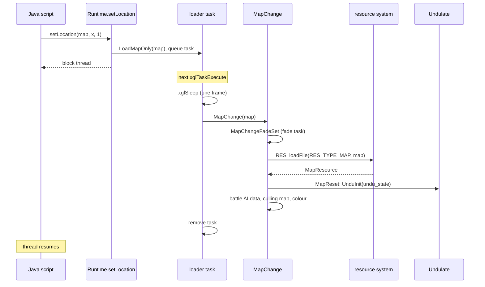
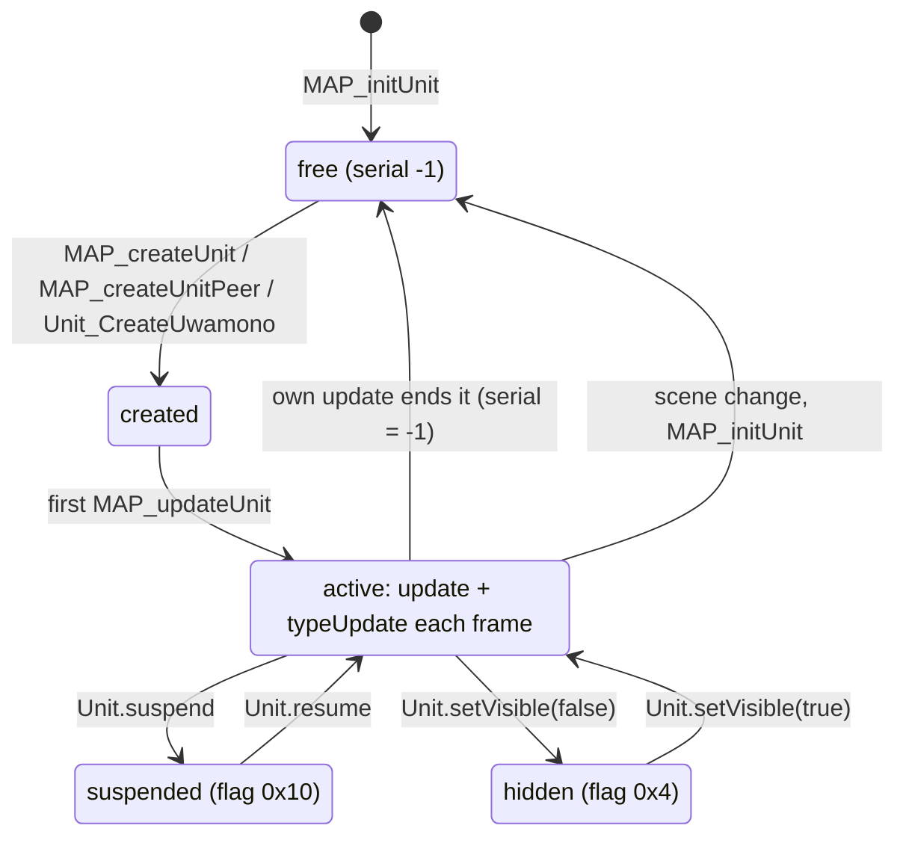
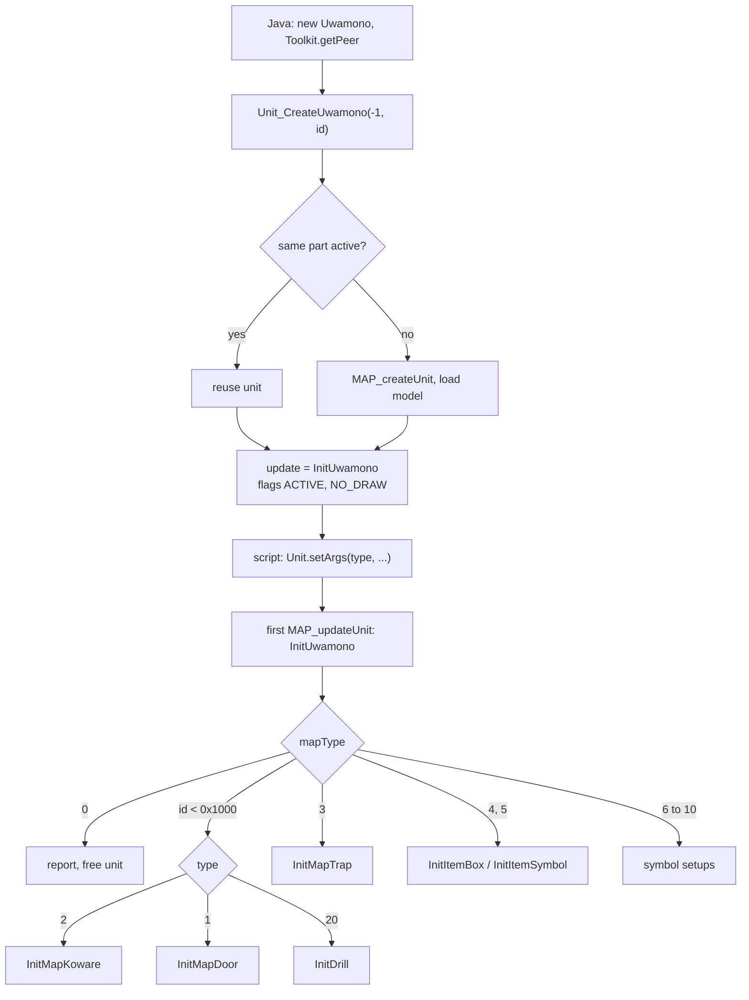
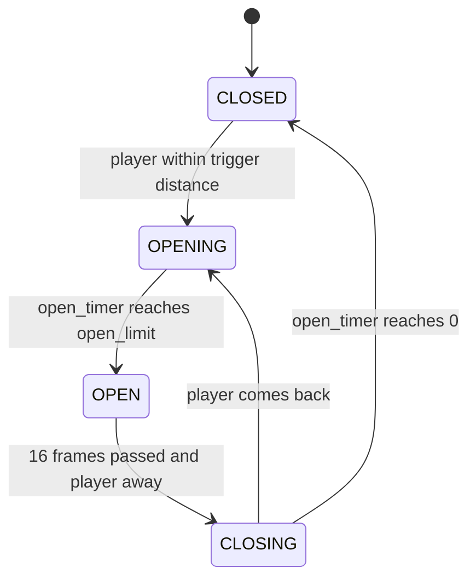
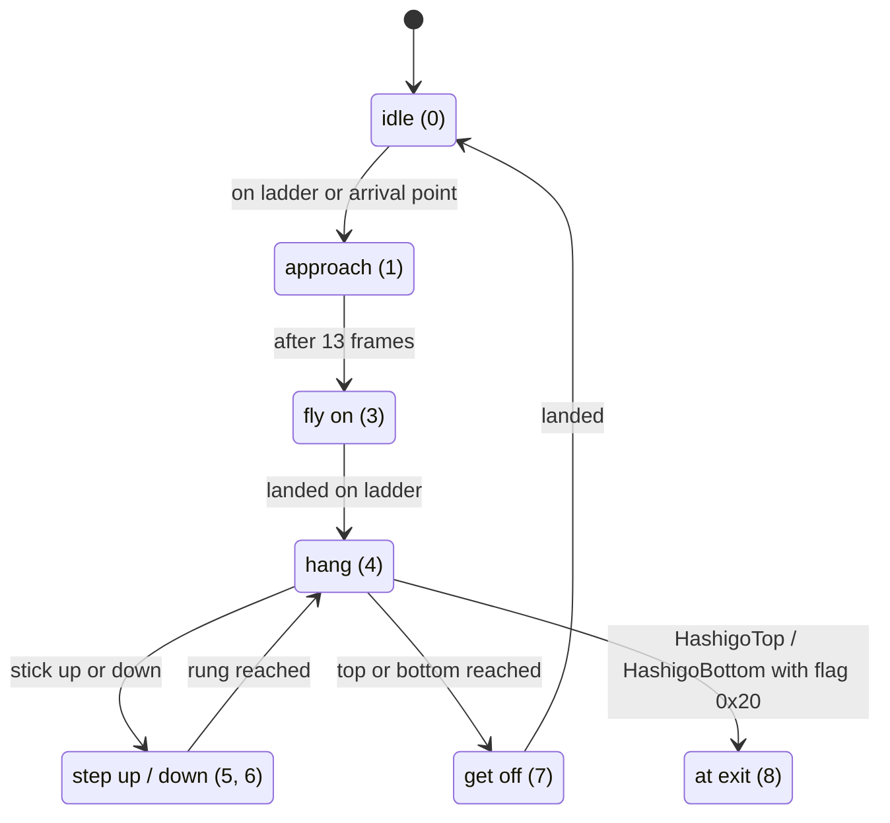

# Maps and units

A map is the 3D place the player walks through in the [field](field.md): a
room, a corridor, a deck of a ship. It comes as one model for the scenery and
one collision mesh, the "undulation" data, that says where the floor is, where
the walls are and what each piece of floor means. On top of the map the game
places map units: doors, item boxes, breakable crates, traps, save points,
elevators, monitor screens and any scenery that moves. The code calls the
placed objects "uwamono", Japanese for "things placed on top".

Maps and units are loaded and created by the scene scripts. The scripts run in
the game's Java virtual machine (see [Java VM](../scripting/java-vm.md)) and
control units through the `xeno.Unit` class. The engine side, described here,
loads the data, runs the units every frame, draws them and does the collision
tests.

[← Back to the overview](../README.md)

## Source files

| File | Contents |
| --- | --- |
| `src/main/map_1.c` | Map change, map reset, map drawing, map names and paths |
| `src/main/maptbl.c` | The map name table, the field camera definitions |
| `src/main/disp_on.c` | Display on and off tasks, the map loader task, event timers |
| `src/main/map_2.c` | The 64 map unit records: create, update, draw |
| `src/main/map_create_unit_peer.c` | Units created from Java, unit sequences |
| `src/main/toolkit.c` | `Toolkit.getPeer`, which links Java objects to units and actors |
| `src/main/unit.c` | The `xeno.Unit` natives |
| `src/main/init_uwamono_sys.c` | Map objects: resident models, creation, breakables, shooting, map object collision |
| `src/main/init_map_door.c` | Doors |
| `src/main/init_map_trap.c` | Traps and containers |
| `src/main/create_evt_item_get_task.c` | Item boxes and item symbols |
| `src/main/get_ladder.c` | Ladders |
| `src/main/tya_elevator_task.c` | Elevators |
| `src/main/unit6003.c` | Monitor screens (unit `0x6025`) |
| `src/main/Undulate.c` | The collision mesh queries |
| `src/main/layout.c` | The `xeno.util.Layout` natives that place objects on locators |
| `src/main/get.c` | Geometry helpers built on the collision mesh |
| `src/main/face_point.c` | Map culling planes |
| `src/main/colli_test.c` | An interactive collision test tool |

## Maps

### Map ids and the map table

Every map has a number. The number is `group * 100 + index`, and the name of
the map is looked up in `maptbl[]` in `src/main/maptbl.c`. The table has 19
groups plus an empty terminator. `MapGetName(map_no)` returns the name, or
null when the slot is empty. Map ids must be below `0x71E`.

| Group | Ids | Names | Notes |
| --- | --- | --- | --- |
| 0 | 0–57 | `araikabe`, `MC_TST01`–`13`, `MC_TEST`, `MC_BTL01`, `MC_VOK01`–`26` (no `17`), `MC_VOKnnb`, `MC_ELS01` | Test maps and early maps |
| 1 | 100–131 | `MC_ELS01`–`16`, `b` and `h` variants | probably the Elsa |
| 2 | none | empty | |
| 3 | 300 | `MC_SYU01` | |
| 4 | 400–401 | `MC_UMN01`, `02` | probably U.M.N. space |
| 5 | 500–507 | `MC_UZU01`–`08` | |
| 6 | 600–601 | `MC_MIL01`, `02` | probably Second Miltia |
| 7 | 700–747 | `MC_EVE..` | |
| 8 | 800–818 | `MC_DYU..` | probably the Durandal |
| 9 | 900–918 | `MC_UTA..` | probably the Song of Nephilim |
| 10 | 1000 | `MC_SYO01` | |
| 11 | 1100–1108 | `MC_PRO..` | probably Proto Merkabah |
| 12 | 1200–1240 | `MC_KAS..` | |
| 13 | 1300–1323 | `MC_KUK..` | probably the Kukai Foundation |
| 14–18 | 1400–1821 | `MC_GNK`, `MC_UTK`, `MC_KOU`, `MC_GNU`, `MC_UDO` | |

The readings in the last column come from the three-letter codes only, so they
are guesses. `VOK` is probably the Woglinde, whose Japanese name starts with
"Vo". Empty names inside a group mark map numbers that are not used. The
table has 344 slots and 323 names, but 75 names have no files on the disc,
the whole `MC_UDO` group among them. The disc in turn holds three map sets
that no slot names (`MC_DYU06B`, `MC_VOK17` and `MC_GUN08`), so they can never
be loaded. The file names and the per-group counts are listed in
[the map directory](../formats/maps-and-field-data.md#the-map-directory).

`MAP_getPath()` returns the folder that map files are read from. It depends
on `UseTestPath`: 0 gives `data\map\`, 1 gives `data\map\test\` and 2 gives
`data\map\check\`. `MapInit()` sets it to 0, so the test folders are only used
by test code. Neither test folder exists on the disc.

### What a map is made of

A map is loaded as one resource of type `RES_TYPE_MAP`.
`RES_loadFileSubMap` in `src/main/res_get_path.c` reads the map's files one
after another into one memory block, each aligned to 16 bytes:

| File | Field of `MapResource` | Contents |
| --- | --- | --- |
| (built in) | `place` | A unit matrix that places the map in the world |
| `<name>.lex` | `culling_map` | The scenery model, split into parts with culling data |
| `<name>.xtx` | `texture` | The scenery textures |
| `<name>.id` | `undu_state` | The collision mesh (undulation data) |
| think file | `think_data` | Battle AI data for battles on this map |

The first three files sit in `data\map\` and share the map's name. A missing
`.xtx` or `.id` leaves its pointer at 0. 41 map sets on the disc have no
`.id`, 24 of them event maps (`MC_EVE*`). Without an `.id` a map has no floor
and no entrances, so the scene scripts load only ten of these sets, nine of
them as backdrops for cutscenes. The byte layout of the block and of each file is in
[Maps and field data](../formats/maps-and-field-data.md#the-map-block-in-memory).

The think file is not in the map folder. The OV01 function
`dataThinkNameGet` (which `src/main/res_get_path.c` still declares under the
placeholder name `func_A1CF18`) looks the map id up in the table
`thinkMapTbl` and, when it finds it at index n, names the file
`data\yamamoto\think\think%03d.bin`. 91 maps have a think file, and a map
that is not in the table gets none. The think data is handed to the battle
code when the map is reset. The battle side is described in
[Battle](battle.md), and the think files themselves in
[Game tables](../formats/game-tables.md#enemy-ai-programs-think-files). Model
and texture formats are described in [nml](../libraries/nml.md) and
[Models and textures](../formats/models-and-textures.md).

The layout below shows the block.

```
map resource block (RES_TYPE_MAP)
+------------------------------+
| SubMapLoadState              |  pointers to the parts below
| place matrix (unit)          |
+------------------------------+
| <name>.lex   scenery model   |  culling_map
+------------------------------+
| <name>.xtx   textures        |  texture (0 if missing)
+------------------------------+
| <name>.id    collision mesh  |  undu_state (0 if missing)
+------------------------------+
| think file   battle AI data  |  think_data (0 if missing)
+------------------------------+
```

### Loading a map

A map is usually loaded by the scene resource list of the current scene. The
command `loadmap NAME` in `src/main/res_get_path.c` looks the name up in
`maptbl[]`, loads the map resource and makes it current. With a `-` before the
name (`loadmap -NAME`) the map is only loaded, not switched to, so a scene can
preload several maps.

Making a map current is `MapReset()`:

1. `UnduInit(undu_state)` installs the map's collision mesh.
2. Map flag `0x80` and render flags `0x30` are set.
3. The OV01 function `dataThinkDataSet` (declared in `src/main/map_1.c` as
   `func_A1CFB8`) copies 16 KiB (0x4000 bytes) from the map's think data into
   the battle buffer `thinkBuf` when the map has a think file. The think files
   are only 382 to 11,220 bytes long, so the copy also takes whatever follows
   the file in memory. Only the part inside the file is meaningful.
4. The model library is told that the map changed
   (`nmlModelSetMapLastInit`), and the map's culling data is installed
   (`xglCullingMapSet`).
5. The render level and clip mode are reset and the map colour is set to white.

Several functions lead to `MapReset()`:

- `MapChange2(map_id)` loads map `map_id` through the resource system and
  resets it. `MapChange(map_id)` starts the change fade first.
- `MapChangeResource(slot, entrance)` switches to a map that is already loaded
  in resource slot `slot`. Slots below 1000 also start the change fade. It then
  places the player at entrance `entrance`: the entrance is a locator in the
  collision data (`UnduDataGetHeader(0x201, entrance + 0x8000)`), and the
  player gets its position and facing.
- `MapChangeFadeSet()` starts the fade. It flips the draw packet and installs
  `taskMapChange` as the render callback, which draws a full-screen fade
  primitive and lowers its strength by 4 each frame, starting from `0x80`.
  It does nothing while `fade_countdown` is still running.

Scripts reach these through `Runtime.setMap(slot, entrance)`, which calls
`MapChangeResource`, and `Runtime.setLocation(map, unused, wait)`, whose second
argument is not read. Without a wait `setLocation` changes the map at once
with `MapChange2`. With a wait it queues `LoadMapOnly(map)` and blocks the
script thread until the load is done.

The loader task in `src/main/disp_on.c` performs queued loads inside the frame
scheduler, so loading happens between frames and not in the middle of a
script. `LoadMap(map)` and `LoadMap2(map, event_index)` first reset the game
resources and actors, then queue a load that changes the map and loads and runs
the map's event script `<mapname>.evt`. `LoadMapOnly(map)` queues only the map
change. The task runs only while `GameLoopState.flags` has bit `0x200` and not
bit `0x400`, and removes itself when done. `Runtime.setLocation` uses
`LoadMapOnly`, and the debug map selection window in `src/main/script.c` uses
`LoadMap2` with the entrance chosen on its slider. No caller of `LoadMap` was
found.

The event script path is an older scheme. `loadScriptCD` reads
`<mapname>.evt` from `MAP_getPath()` and then `<mapname>.fpk` and
`<mapname>.arc` beside it, but `data\map\` holds only `.lex`, `.xtx` and `.id`
files. On the retail disc the read fails, `SCRIPT_exec` finds no class to run,
resets the field and creates only the player character. The debug map window
therefore drops the player on the new map with no scene script. Real scene
scripts live in `data\scene\` and are loaded through the scene resource list
(see [Scripts and archives](../formats/scripts-and-archives.md#scene-resource-scripts-txt)).

The sequence below shows a map change requested by a script with
`Runtime.setLocation` and a wait.



### Drawing the map

`MapDraw()` is the default map pass of `GameDrawSync` (see
[field](field.md#gamedrawsync-drawing-a-field-frame)). It computes the light
matrices of the current studio light and hands the model library the light,
the map texture, the map colour, the render level, the place matrix and the
clip mode, then enters the culling model (`nmlModelEntry(culling_map)`). The
model library culls and draws the parts that are visible. Culling with the
map's planes (`xglCullingMapSet` and `src/main/face_point.c`) is described in
[Rendering](../architecture/rendering.md). `xglCullingMapSet` finds a map's
culling data by the internal name stored in the `.lex` header, compared
case-sensitively with the 69 names of its table. Some B variants carry the
name of their base map and share its entry, while `MC_VOK07B` and
`MC_VOK10B` carry the names `MC_VOK07b` and `MC_VOK10b`, which the table does
not hold, so they get no culling data at all (see
[The internal name and culling](../formats/maps-and-field-data.md#the-internal-name-and-culling)).

### Display on and off, event timers

`DISP_on(countdown)` and `DISP_off(countdown)` queue a task that waits
`countdown` frames and then sets or clears `GAME_FLAG_DRAW`. While that flag is
clear `GameDrawSync` draws nothing, which hides the scene during loads. The
task only acts while `GameLoopState.flags` has bit `0x100`.

`Runtime.setEventTimer(method, countdown)` queues `EventTimerTask`, which
counts down while the game is not paused and then calls the named script
method. It removes itself when flags `0x80000030` are set.

## Collision

### The collision mesh (Undulate)

The map's `.id` file holds its collision mesh. The code calls it "undulation"
(`Undu*` functions in `src/main/Undulate.c`), after the relief of the ground.
It is made of triangle meshes. Each triangle stores its plane, its three
corners, a link to the neighbouring triangle across each edge, and a 16-bit
index into one attribute table that the whole file shares. An attribute is
an 8-byte value that says what the surface means (see
[Floor attributes](#floor-attributes)). Walls are not a separate table: a
move stops at an open edge, or at an edge whose neighbouring triangle has a
wall attribute (bits 0 to 2, tested by `CheckWallAttr`). The byte layout is
described in
[Collision and layout data](../formats/maps-and-field-data.md#collision-and-layout-data-id).

The file holds two kinds of entries, organised in numbered lists. A **mesh
header** (20 bytes) points to one triangle mesh: its vertices, normals,
triangles and the shared attribute table. A **locator** (16 bytes) is a named
point, a position x, y, z and a yaw angle, which the code reads through
`struct LayoutHeader`. Locators sit in eight numbered **groups**, and mesh
headers sit in the direct list, the second list and up to seven numbered
**record lists**. `UnduDataGetHeader(list, id)` finds an entry by its
identifier in a list, or by index when bit `0x8000` is set in `id`. The high
byte of `list` selects the kind of list and the low byte its number: `0x000`
the direct headers, `0x100` the second list, `0x2nn` locator group `nn` and
`0x3nn` record list `nn`. These lists are used:

| List | Kind | Used by | Meaning |
| --- | --- | --- | --- |
| `0x000` | mesh | most ground queries, `Chr.setID` | The walk floors. Header 0 is the main floor. In 31 maps the list holds two to four floors, and `Chr.setID(id)` binds an actor to one of them |
| `0x100` | mesh | `GameCamera` | Camera floors, one per camera index |
| `0x200` | locator | `Layout` natives (`setLocation(0, n)`) | Default layout points, used by two maps only |
| `0x201` | locator | `MapChangeResource`, `Layout` natives | Entrances |
| `0x204`, `0x205` | locator | `Chr.setLocation(4, n)`, `(5, n)` | Character placement points |
| `0x206` | locator | `Effect.setLocation(6, n)` | Effect positions |
| `0x207` | locator | `Check_Locater` | Event trigger areas, as pairs of locators |
| `0x300` | mesh | non-enemy actors | Ground layer for NPCs |
| `0x301` | mesh | nothing | Unused |
| `0x302` | mesh | `GameCamera` | Camera zones |
| `0x303` | mesh | footstep sounds in `src/main/act_3.c` | Footstep materials |
| `0x304` | mesh | enemies | Ground layer for enemies |
| `0x305` | mesh | `AimMapUnitLookCheck` | Line of sight for aiming at objects, the main floor when empty |
| `0x306` | mesh | `GameIdLightSet` | Floor light zones |

Groups 2 and 3 are empty in every file. The `Layout` natives behind
`setLocation(group, number)` (`src/main/layout.c`) and `MapChangeResource`
always look locators up by index, as `UnduDataGetHeader(0x200 + group, number
+ 0x8000)`. Only `Check_Locater` and the enemy debug page search group 7 by
identifier. `Chr.setID` passes its argument unchanged, so a script names a
direct floor by its identifier, or by index with `0x8000` added. How the
event trigger pairs work is described in
[Event locators](../formats/maps-and-field-data.md#event-locators).

Enemies and other actors use different layers, probably so that a map can let
NPCs walk where enemies cannot, and the other way round.

`UnduInit(blob)` installs a map's mesh (or none with 0). `UnduParamInit` clears
a query block (`UnduParam`, 64 bytes). `UnduCheck(position, move, param)` is
the main query: it finds the floor under `position`, returns its height or
`UNDU_NO_HEIGHT` (-1000.0) when there is none, writes the floor's attribute
into `param->attribute`, and can test a move against the walls. The query
flags select what to do when a move hits a wall: stop (`UNDU_QUERY_MODE_BLOCK`),
slide along the edge (`UNDU_QUERY_MODE_SLIDE`) or clip the move at the edge
(`UNDU_QUERY_MODE_CLIP`). Other flags restrict the floor that counts: within a
height tolerance (`0x10`), at or below the sample (`0x800`), within the
triangle's vertical extent (`0x400`), or taken from a height table (`0x20`).
`UnduGet(x, z)` and `UnduGet2` return a plain floor height.

Undulation is listed under [Animation](../libraries/animation.md) in the page
map, but it is collision code. Its users are the player, enemies, the camera,
map units and the geometry helpers.

### Floor attributes

The floor attribute is how map designers give meaning to the floor. The code
tests these values and masks:

| Test | Meaning | Used by |
| --- | --- | --- |
| bits 8–12 a number, bits 13–15 clear | Run floor script number − 1 when stepped on | `checkAttr` in `game.c` |
| bits 13–15 = 3, bits 8–12 a light id | Floor light preset | `GameIdLightSet` |
| `attr & 0x8F00` = `0x8100`…`0x8F00` | Footstep effect index (dust, water) | `Get_EffectCode`, player and enemies |
| `0x10` | Walk only | `GameCfPlayerMove` |
| bits 24–27 | Conveyor direction (eight directions) | Player and `Move_BeltConveyer` |
| bits 28–29 | Speed class: ×1, ×2, ×0.5, ×3 | Player and conveyors |
| `0x00100000`…`0x001F0000` | Ladder 0 to 15 | `Get_Ladder` |
| `0x00200000`…`0x00230000` | Ladder arrival point 0 to 3 | `Get_Arrival` |
| `attr & 0x38000000` = `0x20000000` (bits 27–29 = 4), bits 20–26 the camera index minus 1 | Camera zone, read from list `0x302` | `GameCamera` |
| values in `EneTerritoryID[]` | Enemy territory, read from lists `0x300` and `0x304` | `TM_Check_Move` |
| `0x2300`…`0x2600`, read from list `0x303` | Footstep material, adds `((attr & 0xFF00) - 0x2300) >> 6` to the footstep sound | `src/main/act_3.c` |
| bits 13–15 = 2, bits 8–12 a slot (`0x4100` on the disc) | Floor height taken from `GameLoopState.attributeHeights[slot]` when the query has flag `0x20` | `UnduCheck` |
| bits 0–2 | Wall | `CheckWallAttr` |

Different callers read the attribute with different masks
(`Get_Attr(position, layer, mask)`), so the same bits can mean different
things in different tests. The table lists the tests as the code makes them,
not one fixed bit layout. Each user also reads its own list of the `.id`
file, so a value such as a territory number only appears in the layer meant
for it. The values found on the disc and the list each one appears in are
listed in
[The attribute table](../formats/maps-and-field-data.md#the-attribute-table).
Two camera-layer values on the disc, `0x28000000` and `0x29000000`, have
bit 27 set and fail the camera test, so the camera keeps its current index
over those areas, which is probably what they are for.

### Collision with map units

Map units have their own collision, separate from the mesh. Each map object has
a shape (`crossType`, a circle or a box) and dimensions.
`src/main/init_uwamono_sys.c` tests against them:

- `HitCheckMapUnit` and `HitCheckMapUnitPosSize(position, radius)` return the
  first active, visible unit that overlaps a circle.
- `HitCheckMapUnitWithNyuru` does the same and pushes the actor out along the
  unit's edge. "Nyuru" is a Japanese sound word for sliding smoothly. The push
  functions `NyuruCircle`, `NyuruBox` and `NyuruCorner` handle the three cases,
  and actors count with 1.5 times their radius.
- `CrossPointUwamono` and `CrossCheckMapUnit` test a line segment against the
  units. Enemies use them to see whether an object stands between them and the
  player.
- `CheckUwamonoHeight` applies gravity to an object and bounces it off the
  ground or off another object, so dropped objects come to rest on what is
  below them.

The script native `Unit.setCollision(bool)` sets or clears unit flag `0x100`.

### Geometry helpers

`src/main/get.c` builds higher-level tests on the mesh: `Check_Wall` samples a
half circle of directions for walls, `Check_Straight` walks a line in steps,
`Get_Height` and `Get_Attr` read the floor, `Check_InsideFan` tests a view
cone, and `Get_EnemyIDPos` finds the ground under a point or the nearest ground
around it. These are described in [Math](../libraries/math.md). `colli_test.c`
holds an interactive collision debugger (`ColliTest`), described in
[Debug tools](debug-tools.md).

## Map units

### The MapUnit array

All units live in one global array, `MapUnit[64]`. Each entry is a
`MapUnitRecord` of `0x300` bytes, defined in `include/main/exm_2.h`. An entry
is free when its `serial` is -1. Different files view the same record through
different structs, especially the 96-byte kind work area at `+0x1A0`, whose
meaning depends on what the unit is.

| Offset | Field | Meaning |
| --- | --- | --- |
| `+0x000` | `flags` | Unit flags (see below) |
| `+0x004` | `update` | Per-frame update function |
| `+0x008` | `draw` | Draw function (0 = default `MAP_drawUnitAt`) |
| `+0x00C` | `typeUpdate` | Second update, used for elevators and monitors |
| `+0x010` | `position`, `rotation`, `scale` | Placement |
| | `matrix`, `basis`, `globalPosition` | Computed placement |
| `+0x0A0` | `slot` | Index in `MapUnit` |
| `+0x0A1` | `signal` | Mailbox shared with the script |
| `+0x0A2` | `actionSub` | Sub-state of the unit's state machine |
| `+0x0A4` | `serial` | Model or object id, -1 when free |
| | `radius`, `doorPosition`, `sequence` | Size, door anchor, motion sequence |
| `+0x0E0` | `model` or `uwaresId` | The unit's model resource |
| `+0x0E8` | `effectCf[3]` | Up to three attached effects |
| | `parentMatrixIndex`, `parent` | Attachment to an actor joint |
| `+0x1A0` | kind work area | Arguments and state of the unit's kind |
| `+0x240` | `modelState` | Model entry state |
| | `shadow_map_ids[8]`, `render_command`, `filter_mode`, `sort_offset`, `transparency` | Drawing options |

The kind work area holds, depending on the unit: the arguments written by the
script with `Unit.setArgs`, the uwamono state (`UwamonoCreatedState`: type,
initial values, timers), a door's parameters, a trap's damage properties, an
elevator's heights or a monitor's frame state.

The unit flags used across the code are:

| Flag | Name | Meaning |
| --- | --- | --- |
| `0x4` | `MAP_UNIT_NO_DRAW` | Not drawn |
| `0x10` | `MAP_UNIT_FLAG_SUSPENDED` | Update skipped |
| `0x20` | `MAP_UNIT_FLAG_SHADOW_MAP` | Receives shadow maps |
| `0x40` | `MAP_UNIT_FLAG_CLIP` | Clipped |
| `0x100` | (collision) | Set by `Unit.setCollision` |
| `0x10000` | `MAP_UNIT_ACTIVE` | Active map object |
| `0x20000` | `MAP_UNIT_BROKEN` | Broken |
| `0x40000` | `MAP_UNIT_SELECTABLE` | Can be aimed at |
| `0x80000` | `MAP_UNIT_LANDED` | Standing on something |
| `0x100000` | `MAP_UNIT_HIDDEN` | Hidden |
| `0x08000000` | (item box) | Opened with CIRCLE (`checkItemBox`) |
| `0x20000000` | `MAP_UNIT_SAVE` | Save symbol |
| `0x40000000` | `MAP_UNIT_SHOP` | Shop symbol |

### Creating units

`MAP_initUnit()` clears all 64 records: serial -1, scale 1 and default drawing
options. `Game()` and `InitCfSystem()` call it, so every scene starts with no
units.

`MAP_createUnit(slot, serial)` takes slot `slot`, or the first free one when
`slot` is negative, and stores the serial. Serial `0x6025` also installs
`unit6003_update` as the type update (see [Monitor screens](#monitor-screens)).
`MAP_loadUnitResource` finds the unit's model: a model resource with the
unit's id, or the id with the low byte cleared (`id & 0x7F00`) as a fallback.
It logs "Model not found" when neither exists.

Scripts create units through Java. A scene script creates a `xeno.Unit` object
and asks `Toolkit.getPeer` (`src/main/toolkit.c`) for its engine side, its
"peer":

- For a plain `xeno.Unit`, `getPeer_Unit` calls `MAP_createUnitPeer(-1, id)`,
  sets default sequences and starts a Java thread of kind `JTHREAD_KIND_UNIT`
  for the object. If the id names a part of the map model, the unit takes that
  part's transform from the map, otherwise it uses the object's `px`, `py`,
  `pz` and rotation fields (degrees converted to radians).
- For a `xeno.Uwamono` (a subclass of `Unit`), `getPeer_Uwamono` calls
  `Unit_CreateUwamono(-1, id)`, described below.
- `xeno.Chr` objects become actors, and `xeno.Enepc` objects become enemy
  actors (see [Field enemies](field-enemies.md#creating-an-enemy)).

The Java object keeps a pointer to the `MapUnitRecord` in its `peer` field.
The natives of `xeno.Unit` in `src/main/unit.c` read that field to reach the
unit. They move, turn and scale it (directly or along splines), play its
motion, show or hide it (`setVisible`, flag `0x4`), suspend and resume it
(flag `0x10`), write and read its arguments (`setArgs`, `getArgs`), attach it
to an actor joint (`setParent`), set its shadow, filter, sort offset, clip and
render command, and turn it into an elevator (`initElevatorFunc`). The full
list is in [Natives](../scripting/natives.md).

`Unit.signal(int)` writes the unit's `signal` byte (`+0xA1`) and
`Unit.getSignal()` reads it. The signal is a small mailbox between the script
and the unit's update function. A script switches a monitor screen on by
writing 1, for example. Map objects use the same byte as their action number
and have a second signal of their own in the argument area (see
[Map objects](#map-objects-uwamono)).

### Updating and drawing units

`MAP_updateUnit()` runs once per frame in CF main and CF event mode. For every
unit with a serial of 0 or more that is not suspended, it calls `update` and
then `typeUpdate`.

`MAP_updateUnitDefault` is the default update of script units. It runs the
unit's sequences, keeps the unit on the ground when its follow-ground flag is
set (`UnduGet`) and rebuilds its matrix. Unit sequences (`unitSequence[64]`,
one `UnitSequenceEntry` per unit) move, turn and scale units along curves over
time. The `SEQ_*` functions in `src/main/map_create_unit_peer.c` that drive
them are described in [Scenes and time charts](../scripting/scenes-and-timecharts.md).

`MAP_drawUnit()` is the default unit pass of `GameDrawSync`. For each unit that
is not hidden it calls the unit's own `draw` function or `MAP_drawUnitAt`. The
default draw builds the matrix from translation, rotation and scale, multiplies
it by the parent actor's joint matrix when the unit is attached (bit `0x8000`
of `parentMatrixIndex`), sets the texture, the visible model parts, the render
level and sort offset, clipping, shadow-map parts, texture map modes 5 to 10
and filters, then enters the model (`nmlModelEntry`). `MAP_getHeight` returns
the floor height at a unit with `UnduGet`.

The state diagram below shows the life of a unit.



## Map objects (uwamono)

### Resident models and ids

Map objects are units with game rules attached. `InitUwamonoSys()` runs when a
session starts. It loads 14 resident object models with their textures into a
`0x50000`-byte area (`uwamono_dat`): models `MU_001` to `MU_004`, `Tre_001`,
`Save_P`, `Shop_P`, `Tre_002` and `MU_009` to `MU_014`. Their addresses go into
`uwares_tbl[]` and `xtxres_tbl[]`. `Tre` models are probably the treasure
(item) boxes, and `Save_P` and `Shop_P` the save point and shop terminal. It
also loads two item tables from `data\karakama\`, `itembox.dat` into
`ItemBoxTbl` and `evtitem.dat` into `EvtItemTbl` (see
[Item box tables](../formats/maps-and-field-data.md#item-box-tables)), and
enables aiming with a selection distance of 3.0.

The id of a map object says where its model comes from:

| Id | Meaning |
| --- | --- |
| below `0x1000` | A part of the map model (a door or breakable built into the map) |
| `0x1000` and up | A model resource of the scene |
| `0x7000` | An invisible collision box |
| `0x7001`–`0x7004` | Traps (resident models) |
| `0x7005`–`0x7007` | Symbol objects |
| `0x7012` | An invisible sound emitter |
| `0x7014` and up | Containers (31 kinds) |

The script gives each object a type in its arguments (`mapType`):

| Type | Name | Handler |
| --- | --- | --- |
| 1 | `UWAMONO_TYPE_DOOR` | `InitMapDoor` |
| 2 | `UWAMONO_TYPE_KOWARE` | `InitMapKoware` (breakable) |
| 3 | `UWAMONO_TYPE_TRAP` | `InitMapTrap` |
| 4 | `UWAMONO_TYPE_ITEM_BOX` | `InitItemBox` |
| 5 | `UWAMONO_TYPE_ITEM_SYMBOL` | `InitItemSymbol` |
| 6 | `UWAMONO_TYPE_SAVE_SYMBOL` | `InitSaveSymbol` |
| 7 | `UWAMONO_TYPE_SHOP_SYMBOL` | `InitShopSymbol` |
| 8 | `UWAMONO_TYPE_EVS_SYMBOL` | `InitEvsSymbol` |
| 9 | `UWAMONO_TYPE_RET_SYMBOL` | `InitRetSymbol` |
| 10 | `UWAMONO_TYPE_SPECIAL_SYMBOL` | `InitSpecialSymbol` |
| 20 | `UWAMONO_TYPE_DRILL` | `InitDrill` (Driller Game) |

### Creating a map object

`Unit_CreateUwamono(slot, id)` creates the unit. If an active unit with the
same map part id already exists, it is reused. Otherwise a new unit is created
with `MAP_createUnit`. The model is loaded for scene model ids, but not for map
parts, special objects, symbol objects and id `0x7013`. The unit starts as
active and not drawn, its state values are set to -1 ("not given"), and its
update is `InitUwamono`.

Every map object has a signal byte at `+0x1A4`, inside its argument area. It
is the object's trigger. `checkItemBox` writes 1 to open an item box, a shot
writes 1 to the object it hits, and `SendBrokenSignal` writes 2, which enemies
use when they push into an object. An event door opens when its signal is 1.
Scripts reach the byte through the argument area, probably with
`Unit.setArgs`.

The real setup waits one frame. The script needs that frame to write the
object's arguments with `Unit.setArgs` after creating it. On its first update
`InitUwamono`:

1. Reports and frees the unit if the script gave no type.
2. Probes the floor under the object.
3. For a map part (id below `0x1000`) calls `InitMapParts`, which picks the
   breakable, door or drill setup by type.
4. Otherwise calls the setup for the type. An unknown type is reported and the
   unit stops updating.

Each setup installs the real update function of the object. The flowchart below
shows the path.



`SetHideObject` adds a hidden surprise to an object. It can link an enemy actor
that stays hidden (actor flag 8) until the object reacts, and a hidden unit
(`MAP_updateUnitHide`) that appears once the linked object's `actionSub`
becomes non-zero. When it appears it becomes an item box, an item symbol, a
breakable or a trap. So breaking a crate can release an enemy or reveal an
item.

### Doors

`src/main/init_map_door.c` runs doors. A door is a part of the map model.
`InitMapDoor` reads the part's position and size, sets the travel distance
and installs `MAP_updateUnitDoor`. A door can be linked to a second door,
which copies its parameters and moves with it.

| Door type | Opens when |
| --- | --- |
| `DOOR_TYPE_AUTO` (1) | The player comes within the trigger distance |
| `DOOR_TYPE_EVENT` (2) | The script writes 1 to the door's signal |
| `DOOR_TYPE_DOUBLE` (3) | Never by itself (its function is empty) |
| `DOOR_TYPE_MJ` (4) | The player is near and presses CIRCLE while facing it within 60 degrees |
| `DOOR_TYPE_HALF_AUTO` (5) | Like an auto door, and it stays open while its signal is 1 |

Every door goes through the phases closed, opening, open and closing. A
linked door is in the extra phase "linked" and follows its partner. The
opening and closing moves count `open_timer` toward `open_limit` and move the
model along its motion: slide forward, slide back, rise or sink. An auto door
stays open for 16 frames after the player leaves, a half-auto door for 12. A
closing door opens again when the player returns. Door distance is measured in
2D, and a player more than 2 units above or below counts as far away, so a door
on another floor does not react. Opening and closing play positional sound
effects.

The state diagram below shows the phases of an auto door.



### Breakable objects (koware)

"Koware" means "breakable" in Japanese. A breakable is a part of the map model
with an entry in `KowareKind_t[127]`, which gives its shape (1 or 2, probably a
cylinder and a box), its dimensions, a target class 0 to 2 and the number of
the effect played when it breaks (601 and up). `InitMapKoware` places it with
`GetPartsPos` and `GetPartsSize` and makes the model part visible.

`MAP_updateUnitKoware` waits until its signal byte is not zero. A shot sets it,
and so does an enemy that walks into the object or reaches it with its
tentacle range (`SendBrokenSignal`). Then it:

1. Adds the unit to the shoot list, so the break survives a battle.
2. Shakes the controller strongly (255 down to 32 over 30 frames).
3. Plays a breaking sound chosen by material (`UwamonoBrokenSe`, sound effects
   `0x10003`, `0x10006` or `0x10007`).
4. Plays the break effect, removes the object's other effects and blows wind
   on nearby hair and cloth (`SetUwaWind`).
5. Calls the script method named in the object (`CallMethod_I`) with its part
   id, so the scene can react.
6. Hides the model part after 3 frames, sets `MAP_UNIT_BROKEN`, and removes
   the unit when its time limit runs out.

`GameStateRestoreKoware` hides the broken parts again after a battle, and
`ResetShootSys` clears the list when a scene starts.

### Shooting at objects

In some places the player can shoot at objects. Bit 0 of
`GameLoopState.shoot_control` enables it, and the player's move code then calls
`ShootMapUnit` every frame. Shooting is released while the player stands on a
conveyor floor.

1. `AimMapUnit` collects the selectable objects that are on screen and within
   reach, sorts them by screen position and tests a line of sight to each. R1
   and L1 cycle the target. Locking on plays sound effect `0x10001`, and
   `DrawActiveCursol` shows a cursor effect on the target.
2. SQUARE fires. The player turns to the target, a shot effect (`0x2DE`) and
   motion 14 play, and sound effect `0x10002` sounds.
3. When the motion passes 0.36 seconds, the object's signal is set to 1, which
   breaks it. Enemies within hearing range notice the noise
   (`Enemy_FindByEar`), and the controller gives a short weak vibration.
4. At 0.5 seconds the shot ends.

### Traps

Traps are objects with ids `0x7001` to `0x7004`. They are set up by
`InitMapTrap` in `src/main/init_map_trap.c` from the table `TrapKind_t[5]`:

| Trap | Damage flag | Break effect | Sound |
| --- | --- | --- | --- |
| Electric | `0x400000` | 730 | `0x10004` |
| Explosion | `0x800000` | 731 | `0x10005` |
| Seal | `0x4000000` | 732 | `0x1000A` |
| Slot | `0x2000000` | 733 | `0x10003` |
| Breakable | `0x200000` | 601 | by material |

A fall flag (`0x1000000`) also exists. Containers (`0x7014` and up) use the
same code with their own parameters (`SetContainerParam`). Ids `0x7000` and
`0x7012` are invisible and have no effect. The damage radius is 3.0.

`MAP_updateUnitTrap` waits for the trap's signal byte. A shot writes 1, which
fires the trap. `SendBrokenSignal` writes 2, which only breaks it. So the
player sets traps off by shooting them, while an enemy that bumps into one
merely destroys it.

- Signal 1 fires the trap. It plays the trap's sound, shakes the controller
  strongly (255 down to 32 over 90 frames, or 30 for a breakable), plays the
  effect, hides the model, blows wind, calls the script method `broken` with
  the trap's method id and goes to the damage state.
- In the damage state the wind stops after 5 frames, and for as long as the
  trap's active time lasts `GivesEnemyDamage` hurts the enemies around it. Then
  the unit is deleted.
- Signal 2 is a plain break, which removes the trap after 5 frames.

`GivesEnemyDamage` looks for actors that can be hurt by traps (actor flag
`0x10000`), are not hidden, were not hit yet and stand within the radius. It
marks them as hit and sets the damage kind on the actor: electric, explosion,
fall or seal. A slot trap gives no damage kind. The enemy's reaction is
described in [Field enemies](field-enemies.md#trap-damage).

### Item boxes and item symbols

An item box (type 4) is a chest that the player opens with CIRCLE.
`InitItemBox` uses the resident box model, gives the box a size of 0.3 by 0.5
by 0.2 and installs `MAP_updateUnitItemBox` and `MAP_drawUnitItemBox`. Each box
has an item number that indexes the item table. If the story flag
`ITEM_COLLECTED_FLAG_BASE + itemNo` is set, the box was already opened and
starts in its open state.

The item table has 601 rows of 8 bytes. A row gives either a sum of money or
a count of items of one category (item, weapon, bullet, accessory or event
item). Event items take their names from `evtitem.dat`, which names only 72 of
its 255 entries, so the 39 rows that give an event item above 72 would show an
empty name. The fourth byte of a row is the box's chance in the
[Driller Game](minigames/driller-game.md#6-containers-and-their-items). The
range check in `create_evt_item_get_task.c` uses `ITEM_NO_LIMIT` = 602, one
more than the table holds, so box number 601 would read past the end.

When `checkItemBox` in `game.c` finds the box in front of the player, it sends
the open signal. The box then plays its sound, removes its glow effect, queues
the item get task `taskItemGet`, which shows the "obtained" window and adds the
item, and plays its opening animation. The item get task belongs to the menu
code and is described in [Main menu](main-menu.md).

An item symbol (type 5) is an item that floats and spins on the floor. It is
picked up by walking into it: within the pickup distance, and while no item
window is open, it queues the same task and removes itself. A symbol whose item
was already collected is removed at once. Special symbols (type 10) use their
own update, `MAP_updateUnitSpecialSymbol`.

### Symbols: save, shop, EVS and return

Symbols are the interactive points of the field.

- **Save symbols** (type 6) use the resident `Save_P` model. Their update
  turns them by 0.05 radians per frame. They carry unit flag
  `MAP_UNIT_SAVE`. The save screen names the place after the current map id:
  `MenuSaveMapNameGet` looks the id up in `data\endou\savemap.bin` and falls
  back to the first entry, "Woglinde", when the map has none (see
  [Save point names](../formats/game-tables.md#save-point-names-savemapbin)).
- **Shop symbols** (type 7) use the `Shop_P` model and carry `MAP_UNIT_SHOP`
  and a shop number.
- **EVS symbols** (type 8) and **return symbols** (type 9) use
  `MAP_updateUnitSymbol`. They mark the points to enter or leave the EVS, the
  story's virtual space. The EVS symbol probably also works as the save point
  inside it.

`CheckGameSymbol` in `game.c` detects the player standing on one, and
`checkTalkPoint` acts on CIRCLE (see
[field](field.md#talking-item-boxes-and-symbols)).

### Positional sounds

Some objects play a looping sound placed in the 3D scene. `UwamonoBgmFunc`
plays it at the object's position, or, when the object asks for it, at the
point of the object's direction line that is nearest to the player, which
suits long sources such as a machine along a wall. `UwamonoBgmFadeOut` fades
them all out when a scene changes, and `ClearUwamonoEffect` stops an object's
sound together with its effects. The invisible object `0x7012` is probably the
pure sound emitter. Sound playback is described in
[Audio](../architecture/audio.md).

## Ladders

Ladders are marked in the collision mesh, not placed as units. A floor area
with attribute `0x00100000 + n * 0x10000` belongs to ladder n (0 to 15), and an
area with `0x00200000 + n * 0x10000` is an arrival point next to a ladder,
where the player gets on from the bottom. Three tables in `GameLoopState`
describe each ladder: its direction (0 to 3), whether it can be left at the
bottom, and its height. The script fills them with the enemy command
`Map_Command_Ladder` (see
[Field enemies](field-enemies.md#enemy-commands)).

The ladder code in `src/main/get_ladder.c` stores its state in the player's
enemy work record, at the same offset where enemies keep `encount_lock`. Code
that checks "the player's `encount_lock` is 0" is therefore checking that the
player is not on a ladder. This is why the pause button, the main menu and
encounters are disabled while climbing.

`Ladder_Main(actor)` runs at the start of every player move. Its states are:

| State | Name | What happens |
| --- | --- | --- |
| 0 | idle | `Ready_Ladder` checks whether the player stands on a ladder or on an arrival point facing one |
| 1 | approach | Waits 13 frames while turning to the ladder |
| 3 | fly on | Jumps onto the ladder along a parabola |
| 4 | hang | On the ladder, waiting for input |
| 5, 6 | step up, step down | Moves one rung in 15 frames |
| 7 | get off | Moves from the ladder to the landing point |
| 8 | at exit | The script took over at an end |

When the player gets on, `Fly_to_Ladder` fills `LadderStep[127]` with the
heights of the rungs, 0.7 units apart, around the middle one. On the ladder,
`On_Ladder` reads the stick or d-pad: up and down climb a rung at a time with a
climbing sound (`0x20011`), left and right move sideways. At the top it calls
the script method `HashigoTop` with the ladder number, and at the bottom
(when allowed) `HashigoBottom`. "Hashigo" means ladder. If the script sets
`ladder_flags` bit `0x20`, the ladder code stops in the "at exit" state and the
script moves the player itself. Otherwise `Get_Off_Ladder` moves the player off
and returns to idle.

The state diagram below shows the ladder states.



## Elevators

An elevator is a unit that moves part of the map up and down. The script calls
`Unit.initElevatorFunc()` on the unit. The native installs `tyaElevatorTask` as
the unit's type update and remembers the address of the Java object's `py`
field. The elevator's settings live in the unit's argument area, where the
script writes them: the index of the map part to move, the speed, the current
height and the target height.

`tyaElevatorTask` is a small state machine:

1. State 0 picks a free elevator slot (one higher than any other active
   elevator) and finds the map part's entry in the scene model.
2. State 1 waits until the target height differs from the current height and
   then sets the step direction.
3. State 2 moves the height one step per frame and returns to state 1 when it
   reaches the target.

Every frame the height is copied to three places: the part's entry in the
scene model (a `0x40`-byte entry whose word at `+0x34` receives the height,
probably the Y translation of the part's matrix, so the floor model moves), the
Java object's `py` field,
so the script sees it, and a word in `GameLoopState` at `+0x60 + slot * 4`.
That area is the eight script parameters that are saved with the game, so the
elevator's height probably survives saving and loading.

## Monitor screens

Unit serial `0x6025` is a screen that shows pictures or a movie inside the
map, for example a monitor on a wall. `MAP_createUnit` installs
`unit6003_update` (in `src/main/unit6003.c`) for it.

On its first update the unit loads its source. A resource id from 10000 is an
`fm` file (`data\texture\fmNNNN.xtx`, which a scene can preload with the
command `loadtex`), an XTX texture sheet of 512 by 448 pixels cut into frames
(128 by 112 by default). An id from 20000 is an `mvs` file
(`data\movie\small\mvsNNNN.ipu`, preloaded with `loadmovie`), an IPU movie
decoded into textures. The unit asks the resource system for the file with
`RES_loadFile`. The movie format is described in
[IPU movies](../formats/movies-images-and-icons.md#3-ipu-movies). Then the
unit waits for its signal. When the script sets the signal,
the unit fades in over 15 frames and draws every frame (`unit6003_draw`),
either in screen coordinates or placed in the world, stepping through the
frames at its playback speed. When the signal is cleared it fades out and stops
drawing.
