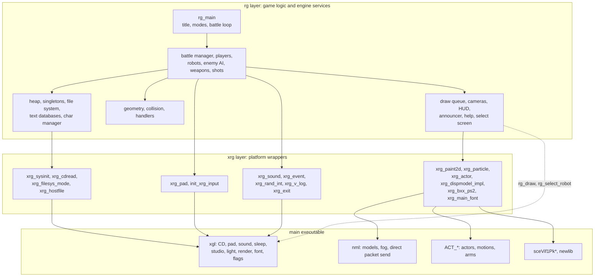
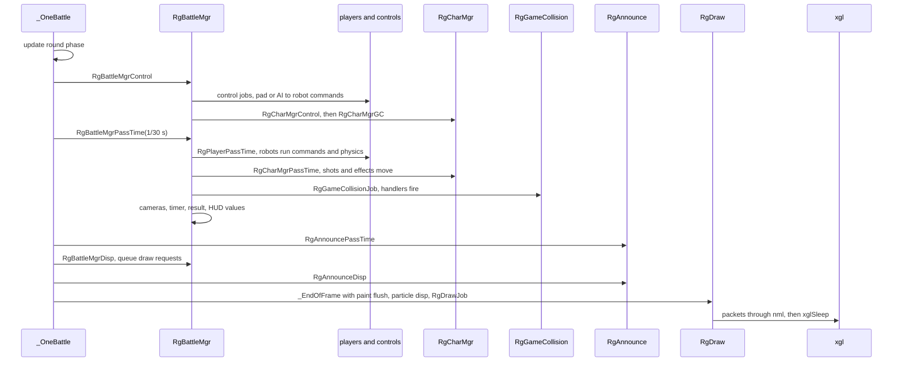
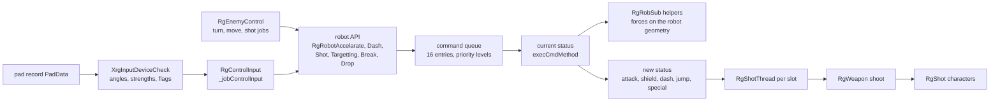
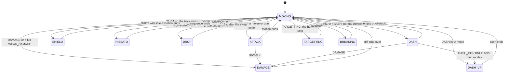
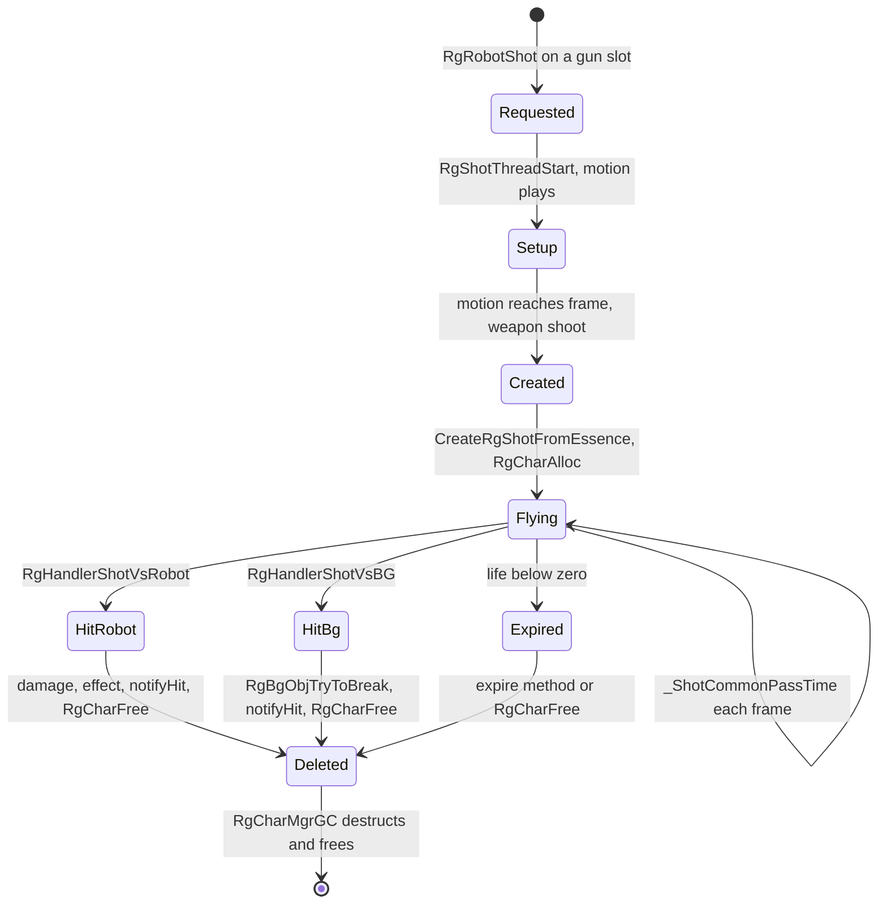
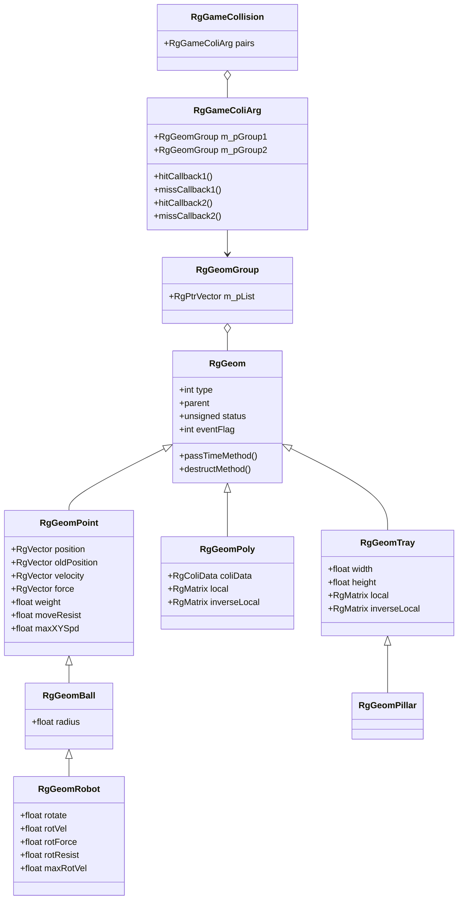
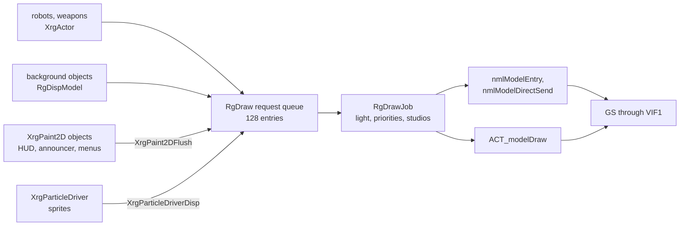

# The A.G.W.S. Battle engine

The [A.G.W.S. Battle](agws-battle.md) minigame does not use the battle system
of OV01 or the field code. Its overlay `OV12.OVL` carries a small, complete
game engine of its own: a heap allocator, a singleton registry, a file system
over link archives, text databases, a character manager, rigid-body geometry
with collision, robots driven by commands and states, weapons, shots, particle
effects, cameras, a draw queue and a 2D painter. The engine is written in C in
an object-oriented style, and every source file keeps the name of its original
`../rg_*.euc.c` file (EUC-JP encoded sources) in its assert strings.

The overlay is loaded at `0x00A00000`. Its single section is `0x5B0F4` bytes
long, with code up to `0x00A4F4C4` followed by read-only data and data. The
recovered source has 96 C files and about 45,000 lines in `src/ov12/`, with
public headers in `include/ov12/`. The object order is in
`config/objects/ov12.layout.json`. This page describes that engine. The game
rules it implements are on the [A.G.W.S. Battle](agws-battle.md) page.

[← Back to the overview](../../README.md)

## Layers

The engine has two layers on top of the main executable. The **rg** layer
(`rg_*.c`, "robot game") holds the game logic and the generic engine services.
The **xrg** layer (`xrg_*.c` and `init_xrg_input.c`) is the platform layer. It
wraps the parts of the main executable the engine needs: the
[xgl system library](../../libraries/xgl.md), the [nml model
library](../../libraries/nml.md), the [actor library](../../libraries/actors.md)
`ACT_*`, Sony's VIF1 packet helpers `sceVif1Pk*` and the newlib runtime. The
names suggest the code was written to be portable: the "x" layer is the only
place that should know about Xenosaga.

The separation is mostly kept. The xrg files make nearly all calls into the
main executable. A few rg files reach down directly: `rg_draw.c` sets the
studio, camera windows and sub-windows through `xglStudio*`, `xglCamera*` and
`nmlModel*`, `rg_select_robot.c` creates its preview actor with `ACT_*`, and
`rg_enemy.c` and `rg_piclist.c` call `xglFontDebugPrintf` in their debug
dumps. The diagram below shows the layers and the main services of each.



## Object style in C

Almost every module follows the same pattern, which makes the code easy to
read once it is known.

- **Create and dispose.** `CreateRgX(...)` allocates the object from an RgHeap,
  calls a private `_InitX` and returns it. `DisposeRgX(p)` calls `_DestructX`
  and frees it. Objects embedded in another object have a public `InitRgX`
  instead. Some creators take the caller's file and line for heap tracking,
  with a macro around a `*_sub` function (`CreateXrgPaint2D_sub`,
  `LoadRgBxx_sub`).
- **Methods as function pointers.** Objects that can vary hold their behaviour
  in pointers. `RgChar` has `controlMethod`, `dispMethod`, `destructMethod` and
  `passTimeMethod`. `RgWeapon` has `dispose`, `disp`, `passTime`, `shoot`,
  `shotStop`, `hitRobot`, `hitBG`, `isBusy` and `setFree`. A robot status has
  `execCmdMethod`, `passTimeMethod`, `dispMethod` and `exitMethod`. Setter
  functions such as `RgCharDispMethod` fill them.
- **Inheritance by embedding.** A derived struct starts with its base struct,
  so a pointer to it is also a pointer to the base. `RgShot` and `RgBgObj`
  start with an `RgChar`. `RgControlInput` and `RgEnemyControl` start with an
  `RgRobotControl`. Every geometry kind starts with an `RgGeom`, a ball starts
  with a point, and a robot geometry starts with a ball.
- **Factories from essences.** A database entry is an **essence**, a read-only
  template (`RgWeaponEssence`, `RgShotEssence`, `RgParticleEffectEssence`,
  `XrgActorEssence`). An essence carries a create function, and
  `CreateRgWeaponFromEssence` or `CreateRgShotFromEssence` build a live object
  of the right kind from it.
- **Singletons.** Shared services are reached through `InstanceOfX()`
  accessors that create the object on first use, as the
  [singletons](#singletons) section explains.
- **Assertions everywhere.** Public functions start with checks such as
  `if (pMgr == 0) assert_prog("pMgr != NIL", "../rg_charmgr.euc.c", 107)`.
  `NIL` and the `RG_FCONST(x)` float macro come from the original headers.

A typical accessor looks like this (from `src/ov12/rg_charmgr.c`):

```c
RgCharMgr *InstanceOfRgCharMgr(void)
{
    RgCharMgr *manager;

    manager = RgSingletonIDGet(RG_SINGLETON_CHAR_MANAGER);
    if (manager == 0) {
        manager = RgHeapAlloc(InstanceOfRgHeap(), sizeof(RgCharMgr), "../rg_charmgr.euc.c", 277);
        InitRgCharMgr(manager);
        RgSingletonIDEntry(RG_SINGLETON_CHAR_MANAGER, manager, _DisposeCharMgr);
    }
    return manager;
}
```

Time is a fixed step. `RgGetFrameTime` returns `RG_FRAME_TIME`, 1/30 of a
second, and every `PassTime` function receives it as `deltaTime`. Each object
type also has a `Disp` function that queues its drawing. The words "pass time"
(advance the simulation) and "disp" (draw) run through the whole engine.

## Start-up and shutdown

`RobotGameMain` (`src/ov12/rg_main.c`) is the entry point, called by the main
executable at `0x00A01EA8`. It saves eight words of the main render state
(`_push`), calls `XrgSystemInit` and `InitXrgSoundSystem`, and then loops over
the title menu. Each lap calls `XrgSystemInit` again, so every mode starts with
empty heaps and no singletons. After the mode it calls
`RgDrawCreateDrawStudioFullScreen`, `RgFileSysClear` and `XrgSystemDispose`.
When the player exits, it calls `DisposeXrgSoundSystem` and `_pop`. The
[game page](agws-battle.md#getting-in-and-out) shows how the main executable
loads the overlay around this call.

`XrgSystemInit` (`src/ov12/xrg_sysinit.c`) does five things:

1. It initialises the two heaps on fixed memory (next section).
2. It clears the frame with `xglRenderClearFrame` and sets the clear colour to
   `0x80000000` (black).
3. It forgets all singletons (`RgSingletonIDClear`) and clears the normal heap.
4. It sets the default light with `_SetDefaultLight`, which reads three
   directional lights of the current studio (`xglStudioGetLight2`) and builds
   the light matrix (`xglLightCalcMatrix`).
5. It logs its steps with `XrgLogSys`, silent in the release build.

`XrgSystemDispose` is the reverse. It calls `RgSingletonDispose`, which runs
the destructors of every registered singleton in reverse order of
registration, dumps both heaps (silent), clears the normal heap and calls
`ACT_init` to release the actors the minigame created.

## Memory: the RgHeap allocator

The engine never calls `malloc`. It has its own allocator, `RgHeap`
(`src/ov12/rg_heap.c`), and two instances of it. `InstanceOfRgHeap` is the
**normal heap**, used for objects. `InstanceOfRgHeapData` is the **data
heap**, used for file contents and large buffers. Both are function-local
statics, not registry singletons. Before `XrgSystemInit` runs, each heap
manages a static arena of 0x800 bytes. `XrgSystemInit` moves them to the upper
16 MiB of the 32 MiB main memory, at fixed addresses. The
[memory](../../architecture/memory.md) page explains the main executable's own
memory map.

```
0x01000000 +-----------------------------------------+
           | normal heap  InstanceOfRgHeap            |  1 MiB  (0x100000)
0x01100000 +-----------------------------------------+
           | data heap    InstanceOfRgHeapData        | 15 MiB  (0xF00000)
0x02000000 +-----------------------------------------+  end of main memory
```

An `RgHeap` is 16 bytes: `top`, `size`, `pHead` (the free list) and `pAlloc`
(the allocated list). Every block starts with a 0x40-byte header,
`RgHeapBlock`, placed right before the address returned to the caller:

```
+0x00 pre       previous block in its list
+0x04 next      next block in its list
+0x08 size      block size in bytes
+0x0C mark      u16, set while allocated
+0x0E line      u16, source line of the RgHeapAlloc call
+0x10 module    char[32], source file of the call
+0x30 magic     char[16], first 15 bytes of "gAMe sHoW 2001.10.15"
```

`RgHeapAlloc(heap, size, file, line)` rounds the size up to 16 bytes, adds the
header, searches the free list for the smallest block that fits (best fit),
splits it when the rest is large enough, stamps the header and moves the block
to the allocated list. `RgHeapFree` checks the magic stamp, unmarks the block,
puts it back into the address-ordered circular free list and merges it with
free neighbours. `RgHeapDump_sub` can print every block with its owner file and
line, and `ClearRgHeap` resets the heap to one free block. The magic text
probably records the date the allocator was written.

File data does not always go to the data heap. `xrg_filesys_mode.c` keeps a
stack of eight heap modes (`DATA_HEAP` or `CODE_HEAP`), and `XrgFileSysAlloc`
allocates from the heap on top of that stack.

## Singletons

Shared services live in a registry of 15 slots, `RgSingletonManager` in
`src/ov12/rg_singleton_id.c`. It holds one instance pointer, one destructor and
one registration index per slot, plus a count. `RgSingletonIDGet(id)` returns
the instance or null. `RgSingletonIDEntry(id, instance, destructor)` registers
one. `RgSingletonDispose` calls the destructors in reverse registration order,
so a service created later (and possibly using an earlier one) is destroyed
first. `RgSingletonIDClear` forgets all entries without calling anything.

| Slot | Constant | Accessor | Service |
| --- | --- | --- | --- |
| 0 | `RG_SINGLETON_CHAR_MANAGER` | `InstanceOfRgCharMgr` | list of live characters |
| 1 | `RG_SINGLETON_SHOT_DB` | `InstanceOfRgShotDB` | shot essences from `rg_shot.info` |
| 2 | `RG_SINGLETON_WEAPON_DB` | `InstanceOfRgWeaponDB` | weapon essences from `rg_weapon.info` |
| 3 | `RG_SINGLETON_ROBOT_DB` | `InstanceOfRgRobotDB` | robot specs from `rg_robot_spec.info` |
| 5 | `RG_SINGLETON_FILESYS` | `InstanceOfRgFileSys` | loaded files and prepared archives |
| 6 | `RG_SINGLETON_GLOBAL_LIGHT` | `InstanceOfGlobalLight` | the stage light set |
| 7 | `RG_SINGLETON_PARTICLE_DRIVER` | `InstanceOfXrgParticleDriver` | particle simulation and drawing |
| 8 | `RG_SINGLETON_EFFECT_ENV` | `InstanceOfRgEffectEnv` | shot models, particle data, effect textures |
| 9 | `RG_SINGLETON_DRAW` | `InstanceOfRgDraw` | draw request queue and studios |
| 10 | `RG_SINGLETON_PAINT2D` | `InstanceOfXrgPaint2D` | shared 2D painter |
| 11 | `RG_SINGLETON_BATTLE_COMMON_DATA` | `InstanceOfRgBattleCommonData` | HUD textures, fonts, weapon motions |
| 12 | `RG_SINGLETON_MOTION_INFO_DB` | `InstanceOfRgMotionInfoDB` | motion timing from `rg_motion.info` |
| 13 | `RG_SINGLETON_DEBUG_FLAGS` | `InstanceOfRgDebugFlags` | debug switches |

Slots 4 and 14 are never used.

## Files and archives

All game data of the minigame is in the folder `data\nisimori\` of the disc
archives. "Nisimori" (西森) is probably the name of the programmer: the same
name is the title of the test function `NisimoriTest` and an error message
says "call NIS!". The [files and resources](../../architecture/files-and-resources.md)
page explains how the main executable finds files on the disc.

`RgFileSys` (`src/ov12/rg_filesys.c`) is the file cache. It keeps a vector of
up to 128 loaded files and up to four **prepared** files. Each loaded file is
an `RgFileSysData` with `data`, `size`, `mode`, `owner`, `ref_count`,
`allocated`, `dupOf` and `name`. `RgFileSysRead(fs, name, folder)` works in
three steps:

1. It looks inside the first prepared archive. A hit returns a new record in
   mode `DUP` whose `data` points into the archive, with no copy, and the
   archive's own reference count grows.
2. Otherwise, if the name is already loaded, it increases that record's
   reference count and returns it.
3. Otherwise it asks the CD for the size (`XrgCdFileSize`, which calls
   `xglCdGetFileSize`), allocates a zeroed buffer rounded up to the sector
   size with `XrgFileSysAlloc`, reads the file (`XrgCdFileRead`, which calls
   `xglCdReadFile`) and stores a record in mode `NORMAL`.

`RgFileSysPrepareFile` loads a whole archive in mode `PREPARED` and makes it
searchable for the following reads, and `RgFileSysDisposePrepares` drops it. The title uses
`title.npr` and the help screen uses `help.npr` this way. Only the first
prepared archive is searched, because the search loop returns after it.
`xrg_hostfile.c` holds stubs for reading from a development host. They only
call `RgError("use host function")`.

The archives use a small **link** format, read by `RgLinkData`
(`src/ov12/rg_linkdata.h`). The same layout appears under four magic words:
`NBXX` (Bxx pictures), `NBGL` (backgrounds), `NLNK` (prepared archives) and
`PTCL` (particles). Only `NLNK` is ever checked, when `_FindInPrepare` searches
a prepared archive and reports `%s is not nlink data` otherwise. The header
gives a pointer to a table of 0x20-byte names (+0x04), a table of offsets
(+0x08), a version (+0x10), the number of entries (+0x14) and a time stamp
in Unix time (+0x18). Every entry is padded to 0x800 bytes. The size of an
entry is the difference between two offsets, and only version 2 files have
the closing offset that the last entry needs, so `RgLinkDataGetSize` refuses
older versions. On the disc only the two `.npr` archives are version 2. The
particle data file `particle_effect.rpl` is also a link archive, read entry
by entry. The container is described byte by byte in
[Minigame data files](../../formats/minigame-data.md#the-link-container).

Pictures come in **Bxx** files (`RgBxx`, `src/ov12/rg_bxx.c`). A Bxx always
holds exactly two entries, taken by their index: a table of named pictures,
each a rectangle of the texture, and one embedded `.xtx` texture.
`RgBxxGetPic(bxx, name)` returns an `RgBxxPic`, and `XrgBxxPs2Tex0`
(`src/ov12/xrg_bxx_ps2.c`) builds the GS `TEX0` register value for it. The
2D layouts of the selection screen are `.r2d` files read by the picture list
module `rg_piclist.c` (`RgPic`, `RgPicList`), which places named pictures
with a position and a blend mode. The colour is not stored in the file:
`CreateRgPicFromBinary` sets it to 128, 128, 128 with alpha 127, and drops a
record whose picture is missing from the Bxx. The files were written by the
built-in layout editor `RgPicDebug`, whose save goes through the host
functions that are stubs in the release. The two formats are described in
[NBXX picture archives](../../formats/minigame-data.md#nbxx-picture-archives)
and [r2d picture lists](../../formats/minigame-data.md#r2d-picture-lists).

A background or model archive (`.rbg`) is an `NBGL` link container of `.lex`
models and `.xtx` textures. A model `NAME` takes the texture `NAME.xtx`, or
the first `.xtx` of the archive when there is none
([NBGL background archives](../../formats/minigame-data.md#nbgl-background-archives)).

| File | Loaded by | Content |
| --- | --- | --- |
| `rg_robot_spec.info`, `rg_weapon.info`, `rg_shot.info` | `_InitDataBase` | robot, weapon and shot databases |
| `rg_motion.info` | `RgMotionInfoDBLoad` | timing of motions |
| `rg_camera.info` | `_CreateBattleCamera` | camera parameters |
| `rg_bg.info` | `RgBattleInitCreateBg` | background descriptions |
| `title.npr`, `help.npr` | `_Title`, `_Help` | prepared link archives |
| `top_*.bxx` | `RgTitle` | title pictures, read from inside `title.npr` |
| `select.bxx`, `*.r2d` | `RgSelectAGWS` | selection screen |
| `btl_all.bxx` | `RgBattleCommonDataLoad` | HUD pictures and fonts (`bullet.bmp`, `time.bmp`, `wpn_font.bmp`) |
| `announce_p.bxx`, `announce_n.bxx` | `RgBattleCommonDataLoad` | announcer banners (added and subtracted layers), `time_pt.bmp` font |
| `weponall.fpk` | `RgBattleCommonDataLoad` | weapon motions |
| `shot.rbg`, `particle_effect.rpl`, `effect.bxx` | `RgEffectEnvLoadData` | shot models, particle effects, effect textures |
| `vx01_all.fpk` and the other five | `XrgActor` | robot model extras |
| `help_*.bxx` | `RgHelp` | help pages, stored only inside `help.npr` |

The title picture files are found in `title.npr`, which `rg_main.c` prepares
before it creates the title. The seven standalone `top_*.bxx` files on the
disc are older copies that are never read, and `title.npr` also holds
`top_base_ag02` and `top_base_vx01`, which exist nowhere else. The help
pages exist only as entries of `help.npr`. Three files are never loaded:
`aircarrier.rbg` (the air carrier stage uses `ship.rbg`), `btl_sel.bxx` (six
robot faces) and `rg_battle.info`. The prepared archives are described in
[NLNK prepared archives](../../formats/minigame-data.md#nlnk-prepared-archives).

## Text databases

The engine's tunable data is plain text. `RgReadText` (`src/ov12/rg_read_text.c`)
is a tokenizer over a loaded text file. Tokens are separated by white space,
`#` starts a comment, `%` is a delimiter that ends a **paragraph**, and `@`
inside a token stands for a space. `RgReadTextFindParagraph(reader, tag,
subtag)` reads token after token, stepping over the delimiters, until it
meets the tag followed by the sub-tag, such as `character vx01` or `CAM 2`.
Typed getters read integers, floats, strings and booleans (`true` or `on`).
The seven files are described in
[.info text databases](../../formats/minigame-data.md#info-text-databases).

`RgTextInfoRead` (`src/ov12/rg_text_info.c`) turns a paragraph into a struct
with a keyword table. Each `RgTextInfoEntry` gives a keyword, a type (`INT`,
`FLOAT`, `STRING`, `BOOL`, `FLOAT_ARRAY` or `CALLBACK`) and a destination,
either an `OFFSET` into the caller's struct or a fixed `ADDRESS`. The robot
spec table in `src/ov12/rg_robot_spec.c` is an example: `dash-time` is a
`FLOAT_OFFSET` entry at `offsetof(RgRobotSpec, dashTime)`.

`RgSimpleDB` (`src/ov12/rg_simple_db.c`) stores the parsed records. It is a
named pointer table with `m_nNumOfData`, `m_nDataCapa`, `m_nEntrySize`,
`m_apData` and `m_apName`. The robot database has room for 32 records. The
dynamic array behind several lists is `RgPtrVector` (`src/ov12/rg_vector.c`).

The robot spec (`RgRobotSpec`) has these keywords: `dash-mode` (`normal`,
`vr`, `neo`, `neo2`, `neo3`), `move-spd-max`, `dash-spd-max`, `rot-spd-max`,
`rot-spd-bottom-rate`, `weight`, `engine-power`, `engine-impulse`,
`roll-power`, `move-resist`, `rot-resist`, `dash-time`, `dash-power`,
`dash-cooldown`, `auto-homing` (with the conditions `see-target`, `lock-on`,
`shot` and `in-scrn`), `life`, `damage-stiff-time`, `body-attack-damage`,
`jet-eff`, `dash-eff` and `sude` (the bare-hand weapon).

The weapon essence (`RgWeaponEssence`, `include/ov12/rg_weapon_db.h`) is read
by `RgWeaponDBRead`. Its keywords include the kind (`shottype`, `atktype`,
`sudetype`, `sldtype`, `enetype`), `cont`, `lock`, `shot`, `num`, `energy`,
`hardness`, `v-dir`, `h-dir`, `shot-pnt`, `equip`, `occupy`, `fake`, `use`,
`mass`, the motion tables `mot`, `selfmot` and `basemot` (six robots by three
slots), `model`, `name`, the sound keys, the level tags `1wa`, `2wa`, `3wa`
and `default`. The shot essence (`RgShotEssence`, `include/ov12/rg_shot.h`) is
read by `RgShotDBRead` and has the damage, life, model, particle, trail,
hit effect and the weak-damage values `notDamLimit`, `notDamTime`, `slowTime`
and `slowRate`.

`RgMotionInfoDB` (`src/ov12/rg_motion_info_db.c`) reads `rg_motion.info`. For
each motion number and robot it lists **actions**: time windows inside the
motion with a "shift motion" (the next motion of a melee combo) and a weapon
index. The robot asks it when a shot must fire, when a melee hit is active or
when a dropped weapon leaves the hand (`RgMotionInfoGetActionInTime`,
`RgMotionInfoIsBefore`, `RgMotionInfoIsAfter`).

## Characters and the character manager

Short-lived objects that need per-frame updates and drawing are
**characters**. `RgChar` (`include/ov12/rg_char.h`) is their base: `type`,
`freedType`, the four methods (control, disp, destruct, pass time) and the
owning manager `mgr`. The types in use are background objects (2), shots (3)
and dropped weapons and particle effects (4).

`RgCharMgr` (`src/ov12/rg_charmgr.c`) is a flat array of up to 256 character
pointers with a count. `RgCharAlloc(size, type)` allocates a character from
the normal heap, initialises it and enters it in the manager.
`RgCharMgrControl`, `RgCharMgrPassTime` and `RgCharMgrDisp` call the matching
method of every character. The pass-time loop works on a copy of the array,
so a character can create others during its update.
`RgCharMgrIsFullOfBuffer(mgr, n)` reports whether `n` more characters would
reach the limit of 256, and effects check it before they spawn.

Deletion is deferred. `RgCharFree` on a managed character only stores its type
in `freedType` and sets `type` to `RG_CHAR_TYPE_DELETED` (-1). Once per frame,
after the control step, `RgCharMgrGC` collects the deleted characters, removes
them from the array and frees them, which calls their destruct method. This
lets a shot "die" in the middle of a collision callback without breaking the
loops that are still using it.

## The battle manager

One battle (one round) is run by an `RgBattleMgr` (`src/ov12/rg_battlemgr.c`),
a private struct of 0x38 bytes. Its main fields are `mode` (the bit mask of
human players), `remainingTime`, `result`, the `playerList` (up to two
`RgPlayer`), the flags `playerControl` and `timerActive`, the HUD objects
(`dispInfo`, `dispLife`, `dispWpn1P`, `dispWpn2P`), the `gameCollision` list,
the background geometry group `geomGroup`, the background file and the
`battleField` (one or two studios, each with a camera and a "screen ball").

`RgBattleMgrInitBattle(mgr, init)` builds the battle from an `RgBattleInit`
record (`include/ov12/rg_battle_init.h`): two players of 0x120 bytes (actor
name, start position, direction, three weapon names), the background name, the
mode and the CPU profile `enemyType`. The steps are:

1. **Screens.** Modes 0 (no humans) and 3 (two humans) get two studios side by
   side (`_DoubleScreenBattleField`, screen ball radius 1.0, far camera, Select
   toggles the distance). Modes 1 and 2 get one full-screen studio (radius
   1.5, near camera). Each camera reads the `CAM 2` paragraph of
   `rg_camera.info`.
2. **Background.** `RgBattleInitCreateBg` reads the background from
   `rg_bg.info` with an `RgBgBuilder` and sets the global light.
3. **Players.** `RgBattleInitCreatePlayers` looks up the robot spec in the
   robot database, finds the three weapon essences and uses the spec's `sude`
   weapon as the spare for each slot, then creates the `RgPlayer`.
4. **Cameras.** Each camera is aimed at the pair of its own robot and the
   other robot.
5. **Controls.** A human slot gets `CreateRgRobotControlInput(robot, camera,
   pad)` and its camera becomes the player's trace camera. A CPU slot gets
   `CreateRgEnemyControl(robot, opponent, enemyType)`.
6. **Targets.** Each robot gets the other robot's geometry as its target
   (`RgRobotSetTarget`).
7. **Collision pairs.** The pairs of geometry groups to test are added to
   `gameCollision`, as the next table shows.

| Group 1 | Group 2 | Hit callback | Purpose |
| --- | --- | --- | --- |
| shots of player i | background | `RgHandlerShotVsBG` | shots hit or break scenery |
| melee balls of i | background | `RgHandlerWeaponVsBG` | melee weapons hit scenery |
| body of i | body of j | `RgHandlerRobotVsRobot` on both | ramming and pushing |
| shots of j | body of i | `RgHandlerShotVsRobot` | j shoots i |
| shots of i | body of j | `RgHandlerShotVsRobot` | i shoots j |
| melee balls of j | body of i | `RgHandlerWeaponVsRobot` | j strikes i |
| melee balls of i | body of j | `RgHandlerWeaponVsRobot` | i strikes j |
| advance ball of i | background | none | sets the event flag only |
| eye ball of i | background | none | sets the event flag only |
| body of i | background | `RgHandlerRobotVsBG` | walls, floors, body attacks on scenery |
| camera screen balls | background | `RgHandlerCameraVsBG` | hide scenery in front of the camera |

The manager then advances in three calls per frame. `RgBattleMgrControl` runs
`_ControlBattle`: the players' control jobs when `playerControl` is on, then
`RgCharMgrControl` and the garbage collection `RgCharMgrGC`.
`RgBattleMgrPassTime` runs `_PassTimeBattle`: the players' pass time, the
character manager's pass time, `RgGameCollisionJob`, the cameras and screen
balls (`_PassTimeBattleField`), the timer, the result check and the HUD
objects. `RgBattleMgrDisp` runs `_DispBattle`: the split-screen divider, the
players, the characters, the target markers, the life display and the weapon
displays.

The result check is simple. If the first player's robot is dead the result is
`KNOCKOUT | PLAYER2_WINS`, else if the second is dead it is `KNOCKOUT |
PLAYER1_WINS`, else if the timer reached zero it is `TIME_OVER` with the
winner chosen by lost life (`RgBattleMgrGetPlayerDamage`). The battle loop in
`rg_main.c` reads it with `RgBattleMgrGetResult`.

## One frame of a battle

`_OneBattle` in `src/ov12/rg_main.c` owns the frame loop. Each frame it updates
the phase of the round (see the [round state
machine](agws-battle.md#rounds-and-results)), then simulates, draws and waits.
While the game is paused the simulation calls are skipped but drawing
continues. The battle itself is drawn only from the second frame on, probably
so that the first frame does not show a scene that is still being set up.

Drawing is deferred. The `Disp` calls do not draw anything. They only add
requests to queues: 2D rectangles to an `XrgPaint2D`, sprites to the particle
driver, and objects to the `RgDraw` queue. `_EndOfFrame` then flushes the
shared painter and the particle driver into `RgDraw`, runs `RgDrawJob`, which
draws everything in priority order for each studio, and calls `XrgSleep`
(`xglSleep`) to wait for the next frame. The sequence diagram below shows one
frame.



## Players and robot controls

An `RgPlayer` (`src/ov12/rg_player.c`, `include/ov12/rg_player.h`) bundles one
robot with what it needs in a battle: the robot (`RgStatus`), its control, the
five geometry groups `bodyGeoms`, `shotGeoms`, `atkGeoms`, `eyeGeoms` and
`advGeoms`, and the `traceCamera`. `_InitRgPlayer` creates the robot, the five
groups, the robot geometry (`RgGeomGroupCreateRobot`), an **eye ball** used
for line-of-sight checks toward the target, an **advance ball** used to feel
obstacles ahead, the actor from an `XrgActorEssence` and a sound object.
`RgPlayerControl` runs the control job and then tells the trace camera what
the robot is doing (advancing, rolling, attacking, seeing the target, locked
on, dashing).

A **robot control** is the brain of a robot. The base `RgRobotControl`
(`src/ov12/rg_robot_control.h`) has `robot`, `destructMethod` and `jobMethod`.
Three kinds exist:

- `CreateRgRobotControlNul` makes a 12-byte control that does nothing. Every
  player starts with it.
- `CreateRgRobotControlInput` makes an `RgControlInput` (0x20 bytes) with an
  `XrgInput` buffer and the camera. Its job `_jobControlInput` reads the pad
  and calls the robot API, as the [controls
  table](agws-battle.md#battle-controls) shows.
- `CreateRgEnemyControl` makes an `RgEnemyControl` (0xB0 bytes), the CPU AI
  described [below](#the-cpu-ai).

Both real controls talk to the robot only through the same public commands:
`RgRobotAccelarate`, `RgRobotAccelarateRotate`, `RgRobotBreak`,
`RgRobotDash`, `RgRobotDashContinue`, `RgRobotShot`, `RgRobotTargetting` and
`RgRobotDropWeapon`. The robot queues them and decides later whether its
current state accepts them. The weapons, shot threads and shots are driven by
the robot, never by the control. The flowchart below shows this chain.



## The robot

The robot (`src/ov12/rg_robot.c`, 3,685 lines, the largest file) is split into
two objects. `RgStatus` (0x60 bytes) is the public handle: the `body`, the
current `robotStatus`, the `cmdQueue`, the `acceptedCommandMask`, the
`statusFlags`, three **dull flags**, the draw view and the death timer
(`passTimePhase`, `passTimeTimer`). `RgBody` (0xB0 bytes) holds the physical
robot: `life` and `lifeMax`, the `spec`, the `target`, the actor, the robot
geometry with its eye and advance balls, `weapon[3]`, `spareWeapon[3]`,
`shotThread[3]`, the `homingThread`, the jet and dash effects, the `confuse`
timer (chaff) and the landing sound.

**Commands.** Every API call becomes an `RgCmd` in a queue of 16 entries. The
types are `ACCELARATE`, `ACCELARATE_ROTATE`, `SHOT`, `TARGETTING`, `BREAK`,
`DASH`, `DASH_CONTINUE`, `DROP_WEAPON`, `DAMAGE`, `WEAK_DAMAGE`,
`HIT_WEAPON_ATTACK`, `INVALID_ATTACK`, `HIT_BG`, `NEAR_BG` and `HIT_BY_BODY`.
Each type has a priority in `s_anCmdLevel` (`{1,1,1,1,1,1,1,2,3,3,2,1,1,1,2}`).
A command of a higher level than the queued ones clears the queue first, and
a lower one is refused. So damage (level 3) always wins over movement
(level 1) in the same frame.

**Statuses.** The robot is always in one status (`RgRobotStatus.type`):
`MOVING`, `ATTACK`, `SHIELD`, `TARGETTING` (the jump), `DASH`, `DAMAGE`,
`DASH_VR`, `BREAKING`, `DROP` or `HISSATU` (special attack). Each status
installs its own `execCmdMethod`, `passTimeMethod`, `dispMethod` and
`exitMethod`. `_SetStatus` runs the old status's exit method before the new
status takes over. The moving status accepts every command
(`_AllowAllCmdInMoving`). Most others accept only damage commands, plus the
few commands that make sense in them. The diagram below shows the main
transitions.



**Per-frame update.** `RgRobotPassTime` calls `_PassTimeRobot`. Unless the
robot is dead, it executes every queued command through the current status,
clears the queue and runs `_BodyPassTime`. That function updates, in order:
the sound, the confuse timer, the effects, the weak-hit slow motion, the
status's own pass time, the three shot threads, the homing thread, the
auto-homing, the robot geometry, the actor, the weapons (with the lock-on
condition), the eye ball (with the see-target condition) and the advance ball.
The **dull flags** (`RgDullFlag`, `src/ov12/rg_dull_flag.c`) feed the
auto-homing: a dull flag stays raised for a set "dull time" after its trigger,
which smooths out conditions that flicker from frame to frame.

**Shots and attacks.** `_ExecShotOrAttackCmd` turns a `SHOT` command for one
slot into an action. On the back slot it first tries the special attack. A
weapon with no ammunition is dropped. A gun (kind 0) starts its shot thread
with `RgShotThreadStart`, using the fire time and loop time of the motion
(0.18 s and 0.4 s by default). A shield (kind 3) enters the shield status.
Other kinds enter the attack status, where melee motions can chain into the
next motion of a combo when `HIT_WEAPON_ATTACK` arrives (the motion info
database gives the "shift motion").

**Damage.** `_ExecDamageCmd` subtracts the damage from `life` and enters the
damage status for the spec's stiff time. A weak-damage command adds up inside
a time window and only staggers the robot when the sum passes the shot's
`notDamLimit`. `RgRobotIsInvalidAttack` reports a blocked hit when the shield
is active and the hit comes from the front half of the shield's direction.
The blocked hit then arrives as an `INVALID_ATTACK` command: the shield status
takes the damage off the shield weapon's rounds (`RgWeaponSubShotNum`), so a
shield's `hardness` value probably works as its ammunition, and it pushes the
robot back. A hit by a
body applies a force to the robot geometry.

**Death.** When `life` is zero or less, `RgRobotPassTime` forces the moving
status and starts a five-second sequence (`passTimePhase` 1) that spawns a hit
effect at a random point of the body every other fifteenth of a second and
plays an explosion sound. Phase 2 marks the end.

## Weapons and shot threads

A live weapon is an `RgWeapon` (`src/ov12/rg_weapon.h`), created from its
essence by `CreateRgWeaponFromEssence` with an `RgWeaponCreateInfo` (owner
robot, slot, the player's shot and melee geometry groups). Its control flags
come from the essence. The kind is in the low three bits
(`RG_WEAPON_CONTROL_KIND_FULL_MOT` 1, `ATTACK` 2, `SHIELD` 3, `UNARMED` 4,
0 for a plain gun). The target mode is in bits 3 and 4 (`TARGET_WTH`,
`TARGET_AFT`), lock-on is `0x20`, advance is `0x40` and `NO_ROBMOT` is `0x80`.

The weapon keeps its essence, its actor (the weapon model attached to the
robot), its equip data, the motion tables for each robot, the lock-on angle
range and current target, `shotNum` (rounds left, 1e8 for unlimited), its mass
and its sounds. Up to eight live shots can be attached to it (`shotAttach`),
which lets a gun wait until its previous shots are gone. The subtypes add
their own data: `RgWeaponShotType` has `busyTime` and `cooldown`,
`RgWeaponAttackType` owns a collision ball that follows a joint of the model,
and `RgWeaponEnergyType` tracks a temperature that rises with each shot.

Each slot of a robot has an `RgShotThread` (`include/ov12/rg_shot_thread.h`),
a small state machine with the states `IDLE`, `SETUP`, `SHOOT`, `STOP` and
`DISABLED`. `RgShotThreadStart` gives it a motion, a fire time `frame` and a
loop time `duration`. The thread plays the shooting motion through an
`RgShotMotCont` (`rg_shotmot_control.c`), calls the weapon's `shoot` method
when the motion reaches `frame`, and loops back while the button is held.

The weapon's `shoot` method for guns checks the cooldown and the attached
shots, fills an `RgShotRequest` (the position source, the target, the shot
group, whether the target is confused) and calls `CreateRgShotFromEssence`.

## Shots

A shot is a character. `RgShot` (`include/ov12/rg_shot.h`) starts with an
`RgChar` of type 3 and adds its own methods (`isReleased`, `expire`,
`release`, `hitRobot`, `hitBg`, `notifyHit`), a collision ball of radius 0.5
(`geomTray`) inside the owner's shot group, a trail or model effect
(`RgShotEffect`), `life`, `damage`, `hitRobotCount` and sound ids. The shot
essence chooses one of five kinds, each with its own keywords:

| Kind | Keywords | Behaviour |
| --- | --- | --- |
| Normal | `speed` | flies straight |
| Homing | `spd`, `aim`, `accuracy`, `wait` | turns toward the target after a wait |
| Grenade | `bom-size`, `bom-time`, `bom-dist`, `chaff` | explodes, and chaff confuses the target's aim |
| Fire | `length`, `attach-time`, `imm-dead`, `once-hit` | a flame that goes through START, BURN and FADE |
| Beam | `spd`, `attach-time` | a beam held at the weapon for a while |

Every frame `_ShotCommonPassTime` moves the geometry, counts down the life and
moves the effect. When the life runs out, the `expire` method runs, or the
shot is freed. When a collision callback reports a hit,
`RgShotHitRobot` counts it, calls `hitRobot` and then `notifyHit`. The common
`hitRobot` applies weak or normal damage, or the blocked reaction, and spawns
a hit effect. The common `notifyHit` turns the geometry off and frees the
shot. `RgShotHitBg` calls `RgBgObjTryToBreak` with the shot's damage. The
state diagram below shows the life of a shot.



## Geometry and collision

All physics and collision use **geometries** (`include/ov12/rg_geom*.h`,
`src/ov12/rg_geom*.c`). The base `RgGeom` has a `type`, a `parent` (the
object that owns it, which the collision handlers use to find the robot, shot
or scenery object), a `status` bit set, an `eventFlag`, and the methods
`passTimeMethod` and `destructMethod`. The status bits are `ACTIVE` (1),
`GRAVITY` (2), `MOVE_RESIST` (4), `ROT_DAMPING` (8) and `PUSH_OUT` (0x10).
Gravity is 60 units per second squared (`RG_GEOM_GRAVITY`).

There are six kinds. A **point** has position, old position, velocity, force,
weight, movement resistance and a maximum horizontal speed. A **ball** adds a
radius. A **robot** is a ball with a heading and its rotation speed, torque,
rotation resistance and maximum rotation speed. A **poly** holds triangle
collision data (`RgColiData`, `src/ov12/rg_colidata.c`) with a local matrix
and its inverse. A **tray** is a box given by width and height and a matrix,
and a **pillar** is a tray tagged with another type. Geometries are grouped in
an `RgGeomGroup`, a vector of geometries that the group creates and owns. The
class diagram below shows these types and the collision list.



The narrow phase is `RgGeomCollisionJob` (`src/ov12/rg_geom_collision.c`). It
looks up a handler in the 6 by 6 table `s_apJobFuncTbl`, indexed by the two
geometry types. Only moving shapes test against others: ball or robot against
ball or robot (`_BallVsBall`), against poly (`_BallVsPoly`, `_RobotVsPoly`),
against tray (`_BallVsTray`, `_RobVsTray`) and against pillar
(`_BallVsPillar`, `_RobVsPillar`), plus the mirrored entries. Points never
collide, and static shapes never test each other. Both geometries must be
`ACTIVE`. On contact the handler pushes them apart when `PUSH_OUT` allows it
(balls by their weights), fills an `RgBgCollision` record (the other geometry,
the contact point, the push direction) and both geometries get `eventFlag`
set.

The broad phase is `RgGameCollision` (`src/ov12/rg_game_collision.c`), a list
of up to 16 `RgGameColiArg` pairs. `RgGameCollisionJob` runs
`RgGeomGroupCollision` for each pair: every geometry of group 1 against every
geometry of group 2. A hit calls `hitCallback1` with the first geometry and
`hitCallback2` with the second. The `miss` callbacks run for members that hit
nothing. The battle registers no miss callbacks. Pairs without callbacks still
matter, because the event flags they set are read later. The eye ball's flag
tells the robot that a wall blocks its view of the target, and the advance
ball's flag stops a dash at an obstacle.

## Collision handlers

The callbacks in `src/ov12/rg_handler.c` turn geometric contacts into game
events. They find the game objects through `RgGeomGetParent`.

| Handler | Effect |
| --- | --- |
| `RgHandlerShotVsRobot` | `RgShotHitRobot(shot, robot, point)` |
| `RgHandlerShotVsBG` | `RgShotHitBg(shot, scenery object, point)` |
| `RgHandlerWeaponVsRobot` | `RgWeaponHitRobot`, a melee hit |
| `RgHandlerWeaponVsBG` | `RgWeaponHitBG`, a melee hit on scenery |
| `RgHandlerRobotVsRobot` | If the other robot has status flag `0x400` (body attack), `RgRobotHitByBody` with its `body-attack-damage` and a force of 600000. With flag `0x100` only a push of 3000000. Applied both ways. |
| `RgHandlerRobotVsBG` | `RgRobotHitBG`, then a body attack on the scenery object with the kinetic energy `weight * 0.5 * speed^2` |
| `RgHandlerCameraVsBG` | hides the scenery object for 0.5 s |
| `RgHandlerRobotAdvVsBG` | `RgRobotNearBG`. It exists but the battle manager does not register it. |

## The CPU AI

`RgEnemyControl` (`include/ov12/rg_enemy.h`, `src/ov12/rg_enemy.c`, nine
functions in 12 KB of code, most of it in `_JobEnemy`) extends `RgRobotControl` with the opponent robot `pEnemyRobot`,
the profile `enemyType` (bits explained on the [game
page](agws-battle.md#the-cpu-opponent)), three **jobs** and a few timers
(`idleTime`, `escapeTime`, `restTime`, `boostTime`, `enemyState`,
`lastVelocity`). Each job is an `RgEnemyJob` with `flags`, `param`, `angle`,
`count`, `state` and `wait`. The three jobs run every frame in `_JobEnemy`:

- The **turn job** keeps the robot facing the target. Without the
  `TURN_WHILE_MOVING` bit the turn job and the move job exclude each other:
  a running move cancels the turn, and a running turn cancels the move.
- The **move job** picks a movement state: `IDLE`, `APPROACH`, `RETREAT`,
  `FORWARD`, `BACKWARD`, `STRAFE`, `HOLD`, `UNSTICK` (escape when stuck) or
  `STOP`. The choice depends on the distance, the angle to the target, the
  life difference between the two robots, the target's state (for example
  locked on), and the profile bits for dashing, circling, getting behind and
  avoiding lock-on or obstacles.
- The **shot job** picks a weapon slot and a fire state when the target is in
  front. It raises a shield, if it carries one, when it is ahead by more than
  10 life, stands on the ground 16 to 70 units from the target, faces it, and
  the target has status flag `0x02` or `0x40` set (`0x02` is probably "locked
  on", the same bit the lock-on avoidance reads). With `ACCURATE_SHOT` it only fires within 22.5
  degrees of the target, and at long range it weighs the target's motion and
  its own ammunition. When none of its weapons can shoot, it switches its own
  profile to `CLOSE_COMBAT`.

Durations come from `_EnemyTime`, which draws a random number of frames in a
range, halves it once per level and subtracts the level. A level 3 CPU
therefore waits about an eighth as long as a level 0 CPU before it changes
its mind. The
CPU uses the same robot commands as a human, so it obeys the same physics,
statuses and gauges. A debug tool, `_dbgThinkTool`, can display and edit the
profile bits on screen with labelled rows. It is unreachable in the release
build because its pad helpers `_GetPadEdge` and `_GetPadRelease` return 0.

## Cameras

`RgCamera` (`src/ov12/rg_camera.c`) follows a robot and frames its opponent.
`CreateRgCamera(version, studio)` only accepts the value 2, which the code
names `RG_CAMERA_VERSION3` and builds with `_InitVersion3`. The values 0 and
1 report an error. `_CreateBattleCamera` passes 2 and reads the parameters
from the paragraph `CAM 2` of `rg_camera.info`, looked up by its literal
tags. The `USE-CAM` line and the paragraphs `CAM 0` and `CAM 1` of the file
are never read. The parameters are `behind-offset`, `look-down`, `upper-offset`,
`roll-coef`, `use-move-dir`, `roll-time`, four conditions combined by two
`and` or `or` operators, and the "sub-slide" settings. The conditions refer to
timers named `roll`, `advance`, `attack`, `lock-attack`, `dash`, `in-screen`,
`lock`, `see-target`, `all-true` and `all-false`. The player feeds these
timers every frame through `RgCameraSetActionAdvance`, `RgCameraSetActionRoll`,
`RgCameraSetActionLockedOn` and the other action setters.

The follow distance is 8 units near or 14 units far
(`RgCameraSetFarMode`). With `RgCameraSelectableFar(camera, pad)` the player
of that pad can toggle it with Select, which the split-screen set-up enables.
The camera drifts sideways by at most pi/80 radians per frame. Each camera
owns a **screen ball**, a ball geometry around the camera that collides with
the background so that scenery in front of the lens can be hidden.

## Background and breakable objects

`RgBgBuilder` (`src/ov12/rg_bg_builder.c`) builds a stage from the paragraph
`BG <name>` of `rg_bg.info` and its `DATA` paragraph. The keywords are `file`
(the model archive in `data\nisimori\`), `tray`, `box` and `posbox` (collision
boxes, kept by name in a small `RgSimpleDB`), `put`, `pos`, `grid` and `rand`
(placing objects one by one, on a grid or at random), the options `nofog`,
`nohide` and `hitbody`, `light`, `amb`, `fog` and `fogcol`. The builder
creates the models, the tray or pillar geometries in the background group and
one light set, which `RgBgBuilderGetLight` copies into the global light.
`rg_main.c` picks the stage name itself, so the closing `USE_BG` line of
`rg_bg.info` is never read, and its sixth stage `BG_TEST_TEST` cannot be
chosen. The stage `BG_AIRCAR` uses `ship.rbg`.

Each placed object is an `RgBgObj` (`src/ov12/rg_bgobj.c`), a character of
type 2 with a display model, a tray geometry, a `hardness` (-1 means
indestructible), hide state and flags. `RgBgObjTryToBreak(obj, damage)` lowers
the hardness, or destroys the object with a hit effect 2 units above its
centre when the damage exceeds it. `RgBgObjTryToBodyAttack(obj, energy)`
destroys an object whose `hitbody` option is set when the energy is at least
288000. `RgBgObjSetHide(obj, time)` fades the object out over 0.3 s, unless
`nohide` was given.

## Drawing

`RgDraw` (`src/ov12/rg_draw.c`, `include/ov12/rg_draw.h`) is the draw queue
and the screen set-up. It owns one or two **studios** (`RgDrawStudio`: screen
index, fog, `RgDrawView`). A view has a camera matrix and a screen rectangle
inside the 512 by 448 screen. `RgDrawCreateDrawStudioFullScreen` makes one
view, `RgDrawCreateDrawStudioDouble` makes two halves split left and right.
The fog (`RgFog`, four distances and a colour, default distances 50 and 250 in
black) comes from the background and is passed to `nmlModelSetFogDist` and
`nmlModelSetFogCol`. `RgDraw` also drives the fade in and out between screens.

Every object that wants to be drawn calls `RgDrawReq(draw, object, drawFunc,
clearFunc, priority, drawID)` during its `Disp`. The queue holds 128
`RgDrawRequest`s. The `drawID` says which studio the request belongs to: 0 or
1 for one screen, `RG_DRAW_ID_GLOBAL` (-1) for a pass without view, or
`RG_DRAW_ID_ALL_STUDIOS` (-2) for every screen. `RgDrawJob` runs once per
frame. It sets the global light, then `_DrawMain` walks the seven priorities
from 0 to 6 and calls each matching request's `drawFunc` with the studio its
`drawID` names, or once per studio for `ALL_STUDIOS`. The draw function uses
the studio's view (camera matrix and screen rectangle) to place its output.
Finally `_DrawReqTerminate` calls the `clearFunc`s and empties the queue. The flowchart below shows where the
requests come from.



`XrgPaint2D` (`src/ov12/xrg_paint2d.c`) is the 2D painter. A paint object
collects up to 255 draw requests: textured or plain rectangles with a mode
word (anchor, scale, angle, jitter, size from the picture), blend mode
(`XrgPaint2DAlpha`: paste, add or subtract), colour, UV window, and 3D lines.
A position can be given in screen pixels or as a 3D point that the painter
projects (`XrgPaint2DOffset3D`). `XrgPaint2DFlush` puts the painter into the
`RgDraw` queue. When it is drawn, `_Paint2DFlush` builds a VIF1 packet with
GIF tags (`sceVif1PkOpenGifTag`, `sceVif1PkAddGsPacked`) and sends it with
`nmlModelDirectSend`, uploading textures with `nmlModelDirectSendXtx`. The
[rendering](../../architecture/rendering.md) page explains the GS packet path
of the main game.

## Actors and models

Robots and weapons are real actors of the main game. `XrgActor`
(`src/ov12/xrg_actor.c`) wraps an `Actor` from the [actor
library](../../libraries/actors.md). Its table `s_aDatTbl_1` gives, for each
of the 25 character ids, the main-game model id for `ACT_create` and, for the
six robots, the model folder under `data\robo\` and an extra `*_all.fpk`
archive. The wrapper plays motions with `ACT_setMotion2` (with smooth and loop
bits, and a separate motion bank for weapons), attaches weapon actors to the
hands, elbows, shoulders and back with `ACT_setArms`, and reads joint matrices
through "manipulators" (`SkeMani`). `rg_matrices_effector.c` builds on these
manipulators to bend joints, for example to aim a weapon at a locked target.

Static models of the background use `RgDispModel` (`src/ov12/rg_dispmodel.c`),
a small interface with display, mode, local matrix, transparency and
brightness. Its only implementation, `XrgDispModelImpl`
(`src/ov12/xrg_dispmodel_impl.c`), registers a LEX model with `nmlModelEntry`
and draws it with the fog, transparency and map clipping of the [nml
library](../../libraries/nml.md).

## Particles and effects

Visual effects are particle systems. `RgEffectEnv` (`src/ov12/rg_effect_env.c`)
loads the shared effect data once per game: `shot.rbg` (shot models),
`particle_effect.rpl` (a link archive of particle effects) and `effect.bxx`
(their textures). `RgEffectEnvGetParticleData(env, name, out)` finds a named
effect and copies its up to four emitters (`RgParticleEffectEssence`, 0xB0
bytes each). On the disc each effect entry has eight emitter slots of 0x100
bytes, and only the first four are read (`RG_EFFECT_ENV_PARTICLE_SLOTS`).
Slots 4 to 7 are always zero. 17 of the 30 effects are never named by the
code, and several effects are copies of others
([PTCL particle archive](../../formats/minigame-data.md#ptcl-particle-archive)).

`RgParticleEffect` (`src/ov12/rg_particle_effect.c`) is a character of type 4
that emits and ages particles from those essences. Helpers in
`src/ov12/create_rg.c` make one-shot effects at a matrix, a position, or a
position and direction (`CreateRgHitEffect`, `CreateRgHitEffectPos`,
`CreateRgHitEffectPosDir`). They take two names and use the first that is not
empty, and they skip the effect when 20 more characters would fill the
character manager. Robots have their own jet and dash effects (`RgRobotEffect`), and
shots their trail or model effect (`RgShotEffect`).

The particles themselves are updated and drawn by the `XrgParticleDriver`
singleton (`src/ov12/xrg_particle.c`). An `XrgParticle` has five rows of four
floats: position, velocity, acceleration, appearance (size, intensity, two
angles) and the rate of change of the appearance. Effects send requests to the
driver (`XrgParticleDriverPassTimeReq`, `XrgParticleDriverDispReq`). The driver
integrates them, then builds textured triangle-strip sprites in batches of 32
directly as GS packets, skipping particles too far away.

## 2D screens: pictures, fonts and gauges

All menus and the HUD are made of pictures from Bxx files, drawn with an
`XrgPaint2D`. `RgFont` (`src/ov12/rg_font.c`) is a bitmap font made of a glyph
table over a picture. `RgFontStr(paint, font, text, x, y, right_align)` draws a
string. The battle uses four fonts: bullets, time, weapon names and the
announcer's digits (`RgBattleCommonData`). `XrgDispMainFont` instead builds a
control string for the main game's `xglFontPrint`.

`RgGauge` (`src/ov12/rg_gauge.c`) is a value that slides toward its target at
`changeSpeed` (100 per second by default). Its picture side is
`RgGaugeDisp` (`src/ov12/rg_gauge_disp.c`), with a bar picture, a "rest"
picture (probably the empty part of the bar), UV rectangles, position, order
and alpha. The life
and boost bars are gauges.

The announcer `RgAnnounce` (`src/ov12/rg_announce.c`, 0x174 bytes) shows the
14 banners (ROUND 1 to 3, READY, FIGHT, YOU WIN, YOU LOSE, DRAW, GAME OVER,
TIME OVER, STAGE CLEAR, GAME CLEAR and the two split-screen pairs). Each banner
is a draw function in `s_apFuncs_0` that paints an additive and a subtractive
layer from `announce_p.bxx` and `announce_n.bxx`. It also draws the stage
clear and game clear panels with the time (in hundredths of a second) and the
damage. The title (`RgTitle`), the help screen (`RgHelp`) and the selection
screen (`RgSelectAGWS`, the largest UI module with 103 functions in 2,581 lines) are built
the same way. The selection screen adds the `RgPicList` layouts and a 3D robot
preview, `RgSelectRobot`.

## Pad input

`src/ov12/xrg_pad.c` gives the engine a simple pad view over the main game's
`PadData` records. `XrgPadSetID(n)` selects the pad, and the `XrgPadIs*`
functions test buttons on it: `Up`, `Down`, `Left`, `Right`, `Start`,
`Select`, `Maru` (Circle), `Batu` (Cross), `Sankaku` (Triangle), `Shikaku`
(Square), `L12` (L1 or L2), `R12`, `LR` (L1 pressed while R1 is held, or the
reverse) and `SelectLevelLR` (L1 and R1 held, the hard-mode check).

Battle input goes through `XrgInput` (`src/ov12/init_xrg_input.c`), 0x30 bytes
per human player: `padId`, the two stick `angle`s and `magnitude`s,
`flags`, four shoulder `buttonTimer`s, `pressFlags` and `latchedFlags`.
`XrgInputDeviceCheck` reads both analog sticks scaled to -1..1, lets the D-pad
override the left stick, applies a dead zone of 0.3 and computes the flags.
Shoulder flags are latched so that a held button keeps firing only after a
fresh press. A left and a right shoulder count as pressed together when both
sides are held and both were pressed within the last 0.2 seconds, and that
flag then replaces the two single-side flags. A shoulder pair (L1 with L2, R1
with R2) needs both buttons pressed within 0.1 seconds. The sticks pushed toward each other (left stick right, right
stick left) give flag `0x20`, the brake, and pushed apart give flag `0x40`,
the jump.

## Sound

`src/ov12/xrg_sound.c` is the sound layer. The system part loads the effect
bank "MINIBAT" (`InitXrgSoundSystem`), loads and plays one music sequence at a
time on the BGM channel (`XrgSoundSystemPlayBGM`, `_LoadSeq`, through
`xglSoundSendSwd`, `xglSoundSendSmd2` and `xglSoundSequenceNormal2`), and plays
the menu effects (`XrgSoundSystemCursor`, `Ok`, `Cancel`, `NG`). The object
part, `XrgSound`, is one sound source per robot or shot. It rings effect ids
with a volume (`XrgSoundRing`, `XrgSoundRingVol`), keeps a looping movement
sound alive for a time (`XrgSoundRingMoving`) and stops them. The sequences and
the effect bank are described on the [audio](../../architecture/audio.md)
page.

## Errors, logs and debug code

`assert_prog(expr, file, line)` (`src/ov12/assert_prog.c`) prints a "NIS
ASSERT (in %s at %d)" report and calls `XrgExit(1)`. `RgError` prints an error
banner and also calls `XrgExit(1)`, and `RgWarn` prints a "RG : WARNING!"
banner (`src/ov12/rg_error.c`). All of them print through `XrgOut` and
`XrgLog` (`src/ov12/xrg_v_log.c`), whose output functions `_vout` and
`_vout_sys` are empty in the release build, and `XrgExit`
(`src/ov12/xrg_exit.c`) is empty too. So a failed assertion or an error in the
retail game is silent and execution goes on. The many dump functions (`RgHeapDump_sub`, `RgCharMgrDump`,
`RgMotionInfoDBDump`, the robot spec dump) print through the same silent path,
except the few that use `xglFontDebugPrintf`.

The remaining debug code is unreachable in the retail game.
`RgDebugFlags` (`src/ov12/rg_debug_flags.c`) has five flags and
`modeEnabled`, which is 0 and gates the Start plus Select shortcut of
`_IsEndOfMode`. `RobotGameMainDebug` is empty. `NisimoriTest`
(`src/ov12/nisimori_test.c`), the first function of the overlay at
`0x00A00000`, prints a debug text until Select and Start are held, and nothing
calls it. The CPU's `_dbgThinkTool` is described [above](#the-cpu-ai). The
[debug tools](../debug-tools.md) page covers the debug code of the whole game.

## Source files

The table groups the files of `src/ov12/` by role.

| Role | Files |
| --- | --- |
| Entry and game flow | `rg_main.c`, `rg_title.c`, `rg_select_agws.c`, `rg_select_subcon.c`, `rg_select_robot.c`, `rg_help.c` |
| Battle | `rg_battlemgr.c`, `rg_battle_init.c`, `rg_player.c`, `rg_handler.c` |
| Robot | `rg_robot.c`, `rg_robot_subcon.c`, `rg_robot_control.c`, `rg_enemy.c`, `rg_hissatu.c`, `rg_robot_spec.c`, `rg_robot_db.c`, `rg_robot_effect.c`, `rg_dull_flag.c`, `rg_motion_info_db.c` |
| Weapons and shots | `rg_weapon.c`, `rg_weapon_db.c`, `rg_equip_type.c`, `rg_shot_thread.c`, `rg_shotmot_control.c`, `rg_shot.c`, `rg_shot_db.c`, `rg_shot_effect.c`, `rg_drop_weapon.c` |
| Geometry | `rg_geom.c`, `rg_geom_point.c`, `rg_geom_ball.c`, `rg_geom_robot.c`, `rg_geom_poly.c`, `rg_geom_tray.c`, `rg_geom_pillar.c`, `rg_geom_group.c`, `rg_geom_collision.c`, `rg_game_collision.c`, `rg_colidata.c` |
| World and effects | `rg_bg_builder.c`, `rg_bgobj.c`, `rg_camera.c`, `rg_light.c`, `rg_effect_env.c`, `rg_particle_effect.c`, `create_rg.c`, `rg_matrices_effector.c` |
| HUD and 2D | `rg_announce.c`, `rg_disp_life.c`, `rg_disp_wpn1p.c`, `rg_disp_wpn2p.c`, `rg_disp.c`, `rg_disp_gameinfo.c`, `rg_gauge.c`, `rg_gauge_disp.c`, `rg_font.c`, `rg_piclist.c`, `rg_bxx.c` |
| Engine core | `rg_heap.c`, `rg_singleton_id.c`, `rg_char.c`, `rg_charmgr.c`, `rg_filesys.c`, `rg_linkdata.c`, `rg_read_text.c`, `rg_text_info.c`, `rg_simple_db.c`, `rg_vector.c`, `rg_draw.c`, `rg_dispmodel.c`, `rg_get_frame_time.c`, `rg_battle_common_data.c`, `rg_actor_charid.c`, `rg_actor_motid.c` |
| Platform layer | `xrg_sysinit.c`, `xrg_cdread.c`, `xrg_filesys_mode.c`, `xrg_hostfile.c`, `xrg_pad.c`, `init_xrg_input.c`, `xrg_paint2d.c`, `xrg_particle.c`, `xrg_actor.c`, `xrg_dispmodel_impl.c`, `xrg_bxx_ps2.c`, `xrg_main_font.c`, `xrg_sound.c`, `xrg_event.c`, `xrg_rand_int.c` |
| Errors and debug | `assert_prog.c`, `rg_error.c`, `xrg_v_log.c`, `xrg_exit.c`, `rg_debug_flags.c`, `nisimori_test.c` |

`xrg_rand_int.c` also holds the engine's vector and matrix helpers
(`XrgAddVector`, `XrgNormalizeVector`, `XrgMulMatrix`, `XrgCalcMatrixZtoY` and
others) next to the random functions `XrgRandInt`, `XrgRand` and
`XrgRandIntRange`, which use `rand()` from newlib. The [math](../../libraries/math.md)
page covers the main game's own math library.
