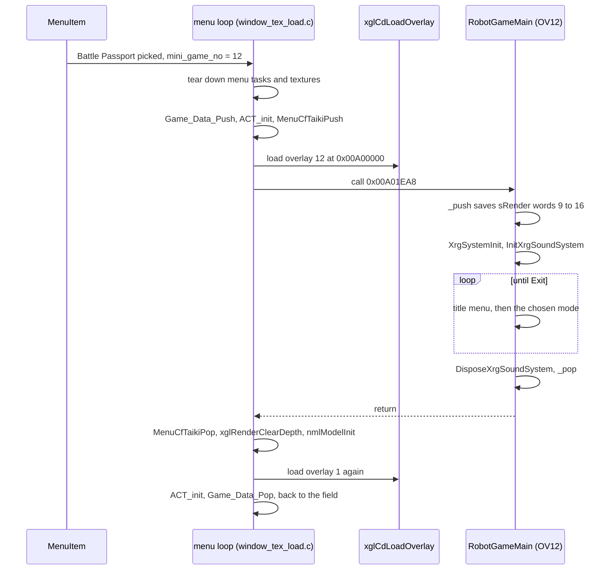
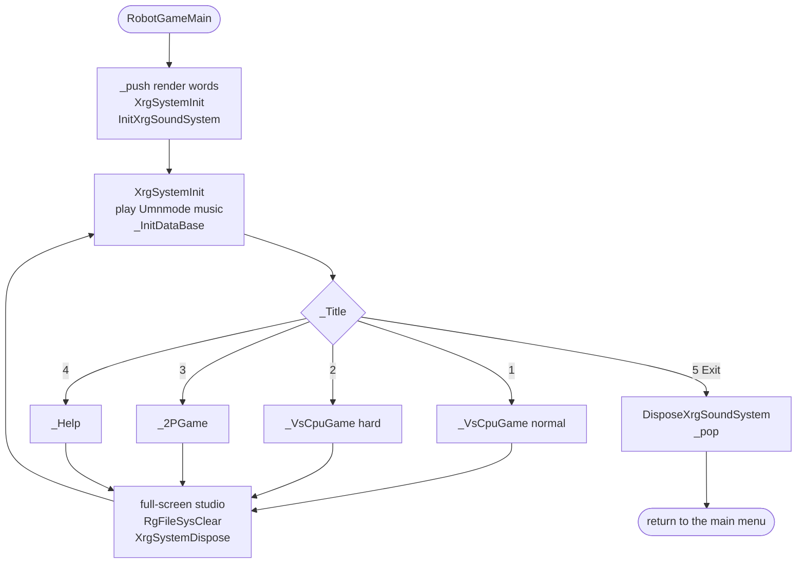
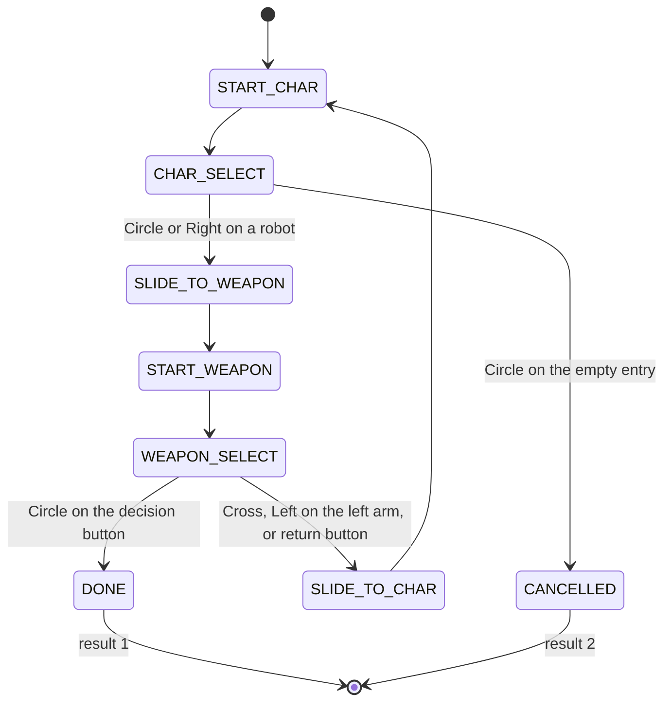
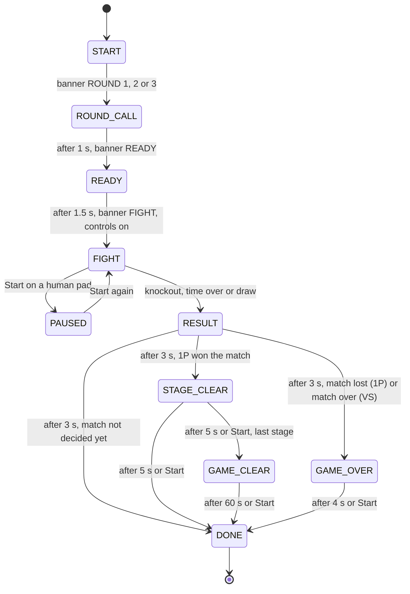
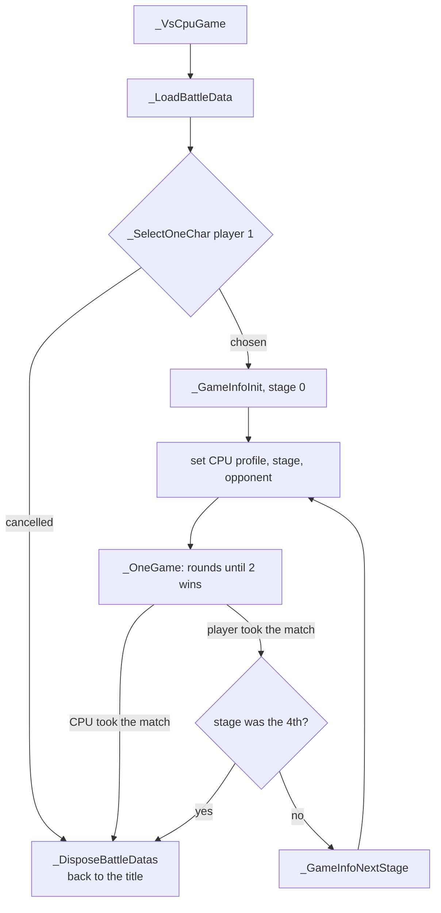

# A.G.W.S. Battle

A.G.W.S. Battle (Japanese "A.G.W.S. Battling") is the robot fighting minigame
of Xenosaga Episode I. Two A.G.W.S. face each other in a small arena and fight
with the weapons they carry until one is destroyed or the three-minute timer
runs out. The player can fight a ladder of four CPU opponents (1P Game) or
another human on a split screen (VS). The minigame has its own title menu,
robot and weapon selection screen, help pages, music and sound bank.

The whole minigame is the overlay `OV12.OVL` (code in `src/ov12/`, headers in
`include/ov12/`). It replaces the field overlay OV01 while it runs, and the main
executable loads OV01 back when it ends. The overlay carries its own small game
engine, the `rg_*` and `xrg_*` modules, which the
[A.G.W.S. Battle engine](agws-battle-engine.md) page describes. This page
describes the game as the player sees it and how the code implements each rule.

[← Back to the overview](../../README.md)

## Getting in and out

The player starts the minigame with the **Battle Passport**, an event item. In
the English release it is obtained by visiting the KOS-MOS Simulator in the EVS
again, and it is used from a save point that has EVS access. The item screen
(`MenuItem` in `src/main/menu_item.c`) shows the event items 11 to 15. Item 11
is the Segment Map. The items 12 to 15 can only be picked when the main menu
was opened with `GameLoopState.flags & MENU_ITEM_GAME_FLAG_PICK` (`0x400000`),
which is probably the flag set at those EVS save points. Picking an item makes
`MenuItem` return its number as the minigame number `mini_game_no`. The
[main menu](../main-menu.md) page explains the menu loop and the item screen.

The main menu loop in `src/main/window_tex_load.c` first tears down the menu
(`MenuLoadCancel`, `MenuBgTaskBreak`, `MenuModelAllBreak`, `MenuCfTaikiPop`,
font and window textures). Then, for a minigame number other than 0 and 15, it
saves the field state and swaps overlays. It calls `xglCullingIgnoreOff`,
`nmlModelSendMenuEnd`, `GameStateRestoreCameraLight`, `Game_Data_Push` (the
saved game state), `ACT_init` (resets all actors) and `MenuCfTaikiPush`. For
number 12 it calls `xglCdLoadOverlay(12)` and jumps to `0x00A01EA8`, which the
main executable knows only as `func_00A01EA8`. Inside OV12 that address is
`RobotGameMain` in `src/ov12/rg_main.c`. When it returns, the menu code calls
`MenuCfTaikiPop`, `xglRenderClearDepth`, `nmlModelInit`, `xglCdLoadOverlay(1)`,
`ACT_init` and `Game_Data_Pop`, and play continues in the field.

A second path exists for scripts. The Java native
`Java_xeno_util_Runtime_minigameExec__I` in `src/main/runtime.c` takes the same
numbers 12, 13 and 14. For 12 it sets `RUNTIME_GAME_FLAG_MINIGAME`
(`0x4000000`) in `GameLoopState.flags`, stops vibration, reads the pad, pushes
the game data, resets the actors, loads OV12 and calls `RobotGameMain`. After
the minigame it loads OV01, resets the actors, pops the game data, calls
`GameCfPlayerLoadResource(1)` to reload the field player and clears the flag.
The [Java VM](../../scripting/java-vm.md) and
[natives](../../scripting/natives.md) pages explain how scripts call natives.

`RobotGameMain` itself saves eight words of the main executable's render state
(`sRender[9]` to `sRender[16]`) into `s_stack` and clears them (`_push`). It
restores them (`_pop`) just before it returns. In between it runs the title
menu in a loop until the player picks Exit. The diagram below shows the whole
round trip from the item screen and back.

The minigame gives no reward. Nothing in OV12 writes the save data or the
inventory. It only reads the story flags, the owned A.G.W.S. and the owned
A.G.W.S. weapons, as the next sections show.

## The title menu

The title screen (`src/ov12/rg_title.c`) is the hub of the minigame. Each time
`RobotGameMain` comes back to it, the engine is set up again from scratch:
`XrgSystemInit` resets the heaps, the "Umnmode" music sequence starts
(`XrgSoundSystemPlayBGM(3)`), and `_InitDataBase` reads the robot, shot and
weapon databases. `_Title` then makes `title.npr` (a link archive of the title
pictures) the prepared file, creates the `RgTitle` object and runs it frame by
frame until it returns a result. The title reads its `top_*.bxx` pictures
from inside the archive, so the older standalone copies of the same names on
the disc are never read
([NLNK prepared archives](../../formats/minigame-data.md#nlnk-prepared-archives)).

The menu has four entries in this order: **1P Game**, **VS**, **Help** and
**Exit**. Up and Down move the cursor, Circle or Start confirms. After a choice
the menu stays in a "decided" state for one second, fades out for half a
second, and only then reports its result through `RgTitleGetResult`. The title
background alternates between two A.G.W.S. on each visit: the counter passed to
`CreateRgTitle` is the number of times the title was shown, and its parity
picks the VX-10000 or the AG-02 background (`top_base_vx01.bxx` or
`top_base_ag02.bxx`). These two pictures exist only inside `title.npr`.

| Result | Value | What `RobotGameMain` does |
| --- | --- | --- |
| `RG_TITLE_RESULT_ONE_PLAYER` | 1 | `_VsCpuGame(0)`, the normal 1P Game |
| `RG_TITLE_RESULT_ONE_PLAYER_LEVEL_SELECT` | 2 | `_VsCpuGame(1)`, the 1P Game in hard mode |
| `RG_TITLE_RESULT_VERSUS` | 3 | `_2PGame()`, the two-player VS mode |
| `RG_TITLE_RESULT_HELP` | 4 | `_Help()`, the help pages |
| `RG_TITLE_RESULT_EXIT` | 5 | leaves the loop and returns to the main menu |

After every mode, `RobotGameMain` switches the draw system back to one full
screen (`RgDrawCreateDrawStudioFullScreen`), forgets every loaded file
(`RgFileSysClear`) and disposes the engine (`XrgSystemDispose`). The next lap
of the loop builds everything again. The flowchart below shows this outer loop.

## Hard mode

Hard mode is real and the code confirms how it is unlocked. `RgTitleGetResult`
turns the 1P Game choice into `RG_TITLE_RESULT_ONE_PLAYER_LEVEL_SELECT` only
when two conditions hold at the moment the menu finishes its fade-out:

1. `XrgPadIsSelectLevelLR()` is true, which means L1 and R1 are both held on
   the controller.
2. `XrgEventGetLevel()` returns 2 or more. This needs story flag `0x12D`, as
   [the event level](#the-event-level) section explains.

So the player holds L1 and R1, presses Circle on 1P Game, and keeps holding the
two buttons for the 1.5 seconds of the decide and fade-out phases. Without the
story flag the same input simply starts a normal game. The wiki describes the
button combination but not the story requirement.

In hard mode `_VsCpuGame(1)` changes three things. It logs the warning "This
game is 'HARD' mode" (`RgWarn`, silent in the release build). Every stage uses
the strongest CPU profile `0x1DEF` (table `s_anEnemyLevel_2`). The opponent of
each stage is fixed instead of random (`_GetHardEnemyChar`). The stage order
stays the same: both branches of the code call `_GetStageDataBySerial`, and the
helper `_GetStageHardDataBySerial`, which would always pick the warehouse, is
never called. The stage clear and game clear screens also print "HARD MODE" in
the weapon font (`_disp_hardmode`).

| Stage | Hard-mode opponent | Left weapon | Right weapon | Back weapon |
| --- | --- | --- | --- | --- |
| 1 | VX-7000 (`vx02`) | SMG32VX | BA15VX | SMP53AG |
| 2 | AG-04 (`ag04`) | DLC02AG4 | UNARMED | CB85VX |
| 3 | AG-05 (`ag05`) | HMP-AG5 | HGG-AG5 | BMP-AG5 |
| 4 | VX-4000 (`vx06`) | HG75VX | HG75VX | ECM1-VX |

`_GetHardEnemyChar` also holds two entries for stage numbers 9999 (AG-02 with
LG10AG, BSW13AG, AIRD-AG2) and 9998 (VX-10000 with FLM64AG, LG24VX, BMP45VX)
that no caller can reach.

## The event level

Several rules of the minigame depend on how far the player is in the story.
`XrgEventGetLevel` in `src/ov12/xrg_event.c` reduces this to a number from 0
to 2, read from the main game's story flags with `xglFlagsGet1`:

| Level | Condition |
| --- | --- |
| 2 | story flag `0x12D` is set |
| 1 | flag `0x12D` is clear and flag `0x65` is set |
| 0 | both flags are clear |

Flag `0x12D` is the same flag that unlocks the advanced card pool of
[Xeno Card](xeno-card.md) and the third card stock of the shops
(`SHOP_CARD_SCENARIO_THIRD` in `src/main/menu_shop.c`). It probably marks a late
point of the story. `XrgSetEventLevel` can force a level, but nothing calls it.
The flags themselves live in the save data, described on the
[save data](../../architecture/save-data.md) page.

The event level decides which opponents can appear (next section), which
weapons the CPU may carry, and whether hard mode can be selected.

## The six A.G.W.S.

Six A.G.W.S. can fight. The engine names them by the model codes of the main
game, and `XrgEventIsUsablePlayer` maps them to the party's A.G.W.S. ids
(`MENU_CHAR_*`). The table below gives each one with its character id
(`rg_actor_charid.h`), its English name, the main-game model it reuses
(`s_aDatTbl_1` in `src/ov12/xrg_actor.c`) and when the CPU may use it.

| Id | Code | A.G.W.S. | Model id | Model folder and extra archive | CPU opponent from |
| --- | --- | --- | --- | --- | --- |
| 0 | `vx01` | VX-10000 | `0x2001` | `data\robo\vx\vx_01`, `vx01_all.fpk` | level 0 |
| 1 | `ag05` | AG-05 | `0x2105` | `data\robo\ag\ag_05`, `ag05_all.fpk` | level 2 |
| 2 | `vx02` | VX-7000 | `0x2002` | `data\robo\vx\vx_02`, `vx02_all.fpk` | level 1 |
| 3 | `ag04` | AG-04 | `0x2104` | `data\robo\ag\ag_04`, `ag04_all.fpk` | level 2 |
| 4 | `vx06` | VX-4000 | `0x2006` | `data\robo\vx\vx_06`, `vx06_all.fpk` | level 2 |
| 5 | `ag02` | AG-02 | `0x2102` | `data\robo\ag\ag_02`, `ag02_all.fpk` | level 0 |

The player may pick an A.G.W.S. only if the party owns it in the main game.
`RgSelectGetPlayerChars` builds a bit mask from `XrgEventIsUsablePlayer`, which
looks for the robot in `PartyAgwsGet` (the `take_agws_mask` bits of the party
data in `src/main/party.c`). Bit 0, the VX-10000, is always set, so at least
one robot is always available. The CPU side uses `RgSelectGetEnemyChars` and
`XrgEventIsUsableEnemy` instead, which ignore ownership and only look at the
event level. The [character growth](../character-growth.md) page explains how
the party gets its A.G.W.S. and their parts in the main game.

Character ids 6 to 24 also exist (`hg00`, `rf01`, `glg00`, `bd00`, and so on).
They use model ids in the `0x36xx` range and have no folder, so they are
probably the weapon and prop models attached to the robots.

The statistics of each robot are not in the code. They come from the text file
`rg_robot_spec.info`, one paragraph per robot named `character <name>`, as
described on the [engine page](agws-battle-engine.md#text-databases). The
file itself is described in
[.info text databases](../../formats/minigame-data.md#info-text-databases). A spec
sets the top speeds, dash speed and dash time, turning speed, weight, engine
power, resistances, life (100 when absent), stagger time, body-attack damage,
auto-homing behaviour and the bare-hand weapon (`sude`, "UNARMED" by default).

## Choosing a robot and its weapons

Both modes start with the selection screen, `RgSelectAGWS` in
`src/ov12/rg_select_agws.c`. `_SelectOneChar(init, player)` creates it for one
player slot, runs it until it ends, and copies the chosen robot name and three
weapon names into the battle set-up record `RgBattleInit`. The screen remembers
each player's last choice in `s_ainData_4[player]` (an `RgSelectAGWSData` with
`selectedCharacter`, `availableCharacters` and `weaponName[6][3][0x20]`, one
weapon set per robot). The memory is filled once per overlay load
(`abInit_3`), so the previous loadout comes back for every game while the
player stays in the minigame.

The screen has two halves that slide into each other, 32 pixels per frame:

- **Robot select.** Up and Down move through the available robots and a final
  "no robot" entry (`RG_ACTOR_CHAR_NOP`). Circle or Right on a robot slides to
  weapon select. Circle on the empty entry cancels the selection.
- **Weapon select.** The cursor walks with Left and Right over the left arm,
  right arm and back slots, then a decision button and a return button. L1 or
  L2 jumps to the left-arm list, R1 or R2 to the right-arm list, and L1 with R1
  to the back list. Up and Down choose a weapon inside the current list.
  Circle on a slot checks it for conflicts: if the chosen weapons overlap, the
  conflicting choices are reset and the "NG" sound plays, otherwise the cursor
  moves to the decision button. Circle there ends the selection. Cross on the
  decision button puts the cursor back, and Cross elsewhere or Left on the
  left-arm slot slides back to robot select.

A 3D preview (`RgSelectRobot`) shows the robot with its chosen weapons. The
slot pictures of conflicting weapons are tinted red (`agwsSelectConflictColor`). The
pictures come from `select.bxx` and the layouts `agwsseltop.r2d`,
`agwssel.r2d`, `wepseltop.r2d` and `wepsel.r2d`, which place named pictures
of `select.bxx` on the screen
([r2d picture lists](../../formats/minigame-data.md#r2d-picture-lists)).

The selection ends in one of two results. 1 means a robot and weapons were
chosen. 2 means the player cancelled. The state diagram below shows the screen.

## Weapons

Every robot has three weapon slots, the **equip types** of
`include/ov12/rg_equip_type.h`: left (`RG_EQUIP_TYPE_LEFT`, 0), right (1) and
back (2). A weapon occupies one or more of eight **mount positions** (left
hand, elbow and shoulder, right hand, elbow and shoulder, back left and back
right). Two weapons conflict when their position masks overlap
(`RgEquipCheckConfrict`). This is why some combinations are refused on the
selection screen.

All weapons are defined in the text database `rg_weapon.info`, which holds 40
records ([.info text databases](../../formats/minigame-data.md#info-text-databases)). Each entry is a
**weapon essence** (`RgWeaponEssence`) with a name, the robots that may use it
(`use` mask), its slots and positions, its model, its motions for each robot,
its sounds, its ammunition (`num`, `energy` or `hardness`, with "inf" meaning
unlimited) and the kind of weapon it is. The kinds are:

| Keyword | Kind | Behaviour |
| --- | --- | --- |
| `shottype` | gun | fires shot objects, with a busy time and a cooldown between shots |
| `atktype` | melee | swings a collision ball that follows a joint of the model and deals damage on contact |
| `sudetype` | bare hands | a melee weapon used when the slot has nothing else |
| `sldtype` | shield | blocks hits that come from the front of the shield |
| `enetype` | energy weapon | fires like a gun but heats up, stops at a temperature limit and cools down |

A gun's ammunition is shown on the HUD as a count ("12/30"), as a percentage,
or not at all, depending on the weapon (`RgDispWpnDat_CreateRestNumStr`). When
a weapon runs out, or when the player discards it, the robot plays a drop
motion, the weapon falls away as a separate object (`RgDropWeapon`), and the
slot gets its spare weapon. For the hands the spare is the bare-hand weapon of
the robot spec, so an A.G.W.S. that has lost its guns still fights with its
fists.

The player may only pick weapons the party owns in the main game.
`RgSelectWeapons` keeps a weapon if `XrgEventIsUsableWeapon` finds it in the
main inventory, or if its essence has the `default` keyword. The check uses a
table of 41 weapon names and their item ids 71 to 111, and asks
`dataWpnBoxChk(id) > 0`. The names follow the main game's A.G.W.S. weapons:
SWD21AG, LG24VX, HG45VX, LG10AG, SMG99AG, GRD20AG, HMP33AG, PB55AG, SHD02AG,
SHD12VX, LG100VX, SWD34VX, HMR55AG, CB85VX, ECM1-VX, ER-VX, BMP45VX, HG75VX,
GLG76AG, FLM64AG, DLC02AG4, WCT02AG4, SHB67AG, BSW13AG, BL24AG, AXE11AG,
SMP53AG, SMG32VX, ECM2-VX, LM11VX, BA15VX, AIRD-AG2, HMR-AG5, AIRC-AG2,
BMP-AG5, HMP-AG5, HGG-AG5, BBC-AG5, LC-AG5, LW-VX4 and DEF-VX. AIRC-AG2 has
item id 0, so it can only appear as a default weapon.

The CPU picks its weapons at random with `RgSelectGetEnemyWeapons`. It starts
from random offsets in the three slot lists and searches for a combination
without conflicts. Its lists use another filter: a weapon qualifies when its
level tag (`1wa` = 0, `2wa` = 1, `3wa` = 2, none = -1) is at least the current
event level. The meaning of the "wa" tags is not stated in the code.

## Battle controls

Each human robot is driven by an **input control** (`RgControlInput` in
`src/ov12/rg_robot_control.c`). Every frame `XrgInputDeviceCheck`
(`src/ov12/init_xrg_input.c`) turns the pad record into stick angles and
strengths (with a dead zone of 0.3) and a set of action flags. The control job
then sends commands to the robot. The D-pad overrides the left stick.

| Input | Command | Effect |
| --- | --- | --- |
| Either stick | `RgRobotAccelarate` | The two stick vectors are added, turned by the camera, and push the robot that way. |
| Sticks in opposite vertical directions | `RgRobotAccelarateRotate` | The robot pivots on the spot. |
| Sticks pushed toward each other | `RgRobotBreak` | Brake. |
| Sticks pushed away from each other | `RgRobotTargetting` | Jump to about 7.5 units high, turning toward the target. |
| L3 or R3 | `RgRobotDash` | Short dash in the stick direction, or straight ahead. |
| L3 and R3 | `RgRobotDashContinue` | Long, continuous "VR" dash, for robots whose dash mode allows it. |
| L1 or L2 | `RgRobotShot(LEFT)` | Use the left weapon. |
| R1 or R2 | `RgRobotShot(RIGHT)` | Use the right weapon. |
| L1 and R1 (or any left plus any right shoulder) together | `RgRobotShot(BACK)` | Use the back weapon, or the special attack. |
| L1 and L2 within 0.1 s | `RgRobotDropWeapon(LEFT)` | Discard the left weapon. |
| R1 and R2 within 0.1 s | `RgRobotDropWeapon(RIGHT)` | Discard the right weapon. |
| All four shoulder buttons | `RgRobotDropWeapon(BACK)` | Discard the back weapon. |
| Start | | Pause (any human player). |
| Select | | Switch the camera between near (8 units) and far (14 units), split screen only. |

Dashing uses the **boost** gauge, the robot's `dashTime`. The gauge drains
while the robot dashes and refills while it moves normally, up to the spec's
`dash-time`. The spec's `dash-mode` changes the rules. In the normal mode a
dash lasts as long as the gauge and the gauge is restored when the dash ends.
In the `neo` modes a dash costs part of the gauge, needs at least 20 percent
of it, lasts at most half a second, and holding both sticks clicked can extend
it into the continuous "VR" dash. In the `vr` mode every dash is a VR dash,
which also needs 20 percent of the gauge. A full description of the robot's commands
and states is on the [engine page](agws-battle-engine.md#the-robot).

## Special attacks

Each A.G.W.S. has one **special attack** (`hissatu`, from the Japanese word for
a finishing move). It replaces the back-weapon command when three conditions
hold: the back slot is empty or bare-handed, both hand weapons are present and
ready, and the two hand weapons match the robot's combination.
`RgHissatuCheck` in `src/ov12/rg_hissatu.c` holds the combinations.

| A.G.W.S. | Right hand | Left hand |
| --- | --- | --- |
| VX-10000 | LM11VX | SHD02AG or SHD12VX |
| VX-7000 | HG75VX or HG45VX | HG75VX or HG45VX |
| VX-4000 | HG75VX or HG45VX | ER-VX |
| AG-05 | HMR55AG | HMR55AG |
| AG-04 | bare hands | bare hands |
| AG-02 | BSW13AG | GRD20AG |

When the check passes, the robot enters the special-attack status and plays
the `RG_MOT_HISSATU` motion. Each robot has its own scripted sequence in
`_HissatuPassTime`. The VX-4000 switches to a second motion,
`RG_MOT_HISSATU_VX06_HIT`, when its first strike connects. The English names
of these moves are not in the code.

## Life, boost and the HUD

Each robot has a **life** value (`life` and `lifeMax` in `RgBody`, 100 unless
the spec says otherwise). Hits from shots, melee weapons and body collisions
lower it. A strong hit puts the robot into a damage status for the spec's
`damage-stiff-time`. Weak hits, such as machine-gun rounds, are "weak damage":
they add up inside a short window and only stagger the robot past a threshold
(`notDamLimit` and `notDamTime` of the shot), and they can slow the victim
down for a moment (`slowTime`, `slowRate`). A shield in use blocks every hit
that comes from in front of it. When life reaches zero the robot is knocked
out at once. It is forced back into its plain moving state and, for up to five
seconds, random explosions and blasts play on it while the result banner is
shown.

The battle HUD has three layers, all drawn with the 2D painter of the engine.

- **Life display** (`RgDispLife`, `src/ov12/rg_disp_life.c`). Two life gauges,
  the name plate of each robot, the round timer as minutes, seconds and
  hundredths (`03'00"00` at the start), and the win marks of each side. The
  win mark of the round winner blinks. The gauges are `RgGauge` objects that
  slide toward the real value at 100 units per second instead of jumping.
- **Weapon display**. In 1P Game `RgDispWpn1P` draws the boost gauge, the
  speed of the robot in "k" (the horizontal speed times 3.6, so km/h if a unit
  is a metre, with a small random flicker) and a panel per weapon slot with its
  picture and ammunition. In VS the smaller `RgDispWpn2P` shows both robots.
- **Target marker** (`RgDispGameInfo`). A marker follows the opponent in 3D and
  is clamped to a circle of 180 pixels around the screen centre. A pointer
  shows its direction when it is off screen. Lock-on indicators appear for
  each weapon that is aiming at the target, bright when the weapon is ready
  and dim when it is busy. The marker fades out while the robot is confused by
  chaff.

## Rounds and results

A match is the best of three rounds (`RG_ROUNDS_TO_WIN` = 2). Each round is one
**battle**, run by `_OneBattle` in `src/ov12/rg_main.c` with a fresh battle
manager. A round lasts at most 180 seconds (`RG_BATTLE_TIME_LIMIT`). It ends in
one of three ways:

- **Knockout.** A robot's life reaches zero (`RgRobotIsDead`). If the first
  player's robot is down, the second player wins, even when both fall in the
  same frame.
- **Time over.** The timer reaches zero. The robot that lost less life
  (`lifeMax - life`) wins. Equal damage gives a draw.
- **Draw.** A drawn round counts for nobody. The next battle repeats the same
  round number, because the round counter `activePlayer` of `RgGameInfo` only
  grows on a win.

The result is a bit field: bits 0 and 1 hold the winner (1 = first player,
2 = second player, 3 = draw) and bits 2 and 3 the way the round ended
(`RG_BATTLE_RESULT_TIME_OVER` = 4, `RG_BATTLE_RESULT_KNOCKOUT` = 8).

A battle goes through fixed phases with banners from the announcer object
(`RgAnnounce`, `src/ov12/rg_announce.c`). The timer only runs during the fight,
and the robots only accept input during the fight. Start on a human pad pauses
the fight: the simulation stops and a "PAUSE" box is drawn until Start is
pressed again. The state diagram below shows one battle.

During the result phase the banner is DRAW for a draw. For a time over it is
TIME OVER for the first 1.5 seconds and then the win or lose banner. In 1P Game
the banners are YOU WIN and YOU LOSE. In VS the screen is split and the
announcer shows the pair "YOU WIN / YOU LOSE" or "YOU LOSE / YOU WIN" over the
two halves.

`_OneGame` wraps the rounds of one match. It starts the battle music
(`XrgSoundSystemPlayBGM(0)`, sequence "BATTLE1"), then creates, runs and
disposes battle managers until one side has two wins.

## 1P Game

`_VsCpuGame` plays a ladder of four stages against the CPU. It loads the
shared battle data (`_LoadBattleData`), runs the selection screen once for
player 1, and then loops over the stages while the player keeps winning. For
each stage it fills the set-up record `RgBattleInit`:

- `enemyType` from `_GetEnemyLevelBySerial`, the CPU profile of the stage.
- the background and start positions from `_GetStageDataBySerial`.
- `mode` = `RG_BATTLE_MODE_VS_CPU` (1), meaning only player 1 is human.
- the opponent from `_GetEnemyChar`, a random robot allowed by the event level
  with random weapons. The opponent can be the same model as the player.

| Stage | Background | CPU profile | Profile meaning |
| --- | --- | --- | --- |
| 1 | `BG_TOWN` | `0x1000` | level 0, likes close combat |
| 2 | `BG_AIRCAR` | `0x0B15` | level 1, turns while moving, homing, avoids and destroys obstacles, two guns |
| 3 | `BG_COL` | `0x05FE` | level 2, turns, dashes, homing, circles, takes the back, avoids lock-on and obstacles, accurate |
| 4 | `BG_BLOCK` | `0x1DEF` | level 3, every behaviour except frequent homing and destroying obstacles |

When player 1 takes a stage, the **stage clear** screen shows the time spent on
the stage and the damage taken. `_GameInfoEndOfBattle` adds, for every round of
the stage, the round time in hundredths of a second and player 1's lost life
into `RgGameInfo.playTime[stage]` and `damage[stage]`.
`RgAnnounceSetStageClear` draws them on a dark panel. After the fourth stage
the **game clear** screen (`RgAnnounceSetGameClear`) lists the time and damage
of all four stages and their totals. These two numbers are the only score the
minigame keeps, and nothing stores them after the minigame ends. If the CPU
wins a match, GAME OVER is shown and the game returns to the title menu. The
flowchart below shows the ladder.

## Stages

`_GetStageData` sets the background name and the start position and facing of
both robots. All robots start 1.5 units above the floor and face each other.
The background itself is built from the paragraph of the same name in
`rg_bg.info` (see [the engine page](agws-battle-engine.md#background-and-breakable-objects)).
The descriptions in the table come from the Xeno Series Wiki.

| Id | Background | Start positions (x, z) | Description |
| --- | --- | --- | --- |
| 0 | `BG_TOWN` | (0, -80) and (0, 80) | a modern city street with bus stops |
| 1 | `BG_AIRCAR` | (0, -97.5) and (0, 68) | a space area with crates and ship buildings, built from `ship.rbg` |
| 2 | `BG_COL` | (0, -10) and (0, 10) | a futuristic arena with pillars |
| 3 | `BG_BLOCK` | (-90, -80) and (90, 80) | a foggy warehouse with destructible rubble |
| 4 | `BG_VS1` | (0, -10) and (0, 10) | the VS arena |

The wiki calls the pillar arena the 2P stage. In the code VS uses its own
background `BG_VS1` with the same start positions as `BG_COL`, so it is
probably a variant of the pillar arena.

Each stage loads one background archive named by its `DATA` paragraph:
`town.rbg`, `ship.rbg`, `col.rbg`, `souko.rbg` and `vs1.rbg`. The disc also
holds `aircarrier.rbg`, an older air carrier stage that nothing loads. The
archives are described in
[NBGL background archives](../../formats/minigame-data.md#nbgl-background-archives).

Objects of the background can be breakable. Each one has a hardness: a shot
that deals more damage than the remaining hardness destroys it with a hit
effect, a weaker shot wears it down, and a robot that rams it hard enough
(kinetic energy of at least 288000) breaks it too. Objects between the camera
and the robot fade out for half a second so they never hide the action.

## VS mode

`_2PGame` is the two-player mode. It runs the selection screen for player 1
and then for player 2. If player 1 cancels, the mode ends. If player 2
cancels, player 1 chooses again. When both have chosen, the game plays one
match on `BG_VS1` with `mode` = `RG_BATTLE_MODE_TWO_PLAYERS` (3) and returns to
the title menu. There is no CPU and no ladder.

With two humans the battle manager splits the screen into two side-by-side
views (`_DoubleScreenBattleField`), each with its own camera, separated by a
dark strip 4 pixels wide at x = 254. Each player has a target marker on his own
half. The cameras start at the far distance and each player can switch his own
camera with Select. When the match is decided, GAME OVER is shown.

## The CPU opponent

The CPU drives its robot through an **enemy control** (`RgEnemyControl`,
`src/ov12/rg_enemy.c`). It calls exactly the same robot commands as a human
player: accelerate, rotate, brake, dash, long dash, shoot and jump. Its
behaviour is set by the profile word `enemyType`. Bits 0 and 1 are the
thinking level. A debug tool left in the code labels the four levels "saru ika"
(worse than a monkey), "hito nami" (average human), "kikai teki" (machine-like)
and "kami" (god). The higher bits switch behaviours on:

| Bit | Name | Behaviour |
| --- | --- | --- |
| `0x4` | `RG_ENEMY_TYPE_TURN_WHILE_MOVING` | turns while moving |
| `0x8` | `RG_ENEMY_TYPE_DASH_OFTEN` | dashes often |
| `0x10` | `RG_ENEMY_TYPE_HOMING_OFTEN` | uses the homing jump often |
| `0x20` | `RG_ENEMY_TYPE_SATELLITE_OFTEN` | probably circles around the target |
| `0x40` | `RG_ENEMY_TYPE_BEHIND` | tries to get behind the target |
| `0x80` | `RG_ENEMY_TYPE_AVOID_LOCKON` | avoids being locked on |
| `0x100` | `RG_ENEMY_TYPE_AVOID_OBSTACLES` | steers around obstacles |
| `0x200` | `RG_ENEMY_TYPE_BREAK_OBSTACLES` | shoots obstacles away |
| `0x400` | `RG_ENEMY_TYPE_ACCURATE_SHOT` | fires only when facing the target closely, and at long range weighs the target's motion and its own ammunition |
| `0x800` | `RG_ENEMY_TYPE_DUAL_GUNS` | uses two guns |
| `0x1000` | `RG_ENEMY_TYPE_CLOSE_COMBAT` | prefers close combat |

The level shortens the CPU's random reaction times, so a higher level thinks
and reacts faster. Its preferred distance depends on the difference in life
between the two robots. The [engine page](agws-battle-engine.md#the-cpu-ai)
describes its three behaviour jobs.

## Help screens

Help on the title menu runs `_Help`. It makes `help.npr` the prepared archive
and creates an `RgHelp` object (`src/ov12/rg_help.c`). The help screen is a
grid of 16 topics. A move table (`s_anMoveTbl`) gives, for each topic, the
topic above, below, to the left and to the right. Up, Down and Left move along
it, and Right or Circle move to the right neighbour. Each topic shows a picture
page, assembled from layers of the `help_*.bxx` texture files
(`help_01_01.bxx` to `help_03_03_low.bxx`, plus the backgrounds
`help_bg_pad.bxx` and `help_bg_grad.bxx`). These files exist only as entries
of `help.npr`, not as separate files on the disc
([NLNK prepared archives](../../formats/minigame-data.md#nlnk-prepared-archives)). Their names suggest three chapters
of three pages each. Cross or Start closes the help: the screen fades out over
half a second and the game returns to the title menu.

## Music and sound effects

The minigame has its own sound set, loaded by `src/ov12/xrg_sound.c`. At start
`InitXrgSoundSystem` loads the effect bank "MINIBAT" through a 4 MiB scratch
buffer of the data heap. Music sequences are loaded on demand from a wave bank
(`.SWD`) and a sequence (`.SMD`):

| Id | Sequence | Folder | Used for |
| --- | --- | --- | --- |
| `XRG_SEQ_BATTLE1` | BATTLE1 | `data\yamamoto\snd\smd\` | every battle |
| `XRG_SEQ_BATTLE2` | BATTLE2 | `data\yamamoto\snd\smd\` | defined, not played |
| `XRG_SEQ_BATTLE3` | BATTLE3 | `data\yamamoto\snd\smd\` | defined, not played |
| `XRG_SEQ_UMNMODE` | Umnmode | `data\sound\smd\` | the title, help and selection screens |

The menus use four short effects: cursor, OK, cancel and "NG" (refused). Each
robot also has its own sound object (`XrgSound`) for its movement, landing,
dash and destruction noises. The [audio](../../architecture/audio.md) page explains the sound
driver, and [Sound files](../../formats/sound.md#smd-music-files) describes the
sequence and bank formats.

## The "subcon" modules

Two source files carry "subcon" in their name: `src/ov12/rg_select_subcon.c`
and `src/ov12/rg_robot_subcon.c`. They are not an in-game feature. "Subcon" is
the developer's name for a module of helper functions next to a main module,
probably short for "sub-control".

- `rg_select_subcon.c` serves the selection screen and the 1P Game set-up. It
  builds the masks of usable robots (`RgSelectGetPlayerChars`,
  `RgSelectGetEnemyChars`), lists usable weapons (`RgSelectWeapons`), picks the
  random CPU robot and weapons (`RgSelectGetEnemyChar`,
  `RgSelectGetEnemyWeapons`) and can disable all story checks
  (`RgSelectIgnoreEventFlag`, never called).
- `rg_robot_subcon.c` serves the robot. Its `RgRobSub*` functions apply
  acceleration and braking to the robot's physics point
  (`RgRobSubAcceralate`, `RgRobSubBreak`), launch the jump and homing
  (`RgRobSubTargetting`, `RgRobSubHoming`, `RgRobSubDirTo`) and choose the
  movement, roll and damage motions from the robot's velocity
  (`RgRobSubGetAdvanceMot`, `RgRobSubGetRollMotion`,
  `RgRobSubGetDamageMotion`).

## Debug leftovers

A few debug features remain in the overlay but cannot be used in the retail
game. `_IsEndOfMode` ends any screen when Start and Select are pressed
together, but only if `RgDebugFlags.modeEnabled` is set, and it is 0. The CPU
has a "think tool" (`_dbgThinkTool`) that edits its profile bits on screen, but
its pad helpers always return 0. `NisimoriTest`, the first function of the
overlay, prints a short text until Select and Start are pressed, and nothing
calls it. The [debug tools](../debug-tools.md) page lists the debug code of the
whole game.
