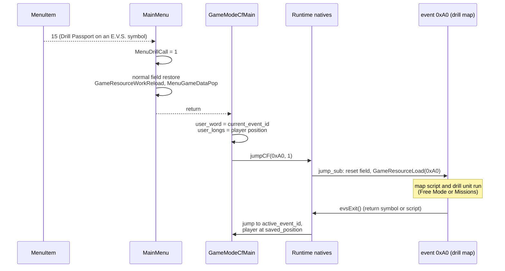
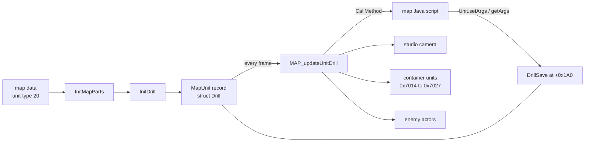
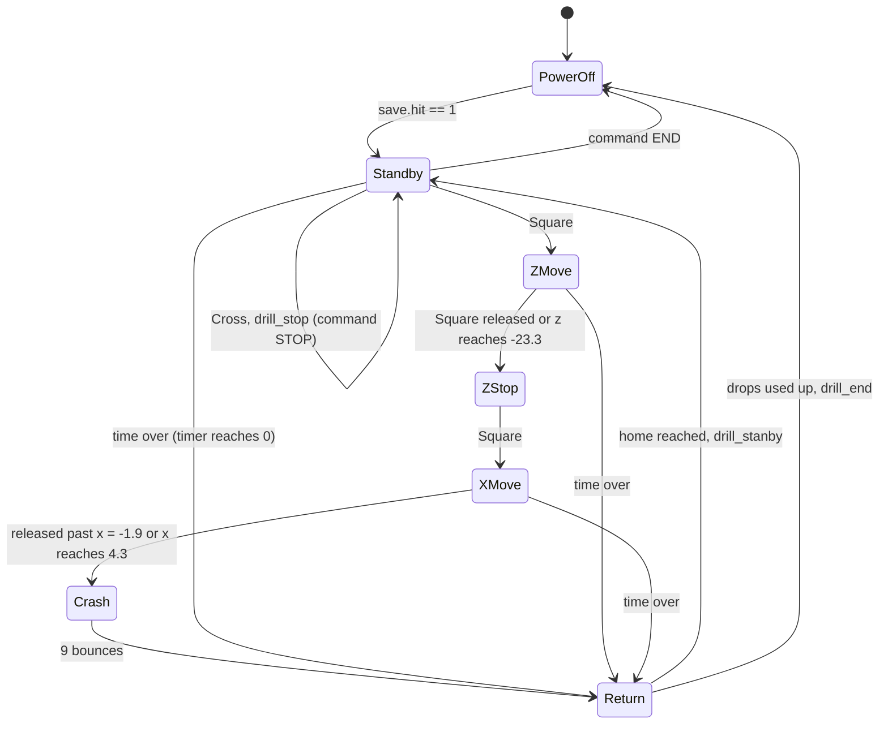
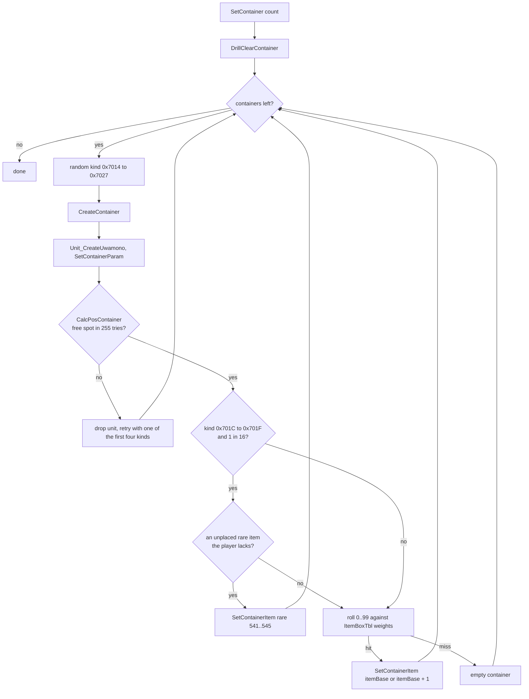
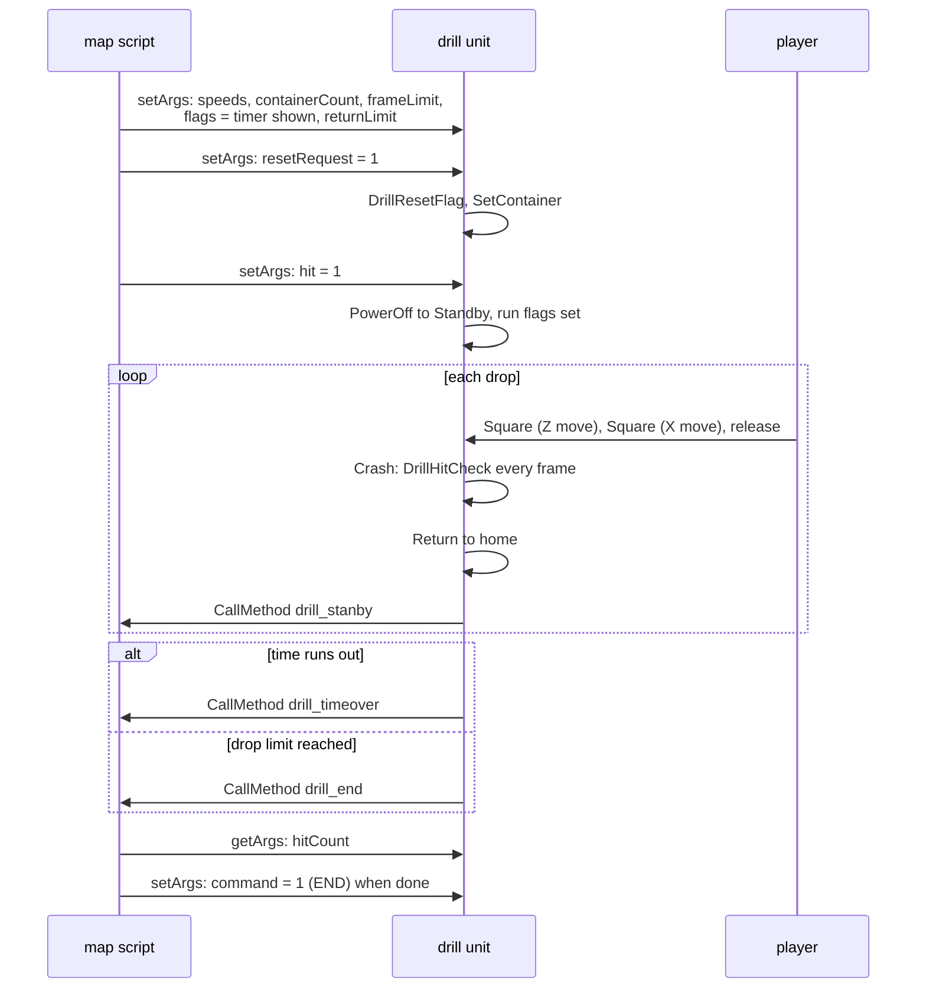

# Driller Game

The Driller Game is a minigame built on the drill puzzle of the Woglinde. The
player steers a large drill over a floor full of boxes, drops it, and breaks
as many boxes as possible to win the items inside. It
is opened with the Drill Passport at an E.V.S. symbol.

Unlike the other minigames, the Driller Game has no overlay of its own. The
drill is an ordinary *map unit* of a field map, its code is in the main
executable (`src/main/init_drill.c`), and the rules of each mode (time limit,
number of drops, prizes, messages) are written in the map's Java script. The
C code provides the machine: the drill's movement, its camera, the boxes and
their items, the hit checks and a set of calls back into the script.

[← Back to the overview](../../README.md)

## Contents

1. [Entering and leaving the Driller Game](#1-entering-and-leaving-the-driller-game)
2. [The drill as a map unit](#2-the-drill-as-a-map-unit)
3. [The drill's phases](#3-the-drills-phases)
4. [Timer and requests from the script](#4-timer-and-requests-from-the-script)
5. [Camera](#5-camera)
6. [Containers and their items](#6-containers-and-their-items)
7. [Hit checks](#7-hit-checks)
8. [The script side](#8-the-script-side)
9. [Effects, sound and debug text](#9-effects-sound-and-debug-text)
10. [Source files](#10-source-files)

## 1. Entering and leaving the Driller Game

The Drill Passport is event item 15. Like the other passports, the item
screen of the [main menu](../main-menu.md) accepts it only while the player
stands on an event symbol (`GAME_FLAG_ON_EVENT_SYMBOL`), and `MenuItem()`
returns 15 into `mini_game_no`. From here the Driller Game takes a different
path from the overlay minigames ([Xeno Card](xeno-card.md),
[Network Casino](network-casino.md), [A.G.W.S. Battle](agws-battle.md)).

When the menu closes, `MainMenu()` in `src/main/window_tex_load.c` treats 15
specially. It does not call `Game_Data_Push()` and loads no overlay. It sets
the global `MenuDrillCall` to 1 and then restores the field exactly as after
any other menu visit (`GameResourceWorkReload()`,
`GameCfPlayerLoadResource(1)`, `MenuGameDataPop()`). Control returns to the
field loop.

The field loop does the rest. `GameModeCfMain()` in `src/main/game.c`, which
opened the menu, checks `MenuDrillCall` after `MainMenu()` returns. When it
is set, the function stores a *return point*: the current event id goes into
`GameLoopState.user_word` and the 16-byte position of the controlled actor
into `GameLoopState.user_longs[0..1]`. Then it calls the native behind
`Runtime.jumpCF(int, int)` (`Java_xeno_util_Runtime_jumpCF__II`) with the
arguments `0xA0` and `1`. That schedules a jump to event `0xA0` (160) at
entrance 1. The jump itself (`Java_xeno_util_Runtime_jump_sub` in
`src/main/runtime.c`) stops streams, sound sequences and movies, resets the
field systems and the scripts and loads the resources of the new event with
`GameResourceLoad()`. While `MenuDrillCall` is set,
`GameCFSoundMenuReload()` also skips resuming the field music, since the
jump is about to replace it.

Event 160 is the drill map. Its scene resource script
`data\scene\cf0160.txt` loads the map `MC_VOK16` and the enemy preset
`MC_DRILL`, the character `CID_ENG_OJI` with the motion `drill_oji`,
the drill effects (`eve349` to `eve356` among them, with the GREAT, NICE,
GOOD and DRILLGO banners), the box models `MU_020` to `MU_039` and `MU_062`,
and finally the script volume `ST0160` (`data\scene\ST0160.evt`) that holds
the rules. The command format is described in
[Scene resource scripts](../../formats/scripts-and-archives.md#scene-resource-scripts-txt).

The return point uses the same two fields as the E.V.S. natives. In
`src/main/runtime.c` they are named `active_event_id` and `saved_position`.
`Runtime.evsSetRetPoint()` writes them and `Runtime.evsExit()` jumps back to
`active_event_id` and puts the player at `saved_position`
(`scriptReset_evsExit`). The field loop calls `evsExit` when the player
presses Circle on a return symbol (`GAME_FLAG_ON_RETURN_SYMBOL`), and scripts
can call it too. Leaving the drill map in this way brings the player back to
the E.V.S. symbol where the passport was used. These fields are part of the
saved game state (`GameStateSave`), so the return point survives a save made
inside the drill map. The jump and return machinery belongs to the
[field game](../field.md) and the [Java natives](../../scripting/natives.md).

The diagram below shows the whole round trip.

The Java native `Runtime.minigameExec()` has no case for 15, so scripts
cannot start the Driller Game that way. They can jump to the drill map
directly, which is probably how the story scene on the Woglinde uses the
same machine.

## 2. The drill as a map unit

Field maps contain *map units*, records in the global `MapUnit[]` array that
stand for doors, traps, symbols and other objects (see
[map and units](../map-and-units.md)). Map parts units are initialized by
`InitMapParts()` in `src/main/init_uwamono_sys.c`. When a unit has the map
type `UWAMONO_TYPE_DRILL` (20), it calls `InitDrill()`.

`InitDrill()` prints a debug line (`InitDrill D1=%d D2=%d D3=%d`), reads the
unit's position and Y rotation from its map parts resource (`GetPartsPos`),
sets the phase to *power off* and
installs `MAP_updateUnitDrill()` as the unit's per-frame update. It
remembers the camera's base angle so it can restore it later, creates three
effects that are hidden until needed and, when the unit's arguments ask for
it, clears the item flags and places the containers (see
[Containers and their items](#6-containers-and-their-items)).

`init_drill.c` views the map unit as a `struct Drill`. The fields it uses are
these.

| Field | Meaning |
| --- | --- |
| `update` | per-frame function, `MAP_updateUnitDrill` |
| `position` | drill head position, home is `(-2.9, 4.5, -12.5)` |
| `rotationX/Y/Z` | drill rotation, Y spins during a drop |
| `matrix` | the drill's matrix in the scene |
| `slot` | the unit's own index, skipped by the hit checks |
| `phase` | current phase, `DRILL_PHASE_*` |
| `crashTimer`, `bounceCount` | spin and bounce counters of a drop |
| `effect2`, `effect3` | movement effects |
| `save` | `DrillSave`, the unit's argument area at `+0x1A0` |
| `cameraYaw`, `cameraPitch` | camera angles saved during a drop |

The `save` member is the key to the design. Offset `0x1A0` of every map unit
record is its *argument area*, the bytes that the Java natives
`Unit.setArgs()` and `Unit.getArgs()` (`src/main/unit.c`) write and read, 1 to
4 bytes at a time at any offset. For the drill this area is a `DrillSave`
record. The map script therefore configures the drill, starts it, reads its
results and stops it by writing and reading these fields.

| `DrillSave` field | Set by | Meaning |
| --- | --- | --- |
| `hit` | script | 1 starts a run from power off |
| `containerCount` | script | number of containers to place |
| `containerSetup` | script | nonzero places containers at init |
| `cameraPreset` | both | camera preset 0, 1 or 2 |
| `clearRequest` | script | remove all containers |
| `resetRequest` | script | reset item flags and place new containers |
| `xSpeed`, `zSpeed` | script | sweep speeds |
| `fallSpeed`, `riseSpeed` | script | drop and lift speeds |
| `xReturnSpeed`, `zReturnSpeed` | script | return speeds |
| `hitRadius` | script | radius of the drill tip for hit checks |
| `returnLimit` | script | drops allowed, −1 for unlimited |
| `kind` | script | 0 limits the camera pitch |
| `command` | both | 1 end the run, 2 stop (pause) the run |
| `hitCount` | drill | containers hit in the current run |
| `returnCount` | drill | drops made in the current run |
| `frameCount`, `frameLimit` | both | frames elapsed and the time limit |
| `flags` | both | timer shown (`0x1`), count up (`0x2`), rare items placed (`0x10`–`0x1F0`), time over (`0x80000000`) |
| `partIndexA`–`D` | map data | scene matrices that follow the drill |

The diagram below shows how the drill unit sits between the map data, the
script and the field systems.

## 3. The drill's phases

`MAP_updateUnitDrill()` calls one handler per frame, chosen by
`drill->phase`. The drill works like a crane game. The player first moves it
back along the Z axis, then sideways along X, and then it drops, spinning,
onto whatever lies below.

| Value | Phase | Handler |
| --- | --- | --- |
| 0 | `DRILL_PHASE_POWER_OFF` | `DrillPowerOffFunc()` |
| 1 | `DRILL_PHASE_STANDBY` | `DrillStandbyFunc()` |
| 2 | `DRILL_PHASE_Z_MOVE` | `DrillZMoveFunc()` |
| 3 | `DRILL_PHASE_Z_STOP` | `DrillZStopFunc()` |
| 4 | `DRILL_PHASE_X_MOVE` | `DrillXMoveFunc()` |
| 5 | `DRILL_PHASE_CRASH` | `DrillCrashFunc()` |
| 6 | `DRILL_PHASE_RETURN` | `DrillReturnFunc()` |

**Power off.** `DrillPowerOffFunc()` keeps the drill at its home position
`(-2.9, 4.5, -12.5)`, clears the run counters and the command, restores the
camera's base angle and stops the movement sounds. When the script has set
`save->hit` to 1, a run starts. The phase becomes *standby*, the game flag
`DRILL_GAME_RUNNING` is set and `DRILL_GAME_ENDED` cleared, the player actor
gets a fixed motion (`ACT_setMotion2(player, 0, 9)`), the camera goes to its
preset, `returnCount` becomes 1 and `frameCount` 0.

**Standby.** The drill waits at home. The left stick turns the camera and R2
cycles through the three camera presets. Square starts the Z move and its
sound. Cross asks for a stop (`command = DRILL_COMMAND_STOP`) and calls the
script method `drill_stop`. This is refused when the timer is shown and less
than 60 frames are left. While the stop command is set, standby only shows
camera preset 1 and waits. An end command (`DRILL_COMMAND_END`) ends the run.
Input is ignored once the time-over flag is set.

**Z move.** While Square is held, the drill moves away from home along Z by
`zSpeed` per frame, the pad vibrates and a moving effect follows the drill.
Releasing Square, or reaching the far limit `z = -23.3`, stops it and the
phase becomes *Z stop*.

**Z stop.** The drill waits at its new depth. The stick and R2 adjust the
camera. Square starts the X move.

**X move.** While Square is held, the drill moves sideways by `xSpeed` per
frame. It also keeps moving while it is still left of `x = -1.9`, so a short
press still carries it clear of the home rail. When Square is released past
that point, or the drill reaches `x = 4.3`, it drops. The drop creates two
effects (1594 on the floor below the drill and 1657 attached to it), saves
the camera angles and plays the crash sound.

**Crash.** `DrillCrashFunc()` spins the drill faster every frame
(`rotationY += crashTimer * 0.1`) and moves the camera to a fixed view
beside it. After 16 frames (`DRILL_CRASH_SPIN_FRAMES`) the drill falls by
`fallSpeed` per frame and runs `DrillHitCheck()` on every frame. Each time it
reaches the floor (`y < 0`) it counts a bounce. The first bounce creates the
impact effect 1721. After nine bounces (`DRILL_CRASH_BOUNCES`) the camera
angles are restored and the phase becomes *return*.

**Return.** `DrillReturnFunc()` first lets the spin run down, still checking
for hits. Then the drill rises to `y = 4.5` at `riseSpeed`, slides back along
X at `xReturnSpeed` and finally along Z at `zReturnSpeed`, with sounds and
effects for each leg. At home it becomes *standby* again and `returnCount`
grows by one. What happens next depends on `returnLimit`. With −1 there is
no limit and the drill calls `drill_stanby` (the spelling is the original's).
Otherwise, when `returnCount` exceeds `returnLimit`, the run ends. The drill
goes back to power off, `DRILL_GAME_RUNNING` is cleared, `DRILL_GAME_ENDED`
set, the camera state becomes 4 and the script method `drill_end` is called.
If drops are left it calls `drill_stanby`.

The state diagram below shows the phases and the events that move between
them.

## 4. Timer and requests from the script

After the phase handler, `MAP_updateUnitDrill()` does three more jobs every
frame while the drill is not powered off.

**The timer.** When `DRILL_FLAG_TIMER_SHOWN` is set, the drill prints a
timer at the top of the screen with the xgl font. With `DRILL_FLAG_COUNT_UP`
it shows "Elapsed Time" as `frameCount / 30` seconds. Otherwise it shows
"Time Remaining" as `(frameLimit - frameCount) / 30` seconds. The display is
capped at 999. When the remaining time reaches zero for the first time, the
drill calls the script method `drill_timeover`, sets
`DRILL_FLAG_TIME_OVER` and, unless a drop is under way, sends the drill
straight into the return phase. `frameCount` counts up every frame except
while the stop command is set, so a stopped run does not lose time. The
timer uses 30 frames per second, the frame rate of the field.

**Following parts.** The drill's position is copied into its own matrix and
into up to four scene matrices named by `partIndexA` to `partIndexD`. These
are probably the rails and the carriage of the machine, which must follow the
drill head along their own axes. `partIndexA` takes the Z position and
`partIndexB` the X and Z positions, while C and D copy the whole matrix.

**Requests.** The script can ask for three things through the argument area.
`clearRequest` removes all containers (`DrillClearContainer`).
`resetRequest` clears the item flags and places `containerCount` new
containers (`DrillResetFlag` then `SetContainer`). `command = 1` ends the run
at once, with the same flag and camera changes as a normal end. Each request
is cleared after it is handled.

The two `GameLoopState.flags` bits that the drill code names
`DRILL_GAME_RUNNING` (`0x10000`) and `DRILL_GAME_ENDED` (`0x80000`) have other
names in `include/main/game.h`: `GAME_FLAG_ACTOR_LOOK_AT` and
`GAME_FLAG_RADAR`. With `0x10000` set, the field loop does not move the
player and does not open the pause screen, which fits a running drill.
Clearing `0x80000` at the start of a run and setting it at the end probably
hides the field radar while the drill is in use. See the
[field game](../field.md) for these flags.

## 5. Camera

The drill takes over the studio camera of the map
(`xglStudioGetActiveCamera()`). It never moves the camera freely. It only
changes two angles, and `DrillCalcCameraPos()` computes the camera position
from them. The camera circles a fixed point near `(0.7, 0.5, -17.9)`. The
yaw angle lifts it (height changes by `sin(yaw) * 20`) and the pitch angle
turns it around the vertical axis on a circle whose radius is
`cos(yaw) * 15`. Finally the X position is shifted by −1.2.

`DrillCameraControlFunc()` reads the left stick, minus the pad's dead zones,
and changes pitch and yaw by small steps. Yaw is kept between −1.5708 and
−0.2094 radians (from straight above to a low view), and when `kind` is 0
pitch is kept between 0 and π/2. The function also clears any camera shake
and sets the camera state to 0, which probably tells the field camera code
to leave the camera to the drill. The [field camera](../field.md) owns the
other camera states.

`DrillResetCameraPos()` sets one of three presets, chosen by
`save->cameraPreset`: preset 0 is a low view from the +X side (pitch π/2), preset
1 a low view from behind the home position, down the Z rail (pitch 0), and preset 2 a view from above
(yaw −π/2). R2 cycles through them in standby and Z stop. During the Z move
the code only sets `cameraPreset` to 1, without moving the camera. During a drop `DrillCrashFunc()` sets a fixed
camera next to the drill and restores the saved angles when the drill
starts its return.

## 6. Containers and their items

The boxes the drill breaks are called *U-kun Balls* in the debug text (the
Japanese message "うーくんボールに%dのレアアイテムが入った" means "Rare item
%d was placed in the U-kun Ball"). They are map units with the serial
numbers `0x7014` to `0x7027`, twenty kinds in all. The table `container[31]`
in `init_drill.c` describes each kind with a `DrillContainerDef`: a type
(1 or 2), a size, a hit mode, a model id (628, 602, 648, 614 or 642 for the
drill kinds) and an `itemBase`, the first of two item box entries that fill
it (501, 503, ... 539).

`SetContainer(count)` first removes the old containers
(`DrillClearContainer`), then creates `count` new ones. Each gets a random
kind. When a kind cannot be placed, one of the first four kinds is tried
instead. `CreateContainer()` does the work for one container.

1. `Unit_CreateUwamono()` creates the map unit and `SetContainerParam()`
   gives it its type, hit mode, size, model and `MAP_updateUnitTrap` as its
   update function. The flag `DRILL_UNIT_CONTAINER` (`0x200000`) marks it.
2. `CalcPosContainer()` picks a position. It makes up to 255 tries with a
   random X in −1.5 to 3.5 and Z in −23.3 to −12.3, which is the area the
   drill can reach. When the new container overlaps another unit, it is
   stacked on top of it. Type 2 containers use a 1.5 times larger radius for
   this check. Without a free spot the container is dropped.
3. The container gets an item. Kinds `0x701C` to `0x701F` have a 1 in 16
   chance to hold one of five rare items (541 to 545). A rare item is placed
   only if it is not yet placed in this set-up (bits `0x10` to `0x1F0` of
   `save->flags`) and the player does not already have it (its event flag,
   `0x79EC7` plus the item id, is clear). Otherwise the item comes from the
   item box table `ItemBoxTbl`, which the field loads from
   `data\karakama\itembox.dat`. A random roll from 0 to 99 is compared with
   the weight of the kind's first entry, then with the sum of both weights.
   A roll above both leaves the container empty. In the file every first
   entry (501, 503, ... 539) has the weight 40 and every second entry the
   weight 10, so a container holds its first item 40% of the time, its
   second item 10% of the time and nothing in the remaining 50%. The weight
   is the fourth byte of each row
   ([itembox.dat](../../formats/maps-and-field-data.md#itemboxdat)).
4. `SetContainerItem()` creates a special item unit
   (`UWAMONO_ID_SPECIAL_FIRST`) that holds the item id and links it to the
   container with `SetHideObject()`, the mechanism breakable map objects use
   to hide their contents until they break.

`DrillResetFlag()` prepares a new set-up. It clears the rare-placed bits,
clears the event flags of items 501 to 540 so the normal items can be won
again, and removes the item units left from the last set-up. The event flags
of the rare items 541 to 545 are kept, so each rare item can be won only once.

The flowchart below shows how one container is created.

## 7. Hit checks

`DrillHitCheck()` runs every frame of a drop and of the spin-down after it.
It first calls `HitCheckContainerPosSize()` with the drill position and
`hitRadius`. That function walks `MapUnit[]` and returns the first unit that
is active, is a container (`containerType` not 0), has not been hit yet, is
not the drill itself, and overlaps the sphere
(`HitCheckMapUnitPosAt`). A hit container gets its `hit` flag set,
`hitCount` grows by one, and an effect plays by kind group (1752 for
`0x7014`–`0x7017`, 1753 for `0x7018`–`0x7023`, 1754 for `0x7024`–`0x7027`).
Breaking the container and releasing its item is then probably left to the
trap update `MAP_updateUnitTrap()` that every container runs (see
[map and units](../map-and-units.md)).

When no container is hit, `HitCheckEnemy()` looks for an enemy actor. It
walks the 64 actors and takes the first one that is in use, not hidden,
whose height span fits the drill height, and whose 2D distance to the drill
is below `hitRadius` plus the actor's body radius. That actor is hidden,
effect 635 and a hit sound play, the enemy is frozen
(`Enemy_Command_Freeze`), and the script method `broken` is called with the
actor's method argument (`CallMethod_I`). The Missions with Bunnie dolls that
the Xeno Series Wiki describes probably use this path, with the dolls placed
as enemy actors that the script counts through `broken`. The enemy system is
described in [field enemies](../field-enemies.md).

## 8. The script side

The C code calls the map script at fixed moments. `CallMethod(name)` in
`src/main/script.c` starts a method with that name on the current map's
stage object (a subclass of `xeno.Stage`) through a script observer task,
and `CallMethod_I` does the same with one integer argument. See
[events](../../scripting/events.md) and the [Java VM](../../scripting/java-vm.md)
for how these calls run.

| Method | Called when |
| --- | --- |
| `drill_stop` | the player pressed Cross in standby to stop |
| `drill_stanby` | the drill is back home and may drop again |
| `drill_end` | the drill is back home and the drop limit is used up |
| `drill_timeover` | the remaining time reached zero |
| `broken(int)` | the drill hit an enemy actor |

The rules of the modes are not in C. The script sets the timer flags,
`frameLimit`, `returnLimit`, the speeds and the number of containers before
it sets `hit = 1`, and it reacts to the calls above, reading `hitCount` and
the item flags to decide the result. By the Xeno Series Wiki, Free Mode
allows five drops and the four Missions have time limits of 80, 120, 90 and
50 seconds with special targets. In the code this probably corresponds to
`returnLimit` for Free Mode and to the timer with `frameLimit` for the
Missions. The prizes and the 200 G fee the wiki mentions are handled by the
script as well.

The sequence below shows one timed run as the C code sees it.

## 9. Effects, sound and debug text

The drill uses the [sef effect system](../../libraries/sef.md) for its
visuals. `InitDrill()` creates three long-lived effects (1662, 1661 and 1581,
with 1539 as a fallback) that show while the drill moves and are hidden
otherwise. A drop adds the floor and spin effects 1594 and 1657, the first
bounce the impact 1721, container hits 1752 to 1754 and enemy hits 635. The
pad vibrates during the Z and X moves (`Vibration_Set_Strong`).

Each movement has its own sound effect: `0x30096` for the Z move, `0x30097`
when it stops, `0x30098` for the X move and `0x30099` for the drop. The
[audio](../../architecture/audio.md) page explains sound effect ids. The
high part 3 selects effect bank 3, the map's ambient bank, which the scene
command `loadse` fills. The drill scene names the bank `ENV_DRL`, and the
disc has no `ENV_DRL` sound files. The load fails quietly, so these four
sounds probably play nothing
([Unused, missing and duplicate files](../../formats/sound.md#unused-missing-and-duplicate-files)).

The drill prints its phase in debug text on every frame with
`xglFontDebugPrintf()`: `DRILL POWEROFF`, `DRILL STANDBY`, `DRILL STOP`, `DRILL ZMOVE`,
`DRILL ZSTANDBY`, `DRILL XMOVE`, `DRILL CRASH` with the hit count,
`DRILL RETURN`, and `CAMERA CONTROL` while the stick moves the camera. It
also prints `SetContainer` and the rare item message with `printf()`. The
on-screen lines appear only while the font's debug print state is on
(`FONT_STATE_DEBUG_PRINT` in `src/main/xgl_font.c`), and the `printf()`
messages go to the development console (see [debug tools](../debug-tools.md)).

## 10. Source files

| File | Role |
| --- | --- |
| `src/main/init_drill.c` | the drill unit, its phases, camera, containers and hit checks |
| `include/main/init_drill.h` | declarations |
| `src/main/init_uwamono_sys.c` | `InitMapParts()`, which calls `InitDrill()` for map type 20 |
| `src/main/window_tex_load.c` | `MainMenu()`, sets `MenuDrillCall` |
| `src/main/game.c` | `GameModeCfMain()`, stores the return point and jumps to event `0xA0` |
| `src/main/runtime.c` | `jumpCF`, `evsSetRetPoint`, `evsExit` natives |
| `src/main/unit.c` | `Unit.setArgs()` and `Unit.getArgs()` natives |
| `src/main/script.c` | `CallMethod()`, `CallMethod_I()` |
