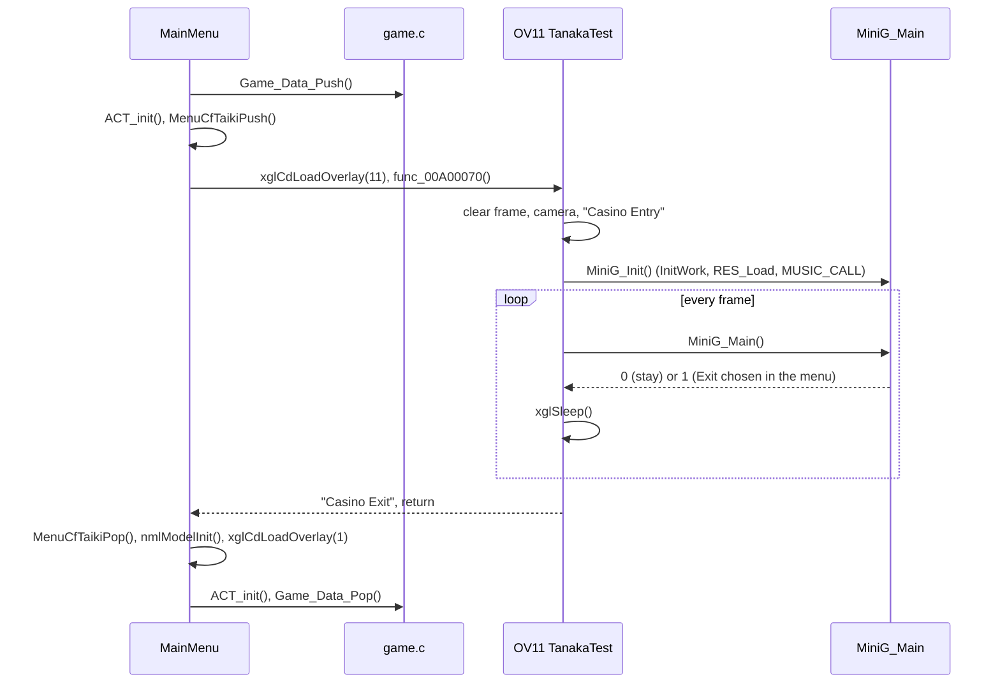
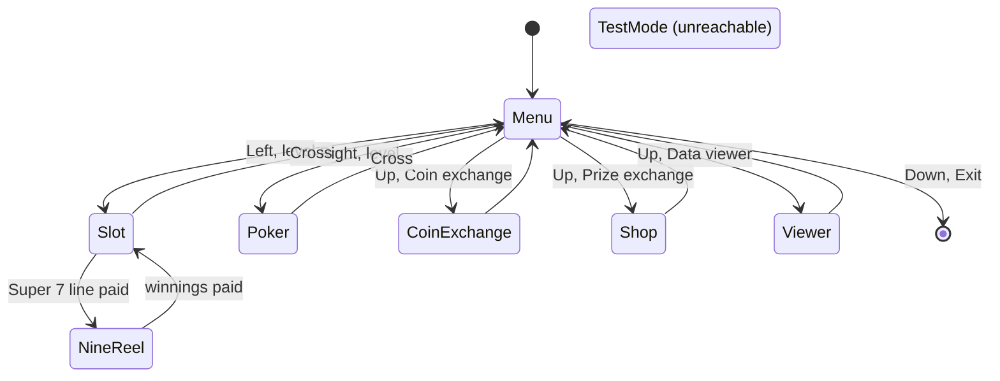
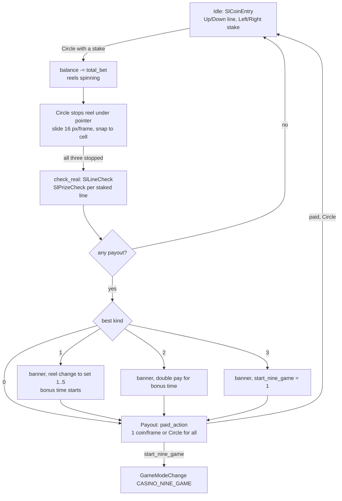
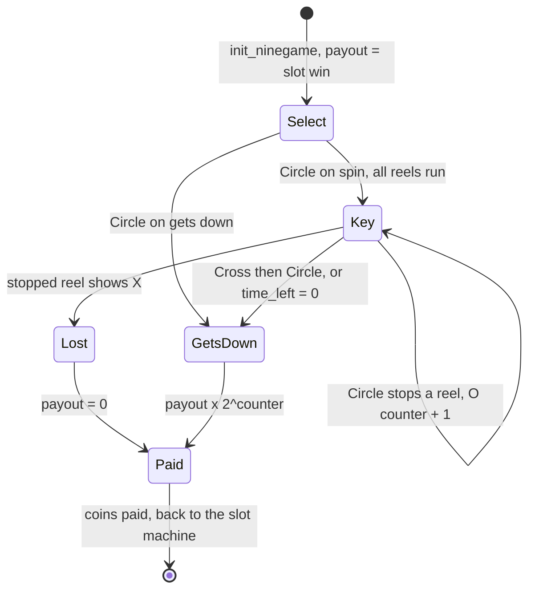
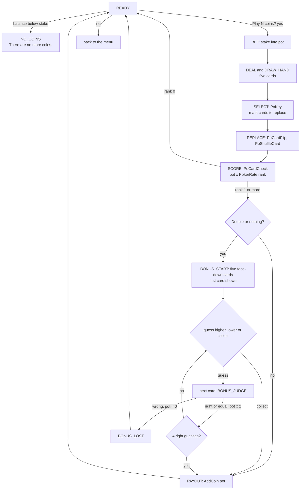

# Network Casino

The Network Casino is the coin gambling minigame of Xenosaga Episode I. The
player buys coins with money (G), plays Slot Machines (with the New Reel and
Nine Reel bonuses) or Poker (with a double-or-nothing game), and trades the
coins for prizes. It also contains a data viewer for the design sketches the
player has bought. The player opens it with the Casino Passport item while
standing on an E.V.S. symbol.

All of the casino runs in overlay 11 (OV11), loaded at `0x00A00000` over the
battle overlay. Unlike [Xeno Card](xeno-card.md) it draws only in 2D. It
writes its own GS sprite packets, keeps its state in one union in the
overlay's BSS and stores the coin balance and the bought prizes in a small
area of the save data. The source is mostly in `src/ov11/mini_g.c`.

[← Back to the overview](../../README.md)

## Contents

1. [Entering and leaving the casino](#1-entering-and-leaving-the-casino)
2. [Code layout of OV11](#2-code-layout-of-ov11)
3. [Casino state and resources](#3-casino-state-and-resources)
4. [The casino menu](#4-the-casino-menu)
5. [Slot Machines](#5-slot-machines)
6. [Nine Reel](#6-nine-reel)
7. [Poker](#7-poker)
8. [Coin exchange](#8-coin-exchange)
9. [Prize exchange](#9-prize-exchange)
10. [Data viewer](#10-data-viewer)
11. [Drawing, sound and memory](#11-drawing-sound-and-memory)
12. [Debug leftovers](#12-debug-leftovers)
13. [Source files](#13-source-files)

## 1. Entering and leaving the casino

The casino starts the same way as the other overlay minigames. The item
screen of the [main menu](../main-menu.md) accepts the Casino Passport
(event item 14) only while the player stands on an event symbol
(`GAME_FLAG_ON_EVENT_SYMBOL`), and `MainMenu()` in
`src/main/window_tex_load.c` receives 14 in `mini_game_no`. After the menu
has closed, it calls `Game_Data_Push()` to save the field, clears the actors,
saves the render callbacks (`MenuCfTaikiPush`), loads overlay 11 with
`xglCdLoadOverlay(11)` and calls `func_00A00070()`. When the casino returns,
it restores the callbacks, resets the model library, loads OV01 again and
calls `Game_Data_Pop()`, which reloads the field resources of the current
event. The [Xeno Card page](xeno-card.md#1-entering-and-leaving-the-card-game)
describes these steps in detail, and [memory](../../architecture/memory.md)
explains why the field has to be reloaded. The Java native
`Runtime.minigameExec(14)` in `src/main/runtime.c` runs the same sequence
for event scripts.

`func_00A00070()` is `TanakaTest()` in `src/ov11/tanaka_test.c`. The name
appears to come from the programmer (the casino's data directory is
`data\tanaka\`). It clears the frame, sets a black clear color, places the
studio camera at `(0, 1, 8)` with a default light, prints `Casino Entry`,
calls `MiniG_Init()` once and then calls `MiniG_Main()` once per frame,
with `xglSleep()` between frames, until `MiniG_Main()` returns nonzero. Then
it waits two more frames, prints `Casino Exit`, clears the depth buffer and
returns.

The diagram below shows the entry and exit sequence.



## 2. Code layout of OV11

OV11 is small. Its layout (`config/objects/ov11.layout.json`) has three code
units and its data, about 57 KB in all.

| Source file | Text range | Contents |
| --- | --- | --- |
| `src/ov11/tanaka_test.c` | `0xA00000`–`0xA00100` | `TanakaTest()`, the overlay entry |
| `src/ov11/mini_g.c` | to `0xA091F8` | 135 functions: menu, slots, Nine Reel, Poker, exchange, shop, viewer, drawing |
| `src/ov11/cajino_get.c` | to `0xA09224` | `Cajino_GetTitle()`, `Cajino_GetInfo()` and the viewer captions |

The data, read-only data and BSS run to `0xA0E078`. The main work union
`Gwork` sits at `0x00A0DD20`. Private declarations are in
`src/ov11/mini_g_private.h`, shared ones in `include/ov11/mini_g.h` and
`include/ov11/cajino_get.h`. Function names follow a few prefixes. `Sl` is
the slot game, `Ng` the Nine Reel game (probably "nine game"), `Po` Poker,
`VW_` the data viewer and `RES_` the accessors for the resource file.

## 3. Casino state and resources

### The work union

`Gwork` is a `union CasinoWork` of `0x250` bytes. Only one game runs at a
time, so the games share the same memory. The union has one view per game.

- `Gwork.modes` holds the selected game (`modes.game`), the bet level chosen
  in the menu (`modes.level`), the exchange submenu choice and six flags that
  record which games have run their initialization.
- `Gwork.slot` (`struct SlotWork`) holds the reel positions and states, the
  stop pointer, the five line stakes, the five scored pay lines, the reel set
  in use (`row`), the double pay and bonus state, the pending payout and the
  current slot event.
- `Gwork.nine` (`struct NineGameWork`) holds the Nine Reel state: the payout
  carried over from the slots, the win counter, the cursor, the time left and
  nine reel records.
- `Gwork.poker_deal` (`struct PokerDealWork`) holds the poker level, the deck
  (one "used" flag per card), the hand, the sorted hand, the sequence state,
  the hand rank, the double-up guess and round, and the pot.

The overlap is used on purpose in one place. `Gwork.slot.payout` and
`Gwork.nine.payout` are the same word at offset `0xA8`, so the coins won on
the slot line that starts Nine Reel become the stake of the Nine Reel game
without any copy.

`MiniG_Main()` switches on `Gwork.modes.game`. The values come from
`enum CasinoGame` in `src/ov11/mini_g_private.h`.

| Value | Name | Handler | Init (once) |
| --- | --- | --- | --- |
| 0 | `CASINO_MENU` | `menu_mode()` | `init_menu_mode()` |
| 1 | `CASINO_SLOT` | `slot_main()` | `init_slot()` |
| 2 | `CASINO_POKER` | `PokerMain()` | `PokerInit()` |
| 3 | `CASINO_COIN_EXCHANGE` | `coin_main()` | `init_coin()` |
| 4 | `CASINO_SHOP` | `shop_main()` | `init_shop()` |
| 5 | `CASINO_VIEWER` | `VW_Main()` | `VW_Init()` |
| 6 | `CASINO_NINE_GAME` | `NineGameMain()` | `init_ninegame()` from `GameModeChange()` |
| 7 | `CASINO_TEST_MODE` | `test_mode()` | inside `test_mode()` |

`GameModeChange()` switches between them. It stores the new value and resets
the state the new game must start with. The menu forgets the bet level,
Poker resets its round (`PoInitWork`) and the Nine Reel game runs
`init_ninegame()`. The slot machine gets stopped reels, reel set 0, no
double pay and no bonus. When it is entered from the menu, its line stakes
are also cleared and the help screen is shown, but when it is entered from
the Nine Reel game the stakes are kept. Each init routine of games 0 to 5 runs only the first time the
game is entered in a casino visit, guarded by `Gwork.modes.initialized`. It
mostly reads the game's textures from the CD into fixed buffers. Only the
menu returns a value that matters. When the player leaves through the menu,
`menu_mode()` returns 1 and `MiniG_Main()` passes it on to `TanakaTest()`.

The diagram below shows how the games connect.



### The resource file CASINO.res

`MiniG_Init()` calls `InitWork()`, which clears the work flags and calls
`RES_Load()`. That function reads `data\tanaka\CASINO.res` to `0x01000000`
(`CASINO_RES_BUFFER`) and points `ResData` at it. The file holds the numbers
that tune the casino, so they are data rather than code. Its start is
described by `struct CasinoResourcePrefix`.

```
0x01000000  CasinoResourcePrefix
    bonus_duration    600     length of a slot bonus      (RES_GetBonusTime)
    reel_step         32      reel advance per update     (RES_GetRealSpeed)
    prizes[51]                CasinoPrize: coin_cost, name[40],
                              description[80]  (0x7C bytes each)
    coin_offers[4]            CasinoCoinOffer: money_cost, description[28]
    sound_effect_id[256]      casino sound number -> sound effect id
    debug_mode        0       nonzero enables the debug grants
```

The two numbers at the start are counts of updates, not of seconds. The
bonus time counts down by one each time `SlModePrint()` draws the bonus bar
while no slot event is pending, so a bonus lasts 600 such frames. A spinning
reel moves 32 pixels per update, half of one 64-pixel symbol cell. The file
ends right after `debug_mode`, and its whole layout is in
[Minigame data files](../../formats/minigame-data.md#casinores).

The `RES_*` functions read these fields. `RES_ShopDataCoin()` and
`RES_ShopDataInfo()` give the price and text of a prize, `RES_Coin_Rate()`
and `RES_Coin_Info()` the price and text of a coin offer, and
`RES_SoundEffect()` plays a casino sound by looking up its effect id.

### Save data

The coins and the bought prizes are part of the normal save. A
`CasinoSaveWork` record sits at `SaveData + 0x15190` (the static pointer
`SaveWork` in `mini_g.c`). It has `prize_bought[0x50]`, one byte per prize,
and `coin_balance`. The [save data](../../architecture/save-data.md) page
shows where this lies in the whole save block.

All coin income goes through `AddCoin()`. The balance cannot go over
9,999,999 (`CASINO_COIN_MAX`). The part of a win above that limit is not
lost. It is converted to money at 8 G per coin and added with
`dataMoneyBoxInc()`.

### Music

`MUSIC_CALL(0)` clears the sound banks, loads the casino sound effects
(`data\sound\sed\Minislot.sed` and `Minislot.swd`) and then the music
`data\sound\smd\Umnmode.SMD` with its `.SWD` bank, and starts it at full
volume. `Umnmode` is the same music the [U.M.N.](../umn.md) screens use. The
[audio](../../architecture/audio.md) page explains the SMD, SWD and SED
formats.

## 4. The casino menu

`menu_mode()` draws the background `data\tanaka\BG.xtx` and the window
texture `window.xtx`. The menu has four entries arranged as a cross, and
each d-pad direction moves the cursor straight to one of them. Up is the
exchange entry, Left the Slot Machines, Right Poker and Down the exit.
Circle opens the chosen entry.

- The exchange entry opens a submenu with three choices: coin exchange,
  prize exchange (the shop) and the data viewer.
- Slot Machines and Poker open a level submenu with four bet levels
  (`level_select`). The chosen level is stored in `Gwork.modes.level` and
  decides the stake of the game.
- Exit makes `menu_mode()` return 1, which ends the casino.

Left, Right or Cross close an open submenu.

## 5. Slot Machines

### The machine

The slot machine has three reels. Each reel is a strip of 21 pictures
(`SLOT_REEL_CELLS`), 64 pixels high, so a reel position wraps after `0x540`
pixels. Three rows of the reels are visible. Nine picture numbers are used.
The code only knows them as numbers, so the table matches them with the
symbols the Xeno Series Wiki lists, which is an interpretation.

| Picture | Probable symbol | Line prize | Kind |
| --- | --- | --- | --- |
| 0 | Vector logo | 5 | 0 |
| 1 | Curry | 10 | 1 |
| 2 | Grape | 20 | 1 |
| 3 | Peach | 20 | 1 |
| 4 | Bunnie | 1 | 2 |
| 5 | 7 | 30 | 0 |
| 6 | Joker (wild) | 0 | 0 |
| 7 | Super 7 | 30 | 3 |
| 8 | blank | 0 | 0 |

The reels come in six sets. `realpt[18]` points to three strips per set and
`Gwork.slot.row` (0 to 5) selects the set. Set 0 (`real01array` to
`real03array`) is the normal machine. The other sets are the *New Reels*.
Set 1 replaces every 7 by a Super 7, set 2 adds a few Jokers, set 3 puts
many Jokers on the first reel, set 4 holds only Super 7s and blanks, and
set 5 adds blanks to the normal strips. A Super 7 therefore never appears on
the normal machine. It only shows up after a reel change.

### Pay lines and stakes

There are five pay lines, defined by `pat_22[5][3]` as one cell offset per
reel. Line 0 is the diagonal from top left to bottom right, lines 1 to 3 are
the top, middle and bottom rows, and line 4 is the other diagonal.

The stake is set per line in `SlCoinEntry()` while the machine is idle. Up
and Down move the line guide over the five lines. Right raises the stake of
that line by one step (at most three steps) and Left lowers it. A raise is
refused when the new total would no longer be below the coin balance. The
coins per step depend on the menu level: 1, 5, 10 or 30
(`lineStakeStepTable`). `line_pay[i]` is the line's steps times the coins per
step, and `total_bet` is their sum. Any other button toggles the help screen
(`help_all.xtx`).

### Spinning and stopping

`slot_key()` runs the machine as three states in `Gwork.slot.state`.

1. **Idle.** Cross leaves to the menu. Circle with a stake starts a spin. The
   total stake is taken from the coin balance at once, all three reels are
   set spinning and the stop pointer goes to the first reel.
2. **Spinning.** Each spinning reel advances by `RES_GetRealSpeed()` (32) pixels
   per frame. Circle stops the reel under the pointer and moves the pointer
   to the next reel. A stopping reel slides on by 16 pixels per frame until
   it is within 17 pixels of a cell edge and then snaps onto the cell. When
   all three reels stand, `check_real()` scores the lines and
   `linepay_check()` clears the stakes of lines the player can no longer
   afford.
3. **Payout.** `paid_action()` pays the win into the balance, one coin per
   frame with a running sound, or all at once when Circle is pressed. Circle
   on a finished payout returns to idle.

### Scoring a line

`SlLineCheck()` reads the three pictures of every line with `SlGetPic()`
and calls `SlPrizeCheck()` for each line that has a stake.
`SlPrizeCheck()` decides the line's picture. Three equal pictures pay the
full prize. The Joker (picture 6) is wild. Two equal pictures and a Joker,
or one picture and two Jokers, also count as that picture, but the prize is
halved and rounded up. Three Jokers pay nothing. While double pay is active
the prize is doubled before the halving. The line pays its prize times the
line's stake, and the payouts of all lines are added up.

Each line also has a *kind*, and `SlLineCheck()` keeps the highest kind of
all winning lines. The kind becomes a slot event, which `SlEvent()` plays
out before the machine accepts input again. A win without a kind just plays
a sound.

- **Kind 1** (Curry, Grape, Peach) shows a banner and then runs event 6, a
  reel change with bonus. `SlChangeRealEffect(1)` picks a random reel set 1
  to 5 that differs from the current one, so the machine switches to a New
  Reel, and starts a bonus time of `RES_GetBonusTime()` frames.
- **Kind 2** (Bunnie) shows a banner and turns on *double pay* for the bonus
  time. The Bunnie line itself only returns the stake (prize 1).
- **Kind 3** (Super 7) shows a banner and sets `start_nine_game`. When the
  payout starts, `paid_action()` switches to the Nine Reel game instead of
  paying, so the win becomes the Nine Reel stake.

`SlModePrint()` draws the bonus banner and a time bar. While a bonus or
double pay is active, the bonus time counts down by one each frame in which
no event runs. When it reaches zero while the machine is idle, it raises
event 7, which changes back to reel set 0 and ends double pay and the bonus.
If a spin is still running, the time is held at 1 until the spin ends.
Events 4 and 5 exist in `SlEvent()` but nothing raises them.

The flowchart below shows one spin from stake to payout.



## 6. Nine Reel

Nine Reel is the bonus game behind a Super 7 win. `init_ninegame()` sets it
up. It shows nine small reels in a 3 by 3 grid. Each reel gets a different
strip, picked at random from the twenty strips of `ng_realtbl`, and each
strip cell is either a hit (1, shown as O) or a miss (0, shown as X). The
game has a time limit of 900 frames (`time_left`), drawn as a bar.

The stake is the slot payout that triggered the game. The game state
`Gwork.nine.guide` has three values.

- **Select (0).** Up and Down choose between spinning the reels and the
  "gets down" button. Circle on spin starts all nine reels.
- **Key (1).** `NgGame_Key()` moves a cursor over the nine reels with the
  d-pad (through the table `ptmove_50`). Circle on a running reel stops it
  after a short slide. Cross jumps to the "gets down" button. The time bar
  runs down only in this state.
- **Paid (2).** `NgGame_Paid()` pays the result into the coin balance and
  switches back to the slot machine. The machine keeps its line stakes but
  returns to reel set 0 without double pay or bonus, so a Nine Reel game
  also ends the New Reel that produced the Super 7.

When a reel stops, `NgCheckReal()` reads its cell. An O adds one to the win
counter. An X stops all remaining reels (`NgAllStop`), resets the counter and
sets the pending amount to zero, so the whole stake is lost. "Gets down"
(`NgGame_GetsDown()`) cashes out. It multiplies the pending amount by
2 to the power of the counter. With all nine reels on O, the stake is
multiplied by 512. When the time runs out, the game cashes out on its own.

The diagram below shows the Nine Reel states.



## 7. Poker

### Rules and stakes

Poker is five-card draw against the machine. The level chosen in the menu
sets the stake per round from `PokerCoinRate`: 5, 10, 30 or 100 coins. A
winning hand multiplies the pot by `PokerRate[rank]`.

| Rank | Hand | `PokerRate` |
| --- | --- | --- |
| 1 | One pair | 1 |
| 2 | Two pair | 2 |
| 3 | Three of a kind | 3 |
| 4 | Straight | 5 |
| 5 | Flush | 7 |
| 6 | Full house | 10 |
| 7 | Four of a kind | 20 |
| 8 | Straight flush | 50 |
| 9 | Royal flush | 100 |

One pair therefore returns the stake and anything less loses it.

### Cards

A card is a number from 0 to 51. The suit is the number divided by 13
(0 spades, 1 clubs, 2 hearts, 3 diamonds, after the textures `spade.xtx`,
`clover.xtx`, `heart.xtx` and `dia.xtx`). The rank is the remainder, with 0
for the Ace, which counts low. `cards.used[]` marks the cards already dealt.
`PoShuffleCard()` deals one card into the next slot that must be filled,
picking random cards with `xglSRand() % 52` until it finds an unused one,
and waits eight frames between cards.

### Evaluating a hand

`PoCardCheck()` sorts the hand (`PoSortCard`, by card number) and tries the
ranks from 9 down to 1, `PoChk9()` to `PoChk1()`. Pairs, two pairs, threes,
full houses and fours are found by `PoMultiChk()`, which counts the pairs of
cards whose numbers differ by 13, 26 or 39 (same rank, another suit). Flushes
come from `PoFlushChk()`. Straights compare the ranks after removing the
suit and need five consecutive ranks. An Ace only counts low, so 10-J-Q-K-A
is not a straight.

The royal flush test in `PoChk9()` has a flaw. It checks the run
`base, base+9, base+10, base+11, base+12` only when
`base == PoGetBase(PoGetBase(base))`. `PoGetBase()` turns a suit index into
the suit's first card number, so the test holds only for base 0. Only the
royal flush in spades is recognized. A royal flush in another suit is not a
straight flush either (the ranks are not consecutive), so it scores as a
flush. The intended test was probably `PoGetBase(PoGetMark(base))`.

### The round

`PokerMain()` is a state machine over `enum PokerSeq`
(`Gwork.poker_deal.seq`).

1. **READY.** If the balance is below the stake, the game shows "There are
   no more coins." Otherwise it asks "Play N coins per round poker?". Yes
   starts a round, No or Cross leaves to the menu.
2. **BET** moves the stake from the balance into the pot. **DEAL** animates
   five face-down cards and **DRAW_HAND** gives them values.
3. **SELECT.** `PoKey()` lets the player move over the five cards with Left
   and Right and toggle each card's replace mark with Circle. Down moves to
   the confirm button and Circle there ends the selection.
4. **REPLACE.** `PoCardFlip()` turns the marked cards face down and
   `PoShuffleCard()` deals new ones.
5. **SCORE.** `PoCardCheck()` ranks the hand. A win multiplies the pot and
   goes on to the double-up offer. A loss goes back to READY with the pot
   lost.
6. **DOUBLE_UP** asks "Double or nothing?". No goes to the payout.

The double-up game deals five cards face down. The first card is turned up.
Before each next card, the player chooses between *higher*, *lower* and
*collect* (`PoDialog(1)`). The new card is compared with the previous one by
rank only. A right guess or an equal rank doubles the pot. After four right
guesses the game pays out automatically, so the pot can grow up to 16 times.
A wrong guess sets the pot to zero and ends the round. **PAYOUT** adds the
pot to the balance step by step, or at once with Circle.

The flowchart below shows a poker round.



### A hidden royal flush

`PoCardFlip()` keeps a counter, `status_96`. It counts the rounds in a row
in which the player throws away all five cards, and resets when fewer are
replaced. Once the counter reaches 32, it sets `Gwork.poker_deal.bonus_mode`.
In that mode `PoShuffleCard()` does not draw at random. It gives the cards
0, 9, 10, 11 and 12 in slot order, which are the Ace, 10, Jack, Queen and
King of spades, the one royal flush the game recognizes. The same fixed
cards are dealt in the double-up game, where each one is higher than the one
before, so "higher" always wins. The flag is checked again at every
replacement, so the mode ends with the first round in which the player keeps
a card. Leaving Poker clears the flag but not the counter, which lives in the
overlay's data and starts again from 0 only when OV11 is loaded anew. The
mode appears to be a hidden feature or a test aid.

## 8. Coin exchange

`coin_main()` sells coins for money. It shows four offers with their texts
from `CASINO.res` (`RES_Coin_Info`) and an EXIT row, on the texture
`exchange2.xtx`. Up and Down move the cursor over the five rows. Circle, or
R1 held down (it repeats), buys one offer. The purchase takes
`RES_Coin_Rate(n)` G with `dataMoneyBoxDec()` and adds 10, 100, 500 or 1000
coins with `AddCoin()`. When the balance is already at the maximum, the money
is given back and a refusal sound plays. The prices themselves are data.
`CASINO.res` sets them to 100, 950, 4500 and 8000 G, so larger offers are
slightly cheaper per coin. Circle on EXIT or Cross returns to the menu.

## 9. Prize exchange

`shop_main()` trades coins for prizes. It uses the texture `exchange1.xtx`
and shows eight rows at a time with a scrolling cursor. `init_shpmenu()`
builds the list of the 51 prizes that are currently on offer.

| Prizes | Shown when | Given by the purchase |
| --- | --- | --- |
| 0 | always | items 1, 5, 10 and 12, the Recovery Set |
| 1 | always | items 16 and 36, the Escape and Rest Set |
| 2, 3 | until bought | accessories 100 and 109 |
| 4, 5 | until bought | items 11 and 18 |
| 6–35 | until bought | nothing but the bought mark, unlocks a design sketch in the data viewer |
| 36, 37 | flag 115 set | event items 53 and 54, the Xeno Card starter pack and Card Pack #821 |
| 38 | flag 301 set | event item 55, Card Pack #822 |
| 39–49 | flag 389 set, until bought | event items 41 to 51, Xeno Card promotional packs |
| 50 | flag 391 set, until bought | event item 52, a promotional pack |

The names, descriptions and prices on screen come from `CASINO.res`
(`RES_ShopDataInfo`, `RES_ShopDataCoin`). The file names prizes 2 to 5 the
Golden Dice (10,000 coins), Bravesoul (15,000), `Revive DX ` with a trailing
space (18,000) and Stim DX (12,000), prizes 6 to 35 Design sketch 01 to 30
(2,000 each), and prizes 39 to 50 PM Card F to Q (1,000 each). The Recovery
Set costs 100 coins, the Escape and Rest Set 150, the Starter Set 400 and
each card pack 100. The
flags are story flags read with `xglFlagsGet1()`, so the card prizes appear
as the story advances. Event items 53 to 55 and 41 to 52 are the same card
pack items that [Xeno Card](xeno-card.md#card-packs) opens (`0x24 + kind`).

Circle, or R1 held down, buys the selected prize when the balance covers its
price. The coins are taken first. For prizes 2 to 50 the bought mark is set
in `prize_bought` before the prize is handed out. If the item cannot be
given (for example because the player already carries 99 of every item in a
set), the coins are refunded but the mark stays set, so a prize that is
offered only once disappears from the list even though it was not received.
Cross returns to the menu.

## 10. Data viewer

The data viewer shows the design sketches bought in the prize exchange.
`VW_SamlistInit()` builds the list from `prize_bought[6]` to
`prize_bought[35]`, so each of the 30 sketches appears after its prize is
bought. `VW_SamMode()` shows the list with a title and a caption for the
selected entry. The texts are in `src/ov11/cajino_get.c`. `ViewerText[30]`
holds a title such as "Shion 1" and a caption such as "Image illustration by
Kunihiko Tanaka. Drawn with acrylic on B3 paper...", and `Cajino_GetTitle()`
and `Cajino_GetInfo()` return them.

Triangle opens the picture in `VW_ViewMode()`. The table `fileinfo[30]` gives
each sketch a type. Type 0 (14 sketches) is a tall picture of two pages
stacked one above the other, `data\tanaka\NN_Y1.xtx` and `NN_Y2.xtx`, and it
scrolls only up and down. Type 1 (16 sketches) is a grid of two by two pages,
`NN_W1.xtx` to `NN_W4.xtx`, and it scrolls both ways. The analog sticks pan
the picture within fixed limits and Cross returns to the list. The sketch
textures are described in
[Minigame data files](../../formats/minigame-data.md#the-design-sketches).

## 11. Drawing, sound and memory

### 2D sprites

The casino draws everything as 2D sprites in its own GS packets and does not
use the model library. Each draw function takes the current packet with
`xglPacketGetCurrent()`, uploads a texture from main memory with
`xglPacketTextureTrans()`, flushes the texture cache (`TEXFLUSH`) and adds
primitives. `MakeSprite()` writes one textured sprite as a triangle strip
with texel coordinates (`GS_PRIM_FST`), alpha blending and a fixed depth.
A `SpriteTex` names the texture rectangle, its CLUT and format, and a
`SpriteRect` the screen rectangle. `SetDrawStatus()` writes the TEST, TEX1,
CLAMP and ALPHA registers for one of seven blend modes, `SetTest()` sets the
depth test, and `DrawNonTextureBox()` draws a plain colored box. Screen
positions are offset by the casino's origin (`0x7000`, `0x7200` in GS 12.4
fixed point) and textures go to GS memory starting at block `0x3800`. The
palettes are not separate files. Each one sits inside its own texture, in a
corner the picture does not use, as
[Minigame data files](../../formats/minigame-data.md#the-casino-textures)
describes.
Numbers are drawn digit by digit from sprite tables (`DecPrint2`,
`SlDecPrintSmall`), and plain text uses the xgl font (`xglFontPrint`). The
[rendering](../../architecture/rendering.md) page explains GS packets and the
[xgl](../../libraries/xgl.md) page the packet and font calls.

### Fixed buffers

The casino reads its files into fixed areas of main memory above
`0x01000000`, listed in `src/ov11/mini_g_private.h`. The resource file sits
at `0x01000000`, the textures of each game from `0x01008000` up to about
`0x01593000`, the music sequence at `0x015A3000`, its sample bank at
`0x017A3000` and the two sound effect files at `0x017A7000` and
`0x017B7000`. This memory is free while the field is pushed, which is why
`Game_Data_Pop()` must reload the field afterwards.

### Sound

Every casino sound goes through `RES_SoundEffect(n)`, which looks up the
sound effect id for casino sound `n` in `CASINO.res`. The constants
`CASINO_SE_*` in `mini_g_private.h` name the sounds the code uses, for
example the reel stop, the payout loop, the poker win and the refusal
buzzer. The payout loop is stopped with `RES_SoundEffectStop()`.

On the disc, 65 of the 256 entries are set. The used ones run from 0 to 66,
with zeros at 7 and 52, and entries 67 to 255 are all zero. Entry 7 is never
played. Entry 52 is the Nine Reel payout loop, so that payout requests sound
effect 0, while the slot payout (sound 39) uses `0x10004`. Most ids lie in
bank 0 or 1, and bank 2 appears only once, in sound 47 (`0x20009`).

## 12. Debug leftovers

The casino keeps several traces of development.

- When the `debug_mode` word of `CASINO.res` is nonzero, `InitWork()` sets
  flags 115, 301, 389 and 391 (unlocking every prize), adds 999,999,999 G
  and 9,999,000 coins. The word is 0 on the disc, so this never happens in
  the released game.
- `MiniG_Init()` prints the work size (`0x7CF000`) and `MiniG_Main()` prints
  a build date line ("Ver Nov 24 2002") with `xglFontDebugPrintf()` every
  frame. The slot and poker code print their results with `dprintf()`, some
  of them in Japanese.
- `CASINO_TEST_MODE` (7) only draws the background `base.xtx`. Nothing calls
  `GameModeChange()` with it, so it cannot be reached.

The [debug tools](../debug-tools.md) page describes the debug output
functions.

## 13. Source files

| File | Role |
| --- | --- |
| `src/main/window_tex_load.c` | `MainMenu()`, minigame switch, overlay swap |
| `src/main/runtime.c` | `Runtime.minigameExec` native |
| `src/main/game.c` | `Game_Data_Push()`, `Game_Data_Pop()` |
| `src/ov11/tanaka_test.c` | `TanakaTest()`, overlay entry |
| `src/ov11/mini_g.c` | the whole casino |
| `src/ov11/mini_g_private.h` | work union, enums, buffers, sound constants |
| `src/ov11/cajino_get.c` | data viewer captions |
| `include/ov11/mini_g.h`, `include/ov11/cajino_get.h` | shared declarations |
