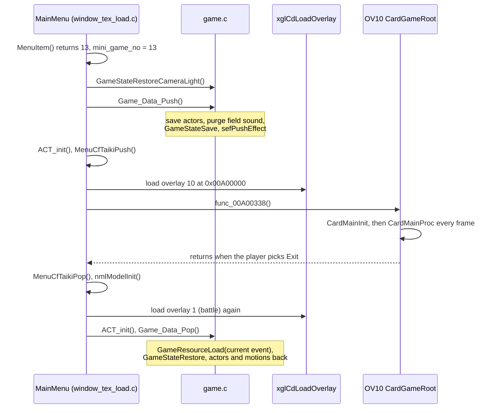
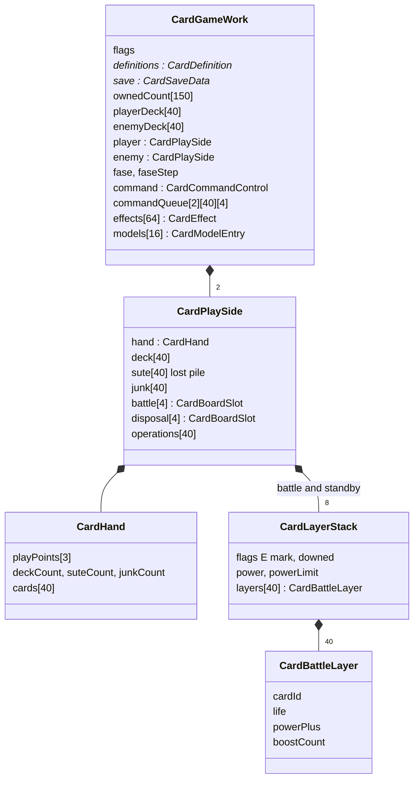
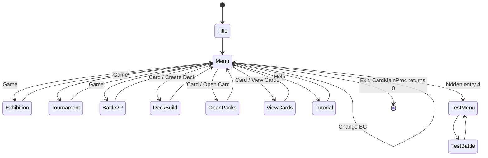
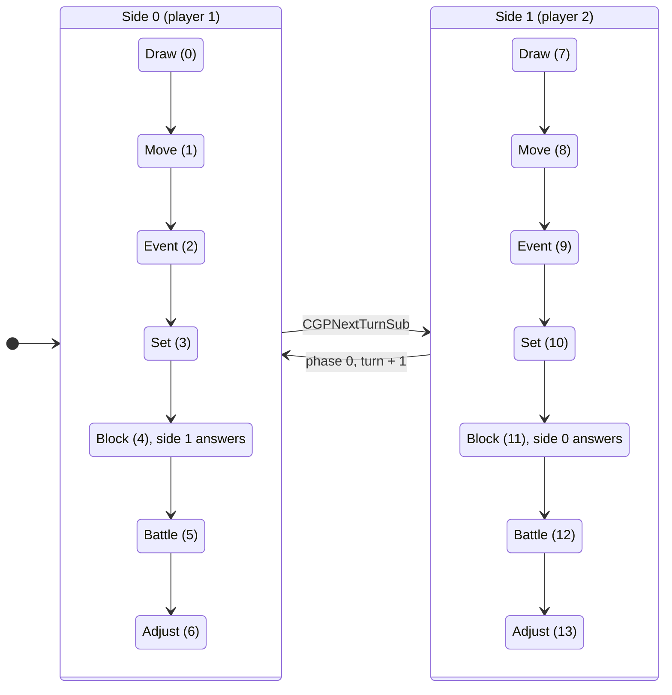
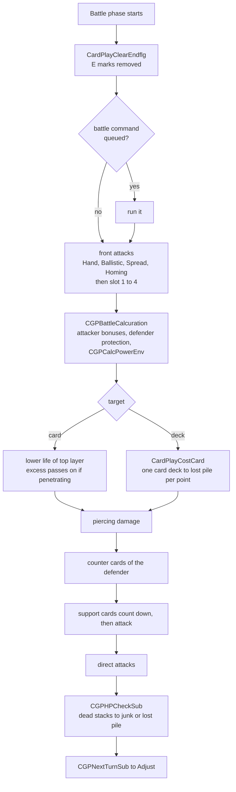
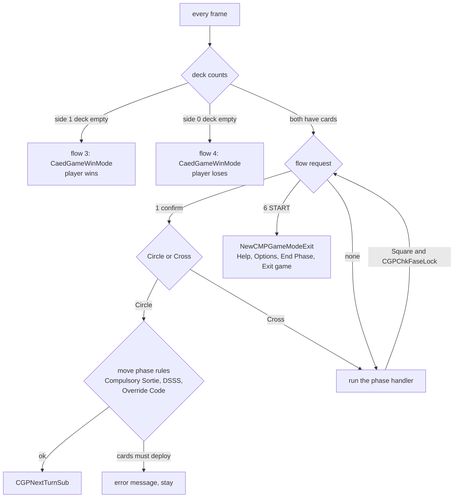
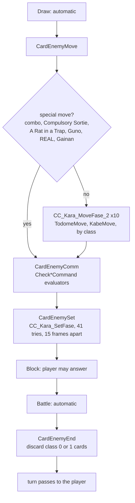
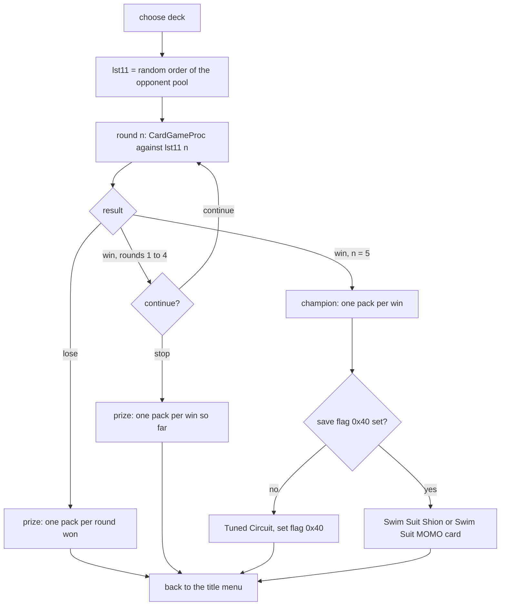

# Xeno Card

Xeno Card is the trading card game inside Xenosaga Episode I. Two players
build 40-card decks from a collection of about 150 cards, place battle cards
on a play mat and attack each other until one deck runs out. The player gets
the game from the Card Passport item and plays it at E.V.S. symbols. Cards
come from Card Packs that are bought, won or given as prizes in the story,
in the [Network Casino](network-casino.md) and in Xeno Card itself.

All of the game runs in overlay 10 (OV10), which is loaded at `0x00A00000`
over the battle overlay while the card game is open. The overlay has its own
main loop, its own data files under `data\carddata\`, its own 3D play mat
drawn with the [nml model library](../../libraries/nml.md), a computer
opponent and a small area of the save data for the collection and the five
saved decks.

[← Back to the overview](../../README.md)

## Contents

1. [Entering and leaving the card game](#1-entering-and-leaving-the-card-game)
2. [Code layout of OV10](#2-code-layout-of-ov10)
3. [The card game work area](#3-the-card-game-work-area)
4. [The main loop and its modes](#4-the-main-loop-and-its-modes)
5. [Card data](#5-card-data)
6. [The play mat](#6-the-play-mat)
7. [A match, turn by turn](#7-a-match-turn-by-turn)
8. [Card effects and the command system](#8-card-effects-and-the-command-system)
9. [The computer opponent](#9-the-computer-opponent)
10. [Game modes and prizes](#10-game-modes-and-prizes)
11. [Collection, decks and save data](#11-collection-decks-and-save-data)
12. [Rendering, sound and input](#12-rendering-sound-and-input)
13. [Source files](#13-source-files)

## 1. Entering and leaving the card game

Xeno Card is one of the four minigames that start from a passport item.
The passports are event items 12 to 15 in the item screen of the
[main menu](../main-menu.md) (`MenuItem()` in `src/main/menu_item.c`). The
item screen accepts a passport only while `GameLoopState.flags` has
`GAME_FLAG_ON_EVENT_SYMBOL` set, which `src/main/game.c` sets while the player
stands on an event symbol (the E.V.S. symbol that also draws the `evsEffe`
effect). The item screen then returns the item number, and `MainMenu()` in
`src/main/window_tex_load.c` stores it in the global `mini_game_no` and closes
the menu.

When the menu has closed and `mini_game_no` is 13, `MainMenu()` runs the
minigame. It first restores the field camera and light
(`GameStateRestoreCameraLight`), then calls `Game_Data_Push()` from
`src/main/game.c`. That function saves the actor array, purges the field
sounds, saves the game state and the active effects, and remembers hidden
model parts. `ACT_init()` then clears the actors and `MenuCfTaikiPush()`
saves and clears the eight final-packet render callbacks
(`sRender.final_packet_callback`), so no field drawing hook runs during the
minigame. Only then does `xglCdLoadOverlay(10)` load
OV10 over the battle overlay, and `func_00A00338()` (the overlay entry,
`CardGameRoot()`) runs the card game until it returns.

On the way back the order is reversed. `MenuCfTaikiPop()` restores the render
callbacks,
the depth buffer is cleared, `nmlModelInit()` resets the model library,
`xglCdLoadOverlay(1)` brings back OV01 and `Game_Data_Pop()` rebuilds the
field. `Game_Data_Pop()` waits for the CD, reloads the field sounds and
effects, calls `GameResourceLoad()` for the current event (because the
minigame has used the memory where the field resources lived), restores the
saved map unit serial numbers, the game state and the actors with their
motion. The memory handling behind this is explained in
[memory](../../architecture/memory.md).

A second way in exists. The Java native `Runtime.minigameExec(int)`
(`Java_xeno_util_Runtime_minigameExec__I` in `src/main/runtime.c`) runs the
same switch for numbers 12, 13 and 14. It sets `RUNTIME_GAME_FLAG_MINIGAME`,
stops vibration, pushes the game data, loads the overlay, calls the entry,
reloads OV01 and pops the data again. For Xeno Card it also clears the depth
buffer after the game. Event scripts can therefore open the card game
directly, without the passport. The [Java VM](../../scripting/java-vm.md) and
the [native catalogue](../../scripting/natives.md) describe how scripts call
natives.

The diagram below shows the entry and exit sequence from the main menu.



`CardGameRoot()` itself lives in `src/ov10/calc_vert_out_vec_edge.c`. It
clears the frame, sets up the studio camera with its eye at `(0, 0, 5.8)` and
a default light (`yNewRenderInit`), starts the global fade, loads the sound
effect bank `"Minicard"` and calls `CardMainInit()` with the static work area
`proc_0`. Then it calls `CardMainProc(&proc_0)` and `xglSleep()` in a loop, which
runs one step of the game per frame and gives the other threads their time
(see [xgl](../../libraries/xgl.md) for `xglSleep`). When `CardMainProc()`
returns 0 the root function unloads the sound banks and returns to the menu.

## 2. Code layout of OV10

OV10 contains 361 functions in eleven translation units. The layout file
`config/objects/ov10.layout.json` gives their address ranges. The table below
names each unit after its first function, as the build does, and explains
what it holds.

| Source file | Text range | Contents |
| --- | --- | --- |
| `src/ov10/calc_vert_out_vec_edge.c` | `0xA00000`–`0xA00410` | `CardGameRoot()` (overlay entry), studio setup, a vertex helper |
| `src/ov10/card_play_sound1.c` | to `0xA08670` | music, `CardDataLoad()`, `CardMainInit()`, `CardMainProc()`, START menu, win banners, prizes |
| `src/ov10/card_fread.c` | to `0xA12A90` | `CardFread()`, card drawing (`CardDisp`), fades, cursor and list windows |
| `src/ov10/ccu_038_exec_sub.c` | to `0xA19A20` | card effects: `CardPlayCommandPlay()` and the `CCU0xx`/`CCC0xx` helpers |
| `src/ov10/card_deck_chk.c` | to `0xA1C1B8` | deck checks, deck building, load and save of decks |
| `src/ov10/card_view_proc.c` | to `0xA1E5D8` | opening card packs, viewing the collection |
| `src/ov10/card_disp.c` | to `0xA21348` | card text, help pages and their texts |
| `src/ov10/card_tutorial.c` | to `0xA21768` | the picture tutorial |
| `src/ov10/cgp.c` | to `0xA324B8` | the match itself: phases, battle, board drawing, effects |
| `src/ov10/card_enemy.c` | to `0xA34190` | computer player phase handlers, enemy deck list |
| `src/ov10/battle_area_check_enemy.c` | to `0xA42034` | computer player board evaluation and decisions |

The prefix `CGP` in `cgp.c` probably stands for "card game play". Functions
named `CardPlay*` handle the state of one side (hand, deck, piles, board),
`CGP*` functions run phases and the board, and `CC_Kara_*` functions belong to
the computer player. The data and BSS of the overlay follow the code. The
work area `proc_0` sits in the BSS at `0x00A4FA10`.

## 3. The card game work area

Everything the card game knows during a session lives in one structure,
`CardGameWork` (`include/ov10/cgp.h`, `0x71A0` bytes). `CardGameRoot()` keeps
it as the static `proc_0` and passes a pointer to every function. It holds the
loaded card definitions, the current mode, both sides of the match, the
command system, the cursor, messages, the effect table and the model slots.

The most important fields are these.

| Field | Meaning |
| --- | --- |
| `flags` | match flags, `CGP_FLAG_SIDE1_AUTO` (`0x20`) when the computer plays side 1, `CGP_FLAG_SIDE0_AUTO` (`0x40`) for side 0 |
| `cardCount`, `definitions` | number of cards and the `CardDefinition` table loaded from `card.dat` |
| `commandIds` | per card id, the effect command it runs (`CardCommandPlay` table) |
| `save` | pointer to `CardSaveData` inside the save data |
| `ownedCount[150]` | copies of each card the player owns (0 to 3) |
| `playerDeck[40]`, `enemyDeck[40]` | the decks chosen for the next match |
| `player`, `enemy` | the two `CardPlaySide` records (side 0 and side 1) |
| `fase`, `faseStep` | current mode of the card game and its step |
| `command` | `CardCommandControl`: current phase, turn counter, pad input of both players, flow requests |
| `commandQueue[2][40][4]` | queued card effects of both sides |
| `effects[64]` | `CardEffect` records (0x40 bytes each) for flying sprites and numbers |
| `models[16]` | `CardModelEntry` slots (visible flag, model, texture, matrix) for menus and windows |
| `rotStageId`, `rotStageCooldown` | which side of the mat faces the camera |

`CardPlaySide` (`0x2AAC` bytes) is the full state of one player. Its
`hand` is a `CardHand` record with three play point counters, the counts of
the deck, lost pile and junk pile, and up to 40 card ids in the hand. The
side also holds the deck order `deck[40]`, the lost pile `sute[40]`, the junk
pile `junk[40]`, four battlefield slots `battle[4]`, four standby slots
`disposal[4]` and up to 40 situation cards in `operations[40]` with their
remaining duration. The Japanese words in the field names are kept from the
original: *yama* (pile) is the deck and *sute* (thrown away) is the lost
pile.

A board slot (`CardBoardSlot`, `0x1BC` bytes) contains a `CardLayerStack`.
The stack has the card at the bottom (layer 0) and up to 39 layers on top of
it for weapons and boosts. Each `CardBattleLayer` stores the card id, the
life of that layer, a power bonus and a boost count. The stack has its own
`flags` (`CARD_STACK_FLAG_END` for the E mark, `CARD_STACK_FLAG_FROZEN` for a
downed card, `CARD_STACK_FLAG_NO_DAMAGE` when its attack does no damage), the
current power and a power limit.

The diagram below shows how these structures nest.



## 4. The main loop and its modes

`CardMainInit()` (`src/ov10/card_play_sound1.c`) runs once. It points
`work->save` at the card area of the save data (`SaveData + 0x15090`). On the
very first run it marks that area as initialized, writes the starter deck
`CardInitialDataPack` into all five deck slots and adds those cards to the
collection. It unpacks the owned counts into `ownedCount`, clears the decks
and the model slots, loads `card.dat` (`CardDataLoad`) and the card pictures
(`CardGraphicLoad`) and then reads about 150 layout (`.lex`) and texture
(`.xtx`, `.bin`) files to fixed addresses with `CardFread()`. Section
[Rendering, sound and input](#12-rendering-sound-and-input) lists the memory
areas.

`CardMainProc()` is called once per frame and switches on `work->fase`. The
values come from `enum CardFase` in `include/ov10/card_play_sound1.h`.

| Value | Name | What runs |
| --- | --- | --- |
| 0 | `CARD_FASE_TITLE` | fade in, start the title music, `CardTitleInit()` |
| 1 | `CARD_FASE_MENU` | the title menu |
| 2 | `CARD_FASE_OPEN_PACKS` | `CardOpenProc()`, opening card packs |
| 3 | `CARD_FASE_VIEW_CARDS` | `CardViewProc()`, browsing the collection |
| 5 | `CARD_FASE_TEST_MENU` | debug test menu (sample decks, sound list) |
| 6 | `CARD_FASE_TEST_BATTLE` | a match started from the test menu |
| 7 | `CARD_FASE_DECK_BUILD` | load, edit and save a deck |
| 9 | `CARD_FASE_BATTLE_2P` | 2P Battle |
| 10 | `CARD_FASE_TOURNAMENT` | Tournament |
| 11 | `CARD_FASE_EXHIBITION` | Exhibition |
| 12 | `CARD_FASE_TUTORIAL` | `CardTutorialProc()` |

The title menu has four columns. **Game** offers Exhibition, Tournament,
2P Battle and Change BG (the background of the mat). **Card** offers
Create Deck, Open Card and View Cards. **Help** offers the picture tutorial
and the help pages. **Exit** makes `CardMainProc()` return 0, which ends the
loop in `CardGameRoot()`. The SELECT button opens the help screen
(`CardHelpProc`) from most screens. While help is open, `helpState` takes
over from `fase` until it closes.

The test menu (fases 5 and 6) is reached only through a fifth menu entry
(`MenuNo_1 == 4`) that the title menu never selects, so it appears to be
leftover debug code. It lets a tester pick one of ten sample decks
(`SampleDeck0` to `SampleDeck9`, named "T1" to "T10") for each side, play
sounds and change the volume. The [debug tools](../debug-tools.md) page lists
the other test modes of the game.

The diagram below shows how the modes connect.



## 5. Card data

### card.dat and CardDefinition

All card rules come from one data file, `data\carddata\card.dat`.
`CardDataLoad()` reads it to `CARD_DATA_BUFFER` (`0x01000000`) with
`CardFread()`, which only prefixes the name with `data\carddata\` and calls
`xglCdReadFile()`. The file starts with a 16-bit card count, then a 12-byte
version tag at offset 4 that must read `CardData1.10` (otherwise the game
prints `ID Not Mutch!!`), and then the table of card definitions at offset
`0x10`. The card texts follow the table. Each definition stores the offsets
of its name, caption and description text relative to the start of the
buffer. The texts are plain ASCII with a few escape characters: `@` stands
for a comma, `#` for an apostrophe and `$` for a line break. The byte layout
of the file is in [Minigame data files](../../formats/minigame-data.md#carddat).

```
0x01000000  +0x00  u16  count
            +0x04  char version[12]   "CardData1.10"
            +0x10  CardDefinition[count]   (0x24 bytes each)
            ...    name, caption and description strings
```

`CardDefinition` (`0x24` bytes, `include/ov10/cgp.h`) describes one card.

| Offset | Field | Meaning |
| --- | --- | --- |
| `0x00` | `kind` | `CARD_KIND_BATTLE` (1), `CARD_KIND_EVENT` (2) or `CARD_KIND_SITUATION` (4) |
| `0x02` | `flags` | attributes, see below |
| `0x04` | `need[4]` | requirement masks: attributes that must be present on the own field |
| `0x0C` | `discardRequirements[4]` | for cards that need discards, one card is discarded per mask |
| `0x10` | `reserveCost` | cost: cards moved from the deck to the lost pile |
| `0x11` | `playCost` | play points the card uses |
| `0x12` | `operationDuration` | life (HP) of a battle card, turns a situation card stays |
| `0x13` | `attackType` | Hand (1), Ballistic (2), Spread (3), Homing (4) |
| ... | `attackPower`, `basePower`, `rarity`, `identity` | attack values, rarity letter, identity for the "only one on the field" rule |
| ... | `nameOffset`, `captionOffset`, `descriptionOffset` | texts in the buffer |

The attribute bits in `flags` are `CARD_ATTR_HUMAN` (`0x01`, "H"),
`CARD_ATTR_REALIAN` (`0x02`, "R"), `CARD_ATTR_GNOSIS` (`0x04`, "G"),
`CARD_ATTR_MECH` (`0x08`, "M") and `CARD_ATTR_UNKNOWN` (`0x10`, "U"). Weapon
cards ("W") carry `CARD_ATTR_WEAPON_MECH` (`0x20`, only Mech cards can equip
them) or `CARD_ATTR_WEAPON_HUMAN` (`0x40`, only Human and Realian cards).
`CardDisp()` draws these attributes as icons from the icon bank at
`0x01C87400`.

The byte `rarity` holds the rarity of the card as an ASCII
letter: `C` (61 cards), `U` (32), `R` (36) or `P` (19). The two weapon cards
Shield and Battle Suit have attack type 0. Every record stores 0 as its
description offset, so `CardDisp()` never prints a description. Two other
bytes are never read: the second byte of a record, which numbers the cards
of each kind, and the word at `0x08`, which is zero except on Lv10 chaos.

### Card ids

A card id is the index of the card in `card.dat`. `include/ov10/card_id.h`
names every id after the English card name, for example `0x00` Lv 1 Shion,
`0x01` Swim Suit Shion, `0x02` Lv1 Ziggy, `0x03` Lv1 MOMO, `0x04` Lv1
KOS-MOS, `0x05` Lv1 Jr., `0x06` Lv1 chaos, `0x07` to `0x0D` the Lv10 versions,
`0x0E` Albedo, `0x0F` Hammer, `0x1D` Bunnie, `0x22` Proto Dora, `0x25`
VX-7000, `0x27` VX-10000, `0x2A` Saber, `0x2B` Cannon, `0x2C` Shield, `0x2F`
Battle Suit, `0x34` Third Armament and `0x36` Virgil. `CARD_ID_COUNT` (150) is only the
size of the per-card arrays. `card.dat` holds 148 cards (`CARD_DISP_ID_COUNT`
is `0x94`), so ids 148 and 149 have no data.
For the six main characters the Lv10 card id is the Lv1 id plus 7, a fact the code
uses in several places (`CGP_PAIRED_CARD_OFFSET`, `CARD_LV10_ID_OFFSET`). The
help text speaks of 148 collectable cards.

The card pictures are in `CARDGRAP.BIN`, loaded to `0x0100C000`. The rarity
letter picks the mark. `CardDispLight()` and `CardDisp()` draw `card_m_p.lex`
for `P`, `card_m_r.lex` for `R` and `card_m_u.lex` for `U`, and every other
value falls through to `card_m_c.lex`. All four marks use the texture
`card_Rare.xtx`. The letters probably stand for common, uncommon, rare and
promotional.

## 6. The play mat

Each side of the mat has the same areas. The help text names them, and the
code uses its own names for them.

| Area (English) | Field in `CardPlaySide` | Notes |
| --- | --- | --- |
| HAND | `hand.cards` | starts with six cards, at most six at the end of a turn |
| DECK | `deck` | face down, the game is lost when it is empty |
| LOST PILE | `sute` | face down, cards removed from the deck by damage or costs |
| JUNK PILE | `junk` | face up, destroyed cards, used event cards, discarded hand cards |
| STANDBY AREA | `disposal[4]` | where battle cards arrive from the hand |
| BATTLEFIELD | `battle[4]` | battle cards here attack automatically |
| SITUATION AREA | `operations` | situation cards, at most four in play |

The board code addresses these areas with zone numbers. Side 1 uses 2 (standby),
3 (situation) and 4 (battlefield), side 0 uses 5 (battlefield), 6 (standby)
and 7 (situation). The cursor code uses a similar set (`CGP_AREA_*` in
`src/ov10/cgp.c`) with the hands at 0 and 9.

The layout below shows the mat as the help pages describe it from the
side 0 view. The two battlefields face each other in the middle, so slot 1
of one side stands in front of slot 1 of the other.

```
+----------------------------------------------------------+
|  side 1   DECK  LOST   [STANDBY 1..4]   SITUATION  JUNK  |
|                        [BATTLE  1..4]                    |
|  ------------------------------------------------------  |
|                        [BATTLE  1..4]                    |
|  side 0   DECK  LOST   [STANDBY 1..4]   SITUATION  JUNK  |
|                        HAND (up to 6 at turn end)        |
+----------------------------------------------------------+
```

A battle card on the board is a stack. The bottom layer is the card itself
and keeps the card's life. A weapon card equipped to it becomes layer 1 with
the weapon's `operationDuration` as its life, and its attack power replaces
the attack of the card under it. Boost effects add layers or raise
`powerPlus` and `boostCount`. `CGPCalcPowerPlus()` adds the bonuses of all
layers to the base power and doubles the result once per boost. The final
power is capped at `CGP_POWER_MAX` (99).

## 7. A match, turn by turn

### Setting up

A match begins in the mode code of `CardMainProc()`. For a human player
`CardPlayInitWork()` copies the chosen deck into the side, shuffles it
(`CardPlayShuffleYama`) and draws six cards (`CARD_OPENING_DRAW_COUNT`). For
the computer `CardPlayInitWorkFake()` is used instead. It first picks up to
three battle cards whose attribute is exactly Human and that have the fewest
requirements, puts them into the opening hand, shuffles the rest twice and
fills the hand to six. The computer therefore always starts with playable
cards. `CardPlayNoInitWork()` sets up a side without shuffling (34 cards in
the deck and 6 in the hand) and appears to be used by test code.

### The turn and its phases

A turn has seven phases for each side, fourteen in all. The phase number in
`work->command.phase` runs from 0 to 13. Numbers 0 to 6 are the phases of
side 0 (player 1, shown in blue) and 7 to 13 are the same phases for side 1
(player 2, shown in red).

| Phase | Constant | What happens |
| --- | --- | --- |
| 0 / 7 | `CARD_PHASE_DRAW` | refill play points, draw a card |
| 1 / 8 | `CARD_PHASE_MOVE` | move battle cards between standby and battlefield |
| 2 / 9 | `CARD_PHASE_EVENT` | play event cards and card abilities |
| 3 / 10 | `CARD_PHASE_SET` | put one battle card and one situation card on the field |
| 4 / 11 | `CARD_PHASE_BLOCK` | the other player may answer with event cards |
| 5 / 12 | `CARD_PHASE_BATTLE` | battle cards attack automatically |
| 6 / 13 | `CARD_PHASE_ADJUST` | end of turn, discard down to six cards |

`CGPNextTurnSub()` moves to the next phase. It increments the phase number,
and after phase 13 it starts again at 0 and increments the turn counter. It
plays sound `0x20001` when the active side changes and sound 6 on every other
phase change. It also resets the per-phase step counters, the computer's
state and the cursor, shows the phase name for 45 frames
(`CGP_INTERRUPT_MESS_FRAMES`) and selects the help topic for the phase.

`CardGameProc()` (`src/ov10/cgp.c`) is the per-frame driver. It first picks
whose pad input counts. Side 0 controls phases 0, 1, 2, 3, 5, 6 and also
phase 11, the block phase of side 1, because the block phase belongs to the
player who is *not* active. Side 1 controls the rest. The function then
checks for a deck out, removes dead cards from all sixteen board slots
(`CGPHPCheckSub`) outside the battle phases, handles a pending flow request
(confirm prompt, deck out, final round, START menu) and finally calls the
handler of the current phase.

The player ends a phase by pressing Square. `CGPChkFaseLock()` decides
whether that is allowed. The draw, battle and adjust phases always run on
their own and never accept it. The other phases refuse it while the
computer plays that side, or once the phase's own timer has reached 3. When
allowed, the request sets `CARD_FLOW_CONFIRM` and the game asks "End this
phase?". Circle confirms and Cross cancels. Before a move phase may end, the
game checks three situation cards. While Compulsory Sortie, DSSS or Override
Code is in play, a side with free battlefield slots and suitable cards in
standby must deploy them first, and the game shows "Move Error: There are
cards still available to play." START from either pad opens the START menu
(`CARD_FLOW_START_MENU`).

The diagram below shows the turn as a state machine.



The table below shows which function runs for each phase in
`CardGameProc()`. "Auto" means the computer plays that side.

| Phase | Human side | Computer side |
| --- | --- | --- |
| Draw | `CGPDrawFaseProc()` | `CGPDrawFaseProc()` |
| Move | `CGPMoveFaseProc()` | `CardEnemyMove()` |
| Event | `CGPCommFaseSub()` for the active side | same, with the computer's choices |
| Set | `CGPSetFaseProc()` | `CardEnemySet()` |
| Block | `CGPCommFaseSub()` for the other side | same |
| Battle | `CGPBattleFaseProc()` | `CGPBattleFaseProc()` |
| Adjust | `CGPEndFaseProc()` | `CGPEndFaseProc()`, which calls `CardEnemyEnd()` |

### Draw phase

`CGPDrawFaseProc()` sets the three play points of the side to 1 and clears
the command flags. On the first turn a human player may exchange the opening
hand up to three times. The game asks "Is this hand okay? You have 3 more
exchanges", puts the hand back under the deck, shuffles and draws six new
cards. Next the phase lights up the board cards that act at the start of a
turn. Some cards then let the player look at the top card of the deck and
answer "Add this card to your hand?".

The normal draw is one card. Each Waste Money situation card in play, on
either side, adds one more card (`CardPlayCntAllOpe`), and a Sanctuary Ship
on the own battlefield adds another. With Imaginary Space in play or a
Sanctuary Ship on the field, the side draws from its lost pile instead
(`CardPlayDrawSute`). The phase waits 50 frames per drawn card so the player
can follow the animation.

### Move phase

In the move phase the active side moves battle cards between its standby
area and its battlefield. The help text calls a move to the battlefield
*deployment* and a move back *withdrawing*. Cards with the E mark cannot
move. `CGPMoveDSBATTLEwork()` swaps a standby stack with a battlefield stack
and starts a ten-frame slide (`CARD_SLIDE_FRAMES`) for both. The computer's
version is `CardEnemyMove()`, described in
[The computer opponent](#9-the-computer-opponent).

### Event and block phases

In the event phase the active side plays any number of event cards from its
hand and uses abilities of cards already on the field ("Discard this card
during the event phase to ..."). Each played card goes through the command
system of [Card effects](#8-card-effects-and-the-command-system), which
checks the card's condition, asks for targets and queues the effect.

The block phase gives the other player a chance to answer. An event card can
be neutralized by an *event block*. Two cards can block events, Miyuki's
Email and Song of the Mysterious Girl, and a block can itself be blocked.
`CGPCommFaseSub()` runs both phases, with its first argument naming the side
that may act. When the block phase confirms, `CGPCommFaseEndSub()` resolves
the chain of answers.

### Set phase

In the set phase a side may put one battle card and one situation card from
its hand onto the field. `CGPSetFaseProc()` handles the human side. Each card
must meet its requirements first. `CardPlayChkCondition()` checks the `need`
masks against the attributes on the own battlefield and standby area. A Lv 10
Shion, for example, needs three "H" cards there. It also checks discard
requirements and refuses a card whose identity already stands on the side
(the rule that only one Shion or one Ziggy may be on the field).
`CardPlayChkCost()` checks that a free slot exists, a standby slot for a
battle card and a situation slot for the other kinds.

Regular battle cards always go to the standby area and situation cards to
the situation area. Two kinds are special. Gnosis ("G") cards may be placed
outside the standby area, but the player must first discard the number of
battle cards the card asks for. Weapon ("W") cards are not placed alone.
They are equipped to a compatible battle card on the battlefield or in
standby. `CGPWeaponEquipChk()` holds the rules. Mech weapons go only to Mech
cards (with Lv1 and Lv10 KOS-MOS, Durandal and Zohar Emulator as exceptions),
the Third Armament only to Lv10 KOS-MOS, and Human weapons to Human or
Realian cards except the Ziggy cards and Albedo. `CGPequipSub()` then puts the
weapon on top of the stack, pays its costs and sends a previous weapon to the
junk pile.

Paying for a card happens in `CGPCommFinishSub()`. The reserve cost moves
that many cards from the top of the deck to the lost pile
(`CardPlayCostCard`), and the played event card goes to the junk pile.
`CGPChkCardPlayCost()` adds a few discounts. Lv1 KOS-MOS and VX-10000 cost
nothing while a Shion card is on the battlefield, and VX-7000 costs nothing
next to Lv1 or Lv10 Jr.

### Battle phase

The battle phase runs on its own. Every newly placed card has the E mark
(`CARD_STACK_FLAG_END`). The mark keeps the card from moving and turns off its
text, and `CardPlayClearEndflg()` clears it right before the side's battle
phase. `CGPBattleFaseProc()` then works through a fixed order.

1. A queued battle command, if one is waiting.
2. Front attacks of the battlefield cards.
3. Piercing damage that passes through.
4. Counter cards of the defending side.
5. Support cards, which count down and then attack.
6. Direct attacks on the deck.

Within the attacks, cards act in attack type order (Hand, Ballistic, Spread,
Homing) and, within one type, in slot order 1 to 4. The attack types work as
the help describes them. Hand attacks the card directly in front. Ballistic
attacks the first card in the line of fire and the deck when the line is
empty. Spread damages the whole enemy battlefield. Homing attacks the deck
directly.

`CGPBattleSub()` resolves one attacker. The top layer of the stack decides
the attack type and power. Some cards have a countdown and attack only every
other turn. `CGPBattleCalcuration()` computes the damage. Effects of the
attacker raise the power, effects of the defender lower it.
`CGPCalcPowerEnv()` adds the situation effects, for example Hilbert Effect
(−1 for Gnosis), Stim (+1 for Human), Mysterious Girl (+1 for
Gnosis), Zohar (+1 for all), Albedo (+1 with Kirschwasser) and Hammer (+1
per Mech card on the battlefield). `CGPBattleDiffenceEffect()` applies the
defender's protections such as Tune Up, Shield and Battle Suit. Cards that
*penetrate* (Proto Dora, AG-05, VX-7000, Cannon) pass the excess damage to the
card behind the target.

Damage that reaches the deck is paid with `CardPlayCostCard()` on the
defending side, one card from the deck to the lost pile per point. Damage to a
card lowers the life of its top layer. When the life of a stack reaches 0,
`CGPHPCheckSub()` removes it. Normally the cards go to the junk pile, but
under the Gnosis Phenomenon situation they go to the lost pile. A *downed*
card (`CARD_STACK_FLAG_FROZEN`) neither counts down nor attacks, and it
recovers at the end of its owner's battle phase.

The flowchart below shows the battle phase of one side.



### Adjust phase

`CGPEndFaseProc()` first runs any queued commands. Then `CGPEndFaseSub()`
clears marks, counts down the remaining duration of every situation card
(expired ones go to the junk pile) and applies recovery and regeneration
effects such as Virgil. Last comes the hand limit. `CGPCheckTeMax()` opens a
list of the hand when it holds seven or more cards (`CGP_HAND_LIMIT`). The
player moves through the hand with Left and Right, holds Triangle to see a
card large and confirms "Throw away this card?" with Circle.
`CardPlayDesertCard()` moves the card to the junk pile and the check repeats
until six cards remain. The computer discards with `CardEnemyEnd()`. Then
`CGPNextTurnSub()` hands the turn to the other side.

### Winning and losing

The object of the game is to empty the opponent's deck. `CardGameProc()`
checks both decks every frame. When `CardPlayYamaCnt()` returns 0 for side 1,
it raises flow request 3 (`CARD_FLOW_ENEMY_DECK_OUT`) and side 0 wins. When
the player's deck is empty it raises flow request 4 and side 0 loses.
`CaedGameWinMode()` then shows the win or loss banner (`victory1` to `victory7`, `NewLost1`, `NewLost2`
models), plays the win jingle unless a single player has lost to the
computer, and returns the outcome to the mode code. The
Tournament raises flow request 5 (`CARD_FLOW_FINAL_ROUND`) itself after the fifth win to show
the champion banner.

The diagram below shows the flow requests inside `CardGameProc()`.



## 8. Card effects and the command system

Every card that does something when played or used has an effect command.
`work->commandIds` points to the table `CardCommandPlay`, which maps a card
id to its command id. `CardPlayCommandCondition()` decides whether a command
is usable at the moment (the right phase, the right targets on the board, an
answer that is still open). `CardPlayCommandPlay()` in
`src/ov10/ccu_038_exec_sub.c` is a large state machine (about 21 KB of code)
with one branch per command. Each branch walks the player through the
targets it needs with the cursor and messages such as "Select a card to
return to the hand" (`CGP_PERM_MESS_*`), and then applies the effect.

Small helper functions do the work of single effects. They are named after
the command number, `CCU0xxExecSub` for commands of the "use" family and
`CCC0xxExecSub` for the others. Examples are `CCU038ExecSub` (set the life of
a standby card to zero), `CCU055ExecSub` (discard a situation card),
`CCU058ExecSub` and `CCU061ExecSub` (down a card), `CCU062ExecSub` (return a
card to the hand) and `CCC31ExecSub` (deal damage).

Some effects do not apply at once. They are stored in
`work->commandQueue[side]`, 40 entries per side with four values each.
`CPCSearchCommWk()` finds a free entry and `CardPlayCommandExecute()` runs
the entries whose phase has come. This is how effects such as "at the end of
the turn" or "in the next battle phase" work. Situation cards run their
effects through `CGPCFPlayCommOperation()` in `cgp.c`.

## 9. The computer opponent

The computer player has 89 functions in `src/ov10/card_enemy.c` and
`src/ov10/battle_area_check_enemy.c`. It plays fixed decks.
`InitCpuDeck()` reads `data\carddata\deckdata\deckdata.dat` into
`cpudeck[48]`. Each `CpuDeckRecord` (`0x80` bytes) holds the deck name (32
bytes), a generation table (16 bytes), the 40 card ids and a class byte for
each card. The class byte tells the computer how to use the card, for
example whether to keep it in the hand or how to place it. The function also
fills four lookup lists (`EnemyDeckListStr` for the names, `DeckGeneLst`,
`EnemyDeckLst` and `DeckDataLst`). `GetDeckData()` returns the class byte of
a card in the current enemy deck.

Only six bytes of the generation table are used. `CardCountGeneration()`
sorts the cards on the computer's standby area and battlefield into five
buckets by their attribute: Realian, Mech, Gnosis, Unknown and everything
else. Bytes 0 to 4 give the minimum number of cards per bucket, and byte 5 is
a total at which the minimums no longer matter. `CheckGeneration()` passes
when the field holds at least that many cards or when every bucket reaches
its minimum. While it passes, `GetDeckDataAdjust()` reads class 0 as 2 and
class 1 as 3, so the computer plays its cards differently once its field is
built up. The other ten bytes are always zero.

The file holds 48 decks, but the tournament and the exhibition draw their
opponents only from the first 40 (`CARD_ENEMY_POOL_ALL`). Decks 41 to 48 are
test decks with Japanese names, and six of them break the three-copy rule.
The deck editor function `CardLoadDeckProc2()` would read records 0 to 4 as
player decks, but nothing calls it. The records are described in
[Minigame data files](../../formats/minigame-data.md#deckdatadat).

The phase handlers `CardEnemyMove()`, `CardEnemySet()`, `CardEnemyComm()`
and `CardEnemyEnd()` run in place of the human input. They use
`command.aiPhase` and `aiStep` as small state machines and wait a few frames
between actions so the player can follow the moves.

- **Set** (`CC_Kara_SetFase`) makes up to 41 attempts, 15 frames apart.
  `CC_Kara_SetFase_1` plays a situation card first, then ranks the battle
  cards in the hand and places the best one. Separate routines place Gnosis
  cards (`CC_Kara_SetGuno`, where *Guno* probably stands for Gnosis), weapons
  (`CC_Kara_SetWeapon`) and Lv10 cards (`CC_Kara_SetLv10`).
- **Move** (`CC_Kara_MoveFase`) first looks for special moves: card combos,
  the Compulsory Sortie and A Rat in a Trap situations and checks for Gnosis,
  Realian and Gainan cards. When none applies, `CC_Kara_MoveFase_2` runs ten
  times and moves single cards by their class (`CC_Kara_MoveFase_Type2` to
  `Type4`), for example to form a wall in front of a weak slot
  (`CC_Kara_KabeMove`, *kabe* is "wall").
- **Event and block** (`CC_Kara_CommRequest`, `CC_Kara_CommPlay`) asks one
  evaluator per command whether its card is worth playing now, such as
  `CheckDamageCommand`, `CheckKonranCommand` (it swaps two slots to test a
  confusion effect) or `CheckCurryCommand`. `CardEnemyAnswer()` answers the
  player's event cards with Miyuki's Email or Song of the Mysterious Girl.
- **Adjust** (`CardEnemyEnd`, `CC_Kara_EndFase`) discards the first hand card
  whose class is 0 or 1 until the hand fits the limit.

The most interesting routine is `TodomeHyouka()` (*todome* means "finishing
blow", *hyouka* means "evaluation"). It simulates the attacks of the
battlefield cards (`GetFriendAttack` records which attacks down a target or
are hand, spread, homing or splash attacks), then scores the resulting board.
A move that would leave the opponent with fewer than two cards in the deck
scores 1000 more (`TODOME_DECK_OUT_SCORE` is 1001). `CC_Kara_TodomeMove()`
tries swapping each battle card with the other slots and keeps the swap with
the best score. `GetShoukin()` and `GetPrice()` read a reward and a price
value per card from the `CardDat` table, which the evaluation uses to judge
which enemy cards are worth destroying.

The flowchart below shows how the computer plays its own turn.



## 10. Game modes and prizes

### Exhibition

Exhibition is a single match against a random opponent. The player picks one
of the five saved decks. The opponent comes from the computer deck list.
`lst14[0] = xglSRand() % count` picks it from a pool whose size depends on
story flags. All 40 decks are available when flag `0x186` is set, the first
19 when flag 301 (`0x12D`) is set, otherwise the first 10. These flags are
probably story progress flags (see [save data](../../architecture/save-data.md)
for the flag area). The enemy deck is copied with `CardCopyRom2Deck()`, the
player's side is set up with `CardPlayInitWork()`, the computer's with
`CardPlayInitWorkFake()`, and `CGP_FLAG_SIDE1_AUTO` hands side 1 to the
computer.

A win gives one Card Pack. `CardMainItemGetSub()` chooses Card Pack #822
(event item 55) when flag 301 is set and a random roll is odd, otherwise
Card Pack #821 (event item 54). The game shows "Congratulations! Your prize
is 1 Card Pack #821." and `CardMainAddItemSub()` adds the item with
`dataEvtBoxInc()`.

### Tournament

The Tournament is five matches in a row (`CARD_TOURNAMENT_ROUNDS`). At the
start the code fills `lst11` with a random permutation of the same opponent
pool and plays them in order. Between rounds the game announces "Entering
the second round" (third, fourth, final) and lets the player stop. Stopping
keeps the prize earned so far ("The prize is N Card Packs if you stop
here"). The final round plays the second battle music.

A champion who wins all five matches gets one pack per win, chosen by the
same #821/#822 rule. The first championship also gives the Tuned Circuit
accessory (accessory 142, given with `dataAccBoxInc()` and remembered by
save flag `0x40`). Later championships give a promotional card instead,
Swim Suit Shion or Swim Suit MOMO at random, added directly to the collection
with `CardAddList()`. A player who loses still gets one pack per round won
("Sorry, you lost. Your prize is:").

The flowchart below shows the Tournament.



### 2P Battle

In 2P Battle both players choose one of the five saved decks, both sides are
set up with `CardPlayInitWork()`, and pad 1 (the second controller) drives
side 1. There are no prizes. The START menu options include an *Auto spin*
setting (save flag `0x10`). With it on, `CGPRotStageSub()` turns the mat
toward the player whose input is needed, for example when side 1 must discard
in its adjust phase. Players can also turn the mat by hand (see
[Rendering, sound and input](#12-rendering-sound-and-input)).

### START menu

`NewCMPGameModeExit()` draws the START menu during a match. It offers Help,
Options, End Phase and Exit game. The options are the phase progression for
1P and 2P ("Auto: Skip phases when you cannot move", save flags `0x08` and
`0x04`), showing or hiding the turn indicator (flag `0x02`) and Auto spin.
Exit game fades out and returns to the title menu.

## 11. Collection, decks and save data

### The save area

`CardSaveData` sits at `SaveData + 0x15090`, so it is written to the memory
card with the rest of the game. The help text warns that decks built in the
card game are lost unless the player saves the game at a save point
afterwards. The structure contains these parts.

```
SaveData + 0x15090  CardSaveData
    flags          0x01 initialized      0x02 hide turn indicator
                   0x04 auto phases P2   0x08 auto phases P1
                   0x10 auto spin        0x20 large cards
                   0x40 Tuned Circuit already given
    background     0..5, index into BGFileNameList (game\BG1..BG6)
    cardCounts[38] owned copies, 2 bits per card id (0..3)
    decks[5]       CardStoredDeck: checksum, cards[40]
```

`cardCounts` packs four card ids into each byte, two bits each
(`CARD_COUNT_BITS`), so no card can be owned more than three times. Each
stored deck has a checksum byte that is the one's complement of the sum of
its 40 card ids. `CardChkDeckRam()` can verify this checksum, but nothing in
OV10 calls it, so a damaged deck is loaded as it is.

### Deck building

The deck editor (`CardLoadDeckProc`, `CardMakeDeckProc`, `CardSaveDeckProc`
in `src/ov10/card_deck_chk.c`) shows the collection on the left and the deck
on the right. Circle adds a card and Cross removes one. `CardDeckChk()`
accepts a deck only when it has exactly 40 cards and no more than three
copies of a card.

### Card packs

Card packs are event items. `CardOpenProc()` in `src/ov10/card_view_proc.c`
knows 20 pack kinds, stored as event box items `0x24 + kind` (checked and
used with `dataEvtBoxChk()` and `dataEvtBoxDec()`). Kinds 0 to 16 are
promotional packs that each give three copies of one fixed card. Kind 17
(ST1) is the starter pack with a fixed list of 39 cards. Kinds 18 (BS1, Card
Pack #821) and 19 (BS2, Card Pack #822) draw ten random cards
(`CARD_PACK_DRAW_SIZE`), one rare, two uncommon and seven common, from the
pack's own lists. Because only three copies of a card can be kept, every
extra copy is sold for 5 G (`dataMoneyBoxInc(CARD_SELL_PRICE)`). The
[Network Casino](network-casino.md) sells the starter pack, both card packs
and the promotional packs as prizes.

`CardViewProc()` lets the player browse the collection. When every card is
owned, the view shows the `deckmake\comp.lex` badge.

### Help and tutorial

The help screen (`CardHelpProc`, texts in `src/ov10/card_disp.c`) has 59 pages
(`CARD_HELP_PAGE_COUNT`) in seven chapters: what Xeno Card is and its
controls, card positioning on the mat, the card types and their fields, the
play order, W and G cards, special terms (penetrate, down, E mark, event
block) and collecting cards. Many pages point at the mat with
`CardDispFieldPoint()`. The tutorial (`src/ov10/card_tutorial.c`) is a
separate slide show of 47 picture pages loaded to `0x01A00000`. R1 goes
forward, L1 goes back and START closes it.

## 12. Rendering, sound and input

### Drawing the game

Xeno Card draws in 3D with the [nml model library](../../libraries/nml.md).
The camera looks at the mat from `(0, 0, 5.8)` and uses four parallel lights
(`s_asIntensity`, `s_asDirection`). The mat is a set of models
(`game\mat_fg.lex`, `mat_info.lex`, `mat_hpatk.lex`, and `mat_moji.lex` or
`mat_mojiJ.lex` for the area labels) drawn over one of six backgrounds
(`game\BG1` to `BG6`). Each card is drawn by `CardDisp()` from several small
models: the frame, the picture from `CARDGRAP.BIN`, digit models for life,
power and cost (`o0`–`o9`, `s0`–`s9`, `L0`–`L9`, `R0`–`R9`), icons for the
attribute, requirements and attack type (`Atype_*`), and the rarity mark. A light mask
(`CARD_LIGHT_FRAME`, `CARD_LIGHT_POWER` and so on) selects which parts are
lit, so a card can highlight the value that matters.

Model data lives at fixed addresses. The model arena starts at `0x01900000`
(`CARD_MODEL_ARENA_BASE`) and the loaded files fill memory up to about
`0x01FF0000`. Effect sprite strips are loaded into the same arena
(`effect\bom.bin`, `flas.bin`, `misl.bin`, `shot.bin` and others). Each
strip is a run of complete XTX textures of equal size, one per animation
frame, and `CARDGRAP.BIN` is likewise 148 textures of `0xBAB0` bytes, one per
card id. One load overlaps another: `atac_b.bin` lands `0x380` bytes before
the end of `atac_a.bin` and overwrites most of the palette of its fifteenth
frame, which is still shown. The textures are described in
[Minigame data files](../../formats/minigame-data.md#the-bin-textures).
`CardSetEffect()` adds an entry to the 64-entry effect table and
`CardDispEffect()` draws it each frame. Effect codes include a burst over the
deck (5), a swirl around a card (10), a rising number (12) and a damage
number (13). Fades of the whole screen (`CardFadeIn`, `CardFadeOut`) and of
the board models (`CardModelFadeIn`, `CardModelFadeOut`) step a color value
every few frames. Text is printed with the xgl font functions
(`xglFontPrint`, see [xgl](../../libraries/xgl.md)). The
[rendering](../../architecture/rendering.md) page explains how the model
packets reach the GS.

The mat can be turned around. Pressing L2 (`CGP_PAD_ROTATE_STAGE`) outside a
battle phase flips `rotStageId`, and over 20 frames the mat turns by 9 degrees
per frame until the other side faces the camera. While it is turned,
`CardGameProc()` swaps the d-pad bits of both pads so that "up" still means
"toward the opponent". This is useful in 2P Battle, where both players share
one screen.

### Sound

The card game loads its own sound effect bank `"Minicard"` at start. The
title screen plays the `Umnmode` music (the same sequence the Network Casino
uses). Matches play `BATTLE1` (`CardPlaySound1`) or, in the final tournament
round, `BATTLE2` (`CardPlaySound2`), both from `data\yamamoto\snd\smd\`.
`CardPlaySound3` plays the win jingle (`JINGLE1`) and `CardPlaySound4` the
champion jingle (`JINGLE2`) after the fifth tournament win. The [audio](../../architecture/audio.md) page explains
the sound banks and sequences.

### Controls

The table below sums up the pad use during a match, from the help text and
the code.

| Button | Use |
| --- | --- |
| d-pad | move the cursor over hand and mat |
| Circle | select, pick up and place a card, use a card's power, confirm |
| Cross | cancel |
| Triangle | view the selected card in detail |
| Square | end the current phase (asks for confirmation) |
| L1 / R1 | in the card preview, enlarge the stacked or played card while held |
| L2 | turn the mat to the other side |
| START | START menu |
| SELECT | help |

## 13. Source files

| File | Role |
| --- | --- |
| `src/main/window_tex_load.c` | `MainMenu()`, minigame switch, overlay swap |
| `src/main/runtime.c` | `Runtime.minigameExec` native |
| `src/main/game.c` | `Game_Data_Push()`, `Game_Data_Pop()` |
| `src/ov10/calc_vert_out_vec_edge.c` | `CardGameRoot()` |
| `src/ov10/card_play_sound1.c` | main loop, modes, prizes |
| `src/ov10/card_fread.c` | file loading, card drawing, fades |
| `src/ov10/ccu_038_exec_sub.c` | card effect commands |
| `src/ov10/card_deck_chk.c` | deck editor |
| `src/ov10/card_view_proc.c` | pack opening, collection |
| `src/ov10/card_disp.c` | help pages and texts |
| `src/ov10/card_tutorial.c` | tutorial |
| `src/ov10/cgp.c` | match rules, phases, battle, board |
| `src/ov10/card_enemy.c`, `src/ov10/battle_area_check_enemy.c` | computer player |
| `include/ov10/cgp.h`, `include/ov10/card_id.h` | work structures, constants, card ids |
