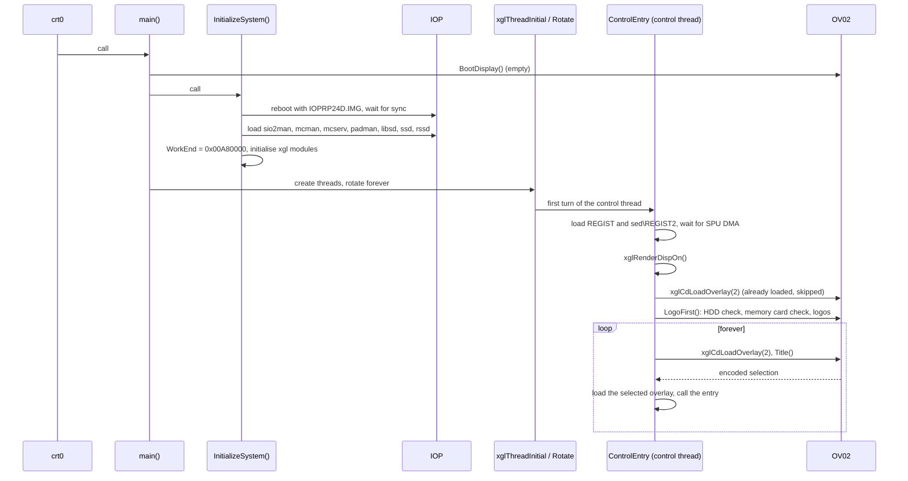
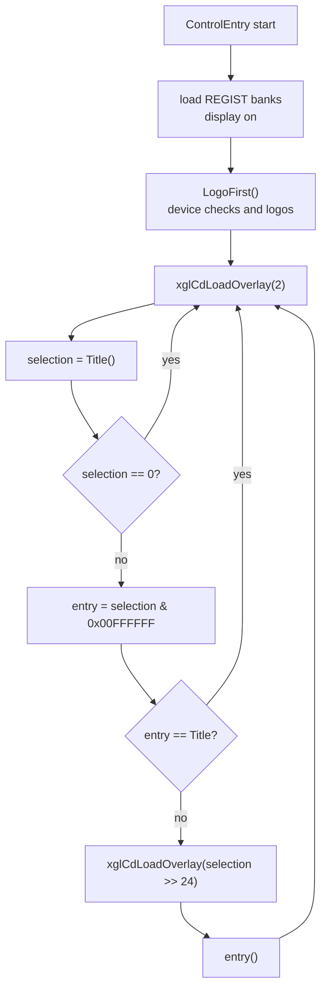
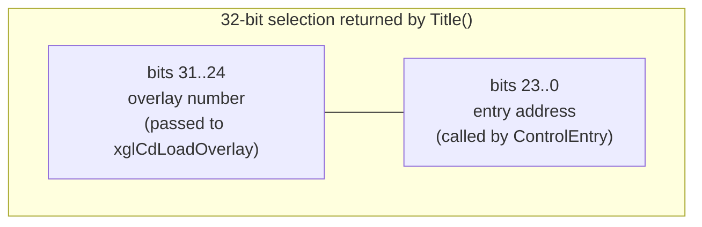
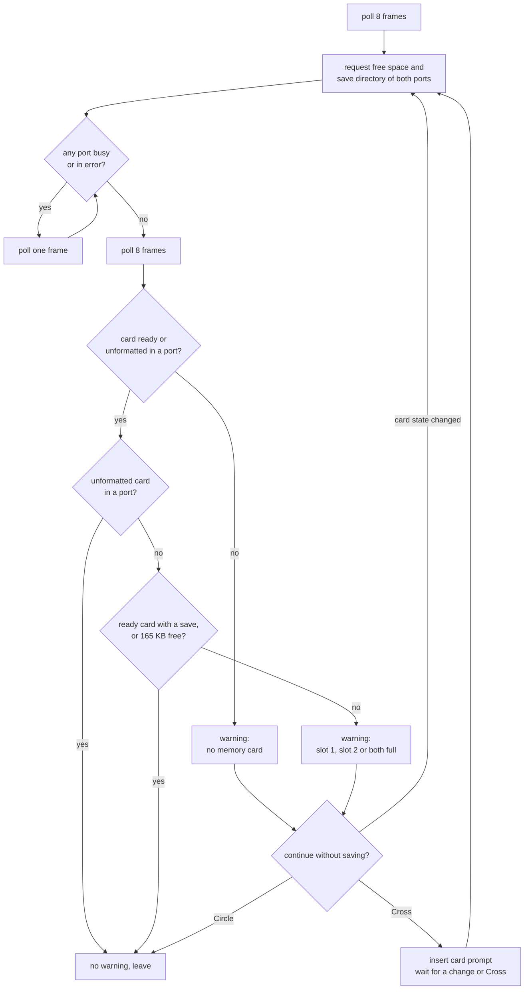
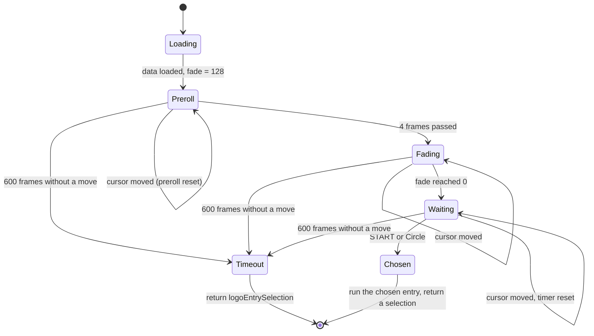
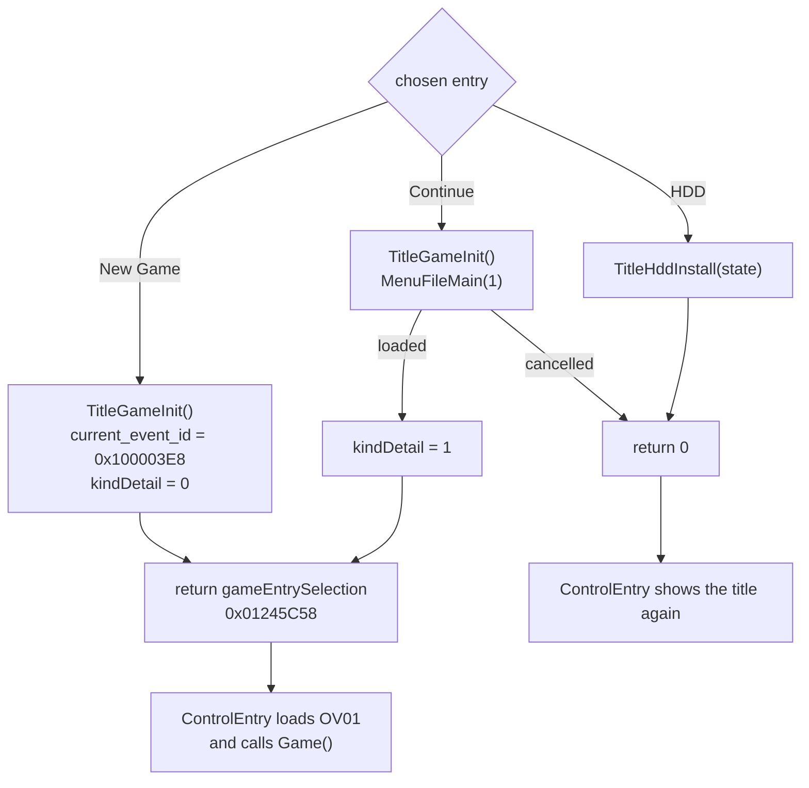
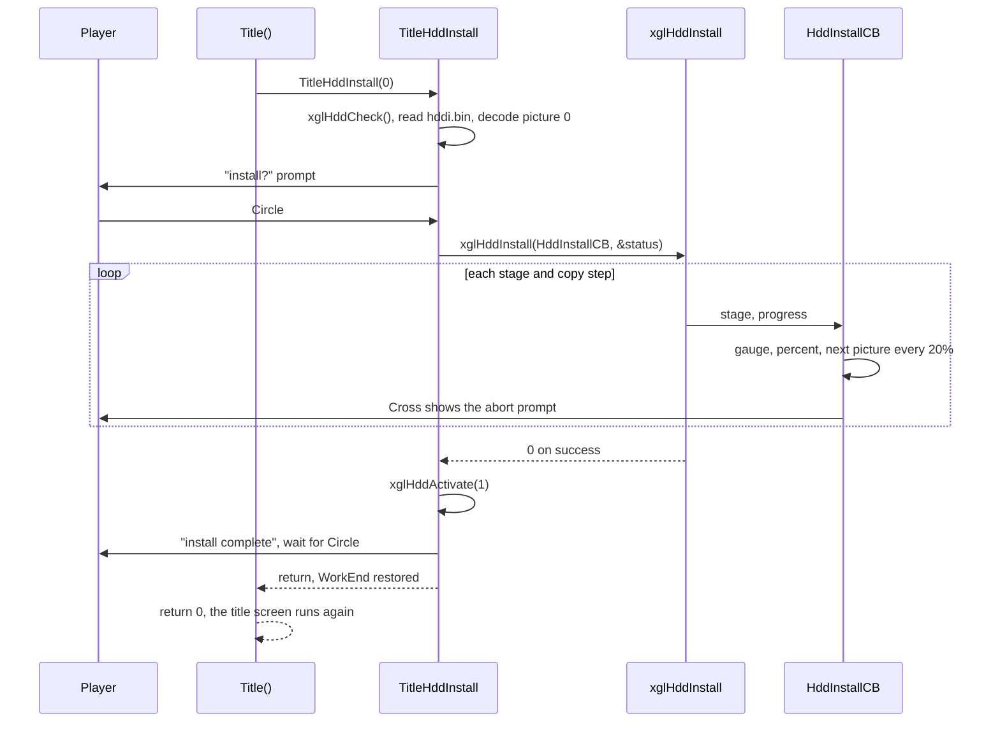

# Boot and title screen

This page follows the game from the moment the console starts the executable
until a play session begins. It covers the start-up code in the main
executable (`src/main/control_entry.c`), the boot checks and logo movies, the
title screen with its New Game and Continue choices, and the optional install
of the game data on the PlayStation 2 hard disk. Apart from `ControlEntry`
itself, all of these screens live in the overlay OV02 (`src/ov02/`), which
they share with the U.M.N. screens described in [umn.md](umn.md).

The title screen is also the dispatcher of the whole game. It returns a small
encoded value that tells the control thread which overlay to load and which
function to call next. The same mechanism starts the field game and, during
development, started the test programs described in
[debug-tools.md](debug-tools.md).

[← Back to the overview](../README.md)

## 1. From `main()` to the control thread

The executable starts at `0x00200008` in the C runtime start-up code (see
[runtime-libraries.md](../architecture/runtime-libraries.md)), which calls
`main()` in `src/main/control_entry.c`. `main()` does very little by itself:

1. It stores `argc` and `argv` in `main_param_argc` and `main_param_argv`.
   Some debug loaders read file names from these start-up options.
2. It calls `BootDisplay()`. This is an empty function in OV02
   (`src/ov02/boot_display.c`, address `0x00A00850`). It was probably meant to
   show something while the system starts, but it does nothing in the shipped
   game. It can be called this early only because OV02 is already in memory
   (see the next section).
3. It calls `InitializeSystem()`, a file-local function that brings up the
   I/O processor (IOP) and the `xgl` system library.
4. It calls `xglThreadInitial()`, which creates the system threads, and then
   `xglThreadRotate()`, which turns the boot thread into the round-robin
   scheduler and never returns. Both are described in
   [xgl.md](../libraries/xgl.md#threads).

`InitializeSystem()` follows a fixed order. It reboots the IOP with the
replacement module image `cdrom0:\IOP\IOPRP24D.IMG;1` and waits until the IOP
answers. It re-initialises the SIF remote procedure calls, the IOP heap and
the CD driver, selects DVD media with `sceCdMmode(2)` and resets the file
system. Then it loads seven IOP modules with `xglCdSifLoadModule`: `sio2man`,
`mcman`, `mcserv` and `padman` for the controllers and memory cards, `libsd`
for the sound chip, and the game's own sound drivers `ssd` and `rssd`
(see [iop-sound-driver.md](../architecture/iop-sound-driver.md)). It installs
`xglCdPowerOffCB` as the power-off callback and sets `WorkEnd`, the bump
allocator of the main work area, to `0x00A80000` (see
[memory.md](../architecture/memory.md)). Last, it initialises the `xgl`
modules in this order: sound, CD, pad, memory card, tasks, DMA, geometry,
packets, render, font, movies and debug menus.

One of the threads that `xglThreadInitial()` creates is the control thread.
Its entry point in the thread table `asSystemThreadList` is `ControlEntry`.
That function is the body of the whole game. It never returns, and every
screen of the game runs inside it, either directly or through a function it
calls.

`ControlEntry` first gives the other threads one turn with `xglSleep()`. Then
it loads the resident sound banks: the sound effect bank `REGIST` with
`xglSoundLoadEffect` and the wave bank `sed\REGIST2` with `xglSoundLoadSwd`,
both through the free memory at `WorkEnd`. `SsdAddWaveData` hands the waves to
the sound driver, and a busy loop waits until `SsdSpuDmaCompleted(0)` reports
that the transfer to sound memory is finished (see
[audio.md](../architecture/audio.md)). Then it turns the display on with
`xglRenderDispOn()`, asks for overlay 2 and calls `LogoFirst()`, which runs
the device checks and the logo movies. After that it enters its endless title
loop.

The diagram below shows this boot sequence up to the first title screen.



## 2. OV02 is already in memory at boot

All overlays of the game are loaded into the same slot at `0x00A00000` (see
[the overview](../README.md#2-overlays)). OV02 is special. Its code and data
are linked into the main executable `SLUS_204.69` as a third loadable segment,
so the console's ELF loader places OV02 in the overlay slot together with the
main program. `readelf -l` shows the layout:

| Segment | Address | File size | Content |
| --- | --- | --- | --- |
| 1 | `0x00200000` | `0x138588` | `.text` and VU code of the main program |
| 2 | `0x00338600` | `0x1A3ED8` (`0x665310` in memory) | data, read-only data and BSS of the main program |
| 3 | `0x00A00000` | `0x138EC` | the `ov02` section |

The bytes of segment 3 are identical to the `ov02` section of the separate
file `OV02.OVL` on the disc. The disc copy is needed later, whenever OV02 has
to come back after another overlay replaced it (for example after a play
session or when the U.M.N. opens from the main menu).

`xglCdLoadOverlay(n)` in `src/main/xgl_cd.c` loads `cdrom0:\OVnn.OVL;1` with
`sceSifLoadElf`, but only when `n` differs from the remembered number in
`loaded_overlay`. `xglCdInitial()` sets `loaded_overlay` to 2 during
start-up. The first request for OV02 in `ControlEntry` is therefore skipped,
and the logo and title appear without an overlay read. The details of the
loader are in [xgl.md](../libraries/xgl.md#overlays-and-iop-modules).

The overlay slot ends where the work area starts. The diagram below shows the
area around it while OV02 is resident.

```
0x00338600 +--------------------------------------+
           | main program data, rodata, BSS       |
0x0099D910 +--------------------------------------+
           | (unused)                             |
0x00A00000 +--------------------------------------+  overlay slot
           | OV02 code and data (0x138EC bytes)   |
           | or OV01 / OV10 / OV11 / OV12         |
0x00A80000 +--------------------------------------+  WorkEnd starts here
           | work area (bump allocated)           |
           |  ...                                 |
0x01000000 | title and logo buffers (section 9)   |
```

## 3. The control loop and the title return value

After `LogoFirst()`, `ControlEntry` repeats the same few steps forever:

1. Ask for OV02 with `xglCdLoadOverlay(2)`. This reads `OV02.OVL` only when
   another overlay is in the slot.
2. Call `Title()`. It returns an unsigned 32-bit selection.
3. If the selection is 0, start again at step 1. The title screen returns 0
   when the player chose an action that ends on the title screen again, such
   as a cancelled Continue or the HDD install.
4. Take the low 24 bits as a function address. If that address is `Title`
   itself, start again at step 1.
5. Otherwise load the overlay whose number is in the high 8 bits and call the
   function. When it returns, start again at step 1.

The flowchart below shows this loop.



The title return value packs two things into one word. The function address
fits in 24 bits because all code of the game lies below `0x01000000`. The
overlay number takes the top byte. The diagram below shows the layout.



The shipped game uses two such values. The linker gives them the names
`gameEntrySelection` and `logoEntrySelection`, so `Title()` returns the address
of a symbol whose numeric value is the selection.

| Value | Overlay | Entry | Meaning |
| --- | --- | --- | --- |
| `0x01245C58` | 1 (OV01) | `Game` at `0x00245C58` | start or continue a play session |
| `0x02A007F8` | 2 (OV02) | `Logo` at `0x00A007F8` | replay the logo movies after the title timeout |
| `0` | none | none | stay on the title screen |

`Game()` is in the main executable, not in OV01, but it needs OV01 because
the battle code must be resident during play (see
[the overview](../README.md#2-overlays) and [field.md](field.md)). When
`Game()` returns, for example after the reset button combination or after a
game over, `ControlEntry` loads OV02 again and the title screen reappears.

OV02 also contains a table named `title_dummy_table` with 21 more values in the
same format. Nothing reads it in the shipped game. Its entries point at the
developers' test programs and are described in
[debug-tools.md](debug-tools.md#3-the-developer-launcher-title_dummy_table).

## 4. Device checks before the logo

`LogoFirst()` (`src/ov02/logo.c`) runs once per boot. It clears the screen to
black with `xglRenderClearFrame()` and `xglRenderClearColor`, waits one frame
and turns frame clearing off. Then it checks the storage devices:

1. `hdd_check()` looks at the optional hard disk.
2. Only when `hdd_check()` returns a non-zero value, `mc_check()` looks at the
   memory cards.
3. It prints `defaultFontModeText`, a one-byte font control string, and calls
   `Logo()` to play the logo movies.

Both checks print their messages with `xglFontPrint` at (16, 64) and wait for
the player. They advance frames through `device_check_sync()`, which polls the
memory card module with `xglMcMain()`, gives the other threads a turn with
`xglSleep()` and prints the font control string `deviceCheckFontModeText`. It
returns the status of both card ports as one word, with port 1 in the low
halfword and port 2 in the high halfword.

### The hard disk check

`hdd_check()` starts with `xglHddMount()`, which decides whether a hard disk is
present and whether the game was installed on it. The result codes are listed
in [xgl.md](../libraries/xgl.md#mount). The check then works as follows:

| `xglHddMount` result | What `hdd_check` does | Returns |
| --- | --- | --- |
| -1 or -99 | No usable hard disk. No message | 1 |
| -5 | Shows "the application data on the HDD is damaged" until Circle is pressed, then continues as below | see below |
| -3 | Shows "the HDD is not formatted, so progress cannot be saved, please format it" | 1 |
| other | Looks for a save on the HDD with `xglHddMcExist`. If one exists, no message | 0 |

When the HDD is usable but holds no save yet, `xglHddMcCheck` tests whether a
save could be created there. A result of 0 or more needs no message. A result
of -1 means the HDD cannot be accessed. The game then shows an access error
until Circle is pressed and disables the HDD for this session with
`xglHddActivate(2)`. Results -2, -3 and -4 select one of three reasons (too
many folders, too many saves, not enough free space) from
`hddFullReasonTexts` and the matching advice from `hddFullAdviceTexts`.

The unformatted case and the three full cases end with the same question:
start the game without using the HDD for saves? Circle answers yes and the
boot continues. Cross shows how to make the HDD usable (format it, or delete
folders, saves or data) and waits for Circle. In both cases `hdd_check()`
returns 1, so the memory card check runs next.

All HDD texts in OV02 are Japanese, stored in the EUC-JP encoding, while the
memory card texts are English. The HDD partition name contains the Japanese
product code (see [xgl.md](../libraries/xgl.md#names-and-partitions)), so the
HDD support was probably carried over unchanged from the Japanese release.

### The memory card check

`mc_check()` makes sure that progress can be saved on a memory card. Its
loop is:

1. Poll the cards for eight frames so that their state settles.
2. Queue four requests with `xglMcRequest`: the free space of each port
   (`MC_REQUEST_FREE_SPACE`) and the save directory of each port
   (`MC_REQUEST_DIRECTORY`, which counts the game's saves found on the card).
3. Poll until neither port reports `MC_STATUS_BUSY` or `MC_STATUS_ERROR`,
   then poll eight more frames.
4. Choose a warning. When neither port holds a ready or unformatted card,
   the warning is "No Memory Card (PS2) detected." An unformatted card in
   either port is accepted without a warning. A ready card is usable when it
   already holds a save of the game or has at least 165 KB free. The check
   passes as soon as one ready card is usable. Only when every ready card
   fails does a warning name the full slot (slot 1, slot 2, or both).
5. If there is no warning, leave. Otherwise show the warning, the 165 KB
   requirement and the question "Do you wish to continue without saving?".

At the question, Circle continues without saving. Cross shows "Please insert
a Memory Card (PS2) with at least 165KB available" and waits until the card
state changes or Cross is pressed again. The loop then starts over from
step 2. A change of the card state while the question is shown also restarts
the check.

The flowchart below shows the memory card check.



## 5. The logo movies

`Logo()` clears the screen to black and plays two IPU movies with the local
function `ipuplay()`: `data\namco.ipu` and then `data\logo_msi.ipu` (the file
layout is described in
[IPU movies](../formats/movies-images-and-icons.md#3-ipu-movies)). The
second one is the Monolith Soft logo. Its frames show the company emblem
with the letters "M.S.I.". When the player skips the first
movie with START, the second one is skipped too.

`ipuplay(path)` drives the `xglMovie` player described in
[xgl.md](../libraries/xgl.md#ipu-movies-xglmovie):

1. Initialise a `LogoMovieInfo` record with `xglMovieInfoInit`. Its
   `stream_base` and `stream_size` fields select a 512 KB stream buffer at
   `0x01000000`.
2. Open the file with `xglMovieOpen`. The decoded frames go to
   `display_base` at `0x01100000`, with `display_end` set from the movie's
   `frame_width`.
3. Each frame, call `xglSRand()` and `xglFRand()`, stop when START is
   pressed (with the confirm sound), and stop when `xglMoviePlay` reports the
   end. Otherwise send the GIF packet `TestEnv_1_00A0F690`, which draws the
   decoded frame as a textured rectangle, and give the other threads a turn.
4. Close the movie and return 1 when the player skipped it.

The two random number calls do not use their results. They advance both
random generators once per frame, so the random state when the game starts
probably depends on how long the player watched the logos.

## 6. The title screen

`Title()` in `src/ov02/title.c` is the title screen. It shows a full-screen
background picture with drifting particles and the title logo, a menu with up
to three entries, and a fade from black. It returns the encoded selection
described in section 3.

### Loading

`Title()` first copies the current frame with `copyframe()`, a small GS
transfer packet that copies the display buffer, so the previous picture stays
visible while the title loads. Then it collects what it needs to know about
saves and the hard disk:

1. `xglMcRequest(0 and 1, MC_REQUEST_DIRECTORY)` count the game's saves on
   both memory cards. `xglHddMcExist` counts the saves on the HDD.
2. `xglFontLoad(1, 1)` loads the font.
3. A loop polls `xglMcMain()` until the CD is idle (`xglCdSync()`) and neither
   card port is busy or in error.
4. When any of the three counts is positive, the cursor starts on Continue.
   Otherwise it starts on New Game.
5. `xglHddMount()` is called again. Its result decides whether the third menu
   entry is shown and what it does (see section 8). The local variable that
   holds this state is called `cursor` in the source.

Then the title data is read from the disc. `data\yajima\title_obj.xtx` goes to
`0x01001000`. It is an ordinary XTX texture set (see
[XTX texture sets](../formats/models-and-textures.md#xtx-texture-sets)): a
small table of upload rectangles followed by their pixel data. On the disc it
holds one rectangle of 120 × 72 pixels, the labels of the menu entries.
`data\title.jpg` (see
[JPEG pictures](../formats/movies-images-and-icons.md#41-the-pictures)) is read
behind the area where its decoded picture will go, and `xglJpegDecode`
decodes it directly behind the label texture. The decoded background is 512 × 448
pixels in 32-bit colour, which is `0xE0000` bytes. Last, `particle_reset()`
gives each of the 256 particles a start position.

The memory map below shows where these buffers lie. The addresses are fixed
in the code and lie in the free work memory, which nothing else uses while
the title screen runs.

```
0x01000000 +--------------------------------------------+
           | 256 particles x 16 bytes (TitleParticleView)|
0x01001000 +--------------------------------------------+  TITLE_OBJECT_BASE
           | title_obj.xtx: header, records, textures   |
objectEnd  +--------------------------------------------+
           | decoded title.jpg, 512 x 448 x 32 bit      |
           | (0xE0000 bytes, sent in two halves)        |
           +--------------------------------------------+
0x010E1000 | + size of title_obj.xtx:                   |  TITLE_JPEG_BASE
           | compressed title.jpg as read from the disc |
           +--------------------------------------------+
```

### The frame loop

Each pass of the loop is one frame. The input part works like this:

1. `frameTimer` counts down from 600 frames, about ten seconds. When it
   reaches zero, `Title()` returns `logoEntrySelection`, and the control loop
   plays the logo movies before the title appears again.
2. For the first four frames (`preroll`) input is ignored. After that, once
   the fade has ended, START or Circle chooses the highlighted entry. The
   choice plays the confirm sound, copies the frame and leaves the loop. A
   guard plays the buzzer instead when the HDD entry is chosen while the HDD
   is unusable, but the cursor cannot reach the hidden entry.
3. Up and Down (with auto-repeat) move the cursor between the entries. The
   cursor skips the HDD entry when it is hidden. A move plays the cursor
   sound, resets `preroll` to four frames and restarts the 600-frame timer.
4. The fade value starts at 128 and drops by 4 per frame until it is 0.

The draw part builds one VIF packet per frame (see
[rendering.md](../architecture/rendering.md) for packets):

1. The background picture is uploaded to GS memory in two halves of `0x7000`
   quadwords and drawn as the full-screen background.
2. The 256 particles move and are drawn. Each particle adds its `y` value to
   `x` and its `depth` value to `z`. A particle whose `x` or `z` leaves the
   allowed range is reset at once.
3. Every rectangle of `title_obj.xtx` is uploaded to GS memory at word
   address `0xE0000` plus its destination. A record gives the width and
   buffer width, the height, the destination, the quadword count and the
   data offset of one rectangle (`TitleRecord` in `src/ov02/title.h`, an
   ordinary XTX upload entry).
4. The menu entries are drawn from a label texture. The selected entry is
   drawn larger (180 × 18 pixels) than the others (140 × 12 pixels).
5. A full-screen quad with the current fade value as alpha is drawn on top.

Each particle is a 16-byte `TitleParticleView` record with the 16-bit fields
`x`, `y`, `z`, `depth` and `speed`. `particle_reset()` picks random values for
`x`, `y`, `z` and `speed` with `xglSRand()`. Odd and even particles use
different start ranges for `x` and opposite signs for `y`, so they drift in
both directions. `depth` is derived from `z` and `y`. The comments in the
source call them snow particles.

The menu has three possible entries:

| Entry | Index | Label row | Shown |
| --- | --- | --- | --- |
| New Game | 0 | 0 | always |
| Continue | 1 | 1 | always |
| HDD install or removal | 2 | 2, or 3 when the game is already installed | only when the HDD state is known |

The label texture is the 120 × 72 rectangle of `title_obj.xtx`, read as four
rows of 18 pixels. Row 3 is used for entry 2 when the HDD already holds the
game. In the file on the disc only rows 0 and 1 carry text, "New Game" and
"Continue". Rows 2 and 3 are plain white with no text, so the install and
removal entries have no label of their own in this version.

The diagram below shows the states of the title screen.



### What each choice does

After the loop, a `switch` on the chosen entry decides the result:

| Choice | Actions | Returns |
| --- | --- | --- |
| New Game | `TitleGameInit()`, set the event id to `0x100003E8` and the resume kind to 0 | `gameEntrySelection` |
| Continue | `TitleGameInit()`, run the load screen `MenuFileMain(1)`. If it returns 1, set the resume kind to 1 | `gameEntrySelection`, or 0 when no game was loaded |
| HDD install | `TitleHddInstall(cursor)` when the HDD state is known | 0 |
| case 3 | `TitleGameInit()`, event id 0, resume kind 0 | `gameEntrySelection` |

The event id goes to `GameLoopState.current_event_id` (offset `0x18`). Ids at
or above `0x10000000` (`SCRIPT_ID_EVENT_BASE`) are event scripts, so
`0x100003E8` is event 1000, the first event of a new game. The resume kind
goes to `GameLoopState.kindDetail` (offset `0x0E`). `Game()` checks it at
start-up. With 0 it simply starts the script of `current_event_id`. With a
non-zero value it first restores the saved session with
`GamePopSaveDataUser()`, then jumps to the saved event and puts the player
back at the saved position. The load screen (`src/main/file.c`) has filled
these fields from the save, as described in
[save-data.md](../architecture/save-data.md).

Case 3 cannot be reached, because the cursor never goes past entry 2. It
starts a session with event id 0. This is probably a leftover developer entry
that started the game without the opening event.

The flowchart below shows how the choices lead to the next screen.



## 7. Preparing a new session: `TitleGameInit`

`TitleGameInit()` (`src/ov02/title_game_init.c`) prepares the global state for
a session. It runs before New Game and before the load screen, so a loaded
save always starts from a clean state:

1. `memset(&GameLoopState, 0, 0x2A030)` clears the whole game loop record
   (`GameLoopStateLayout` in `src/main/game.c`, see [field.md](field.md)).
2. `xglFlagsInitial()` clears the game flags (see
   [xgl.md](../libraries/xgl.md#flags)).
3. `PartyDataInit()` (`src/main/party.c`) resets the party and the save
   record. Among other things it empties the U.M.N. mailbox, puts the three
   starting mails 78, 79 and 80 into it and sets the first Plug-in bit (see
   [umn.md](umn.md#7-mail)). The party data itself is described in
   [character-growth.md](character-growth.md).
4. `xglFontLoad(1, 0)` and `WindowTexLoad(0, 0)` load the font and the window
   textures that the field and menus need.

OV02 only knows a small view of `GameLoopState`, declared as
`Ov02GameLoopState` in `include/ov02/title_game_init.h`:

| Offset | Field in OV02 | Field in `game.c` | Use |
| --- | --- | --- | --- |
| `0x0E` | `half_0e` | `kindDetail` | 0 for a new game, 1 to resume a loaded save |
| `0x10` | `flags` | `flags` | `GAME_FLAG_*` bits, read by the U.M.N. screens |
| `0x18` | `word_18` | `current_event_id` | event script to start |

## 8. HDD installation

The PlayStation 2 hard disk unit could hold a copy of the game's main archive,
so that most reads come from the faster disk. The low-level work (partition,
format, copy, check file) is done by `xglHddInstall` and `xglHddUninstall` in
`src/main/xgl_hdd.c`, described in [xgl.md](../libraries/xgl.md#install).
OV02 contains the screens around it in `src/ov02/title_hdd_install.c`.

### The menu entry

`Title()` turns the result of `xglHddMount()` into a screen command for
`TitleHddInstall`:

| `xglHddMount` | Meaning | Command | Screen |
| --- | --- | --- | --- |
| 0 | not installed, enough free space | 0 | install |
| 1 | installed and valid | 1 | uninstall |
| -5 | check file missing or different | 1 | uninstall |
| -2 | HDD error | 2 | message "cannot access the HDD" |
| -3 | HDD not formatted | 3 | message "not formatted" |
| -4 | not enough free space | 4 | message "not enough space" |
| other | no HDD | none | entry hidden |

### The install screen

`TitleHddInstall(command)` saves `WorkEnd` and restores it at the end, so the
screen leaves no allocation behind. It works like this:

1. It checks the drive again. An install request whose `xglHddCheck()` fails
   becomes the access error message. An uninstall request whose
   `xglHddCheck2()` fails deactivates the HDD and becomes command 5, an access
   error screen. After Circle, command 5 sets the HDD state to 3 ("an error
   still to be shown") with `xglHddActivate(259)` and calls `xglHddCheck()`,
   which shows the HDD error screen and disables the HDD for the session.
2. It reads `data\yajima\hddi.bin` to `WorkEnd`. This archive has a `0x40`-byte
   header and five JPEG pictures, one for each fifth of the progress (see
   [the install pictures in hddi.bin](../formats/movies-images-and-icons.md#44-the-install-pictures-in-hddibin)).
   A transfer buffer of `0xE0000` bytes, aligned to 64 bytes, follows it.
3. It decodes the first picture into the transfer buffer and stores the
   parameters in `HddInstallParam` (`image_data`, `step`, `transfer_buffer`).
4. It shows the screen selected by the command. Every frame of every screen
   calls `HddInstallSync()`, which uploads the transfer buffer as the
   background in two halves of `0x7000` quadwords, gives the other threads a
   turn and prints the font control string `installScreenFontText`.

The install screen (`TitleHddInstallSubInstall`) asks for confirmation.
Cross leaves. Circle runs `xglHddCheck()` and then
`xglHddInstall(HddInstallCB, &installStatus)`. On success it activates the
HDD with `xglHddActivate(1)` and shows the completion text. On failure it
shows the failure text, where Circle leaves and Cross returns to the
confirmation. A cancelled install returns at once.

`HddInstallCB(command, offset, status)` is the progress callback. It prints the
"installing" text at (32, 16) and handles the stage that `xglHddInstall`
reports:

- For the set-up stages it prints an English stage label such as
  `Create Partition` or `Format Partition` with `xglFontDebugPrintf`. These
  labels are debug text and are not visible in the retail game (see
  [debug-tools.md](debug-tools.md#1-why-the-debug-code-is-invisible)).
- During the copy, `offset` holds the copied part count in its low halfword
  and the total in its high halfword. The callback draws a gauge with
  `tyaDrawGauge` (320 × 12 pixels at 168, 416), a spinning character and the
  percentage. Every 20 percent it decodes the next picture of `hddi.bin` into
  the transfer buffer, so the background changes five times.
- Cross during the copy shows an abort prompt. Circle confirms the abort and
  the callback returns 1. Cross resumes, unless `xglHddCheck()` now fails, in
  which case the callback returns 2.
- For each failure code it prints the code with `printf` and a debug label.

The uninstall screen (`TitleHddInstallSubUninstall`) follows the same pattern
with `xglHddCheck2()` and `xglHddUninstall()`.

The diagram below shows an install from the title screen.



## 9. Memory used by the boot and title screens

These screens use fixed addresses in the work memory above `0x01000000`.
Nothing else is loaded there at that time, so the code does not allocate
these buffers.

| Address | Size | Use |
| --- | --- | --- |
| `0x00A00000` | `0x138EC` | OV02 code and data |
| `0x00A80000` | varies | `WorkEnd` buffers: boot sound banks, memory card and HDD requests, `hddi.bin` and its transfer buffer |
| `0x01000000` | `0x80000` | logo movie stream buffer |
| `0x01100000` | one frame | decoded logo movie frames |
| `0x01000000` | `0x1000` | title particles (256 × 16 bytes) |
| `0x01001000` | file size | `title_obj.xtx`, then the decoded `title.jpg` |
| `0x010E1000` + object size | file size | compressed `title.jpg` |

## Source files

| File | Content |
| --- | --- |
| `src/main/control_entry.c` | `main`, `InitializeSystem`, `ControlEntry` |
| `src/ov02/boot_display.c` | `BootDisplay` (empty) |
| `src/ov02/logo.c` | `LogoFirst`, `hdd_check`, `mc_check`, `ipuplay`, `Logo`, the boot messages |
| `src/ov02/title.c` | `Title`, `copyframe`, `particle_reset`, the GS packet templates, `title_dummy_table` |
| `src/ov02/title_game_init.c` | `TitleGameInit` |
| `src/ov02/title_hdd_install.c` | `TitleHddInstall`, the install and uninstall screens, `HddInstallCB`, and the U.M.N. globals that share its object file |
| `src/main/xgl_hdd.c` | the HDD layer used by these screens |
| `src/main/xgl_cd.c` | `xglCdLoadOverlay`, `loaded_overlay` |
