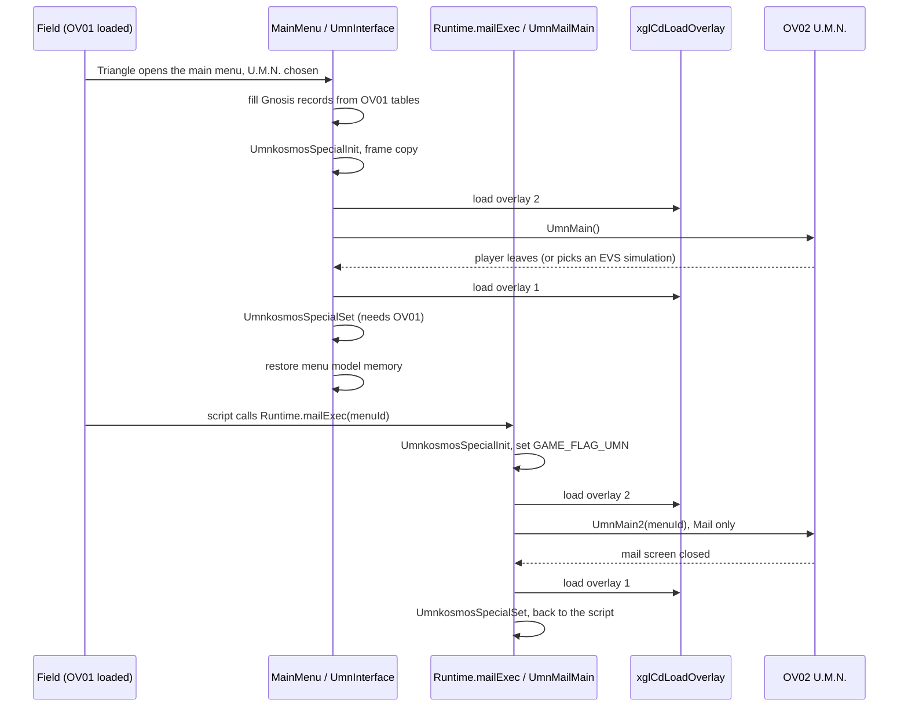
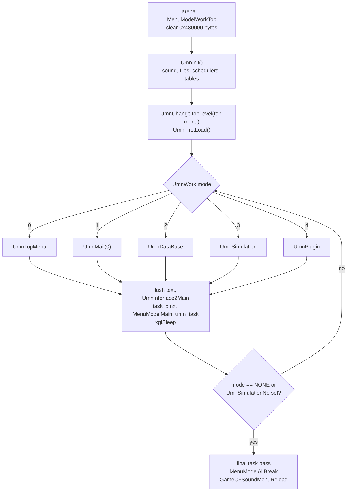
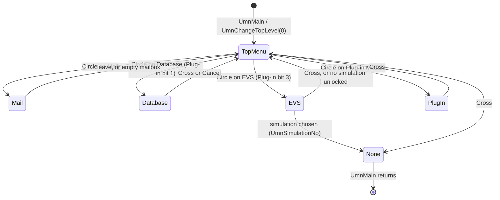
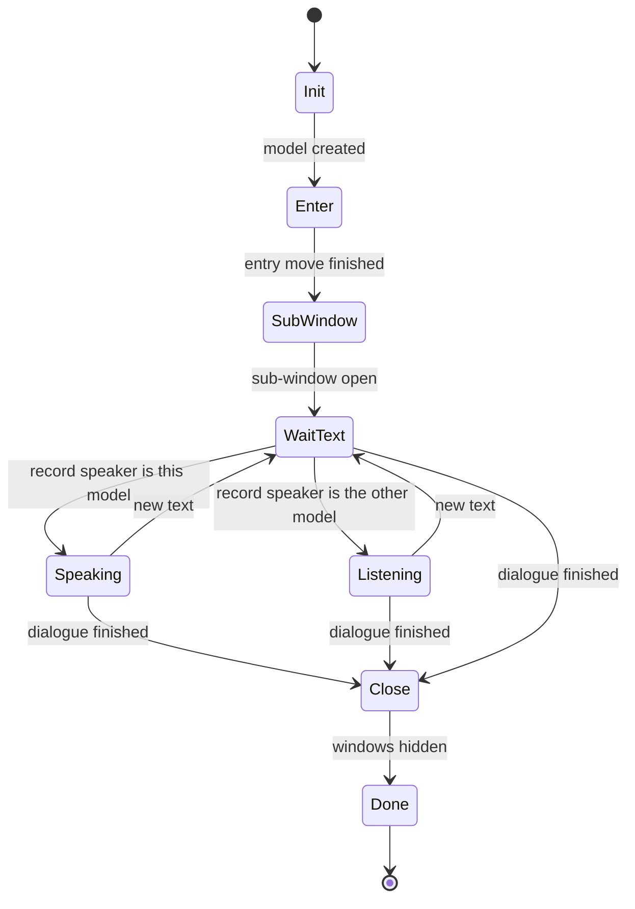
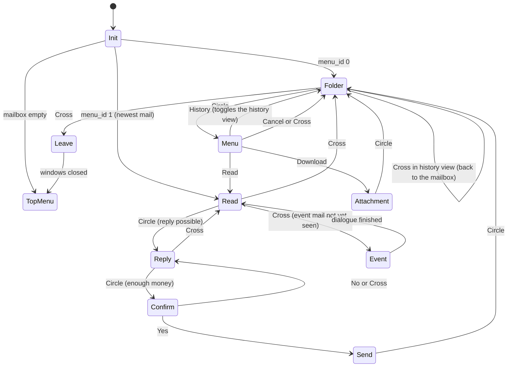
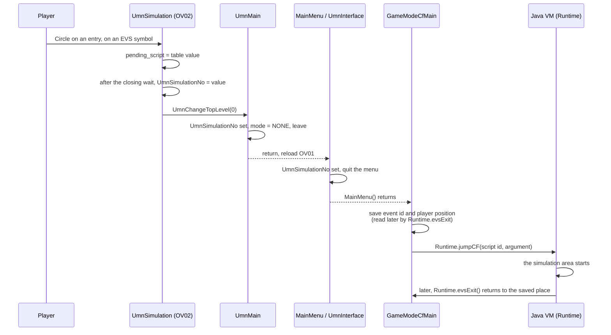

# U.M.N.

In *Xenosaga Episode I* the U.M.N. (Unus Mundus Network) is the hyperspace
network that links the worlds of the Galaxy Federation. In the game it is a
terminal screen that the player opens from the main menu. It has four
services: **Mail** (read e-mail, answer it, download attachments and invest
money), the **Database** (the Gnosis that the party has met and the keywords
of the story), the **EVS** (Environmental Simulator, which replays places the
party has visited) and the list of installed **Plug-ins**. A small character,
the U.M.N. procurator Bunnie, guides the player and sometimes talks with Shion
in short comic dialogues.

All U.M.N. screens are in the overlay OV02 (`src/ov02/`), which they share
with the boot and title screens described in
[title-and-boot.md](title-and-boot.md). During play the overlay slot normally
holds OV01, so opening the U.M.N. means swapping overlays and back. A few
helpers that must work while OV01 is loaded live in the main executable, in
`src/main/window_tex_load.c`.

[← Back to the overview](../README.md)

## 1. How the game enters and leaves the U.M.N.

There are two ways into the U.M.N. code:

| Path | Caller | OV02 entry | Screens |
| --- | --- | --- | --- |
| Main menu | `MainMenu()` level `MENU_LEVEL_UMN` → `UmnInterface()` | `UmnMain()` | top menu and all four services |
| Script | Java native `Runtime.mailExec(int)` → `UmnMailMain(menuId)` | `UmnMain2(menuId)` | Mail only |

Both paths follow the same pattern. The field is running with OV01 in the
overlay slot. The caller finishes everything that needs OV01, loads OV02,
runs the U.M.N. loop, loads OV01 again and then applies the results that need
OV01. Two pieces of work are moved across the swap for this reason:

- **Gnosis records.** Before the swap, `UmnInterface()` fills one record per
  Gnosis (unit ids `0x22` to `0x3E`) in `UmnGunoDataBaseTop` from the battle
  unit tables in OV01 and from the menu text (`MenuTextGet`). Each record gets
  the unit's name, its maximum HP and its weak element from the unit record
  of `batdat.bin`, and its experience, money, T.Pts, E.Pts and S.Pts and the
  names of its normal and rare drop items from its gain record (see
  [gain records](../formats/game-tables.md#gain-records)). The Database
  screen only reads these records (section 8). The field names of the views
  in `src/main/window_tex_load.h` do not describe this use: `unit_type` is the
  maximum HP, `text_type` the weak element, `unit_id` the experience, `value`
  the money, `property_a` to `property_c` the three point values, and `name`
  and `description` the names of the two drop items.
- **KOS-MOS specials.** Some mails teach KOS-MOS a special ability. The
  function that records it, `dataSpecLearnSet` (`src/ov01/data_unit_org_get.c`,
  see [character-growth.md](character-growth.md)), is in OV01. The mail screen
  only stores the ids in `UmnKosmosSpecialBox`. After OV01 is back,
  `UmnkosmosSpecialSet()` applies up to four of them with
  `dataSpecLearnSet(2, id)`.

The main menu path also prepares the screen: it flushes the menu tasks and
models, copies the current frame with `endPrintDirectFrameCopy` so the screen
does not flicker, and clears `UmnKosmosSpecialBox` with
`UmnkosmosSpecialInit()`. After `UmnMain()` it restores the menu model memory
with `MenuModelMemoryInit(MenuModelWorkTop, 0x480000)`, because the U.M.N.
used that memory as its arena.

The script path saves the camera and light state, sets `GAME_FLAG_UMN` in
`GameLoopState.flags` and calls `UmnMailMain`. `UmnMain2()` then does the work
that the main menu would normally do: it pushes the menu and game data
(`MenuCfTaikiPush`, `MenuGameDataPush`), sets three studio lights from
`objectLightTable`, allocates its arena with `GameResourceWorkAlloc(0x480000)`
and loads the menu font and window textures. On exit it pops the data again,
reloads the field resources with `GameResourceWorkReload()` and
`GameCfPlayerLoadResource(1)`, and clears `GAME_FLAG_UMN`. The menu system is
described in [main-menu.md](main-menu.md), and the Java natives in
[natives.md](../scripting/natives.md).

The diagram below shows both paths with their overlay swaps.



## 2. The U.M.N. main loop

`UmnMain()` in `src/ov02/tsk_umn_object_task_main.c` is the loop of the full
terminal. It runs on the control thread and returns when the player leaves:

1. Copy the frame twice with `endPrintDirectFrameCopy` so the last menu
   picture stays on screen.
2. Take the menu model memory (`MenuModelWorkTop`) as the arena `UmnMemory`
   and clear `0x480000` bytes of it.
3. Call `UmnInit()`, then `MenuLoadInit()`, `MenuModelMemoryInit` and
   `MenuModelMemorySet(0)` for the procurator models.
4. Select the top menu with `UmnChangeTopLevel(UMN_MODE_TOP_MENU)` and load the
   resident files with `UmnFirstLoad()`.
5. Each frame:
   1. `GameSnapShotCheck()` (an empty debug hook, see
      [debug-tools.md](debug-tools.md#7-other-debug-hooks)).
   2. Run the screen function of `UmnWork.mode`: `UmnTopMenu`, `UmnMail(0)`,
      `UmnDataBase`, `UmnSimulation` or `UmnPlugin`. An unknown mode goes back
      to the top menu.
   3. Flush the `endPrint` text queue, update the interface colours with
      `UmnInterface2Main()`, run the `task_xmx` scheduler, update the menu
      models with `MenuModelMain()`, run the `umn_task` scheduler and give the
      other threads a turn with `xglSleep()`.
   4. Leave when the mode is `UMN_MODE_NONE`, or when an EVS simulation was
      chosen (`UmnSimulationNo` not 0, which also sets the mode to none).
6. Copy the frame, run both schedulers once more so the tasks see the mode
   change and remove themselves, break all menu models with
   `MenuModelAllBreak()` and reload the field sounds with
   `GameCFSoundMenuReload()`.

`UmnMain2(menuId)` is the same loop limited to the Mail screen. It starts in
`UMN_MODE_MAIL`, waits until the procurator model is active, and runs
`UmnMail(menuId)` until the mode changes. It also runs `VibrationEngine()`
each frame.

The flowchart below shows the frame loop of `UmnMain()`.



### `UmnInit` and the arena

`UmnInit()` sets up everything the screens share:

1. `endPrintInit()`, purge the field menu sounds with
   `GameCFSoundMenuPurge(1)`, clear `UmnSimulationNo` and clear the depth
   buffer.
2. Read `data\sound\smd\Umnmode.SWD` to the start of the arena and send it to
   the sound driver with `xglSoundSendSwd`. Wait for the transfer, then read
   `Umnmode.SMD` to the same place and start it as the U.M.N. music in
   sequence slot 4 at volume `0x7F` (see [audio.md](../architecture/audio.md)).
3. Seed the float random generator with `xglFSrand(0.12345679f)`.
4. Give the start of the arena to the UML text display with
   `tyaUmlDispInit2` (section 8).
5. Place the fixed buffers and move `UmnMemory` past them.
6. Build the work area from `UmnWorkEndTop` upwards, moving the cursor
   `UmnWorkEnd` after each block: the two task schedulers with 32 entries each
   (`umn_task` and `task_xmx`), the interface colours (`UmnInterface2Init`),
   the background cube task (`UmnBgCubeInit`), the battle window work used by
   the Database (`eBattleWinInit2`), the mail header table
   (`UmnMailHeaderCreate`), the mail history tree (`UmnHistoryTreeLoad`) and
   the event text buffer of `0x2000` bytes.

`UmnFirstLoad()` then reads `data\endou\umn\umntxt.bin` (the Plug-in texts)
into the work area and the cube texture, cube model and U.M.N. texture into
their fixed buffers. After `UmnInit()`, `UmnMain()` hands the menu model
system its `0x200000` bytes at the new `UmnMemory`. The resulting layout of
the `0x480000`-byte arena is shown below.

```
base + 0x000000 +--------------------------------------------+
                | UML display buffer (1 MiB file area)       |
                | (first used to stage Umnmode.SWD / .SMD)   |
base + 0x180000 +--------------------------------------------+ UmnBgCubeXtx
                | data\endou\umn\cube.xtx                    |
base + 0x190000 +--------------------------------------------+ UmnBgCubeLex
                | data\endou\umn\cube.lex                    |
base + 0x1A0000 +--------------------------------------------+ UmnTexAddr
                | data\endou\umn\umn00.xtx                   |
base + 0x1E0800 +--------------------------------------------+ UmnWorkEndTop
                | umn_task, task_xmx (32 tasks each)         |
                | interface colours, cube task, battle win   |
                | mail headers (0x4800) + header.lst         |
                | history tree (0x800), event text (0x2000)  |
                | umntxt.bin (0x800)                         |
                | per-screen task work (UmnWorkEnd onwards)  |
base + 0x220800 +--------------------------------------------+ UmnMemory
                | menu model memory (0x200000)               |
base + 0x420800 +--------------------------------------------+
                | (unused up to 0x480000)                    |
                +--------------------------------------------+
```

### Object tasks

Every window and animation of the U.M.N. is a task in one of the two `xgl`
schedulers (see [xgl.md](../libraries/xgl.md#tasks)). They all share one
callback, `tskUmnObjectTaskMain`, and differ only by the worker function and
data stored in their `UmnObjectTask` record:

| Field | Meaning |
| --- | --- |
| `state` | `UMN_TASK_INIT`, `UMN_TASK_RUN` or `UMN_TASK_END` |
| `worker` | the screen's task function, called with the task and its data |
| `data` | the work block of this task, usually in the arena after `UmnWorkEnd` |
| `zeroedOnCreate` | words cleared by `UmnObjectTaskCreate` |

`UmnObjectTaskCreate(worker, data)` appends a task to `umn_task`. In the INIT
state the callback runs the worker twice in the same frame (once to set up,
once to run). In the RUN state it runs the worker once. In the END state it
removes the task with `xglTaskWaitRemove`. When `UmnWork.mode` becomes
`UMN_MODE_NONE`, every task switches to END, so leaving the U.M.N. cleans up
all windows. A worker can also end its own task, which they do when the mode
no longer matches their screen.

Each screen creates its tasks in its first step. For example `UmnMail` creates
seven tasks (`tskUmnMailPas`, `tskUmnMailInfo`, `tskUmnMailFolder`,
`tskUmnMailHensin`, `tskUmnMailMenu`, `tskUmnMailExWin`, `tskUmnMailDisp`)
and places their work blocks one after the other from `UmnWorkEnd`, each
rounded to 16 bytes.

## 3. `UmnWork` and the screen states

All screens keep their state in the global `UmnWork`, a 128-byte
`UmnWorkData` record declared in `include/ov02/title_hdd_install.h`. The first
part is common to all screens, the rest is a union of per-screen views:

| Offset | Field | Meaning |
| --- | --- | --- |
| `0x01` | `mode` | current screen: 0 top menu, 1 Mail, 2 Database, 3 EVS, 4 Plug-in, `0xFF` none |
| `0x02` | `menu_selected` | top menu entry, kept while a service runs |
| `0x03` | `tab_state` | step of the current screen |
| `0x10` | `wait` | frame countdown, decremented at the end of each screen step |
| `0x11` | `moving` | set while a window slides, cleared by the window task |
| `0x12` | `direction` | navigation or scroll direction |
| `0x20` | `option_ids[16]` | top menu entries (mode numbers, 0 for an empty slot) |
| `0x30` | `menu_count`, `menu_cursor` | top menu size and cursor |
| `0x40` | `column`, `row`, `rows`, `scroll` | list position (Mail folder, Database grid) |
| `0x46` | `cursor`, `confirm_cursor` | menu cursors |
| `0x50` | `list_cursor`, `count`, `entry` | list cursor, list size, selected mail, Gnosis or Plug-in |
| `0x53` | `mail_cursor` … `saved_row` | Mail view: reply choices, flags, saved folder position |
| `0x50` | `simulation.list_index`, `list_count`, `pending_script` | EVS view |
| `0x60` | `price_balance` | Mail: investment cost, negative when money is short |

The screens use common values for `tab_state`. Step `UMN_STEP_INIT` (0)
creates the tasks. `UMN_STEP_OPEN` (`0x10`) arms the opening wait of 12
frames. `UMN_STEP_ACTIVE` (`0x11`) reads the pad. `UMN_STEP_LEAVE` (`0xF0`)
arms the closing wait of 16 frames or starts the slide-out, and
`UMN_STEP_LEAVE_WAIT` (`0xF1`) waits for it and returns to the top menu. The
Mail and Database screens add their own steps between these.

`UmnChangeTopLevel(level)` switches screens. It clears the screen part of
`UmnWork` (offsets `0x10` to `0x7F`, as seven quadwords), stores the new
mode, sets `tab_state` to 0 and calls `UmnProcuratorSet()` so the procurator
model takes the pose of the new screen.

The diagram below shows the mode changes.



## 4. The top menu

`UmnTopMenu()` in `src/ov02/task_umn_top_win.c` is the first screen. In its
INIT step it creates the window task `taskUmnTopWin` and fills
`UmnWork.option_ids` from the Plug-in bits of the save data
(`umnMailSaveData.plugin_unlock_flags`, see section 7):

| Slot | Mode | Title | Help text | Shown when |
| --- | --- | --- | --- | --- |
| 0 | 3 | EVS (Environmental Simulator) | Simulate places that you have been to previously. | Plug-in bit 3 (`0x08`) is set |
| 1 | 1 | Mail | Read and reply to emails. Download attachments. | always |
| 2 | 2 | Database | View database relating to the characters and the Gnosis. | Plug-in bit 1 (`0x02`) is set |
| 3 | 4 | Plug-in Module | View list of Plug-ins currently equipped. | always |

The menu always has four slots. A locked service leaves its slot empty. When
the U.M.N. opens for the first time, the cursor moves to the first non-empty
slot. Up and Down move the cursor with wrap-around and play the cursor sound.
Circle on a filled slot calls `UmnChangeTopLevel` with its mode. Circle on an
empty slot plays the buzzer. Cross sets the leave step, which sets the mode to
`UMN_MODE_NONE` and ends the U.M.N.

`taskUmnTopWin` draws the menu as a carousel of the entries with the selected
one highlighted, its title from `moji00_0` and its help text from `moji01_1`,
together with arrows and labels.

## 5. The procurator and the manzai windows

The procurator is a 3D menu model (model id `0x1D`) that stands beside the
U.M.N. windows. The Xeno Series Wiki names this character Bunnie. The event
texts call the speaker `UKUN`, which is probably the character's Japanese name
U-kun. Its model unit is kept in `UmnModelUkn`. Menu models are explained in
[main-menu.md](main-menu.md).

`UmnProcuratorSet()` runs on every screen change and gives the model a new
worker with `MenuModelExtFuncSet`:

| Mode | Worker | Behaviour |
| --- | --- | --- |
| top menu | `UmnProcuratorTop` | creates the model if needed, sets a resting pose and lighting, starts its standing motion |
| Mail | `UmnProcuratorMail` | creates the model if needed, sets the camera, eases scale, offset and rotation into the mail position |
| other | `UmnProcuratorGoodBy` | plays the farewell motion, moves the model away and ends its task when it is fully transparent |

### Manzai dialogues

*Manzai* is a Japanese stand-up comedy style with two performers. In the
U.M.N., some mails start a short dialogue between the procurator and Shion,
shown in two speech windows next to the two 3D models. Shion is menu model
id 3, kept in `UmnModelSon`.

`UmnManzaiInit(event_no)` in `src/ov02/umn_procurator.c` starts a dialogue:

1. Build the dialogue records from the event text file with
   `UmnEventTextMake(event_no)` (section 6). Return -1 when the file does not
   exist. The caller then tries event 0 instead.
2. Take the first record as `UmnManzaiText`.
3. Create Shion's model if needed, and give the two models the workers
   `UmnProcuratorManzai` (procurator) and `UmnProcuratorManzai2` (Shion).
4. Create one `tskUmnManzaiWin` task for each speech window.
5. Set `UmnManzaiFlag` to "both models moving".

`UmnManzaiControl()` runs each frame while the Mail screen is in its event
step. Once both windows are shown and nothing slides, Circle turns the page of
the current speaker's message with `eMessageNextPage`. When the message has no
more pages, it takes the next record with `UmnEventTextNextGet(1)` and plays
the confirm sound. After the last record it sets the finished flag. It returns
0 once the dialogue is finished and both windows are hidden, and 1 otherwise.

The two model workers follow the same step machine, stored in the model's
`extFuncFlag`. Each model enters, opens its sub-window, and then grows the
sub-window while it is the speaker or shrinks it while the other one speaks.
The speaker comes from the `value` of the current text record
(`UMN_EVENT_SPEAKER_UKUN` or `UMN_EVENT_SPEAKER_SHION`). The diagram below
shows these steps.



## 6. Event text files

The manzai dialogues are stored as plain text files `data\umn\eventNN.txt`,
where `NN` is a two-digit decimal number. `UmnEventTextMake(event_no)` in
`src/ov02/umn_event_text_symbol_check.c` loads one file into the event text
work area and turns it into records.

The file uses seven tags, written between `<` and `>`:

| Tag | Value | Meaning |
| --- | --- | --- |
| `<speech` | 1 | starts a speech block, followed by a decimal number |
| `<char` | 2 | the speaker of the block: `UKUN` or `SHION` |
| `<msg` | 3 | the message text, up to the next `<` |
| `<mot` | 4 | a decimal motion number for the speaker's model |
| `</speech` | 5 | ends the block |
| `<memo` | 6 | a comment, skipped up to `</memo` |
| `</memo` | 7 | ends the comment |

A message may contain a backslash followed by octal digits. The parser turns
it into one byte, which is how font control codes are written in the text
(see [ui-windows.md](../libraries/ui-windows.md) for `eMessage`). After the
"wait for key" code the newlines that follow are skipped. Based on the parser,
a block looks like this one from `event04.txt`:

```
<speech>01
<char>UKUN
<msg>
\15\2This must be the interesting email someone mentioned
I'd be getting earlier!\15\0\37
</msg>
</speech>
```

The parser copies the message up to the next `<` and then skips six bytes,
the closing `</msg>`, which every message in the files has. The 135 blocks of
the shipped files are described in
[event texts](../formats/text-and-fonts.md#event-texts).

`UmnEventTextMake` reads the file twice. The first pass counts the speech
blocks and skips the comments. The second pass fills the record table at
`uet_text_buf`, which has a `count` and a `cur` field followed by one 8-byte
`UmnEventTextRecord` per block:

| Field | Meaning |
| --- | --- |
| `value` | speaker, 1 for the procurator and 2 for Shion |
| `count` | number of pages of the message (counted with `eMessageNextWaitKeySearch`) |
| `number` | motion number from `<mot` |
| `text` | pointer to the message text, copied behind the table |

`UmnEventTextNextGet(delta)` moves `cur` and returns the record at the new
position, or null after the last one.

## 7. Mail

Mail is the main U.M.N. service. Characters of the story send e-mails to the
player during the game. Some mails carry an attachment (an item, a weapon,
money or a Plug-in), some can be answered with one of up to three prepared
replies, some ask for an investment, and some start a manzai dialogue.

### Mail data

There are 128 mail ids. The static data of each mail comes from the file
`data\umn\header.lst`. `UmnMailHeaderCreate()` reads it at start-up and builds
a table of 128 `UmnMailHeader` records of `0x90` bytes in the work area. Each
record of the file has a size word, the mail id, a copy of the 96-byte header
of the mail's UML page and the first two text lines of that page, which are
`Subject: ...` and `Sender: ...` (layout in
[header lists](../formats/text-and-fonts.md#header-lists)). The header record
keeps:

| Field | Meaning |
| --- | --- |
| `subject` | the subject shown in the folder, the first line without `Subject: `, copied with `eMessageCpy` |
| `sender` | the sender of the mail, the second line without `Sender: ` |
| `reply_ids[3]` | up to three reply choices. Each value is the mail id of a prepared reply mail, 0 for none |
| `scenario_limit` | replies are possible only while the story progress (`MenuScenarioNoGet()`) is below this value |
| `attach` | attachment id, 0 for none |
| `kosmos_items[5]` | discount levels this mail adds when it is first read (see below) |
| `cost` | money needed to send the reply (the investment amount) |

The text of a mail is shown by the UML display (section 8). The mail screen
passes the mail id as the resource number, and the mail bodies are the UML
pages `0000.uml` to `0080.uml`, numbered like the mails (see
[UML pages](../formats/text-and-fonts.md#uml-pages)).

The dynamic state is part of the save data (see
[save-data.md](../architecture/save-data.md)). The block `umnMailSaveData`
lies at `SaveData + 0x1025C`, and the per-mail data follows it:

```
SaveData + 0x1025C  UmnMailSaveData (0xA8 bytes)
  +0x00  mail_ids[128]          mailbox: mail ids in arrival order, -1 = free
  +0x80  kosmos_items[5]        shop discount levels (one per price class)
  +0x86  plugin_unlock_flags    one bit per Plug-in
  +0x88  monster_discovered[4]  Database: Gnosis met (bit per id 0x22..0x3E)
  +0x98  monster_analysed[4]    Database: Gnosis analysed
SaveData + 0x10304  mail data, 2 bytes per mail id (UmnMailDataGet)
  byte 0  flags   0x01 received, 0x02 read, 0x04 event seen,
                  0x08 is a reply, 0x30 reply chosen (index + 1)
  byte 1  attachment id, plus 0x80 once downloaded
```

The two Database bit sets are read through the alias `UmnDataBaseStateData`
in `src/main/window_tex_load.c`, which points at the same block.

### Receiving mail

A mail becomes visible when its id is added to the mailbox and its "received"
flag is set. This happens in four places:

- `PartyDataInit()` (`src/main/party.c`) empties the mailbox at a new game and
  adds mails 78, 79 and 80. It also sets Plug-in bit 0.
- The Java native `Runtime.mailFlag(int)` (`src/main/runtime.c`) lets event
  scripts query and change mails. The high byte of its argument selects the
  action, the low 24 bits the mail id. Actions 0 to 3 return the received
  flag, the read flag, the attachment state and the chosen reply. Action 4
  delivers the mail: it sets the received flag, calls `UmnMailBoxSet`, plays
  the mail sound and makes the controller vibrate. Action 5 counts the mails
  in the mailbox or the unread ones.
- Sending a reply delivers the chosen reply mail.
- `UmnEventEndMailCheck` delivers mail 30 after the dialogue of mail 29
  (`event_end_mail`).

`UmnMailBoxSet(mail_id)` stores the id in the first free slot of `mail_ids`.
The folder shows the mailbox in reverse order, so the newest mail is at the
top.

### The mail screen

`UmnMail(menu_id)` in `src/ov02/tsk_umn_mail_pas.c` is a step machine on
`UmnWork.tab_state`. The title bar shows the current path, built from the
captions `Mail`, `/Folder`, `/Read`, `/Reply` and `/History`.

1. **INIT** creates the seven mail tasks and the event text buffer, and builds
   the folder list with `UmnMailFolderSet()`. When the mailbox is empty, the
   screen returns to the top menu at once. With `menu_id` 1 (used by
   `Runtime.mailExec`) the newest mail opens directly. Otherwise the folder
   opens.
2. **Folder** shows four rows of the list at a time and scrolls at the edges.
   Each row shows a sprite for unread, read or reply mails and for the
   attachment state. Circle opens the mail menu. Cross leaves the U.M.N. mail,
   or leaves the history view when it is active.
3. **Menu** offers Read, History, Download and Cancel. History switches the
   folder to the history view of the selected mail (see below). Download is
   only possible when the mail has an attachment that was not yet taken.
4. **Read** shows the mail text. On the first read, the mail's discount levels
   are added to the save data, its KOS-MOS specials are queued with
   `UmnKosmosSpecialGetCheck`, and the read flag is set. Attachments of mails
   in `compulsion_down_load_tbl` (13 mails) are downloaded automatically at
   this point. Circle opens the reply step when a reply is possible. Cross
   either starts the mail's manzai dialogue (for the 18 mails in `event_tbl`,
   once) or returns to the folder. Mail 30 cannot be left before a reply was
   chosen.
5. **Reply** lists the reply choices. The text window previews the selected
   reply mail. When the mail has a cost, the info line shows "Investment
   amount" and, when the player's money is too low, "Amount needed". Circle
   asks "Is this okay?". Yes sends the reply.
6. **Send** stores the chosen index in the mail's flags, marks the reply mail
   as received and as a reply, adds it to the mailbox and takes the cost from
   the player's money with `dataMoneyBoxDec`.
7. **Attachment** marks the attachment as taken and applies it with
   `UmnMailAttachSet`.
8. **Event** runs `UmnManzaiControl()` until the dialogue ends, then returns to
   reading. If the dialogue unlocked a follow-up mail, the folder is rebuilt.

The diagram below shows the main mail steps.



### The history tree

Replies create threads of mails. The file `data\endou\umn\histree.bin`
(512 bytes, read into a block of `0x800` bytes) holds one 4-byte
`UmnHistoryNode` for each of the 128 mail ids with up to three child mail ids
(-1 for none). `UmnHistoryTreeGet(id)` returns the node. The links are not a
strict tree: mail 68 is the child of both 63 and 65. The node layout and the
threads of the shipped file are in
[history tree](../formats/text-and-fonts.md#history-tree).

When the player picks History, `UmnMailFolderSet()` rebuilds the folder as
the thread that contains the selected mail:

1. Find the root. For each of the mails 0 to 80, the nested helper
   `SisoSiso(mail_id)` searches the subtree below it recursively. The first
   mail whose subtree contains the selected mail is the root. `SisoSiso` is a
   GNU C nested function inside `UmnMailFolderSet`.
2. Starting at the root, follow the first received child at each level and
   add it to the folder.
3. Put the cursor on the selected mail.

Leaving the history view restores the saved folder position
(`saved_list_cursor`, `saved_scroll`, `saved_row`).

### Attachments

`UmnMailAttachSet(id)` applies attachment `id` from the table `umn_attach_tbl`
(23 records of three bytes: kind, value, quantity):

| Kind | Effect |
| --- | --- |
| 1 Plug-in | sets bit `value` of `plugin_unlock_flags` |
| 2 item | `dataItmBoxInc(value)`, `quantity` times |
| 3 weapon | `dataWpnBoxInc(value)`, `quantity` times |
| 4 money | `dataMoneyBoxInc(value × 10^(quantity + 2))`, for example 4 000 or 100 000 |

The item, weapon and money boxes are described in
[character-growth.md](character-growth.md) and
[save-data.md](../architecture/save-data.md).

### Investments and shop discounts

The five bytes `kosmos_items` in the save block are shop discount levels.
`src/main/menu_1.c` reads them as `SAVE_MENU_DISCOUNT_LEVELS` and computes the
price rate of each price class as `1.0 - level × 0.1`, with a minimum of 0.5
(see [main-menu.md](main-menu.md)). A mail header can name one class (1 to 4)
and a level step (1 to 4). The first time the mail is read, the step is added
to that class. The reply cost is the money side of this system. A mail that
asks for an investment can be answered only when the player has the amount,
and sending the reply takes it. The field name `kosmos_items` in the OV02
declarations does not match this use.

### KOS-MOS specials

The table `kosmos_special_tbl` lists four mails (`0x29`, `0x42`, `0x46`,
`0x4A`) and the special ability ids they teach KOS-MOS (`0x37`, `0x38`,
`0x39` and `0x3A`, `0x3B`). Reading such a mail for the first time copies the
ids into `UmnKosmosSpecialBox`. They are applied after the return to OV01, as
described in section 1.

## 8. Database

The Database has two parts, chosen from its own menu: **Gnosis** and
**Keywords**. A third entry, Cancel, returns to the top menu. Its code is in
`src/ov02/umn_guno_data_base_get.c` ("guno" for Gnosis) and
`src/ov02/tya_uml.c`.

### Gnosis

The Gnosis part lists the 29 enemy units with ids `0x22` to `0x3E` that the
party has met. Two sets of bits in the save block record the progress:

- `UmnDataBaseMonsterSet(id)` (`src/main/window_tex_load.c`) marks a Gnosis
  as met. The battle code calls it when an enemy is defeated (see
  [battle.md](battle.md)).
- `UmnDataBaseAnalisisSet(id)` marks it as analysed. The battle's analysis
  command (`specAnalyzeProc` in OV01) calls it.

`UmnDataBase()` collects the met ids in `monster_folder` when it opens. The
list step shows them as a two-column grid with up to six visible rows. Left
and Right move by one entry, Up and Down by one row. Circle opens the detail
view, in which `UmnDataBaseModel` shows the selected Gnosis as a 3D model that
the player can rotate and zoom. When the Gnosis was analysed, the analysis
info is available. It opens the same analysis window as in battle
(`eBattleWinOpen3`, see [ui-windows.md](../libraries/ui-windows.md)). Names
and descriptions come from the records that `UmnInterface()` prepared
(section 1), read with `UmnGunoDataBaseGet(id)`.

### Keywords and the UML text format

The Keywords part is a small hypertext browser written as one function,
`tyaUmlDatabaseMain()`. It works with three kinds of files:

| File | Content |
| --- | --- |
| `data\umn\db_fileno.txt` | the list of entry identifiers, one decimal number per line, with `-` lines as separators ([keyword list](../formats/text-and-fonts.md#keyword-list)) |
| `data\umn\dbheader.lst` | 245 records sorted by identifier: size, identifier, a copy of the page header that holds the game flag number, and the entry's title line ([header lists](../formats/text-and-fonts.md#header-lists)) |
| `data\umn\NNNN.uml` | the page of one entry, four decimal digits, 9000 to 9244 ([UML pages](../formats/text-and-fonts.md#uml-pages)) |

`dbheader_load()` builds the visible list. For each identifier of
`db_fileno.txt` it looks up the record in `dbheader.lst` with `find_text()`.
The title is shown only when the record's game flag is set
(`xglFlagsGet(record->flag, 1)`), so a keyword appears once the story has
mentioned it. Locked entries keep their place in the list as `-3`. The
browser also shows an index bar of 26 entries (`disp_index`, letters from
`umlIndexLetters`). The file `db_fileno.txt` has 25 letter groups: A to Z
without Q and X, then `#` for titles that do not start with a letter. The bar
has room for 26 entries (`TYA_UML_INDEX_COUNT`), so its last entry is
empty.

`tyaUmlDispLoad()` loads one UML page. The page file has a 96-byte header, a
table of up to eight embedded pictures at offset 32 (each a JPEG with its
position), and the text. The picture of slot 0 is tiled across the page as
its background, and in every page that has pictures it is a 48 by 48 tile.
Only 11 mails have pictures in the slots 1 to 7, 23 in all. While copying the text it handles font control codes
and `@` codes:

| Code | Effect |
| --- | --- |
| `@(` … `@)` | each character in between is replaced by a random glyph unless Plug-in bit 4 (`0x10`) is set |
| `@<` … `@>` | the same, unless Plug-in bits 4 and 5 (`0x30`) are both set |
| `@*` | inserts a callback that records a line mark, used for scrolling |

A hidden character becomes 12 bytes of font control codes: an effect packet
(code `0x13` with `0x83 0x83`), the letter `W`, a backward step of 11 pixels
(code 8), one of the letters `O`, `Q`, `V` and `Y` picked by `xglSRand`
through `tyaUmlEffectCodeTable`, and a closing effect packet (`0x13 0 0`). So
each hidden character shows as a `W` overprinted with a random letter. These
two codes hide parts of a page until the player owns the matching Plug-ins,
the Code Disarm Key Plug-in (bit 4) and its Support Plug-in (bit 5), named in
`umntxt.bin`. Only mail 0061 uses them. The pictures
are decoded with `xglJpegDecode` and uploaded as textures when the page is
drawn. The same UML display (`tyaUmlDispMain`) shows the mail bodies.

## 9. EVS: the Environmental Simulator

The EVS replays areas the party has already visited. The screen
`UmnSimulation()` in `src/ov02/tsk_umn_simulation_pas.c` lists up to seven
simulations. The list grows with the story progress returned by
`MenuScenarioNoGet()`:

| Entry | Unlocked at progress | Jump target (`UmnSimulationScriptNoTbl`) |
| --- | --- | --- |
| KOS-MOS Simulator | 115 | script 239, argument 3 |
| Woglinde | 115 | script 329, argument 4 |
| Pleroma | 115 | script 819, argument 1 |
| U-TIC Battleship | 162 | script 1049, argument 1 |
| Cathedral Ship | 301 | script 1419, argument 1 |
| Encephalon | 345 | script 2429, argument 1 |
| Song of Nephilim | 388 | script 2869, argument 1 |

Each table value holds the field (CF) script id in its low halfword and an
argument, probably the entrance number, in its high halfword. When no entry is
unlocked, the screen returns to the top menu at once.

A simulation can start only while the player stands on an EVS symbol in the
field. That is the `GAME_FLAG_ON_EVENT_SYMBOL` bit of `GameLoopState.flags`,
which `src/main/game.c` sets while the player is on such a map symbol (it also
shows the symbol effect `evsEffe`). Elsewhere Circle plays the buzzer.

Starting a simulation crosses several layers. The diagram below shows the
steps.



`GameModeCfMain` stores the current event id and the player position in
`GameLoopState` (offsets `0x2A018` and `0x2A020`). The script natives
`Runtime.evsSetRetPoint()` and `Runtime.evsExit()` use the same fields to
bring the party back when the simulation ends. Script jumps are described in
[events.md](../scripting/events.md) and [natives.md](../scripting/natives.md).

## 10. Plug-ins

Plug-ins are upgrades of the U.M.N. terminal. They are stored as the 16-bit
set `plugin_unlock_flags` in the save block. Plug-ins arrive as mail
attachments of kind 1. The code shows these uses of the bits:

| Bit | Mask | Effect in the code |
| --- | --- | --- |
| 0 | `0x01` | set at a new game by `PartyDataInit()` |
| 1 | `0x02` | adds the Database to the top menu |
| 2 | `0x04` | delivered by an attachment, no reader found in the code. `umntxt.bin` names this Plug-in Sprinkle, "enables multi-array computing" |
| 3 | `0x08` | adds the EVS to the top menu |
| 4 | `0x10` | shows the text inside `@(` `@)` in UML pages |
| 4 and 5 | `0x30` | show the text inside `@<` `@>` in UML pages |

`UmnPlugin()` in `src/ov02/tsk_umn_plugin_pas.c` is a view-only screen. It
collects the set bits in ascending order in `plugin_folder` (at most six are
listed) and creates four tasks: the title window, the information window, the
list and a help window. The name and description of each Plug-in are one of
six `0x80`-byte records in `umntxt.bin`, returned by `UmnPluginTextGet(id)`
(see [plug-in texts](../formats/text-and-fonts.md#plug-in-texts) for the six
records).
Cross returns to the top menu.

## 11. Background, interface and sound

The U.M.N. has its own look, built from three parts in
`src/ov02/umn_interface2.c`:

- A rotating background cube. `UmnBgCubeInit` creates the task
  `tskUmnBgCubeMain`, which turns the model `cube.lex` with the texture
  `cube.xtx` a little each frame and sends it for drawing (formats in
  [LEX models](../formats/models-and-textures.md#lex-models) and
  [XTX texture sets](../formats/models-and-textures.md#xtx-texture-sets)).
- Interface panels. `DrawUmnInterface2` draws six coloured quads from two
  packed colour sets.
- An entry fade. `UmnInterface2Main()` lowers two intensity counters each
  frame until both are zero.

The windows themselves use the shared window and message system (`WindowDX`,
`eMessage`, `eSprite`, `endPrint`), described in
[ui-windows.md](../libraries/ui-windows.md). The music `Umnmode.SMD` plays
while the U.M.N. is open (format in
[SMD music files](../formats/sound.md#smd-music-files)). The disc also
holds byte-identical copies of both files as `ENV_UMN.SMD` and `ENV_UMN.SWD`. `GameCFSoundMenuPurge` and `GameCFSoundMenuReload`
free and restore the field sound banks around it (see
[audio.md](../architecture/audio.md)).

Most U.M.N. screens also print their step numbers and cursors with
`xglFontDebugPrintf`. This text is invisible in the retail game (see
[debug-tools.md](debug-tools.md#1-why-the-debug-code-is-invisible)).

## 12. Data files

| File | Loaded by | Content |
| --- | --- | --- |
| `data\sound\smd\Umnmode.SWD`, `.SMD` | `UmnInit` | U.M.N. music |
| `data\endou\umn\cube.xtx`, `cube.lex` | `UmnFirstLoad` | background cube |
| `data\endou\umn\umn00.xtx` | `UmnFirstLoad` | U.M.N. textures |
| `data\endou\umn\umntxt.bin` | `UmnTextLoad` | Plug-in names and descriptions |
| `data\endou\umn\histree.bin` | `UmnHistoryTreeLoad` | mail history tree |
| `data\umn\header.lst` | `UmnMailHeaderCreate` | mail subjects, senders and parameters |
| `data\umn\eventNN.txt` | `UmnEventTextMake` | manzai dialogues |
| `data\umn\NNNN.uml` | `tyaUmlDispLoad` | mail and keyword pages |
| `data\umn\db_fileno.txt`, `dbheader.lst` | `dbheader_load` | keyword list |

The folder name `endou` is a developer's name (see
[debug-tools.md](debug-tools.md#8-what-the-code-reveals-about-the-developers-workflow)).

## Source files

| File | Content |
| --- | --- |
| `src/ov02/tsk_umn_object_task_main.c` | `UmnMain`, `UmnMain2`, `UmnInit`, `UmnFirstLoad`, `UmnChangeTopLevel`, the object task callback |
| `src/ov02/task_umn_top_win.c` | `UmnTopMenu`, `taskUmnTopWin` |
| `src/ov02/umn_procurator.c` | procurator workers, `UmnManzaiInit`, `UmnManzaiControl`, manzai windows |
| `src/ov02/tsk_umn_mail_pas.c` | `UmnMail`, the mail tasks, `UmnMailFolderSet` |
| `src/ov02/umn_event_text_symbol_check.c` | event text parser, mail headers, history tree, attachments, Plug-in texts |
| `src/ov02/umn_guno_data_base_get.c` | `UmnDataBase` and its tasks |
| `src/ov02/tya_uml.c` | UML page loader and display, keyword browser |
| `src/ov02/tsk_umn_simulation_pas.c` | `UmnSimulation` (EVS) |
| `src/ov02/tsk_umn_plugin_pas.c` | `UmnPlugin` |
| `src/ov02/umn_interface2.c` | background cube and interface panels |
| `src/ov02/title_hdd_install.c` | the U.M.N. globals (`UmnWork`, arena pointers, schedulers) that share this object file |
| `src/main/window_tex_load.c` | `UmnInterface`, `UmnMailMain`, `UmnMailBoxSet`, `UmnMailDataGet`, Database bits, KOS-MOS specials |
| `src/main/runtime.c` | `Runtime.mailExec`, `Runtime.mailFlag`, `Runtime.jumpCF`, `Runtime.evsExit` |
