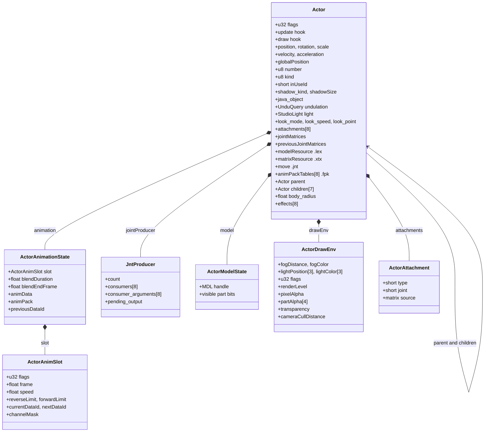
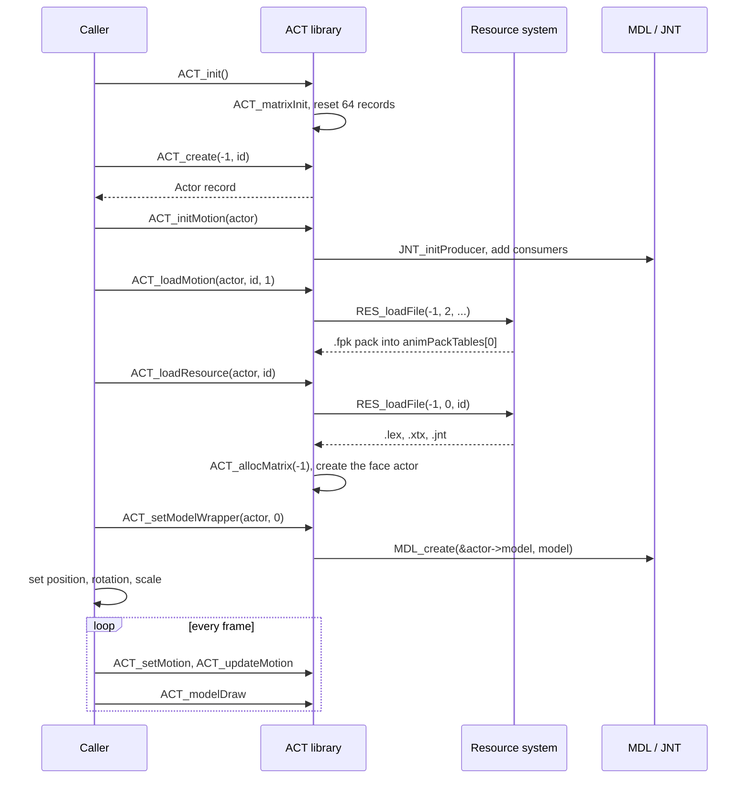
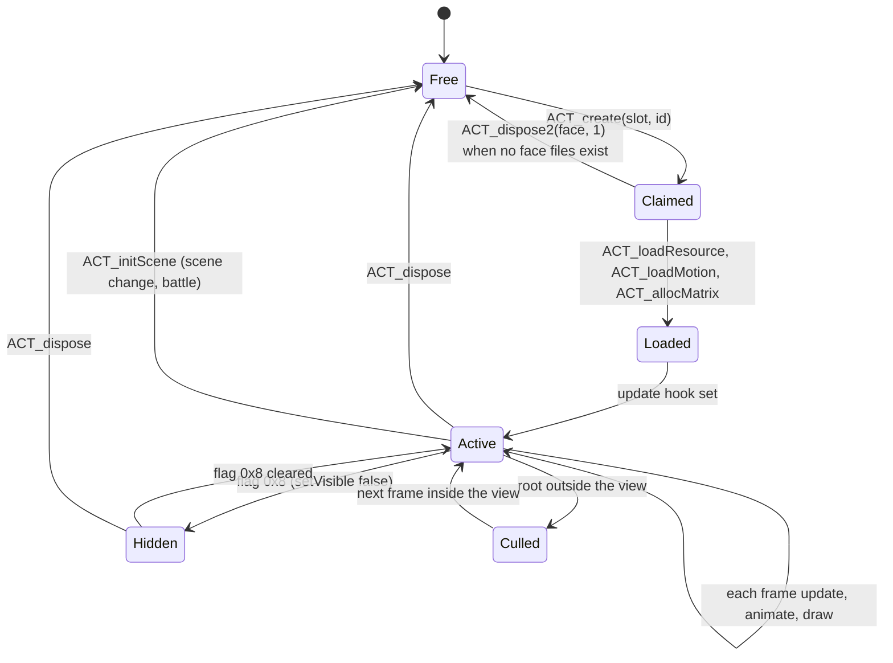
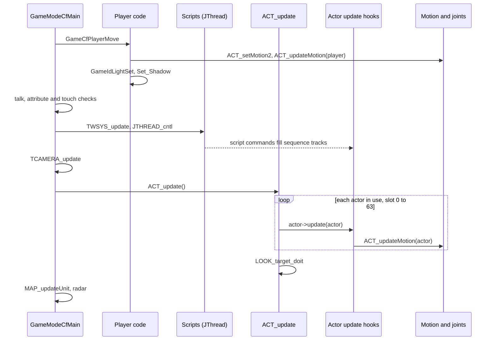
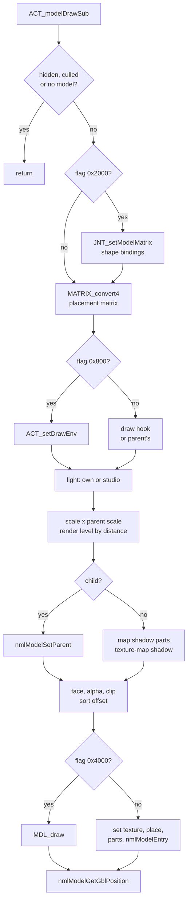
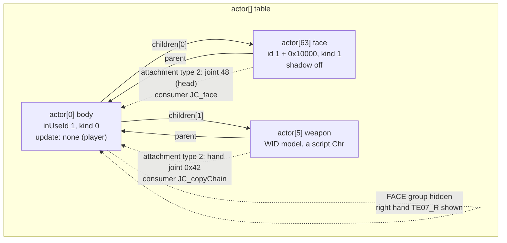
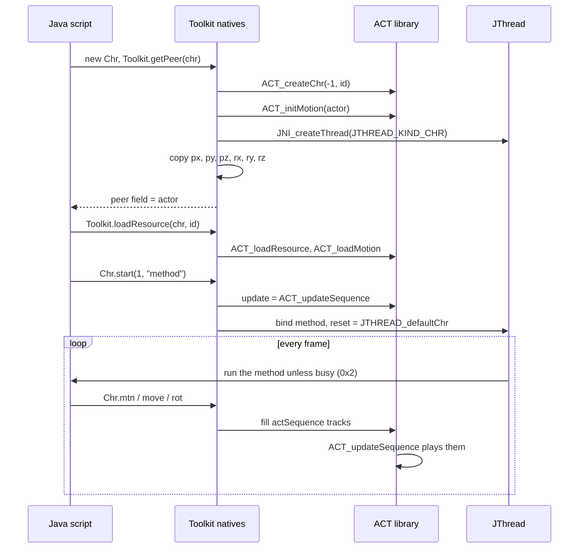
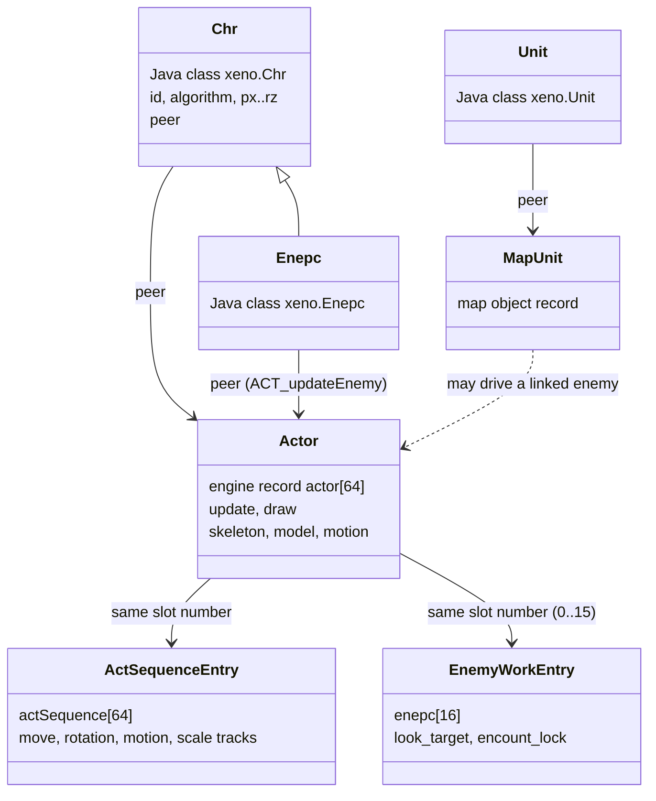

# Actors

An actor is the engine's record for one animated 3D object in the world. The
player character, the people and robots that event scripts place on the field,
field enemies, a character's face, the weapon in a character's hand, the
models shown in the main menu and the units of a battle are all actors. Each
actor joins a transform (position, rotation, scale), a skeleton-animated
model, a motion clock, an update callback that moves it every frame, and a
draw step that hands its model to the [nml model library](nml.md).

All actors live in one fixed table of 64 records. The `ACT_*` library manages
that table. It creates and destroys actors, gives them memory for their joint
matrices, runs their update callbacks, animates and draws them, links them
into parent and child hierarchies and draws their shadows. How the skeleton
and the motion data turn into joint matrices is explained on the
[animation page](animation.md).

[← Back to the overview](../README.md)

## Files

| File | Contents |
| --- | --- |
| `include/main/act_1.h` | The `Actor` record and its sub-structures (`ActorAnimSlot`, `ActorDrawEnv`, `ActorAttachment`, `ActorJavaArgs`, `ActorMenuControl`), flag names |
| `src/main/act_1.c` | The actor table, joint matrix memory, `ACT_create`, `ACT_dispose`, the per-frame `ACT_update` and `ACT_draw` loops, the debug actor viewer |
| `src/main/act_2.c` | Motion selection and update, matrix reset, parents and attachments, the model draw, resource loading, hands and visibility |
| `src/main/act_3.c` | Shadows (circle, drop circle, shadow volume) and footstep sounds |
| `src/main/near_dir.c` | Character actors created for scripts (`ACT_createChr`, `ACT_createNPC`), their update callbacks, the per-actor sequence table `actSequence`, draw filters |
| `src/main/check.c` | `Check_Actor`, the body-to-body proximity test |
| `src/main/look_at_player.c` | Player setup (`Player_System_Init`), player resource loading, the field look-at helpers |
| `src/main/set_motion.c` | `Set_Motion`, `Set_Shadow`, `Sound_FootStep` and other helpers shared by the player and enemies |
| `src/main/chr.c`, `src/main/toolkit.c` | The Java side: `xeno.Chr` natives and the peer creation that turns a Java character into an actor |
| `src/main/game_id_light_set.c` | `GameIdLightSet`, which gives an actor the light of the floor it stands on |

## What an actor is

The engine has one pipeline for everything that moves with a skeleton. A
model file (`.lex`) holds the mesh, a texture file (`.xtx`) its images, a
skeleton file (`.jnt`, called the "move" in the code) the joint hierarchy, and
a motion pack (`.fpk`) the animation curves. An actor is the object that owns
one set of these resources and the state needed to play them: where it stands,
which motion it plays and at which frame, the joint matrices produced this
frame, and how it must be drawn. How the game finds and loads these files is
described in [files and resources](../architecture/files-and-resources.md).
Their byte layouts are in [Models and textures](../formats/models-and-textures.md) and
[Skeletons and motion](../formats/skeletons-and-motion.md).

The actor table is a static array, `actor[64]` (`ACTOR_COUNT`) at main address
`0x0043c1e0`. Each record is `0xa70` bytes, so the whole table takes `0x29c00`
bytes. No actor record is ever allocated from a heap. Creating an actor means
claiming a free slot, and destroying it means marking the slot free again. A
slot is free when its `inUseId` is 0. The slot index is stored in the record
as `number`, and several other tables are indexed by the same number:

- `actSequence[64]` (`src/main/near_dir.c`) holds the sequence channels that
  event scripts use to move, turn, scale and animate a character. The
  sequence system itself is explained in
  [scenes and time charts](../scripting/scenes-and-timecharts.md).
- `enepc[16]` (`EnemyWorkEntry`) holds extra work for the first sixteen slots:
  the look-at target, the encounter lock, footstep switches and look limits.
  Enemies use most of it (see [field enemies](../game/field-enemies.md)), but
  the player and NPCs use it too.

Map geometry is not made of actors. Map units (doors, lifts, switches, map
objects) are a separate array, `MapUnit`, explained on
[maps and units](../game/map-and-units.md).

The table below lists the kinds of actors the game creates and where each is
made. The update and draw hooks are explained further down.

| Kind of actor | Created by | `update` hook | `draw` hook |
| --- | --- | --- | --- |
| Player character on the field | `Game()` with `ACT_create(0, 1)` | none, moved by `GameCfPlayerMove` | none |
| Script character (`xeno.Chr`) | `getPeer_Chr` → `ACT_createChr` | `ACT_updateSequence`, or `ACT_updateNPC` for wandering NPCs | none by default, a filter set by `Chr.setFilter` |
| Field enemy (`xeno.Enepc`) | `getPeer_Enepc` → `ACT_createEnemy` | `ACT_updateEnemy` | none by default |
| Face of a character | `ACT_loadResource`, `Chr.setPlayer`, the menu | none, it is updated through its parent | none |
| Weapon or accessory | `ACT_setArms`, `ACT_setRelation` | none | none |
| Main menu character models | `MenuModelUnitActorSet` (`src/main/menu_model.c`) | `ACT_updateDefault` | `MenuModelAlphaDraw` |
| Battle units | `src/ov01/unit_cmd.c` | `unitActupdate` | `unitActdraw` |
| A.G.W.S. Battle robots | `src/ov12/xrg_actor.c` | none, the OV12 engine calls `ACT_updateMotion` and `ACT_modelDraw` itself | `_ActorDrawFunction` |

## The actor record

The `Actor` structure is declared in `include/main/act_1.h`. It is large
because it carries everything an animated object needs, from its Java script
object to its shadow settings. The record is easier to read as a set of
blocks.

The header holds the main `flags` word and the two callbacks. `update` is
called once per frame by `ACT_update` and moves the actor. `draw` is an
optional hook called from the model draw to set special render state. Both
take the actor as their only argument.

The transform block holds `position`, `previous_position`, `velocity`,
`acceleration`, `rotation` (three angles in radians), `scale` and
`globalPosition`. `globalPosition` is written back by nml after the model is
drawn, and it is the world position other systems use to find the actor on
screen.

The identity block holds `number` (the slot), `signal`, `kind`, `humanKind`,
`state84`, `inUseId` (the model id, 0 when the slot is free) and
`frame_counter`.

The shadow block holds `shadow_kind`, `shadowSize`, `shadow_offset` and
`last_step_distance`. It is explained in [Shadows and footsteps](#shadows-and-footsteps).

At `+0xc0` there is a 0x400-byte block whose meaning depends on the kind of
actor. Script characters and enemies keep their queued commands here
(`ActorJavaArgs`: `command_count`, `command_type[16]`,
`command_parameter[5][16]`). The main menu keeps the model's own transform and
draw progress here (`ActorMenuControl`). Enemies keep their parameter record
(`EnemyParams`). The enemy command system is explained in
[field enemies](../game/field-enemies.md).

`java_object` at `+0x4c0` points back to the Java object when the actor is the
peer of a script character.

At `+0x4c8` the record embeds a ground query, the `UnduQuery` that
`UnduParamInit` fills and `UnduCheck` updates. Its fields are visible in the
`Actor` record under their own names: `status_flags` (`+0x4d0`),
`translate_y` (`+0x4dc`, the last ground height), `data_header` (`+0x4e0`)
and `attribute_flags` (`+0x4e8`, the attribute bits of the floor triangle the
actor stands on). The query is explained on the
[animation page](animation.md#undulate-ground-height-and-walls).

`light` at `+0x510` is a `StudioLight` (see [xgl](xgl.md)). It is used
instead of the studio's light when the actor has its own light.

From `+0x600` to `+0x67c` lie the look-at state: `look_point`,
`look_eye_speed`, `lookState`, `look_eye_angle`, `look_speed`, `look_mode`,
`look_eye_control` and `look_target`. The look-at system is explained on the
[animation page](animation.md#look-at-control-look).

The attachment block holds `attachmentCount`, `attachmentIndex`, eight
`ActorAttachment` entries and eight `attachmentUsed` bytes. An attachment ties
this actor to a joint of its parent.

The animation block starts with `animation` (`ActorAnimationState`, the motion
clock) at `+0x6f0`, followed by `transitionFrames`, `holdFrames`,
`rootTranslation`, the `jointProducer` and four pointers into the matrix
memory: `jointMatrices`, `previousJointMatrices`, `staticValueRecords` and
`valueRecords`.

The model block holds `model[1]` (`ActorModelState`, the MDL handle of the
model) and the resource pointers. `modelResource` points to the `.lex` model,
`matrixResource` to the `.xtx` texture (despite its name, it is passed to
`nmlModelSetTexture`), `move` to the `.jnt` skeleton, and `animPackTables[8]`
to up to eight motion packs.

The hierarchy block holds `parent`, `childCount` and `children[7]`. Script
characters may have up to fifteen children. The extra entries then overlap
the start of `drawEnv`, because `ACT_setParent` does not limit `childCount`.

`drawEnv` (`ActorDrawEnv`) at `+0x920` holds fog, three point lights,
transparency, render level and per-part alpha. It is explained in
[The draw environment](#the-draw-environment).

The tail holds `sortOffset`, `target_angle`, `body_radius` (0.35 by default,
used by collision and talk range), the look-at timers, `flash_timer`,
`talk_message` and `touch_message` (the names of the script methods run when
the player talks to or touches the actor), `saved_position`, eight attached
effect schedulers `effects[8]` (see [sef](sef.md)), and the moved-hair state
`moved_hair_mode`, `moved_hair_delay` and `moved_hair_sway` used by the hair
simulation.

The layout below shows the main offsets of one record.

```
actor[n]  (0xa70 bytes, n = 0..63)
+0x000  flags  update  draw
+0x010  position  previous_position  velocity  acceleration
+0x050  rotation  scale  globalPosition
+0x080  number signal kind humanKind state84 inUseId frame_counter
+0x090  shadow_kind shadowSize ... shadow_offset (+0xa0) last_step_distance (+0xb0)
+0x0c0  union: ActorJavaArgs / ActorMenuControl / EnemyParams   (0x400 bytes)
+0x4c0  java_object
+0x4c8  embedded UnduQuery: status_flags translate_y data_header attribute_flags
+0x510  light (StudioLight)
+0x600  look-at state (look_point, lookState, look_speed, look_mode, look_target)
+0x680  mapShadowPartIds[8]  mapShadowPartCount  stick_x/y  pauseCounter
+0x698  attachmentCount attachmentIndex attachments[8] attachmentUsed[8]
+0x6f0  animation (ActorAnimationState)  transitionFrames holdFrames
+0x760  rootTranslation
+0x790  jointProducer (JntProducer)
+0x824  jointMatrices previousJointMatrices staticValueRecords valueRecords
+0x840  model[1] (MDL handle)
+0x8d0  modelResource matrixResource move animPackTables[8]
+0x8fc  parent childCount children[7]
+0x920  drawEnv (ActorDrawEnv)
+0x9e0  sortOffset target_angle body_radius look_at_timer ... talk/touch_message
+0xa00  saved_position effects[8] effect_timer effect_slot
+0xa40  moved_hair_mode moved_hair_delay moved_hair_sway previous_joint_matrices
```

The class diagram below shows the same record as groups of related fields
and the structures it points to.



### The actor id

The id passed to `ACT_create` is stored in `inUseId`. It is the same number
the resource system uses to find the model files (`RES_GetMdlFileNameSub` in
`src/main/res_get_path.c`), so an actor's id says which model it shows. The
bits are packed as follows.

| Bits | Meaning |
| --- | --- |
| 0-7 | Index inside the group, starting at 1 |
| 8-11 | Group inside the category, for example CID0 to CID6 for the characters |
| 12-14 | Model category |
| 16 | Face model (`0x10000`). `ACT_create` stores bits 16-23 in `kind`, so a face actor has `kind` 1 |

The model categories select a name table in `res_get_path.c`.

| Category | Prefix | Contents |
| --- | --- | --- |
| 0, 1 | CID | Characters. CID0 holds the playable characters (Shion, KOS-MOS, chaos, MOMO, Jr., Ziggy and others), CID1 named NPCs, CID2 to CID5 other people, CID6 citizens |
| 2 | RID | Robots, including the A.G.W.S. models |
| 3 | WID | Weapons |
| 4 | EID | Enemies: Gnosis, U-TIC soldiers and robots, Federation soldiers and robots, bosses |
| 5 | MID | Objects |
| 6 | AID | Accessories |
| 7 | MOBJ | Map unit objects |

So `ACT_create(0, 1)` creates the first playable character, Shion, in slot 0.
Field enemies use ids in the `0x4000` range. A face actor uses the id of its
body plus `0x10000`.

### Actor flags

The `flags` word controls what the update, draw and shadow code do with the
actor. The low bits belong to the actor library. The high bits (from
`0x10000`) are used by field enemies and are explained in
[field enemies](../game/field-enemies.md).

| Bit | Meaning |
| --- | --- |
| `0x2` | Busy. A script wait or sequence is running. `JTHREAD_defaultChr` does not call the character's default script method while it is set |
| `0x8` | Hidden (`ACTOR_FLAG_HIDDEN`). Skipped by draw, shadow and target selection |
| `0x20` | Casts a shadow. Part of `ACTOR_FLAGS_INITIAL` |
| `0x40` | Follows the ground and collides (`ACTOR_FLAG_FOLLOW_GROUND`, set by `Chr.setCollision`) |
| `0x80` | Not shown on the radar |
| `0x100` | No footstep sounds |
| `0x200` | Never cull the skeleton when it is off screen |
| `0x400` | Motion does not update. Together with `0x8` the motion update is skipped completely |
| `0x800` | Use the draw environment (`ACTOR_FLAG_TRANSLUCENT`) instead of the draw hook |
| `0x1000` | Culled this frame. The skeleton's root left the view, so draw and shadow are skipped and the children are not animated |
| `0x2000` | Joint matrices changed. The model matrices and shape weights are rebuilt at draw time |
| `0x4000` | The actor owns an MDL model handle (set by `ACT_setModelWrapper`) |
| `0x8000` | The actor has its own light (set by `GameIdLightSet`) |

## Joint matrix memory

An actor's record is static, but the size of its joint matrices depends on its
skeleton. The joint matrices therefore come from a separate arena.
`ACT_matrixInit` sets up a resource manager, `matrixHeap` (an `RsrcManager`),
over `actMatrix`, a fixed buffer of `0xC0000` bytes (768 KiB), with 64 entries.
The resource manager functions (`RSRC_*`) are explained in
[files and resources](../architecture/files-and-resources.md), and the place of
this arena in memory in [memory](../architecture/memory.md).

`ACT_allocMatrix(self, count)` gives an actor its matrices. A negative `count`
takes the joint count from the skeleton (the 16-bit `channel_limit` at offset 6
of the `.jnt` data), or 1 when the actor has no skeleton. The block holds
`count` current matrices and `count` previous matrices, 64 bytes each, so it is
`count * 128` bytes. A face actor (`kind` 1) gets `count * 64` more bytes for
the value records that let its face channels blend with the last frame. The
block is allocated with `RSRC_alloc`, using the actor's address as the tag, and
`ACT_resetMatrix` then fills both matrix buffers with the rest pose. The
layout below shows one block.

```
ACT_allocMatrix block for an actor with N joints
+0           jointMatrices[N]           64 bytes each, this frame
+N*64        previousJointMatrices[N]   64 bytes each, last frame or blend source
+N*128       staticValueRecords[N]      32 bytes each   (face actors only)
+N*160       valueRecords[N]            32 bytes each   (face actors only)
```

The current and previous buffers swap roles when a new motion starts, so the
pose of the old motion stays available for blending. The
[animation page](animation.md#blending-between-motions) explains this.

`ACT_allocBlock(tag, n)` allocates `n` 64-byte blocks from the same arena for
other users. `ACT_dispose2` releases everything allocated under the actor's
tag with `RSRC_inactiveSource`.

## Creating an actor

Creation happens in layers. A free slot is claimed first, then the kind of
actor is set up, then the files are loaded and the motion system is prepared.

### Claiming a slot

`ACT_init` runs once when the field game or a test program starts. It calls
`ACT_matrixInit` and resets all 64 records: flags `0x20`, `pixelAlpha` 117,
scale 1, `holdFrames` -1, `attachmentIndex` -1, `look_mode` 1, `look_speed` 1.
It initializes each embedded ground query with `UnduParamInit` and the hair
state with `EXM_InitMovedHair`, then resets the wind with `EXM_InitWind`.

`ACT_create(slot, id)` claims a record. A `slot` of 0 or more takes that exact
entry. A `slot` of -1 takes the first free entry and -2 the last free entry.
Faces are created with -2, so they collect at the end of the table, away
from the low slots that bodies take. The function returns 0
when no slot is free. It then sets:

- `kind` to `id >> 16`, `number` to the slot and `inUseId` to the id,
- `flags` to `0x20` (casts a shadow),
- scale 1, no parent, no children, no draw hook,
- a shadow of kind 4 and size 16 for character ids (`(id & 0xf000) == 0`),
  or kind 1 and size 80 for all others,
- no talk or touch method, `body_radius` 0.35, and the default moved-hair
  state.

`ACT_create` does not set `update`. Each creator chooses the update hook.

### Specialized creators

`ACT_createChr(slot, id)` in `src/main/near_dir.c` creates a character for
scripts. It calls `ACT_create`, sets `update` to `ACT_updateSequence`, a circle
shadow of size 80, and clears the actor's entry in `actSequence`.

`ACT_createNPC(slot, id)` does the same but uses `ACT_updateNPC`, the update
for townspeople who wander on their own.

`ACT_createEnemy` (`src/main/enemy_system_init.c`) creates a field enemy with
`ACT_updateEnemy` and fills its `enepc` defaults. It belongs to
[field enemies](../game/field-enemies.md).

### Loading the files

`ACT_loadResource(actor, id)` loads the model. It calls
`RES_loadFile(-1, 0, id & 0xffffff)` and, if that fails, retries with the low
byte cleared (the first model of the group). The loaded set fills
`modelResource` with the [LEX model](../formats/models-and-textures.md#lex-models),
`matrixResource` with the
[XTX texture set](../formats/models-and-textures.md#xtx-texture-sets) and
`move` with the [skeleton](../formats/skeletons-and-motion.md#skeleton-files-jnt).
It then calls `ACT_allocMatrix(actor, -1)` and `ACT_setModelWrapper`.

For a person with a separate face model (an id without sub-index bits,
`(id & 0xfff000) == 0`, and a kind of `0x600` or less), `ACT_loadResource`
also creates the face. It claims a slot with `ACT_create(-2, id + 0x10000)`,
loads the face files, turns its shadow off, clears its flag `0x20`, prepares
its motion with `ACT_initMotion` and binds it to the body with
`ACT_setRelation(face, actor, 0x8200, 1)`. If the face files do not exist, the
slot is given back with `ACT_dispose2(face, 1)`. Finally `ACT_setHumanHand`
shows the default hand models. An actor without a skeleton gets its shadow
turned off.

`ACT_loadMotion(actor, id, bank)` loads the
[motion pack](../formats/skeletons-and-motion.md#motion-packs-fpk). It does
nothing for a face id (bits 16-23 set). Object and accessory actors
(categories 5 and 6) get no pack. For the others it calls `RES_loadFile(-1, 2, (bank << 24) + id)`
(bank 2 is read as bank 1), falling back to the motion pack of id
`0x01000001` when the character has none. It stores the pack in
`animPackTables[0]` and starts the first entry of the pack with
`ACT_setMotion(actor, 0x8000)`. The motion id keeps only its low eleven bits,
so `0x8000` selects entry 0 of bank 0, and because the request never equals
the stored id, the motion always restarts.

`ACT_initExMotion(target, slot, pack)` installs an additional motion pack in
`animPackTables[slot]`, for one actor or for all actors when `target` is 0.
Event scripts use it. `loadScriptCD2` in `src/main/script.c` loads the
motion pack `data\mtnpack\SCExxxxx.fpk` of an event script and puts it into
slot 1 of every actor, so an event can play motions that are not in the
character's own pack. Only 107 of the 181 event scripts have such a pack.
Motion banks are explained on the [animation page](animation.md#motion-ids-and-banks).

`ACT_setModelWrapper(actor, unused)` creates the MDL handle with
`MDL_create(&actor->model, modelResource)`. When the actor has a skeleton it
also sets the texture on the handle, sets flag `0x4000` and points the
handle's matrix table into the skeleton data, just after its root element and
its base and extra joint entries (`JNT_getRootElement`).

`ACT_initMotion(actor)` resets the motion clock and installs the joint
consumers (the skeleton evaluator and the look-at controllers). It is
explained on the [animation page](animation.md#the-joint-producer-and-its-consumers).

`ACT_resourceInit` and `ACT_initMTNResource` are empty in this build.

The sequence below shows the order that the hair and wind test programs use to
build a complete actor by hand. Field code follows the same steps, spread
over the peer creation and `Toolkit.loadResource`.



## The life of an actor

An actor goes through a short list of states. The slot is free until
`ACT_create` claims it. It then has an id but no files. Once its resources and
matrices are loaded it is animated and drawn every frame. It can be hidden
(flag `0x8`), which keeps it in the table but stops drawing it. Off-screen
culling (flag `0x1000`) is decided again every frame. Finally `ACT_dispose`
or a scene reset frees the slot.

`ACT_dispose(self)` calls `ACT_dispose2(self, 0)`. `ACT_dispose2(self, quick)`
releases the actor's matrix memory with `RSRC_inactiveSource`, detaches it from
its parent with `ACT_resetParent`, and sets `inUseId`, `update`, `draw` and
`flags` to 0. Unless `quick` is set it also clears the eleven resource
pointers (model, texture, skeleton and the eight motion packs). The menu, the
battle units and the A.G.W.S. Battle robots dispose their actors one by one.

Field actors are rarely disposed one by one. When a scene changes,
`sceneObserver2` and `SCRIPT_exec` (`src/main/script.c`) call
`ACT_initScene`, which resets every record at once: no id, no hooks, initial
flags, a circle shadow and a fresh ground query. `Runtime.execBattle` does the
same before a battle. `ACT_initSequence` resets the sequence table and gives
every record the `ACT_updateDefault` hook (the battle overlay calls it during
its setup). `ACT_initVMObject` clears the Java link of one actor. When it is
called with 0 it is meant to reset all records, but its loop never advances,
so it appears to reset only `actor[0]` 64 times.

The state diagram below shows these transitions.



## The update each frame

### Update hooks

Every frame `ACT_update` walks the table and calls the `update` hook of every
actor whose `inUseId` is not 0. The hook decides how the actor moves, and it
nearly always ends by calling `ACT_updateMotion` to advance the motion and
rebuild the joint matrices. The hooks are listed below.

| Hook | File | What it does |
| --- | --- | --- |
| `ACT_updateSequence` | `near_dir.c` | Runs the actor's sequence handlers (scripted move, rotate, scale and motion tracks), clears finished channels and the busy flag `0x2`, keeps the actor on the ground with `UnduGet` when flag `0x40` is set, then calls `ACT_updateMotion` |
| `ACT_updateNPC` | `near_dir.c` | Runs the sequence handlers, then picks random idle behaviour: a motion with `SEQ_setMotion`, or a walk to a random point near the actor's anchor with `SEQ_setPositionRAND` and `SEQ_moveNPC_XZ`. It derives the velocity, checks the ground with `UnduCheck` in slide mode, then calls `ACT_updateMotion` |
| `ACT_updateDefault` | `near_dir.c` | Follows the ground if flag `0x40` is set, then calls `ACT_updateMotion` |
| `ACT_updatePlayer` | `near_dir.c` | A debug driver that moves the actor with the pad relative to the active camera |
| `ACT_updateMPack` | `near_dir.c` | Sets the motion frame from the current time chart (`PLAY_getCurrent()->currentTime`), so the actor plays in step with a cutscene |
| `ACT_updateEnemy` | `enemy_1.c` | The field enemy behaviour (see [field enemies](../game/field-enemies.md)) |
| `unitActupdate` | `src/ov01/unit_cmd.c` | Battle units (see [battle](../game/battle.md)) |

Scripts choose the hook of a character with `Chr.start(mode, method)`
(`src/main/chr.c`). Mode 0 selects `ACT_updateDefault`, mode 1 binds the named
script method to the character's thread and selects `ACT_updateSequence`,
mode 2 selects `ACT_updatePlayer`, mode 4 selects `ACT_updateSequence` alone,
and mode 5 selects `ACT_updateMPack`. The sequence tracks that these hooks run
(`SEQ_*` functions) are described in
[scenes and time charts](../scripting/scenes-and-timecharts.md).

### ACT_update and ACT_pauseUpdate

`ACT_update` first calls `xglStudioFlushActiveCamera` so that the camera
matrices are current, resets the debug print cursor with `DB_reset(8, 8)`,
runs every update hook in slot order, and ends with `LOOK_target_doit`, which
is empty in this build.

`ACT_pauseUpdate` replaces `ACT_update` while the field game is held or
paused. It sets the paused bit `0x80000` in every motion
clock, calls `ACT_updateMotionPause` for each visible actor in use, then clears
the bit again. The skeletons are rebuilt so the actors keep their pose, but no
clock advances.

### Where the update fits in the frame

The field game loop, described in [field](../game/field.md), calls the actor
update at a fixed point. In the normal field mode, `GameModeCfMain` in
`src/main/game.c` runs these steps in order:

1. `GameCfPlayerMove` moves the player. It chooses the idle, walk or run
   motion from the stick with `ACT_setMotion2(…, MOTION_BLEND_DEFAULT)`,
   handles collisions and the ground with `UnduCheck`, turns the head with
   `LookAt_Player`, calls `ACT_updateMotion(player)`, applies the floor light
   with `GameIdLightSet` and aims the shadow with `Set_Shadow`. In the look-at
   mode it calls `Actor_LookAt` and `ACT_updateSequence(player)` instead.
2. The talk, attribute and touch checks run.
3. `TWSYS_update` (windows), `JTHREAD_cntl` (Java script threads),
   `TCAMERA_update` and the camera callback run.
4. `ACT_update` runs every other actor. While the game is held or paused,
   only the enemy timers and `ACT_pauseUpdate` run.
5. `MAP_updateUnit` updates the map units, then the radar.

In event mode, `GameModeCfEvent` runs `TWSYS_update`, `JTHREAD_cntl`,
`PLAY_ctrl` (time charts), `TCAMERA_update`, `ACT_update` and
`MAP_updateUnit`. The player has no update hook (`Game()` sets it to 0), so the
player is never moved twice. Script threads run before `ACT_update`, so a
script command issued this frame is applied by the actor's sequence handlers
in the same frame.

The sequence diagram below shows one field frame.



### Animating parents and children

`ACT_updateMotion(actor)` only works on a root actor, one without a parent. It
advances the root's own motion and then the motion of each child in
`children[]`. A child's own call to `ACT_updateMotion` returns at once. This
order matters, because a child (a face, a weapon) reads its parent's joint
matrices, so the parent must be finished first. When the root was culled this
frame (flag `0x1000`), its children are not animated and get flag `0x1000`
too. The per-actor motion step, `ACT_updateMotionSub`, is explained on the
[animation page](animation.md#one-motion-step-act_updatemotionsub).

## Drawing

### The draw pass

Drawing happens after the update, in `GameDrawSync` (`src/main/game.c`).
After the map is drawn, `ACT_draw` (or the `actor_draw_callback` some modes
install) draws the actors. `GameDrawShadow` then draws their shadows, followed
by `MAP_drawUnit`, the effects (`sefExecEffect`) and movies. The rendering
order of a whole frame is described in
[rendering](../architecture/rendering.md).

`ACT_draw` first advances the wind wave with `EXM_StepShakeWind` and runs the
debug actor viewer. It then calls `ACT_modelDraw` for each actor in use.
`ACT_modelDraw` works only on roots: it draws the root with `ACT_modelDrawSub`
and then each child, unless the root is hidden or culled (`0x1008`).

### ACT_modelDrawSub step by step

`ACT_modelDrawSub` turns one actor into an nml model entry. Its steps are:

1. Return if the actor is hidden or culled (`0x1008`) or has no model.
2. If the joint matrices changed (flag `0x2000`) and the actor has a skeleton,
   copy them into the model's matrix table with `JNT_setModelMatrix`. Then
   apply the deferred shape bindings with `nmlModelSetShapeId`, unless
   `drawEnv.flags` has `0x400` (ignore shapes). Clear flag `0x2000`.
3. Convert the root joint matrix into the placement matrix with
   `MATRIX_convert4` (see [math](math.md)).
4. Set the render state. With flag `0x800` the draw environment is applied with
   `ACT_setDrawEnv`. Otherwise a valid `draw` hook is called. A child without
   a hook borrows its parent's: it uses the parent's light when the parent has
   flag `0x8000`, and the parent's draw environment or hook.
5. Set the light. An actor with its own light computes it with
   `xglLightCalcMatrix(&actor->light)`. The others take the studio light with
   `xglStudioGetLight2`.
6. Multiply the actor's scale by its parent's scale.
7. With render level `0x80` and a perspective camera, switch to render level
   `0x100` when the actor is farther than `cameraCullDistance`.
8. For a child: a face whose parent has `drawEnv` flag `0x80` is cleared with
   `nmlModelClear` and not drawn. Otherwise the child is linked with
   `nmlModelSetParent`. For a root: set the map shadow parts and, for shadow
   kinds 5 to 10, the texture-map shadow mode with `nmlModelSetTexMap`. Both
   then set the window, render level and axis symmetry.
9. Pass the per-model options: `nmlModelSetFaceModel(kind == 1)`, human model,
   sort offset, pixel alpha, per-part alpha, clip and shadow height.
10. Submit the model. With flag `0x4000` it calls `MDL_draw`. Without it, it
    sets the texture, places the model, applies part visibility with
    `MDL_partsSetVisible` and calls `nmlModelEntry`. Finally it reads the
    world position back with `nmlModelGetGblPosition(&actor->globalPosition)`.

The flowchart below shows the same path in short form.



### The draw environment

`drawEnv` lets one actor be drawn with different render state from the rest
of the scene. `ACT_setDrawEnv` applies it to nml before the model is entered.
The fields are:

- `fogDistance[4]` and `fogColor`, the fog of this actor,
- `lightPosition[3]` and `lightColor[3]`, three point lights,
- `flags`, the switches below,
- `renderLevel`, the render level passed to nml,
- `pixelAlpha` (117 by default), `partAlphaCount` and `partAlpha[4][2]`, the
  alpha of the whole model and of up to four parts,
- `transparency`, `filter_param[3]` and `alpha`, used for translucent drawing
  and filters,
- `cameraCullDistance`, the distance used by render level `0x80`.

| `drawEnv.flags` bit | Effect |
| --- | --- |
| `0x1` | Translucent (nml "toumei") with `alpha` and `transparency` |
| `0x2` | Z write |
| `0x4` | Stencil |
| `0x8` | Fog |
| `0x10` | Axis symmetry in y |
| `0x20` | The three point lights |
| `0x40` | Shadow height 0 |
| `0x80` | Hide the face child. `LOOK_head_cont` clears it |
| `0x100` | Keep the skeleton evaluated while hidden (used with `setMotNoUpdate(2)`) |
| `0x200` | Clip |
| `0x400` | Ignore shape bindings |

The meaning of these render options inside nml is explained on the
[nml page](nml.md).

### Draw hooks and filters

A `draw` hook replaces the draw environment with code. Scripts select one with
`Chr.setFilter`. Value 2 installs `ACT_filterGuno` and value 3
`ACT_filterStealth` (both in `src/main/near_dir.c`). Each switches on
translucency, z write and stencil and calls `nmlModelSetFilter` with filter 1
or 2. "Guno" is probably the in-house name for Gnosis, so `ACT_filterGuno` is
probably the see-through look of Gnosis. Other hooks are `MenuModelAlphaDraw`
in the menu, `unitActdraw` in battle and the battle weapon hooks
`transWepInDraw` and `transWepOutDraw` (`src/ov01/battle_init.c`).

### Lights

By default an actor is lit by the light set of the current studio (see
[xgl](xgl.md)). An actor gets its own light (flag `0x8000`) from
`GameIdLightSet` (`src/main/game_id_light_set.c`). When the actor stands on
a floor triangle whose attribute selects an "ID light" (attribute type
`0x6000`), the function blends the actor's `light` toward that light id over
four frames. This is probably how characters take the local lighting of
some rooms and corridors. Scripts can also reach the light, because the `xeno.Light` peer created for
each character points to `&actor->light`.

## Shadows and footsteps

`GameDrawShadow` calls `ACT_DrawShadowBegin`, then `ACT_DrawShadow` for every
actor in use that casts a shadow (flag `0x20`) and is not hidden, then
`ACT_DrawShadowEnd`. The code is in `src/main/act_3.c`.

`ACT_DrawShadow` returns when the actor was culled or has no matrices. The
kind of shadow comes from `shadow_kind`.

| `shadow_kind` | Shadow |
| --- | --- |
| 0 | None |
| 1 (and unknown values) | `DrawCircleShadow`, a 16-vertex round shadow |
| 2 | `DrawZeldaShadow`, a round shadow placed along the ground direction |
| 3 | `DrawDropCircle`, two rings of eight vertices |
| 4 | `DrawDropShadow`, a shadow volume |
| 5 to 10 | Texture-map shadows drawn by nml (`nmlModelSetTexMap`), nothing here |

The shadow volume of kind 4 is the shadow of characters. It is built from
contact runs listed in `DropShadowDefineTable[10]`, chosen by the actor's kind
mask. Each run is a list of joint matrices with a width at each point. The
volume is projected along the direction stored in `shadow_offset` (`+0xa0`)
with a flattening matrix, and drawn in a back pass and a front pass on the
stencil buffer.

After drawing, `ACT_DrawShadow` copies the current light direction (from the
actor's own light when it has flag `0x8000`, otherwise from the studio light)
into `shadow_offset`, so the next frame's shadow follows the light. For the
player, `Set_Shadow` (`src/main/set_motion.c`) can replace that direction
during the update. It looks at the first sixteen slots for the nearest actor
within distance 5000 whose `enepc` entry has `casts_shadow` set, and points
`shadow_offset` at it. No C code sets `casts_shadow`, so it is probably set
from data or scripts, and its exact use is not clear. Battle units use kind 9.

For character ids without flag `0x100`, `ACT_DrawShadow` also calls
`Footstep`. Footsteps are played only for the controlled actor, or for
an actor whose `enepc` entry has `footstep_enabled`. When the actor plays
the walk (1) or run (3) motion, the motion frame is compared with the step
frames in `foot_tbl`. There is one row per party leader (Shion, KOS-MOS,
chaos, MOMO, Ziggy, Jr.), chosen by the leader id at `SaveData + 0x100a4`.
For the player the sound depends on the floor material, read from the floor
attribute through `UnduCheck`. Other actors use the enemy sound bank. The sound
is played with `xglSoundEffectNormalID` (see [audio](../architecture/audio.md)).
`Sound_FootStep` in `src/main/set_motion.c` is the version used by enemies and
NPCs.

## Parents, children and attachments

### Why actors have parents

A character is built from several models. The body, the face and a held
weapon are separate files with separate skeletons, so they are separate
actors. A child actor follows one joint (or a run of joints) of its parent:
the face follows the head, a weapon follows the hand. The link has two
halves. The actor records (`parent`, `children[]`) tell the update and draw
loops to handle the child right after its parent. The attachment entry and a
joint consumer tell the child's skeleton where to read the parent's matrices.

### ACT_setParent and attachments

`ACT_setParent(actor, type, parent, joint, flags)` makes `actor` a child of
`parent`:

1. It adds `actor` to `parent->children` and sets `actor->parent`.
2. With `flags & 1` the child shares the parent's texture (`matrixResource`).
3. It takes a free attachment slot in the child (at most eight). The entry is
   an `ActorAttachment` `{type, joint, matrix}`. `type` is the joint of the
   child that receives the parent's matrix (0 for the root, 2 for faces and
   held weapons), `joint` is the parent's joint, and `matrix` points to the
   parent's `jointMatrices` pointer. Because it points to the pointer, the
   child always reads the parent's current buffer, even after the parent
   swaps its buffers.
4. It reinitializes the child's joint producer and installs consumer 0. The
   consumer is `JC_setParent`, which places the child's joint `type` on the
   parent joint, or `JC_copyChain` with `flags & 2`, which copies a run of the
   parent's joint matrices.

`ACT_setParent2` does the same with a caller-chosen consumer and without
reinitializing the producer. `ACT_resetParent(actor, parent)` removes the
child from the parent's list. The consumers are explained on the
[animation page](animation.md#attaching-skeletons-jc).

### Relations: face, arms and accessories

`ACT_setRelation(actor, parent, relation, flags)` is the higher-level call.
When `relation` has bit `0x8000`, bits 8-14 select a known relation:

- `0x200` makes the actor a face. It uses the `JC_face` consumer on joint 48,
  the head, and hides the parent's own face group ("FACE") so the separate
  face model replaces it. `ACT_setFace` does the same.
- `0x100` makes the actor "arms", a held weapon. It follows a run of joints
  starting at the hand joint `0x42`, copied with `JC_copyChain`, and calls
  `ACT_setHumanHand(parent, 0x8007)`, which switches the right hand to model
  "TE07" (probably the hand that grips the weapon).
- 0 makes the actor an accessory. The joint comes from the accessory joint
  table of the parent's skeleton, indexed by the low bits.

Without bit `0x8000`, `relation` is a plain joint number.

`ACT_setArms(actor, parent, accessoryId, flags)` is the same idea with an
accessory id. For an `accessoryId` below `0x100`, the joint comes from
`ACT_jointGetAccessories`, which reads the type-4 record of the parent's
skeleton (`JNT_getAccessories`). The code declares that table with `0x29`
entries, but the record in the file holds only 40 joint ids, so id 40 reads
past it (see
[The accessory record](../formats/skeletons-and-motion.md#the-accessory-record)).
Id `0x108` (`ACT_ACCESSORY_ARMS`) attaches the actor to the hand like
relation `0x100`.
`Chr.setWeaponR(other)` calls `ACT_setArms(peer, other_peer, 0x108, 2)`, so the
character it is called on becomes the weapon and the argument becomes the
holder. `ACT_resetArms` undoes it.

### Hands and visible parts

A character model contains several versions of each hand ("TE00" to "TE07",
in the table `tblHand`, with the suffixes "_L" and "_R"). `ACT_setHumanHand(actor, hand)`
shows one of them per side with `MDL_setNameVisible` and hides the others. It
works only on an actor with its own MDL handle (flag `0x4000`). Bits 0-7 of
`hand` select the right hand and bits 8-15 the left hand. A value of `0x80`
in either half leaves that hand unchanged. `ACT_setHand` converts the hand
codes used by scripts. `ACT_setVisible(actor, part, visible)` shows or hides
a model group when `part` is 128 or more (`MDL_setGroupVisible`). Model part
visibility is explained on the
[animation page](animation.md#mdl-model-handles-and-part-visibility).

### An example hierarchy

When Shion is the player, `Chr.setPlayer` creates her face as a second actor
in a high slot (`ACT_create(-2, …)`) and binds it to her head. For other
characters `ACT_loadResource` does the same. A weapon is a third actor, made
by a script as its own `Chr`, which is then attached to her hand with
`Chr.setWeaponR`. The diagram below shows the resulting records and links,
with example slot numbers.



## Characters, scripts and peers

### The Chr peer

Event scripts are written in Java (see [the Java VM](../scripting/java-vm.md)).
A script character is an object of class `xeno.Chr`. The engine side of that
object is an actor, called its peer. `Toolkit.getPeer(obj)`
(`src/main/toolkit.c`) chooses the peer by class:

- `xeno.Enepc` (a `Chr` subclass) → `getPeer_Enepc` → `ACT_createEnemy`,
- other `xeno.Chr` → `getPeer_Chr` → `ACT_createChr`,
- `xeno.Uwamono` → `getPeer_Uwamono`, and other `xeno.Unit` → `getPeer_Unit`.
  These create map units, not actors.

`getPeer_Chr` reads the Java fields `id` and `algorithm`, calls
`ACT_createChr(-1, id)` and `ACT_initMotion`, and creates the character's
script thread with `JNI_createThread(JTHREAD_KIND_CHR, …)`. It links the
actor and the Java object both ways (`java_object` in the actor, the `peer`
field in Java), copies the position fields `px`, `py`, `pz` and the rotation
fields `rx`, `ry`, `rz` (converted from degrees to radians), and creates an
`xeno.Light` peer that points at `&actor->light`. When the `algorithm` field
has bits in `0xF00`, the character is a wandering NPC: its update becomes
`ACT_updateNPC` and its current position becomes the anchor of its walks in
`actSequence`.

The model is loaded later, when the script calls `Toolkit.loadResource(obj, id)`,
which runs `ACT_loadResource` and `ACT_loadMotion`.

Each frame `JTHREAD_cntl` runs the script threads. For a character thread,
`JTHREAD_defaultChr` (`src/main/jthread.c`) calls the character's script method
unless the actor is busy (flag `0x2`). Commands such as `Chr.mtn` (play a
motion), `Chr.move`, `Chr.rot` and `Chr.scl` do not change the actor directly.
They fill tracks in `actSequence[number]`, which `ACT_updateSequence` plays.
When a command waits for completion, the busy flag is set and the thread waits
on the actor until the channel ends. The full list of `Chr` natives (look-at,
visibility, filters, shadow, hair, parents, hands and more) is on the
[natives page](../scripting/natives.md).

The diagram below shows how a script character comes to life.



### The player actor

The player is the actor in slot 0. `Game()` (`src/main/game.c`) calls
`ACT_init`, clears every update hook, creates the player with
`ACT_create(0, 1)` and stores it in `GameLoopState.controlled_actor`. It then
calls `Player_System_Init` (`src/main/look_at_player.c`), which sets the
player's ground query flags, clears its effects, resets the ladder state and
initializes its look-at state with `Actor_LookAt_Init`.

The model is chosen by the script with `Chr.setPlayer` (`src/main/chr.c`). The
player's files are loaded by `GameCfPlayerLoadResource` from
`<name>.lex`, `.xtx` and `.jnt`, the face's `.lex` and `.jnt`, and the motion
pack `data\motion\<base>.fpk` (or `shion_curry.fpk`, probably a special motion
set for Shion). They are placed at fixed addresses in the game resource area:
the model at `0x01000000`, the texture at `0x01070800`, the skeleton at
`0x010b1000`, the motion pack at `0x010e7000`, the face model at `0x010b4000`
and the face skeleton at `0x010e6000`. `setPlayer` points the actor at them,
allocates `0xaa` joint matrices, creates the face with
`ACT_create(-2, player_id + 0x10000)` and 0x33 matrices, binds it with
`ACT_setRelation(face, player, 0x8200, 1)`, sets `player->update` to 0 and
records the player in `GameLoopState[1]`. The id of the character shown comes
from the party leader id at `SaveData + 0x100a4` (see
[save data](../architecture/save-data.md)).

There is no follower system. Only the controlled actor walks on the field
under player control. When other party members appear, they are script
characters placed by events. Player control itself is described in
[field](../game/field.md).

## Actors, Chr, Enemy and Unit

These four names are easy to confuse. An Actor is an engine record in the
`actor[]` table. A Chr is the Java class whose engine peer is an actor, so every
Chr has an actor, but many actors (faces, weapons, menu models, battle units)
have no Chr. An Enepc is a Java `Chr` subclass for field enemies. Its peer is
an actor with the `ACT_updateEnemy` hook, the enemy parameter block at `+0xc0`
and an `enepc` work entry. A Unit is a map object. Its peer is an entry in
`MapUnit`, not an actor, and it is updated by `MAP_updateUnit`. Some map units
are linked to an enemy actor: `MAP_updateUnitEnemy`
(`src/main/init_uwamono_sys.c`) moves the linked enemy to the unit and hands it
to `ACT_updateEnemy`. Units are explained in
[maps and units](../game/map-and-units.md), and enemies in
[field enemies](../game/field-enemies.md).

The diagram below summarizes how these objects relate.



## Body contact: Check_Actor

`Check_Actor(position, number)` in `src/main/check.c` answers the question
"would an actor standing here touch another actor?". It returns the first
actor that is in use, is not a face, is not hidden, has a non-zero
`body_radius`, is within 1.0 of the position vertically, and whose horizontal
distance is at most the sum of the two body radii. The actor with slot
`number` (the one asking) is skipped. Players and enemies are also skipped
while their `enepc` entry has `state_flags & 1`. Field enemy movement
(`src/main/enemy_1.c`) and the geometry helpers in `src/main/get.c` use it to
keep bodies from overlapping.

## Debug viewer

`ACT_draw` calls a debug actor viewer (the static `ACT_info` in
`src/main/act_1.c`). SELECT with L2 switches it on and off. Left and right
choose the actor, up and down the page. Page 0 shows position, rotation, scale
and motion, page 1 the resource pointers and the model bounds, page 2 the
parent and the children. A second `ACT_info` in `src/main/near_dir.c` is an
empty loop. Other debug tools are described in
[debug tools](../game/debug-tools.md).

## Other users of actors

- The main menu (`src/main/menu_model.c`) shows party members and A.G.W.S. with
  actors. `MenuModelUnitActorSet` creates them with `ACT_create(-1, …)`, the
  `ACT_updateDefault` hook and the `MenuModelAlphaDraw` hook, attaches a face
  with `ACT_setFace` and weapons with `ACT_setArms`, and disposes them with
  `ActorAndResourceDispose`. See [main menu](../game/main-menu.md).
- The battle overlay (`src/ov01/unit_cmd.c`, `src/ov01/data_unit_org_get.c`)
  creates one actor per battle unit with `ACT_create(-1, unitCidGet(…))`, the
  `unitActupdate` and `unitActdraw` hooks, shadow kind 9 and flags `0x300`.
  It turns on smooth hair with `JNT_onSmoothHair` and sets a directional wind.
  See [battle](../game/battle.md).
- The A.G.W.S. Battle overlay (`src/ov12/xrg_actor.c`) wraps one actor per
  robot (`pXenoAct = ACT_create(-1, modelID)`) inside its own actor framework.
  See [the A.G.W.S. Battle engine](../game/minigames/agws-battle-engine.md).
- Test programs (`hair_test.c`, `wind_test.c`, `endou_test.c`,
  `karakama_test.c`) build actors by hand. See
  [debug tools](../game/debug-tools.md).
