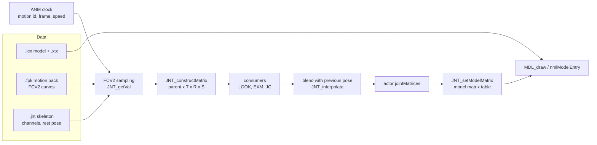
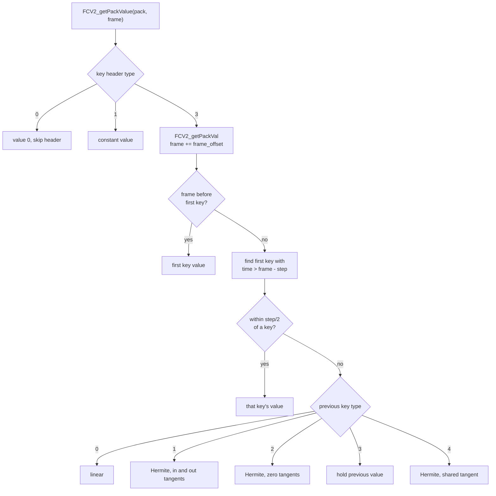
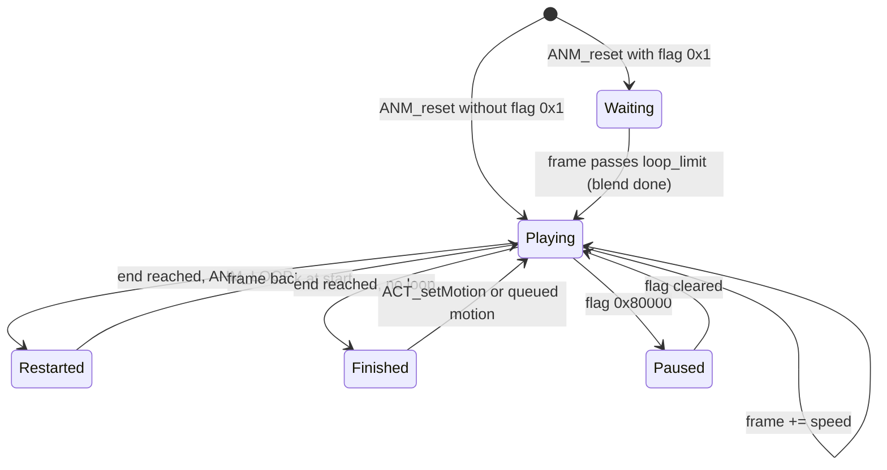
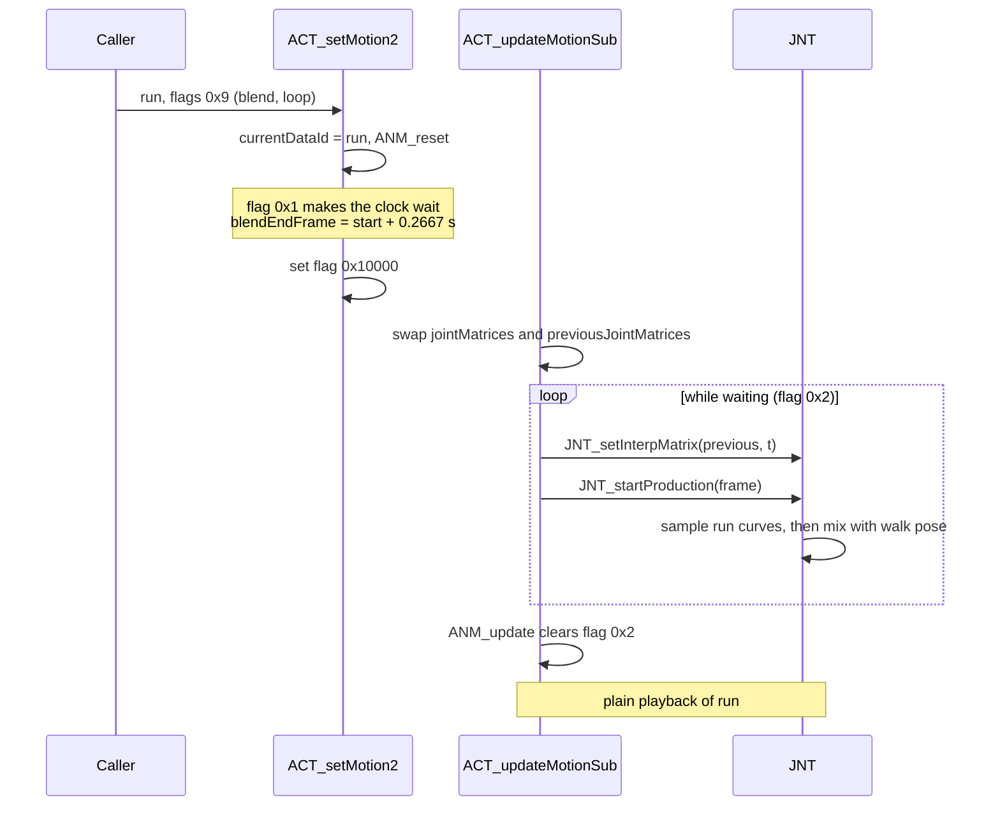
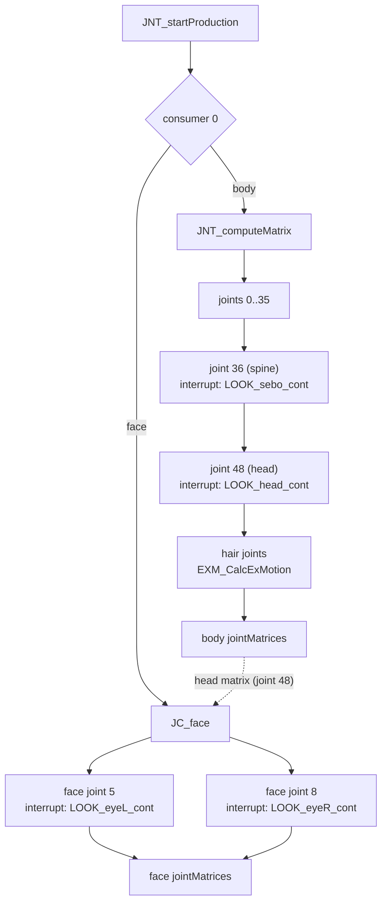
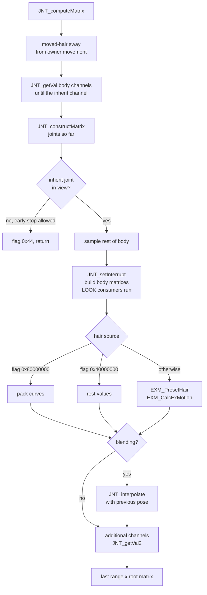
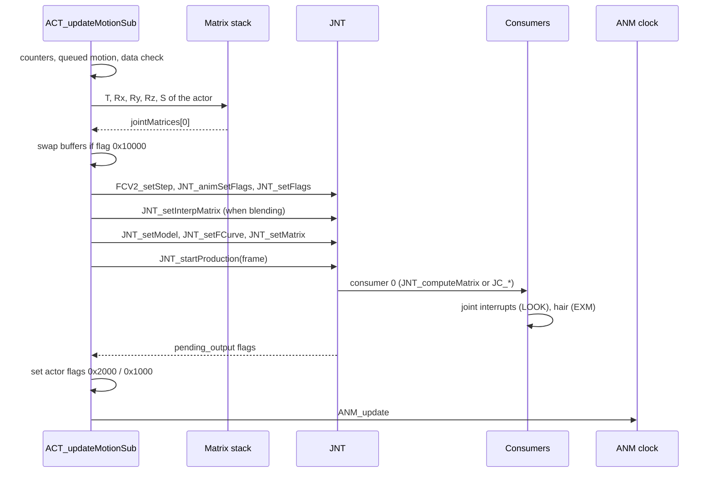
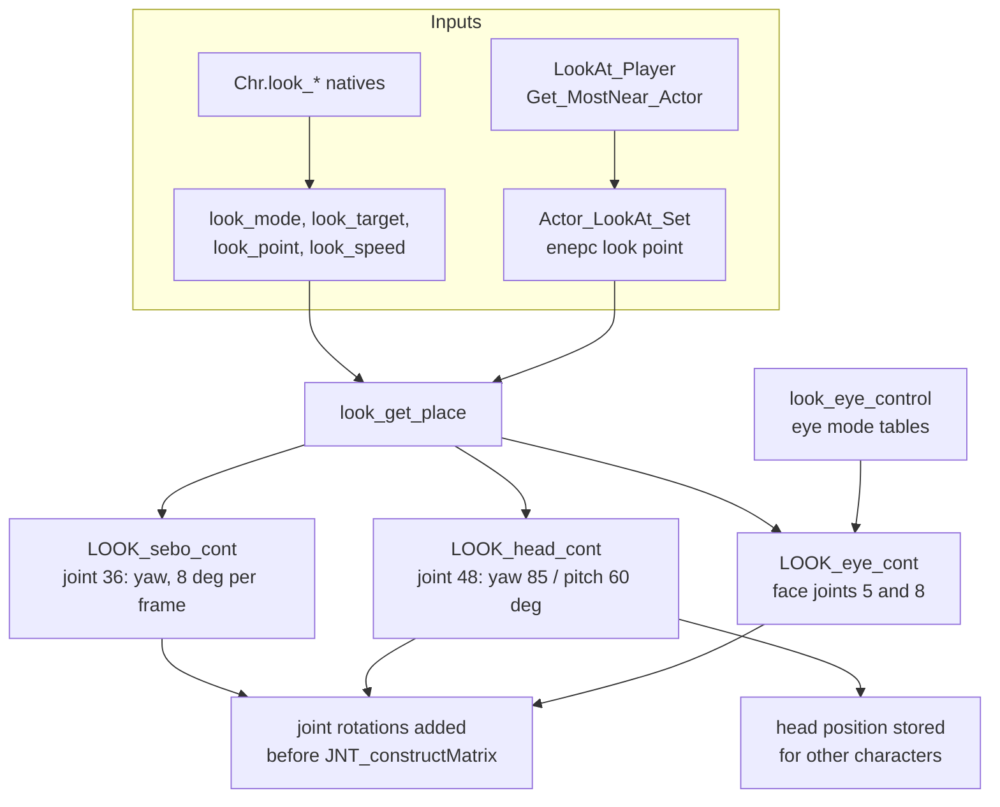
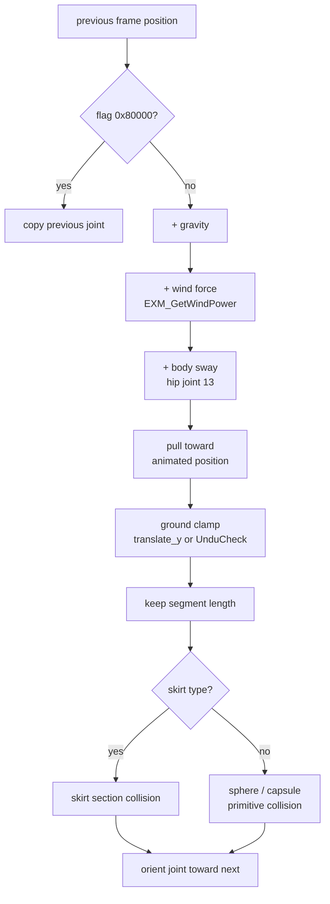

# Animation: skeletons, joints and motion

Every animated model in the game is moved by a skeleton. A skeleton is a list
of joints, and each joint has a translation, a rotation and a scale relative
to its parent joint. A motion is a set of curves that give those values over
time. Every frame the engine samples the curves at the current time, builds one
matrix per joint, lets several controllers adjust the result (head and eye
tracking, hair and skirt physics, attached faces and weapons) and hands the
matrices to the model renderer.

The code is spread over several small libraries in `src/main/`. `anm.c` is
the motion clock, `fcv2.c` reads the curve data, `jnt.c` builds the joint
matrices, `jc_face.c` attaches one skeleton to another, `look.c` turns heads
and eyes, `exm_1.c` and `exm_2.c` simulate hair, cloth and wind, and `mdl.c`
wraps the model handle. `Undulate.c` answers ground height queries for the
characters. They all work on [actors](actors.md), and the motion functions of
the actor library (`ACT_setMotion`, `ACT_updateMotion`) tie them together.

[← Back to the overview](../README.md)

## Files

| File | Prefix | Contents |
| --- | --- | --- |
| `src/main/anm.c` | `ANM_`, `PACK_` | The motion clock (`AnmClock`) and motion pack access |
| `src/main/fcv2.c` | `FCV_`, `FCV2_` | Curve data: the older FCV and the packed FCV2 formats |
| `src/main/jnt.c` | `JNT_` | Skeleton evaluation, joint matrices, the joint producer and consumers, blending |
| `src/main/jc_face.c` | `JC_` | Consumers that attach a child skeleton (face, weapon, accessory) to a parent joint |
| `src/main/look.c` | `LOOK_` | Look-at controllers for the spine, head and eyes |
| `src/main/look_at_player.c`, `src/main/set_motion.c` | various | Field look-at targets, `Set_Motion`, motion ids |
| `src/main/exm_1.c` | `EXM_` | Extra motion: hair, cloth and skirt simulation |
| `src/main/exm_2.c` | `EXM_` | Wind state and wind force |
| `src/main/mdl.c` | `MDL_` | Model handle and part visibility |
| `src/main/Undulate.c` | `Undu` | Ground height and wall checks against the map collision mesh |
| `src/main/mot.c` | `Mot` | One matrix helper and empty stubs |
| `src/main/act_2.c` | `ACT_` | Motion selection and the per-actor motion step |

## From motion data to a drawn model

The data comes from four files per model, loaded by the
[resource system](../architecture/files-and-resources.md):

- the model (`.lex`), the mesh drawn by the [nml library](nml.md),
- the texture (`.xtx`),
- the skeleton (`.jnt`), called the "move" in the code (`Actor.move`),
- the motion pack (`.fpk`), a pack of curve sets, one per motion.

The byte layouts of these files are described in
[Models and textures](../formats/models-and-textures.md) and
[Skeletons and motion](../formats/skeletons-and-motion.md).

At run time the chain has five stages. The motion clock decides which motion
plays and at what time. The curve reader samples that motion's curves for each
joint channel. The skeleton code turns the sampled values into joint matrices.
Consumers adjust some joints: the look-at code turns the head, the hair code
replaces the hair joints with simulated ones, and a face reads the body's head
matrix. Finally the joint matrices are copied into the model's matrix table
and the model is drawn.

The diagram below shows this flow for one actor.

## Motion data

### Motion packs

A motion pack (`.fpk`) is a container of curve sets. Its header starts with
the magic "FPK". After loading, the pack is relocated in place: every entry
offset becomes a pointer, and the flag `0x01000000` in the high byte of the
magic word marks the pack as relocated. Each entry is one motion, a curve set
in FCV2 format. A file whose magic is "FCV" (`0x564346`) instead of "FPK" is
treated as a pack with a single entry.

The code knows two pack formats, chosen by the header's `format` word. Every
pack on the disc uses format 3, except four small packs inside the script
resource volumes.

- In **format 3** the entry offsets count from the start of the pack. A
  second table follows the entry table, one 32-bit **attribute slot** per
  entry. Its low half is the entry's attribute index, which selects the
  [range records](#range-records-and-attribute-slots) of the curve set.
- In **format 2** each curve set is preceded by a word with the value 1. The
  relocation adds `data_offset` (4 in every pack) to each entry offset, which
  skips that word. Format 2 has no slot table.

`ANM_getEntry` reads the slot word after the entry table for every format. In
a format-2 pack it therefore gets the prefix word of the first curve set or
bytes of that curve set as the attribute index. This is normally harmless,
but see [range records](#range-records-and-attribute-slots) for the one case
on the disc where it has an effect. The exact layouts are in
[Motion packs (FPK)](../formats/skeletons-and-motion.md#motion-packs-fpk).

`anm.c` reads packs through a few helpers. `PACK_getEntry` and `ANM_getEntry`
return the curve set for an entry index. `PACK_getSize` returns the number of
entries. `PACK_getAttr` returns an entry's attribute data, and `PACK_unlink`
undoes the relocation of a format-3 pack. `ANM_getEntry`, `PACK_getEntry` and
`PACK_getAttr` relocate with the test `format == 2`, but `PACK_getSize` tests
`format >= 2`, so it would treat a format-3 pack as format 2 and add
`data_offset` to every entry. This latent bug never triggers, because
`PACK_getSize` is only called from `ANM_update` on a pack that `ANM_reset` has
already relocated.

### Motion ids and banks

An actor can hold up to eight motion packs at once, in
`Actor.animPackTables[8]`. A motion id selects a pack and an entry:

| Bits | Meaning |
| --- | --- |
| 0-7 | Entry index in the pack (`ANM_DATA_INDEX_MASK`) |
| 8-10 | Bank, the index in `animPackTables` (`ANM_DATA_BANK_MASK`) |

Bank 0 holds the character's own pack, loaded by `ACT_loadMotion`. Bank 1 is
used for event motions: `loadScriptCD2` (`src/main/script.c`) loads the pack
`data\mtnpack\SCExxxxx.fpk` of each event script and installs it in slot 1 of
every actor with `ACT_initExMotion`, so event motion ids are `0x100` plus the
entry index. Only 107 of the 181 event scripts have such a pack, and the
others install a null bank 1. The older `loadScriptCD`, reached only from the
debug map loader, does the same with a pack beside the script file. Field
enemies and the A.G.W.S. Battle overlay also install extra packs this way, and
the battle overlay fills banks 0 to 4 from its own
[battle motion files](../formats/skeletons-and-motion.md#battle-motion-files).

A few entries have fixed meanings in the field code. `MOTION_ID_IDLE` is 0,
`MOTION_ID_WALK` 1 and `MOTION_ID_RUN` 3 (`src/main/set_motion.c`). The
player's move code and the footstep code rely on them. Other ids are chosen by
scripts and enemy data.

### FCV2 curves

Each motion is a curve set in FCV2 format (`FCV2CurveData`, declared in
`include/main/fcv2.h`). The header holds the "FCV" signature, a `format`
number, `frame_count`, `first_frame`, `last_frame` and `frame_offset`. From
format 2 on, an attribute stream follows the header.

Key times are stored as 16-bit fractions of the curve length. They are turned
into seconds with a scale computed by `FCV2_resetPack`. For format 2 and
later, the scale is `frame_count / 65535 * 1/30` and the offset is
`frame_offset / 30`. For older formats the scale is
`(last_frame - first_frame) / 65535 * 1/30` with no offset. The game runs
motions at 30 frames per second, so 1/30 second is one motion frame.

The attribute stream carries data that is not a curve:

- a hash of the skeleton the motion was made for (the attribute key),
- the playback range, a first frame, last frame and speed that override the
  entry's own limits,
- the reset range, the frames used when a looping motion restarts,
- user data for the game (`ActorAnimationState.animUserData`).

`FCV2_readAttribute` reads it. `ANM_reset` uses the ranges, as the next
section explains. The user data occurs only once on the disc, in one battle
motion file, and `ACT_animGetUserData`, which returns it, has no caller in the
recovered code.

After the attribute stream come the curves, grouped by channel. A channel is
one joint of the skeleton. For each channel the stream holds:

1. A type-4 attribute record (`FcvPackAttribute`). Its `channel_flags` word
   ends the list when it is `0xFFFF`, and bit `0x8000` marks the inherit
   channel described below. Its `value_mask` has ten bits that say which
   components have curves: three translations, three rotation angles, three
   scales and a flag curve. It also holds link indices that let this joint
   copy its translation, pivot or rotation from another joint.
2. One key header (`FCV2KeyHeader`) per component set in the mask. The header
   type is 0 for a zero value (the component reads 0.0, not its rest value), 1
   for a constant (the value follows directly) and 3 for a run of spline keys
   (`key_count` keys follow).

The reader cannot skip a key header, so the mask of every channel must agree
with the joint types of the skeleton, which decide which components
`JNT_getVal` reads. The list normally ends with an end record. A few hundred
curve sets on the disc have none. The reader then meets the header of the next
curve set or the prefix word of a format-2 pack, and `FCV2_getPackAttribute`
returns its built-in `defaultAttr`, whose `channel_flags` is also `0xFFFF`, so
the list ends in the same way. The last set of a pack without an end record
relies on having exactly as many channels as the skeleton samples.

**The inherit channel.** Exactly one channel of every curve set on the disc
has the flag `0x8000`, always with the full mask `0x3FF`. For that channel
`JNT_getVal` reads all ten components whatever the joint type: the
translation, the rotation, the scale and then the flag curve, whose value sets
or clears bit 0 of the joint work flags. It also records the channel as
`channel_start_index`. `JNT_computeMatrix` stops its first sampling pass
there, builds the matrices so far and clip-tests that joint against the view
(see [JNT_computeMatrix step by step](#jnt_computematrix-step-by-step)). In
about two thirds of the field motions the inherit channel is channel 11, the
joint just before the first chain root of a human skeleton. Other motions use
other joints, and face motions almost always use channel 0.

The flag curve is read by `get_fcvpack_flag`, which is called with the mask
shifted right by 3, 3 and then 1 more bit. It therefore tests bit 7 of the
original mask (the y scale) instead of bit 9. This works only because every
inherit channel has the full mask, where both bits are set.

The `FCV2Pack` structure is the cursor that walks this stream. It holds the
current position, `frame_scale`, `frame_offset`, the attribute hash and id and
the `step` used for snapping. The record layouts are in
[Curve sets (FCV2)](../formats/skeletons-and-motion.md#curve-sets-fcv2).

### Range records and attribute slots

A range record carries an attribute id in bits 0 to 6 of its first byte, and
bit 7 says whether it is a playback range or a reset range.
`FCV2_readAttribute` keeps only the records whose id equals the attribute
index of the entry being played, the value of the entry's slot in the pack.
This lets one curve set serve several motions: the pack lists the set under
several entries, each entry gets its own slot number, and each slot number
selects its own range.

Only the battle packs use this. In the battle motion files of the party
characters and of `boss_016`, entries 12 to 16 share one curve set and
entries 17 to 21 share another. Their slots are 1 to 5, and each shared set
holds five playback ranges with ids 1 to 5, which split it into five phases.
What the phases represent is not known.

In the field and event packs every range record has id 0 and is a reset
range, while every format-3 slot is 1 or higher, so the records never match
and the entries play their full default range. They would apply only to a
curve set played on its own as an FCV file, which gets attribute index 0. The
one exception is the format-2 pack `idle.fpk` of the script volume
`SCE03003D.arc`: the garbage slot words of its entries 12 and 14 are 0, so
their reset ranges do match. The details are in
[Range records and attribute slots](../formats/skeletons-and-motion.md#range-records-and-attribute-slots).

### Key types

Each spline key (`FCV2Sample`) starts with a 16-bit type and then a 16-bit
time, followed by one to three floats. The type decides the size of the key
and how the curve goes from this key to the next one.

| Key type | Size | Floats | Interpolation to the next key |
| --- | --- | --- | --- |
| 0 | 8 bytes | value | Linear |
| 1 | 16 bytes | value, in tangent, out tangent | Hermite spline with separate in and out tangents |
| 2 | 8 bytes | value | Hermite with zero tangents (ease in and out) |
| 3 | 8 bytes | value | Step: hold the value until the next key |
| 4 | 12 bytes | value, tangent | Hermite with one tangent shared by both sides |

The counts of each type on the disc are listed in
[Key types](../formats/skeletons-and-motion.md#key-types). Type 4 is by far
the most common, and type 3 occurs only 226 times.

### Evaluating a curve

`FCV2_getPackValue(pack, frame)` returns the value of the next component and
moves the cursor. For a spline run it calls `FCV2_getPackVal`, which works as
follows. The frame is shifted by the pack's `frame_offset`. If it is before
the first key, the first key's value is returned. Otherwise the keys are
scanned for the first one whose time is later than `frame - step`. The
`step` is half the clock speed, set once per actor by `FCV2_setStep(speed)`.
If the frame is within half a step of a key, the key's value is returned
exactly. This probably keeps keyed poses exact. Otherwise the value is
interpolated between the previous key and the next one, with the formula
chosen by the previous key's type. After the last key the last key's value is
held.

The next key's value and in tangent are read only for types 0, 1, 2 and 4. A
step key (type 3) used as the next key gives a value of 0 and a tangent of 0,
so a curve that runs into a step key moves towards 0 instead of towards the
step key's value. This happens in 13 places on the disc, where a step key
follows a key of another type.

The flowchart below shows the decision path for one component.

### The older FCV format

`fcv2.c` also keeps the readers of an older curve format. `FCV_getValue`
evaluates an `FCVCurve` with per-key interpolation modes (0 step, 1 linear,
2 Hermite) and a pre- and post-behaviour that either holds the end value or
repeats the curve. `FCV_getPackValue` reads an older packed stream whose key
types are stored as 2-bit fields. Other helpers are `FCV2_getValue`,
`FCV2_getKey` (finds the key at a frame), `FCV2_checkData` (returns 0 for FCV
data, 1 for a null pointer and 2 for anything else) and `FCV2_dump`, a debug
printer.

## The motion clock (ANM)

### What the clock holds

Every actor has one motion clock, `Actor.animation`. Its first part,
`ActorAnimSlot`, is the same structure that `anm.c` calls `AnmClock`. Time is
measured in seconds. The clock fields are:

| Field (`ActorAnimSlot`) | Meaning |
| --- | --- |
| `flags` | Clock state, see the table below |
| `frame` | Current time in seconds |
| `speed` | Time added per tick. The default is 1/30, one motion frame per game frame. A negative speed plays backward |
| `reverseLimit`, `forwardLimit` | The time range of the motion |
| `currentDataId` | The motion id now playing |
| `nextDataId` | A queued motion id, `0xffff` when none |
| `channelMask` | Which channel groups are sampled, `0x1ff` by default |
| `bufferIndex` | Which of the two matrix buffers is current |
| `animQueuedFlags` | Flags to apply when the queued motion starts |

The rest of `ActorAnimationState` holds `blendDuration` (the blend time,
0.26666668 seconds or 8 frames by default), `blendEndFrame` (the time at which
the blend ends), `animData` (the current curve set), `animUserData` (the
attribute user data), `animPack` (the current pack), `blendWork[4]` (where
`blendWork[3]` is the clip radius of the skeleton) and `previousDataId`.

| Slot flag | Meaning |
| --- | --- |
| `0x1` | Blend into the new motion. On reset the clock starts waiting (`0x2`) |
| `0x2` | Waiting (`ANM_WAITING`). While set, the actor blends from its previous pose |
| `0x8` | Loop (`ANM_LOOP`) |
| `0x20` | Start a new motion at once instead of queueing it behind the blend |
| `0x1000` | Finished (`ANM_FINISHED`) |
| `0x10` + `0x1000` | Restarted (`ANM_RESTART`), set when a loop wraps |
| `0x10000` | A new motion started this frame. The matrix buffers are swapped |
| `0x20000` | Advance to the next entry of the pack at the end (`ANM_ADVANCE_ENTRY`) |
| `0x40000` | Use the reset range when looping (`ANM_RESET_BOUNDS`) |
| `0x80000` | Paused (`ANM_PAUSED`) |
| `0x08000000` | Produce nothing. The skeleton is not evaluated |
| `0x10000000` | Allow the skeleton to stop early when it is off screen |
| `0x20000000` | Force a restart even when the same motion is requested |
| `0x40000000` | Hold the hair at its rest values |
| `0x80000000` | Take the hair from the motion pack instead of simulating it |

The high flags are passed to the skeleton code each frame with
`JNT_animSetFlags`, where `jnt.c` and `exm_1.c` read them.

### Resetting the clock

`ANM_reset(clock, pack)` starts the entry `currentDataId` of a pack. It stores
the pack and the entry and clears the finished flag. The limits are the entry's
first and last frame multiplied by 1/30. For format 2 entries it reads the
attribute stream: a playback range replaces the limits and sets the speed
(stored in units of 1/32), and a reset range is kept for looping. A speed of 0
becomes 1/30. The frame is placed at the start (or at the end for a negative
speed). If flag `0x1` is set, the clock enters the waiting state and
`loop_limit` (`blendEndFrame` in the actor) is set to the start time plus
`wait_duration` (`blendDuration`).

The variants `ANM_resetPack`, `ANM_resetTime`, `ANM_resetTimeInterp` and
`ANM_resetDefault` do the same with small differences (the pack is already
set, or the restart flag is cleared). `ANM_updateTime(clock, elapsed)`
advances a clock by an explicit time instead of its speed.

### Advancing the clock

`ANM_update(clock)` runs once per frame for each animated actor. It adds the
speed to the frame unless the clock is paused. While the clock is waiting it
only checks whether the frame has passed `loop_limit`, and clears the waiting
flag when it has. Otherwise it checks the range. When the frame runs past
`forwardLimit` (or before `reverseLimit` when playing backward), a looping
clock jumps back to the other end and sets `ANM_RESTART`, using the reset
range when `ANM_RESET_BOUNDS` is set. A clock that does not loop stays on the
last frame and sets `ANM_FINISHED`. With `ANM_ADVANCE_ENTRY` the clock then
moves to the next entry of the pack (wrapping to 0, keeping the bank bits) and
resets itself on it.

The state diagram below shows the clock's main states.

## Choosing a motion

### ACT_setMotion

`ACT_setMotion(actor, id)` starts a motion without blending. If the requested
id is already playing, nothing happens unless the force flag `0x20000000` is
set in the clock. Otherwise it stores the new id (masked to eleven bits),
clears the queue, calls `ANM_reset` on the pack of the id's bank, and sets
flag `0x10000` so the next motion step swaps the matrix buffers.

The id `ANIM_MOTION_CLEAR` (`0x80000000`) drops the motion instead. The actor's
matrices are reset to the rest pose with `ACT_resetMatrix`, the curve
pointers are cleared, and the rest pose is written to the model at once.

### ACT_setMotion2 and the motion queue

`ACT_setMotion2(actor, id, flags)` is the version used by game code that wants
smooth transitions. Its `flags` are copied into the clock, so the caller
chooses blend (`0x1`) and loop (`0x8`). The constant `MOTION_BLEND_DEFAULT`
(9) means "blend and loop", and the player's move code uses it for idle, walk
and run.

The function follows these rules:

1. If the same motion is requested and no force flag is given, the new flags
   are only added to the clock.
2. If no blend is running (flag `0x2` is clear), the new motion starts at once
   with flag `0x10000`.
3. If a blend is running and nothing is queued yet, the new motion is queued
   in `nextDataId` with its flags, and `forwardLimit` is cut to the end of
   the blend. The running blend finishes first.
4. If a blend is running but the clock has flag `0x20`, the motion starts at
   once. The matrix buffers are swapped immediately, so the new blend starts
   from the pose of the current one.

`ACT_runQueuedMotion`, called from the motion step, starts the queued motion
when the clock reports `0x1000` (finished, or restarted after a loop). For the
player the queue is held while an encounter is starting
(`enepc[0].encount_lock`).

`Set_Motion` (`src/main/set_motion.c`) is the helper used by the player and
enemy code. For enemies it adds flag `0x20` and a blend time of 0.5333
seconds (16 frames).

### Blending between motions

Blending makes one motion flow into the next. The actor keeps two buffers of
joint matrices, `jointMatrices` and `previousJointMatrices`. When a motion
starts with flag `0x10000`, the motion step swaps them, so the previous
buffer holds the last pose of the old motion. While the clock is in the
waiting state (flag `0x2`), the new motion's pose is mixed with that saved
pose. The weight is `1 - (blendEndFrame - frame) / blendDuration`, which grows
from 0 to 1 during the blend. `JNT_setInterpMatrix` gives the skeleton code
the previous buffer and the weight, and `JNT_interpolate` mixes each joint.

How a joint is mixed depends on its channel type. Plain joints (types 0 and
1) blend only the translation, linearly, with VU0 code (`liner_interpolate`).
Chain links (type 2) convert both matrices to quaternions, interpolate them
with `xglQuaternionInterpolateLinear` and rebuild the matrix, optionally
keeping the scale of the old matrix. Chain ends (type 4) do the same when the
channel asks for it. Chain roots (type 3) recompute their position from the
parent. Joints 36 and 48 (spine and head) can be excluded from the blend with
skeleton flag `0x40000`, which the code sets for "chaos" models.

The sequence diagram below shows a blend from walk to run.

## The skeleton (JNT)

### The skeleton file

The `.jnt` file starts with a 16-byte header that `jnt.c` reads as
`JntHairIdSource`. The byte layout of the whole file is described in
[Skeleton files (JNT)](../formats/skeletons-and-motion.md#skeleton-files-jnt).

| Offset | Field | Meaning |
| --- | --- | --- |
| `+0x4` | `version` | Format version. From version 2 an attribute block follows the header |
| `+0x6` | `channel_limit` | Number of channels (joints). `ACT_allocMatrix` uses it as the matrix count |
| `+0x8` | `primary_id` | Number of body joints |
| `+0xa` | `secondary_id` | Number of extra joints after them (hair, cloth) |
| `+0xc` | `additional_primary_count` | Joints after the extra joints that take values from the pack |
| `+0xe` | `additional_secondary_count` | Last joints, which take their rest values |
| `+0x10` | `attribute_size` | Byte size of the attribute block. The channels start at `0x10` plus this value |

The four counts add up to `channel_limit`. In `kosmos.jnt` the attribute
block is `0xF0` bytes, so the channels start at `0x100`.

The attribute block (`JNT_readAttribute`) holds small records. A type-1 record
holds the skeleton's 8-character name, and its hash (`word0 * 31 + word1`)
becomes `attribute_key`. Motion packs carry the hash of the skeleton they were
made for. When the two keys match, the curves are sampled with `JNT_getVal`.
When they differ, `JNT_getVal_staticChain` is used, a variant without the face
record blending described below. The hair code reads the same name to choose
the hair setup of each character.

The name check fails for every body motion of Matthews. His skeletons and face
packs carry the name `MATEHWS`, but his 86 body curve sets carry `MATHEWS`.
The hashes differ, so his body is always sampled with
`JNT_getVal_staticChain`.

A type-5 record holds a hair tag, two words that `JNT_hairID` reads to find
the end of the sampled range, the channel where the motion pack stops.
`JNT_hairID` starts from `primary_id`. It adds `secondary_id` only when the
first word is 0, and it adds the low 16 bits of the second word when that
word's high half is `0x8A`. Without a type-5 record a zeroed dummy tag
(`dummyCntFree`) is used, so the pack drives the body and the whole extra
range. The first word of every type-5 record on the disc is a word count and
never 0, so with a record `secondary_id` is never added and only kind `0x8A`
extends the end. In `kosmos.jnt` the tag is `0x8A0015`, so the motion pack
drives channels 0 to 94 and the remaining 25 hair channels are simulated. Tags of kind `0x87` and `0x89` stop at the end of
the body range. The record is described in
[The hair tag record](../formats/skeletons-and-motion.md#the-hair-tag-record).

The skeleton also has an accessory record (type 4), read by
`JNT_getAccessories`. It tells where accessories and weapons attach. The
record is 196 bytes long and holds 32 unused bytes and 40 joint ids. The
reader declares 41 ids (`0x29`), so asking for id 40 reads past the record.
The layout is in
[The accessory record](../formats/skeletons-and-motion.md#the-accessory-record).

### Channels

After the header comes one `JntStaticChannel` (64 bytes) per joint. It holds
the channel `type`, `interpolation_flags`, an offset to rotation limits,
`matrix_index` (the parent joint) and the rest pose (`translation` and
`rotate`). The channel type decides how the joint is built.

| Type | Joint kind | How it is built |
| --- | --- | --- |
| 0, 1 | Ordinary joint | Translation, rotation and scale relative to the parent |
| 2 | Chain link | Rotation only, clamped to the min and max rotation limits |
| 3 | Chain root | Starts a chain |
| 4 | Chain end | Closes a chain. It solves a two-link reach (inverse kinematics) |
| 5 | Model matrix | Full transform, copied directly into the model matrix table |
| 6 | Skip | Not built |

### The joint work area

`jnt.c` keeps all its working state in `JntWork`, placed at the start of the
EE scratchpad (`0x70000000`, `JNT_SCRATCH_BASE`). The scratchpad is a fast
on-chip memory, described in [memory](../architecture/memory.md). Only one
skeleton is evaluated at a time, so a single work area is enough. Its main
fields are:

- `producer` and `owner`, the joint producer and the actor being evaluated,
- `cursor`, the FCV2 curve reader state,
- `hair_id_source`, the skeleton header, and `channels`, the channel array,
- `current_index`, the joint being built,
- `model` and `flags` (`+0x38`),
- `root_matrix` (`+0x720`) and `matrix_buffer` (`+0x7a0`), the output
  matrices (the actor's `jointMatrices`),
- `interp_matrix` and `interpolation`, the blend source and weight,
- `static_value_records` and `value_records`, used by faces,
- `current_frame`, `animation_flags` (`+0x810`, the clock flags),
  `clip_radius` and `elements`.

The flags in `work->flags` are set by the motion step before the evaluation
and by the evaluation itself. The most important ones are `0x2` (blend with
the previous pose), `0x100` (never stop early when off screen), `0x200`
(stop after the inherit channel, set for hidden actors), `0x40` (the
skeleton was found off screen), `0x10` (model matrices changed) and `0x20`
(no pack, use rest values). The motion step also sets `0x8000` for every
actor evaluation.

### The joint producer and its consumers

The skeleton code does not hard-wire what happens to each joint. Each actor
has a `JntProducer` (`Actor.jointProducer`) with up to eight consumers, set up
by `ACT_initMotion`. A consumer is a function with an id and an argument:

- Id 0 is the main consumer. It evaluates the whole skeleton. For a normal
  actor it is `JNT_computeMatrix`. For a child attached to a parent it is one
  of the `JC_*` functions.
- Other ids are joint numbers. `JNT_setInterrupt` marks those joints, and the
  consumer runs when `JNT_constructMatrix` reaches that joint, before the
  joint's matrix is built. This is how the look-at controllers add their
  rotation to the spine, head and eyes.
- Ids with bit `0x8000` are filters, found with `JNT_getFilter` and used by the
  attach consumers.

`JNT_addConsumer(producer, id, function, argument)` adds a consumer.
`JNT_initProducer` clears the list. `ACT_initMotion` installs:

| Consumer | Id (joint) | Installed for |
| --- | --- | --- |
| `JNT_computeMatrix` | 0 | Every actor |
| `LOOK_eyeL_cont` | 5 | Face models (model name contains "_face") |
| `LOOK_eyeR_cont` | 8 | Face models |
| `LOOK_sebo_cont` | 36 (spine) | Other models |
| `LOOK_head_cont` | 48 (head) | Other models |

For actors in the first sixteen slots it also sets look limits in the
`enepc` entry: x from -30 to 30 degrees, y from -80 to 80 degrees and z from 30
to 110 degrees.

`JNT_startProduction(frame, producer, actor)` runs the evaluation. It resets
the work area, stores the frame, the owner and the producer, and returns at
once when the clock has flag `0x08000000`. Otherwise it calls consumer 0, but
only when its address is a word-aligned address inside the program code. After
the call it records the matrix buffer in the actor and copies `work->flags`
into `producer->pending_output`, which the motion step reads.

The diagram below shows how the consumers plug into the evaluation of a body
and its face.

### JNT_computeMatrix step by step

`JNT_computeMatrix(work, channel)` is the main consumer. It evaluates the
skeleton in ranges:

1. If the actor's moved-hair mode is on, it measures how far and in which
   direction the actor moved since the last frame. The result, smoothed by
   `jointMovementFollowRate` (0.8) and scaled by `moved_hair_delay`, is kept in
   `moved_hair_sway` and makes the hair swing when the character walks.
2. It samples the body channels with `JNT_getVal`, from the first channel up
   to the end of the sampled range (`JNT_hairID`) or the inherit channel of the
   curve set (see [FCV2 curves](#fcv2-curves)), whichever comes first. If the
   pack runs out of channels, the rest take their rest values
   (`JNT_getStaticVal`).
3. After the inherit channel it builds the matrices so far with
   `JNT_constructMatrix`, then tests a sphere around the inherit joint against
   the view with `nmlModelCalcClip`. The radius is `clip_radius`, or 2.0 when
   it is not set. If the sphere is outside the view, or work flag `0x200` is
   set, and flag `0x100` is not set, it sets `0x40`. With clock flag
   `0x10000000` or work flag `0x200` it then stops here. The motion step later
   marks the actor as culled when the clock allows it. The static-chain path,
   used when the skeleton name does not match, makes the same test but ignores
   flag `0x100`.
4. It samples the remaining channels up to that end and builds the remaining
   body matrices. `JNT_setInterrupt` arms the look-at consumers on their joints.
5. It fills the extra joints (hair, cloth). They come from the motion pack
   (clock flag `0x80000000`), from the rest values (flag `0x40000000`, or no
   previous matrices), or from the hair simulation `EXM_CalcExMotion` after
   `EXM_PresetHair` has chosen the setup. On the frame a new motion starts,
   the hair takes its rest values unless smooth hair is on
   (`JNT_onSmoothHair`).
6. If a blend is running (work flag `0x2`), it mixes each joint with the
   previous pose using `JNT_interpolate`.
7. It samples the additional channels from the pack with `JNT_getVal2`.
8. The last range of joints takes its rest values and is multiplied by the
   root matrix.

`JNT_getVal` samples one channel. It reads the attribute record, calls the
pack reader for each masked component, applies the rotation limits of chain
links and stores the values in the joint element. For face actors with record
tables, it also stores each value in `value_records` and blends it with the
value of the last frame when the channel asks for it (flag `0x80`). This
probably smooths facial motion when the face motion changes.

`JNT_constructMatrix` builds one joint matrix. It runs the joint's interrupt
consumer first, then computes `parent matrix x translation x rotation (z, y, x)
x scale`. The link flags (`2`, `4`, `8`) of the channel can copy the
translation or rotation of an earlier joint instead. When a joint has a shape
binding, it queues a deferred binding in the producer (`deferred_limits`).

The flowchart below summarizes the evaluation order.

### Other skeleton functions

- `JNT_resetMatrix` writes the rest pose into the matrix buffer.
  `ACT_resetMatrix` builds the root matrix from the actor's transform and calls
  it for both buffers.
- `JNT_defaultConsumer` and `JNT_computeHair` are simpler consumers. The first
  samples the hair channels from the pack (then from rest values) and blends
  them. The second evaluates the hair range with the same three sources as
  `JNT_computeMatrix`.
- `JNT_resetHair` resets the hair state.
- `JNT_setFCurve(pack, mask)` starts the curve reader on a curve set. A null
  pack sets the "no pack" flag, so the consumers fall back to rest values.
- `JNT_getRootTrans`, `JNT_getRootRotate` and `JNT_getRootScale` return the
  root's values from the last evaluation. The motion step copies the root
  translation to `Actor.rootTranslation`.
- `JNT_onSmoothHair` and `JNT_offSmoothHair` set a global switch that keeps
  the hair simulated across motion changes. The battle setup turns it on.
- `JNT_setFlags`, `JNT_animSetFlags`, `JNT_setClipR`, `JNT_setModel`,
  `JNT_setMatrix`, `JNT_setInterpMatrix` and `JNT_setCurve` fill the work
  area before an evaluation.

### Writing the model matrices

The joint matrices belong to the actor. The model needs its own table, in the
layout the [nml library](nml.md) expects. `JNT_setModelMatrix` (with
`JNT_setMDLMatrix`) copies the joints into the model's matrix table at draw
time, and only when the joints changed (actor flag `0x2000`). Type-5 channels
are copied as they are. Type-2 channels are multiplied into the combined
table. After that, `ACT_modelDrawSub` applies the shape bindings queued during
the evaluation with `nmlModelSetShapeId`, unless the draw environment has flag
`0x400`. Each binding passes a shape id and a weight to nml. The weight is the
z translation of the bound joint (`jointMatrices[joint][3][2]`), so the motion
curves of that joint drive a shape (morph) target of the model. On the disc
the bindings exist only in 15 `*_h_face` skeletons, on joints 58 to 60. They
probably move the mouth and the eyelids. The bindings are stored with the
rotation limits, described in
[Rotation limits and shape bindings](../formats/skeletons-and-motion.md#rotation-limits-and-shape-bindings),
and the model side is in
[The matrix table](../formats/models-and-textures.md#the-matrix-table).

## One motion step: ACT_updateMotionSub

`ACT_updateMotion(actor)` calls `ACT_updateMotionSub` for a root actor and then
for each of its children (see [actors](actors.md#animating-parents-and-children)).
`ACT_updateMotionSub(actor, pause)` is the place where the clock, the curves
and the skeleton meet. It runs these steps:

1. Count down `pauseCounter`, unless this is a paused update.
2. Return if the actor has both flags `0x400` (no motion update) and `0x8`
   (hidden).
3. Count down `transitionFrames` and `holdFrames`. While `holdFrames` is
   running, clock flag `0x40000000` holds the hair at its rest values. Scripts
   set both counters with `Chr.hairStop`.
4. Start the queued motion if the clock has finished (`ACT_runQueuedMotion`).
5. Check the data. The model must start with the tag "lex" and the skeleton
   with "JNT", or the step is skipped.
6. Build the root matrix from the actor's transform with the
   [matrix stack](math.md) (`CUR_MATRIX_SetT`, `Rx`, `Ry`, `Rz`, `Sxyz`) into
   `jointMatrices[0]`, and clear the culled flag `0x1000`.
7. If the clock has flag `0x10000`, swap the current and previous matrix
   buffers (and the face value records) and copy the old pose into the new
   current buffer.
8. Pass the clock speed to `FCV2_setStep` and the clock flags to
   `JNT_animSetFlags`.
9. Choose the skeleton flags. While blending (and not paused), the flags are
   `0x8002`, plus `0x80` for faces, `0x100` when the actor has flag `0x200`,
   `0x200` when the actor is hidden and its draw environment does not keep
   the skeleton alive, `0x40000` for "chaos" models and `0x20000` for the
   boss models `boss_016` and `boss_019`. The blend weight is computed and
   `JNT_setInterpMatrix` receives the previous buffer. Without a blend the
   flags are `0x8000` with the same `0x100` and `0x200` additions.
10. Pass the clip radius, the model and skeleton, the current curve set with
    the channel mask, the matrix buffer and the face records to the skeleton
    code.
11. Clamp the frame to the clock limits.
12. Run `JNT_startProduction(frame, &jointProducer, actor)` and read the root
    translation with `JNT_getRootTrans`.
13. If the evaluation changed the model matrices (output flag `0x10`), set
    actor flag `0x2000`. If the skeleton was found off screen (output `0x40`)
    and the clock allows early stops, set actor flag `0x1000`.
14. Advance the clock with `ANM_update`.

The sequence diagram below shows one step.

## Attaching skeletons (JC)

A face, a weapon or an accessory has its own skeleton, but its root must
follow a joint of another actor. `src/main/jc_face.c` holds the main
consumers that do this. JC probably stands for "joint chain". Each consumer
receives the child's attachment entry as its argument, read as a `JcChain`:
`index` is the joint of the child that receives the parent's matrix,
`static_index` is the parent's joint, and `source` points to the parent's
`jointMatrices` pointer. Because `source` points to the pointer, the child
always reads the parent's current buffer, even after the parent swaps its
buffers.

`JC_face` drives a face. It copies the parent's head matrix into the face's
joint `index`, then evaluates the face skeleton from there. When the face has
its own motion, its channels are sampled from it, which is how facial
expressions and lip movements are played. When it has none (work flag `0x20`),
the channels take their rest values. The face's interrupt consumers (the eye
controllers) run while its matrices are built, and blending works as for a
body. A face created by `ACT_loadResource` or by `Chr.setPlayer` uses this
consumer. Scripts reach the face actor through `Chr.childGetPeer`.

`JC_setParent` and `JC_setParent2` do the same for accessories and weapons
that do not need the face logic. `JC_setParent2` copies each matrix through a
helper. `JC_copyChain` copies a run of the parent's joint matrices into the
child, starting at the parent joint. It is used for held weapons ("arms"),
whose skeleton repeats the arm and hand joints of the holder.

How these consumers are installed (`ACT_setParent`, `ACT_setRelation`,
`ACT_setArms`, `ACT_setFace`) is explained on the
[actors page](actors.md#parents-children-and-attachments).

## Look-at control (LOOK)

### What it does

Characters turn their upper body, head and eyes toward a point of interest:
the camera, another character, a fixed point, or a target chosen by the field
code. This is done by consumers that run as joint interrupts, so they add a
rotation to the spine, head or eye joint right before its matrix is built.
The motion keeps playing underneath, and the look-at only adds to it.

### Look modes

The point of interest is chosen by `look_get_place` from `Actor.look_mode`:

| `look_mode` | Name in the scripts | Point |
| --- | --- | --- |
| 1 | `look_default` | The point set by the field code in the actor's `enepc` entry (`Actor_LookAt_Set`). Only the first sixteen slots have one |
| 2 | `look_camera` | The active camera's position |
| 3 | `look_point` | The fixed point `Actor.look_point` |
| 4 | `look_char` | The head of `look_target` when its model has enough detail (detail 8 or more), otherwise its world position |
| 5 | `look_unit` | The position of a map unit in `look_target` |

`Actor.look_speed` is the weight of the look-at. A weight below 0.0001
switches it off, and a weight of 0 or less is read as 1.
`Actor.look_eye_speed` is the eye weight. The script natives that set these
values (`look_camera`, `look_char`, `look_unit`, `look_point`,
`look_default`, `look_eye_set`, `look_eye_control`, `look_speed`,
`look_eye_speed`) are listed on the [natives page](../scripting/natives.md).
`look_default` resets the state and both speeds to 1.

### The controllers

`LOOK_sebo_cont` runs on joint 36. "Sebo" probably comes from the Japanese
*sebone*, backbone. It converts the look point into the space of the parent
joint and computes the yaw toward it. The stored spine angle moves toward that
yaw by at most 8 degrees per frame (`look_limit_add`), and one fifth of it is
added to the joint's z rotation. Without a point, the angle returns toward
zero.

`LOOK_head_cont` runs on joint 48. It first builds the head matrix and stores
the head position (raised by 0.15) in the actor, where mode 4 of other
characters can find it. It also clears `drawEnv` flag `0x80`. It then converts
the look point into head space and computes the yaw and the pitch. The yaw is
clamped to 85 degrees, the pitch to 60 degrees, and both are scaled by 0.7.
The stored angles move toward the targets by 10 degrees (yaw) and 5 degrees
(pitch) per frame. The result is converted back into the joint's Euler angles
and added to its rotation.

`LOOK_eyeL_cont` (joint 5) and `LOOK_eyeR_cont` (joint 8) run in the face
skeleton. Both call `LOOK_eye_cont` with a small sideways offset (0.04 to the
left or right), so each eye aims from its own position. An eye uses the look
state of its owner, the body actor. The eye mode, `look_eye_control`, decides
what the eyes do:

| Eye mode | Behaviour |
| --- | --- |
| 0 | Return to the rest direction |
| 1 | Idle glances, from the 22-row table `s_aEyeIdling` (yaw, pitch, duration, step) |
| 2 to 12 | Fixed directions from `s_aEyeControl`. Modes 7 to 9 mirror the yaw for the right eye |
| 13 | Hold the current angles |
| 14 | Track the angles given by `look_eye_set` (`look_eye_angle`) |

Models whose names contain the names of Shion, KOS-MOS or MOMO use 0.4 times
the angles of the fixed directions (modes 2 to 12). After the
mode, the eye is aimed at the look point, with the yaw scaled by 0.6 and the
pitch by 0.3.

`LOOK_target_init` and `LOOK_target_doit` are empty in this build.

### Field look-at helpers

On the field, the player looks at nearby characters on its own.
`LookAt_Player` (`src/main/look_at_player.c`) runs every frame from the
player's move code. It finds the nearest active actor close to the player,
inside a fan in front of it, with `Get_MostNear_Actor`. When a map unit is
chosen as look target (`GameLoopState.look_at_target`), the player aims at
that unit instead (`PlayerLookAtAim`). Otherwise, when the nearest actor is
visible, its slot is stored in the player's `look_at_target` and
`Actor_LookAt_Set` and `Actor_LookAt` store the target point in the
player's `enepc` entry (`look_target.lookat_point`), the point that look
mode 1 reads. While input is disabled the look-at is released with
`Actor_LookAt_Release`, and while `look_at_timer` is 2 the current target is
kept. `Actor_LookAt_Init` resets the state when the player is set up.

The diagram below shows the full chain from a script or field command to the
joint rotations.

## Extra motion (EXM): hair, cloth and wind

### What EXM is

Long hair, coats, skirts and similar parts are not keyed in the motion data.
They are extra joints at the end of the skeleton (the `secondary_id` range),
and `src/main/exm_1.c` simulates them each frame as chains of points that hang
from the body, fall under gravity, are pushed by wind, swing when the
character moves and collide with the body. EXM probably stands for "extra
motion". The simulation runs inside `JNT_computeMatrix` as described above.

### Choosing the hair setup

`EXM_PresetHair(work)` runs before the simulation. It reads the skeleton's
8-character name from the attribute block. The first letters select the
character, and the last letter often selects a variant. From these it sets:

- the collision palette, a table of primitives that approximate the body
  (spheres, capsules, "inside sphere" bounds and flagged spheres that only
  some hair types use),
- the skirt sizes (`skirtColliSize` and related values) for skirt types,
- the per-joint hair types in `htypebuf`, which index the parameter table
  `hairpara[]` (gravity, response and other constants).

The value `EX_HAIR_TYPE_AUTO` (1000) lets `GetHairTypeSelection` pick the
type from the name and the joint's type letter. `EX_HAIR_TYPE_NONE` (999)
means no simulation. Skirts use parameter entry 16 (`EX_HAIR_PARAM_SKIRT`)
and a set of flags that choose the skirt profile angle and split the skirt
into sections. A special flag widens Jr.'s coat (`AdjustJrCoatWidth`).

### The chain solver

`EXM_CalcExMotion(work, channel)` reads the extra joints as a little program
of channel types. Type 3 (`EX_CHANNEL_CHAIN_BEGIN`) sets the chain's base
matrix. Type 2 (`EX_CHANNEL_CHAIN_JOINT`) queues one joint. Type 4
(`EX_CHANNEL_CHAIN_SOLVE`) simulates the queued chain. For each joint after
the first, the solver:

1. Starts from the joint's position in the previous frame, read from the
   owner's previous matrices (`Actor.previous_joint_matrices`). With clock
   flag `0x10000` the previous pose is taken relative to the group base. With
   flag `0x80000` the joint simply copies the previous joint.
2. Adds gravity from `hairpara[kind].gravity`, unless flag `0x200000` is set.
3. Adds the wind force from `EXM_GetWindPower`, unless flag `0x100000` is set.
4. Adds the body sway: the local up direction of the hip joint (13) times
   `moved_hair_sway.w`, weighted by the joint's place in the chain
   (`index * 0.3 + 0.4`).
5. Pulls the point toward its animated position by the response factors.
6. Widens Jr.'s coat when the type asks for it.
7. Keeps the point above the ground (the owner's `translate_y` or an
   `UnduCheck` query, plus 0.07), unless flag `0x400000` is set.
8. Restores the joint length, so the chain does not stretch.
9. Pushes the point out of the body, either with the skirt collision (body
   sections around the root joint 11 and the hip joint 13) or with the
   primitive table of the palette.

When all points are placed, each joint is turned to point at the next one,
with an optional bend taken from joints 39 and 48.

The flowchart below shows the work done for one joint.

### Moved hair

Moved hair is the sway that comes from the character's own movement. It is set
per actor:

- `EXM_InitMovedHair(actor)` sets mode 2 and a delay of 0.5. `ACT_init` and
  `ACT_create` call it.
- `EXM_OnMovedHair` and `EXM_OffMovedHair` switch it on and off.
- `EXM_SetDelayMovedHair(actor, delay)` changes how strongly the movement
  feeds the sway.

The values live in the actor (`moved_hair_mode`, `moved_hair_delay`,
`moved_hair_sway`). `JNT_computeMatrix` updates `moved_hair_sway` from the
distance moved and the angle between the motion and the facing direction.
`Chr.hairStop(transition, hold)` sets `transitionFrames` and `holdFrames`, so
a script can freeze the hair at its rest pose for a number of frames.

### Wind

`src/main/exm_2.c` holds one global wind, `EXM_WindState`. Its `mode` is 0
(off), 1 (directional) or 2 (point). `direction` is the wind direction (or the
source point), with the strength in `w`. `shake_power`, `shake_time` and
`shake_rad` make the wind gust.

`EXM_GetWindPower` computes the force on one hair joint. It takes the wind
vector, rotates it into the space of the skeleton's root and the owner's yaw,
and multiplies it by `1 + sin(shake_rad - wave) * wave * shake_power`. `wave`
grows by 1.3 with every joint and is reset at the start of each chain by
`EXM_ResetWave`, so the gust ripples down the hair. `EXM_StepShakeWind`, called
once per frame from `ACT_draw`, advances `shake_rad` by `shake_time` and the
wave phase by 0.5.

The setters are `EXM_SetDirectionalWind`, `EXM_SetPointWind`,
`EXM_SetShakePower`, `EXM_SetShakeTime` (clamped to plus or minus 2π),
`EXM_StopWind`, `EXM_ResetWind`, `EXM_InitWind`, `EXM_SetWindStruct`,
`EXM_ClearWindStruct`, `EXM_SetWindPara` and `EXM_GetWindPara`. The users are:

- `Runtime.setWindParam(mode, power, time, z, w)` (`src/main/runtime.c`) for
  event scripts. Mode 0 stops the wind, 1 sets the shake, 2 a directional wind
  and 3 a point wind.
- `SetUwaWind` (`src/main/init_uwamono_sys.c`), which places a point wind at a
  map unit (see [maps and units](../game/map-and-units.md)).
- The battle setup (`src/ov01/entry_first_init.c`), which sets a directional
  wind with shake values 1.0 and 0.75.
- A debug wind in `src/main/script.c` and the wind test program.

## MDL: model handles and part visibility

`src/main/mdl.c` wraps an nml model in a small handle, `MdlHandle`, kept in
`Actor.model`. It holds the model entry, four 32-bit words of visibility bits
(`visibleParts[4]`, one bit for each of up to 128 parts), the part count
(`+0x40`), the texture (`+0x54`), the part table (`+0x58`) and a pointer to
copied data.

- `MDL_create(handle, model)` fills the handle and makes all parts visible.
- `MDL_setVisible` sets the bit of one part.
- `MDL_setGroupVisible` shows or hides every part whose group tag matches a
  4-character name (stored byte-swapped). The actor library uses it to hide
  the body's "FACE" group when a separate face model is attached, and for
  `ACT_setVisible` with part numbers of 128 or more.
- `MDL_setNameVisible` shows or hides parts whose 8-character names match a
  masked pattern. `ACT_setHumanHand` uses it to choose the hand models.
- `MDL_partsSetVisible` passes the bits to nml (`nmlModelSetPartsVisible`).
- `MDL_draw` sets the texture, places the model, applies the visibility and
  enters it with `nmlModelEntry`.

How nml draws the parts is explained on the [nml page](nml.md).

## Undulate: ground height and walls

"Undulation" is the uneven ground of a map. `src/main/Undulate.c` answers two
questions for moving characters: how high is the ground under this point, and
does this move cross a wall? It works on the collision mesh of the current
map, a blob of triangles with attributes that `UnduInit(blob)` relocates and
keeps in `CurrentColiHead`. `map_1.c` calls it when a map is loaded. The blob
is the map's `.id` file, described in
[Collision and layout data](../formats/maps-and-field-data.md#collision-and-layout-data-id).

Each query uses an `UnduQuery` record of 0x40 bytes. Every actor embeds one
at `Actor.undulation` (`+0x4c8`). `UnduParamInit(query)` prepares it: sixteen
cross checks, a height limit of 1.0, a height of -1000 (`UNDU_NO_HEIGHT`, no
ground) and the scratchpad as the work area. The query's flag word
(`status_flags` in the actor) chooses the behaviour:

| Flag | Meaning |
| --- | --- |
| `0x7` mask | Wall mode: 1 block the move, 2 slide along the wall, 3 clip the move at the wall |
| `0x10` | Only accept ground within the height tolerance of the sample |
| `0x20` | Surfaces of the height-table kind use `GameLoopState.attributeHeights` |
| `0x400` | Reject ground outside the triangle's vertical extent |
| `0x800` | Only accept ground at or below the sample |

`UnduCheck(sample, move, query)` returns the ground height under `sample`. It
first tries the triangle found last time, which is fast when the character
stays on the same floor. With a move vector, it shifts the test point and
checks the triangle edges crossed on the way. Edges with wall attributes stop,
deflect or clip the move according to the wall mode. The result (height,
triangle, attribute bits) is kept in the query. `UnduGet2(query, x, z)` and
`UnduGet(x, z)` are short forms that return the height at a point.
`UnduDataGetHeader(map_index, unit_index)` returns a locator (position and
facing angle) stored in the collision data, which map and layout code use to
place things.

The attribute bits of the floor (`Actor.attribute_flags`) drive several field
features: conveyor belts (`Move_BeltConveyer`), ID lights (`GameIdLightSet`,
attribute type `0x6000`), the footstep material and ground effects. The
collision rules of the field and the map units are explained in
[maps and units](../game/map-and-units.md).

## mot.c

`src/main/mot.c` appears to be the remains of an older motion module.
`MotTransXYZ` moves the translation of the current matrix of the matrix stack
along its own local axes. `GetMdlFileName`, `MotInit`, `MotCalc` and
`MotSetEx` are empty functions.

## Test programs

Two debug programs left in the game show the animation system in its
simplest form. Both build one actor by hand with `ACT_init`, `ACT_create`,
`ACT_initMotion`, `ACT_loadMotion`, `ACT_loadResource`, `ACT_allocMatrix` and
`ACT_setModelWrapper`, then loop on `ACT_setMotion`, `ACT_updateMotion` and
`ACT_modelDraw`. How they are reached is described in
[debug tools](../game/debug-tools.md).

`HairTest` (`src/main/hair_test.c`) cycles through a list of characters and
motions. Up and down pick the character, which is reloaded unless SQUARE is
held. Left and right change the motion, and START pauses. The pad moves the
camera. It replaces consumer 0 with its own copy of the skeleton evaluator,
`__JNT_computeMatrix`, through `JNT_addConsumer`, which shows how the
consumer design lets a program change the evaluation without touching the
actor code.

`WindTest` (`src/main/wind_test.c`) loads character id 2 (probably KOS-MOS)
and lets the tester move a point wind or a directional wind with the pad.
SELECT switches between them, up and down change the wind power, and left and
right the shake power. `EXM_StepShakeWind` is called every frame, and
`EXM_InitWind` restores the calm state on exit.
