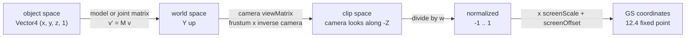
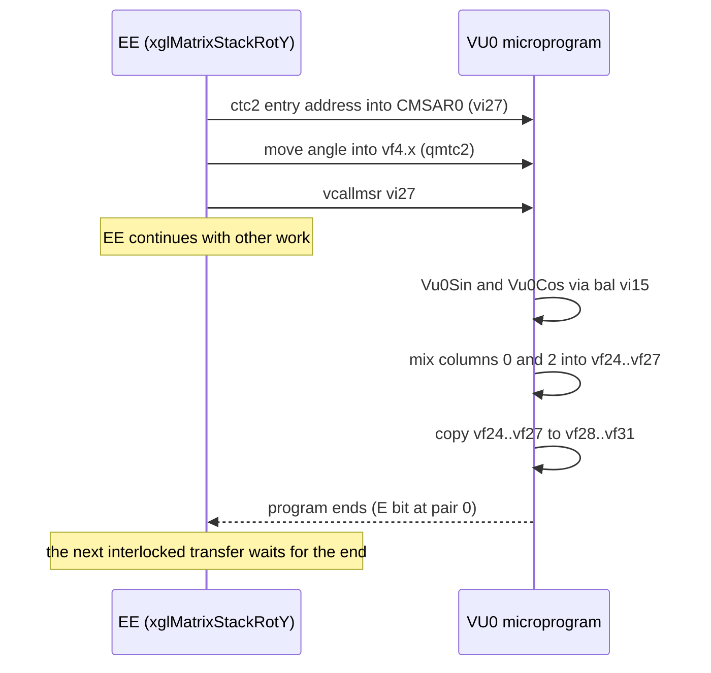
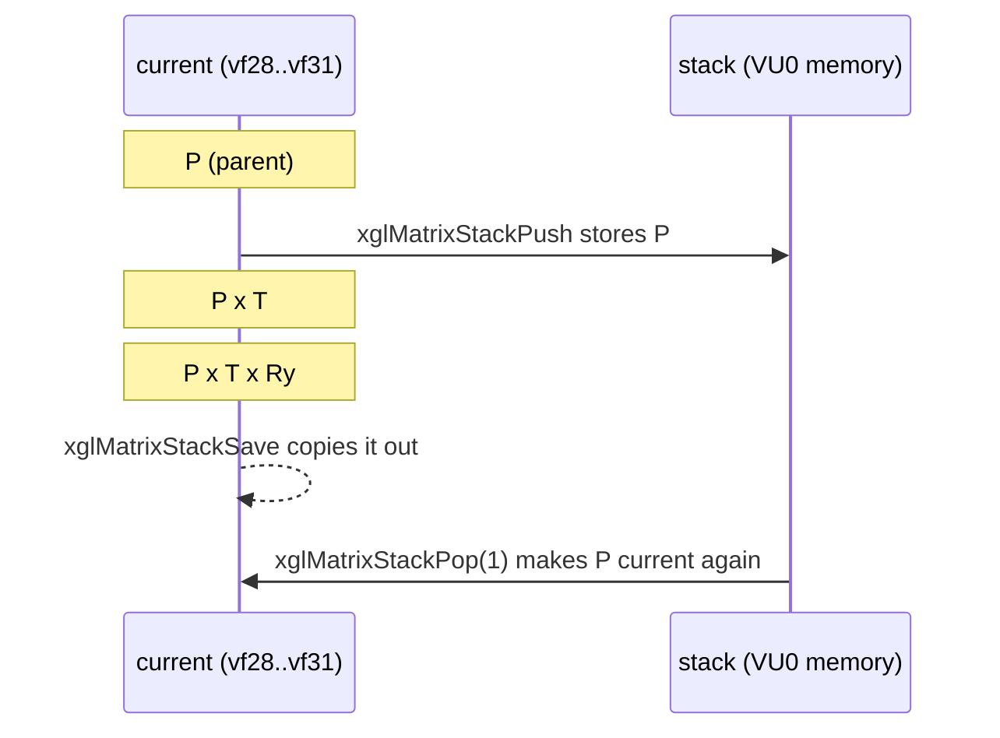
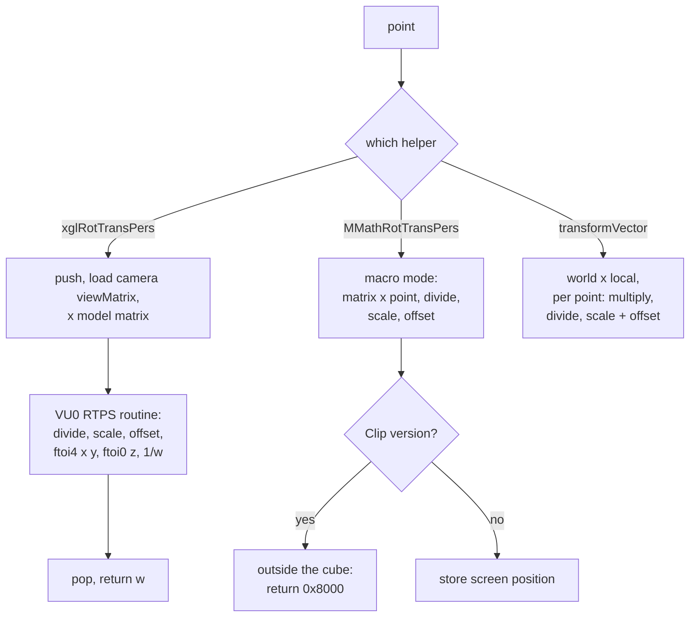
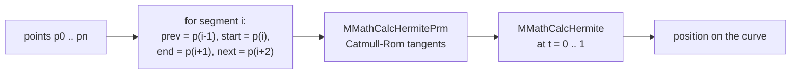
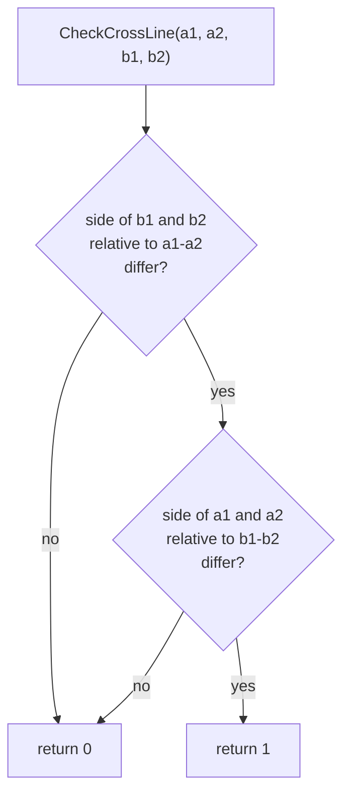
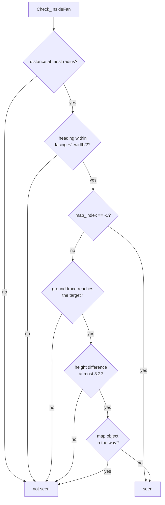
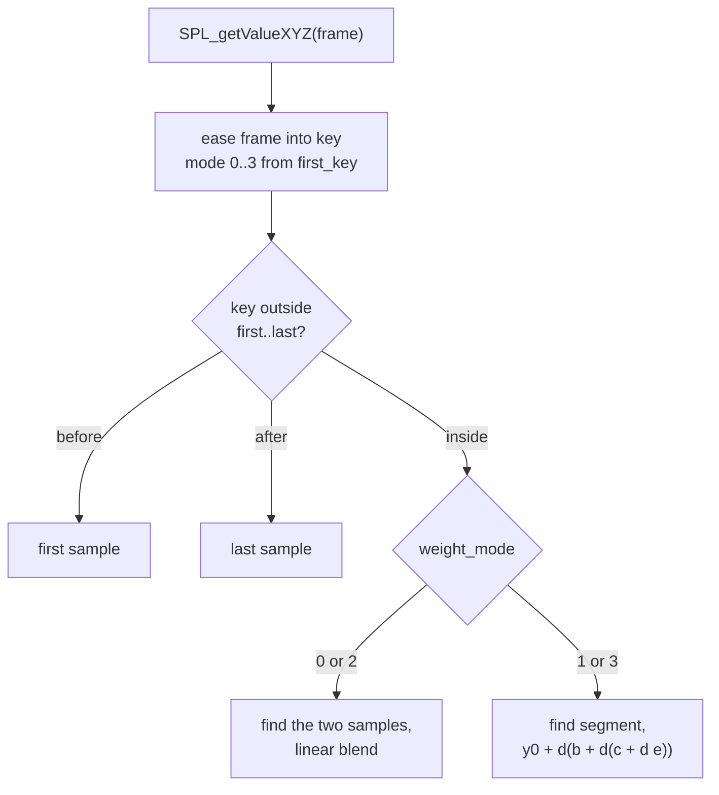

# Math helpers

The game has no single math library. Vector, matrix and curve code is spread
over several small libraries with different styles, which probably come from
different programmers: the `xgl`
system library's math file, the `MMath` helpers used by battle effects, the
`MATRIX_` and `CUR_MATRIX_` helpers used by skeletons, the game-play geometry
helpers of the field code, and a spline library used by cameras and scripts.
They all share the same vector and matrix types and the same conventions,
and most of them do their work on the VU0 vector unit.

This page describes the conventions first, then the VU0 unit and the
low-level macros that every library uses, then each library in turn. The
system library that owns `xgl_2.c` is described in [xgl.md](xgl.md).

[← Back to the overview](../README.md)

## Where the math lives

| File | Prefix | Content |
| --- | --- | --- |
| `src/main/xgl_2.c` | `xgl` | Vectors, matrices, the VU0 matrix stack, projection, quaternions, random numbers, trigonometry, memory copies |
| `src/main/vu0/Vu0MicroCode.dvp` | `Vu0Call` | The resident VU0 microprogram: sine, cosine, the matrix stack, projection, light matrices |
| `src/main/m_math.c` | `MMath` | Vector and matrix helpers in VU0 macro mode, random angles, rotation helpers, Hermite curves |
| `src/main/matrix_print.c` | `MATRIX_`, `CUR_MATRIX_`, `QUAT_` | Matrices with separate scale, the second VU0 current matrix, quaternion conversions |
| `src/main/align.c` | `align` | Rotations that turn one axis onto a direction |
| `src/main/outer_product.c` | | Cross products, plane intersection, line and circle tests in the XZ plane |
| `src/main/get.c` | `Get_`, `Check_` | Game-play geometry: angles, points, parabolas, vision fans, walls, B-spline paths |
| `src/main/transform_vector.c` | `transformVector` | Batch projection of points with a parameter block |
| `src/main/spl.c`, `src/main/spline.c` | `SPL_` | Cubic splines with eased timing, and the `xeno.util.Spline` script class |
| `src/main/math.c` | `Java_xeno_vm_Math_` | The script `Math` natives |
| `include/quadword.h` | `Quadword` | 128-bit copy macros |
| `include/vu0_macro.h` | `Vu0` | VU0 macro-mode helper macros |

The math functions of the C runtime (`sinf`, `cosf`, `atan2f`, `fmodf`,
`sqrtf`) come from the bundled runtime libraries, described in
[runtime-libraries.md](../architecture/runtime-libraries.md). The game calls
them in some places and its own VU0 versions in others.

## Conventions

### Types

All libraries use the types of `include/shared.h`:

| Type | Definition | Use |
| --- | --- | --- |
| `Vector4` | struct of four floats `x`, `y`, `z`, `w` | Points, directions, colors, quaternions |
| `AlignedVector4` | `Vector4` aligned to 16 bytes | Vectors that are copied as whole quadwords, like the SDK's `sceVu0FVECTOR` |
| `DoublewordAlignedVector4` | `Vector4` aligned to 8 bytes | Vectors copied as two 64-bit words |
| `DoublewordVector4` | union of a `Vector4` and two `u64` words | The same, when the code really accesses the two words |
| `Matrix4` | `float[4][4]` | A 4 x 4 matrix, 64 bytes |
| `Matrix` (`include/main/xgl_2.h`) | union of 16 floats, a `Matrix4` and four 128-bit quadwords | The same matrix seen as elements, rows or quadwords |
| `HermiteVector` | struct of four floats `x`, `y`, `z`, `w` | Control points of Hermite curves |
| `Vector3` (`include/main/get.h`) | struct of three floats `x`, `y`, `z` | Control points of B-spline paths |

A vector always has four floats, even when only x, y and z mean something.
The VU0 unit loads and stores 16 bytes at a time, so a 3-component vector
would cost the same and would complicate the code.
For points, w is usually 1. For directions it is often left as it was.

Many functions come in two versions. The plain version works on all four
components. The `XYZ` version works on x, y and z only and copies w from the
first source, as in `xglVectorScale` and `xglVectorScaleXYZ`.

### Matrix layout

A `Matrix4` is stored as four groups of four floats. In C each group is a
"row", `m[0]` to `m[3]`. Mathematically each group is a **column**: the
engine uses column vectors, like OpenGL. The first three groups are the X, Y
and Z axes of the transformed space, and the fourth group is the
translation. The resident VU0 matrix of the microprogram holds the four
groups in `vf28` to `vf31`, one column per register.

```
 C storage                        mathematical matrix M
 m[0] = ( Xx, Xy, Xz, 0 )         | Xx  Yx  Zx  Tx |
 m[1] = ( Yx, Yy, Yz, 0 )         | Xy  Yy  Zy  Ty |
 m[2] = ( Zx, Zy, Zz, 0 )         | Xz  Yz  Zz  Tz |
 m[3] = ( Tx, Ty, Tz, 1 )         |  0   0   0   1 |
```

A vector is transformed as `v' = M v`. In code this is a weighted sum of the
four groups: `v' = v.x * m[0] + v.y * m[1] + v.z * m[2] + v.w * m[3]`.
This is exactly what `xglVectorMulMat` does on VU0, one multiply-add per
group.

`xglMatrixMul(destination, left, right)` computes `left * right`. The
right-hand matrix is applied to a vector first. The functions that add a
translation, scale or rotation to an existing matrix (`xglMatrixTrans`,
`xglMatrixScale`, `xglMatrixRotX` and the matrix stack versions) multiply on
the right: `M' = M * T`. The new transform therefore acts in the local space
of the old one, as in classic OpenGL. To place an object, code starts from
the parent matrix and adds the object's own translation, then its rotation,
then its scale.

### Coordinate system

The world is **Y-up**. Gravity is applied by decreasing y (for example the
hair simulation in `src/main/exm_1.c`), and the camera's screen scale has a
negative Y factor because screen Y grows downward. The projection matrix is
the OpenGL `glFrustum` matrix, so in camera space the camera looks along -Z,
and the coordinate system is right-handed.

On the ground plane, a heading (yaw) is measured from the +Z axis toward the
+X axis. `Get_Angle(from, to)` returns `atan2f(dx, dz)`, and
`Get_Point_By_AngleLength` moves a point by `(sin a, 0, cos a) * length`. A
heading of 0 faces +Z, and a heading of pi/2 faces +X. This matches a
positive rotation about the Y axis. Pitch is measured from the ground plane,
positive upward (`MMathCalcAngle` uses `atan2(dy, xz_length)`).

The unit of length is not named in the code. The default travel position of
a camera in `src/main/xgl_camera.c` is (0, 1, 4), and positioned sound
effects stop when the listener is more than 6 units away
(`xglSoundEffectPosID`). Values like these suggest that one unit is probably
about one metre.

The screen side uses GS coordinates. The GS drawing area is 4096 x 4096
units with the visible screen centered at (2048, 2048). Screen positions are
12.4 fixed-point numbers: the integer pixel position times 16. The camera's
`screenScale` and `screenOffset` convert normalized coordinates to that
space (see [Projection to the screen](#projection-to-the-screen)).

### Angles

Angles are in **radians** everywhere, as `float`. Degrees appear only where a
person types the value: the fan widths of `Check_InsideFan` are given in
degrees and converted, and `MMathDeg2RadVector` and `MMathRad2DegVector`
convert whole vectors of Euler angles. The `...I` versions of these two
functions read or write integer degrees.

Angles are often kept in the range [-pi, pi]. `Get_Decimal_Surplus_for_Radius`
wraps any angle into that range, and `MMathCalcRotNear` returns the signed
difference between two angles along the shorter way round.

The diagram below shows how a point travels from an object's own space to a
position on the screen, with the convention of each step.



## The VU0 unit in plain terms

The PlayStation 2's main processor (the EE) has two vector units. VU1 is used
for geometry by the model library (see [nml.md](nml.md)). **VU0** is tightly
coupled to the EE and is the unit all the math code uses.

VU0 has 32 vector registers, `vf0` to `vf31`. Each holds four floats, x, y, z
and w, and one instruction works on all four lanes at once. `vf0` is a
constant (0, 0, 0, 1), which the code uses as a source of 0 and 1. There are
also 16 integer registers `vi0` to `vi15`, an accumulator `ACC` for
multiply-add chains, a `Q` register that receives the result of a divide or a
square root, an `I` register for an immediate float, and an `R` register that
generates random numbers.

VU0 can be used in two ways.

### Macro mode

In **macro mode**, VU0 behaves like a coprocessor of the EE (coprocessor 2).
The EE executes VU0 instructions one by one inside its own instruction
stream. The code moves data with:

- `lqc2` and `sqc2`, which load and store a vector register from memory,
- `qmtc2` and `qmfc2`, which move 128 bits between an EE register and a vector
  register,
- `ctc2` and `cfc2`, which write and read VU0 control registers.

The arithmetic instructions have a field mask (`.xyz`, `.x`, ...) and can take
one lane of the second operand as a scalar (`vmulx`, `vaddy`, ...). A vector
length, for example, is computed in `xglVectorLength` like this:

```c
__asm__ __volatile__(
    "lqc2 vf3, 0(%1)\n"       /* load the vector */
    "vmul.xyz vf3, vf3, vf3\n"   /* square x, y, z */
    "vaddy.x vf3, vf3, vf3y\n"   /* x*x + y*y */
    "vaddz.x vf3, vf3, vf3z\n"   /* + z*z */
    "vsqrt Q, vf3x\n"           /* square root into Q */
    "vwaitq\n"
    "vaddq.x vf4, vf0, Q\n"     /* move Q into a register */
    "qmfc2 $2, vf4\n"
    "sw $2, 0(%0)\n"            /* store the result */
    : : "r"(destination), "r"(vector) : "$2", "memory");
```

This style is written as inline assembly in the original, and the recovered
source keeps it. The recurring shapes are collected as macros in
`include/vu0_macro.h` (see [VU0 macros](#vu0-macros)).

### Micro mode

In **micro mode**, VU0 runs a program from its own instruction memory while
the EE continues. The EE starts a routine with `vcallms address` or with
`vcallmsr`, which takes the address from the control register `CMSAR0`
(`vi27` in `ctc2` notation). The EE puts the arguments in agreed vector
registers first and reads the result from agreed registers after the
routine has ended. To be sure the routine has ended, the EE reads the result
with an interlocked transfer, one with the `.i` suffix such as `qmfc2.i` or
`cfc2.i`. Such an instruction waits until the running routine stops.

### The resident VU0 microprogram

The game's VU0 program is `src/main/vu0/Vu0MicroCode.dvp`, 224 instruction
pairs (1792 bytes). `xglGeometryInit` uploads it once at start-up, with a DMA
transfer on channel 0 (VIF0). Nothing overwrites it later, so its routines
are available for the whole game.

The program keeps state between calls:

- `vf28` to `vf31` hold the **current matrix** of the matrix stack, one
  column per register.
- `vi13` is the **stack pointer**. The stack is a circular buffer of 32
  matrices (2 KiB) at the bottom of VU0 data memory, which the EE sees at
  `0x11004000`. A push past 32 matrices wraps around and silently overwrites
  the oldest entry.
- `vf24` to `vf27` hold a scratch copy while a new current matrix is built.

The entry points are:

| Entry | Arguments | Result |
| --- | --- | --- |
| `Vu0CallSin` (byte address `0x20`) | angle in `vf4.x` | sine in `vf1.x` |
| `Vu0CallCos` (`0xE8`) | angle in `vf4.x` | cosine in `vf1.x` |
| `Vu0CallMatrixStackUnit` (`0x108`) | | current matrix = identity |
| `Vu0CallMatrixStackMul` | matrix in `vf4`–`vf7` | current = current x matrix |
| `Vu0CallMatrixStackReverse` | | current = transpose of current |
| `Vu0CallMatrixStackInverse` | | current = inverse of current (affine) |
| `Vu0CallMatrixStackScale` | scale in `vf4` | current = current x S |
| `Vu0CallMatrixStackTrans` | translation in `vf4` | current = current x T |
| `Vu0CallMatrixStackRotV` | axis in `vf5`, angle in `vf4.x` | current = current x R(axis, angle) |
| `Vu0CallMatrixStackRotX`, `RotY`, `RotZ` | angle in `vf4.x` | current = current x R |
| `Vu0CallMatrixStackFrustum` | six planes in VU0 memory at `0x11004800` | current = current x frustum |
| `Vu0CallMatrixStackPush`, `PushUnit` | | save current on the stack (then load identity) |
| `Vu0CallMatrixStackPop` | count in `vi1` | drop `count` entries and load the top |
| `Vu0CallMatrixStackMulVector` | vector in `vf4` | current x vector in `vf5` |
| `Vu0CallMatrixStackRTPS` | point, scale, offset in `vf4`–`vf6` | screen position in `vf7` |
| `Vu0CallLightCalcMatrix` | the seven quadwords of a light set in `vf4`–`vf10` | two matrices in `vf20`–`vf27` |

Sine and cosine reduce the angle to the range [-pi/2, pi/2] by multiples of
pi and evaluate an odd polynomial of degree 9. The coefficients are a fitted
set, not the Taylor series, and the result is accurate to about one unit in
the last place of a `float`. Cosine is sine with pi/2 added. The light matrix
routine only rearranges its input: one output matrix holds the three light
directions transposed, the other holds the light colors and the ambient color
as columns. `xglLightCalcMatrix` calls it, as described in
[xgl.md](xgl.md#lights).

An EE function that calls a routine follows the same pattern every time. The
sequence diagram below shows `xglMatrixStackRotY(angle)`.



### VU0 register conventions

Because some registers keep their value between calls, each library uses
VU0 registers by a fixed convention. The comment at the top of
`include/vu0_macro.h` states it: the same operation written by two libraries
is two different helpers, because each library has its own registers.

| Library | Resident registers |
| --- | --- |
| xgl matrix stack (microprogram) | Current matrix in `vf28`–`vf31`, stack pointer `vi13` |
| `CUR_MATRIX_` (matrix_print.c) | Current matrix in `vf27`–`vf30` |
| Model library clipping (nml) | Clip matrices in `vf12`–`vf19`, view scale and translation in `vf25`, `vf26` |
| Effect library particles (sef) | Inverse view in `vf16`–`vf19`, particle rotation in `vf13`–`vf15` |
| JPEG decoder | Constant tables in `vf1`–`vf8`, `vf11`–`vf18` and `vf21`–`vf26` during a decode |

The sets overlap. The `xgl` matrix stack and the `CUR_MATRIX_` functions both
use `vf28`, `vf29` and `vf30`, and the microprogram uses `vf24` to `vf27` as
scratch, which covers the model library's view scale and translation. Even
some `xgl` functions, such as `xglMatrixMul`, use `vf27` to `vf31` as scratch
(see [Matrices](#matrices)). A
library therefore cannot trust its registers after another library has run.
The code appears to reload them where it needs them (for example with
`CUR_MATRIX_Set` or `Vu0SetViewScaleTranslation`) and keeps its lasting
matrices in memory.

## Quadword copies

File: `include/quadword.h`

The EE has 128-bit general registers. The instructions `lq` and `sq` load and
store 16 bytes at once, so a whole `Vector4` moves in two instructions, and a
whole `Matrix4` in eight. The original code wrote these copies as small
inline-assembly blocks, in the same style as the SDK's `sceVu0CopyVector`.
A plain C structure copy would compile to different instructions, so the
recovered source keeps the blocks, gathered as macros:

| Macro | Effect |
| --- | --- |
| `QuadwordCopy(d, v)` | `*d = *v`, one 16-byte vector |
| `QuadwordZero(d)` | `*d = 0`, stored from the zero register |
| `QuadwordCopyMatrix(d, v)` | Copy a 64-byte matrix, load and store interleaved |
| `QuadwordZeroMatrix(d)` | Clear a matrix |
| `QuadwordCopyT0`, `QuadwordCopyMatrixT0` | The same copies with all loads first, through registers `$8` to `$11` |
| `QuadwordMergeMatrixPosition(d, m, p)` | Copy the three axes of `m` and take the fourth group from `p` |
| `QuadwordCopyXyzT0(d, v)` | Copy x, y and z, leave w of the destination |
| `LoadWordUnaligned(r, a)` | Load a 32-bit word from any address (the `lwl` and `lwr` pair) |
| `QuadwordCopyArray(d, v, n)` | Copy `n` quadwords (the body of `xglMemCopy16`) |
| `QuadwordCopyMatrixArray(d, v, n)` | Copy `n` 64-byte blocks (the body of `xglMemCopy64`) |

`lq` and `sq` ignore the low four bits of the address, so both addresses
must be 16-byte aligned. This is why so many structures keep their vectors
on 16-byte boundaries and why `AlignedVector4` exists. A typical use is
taking the translation group of a joint matrix as a position, as in
`src/main/look.c`:

```c
QuadwordCopy(&actor->headPosition, matrix[3]);
```

## VU0 macros

File: `include/vu0_macro.h`

The VU0 macros wrap the macro-mode blocks that appear many times in the
original code. Each one loads its operands with `lqc2`, runs a few VU0
instructions and stores the result with `sqc2`, in fixed registers. They fall
into six groups:

| Group | Macros | Registers |
| --- | --- | --- |
| Shared vector operations | `Vu0AddVectorXYZ`, `Vu0SubVectorXYZ`, `Vu0SubVector` | `vf2`, `vf3` (and `vf20`, `vf21`) |
| Effect library | `Vu0SefAddVectorXYZ`, `Vu0SefScaleVectorXYZ`, `Vu0SefSetInverseView`, `Vu0SefQuadCornersXY` and others | `vf1`–`vf4`, `vf13`–`vf19` |
| Matrices and constants | `Vu0ApplyMatrixXYZ`, `Vu0ApplyMatrix33XYZ`, `Vu0ApplyMatrix2XYZ`, `Vu0UnitMatrix`, `Vu0SetOrigin` | `vf27`–`vf31` for `Vu0ApplyMatrixXYZ`, `vf0`–`vf3` for the constants |
| Model library | `Vu0DistanceSquaredXYZ` | `vf10`, `vf11` |
| Resident state | `Vu0SetCurrentMatrix`, `Vu0GetCurrentMatrix`, `Vu0ApplyCurrentMatrix`, `Vu0CurrentRotTransPersClip`, `Vu0SetViewScaleTranslation`, `Vu0SetClipMatrices` | `vf27`–`vf30`, `vf25`, `vf26`, `vf12`–`vf19` |
| Micro subroutine calls | `Vu0Sin`, `Vu0Cos`, `Vu0CallMicro`, `Vu0CallMicroArgument`, `Vu0CallMicroVector`, `Vu0CallMicroResult` | `vf4` in, `vf1` out, `vi27` |

The `Vu0Sef...QuadCorners` macros build the four corners of a sprite quad
around a center point in one coordinate plane, for the particles of
[sef.md](sef.md). `Vu0CurrentRotTransPersClip` projects a point through the
current matrix and returns its clip flags, for the model library.
`Vu0ApplyMatrixXYZ` loads its matrix into `vf27` to `vf30`, so it replaces
any current matrix kept there. `Vu0UnitMatrix` builds the identity from `vf0`
by rotating its lanes, and `Vu0SetOrigin` stores `vf0` itself, the point
(0, 0, 0, 1). The micro
subroutine macros are the building blocks of the `xgl` matrix stack
functions below. For example, `xglMatrixStackRotX` is:

```c
void xglMatrixStackRotX(float angle)
{
    unsigned int entry = (unsigned int)Vu0CallMatrixStackRotX >> 3;

    Vu0CallMicroArgument(entry, angle);
}
```

The address is divided by 8 because `CMSAR0` counts in instruction pairs of 8
bytes.

## xgl math

File: `src/main/xgl_2.c`

`xgl_2.c` is the most used math file of the game. Its functions take the
destination first, like `xglVectorScale(destination, source, scale)`, and
most of them return nothing.

### Vectors

| Function | Result |
| --- | --- |
| `xglVectorScale(d, v, s)`, `...XYZ` | `d = v * s` |
| `xglVectorScaleAdd(s, d, v, o)`, `...Sub`, `...XYZ` | `d = v * s + o`, or `- o` |
| `xglVectorMulAdd(d, a, b, c)`, `...Sub`, `...XYZ` | `d = a * b + c` per component |
| `xglVectorDiv(d, a, b)`, `xglVectorDivAdd`, `xglVectorDivSub`, `...XYZ` | Per-component division, with an optional addend |
| `xglVectorInter(t, d, a, b)`, `...XYZ` | Linear interpolation `d = a + (b - a) * t` |
| `xglVectorInner(&r, a, b)` | Dot product of x, y, z |
| `xglVectorInner4(a, b)` | Dot product of all four components |
| `xglVectorOuter(d, a, b)` | Cross product of x, y, z. w is copied from `a` |
| `xglVectorLength(&r, v)` | Length of x, y, z (VU0 square root) |
| `xglVectorNormal(d, v)` | `v` scaled to length 1 (VU0 reciprocal square root). w is kept |
| `xglPointLength(a, b)`, `xglPointLengthXZ(a, b)` | Distance in 3D, or on the ground plane |
| `xglVectorClamp(d, v, min, max)`, `...XYZ` | Clamp each component |
| `xglPlaneParameter(d, p0, p1, p2)` | The plane through three points |
| `xglVectorMulMat(d, m, v)` | `d = m * v`, all four components |

`xglPlaneParameter` stores a plane as a `Vector4`: x, y and z are the unit
normal `normalize((p1 - p0) x (p2 - p1))`, and w is minus the dot product of
the normal with `p0`. A point `q` is on the plane when
`dot(normal, q) + w` is 0, and on the side the normal points to when it is
positive. The camera uses it to build the six planes of the view volume.

`xglVectorInner` stores each partial sum into the result as it builds it.
This does not change the result, but it is how the original code behaves.

### Matrices

| Function | Result |
| --- | --- |
| `xglMatrixUnit(m)` | Identity |
| `xglMatrixUnit4s(m)` | Identity with 1 in the w lane of every axis, for the "4s" format (see [The 4s matrix format](#the-4s-matrix-format)) |
| `xglMatrixMul(d, a, b)` | `d = a * b` on VU0 |
| `xglMatrixReverse(d, m)` | Transpose |
| `xglMatrixInverse(d, m)` | Inverse of an affine matrix |
| `xglMatrixScale(d, m, s)` | `d = m * S(s)`: axis `i` multiplied by `s[i]`, the translation by `s[3]` |
| `xglMatrixTrans(d, m, t)` | `d = m * T(t)`: the translation moves by `m * t` |
| `xglMatrixRotX(d, m, a)`, `RotY`, `RotZ` | `d = m * R(a)` |
| `xglMatrixRotV(d, m, axis, a)` | `d = m * R(axis, a)`, Rodrigues' formula |
| `xglMatrixFrustum(d, m, l, r, b, t, n, f)` | `d = m * frustum`, the OpenGL `glFrustum` matrix |

`xglMatrixInverse` is not a general 4 x 4 inverse. It inverts the 3 x 3 part
from its cofactors and transforms the translation to match, and it sets the
fourth row to (0, 0, 0, 1). This is correct for matrices made of rotations,
scales and translations, such as object and camera matrices, but not for
projections. The matrix stack has the same operation on VU0.

`xglMatrixTrans` multiplies the translation vector by the matrix, so its w
component should be 1. With `t.w = 1` the result is "move along the matrix's
own axes". The three axis rotations change only the two axes they mix: RotX
mixes the Y and Z axes, RotY mixes X and Z, and RotZ mixes X and Y. Each
calls the VU0 sine and cosine routines first.

`xglMatrixMul`, `xglMatrixRotX`, `RotY`, `RotZ`, `xglMatrixFrustum` and
`xglVectorMulMat` work from memory to memory, but they use `vf27` to `vf31`
as scratch registers on the way. These are the registers of the matrix
stack's current matrix, so a call to one of them destroys the current matrix
of the stack. Code that mixes the two styles has to save the current matrix
first with `xglMatrixStackSave`, or load a new one afterwards, as
`xglRotTransPers` does.

### The matrix stack

The **matrix stack** keeps a current matrix and a stack of saved matrices, as
in classic OpenGL. Both live inside VU0: the current matrix in `vf28` to
`vf31` and the stack in VU0 data memory (see
[The resident VU0 microprogram](#the-resident-vu0-microprogram)). The EE
functions are thin wrappers that pass their arguments and start a
microprogram routine.

| Function | Effect |
| --- | --- |
| `xglMatrixStackUnit()` | Current = identity |
| `xglMatrixStackLoad(m)`, `xglMatrixStackSave(m)` | Load the current matrix from memory, or store it |
| `xglMatrixStackPush()`, `xglMatrixStackPushUnit()` | Save the current matrix on the stack (and load identity) |
| `xglMatrixStackPop(n)` | Drop `n` saved matrices and make the top one current |
| `xglMatrixStackMul(m)` | Current = current x `m` |
| `xglMatrixStackTrans(t)`, `Scale(s)`, `RotX/Y/Z(a)`, `RotV(axis, a)` | Current = current x transform |
| `xglMatrixStackReverse()`, `xglMatrixStackInverse()` | Transpose or invert the current matrix |
| `xglMatrixStackFrustum(l, r, b, t, n, f)` | Current = current x frustum |
| `xglMatrixStackMulVector(out, v)` | `out = current x v` |
| `xglMatrixStackRTPS(out, p, scale, offset)` | Project a point (see below) |

`xglMatrixStackSave` and `xglMatrixStackLoad` start with `ctc2.i` to `vi0`.
Writing `vi0` has no effect, but the interlocked form of the instruction waits
until any running microprogram has finished, so the four registers are
complete when they are read or written.

The vector arguments of these functions are `float[4]` arrays, so callers
pass the address of the x field of a `Vector4`. A typical use builds an
object's matrix from its position, rotation and scale and stores it, here
for a culling volume in `src/main/face_point.c`:

```c
xglMatrixStackUnit();
xglMatrixStackTrans(&volume->position.x);
xglMatrixStackRotY(volume->rotation.y);
xglMatrixStackRotX(volume->rotation.x);
xglMatrixStackRotZ(volume->rotation.z);
xglMatrixStackScale(&volume->scale.x);
xglMatrixStackSave(volume->transform);
xglMatrixStackInverse();
xglMatrixStackSave(volume->inverseTransform);
```

Each call multiplies on the right, so the stored matrix is `T Ry Rx Rz S`. A
point is scaled first, then rotated about Z, X and Y, then moved. The order
of the rotations is chosen by each caller. The field camera
(`src/main/game_camera.c`) uses Y then X, and the Driller Game units
(`src/main/init_drill.c`) use X, Y, Z. The inverse is kept as well,
probably to bring world positions into the volume's own space.

The stack itself is used when a matrix must survive a nested drawing call.
The map code (`src/main/map_2.c`) pushes before drawing each unit and pops
after it, so the unit can change the current matrix freely.

The diagram below shows the state of the current matrix and the stack for a
push, a few transforms and a pop.



### Projection to the screen

**RTPS** (rotate, translate, perspective) turns a 3D point into a GS screen
position. `xglMatrixStackRTPS(out, point, scale, offset)` runs the
microprogram routine, which does the following:

1. Multiply the point by the current matrix.
2. Divide x, y and z by w.
3. Multiply by `scale` and add `offset`. With the camera's values this maps
   the normalized range onto the GS drawing area.
4. Convert x and y to 12.4 fixed point and z to an integer, and keep `1/w` as
   a float in w, probably for perspective-correct texturing.

`xglRotTransPers(out, matrix, point, camera_index)` wraps the routine for one
point. It pushes the stack, loads the `viewMatrix` of camera `camera_index`
of the current studio, multiplies in `matrix` when it is not 0, runs RTPS
with the camera's `screenScale` and `screenOffset`, pops the stack and
returns the w lane. `xglRotTransPersN` does the same for an array of points.
The field code (`src/main/game.c`) uses `xglRotTransPers` to find where an
object appears on the screen and to skip objects outside the drawing area.
The field camera (`src/main/game_camera.c`) uses the returned `1/w` and the
screen depth of its look-at point to place the depth limits of its defocus
effect. A debug page (`src/main/pause_menu_page_uwamono.c`) uses it to print
labels next to map objects.

`MMathRotTransPers(out, camera, matrix, point)` does the same work in macro
mode, without the matrix stack. The given matrix must already contain the
view, because only the camera's scale and offset are used. It stores x and y
as 12.4 fixed point, z as an integer and 0 in w. `MMathRotTransPersClip`
also tests the point against the normalized cube after the divide. When it
is outside, the function returns `0x8000` and stores `0x8000` in the w lane
of the result, otherwise both are 0. That value probably sets the GS "no
drawing" bit of a vertex, so a primitive that uses the point is not drawn.

`transformVector(destination, vectors, count, params)` in
`src/main/transform_vector.c` projects a batch of points with a
`TransformParams` block, without the camera functions. The block holds a
world matrix, a pointer to a local matrix, a scale and an offset. The function multiplies the world and local
matrices into `params->matrix`, then for each point multiplies, divides all
four components by w and applies the scale and offset with
`xglVectorMulAdd`. `transformVector2` leaves z undivided. Their users
include the window system (`src/main/twsys_init.c`) and debug light drawing
(`src/main/db_light_write.c`).

The flowchart below compares the three ways to project a point.



### Quaternions

A quaternion is stored in a `Vector4` as (x, y, z, w), with w the scalar
part. A rotation by angle `a` about a unit axis `u` is
`(u * sin(a/2), cos(a/2))`.

| Function | Use |
| --- | --- |
| `xglMatrix2Quaternion(q, m)` | The quaternion of the rotation part of `m`. Uses the trace when it is positive, otherwise the largest diagonal element, for accuracy |
| `xglQuaternion2Matrix(m, q)` | The rotation matrix of `q`, with translation 0, on VU0 |
| `xglQuaternionInterpolateLinear(d, a, b, wa, wb)` | `normalize(a * wa + b * wb)`. `b` is negated first when `dot(a, b)` is not positive, so the blend takes the shorter arc |

The interpolation is a normalized linear blend, not a true spherical
interpolation. It is cheaper and looks almost the same for small angles,
which are probably the usual case when blending animation poses. The joint
code (`src/main/jnt.c`) converts matrices to quaternions with
`xglMatrix2Quaternion` for this purpose. The animation code is described in
[animation.md](animation.md).

### Random numbers

There are two independent generators.

The first is a **linear congruential generator** on the EE, with a 64-bit
seed `iRandSeed`. Each step computes
`seed = seed * 1103515245 + 12345`, the classic C library constants.

| Function | Result |
| --- | --- |
| `xglSRand()` | Bits 16 to 30 of the new seed: 0 to 32767 |
| `xglLRand()` | Two steps combined into 32 bits |
| `xglRandSeedInit()` | Seed = `0x12345678` |

The seed is set to `0x12345678` by `xglGeometryInit` at start-up and is never
taken from the clock. `xglRandSeedInit` sets the same value and has no
callers. The sequence probably still varies in play, because how many
numbers are drawn depends on timing and on the player's input.

The second generator is the **VU0 random register** `R`. `xglFRand()` returns
the next value with `vrnext`. VU0 builds it with a fixed exponent, so the
value is always in the range [1, 2). Some callers subtract 1.5 to center it
on 0, as the memory card code does with `(xglFRand() - 1.5f) * checksumNoiseScale`.
Others use the value as it is, for example as an angle. The field enemy
code (`src/main/enemy_3.c`) computes `2.0f * xglFRand() - 1.0f`, which gives
a value from 1 to 3 rather than from -1 to 1, probably because its author
expected a value from 0 to 1. `xglFSrand(seed)` reseeds the register with
`vrinit`, and `xglGeometryInit` seeds it with 0.1.

Other libraries build on these:

| Function | Result |
| --- | --- |
| `MMathMakeRandom()` | `xglSRand() / 32767`, from 0 to 1 |
| `MMathMakeRandom2PI()` | A random angle from 0 to 2 pi |
| `Get_Rnd(min, max)` | A random integer from `min` to `max`, both included |
| Script `Math.random()` | `xglLRand()`, a 32-bit integer |

### Trigonometry

`xglSin(a)` and `xglCos(a)` call the VU0 sine and cosine routines described
above. `xglAtan2(y, x)` is computed on the EE: it reduces the ratio to the
range 0 to 1, evaluates an odd polynomial and corrects the result for the
quadrant. It returns a value from -pi to pi. Its prototype in
`include/main/xgl_2.h` names the parameters `(x, y)`, but the definition
takes `y` first, like the C `atan2`.

The effect library has a third arctangent, `srsAtan2` in `src/main/sef.c`,
based on a lookup table, which `MMath` uses for its angle helpers.

### Memory copies

| Function | Unit | Instructions |
| --- | --- | --- |
| `xglMemCopy64(d, s, n)` | 64-byte blocks | `lq`/`sq` |
| `xglMemCopy16(d, s, n)` | 16-byte quadwords | `lq`/`sq` |
| `xglMemCopy8(d, s, n)` | 8 bytes | `ld`/`sd` |
| `xglMemCopy4(d, s, n)` | 4 bytes | `lw`/`sw` |
| `xglMemCopy2(d, s, n)` | 2 bytes | `lh`/`sh` |

`n` counts units, not bytes, and must be at least 1: the loops test the count
after the first copy, so 0 would run about four billion times. Each function
has a `...b` version that moves both pointers backward. The caller passes the
address of the last unit, and the copy runs from the end toward the start.
This is the safe direction when the destination overlaps the source at a
higher address. The 64-byte and 16-byte copies need 16-byte aligned
addresses.

### Conversions

`F2I(value)` converts a float to an int with the FPU instruction `cvt.w.s`,
written as inline assembly. On the PS2's FPU this rounds toward zero, like a
C cast. `I2F(value)` is a plain cast. The sound code uses `F2I` to turn
computed volumes and pan values into integers.

## MMath

File: `src/main/m_math.c`

`MMath` is a second vector and matrix library, written entirely in VU0 macro
mode. It is used mainly by the battle overlay: the battle effects
(`src/ov01/m_ef*.c`), the battle camera (`src/ov01/m_cam.c`), and by the
effect library (`src/main/sef.c`) and `src/main/sdv.c`. Battle itself is
described in [battle.md](../game/battle.md) and its effects in
[battle-effects.md](../game/battle-effects.md).

Its conventions differ from `xgl`:

- Most functions that produce a vector or a matrix return the destination
  pointer, so calls can be nested.
- A null source vector or matrix is replaced by `McMathUnitVector`
  (0, 0, 0, 1) or `McMathUnitMatrix`, defined in `src/main/sdv.c`. The
  replacement is done inside the VU0 block with a `movz` instruction.
- Sine and cosine are taken from the resident microprogram with
  `vcallms 0x20` and `vcallms 0xE8` directly.

| Group | Functions |
| --- | --- |
| Random | `MMathMakeRandom`, `MMathMakeRandom2PI` |
| Angles | `MMathCalcRotNear`, `MMathCalcRotFar`, `MMathDeg2RadVector(I)`, `MMathRad2DegVector(I)` |
| Lengths | `MMathCalcLength`, `...XY`, `...XZ`, `...YZ`, `MMathCalcDist`, `MMathCalcDistXZ` |
| Vectors | `MMathNormalizeVector2`, `MMathVectorDotProduct`, `MMathVectorCrossProduct`, `MMathVectorInterpolation`, `MMathDivVector`, `MMathSubVectorMulS`, `MMathIsVectorEqual` and others |
| Directions | `MMathCalcDirVector`, `MMathCalcDir`, `MMathCalcAngle`, `MMathCalcAngleCam`, `MMathAddRotateVectorY`, `MMathCalcOffset`, `MMathCalcOffsetXYZ` |
| Matrices | `MMathRotateMatrixX/Y/Z`, `...XY`, `...YX`, `...XYZ`, `...YXZ`, `MMathMulMatrix`, `MMathScaleMatrix`, `MMathTranslateMatrix`, `MMathApplyMatrix` |
| Matrix and direction | `MMathCalcMatrixVector`, `MMathCalcVectorMatrix`, `MMathCalcAngleMatrix` |
| Curves | `MMathCalcHermite`, `MMathCalcHermitePrm` |
| Projection | `MMathRotTransPers`, `MMathRotTransPersClip` |

The most used ones are `MMathApplyMatrix`, the two random functions and
`MMathRotTransPersClip`.

### Directions and angles

`MMathCalcAngle(out, from, to)` turns the direction from one point to another
into Euler angles: `out.x` is the pitch `atan2(dy, xz_length)` and `out.y` is
the heading `atan2(dx, dz)`. Both angles come from `srsAtan2`.
`MMathCalcAngleCam` does the same with x and z negated, which turns the
heading by half a turn. This is probably for a camera, which looks along
its own -Z axis. `MMathCalcMatrixVector` does the reverse: it builds a
matrix rotated by the heading and then the pitch of a direction. `MMathCalcVectorMatrix` returns the negated third axis of a
matrix, the direction a camera matrix looks along.

`MMathAddRotateVectorY(d, angle, base, offset)` rotates an offset about the Y
axis and adds it to a base point, which suits placing an effect relative to
a character's heading. `MMathCalcOffset(d, base, offset)` adds `offset.y` to
`base.w`, takes the sum as a heading and `offset.x` as a pitch, and moves
`offset.w` units from `base` along the resulting direction. The w component
of `base` therefore probably holds the heading of the object it belongs to.

`MMathCalcRotNear(a, b)` returns the signed difference from `a` to `b`, taking
the shorter way round, and `MMathCalcRotFar` the longer way. Both first
reduce the angles with `fmodf`.

### Hermite curves

A **cubic Hermite curve** goes from a start point to an end point with a
given tangent (direction and speed) at each end. For a parameter `t` from 0
to 1 the point is:

```
P(t) = h00(t) * start + h01(t) * end + h10(t) * tangent_start + h11(t) * tangent_end

h00 = 2t^3 - 3t^2 + 1      h01 = 3t^2 - 2t^3
h10 = t^3 - 2t^2 + t       h11 = t^3 - t^2
```

`MMathCalcHermite(d, t, tangent_start, tangent_end, start, end)` computes the
four weights from `t` in VU0 registers and accumulates the weighted sum in one
multiply-add chain. The w component of the result is set to 1.

`MMathCalcHermitePrm(tangent_start, tangent_end, prev, start, end, next)`
computes the tangents from the neighbouring points:
`tangent_start = (end - prev) / 2` and `tangent_end = (next - start) / 2`.
These are the **Catmull-Rom** tangents, which make a chain of Hermite
segments pass smoothly through every point. The effect code
(`src/ov01/m_ef_create_dora.c`, `src/ov01/m_ef_create_gamera.c`,
`src/ov01/m_ef_create_solb.c`) uses the pair to move effects along a path of
points.

The flowchart below shows how a path of points becomes a smooth motion.



## MATRIX_ and CUR_MATRIX_

File: `src/main/matrix_print.c`

This file is named after its first function, `MATRIX_print`, which prints a
matrix with `printf`. It holds a third set of matrix helpers, used by the
skeleton and joint code (`src/main/jnt.c`, `src/main/exm_1.c`,
`src/main/exm_2.c`, `src/main/act_2.c`, `src/main/look.c`,
`src/main/hair_test.c`), by `src/main/align.c` and by `src/main/sef.c`.
Skeletons are described in [animation.md](animation.md).

### The 4s matrix format

Many of these functions work on matrices in a format the code marks with the
suffix `4s`. In this format the three axes hold a pure rotation, and the
scale of each axis is kept apart in that axis's w lane:

```
 m[0] = ( Xx, Xy, Xz, scale_x )
 m[1] = ( Yx, Yy, Yz, scale_y )
 m[2] = ( Zx, Zy, Zz, scale_z )
 m[3] = ( Tx, Ty, Tz, 1 )
```

Keeping the scale apart lets the code rotate a joint without the rotation
changing its scale, and scale it without disturbing the rotation.
`MATRIX_convert4` turns a 4s matrix into an ordinary one: it multiplies each
axis by its scale and clears the w lanes. `xglMatrixUnit4s` and
`MATRIX_identity4s` make a 4s identity, with every scale set to 1.

### MATRIX_ functions

| Function | Use |
| --- | --- |
| `MATRIX_identity`, `MATRIX_identity4s` | Identity, ordinary or 4s |
| `MATRIX_convert4` | Convert a 4s matrix to an ordinary one |
| `MATRIX_convert4s` | Copy a matrix and store the length of each axis in its w lane. The axes are not normalized |
| `MATRIX_convert4MulMatrix`, `...Rev` | Convert and multiply in one step on VU0 |
| `MATRIX_transpose3`, `MATRIX_transpose4` | Transpose the 3 x 3 part, or the whole matrix |
| `MATRIX_rotate4(m, angle, x, y, z)` | Build a rotation about an axis, normalized first |
| `MATRIX_rotX4`, `rotY4`, `rotZ4` | Rotate an ordinary matrix about the X, Y or Z axis |
| `MATRIX_rotX4s`, `rotY4s`, `rotZ4s` | The same for a 4s matrix, keeping the scales |
| `MATRIX_translate4`, `MATRIX_translate4s` | Move along the matrix's own axes (scaled in the 4s version) |
| `MATRIX_scale4(m, x, y, z)` | Scale in the outer space: the x, y and z components of every group, translation included (`S M`) |
| `MATRIX_scale4s(m, x, y, z)` | Multiply the three w scales |
| `MATRIX_toQuat4`, `QUAT_toMatrix4` | Convert between a matrix and a quaternion |
| `QUAT_toAxis` | Quaternion to axis and angle |
| `QUAT_interpS`, `QUAT_interpL` | Spherical and linear quaternion interpolation |

`MATRIX_rotXYZ` and `MATRIX_rotZYX` are empty. The `QUAT_` functions and
`MATRIX_toQuat4` are not called anywhere in the recovered code.

### CUR_MATRIX_ functions

The `CUR_MATRIX_` functions work on a second VU0 current matrix kept in
`vf27` to `vf30`. Unlike the `xgl` matrix stack, there is no stack and no
microprogram routine. Each function is a macro-mode block.

| Function | Use |
| --- | --- |
| `CUR_MATRIX_Unit`, `CUR_MATRIX_Unit4s` | Load the identity |
| `CUR_MATRIX_Set(m)`, `CUR_MATRIX_Get(m)` | Load from memory, or store to memory |
| `CUR_MATRIX_SetT(t)`, `CUR_MATRIX_GetT(t)` | Set or read the translation |
| `CUR_MATRIX_SetR(m)` | Replace the three axes |
| `CUR_MATRIX_4s3(local)` | Current = current x `local`, where the current matrix is in the 4s format |
| `CUR_MATRIX_Txyz4s(d)` | Move along the scaled axes |
| `CUR_MATRIX_Rx4s`, `Ry4s`, `Rz4s` | Rotate about one axis |
| `CUR_MATRIX_Rzyx4s(angles)` | Three rotations in one call: about Z by `angles[0]`, then Y by `angles[1]`, then X by `angles[2]`, each multiplied on the right |
| `CUR_MATRIX_Sxyz4s(s)` | Multiply the w scales |

The rotation functions take a pointer to an `int`, not a float. The value is
the bit pattern of a float angle in radians: the code moves it into VU0
untouched. `src/main/align.c` shows the idiom with a union of floats and ints.

A joint matrix is built from its parent's matrix, as in this case of the
joint code (`src/main/jnt.c`):

```c
CUR_MATRIX_Set(work->matrix_buffer[channel->matrix_index].elements);
CUR_MATRIX_Txyz4s(&element->translation);
CUR_MATRIX_Rzyx4s((const int *)element->rotation);
CUR_MATRIX_Sxyz4s(&element->scale);
CUR_MATRIX_Get(work->matrix_buffer[work->current_index].elements);
```

The parent matrix is loaded, the joint's offset is applied along the
parent's scaled axes, the joint's rotation and scale are added, and the
result is stored in the joint's slot of the matrix buffer. The result is
still in the 4s format. `MATRIX_convert4` turns it into an ordinary matrix
where one is needed, as `src/main/look.c` does before it multiplies by the
root matrix.

## Axis alignment

File: `src/main/align.c`

`alignXAxis(direction, matrix)`, `alignYAxis` and `alignZAxis` build a
rotation matrix that turns one axis onto a given direction. A VU0 block
computes the sine and cosine pairs of the two angles needed, the angles are
taken with `xglAtan2`, and the rotation is built with `CUR_MATRIX_Unit`
followed by two `CUR_MATRIX_R*4s` calls:

| Function | Rotations |
| --- | --- |
| `alignXAxis` | about Y, then about Z |
| `alignYAxis` | about X, then about Z |
| `alignZAxis` | about X, then about Y |

`alignXAxisEuler` returns the two angles for the X axis without building a
matrix, and `alignXYAxis` is empty. The joint code (`src/main/jnt.c`) and the
map unit code (`src/main/map_create_unit_peer.c`) use these functions,
probably to point a bone or an object at a target.

## Plane and line tests

File: `src/main/outer_product.c`

These helpers take their name from the outer (cross) product they are built
on. Most of them work on the ground plane, using only x and z.

| Function | Use |
| --- | --- |
| `OuterProduct(a, b, d)` | Cross product |
| `CalcVerticalVector(p1, p2, p3, v)` | A vector in the plane of three points, perpendicular to the edge p1-p2 |
| `CalcLength(p1, p2, p3)` | Signed distance of p3 from the edge p1-p2, measured in their plane |
| `CalcCrossPoint(p1, p2, p3, p4, out)` | Where the line from p3 through p4 reaches the edge p1-p2 (the plane through that edge, perpendicular to the triangle p1, p2, p3) |
| `CheckPointLine(a, b, p)` | Side of `p` relative to the line a-b in XZ: 1 or 2 for the two sides, 0 on the line |
| `CheckCrossLine(a1, a2, b1, b2)` | 1 when two segments cross in XZ |
| `CheckCrossCircle(a, b, center, radius)` | 1 when a segment passes within `radius` of a point in XZ |
| `CheckDist3D(a, b)`, `CheckDist2D(a, b)` | Distance in 3D, or in XZ |

`CheckPointLine` computes the two-dimensional cross product
`dx1 * dz2 - dz1 * dx2` of `b - a` and `p - a` on the ground plane and returns
1 when it is positive.
`CheckCrossLine` calls it up to four times: two segments cross when each one has
the ends of the other on different sides. The flowchart below shows that
test.



Map doors, traps, the Driller Game and the item pick-up events use these
tests (`src/main/init_map_door.c`, `src/main/init_map_trap.c`,
`src/main/init_drill.c`, `src/main/create_evt_item_get_task.c`), as do the
field loop in `src/main/game.c` and the effect library.

## Game-play geometry

File: `src/main/get.c`

`get.c` collects the geometry questions that field characters and enemies
ask: where is the player, can I see them, can I walk there, where is the
ground. Its functions are named `Get_...` and `Check_...`. Field enemies are
described in [field-enemies.md](../game/field-enemies.md) and the ground and
map data in [map-and-units.md](../game/map-and-units.md).

### Angles and steps

| Function | Use |
| --- | --- |
| `Get_Angle(a, b)` | Heading from `a` to `b`, `atan2f(dx, dz)` |
| `Get_Angle_Relative(a, b, ref)` | That heading minus `ref`, wrapped to [-pi, pi] |
| `Get_Decimal_Surplus_for_Radius(a)` | Wrap an angle to [-pi, pi) |
| `Check_Angle(a, start, end)` | 1 when `a` lies between `start` and `end`, also when the range crosses pi |
| `Get_Cursol_by_Reduce_Speed_Angle_Loop(cur, target, speed)` | Turn `cur` toward `target` by `1/speed` of the remaining difference, along the shorter arc |
| `Get_Multi_Max_Under(value, step, max)` | Add or subtract `step` until `value` is just below `max` |
| `Get_Rnd(min, max)` | Random integer |

`Get_Cursol_by_Reduce_Speed_Angle_Loop` makes a character turn smoothly. Each
frame it covers a fixed fraction of the remaining angle, so the character
turns fast at first and slows down as it faces the target. The field enemies
call it with a `speed` of 6 or 36, `src/main/look_at_player.c` with 4, and
the ladder code and the field loop (`src/main/game.c`) use it too.

### Points and distances

| Function | Use |
| --- | --- |
| `Get_Distance(a, b)` | Distance on the ground plane |
| `Get_Distance3D(a, b)` | Distance in 3D |
| `Get_Point_By_AngleLength(src, dst, angle, length)` | The point `length` away from `src` in direction `angle` |
| `Get_One_Step(length, src, target, out)` | The step of `length` units from `src` toward `target` on the ground plane, as an offset (`src` is not added) |
| `Get_MiddlePoint(a, b, i, n, out)` | The point `i / n` of the way from `a` to `b` |
| `Get_MiddlePoint_Parabora(a, b, i, n, height, out)` | The same, raised by a parabolic arc |

`Get_MiddlePoint_Parabora` moves a point along a jump-like arc. With
`mid = n / 2` (integer division), it adds to y the value
`height * (1 - ((mid - i) / mid)^2)`. The arc is 0 at both ends and reaches
`height` in the middle. The only caller found, `Fly_to_Ladder` in
`src/main/get_ladder.c`, moves a character onto a ladder frame by frame and
passes a height of 0, so the arc is not used there. The shape of the arc is
shown below.

```
height  |            * * *
        |        *           *
        |     *                 *
        |   *                     *
      0 +-*-------------------------*--> i
          0           n/2           n
```

### Vision fans

An enemy notices the player when the player is inside its **fan**, a sector
of a circle in front of it. `Check_InsideFan_Wooo(origin, target, facing,
radius, width_degrees)` is the simple test, and `Check_InsideFan` adds a line
of sight check against the map. `Check_InsideFan` goes through these steps:

1. Reject the target if it is farther than `radius` (3D distance).
2. Compute the heading to the target and reject it if it is not within half
   the fan width of `facing`. The width is given in degrees.
3. When `map_index` is -1, accept the target.
4. Otherwise trace the ground from the origin to the target with
   `Check_Undu`. Reject the target if the trace fails, if the point where it
   stops is 0.01 units or more from the target on the ground plane, or if
   that point is 0.1 units or more above or below the target.
5. Reject the target if the height difference between the origin and the
   target is more than 3.2 units.
6. Reject the target if a map object blocks the line (`CrossPointUwamono`).

The field enemies (`src/main/enemy_1.c`) use it with their sight distance,
and the motion and script code (`src/main/set_motion.c`,
`src/main/call_java_method.c`) use it as well. The flowchart below shows the
test.



### Walls, paths and the ground

| Function | Use |
| --- | --- |
| `Check_Wall(distance, ..., blocked, count, map, actor, territory)` | Mark which of `count` directions around a point are blocked by missing ground, a map unit or the edge of the actor's territory. With a count of 0 or less, one random direction is tested |
| `Check_Octpus(length, radius, origin, ...)` | Sample up to 16 directions, rank them by how far a straight walk gets, shuffle the ranking a little and pick one |
| `Get_WallSpace(unused, flags, count, angle)` | The angle of the first free direction in the `Check_Wall` flags, searching on both sides of `angle`, or 0 when none is free |
| `Check_Straight(start, end, steps, ...)` | Walk toward `end` in steps and stop before the first blocked sample |
| `Check_Straight_ID(...)` | The same on a given map |
| `Check_MoveSquare(a, b, ...)` | Test the two L-shaped routes between two points for walls |
| `Check_CrossingOver(a1, a2, b1, b2)` | 1 when two segments cross |
| `Get_HeightAttr`, `Get_Height`, `Get_Attr`, `Get_Attr_NU` | Ground height and ground attribute at a point |
| `Check_Undu(start, end, map, out, ...)` | Trace the ground from `start` to `end` |
| `Get_EnemyIDPos(origin, out)` | `origin` when it has ground under it, otherwise the nearest ground point found in eight directions 2 units around it (map 772) |

The name **Octpus** (octopus) probably refers to the arms the function sends
out in every direction. The ground queries all call `UnduCheck`, the terrain
query of the map system. "Undu" is the engine's name for the ground
geometry, probably from "undulation". No caller of `Check_Octpus` was found
in the recovered code. Its design suggests a way to pick a direction for a
wandering character: directions with a long free walk are preferred, and
the random swaps keep the choice from being predictable.

### Looping B-spline paths

Some field enemies (`src/main/enemy_1.c`) move along a closed path. The path
is a list of control points, and the position is taken from a smooth curve
that passes near the points but not through them. The curve is a **uniform
cubic B-spline**: its weights are the B-spline basis scaled by 4096, so they
sum to 6 x 4096 (the basis sums to 6 before the usual division).

`GetBSplineLoop(frame, count, period, points, out)` evaluates it:

1. The segment is `(frame / period) % count`, so the path loops after
   `count` segments.
2. The phase inside the segment, `(frame % period) * (2048 / period)`, is a
   byte offset into the weight table `DataSpline`, counted from byte 4304.
3. The result is the weighted sum of four consecutive points (with wrap
   around), divided by 24576 (6 x 4096).

The weight table comes from the file `data\matumoto\spline.dat`, which
`Enemy_SystemInit` (`src/main/enemy_system_init.c`) loads and points
`DataSpline` at. The file holds five blocks of 269 rows of four 16-bit
weights, the five segments of a clamped cubic B-spline sampled at steps of
1/256. `GetBSplineLoop` reads only block 2, the uniform middle segment: byte
offset 4304 is its first row (row 538), and the phases reach rows 538 to 793.
The other blocks, the end segments of an open curve, are never read. The
file is described in
[The B-spline weight table](../formats/maps-and-field-data.md#the-b-spline-weight-table).

`BSpline_Init` fills four points with the same position. `BSpline_Add`
stores a new control point in slot `(frame / period + offset) % count`, so
the enemy code can replace points ahead of the current segment, probably to
extend a path while it is followed. `GetBSplineLoopDummy` is a simpler
version that moves in straight lines between the points, with a number of
steps per segment taken from the segment's length and the enemy's step
length. The enemy code calls the loop with periods of 128 and 32 steps per
segment.

## Splines with eased timing

Files: `src/main/spl.c`, `src/main/spline.c`

The `SPL_` library makes smooth curves through a list of points. Event
cameras (`src/main/camera.c`, `src/main/tcamera.c`), `src/main/near_dir.c`,
the map units (`src/main/map_create_unit_peer.c`) and the scripts (through
`xeno.util.Spline`) use it. The event camera system is described in
[scenes-and-timecharts.md](../scripting/scenes-and-timecharts.md).

### Data

A spline is a `SplineState`:

| Field | Meaning |
| --- | --- |
| `weight_mode` | Interpolation: 0 or 2 linear, 1 or 3 cubic |
| `first_key` | Low 4 bits: the easing mode (0 to 3), or 8 when the samples carry their own keys. High 4 bits: how keys are made |
| `last_key` | The duration in frames |
| `sample_count`, `component_count` | Number of samples, values per sample (3 for x, y, z) |
| `samples` | The sample rows |
| `coefficients[3][96]` | Linear, quadratic and cubic terms of each segment and component |

Each sample row is a **key** followed by the values: `(key, x, y, z)`. The key
is the position of the sample along the curve's parameter. The coefficient
tables have room for 96 values, so a spline holds at most 32 points of three
components.

### Making the keys

When the samples do not carry their own keys, `SPL_init2` computes them with
one of four schemes chosen by the high bits of `first_key`:

| Bits | Scheme | Keys |
| --- | --- | --- |
| `0x00` | `setWeightLen` | Running sum of the lengths of the point vectors |
| `0x20` | `setWeightLen2` | Running sum of the distances between consecutive points |
| `0x30` | `setWeightIndex` | 0, 1, 2, ... |
| `0x40` | `setWeightTime` | Equal steps from 0 to the duration |

The chord-length scheme gives a nearly constant speed along the curve. The
index and time schemes give each segment the same time whatever its length.

### Building the cubic

For cubic interpolation, `SPL_cardinalInit` computes a **natural cubic
spline** for each component. The source calls it cardinal, but the method is
the natural spline: the curve passes through every sample, its first and
second derivatives are continuous, and its curvature is zero at both ends.

1. Compute the key interval `h` and the slope of each segment. A zero
   interval is replaced by `1e-6` to avoid a division by zero.
2. Build the tridiagonal system for the second derivatives and eliminate it
   forward.
3. Set the second derivative to 0 at both ends and solve backward.
4. Turn the second derivatives into the linear, quadratic and cubic terms of
   each segment.

The work tables (interval, slope, diagonal, right-hand side, second
derivative, 32 floats each) are kept in the scratchpad at `0x70000000`.

### Evaluation

`SPL_getValueXYZ(destination, spline, frame)` returns the point at a frame:

1. Ease the frame into a key according to the low bits of `first_key`, with
   `u = frame / duration` and `K` the last key:

   | Mode | Key | Motion |
   | --- | --- | --- |
   | 0 | `u^2 * K` | Ease in: starts slowly |
   | 1 | `K - (1 - u)^2 * K` | Ease out: ends slowly |
   | 2 | `u * K` | Constant speed in key space |
   | 3 | `(3u^2 - 2u^3) * K` | Ease in and out |

   With mode 8 (own keys) the frame is used as the key directly.
2. Before the first key, return the first sample. After the last key, return
   the last sample.
3. For linear interpolation, find the two samples around the key and blend
   them.
4. For cubic interpolation, find the segment that starts before the key and
   evaluate `y = y0 + d * (b + d * (c + d * e))`, with `d` the distance from
   the segment start and `b`, `c`, `e` the stored terms.

`SPL_getValue(spline, index, frame)` evaluates one component without the
easing step. The flowchart below shows the evaluation.



### The script class

`src/main/spline.c` gives the scripts a `xeno.util.Spline` class (see
[natives.md](../scripting/natives.md)):

| Native | Effect |
| --- | --- |
| `Spline.create()` | Allocate a spline object of `0x494` bytes (heap category `0xE`) |
| `setCtrlVertex(float[] points, int order, int mode, int duration)` | Set the samples, the interpolation (`order`), the key and easing byte (`mode`) and the duration, then call `SPL_init2` with three components |
| `getValue(int frame)` | Evaluate with `SPL_getValueXYZ` and return a `Vector4f` with w = 1 |

`getValue` returns the same static `Vector4f` object on every call. A script
that keeps the result must copy it before the next call.

## Script math natives

File: `src/main/math.c`

The script virtual machine's `xeno.vm.Math` class has four natives. The
virtual machine and the native interface are described in
[java-vm.md](../scripting/java-vm.md) and
[natives.md](../scripting/natives.md).

| Native | Implementation |
| --- | --- |
| `Math.random()` | `xglLRand()`, a 32-bit integer, not a float between 0 and 1 |
| `Math.atan2(y, x)` | `atan2f(y, x)` |
| `Math.cos(a)` | `xglSin(a)` |
| `Math.sin(a)` | `xglCos(a)` |

The sine and cosine natives are swapped: `Math.cos` returns the sine and
`Math.sin` returns the cosine. Since the script data was written and tested
against this engine, the scripts probably already account for it, so it does
not show as a bug in play.
