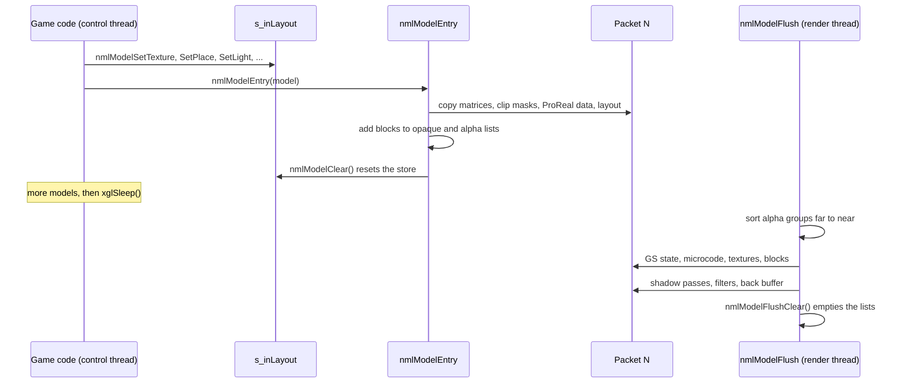
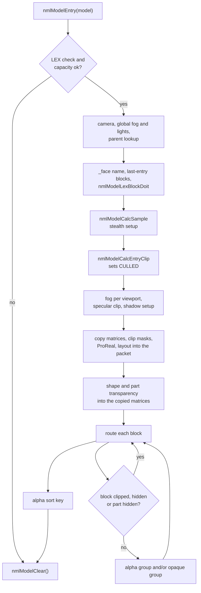
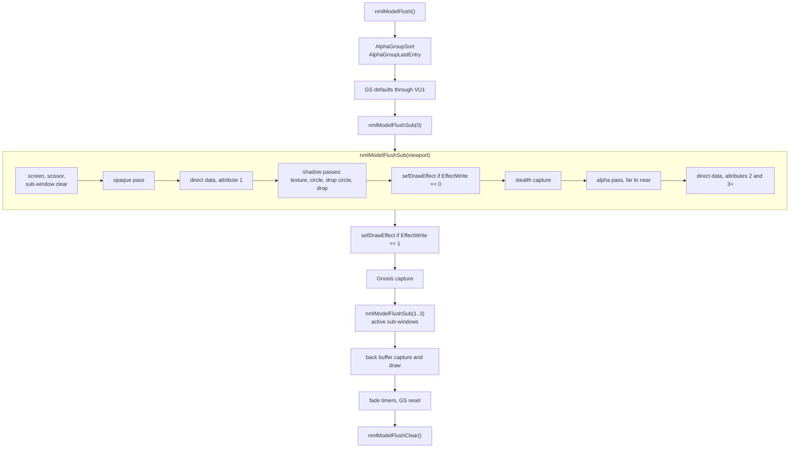
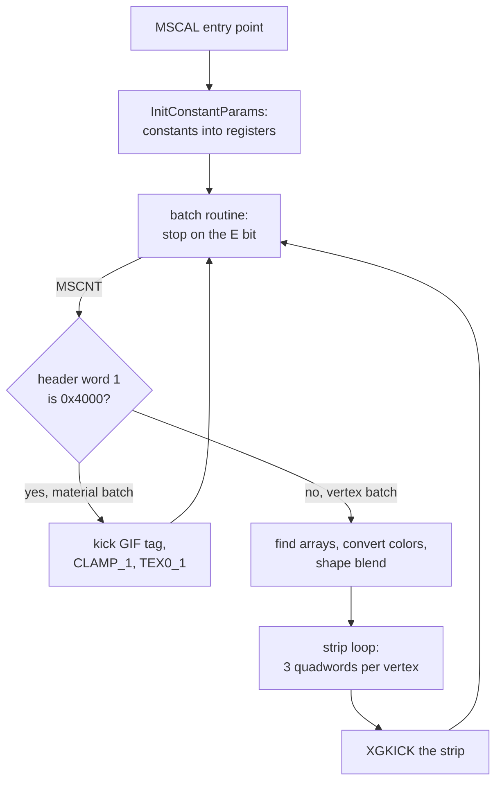
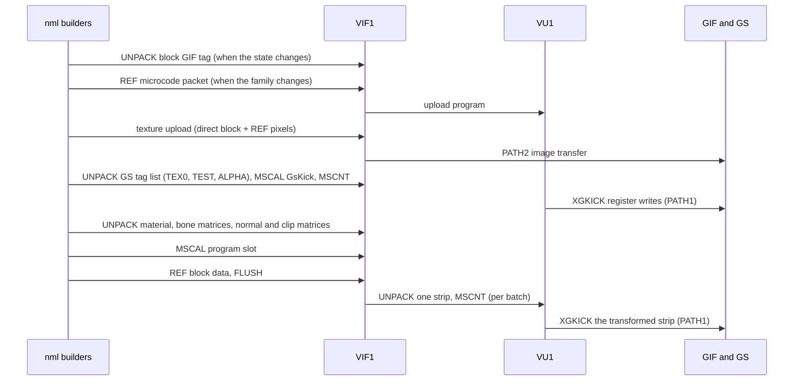
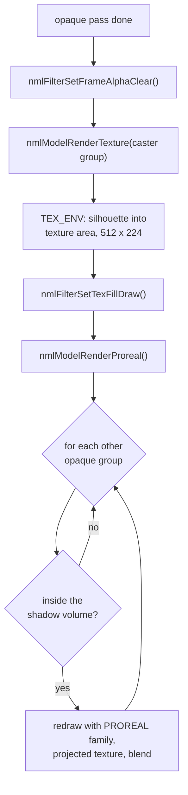
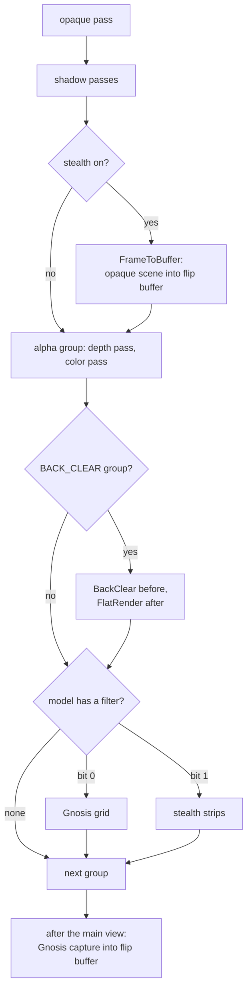
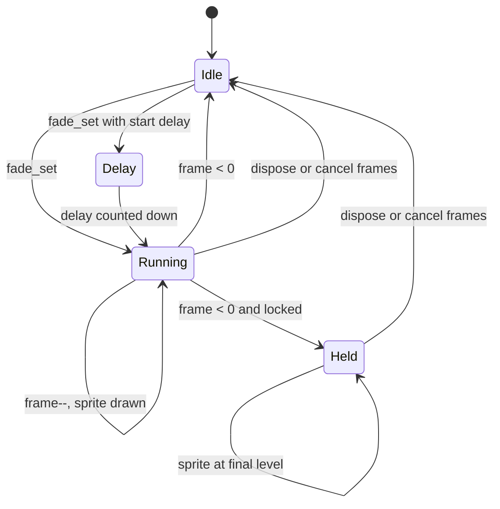
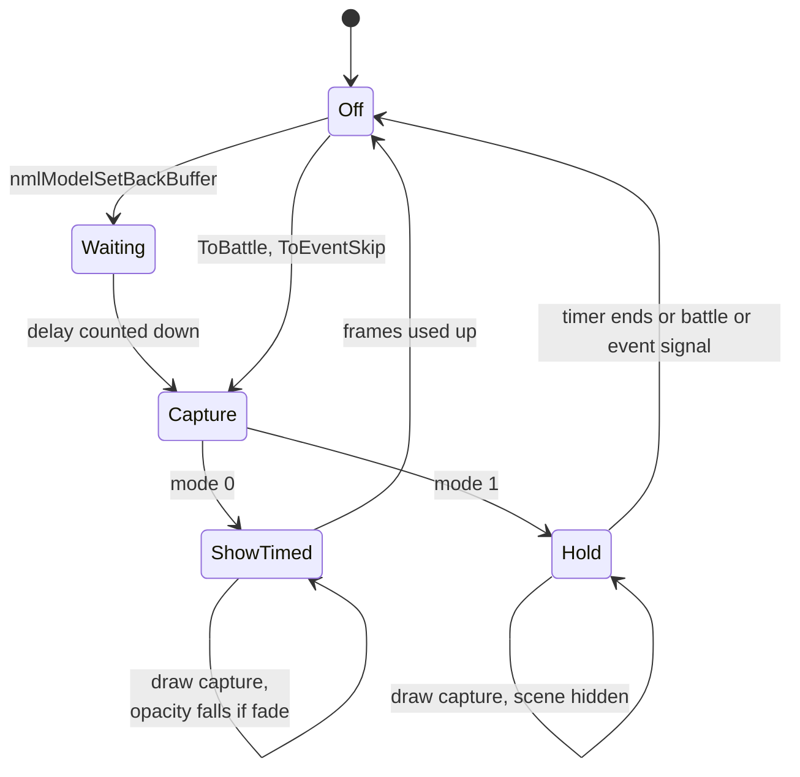

# nml — the model library

`nml` draws every 3D model of the game: maps, characters, weapons, units,
effect meshes and the models of the menus and minigames. It reads models in
the LEX format and textures in the XTX format, sorts their pieces into opaque
and transparent lists, and turns them into VIF1 packet data that runs on VU1
microcode. It also owns several whole-screen passes that depend on the 3D
scene: projected shadows, the Gnosis and stealth filters, the back buffer
that freezes or cross-fades the picture, and the colored fades.

The library is used in two steps. During the game's turn, code describes one
model at a time with `nmlModelSet*` calls and registers it with
`nmlModelEntry`. During the render thread's turn, `nmlModelFlush` writes all
registered models into the packet in the right order. The code is in
`src/main/nml_model_set.c` (state, entry, flush, fades, back buffer),
`src/main/nml_packet_add.c` (packet builders and microcode),
`src/main/nml_filter_set.c` (full-screen filter passes) and the clip
functions of `src/main/face_point.c`. The shared types are in
`include/main/nml_model_set.h` and `src/main/nml_model_set.h`.

[← Back to the overview](../README.md)

## Using the library

`nml` keeps one **layout store**, `s_inLayout`, that describes "the next
model". A caller fills it with setters, then calls `nmlModelEntry(model)`.
The entry copies the store into the current packet, adds the model's blocks
to the draw lists and calls `nmlModelClear`, which resets the store to its
defaults for the next model. Nothing is drawn yet. Later in the frame the
render thread calls `nmlModelFlush`, which walks the lists and writes the VU1
commands. The whole pipeline from packet to screen is described in
[rendering.md](../architecture/rendering.md).

A typical call sequence looks like `MDL_draw` in `src/main/mdl.c`:

```c
nmlModelSetTexture(model->texture);   /* XTX texture set */
nmlModelSetPlace(place);              /* model-to-world matrix */
MDL_partsSetVisible(model);           /* per-part visibility */
nmlModelEntry(entry);                 /* register the LEX model */
```

The map does the same in `MapDraw` (`src/main/map_1.c`) with extra calls for
the light, the map entry flag, the multiply color, the render level and the
clip mode. Actors do it in `src/main/act_2.c` with shadow, window and sort
settings (see [actors.md](actors.md)).

The sequence below shows the two halves of the work and the threads that run
them.



## Model data

### LEX models

A model is one LEX file loaded into main memory. `NmlModel` is its header.
Most offsets in it are byte offsets from the start of the model. The full
byte layout, with the values found in the 1317 files of the disc, is in
[LEX models](../formats/models-and-textures.md#lex-models).

| Offset | Field | Meaning |
| --- | --- | --- |
| +0x00 | magic | `lex\0` |
| +0x04 | | MS-DOS date and time of the conversion. Never read |
| +0x08 | | Always the float 0.16, probably the converter version. Never read |
| +0x10 | name | The model name after a `/` or `\` separator, so the code reads it from +0x11. A name containing `_face` marks a face model |
| +0x30 | | Account name of the artist. Never read |
| +0x3f | `unclassified_3f` | A flag that enables the marker check below |
| +0x40 | `partCount` | Number of parts (bones) |
| +0x44 | `blockCount` | Number of blocks |
| +0x48 | `sampleCount` | Number of skin joints, the size of the matrix arrays C and D |
| +0x4c | | Triangle count in about half the files. Never read |
| +0x50 | `weightedMatrixOffset` | The matrix table, four arrays of 64-byte matrices with `(partCount + sampleCount) * 2` matrices in all. This offset points at array A, the part matrices |
| +0x54 | | Array B, the inverses of the part matrices |
| +0x58 | `skinMatrixOffset` | Array C, the skin matrices written at run time |
| +0x5c | `jointMatrixOffset` | Array D, one constant matrix per skin joint |
| +0x60 | `geometryTableOffset` | Meant for a geometry table, but always equal to +0x50 in the files |
| +0x6c | `textureSetOffset` | Embedded texture set (`NmlTextureResourceSet`, not XTX), 0 when the model has none |
| +0x70, +0x80 | `boxMaxOffset`, `boxMinOffset` | Bounding box corners, the maximum at +0x70 and the minimum at +0x80 |
| +0x90 | `entryTranslation` | Bounding sphere: center offset, with the radius in `w` |
| +0xa0 | `unclassified_a0` | Offset of a per-block sphere table in 13 maps, 0 elsewhere |
| +0xb0 | `blockOffsets[]` | Offset of each block |

The four matrix arrays are explained in
[The matrix table](../formats/models-and-textures.md#the-matrix-table).

`nmlModelLexDataCheck` decides whether a pointer is a usable model. The
address must lie between `0x00200000` and `0x02000000`, be 16-byte aligned and
start with `lex`, and `blockCount` must be positive. When the flag at +0x3f is
set and the model has no embedded texture set, the check also looks for the
string `MagicCarpetCome` right after the last block's data. When +0xa0 is
nonzero it first skips the sphere table, `blockCount * 16` bytes. The files
that end with this trailer are exactly the ones with the flag set, as
[The MagicCarpetCome trailer](../formats/models-and-textures.md#the-magiccarpetcome-trailer)
shows. `nmlModelEntry` and the visibility functions run this check first and
do nothing when it fails.

The ASCII diagram below shows how a model is laid out in the files.

```
model +0x000  +--------------------------------------+
              | NmlModel header ("lex", counts,      |
              | offsets, bounds, entryTranslation)   |
      +0x0b0  | blockOffsets[blockCount], padded     |
              +--------------------------------------+
              | matrix arrays A, B, C, D             |
              | (64 bytes per matrix)                |
              +--------------------------------------+
              | NmlModelBlock 0 (0x190 bytes)        |
              | its VIF stream (dataOffset 0x190)    |
              +--------------------------------------+
              | NmlModelBlock 1 and its VIF stream   |
              | ...                                  |
              +--------------------------------------+
              | optional block sphere table (+0xa0)  |
              | optional embedded texture set        |
              | optional "MagicCarpetCome" trailer   |
              +--------------------------------------+
```

The code does not depend on this order, because it always goes through the
offsets.

### Blocks

A **block** (`NmlModelBlock`) is one drawable piece of a model with a single
material, usually one mesh of one part. Blocks are the unit that `nml` sorts,
clips, hides and draws. Every block header is 0x190 bytes long and is
followed at once by its VIF stream. The table lists the fields that the code
reads. All fields and their values on the disc are in
[Blocks](../formats/models-and-textures.md#blocks).

| Offset | Field | Meaning |
| --- | --- | --- |
| +0x00 | `name[32]` | Name of the mesh node in the modelling tool, used by the name visibility functions and searched for `lenz` and `eye` names |
| +0x20 | `flags` | Render flags, described below the table |
| +0x24 | `dataOffset`, `dataSize` | The block's prebuilt VIF stream, sent by `REF`. `dataOffset` is always 0x190 |
| +0x2c | `partId` | The part (bone) the block belongs to |
| +0x30 | `matrixIndices[48]` | Indices of the bone matrices the block uses. The files hold at most 31 indices and a 0 terminator in the first 32 entries |
| +0x70, +0x80 | (inside `matrixIndices`) | The block's bounding box, maximum then minimum corner |
| +0x90 | `clipBounds` | Bounding sphere for per-block clipping |
| +0xa0 | `geometryIndex` | Index into the geometry table. Always -1 in the files |
| +0xb0 | `gifTag` | The block's GIF tag |
| +0xc0 | `materialFlags` | Material flags, listed below the table |
| +0xc4 | `alphaScale` | Material alpha |
| +0xd0 | `materialParameters` | Five quadwords for VU1: reflection alpha, multiply color, UV scroll translation and steps |
| +0x120 | `textureParameters[6]` | Texture register values |
| +0x150 | | Name of the group node above the mesh. Never read |
| +0x16c | shape bytes | Shape math parameter, mode, weight and flags, read by `nmlModelLexBlockDoit` |
| +0x170 | `materialName[32]` | Material name |

The low bits of `flags` select the program variant. Bit 0 (`0x1`) marks a
skinned block, whose vertices carry joint references and weights. The code
names the programs for it `Env`, which stands for envelope (skin), not for
environment mapping. Bit `0x2` means one joint per vertex and bit `0x4`
two joints. Without either, a vertex blends up to four joints.
Bit `0x8` (`NML_BLOCK_HIDDEN`) hides the block. It is set only at run time.
Bit `0x10` marks indexed vertices, but no file sets it, so the indexed path
of `nmlPacketAddParts` never runs. Bits `0x80`, `0x100` and `0x200` choose
front, back or two-sided drawing (see [VU1 microcode](#vu1-microcode)).
`0x80` and `0x100` are never set in the files, and `0x200` is set in 19
skinned blocks. `0x400` forbids the extended two-pass programs and is set in
383 map blocks. The values found are listed in
[Block flags](../formats/models-and-textures.md#block-flags).

`materialFlags` describes the material and the vertex layout:

- `0x1` marks a textured block: the GIF tag enables texturing and the texture
  registers are sent.
- `0x2` and `0x4` make the block transparent.
- `0x10` (`NML_BLOCK_MATERIAL_NAMED_PARTS`, read on the first block) means the
  model has named parts. It is set on every block of the maps and of most
  `muobj` objects, and it always comes with the compact map vertex layout.
- `0x20` and `0x40` select additive and subtractive blending.
- `0x80` marks the float vertex layout with per-vertex normals. Each block has
  exactly one of `0x10` and `0x80`.
- `0x8` adds a specular highlight, and `0x800` picks the one-strip `Spec`
  programs instead of `MultiSpec`, which draw the highlight as a second
  strip (see [Program choice](#program-choice)).
- `0x1000` turns on reflection mapping, and `0x2000` selects reflection
  rotation type 2.
- `0x8000` makes a transparent block write depth. It is drawn in the depth
  pass of the alpha groups with a `ZGEQUAL`-only pixel test (see
  [Flush](#flush)).
- `0x10000` marks a map block whose vertices carry indices into the normal
  table, so point lights can light it.
- `0x20000` (`NML_MATERIAL_LIGHT_PARA`) also uploads the light parameters to
  VU1 address `0x3D1`.
- `0x40000`, together with `0x4`, keeps the block out of the opaque groups.

The full table, with the block counts of each bit, is in
[Material flags](../formats/models-and-textures.md#material-flags).

`nmlModelLexBlockDoit` updates blocks once per entry. It advances each block's
UV scroll by its steps (wrapping at 0.5 for U and 1.0 for V, and only while
the game is not paused), applies the multiply color and collects the blocks
that take part in shape (morph) blending. The shape bytes choose an automatic
weight loop for the block. Only modes 0 (triangle wave) and 1 (sawtooth) are
handled. The files also use modes 7 and 25, for which the block is counted
but gets no part and no weight. See
[Shape bytes](../formats/models-and-textures.md#shape-bytes).

### Parts and visibility

A **part** is a bone of the model. Each block belongs to one part through
`partId`, and a part usually owns several blocks. Models whose first block has
`NML_BLOCK_MATERIAL_NAMED_PARTS` can hide and show blocks by part or by name.

| Function | Effect |
| --- | --- |
| `nmlModelSetPartsVisible(model, partId, visible)` | Sets or clears `NML_BLOCK_HIDDEN` on every block of the part |
| `nmlModelSetNameVisible(model, name, visible, match)` | The same for blocks whose name matches by prefix, exactly, or as a substring |
| `nmlModelInitPartsVisible(model, visible)` | Shows or hides all blocks |

The flag is stored in the model data itself, so it stays until it is changed
again. For models without named parts, hiding a part instead appends its id
to the list `s_aDispVisible` (up to 1024 entries). That list only lasts for
the next entry: `nmlModelEntry` skips the blocks of the listed parts, and the
store reset clears the list.

`src/main/mdl.c` wraps this for actors (see [animation.md](animation.md)).
An `MdlHandle` keeps a 128-bit mask `visibleParts`. `MDL_setVisible`,
`MDL_setGroupVisible` (all parts of a group id) and `MDL_setNameVisible` (all
parts whose 8-byte name matches under a mask) change the mask. `MDL_draw`
passes the whole mask to `nmlModelSetPartsVisible` before each entry.

### XTX texture sets

Textures come in XTX texture sets. `nmlModelSetTexture(texture)` accepts a
pointer only when it is in range, 16-byte aligned and starts with `XTX` (the
code compares the third byte with the first). A set holds one or more upload
rectangles, each with a size, a VRAM offset and its pixel data. The
rectangles are always uploaded as 32-bit pixels, but they are pre-swizzled
sheets: the converter packed the real textures, mostly 8-bit images with
256-color palettes and a few 4-bit ones, so that the 32-bit upload leaves
them in GS memory exactly where each block's `TEX0` reads them in its own
format. No set holds mipmaps. The layout and the address arithmetic are in
[XTX texture sets](../formats/models-and-textures.md#xtx-texture-sets) and
[How a model finds its texels](../formats/models-and-textures.md#how-a-model-finds-its-texels).

A model may also carry its own set at `textureSetOffset`. This embedded set
is not an XTX file but an `NmlTextureResourceSet`, uploaded by
`nmlPacketTextureTrans`. Only seven models have one, as
[Embedded texture sets](../formats/models-and-textures.md#embedded-texture-sets)
describes.

Textures are not resident in video memory. When a block needs a texture set
that differs from the last one sent, `nmlPacketAddTexture` adds uploads for
the whole set to the packet, into the shared texture area at block `0x3800`
(see [rendering.md](../architecture/rendering.md#textures)).
`nmlModelDirectSendXtx` builds such uploads for code that draws its own
geometry, such as the radar.

## The layout store

`LayoutStore` is a union of 0x320 bytes. `s_inLayout` (at `0x004A91E0`) is the
store the setters write. At entry time it is copied into the packet, and the
copy is what the flush reads, so each registered model keeps its own
settings. The table lists the main fields.

| Offset | Field | Set by |
| --- | --- | --- |
| +0x000 | `lightColorMatrix` | `nmlModelSetLight`: the colors of the three directional lights and the ambient color |
| +0x040 | `lightNormalMatrix` | `nmlModelSetLight`: the directions of the three lights |
| +0x080 | `place` | `nmlModelSetPlace` |
| +0x0c0 | `inversePlace` | computed from `place` |
| +0x100 | `pointPosition[4]` | `nmlModelSetPointLight`, or the global point lights |
| +0x140 | `pointColor[4]` | same |
| +0x180 | `projectionMatrix` | projection paths for shadows |
| +0x1c0 | `fogColor` | `nmlModelSetFogCol` and the global fog |
| +0x1d0 | `fogPara` | fog setters |
| +0x1e0 | `filterAlpha`, `filterAmplitude` | `nmlModelSetFilter` |
| +0x1f0 | `center` | the model center, radius in `w` |
| +0x200 | `multiplyColor` | `nmlModelSetMulColor` |
| +0x220 | `transparency` | `nmlModelSetTransparency` |
| +0x234 | `packetFilterFlags` | `nmlModelSetFilter` |
| +0x240 | `texture` | `nmlModelSetTexture` |
| +0x248 | `alpha` | `nmlModelSetAlpha`, GS `ALPHA` value, default `0x44` |
| +0x250 | `render_status` | the request bits listed below |
| +0x254 | `model` | the entered model |
| +0x258 | `weightedMatrices` | packet copy of the matrices |
| +0x260 | `proreal` | packet copy of the ProReal parameters |
| +0x268 | `texMapMode`, `texMapSize`, `texMapWeight` | `nmlModelSetTexMap` |
| +0x27c | `window` | `nmlModelSetWindow` |
| +0x280 | `stealthParts[10]` | stealth filter geometry |
| +0x2b0 | `renderLevel` | `nmlModelSetRenderLevel` and specular clipping |
| +0x2b8 | `clipMasks` | per-block clip bytes in the packet |
| +0x2c0 | `circleShadowScale` | also written by `nmlModelSetTransparency` |
| +0x2e0 | `mapShadowParts[8]` | `nmlModelSetMapShadowParts` |
| +0x2f0 | `fogIntensity[4]`, `viewportAlpha[4]`, `viewportFlags[4]` | one value per viewport |

`render_status` collects one request bit per setter, and the flush reads it
to choose passes and microcode.

| Bit | Name | Meaning |
| --- | --- | --- |
| `0x1` | `PLACE` | A placement was set |
| `0x2` | `FOG` | Fog on |
| `0x4` | `STENCIL` | Mark the model in the destination alpha |
| `0x8` | `ZWRITE` | Transparent blocks write depth |
| `0x10` | `LIGHT` | A light was set |
| `0x20` | `TOUMEI` | Draw the whole model as transparent (`toumei` is Japanese for "transparent") |
| `0x40` | `HUMAN` | Human model |
| `0x100`, `0x200` | | Force front or back face programs (`nmlModelSetRenderStatus`) |
| `0x800` | `PROREAL` | Projected texture pass |
| `0x1000` | `POINT_LIGHT` | Point lights on |
| `0x2000` | `FOG_CANCEL` | Ignore fog |
| `0x4000` | `TEXMAP_TEXTURE` | Casts a projected texture shadow |
| `0x8000` | `TEXTURE_PASS` | Set while the silhouette is rendered |
| `0x10000` | `MAP_ENTRY` | The model is the map |
| `0x20000` | `CULLED` | Rejected by every camera window |
| `0x40000` | `TEXMAP_DROP` | Casts a drop shadow |
| `0x80000` | `DROP_PASS` | Set while a drop shadow is rendered |
| `0x100000` | `FACE` | Face model |
| `0x200000` | `TEXMAP_CIRCLE` | Casts a projected circle |
| `0x400000` | `TEXMAP_DROP_CIRCLE` | Casts a drop circle |
| `0x800000` | `BACK_CLEAR` | Draw through the flip buffer, see [Filters](#filters) |
| `0x1000000` | `GLOBAL_FOG` | The global fog applies |
| `0x2000000` | `GLOBAL_POINT_LIGHT` | The global point lights apply |

`CLEAR_LAYOUT_MODEL` resets the store after every entry. It takes the light
of studio 0, sets `place` and `inversePlace` to identity, the alpha to `0x44`
(normal blending), the scale and the transparency values to 1, and clears the
point light colors and `center`. It keeps only the top byte of
`render_status`, so the global fog and global point light bits survive from
one model to the next. `CLEAR_MODEL_ENTRY` resets the per-entry lists: hidden
parts, part transparencies, shapes, map shadow parts, the parent, the clip
mode, the map clip and the sort offset.

The setters fall into a few families:

| Family | Functions |
| --- | --- |
| Placement | `nmlModelSetPlace`, `nmlModelSetMatrix`, `nmlModelSetScale`, `nmlModelSetParent`, `nmlModelSetSortOffset` |
| Light and fog | `nmlModelSetLight`, `nmlModelSetPointLight`, `nmlModelSetGlobalPointLight`, `nmlModelSetFog*`, `nmlModelSetGlobalFog*`, `nmlModelSetFogCancel` |
| Material | `nmlModelSetTexture`, `nmlModelSetTexfunc`, `nmlModelSetMulColor`, `nmlModelSetAlpha`, `nmlModelSetPixelAlpha`, `nmlModelSetPartsPixelAlpha` |
| Transparency | `nmlModelSetTransparency`, `nmlModelSetReflTransparency`, `nmlModelSetToumei`, `nmlModelSetToumeiParts`, `nmlModelSetZwrite`, `nmlModelSetStencil` |
| Shape | `nmlModelSetShapeId(shapeId, weight)` for up to 32 morph weights |
| Shadows | `nmlModelSetTexMap`, `nmlModelSetProreal`, `nmlModelSetMapShadowParts`, `nmlModelSetShadowMapEntry` |
| Filters | `nmlModelSetFilter(filter, alpha, amplitude)` |
| Kind | `nmlModelSetMapEntry`, `nmlModelSetMapLastEntry`, `nmlModelSetFaceModel`, `nmlModelSetHumanModel`, `nmlModelSetRenderLevel`, `nmlModelSetRenderStatus` |
| View | `nmlModelSetWindow`, `nmlModelUseSubWindow`, `nmlModelSetClip`, `nmlModelSetMapClip` |

`nmlModelSetToumeiParts(partId, alpha)` and `nmlModelSetShapeId` do not write
the store. They keep their values in small lists, and the entry writes them
into the copied matrices: a part's transparency goes into its matrix row 1
`w`, a shape weight into row 2 `w`. The VU1 programs read the shape weight
from there (see [How a program runs](#how-a-program-runs)), and
`nmlPacketAddBlockMaterial` reads the transparency back into the material
alpha. The actor code calls `nmlModelSetShapeId` for the high-detail faces, with
weights taken from bound joints of the face skeleton (see
[Writing the model matrices](animation.md#writing-the-model-matrices)).

## Model entry

`nmlModelEntry(model)` registers one model. It runs on the control thread and
is the most involved function of the library. Its steps are:

1. **Checks.** `nmlPacketSetCurrent` picks the current packet. The LEX check
   and the capacity check (models, blocks) must pass. With
   `nmlModelSetParent`, the parent's buffer entry is looked up.
2. **Camera and lights.** The active camera of the model's window is
   selected. The global fog and the global point lights are copied in when the
   model has none of its own. A child model inherits the circle and texture
   shadow bits of its parent.
3. **Kind.** A name containing `_face` sets `FACE`. `xglCullingMapLastCheck`
   registers the map's "last entry" blocks. `nmlModelLexBlockDoit` updates UV
   scroll, colors and shapes.
4. **Center.** `nmlModelCalcSample` computes the weighted center from the
   sample points. It contains a special case for a model named `boss_030`.
5. **Filters.** For a root model with the stealth filter,
   `nmlModelStealthEntry` prepares the outline geometry.
6. **Clipping.** `nmlModelCalcEntryClip` tests the bounding sphere against
   every active camera window and the culling boxes, and sets `CULLED` when
   all of them reject it (see
   [rendering.md](../architecture/rendering.md#culling)). With render level
   `0x400` and filter bit 0 it turns on the Gnosis filter capture.
7. **Fog and specular.** Fog intensity is computed per viewport.
   `nmlModelCalcSpecularClip` turns specular lighting off by depth.
8. **Shadows.** For a root model, the drop shadow, projected circle or
   projected map shadow setup runs when the matching `TEXMAP` bit is set.
9. **Copies.** The weighted matrices are copied into the packet's data area
   (`nmlPacketSetAttributeData64N`), except for the map. One clip-mask byte
   per block is allocated and cleared. The ProReal parameters (0x1e0 bytes)
   are copied when a projected texture is involved, then the whole layout
   store (0x320 bytes). The packet address of the copy goes to
   `s_apModelLayout[s_nModel]`.
10. **Shapes and parts.** Shape weights and part transparencies are written
    into the copied matrices. With render level `0x200`,
    `nmlModelCalcEntryPartsClip` clips part by part.
11. **Blocks.** Each block is routed into the model's alpha group, its
    opaque group, or both, see [Block groups and sorting](#block-groups-and-sorting).
12. **Sort key.** If the model added transparent blocks, its alpha group gets
    a sort distance.
13. **Reset.** `nmlModelClear` restores the defaults.

The flowchart below shows the same flow with its main decisions.



`nmlModelEntryEffect` and `nmlModelEntryCard` are lighter versions for
effect meshes and for the card game (`src/ov10`). They skip the LEX check,
parents, clipping and shadow setup, place the center with the placement
matrix, copy the matrices and the layout, and route the blocks with the same
group handling.

## Block groups and sorting

Registered blocks live in two parallel arrays of 4096 slots: `s_apBlock`
(the block) and `s_aBlockLayout` (the index of its model's layout). The arrays
are filled from both ends. Opaque blocks are added upward from slot 1, and
transparent blocks downward from slot 4095. The memory diagram below shows
the pool.

```
slot 0     unused
slot 1     +------------------------------+  s_aNonAlphaGroup[0].firstBlock
           | opaque blocks, model 0       |
           | opaque blocks, model 1       |
           | ...                          |  grows upward (s_nBlocks)
           +------------------------------+
           |          free                |
           +------------------------------+
           | ...                          |  grows downward (s_nBlocksAlpha)
           | alpha blocks, model 1        |
           | alpha blocks, model 0        |
slot 4095  +------------------------------+  s_aAlphaGroup[0].firstBlock
```

Each model opens one **opaque group** in `s_aNonAlphaGroup` and one **alpha
group** in `s_aAlphaGroup` (up to 511 each). An `NmlBlockGroup` holds the
first slot, the block count, a sort distance (alpha groups only), group flags
and the address of the model's layout copy. `set_group_status` derives the
group flags from `render_status`: `TEXTURE`, `STENCIL`, `FOG`, `PROREAL`,
`MAP`, `TOUMEI`, `CULLED`, `DROP`, `CIRCLE`, `DROP_CIRCLE`, `ZWRITE` and
`BACK_CLEAR`.

A block is skipped when its clip mask is set, when it is hidden, or when its
part is in the `s_aDispVisible` list. Otherwise:

- It goes into the **alpha group** when its material is transparent
  (`materialFlags & 6`), when the model is `TOUMEI`, or when its part has a
  transparency set. Render level `0x800` keeps a block out of the alpha group
  unless the model is `TOUMEI`. Blocks of the map's "last entry" list go to a
  separate list instead.
- It goes into the **opaque group** unless its material has bit `0x2`, the
  model is `TOUMEI`, its material has both `0x4` and `0x40000`, or its part
  has a transparency.

So a block with material bit `0x4` alone lands in both groups. It is drawn
once with the opaque models and once more in the transparent pass, probably
so that its solid texels write depth before its soft edges are blended.

A model entered with a parent (`nmlModelSetParent`) adds its blocks to the
most recently opened groups instead of opening new ones. Those are the
parent's groups when the child is entered right after the parent. The actor
code in `act_2.c` uses it, probably for weapons and faces, so that they sort
together with the body. Face models also have their
alpha blocks moved into place inside the parent's alpha group.

**Sorting.** `AlphaGroupSortEntry` sets an alpha group's `sortDistance` to the
squared distance from the camera of the model's window to the model's center,
plus the sort offset from `nmlModelSetSortOffset`. Models with named parts use
the point (10000, 10000, 10000) instead of their center, which puts them far
away and draws them first among the transparent groups. At flush time
`AlphaGroupSort`, a bubble sort written in assembly, orders the groups by
descending distance, far to near. `AlphaGroupLastEntry` then appends one
group per "last entry" map block with a distance of 0, so those blocks come
after everything else. Opaque groups are not sorted.

## Flush

`nmlModelFlush` turns the lists into packet data. The render thread calls it
from `xglRenderMove` once per frame (see
[rendering.md](../architecture/rendering.md#the-render-step)). Its steps are:

1. **Back buffer check.** A back buffer that hides the scene sets
   `s_nRenderCancel` (see [Back buffer](#back-buffer)).
2. **Sort.** `AlphaGroupSort`, then `AlphaGroupLastEntry`.
3. **GS defaults.** `nmlPacketAddTransMicrocodeInit` forgets the loaded
   microcode. Then depth buffer, `FBA`, depth test `GEQUAL`, `FRAME` at
   `sRender.display_buffer_base` and an additive `ALPHA_2` are queued and
   flushed through VU1.
4. **Frame state.** `s_nCount` (the filters' animation counter) advances
   unless the game is paused. The stencil mask `s_nStencilVal` is `0x80000000`,
   or 0 when `GameLoopState.flags` bit `0x01000000` is set.
5. **Main view.** `nmlModelFlushSub(0)` draws everything for the main camera.
6. **Effects.** With `EffectWrite` 1, the default that `Game()` also sets,
   `sefDrawEffect` runs here, after the models of the main view (see
   [sef.md](sef.md)).
7. **Gnosis capture.** When a Gnosis filter is active, the frame is copied
   into the flip buffer.
8. **Sub-windows.** `nmlModelFlushSub(1..3)` for each active sub-window.
9. **Back buffer.** Timers advance, a requested capture is made and the
   captured picture is drawn back.
10. **Fades.** `nmlModelFadeDoit` counts the fade cancel timers down.
11. **GS reset.** Texture, clamp, depth, `GEQUAL` and normal blending
    (`ALPHA` `0x44`) are restored.
12. **Overflow.** If a builder ran out of packet space, `sRender.render_status`
    becomes 1.
13. **Clear.** `nmlModelFlushClear` empties all lists.

`nmlModelFlushSub(viewport)` draws one camera view. It sets the screen scale
and offset of the camera (`nmlPacketAddScreen`) and its scissor rectangle.
For a sub-window it clears the window's rectangle first. Then it runs the
passes in this order:

1. **Opaque pass** (`nmlModelFlushSubNonAlpha`).
2. **Direct data, attribute 1** (main view only): shadows and other queued GS
   blocks, see [Direct data](#direct-data).
3. **Shadow passes.** `nmlFilterSetFrameAlphaClear`, then for each opaque
   group with a `TEXTURE`, `CIRCLE`, `DROP_CIRCLE` or `DROP` flag the
   matching render function, then the same for `TOUMEI` alpha groups.
4. **Effects.** With `EffectWrite` 0, `sefDrawEffect` runs here, in the
   main view only, between the opaque and the transparent models.
5. **Stealth capture.** For the stealth filter, the frame is copied into the
   flip buffer.
6. **Alpha pass** (`nmlModelFlushSubAlpha`).
7. **Direct data, attributes 2 and 3+.**
8. **Reset** of the scissor and the texture cache.

The flowchart below combines the two levels.



**The opaque pass** goes through the opaque groups and skips those flagged
`PROREAL` or `CULLED`. For each group it sets `FRAME` with the stencil mask,
`FBA` for stencil models, fog and a fixed alpha from the viewport's alpha.
With sub-windows, it skips models that belong to another window. For each
block it adds, in order: the GIF tag (when its state changes),
the microcode (when the family changes), the texture set, the texture
registers, the pixel test, a GS flush, the reflection rotation and
parameters, the material, the part matrices, and finally the program call
with the block's data.

**The alpha pass** goes through the sorted alpha groups. Each group is drawn
twice:

- A **depth pass** draws the blocks that must write depth: blocks of a part
  flagged in its matrix, blocks with material bit `0x8000`, or all blocks of a
  `ZWRITE` model. It uses depth writes and the `Zbuf` program row. For a
  `STENCIL` group the color channels are masked so that only the destination
  alpha changes.
- A **color pass** draws all the group's blocks with depth writes off. Each
  block gets fog, texture, reflection and material, then its blend: additive
  for material bit `0x20`, subtractive for `0x40`, otherwise the model's
  `alpha` value. A `BACK_CLEAR` group is drawn into the flip buffer instead of
  the frame, see [Filters](#filters).

After each group the pass adds the group's filters: the flat composite for
`BACK_CLEAR`, a destination alpha clear when the stealth filter is on, and
`nmlFilterSetPacket` for a model with a filter.

## Packet building

`src/main/nml_packet_add.c` holds the builders. They write into the current
packet through `s_pPacket` and check the remaining space. The limit is
`NML_PACKET_SIZE_LIMIT` (2 MiB) with `NML_PACKET_SLACK` (64 KiB) kept free.
When a builder would cross it, it returns 1, the flush stops adding blocks,
and `g_nPacketOver` reports the overflow.

**Attribute data.** `nmlPacketSetAttributeData`, `...Data64`, `...Data64N`,
`...Data16N` and `nmlPacketSetAttributeAlloc16N` copy or reserve data at the
top of the packet buffer by moving `packet->cursor` down (see
[rendering.md](../architecture/rendering.md#packets)). The layouts, matrices,
clip masks and direct data copies live there.

**GS state through VU1.** The `Gs*` helpers (`nmlPacketAddGsZbuf`,
`nmlPacketAddGsFrame`, `nmlPacketAddGsAlpha`, `nmlPacketAddGsPixeltest`,
`nmlPacketAddGsScissor` and others) do not write to the packet. They queue
A+D register writes in `g_aGsTag` and count them in `g_nGsEntry`.
`nmlPacketGsInit` starts a new list. `nmlPacketAddGsFlush` closes the list
with a GIF tag, unpacks it into VU1 memory at `0x3d5`, and adds an `MSCAL` to
the `GsKick` entry of the current microcode family, then `MSCNT` and `FLUSH`.
The `MSCNT` makes the microcode send the list to the GIF with `XGKICK` (see
[How a program runs](#how-a-program-runs)).
`nmlPacketAddGsFlushWide` does the same for longer lists at `0x2dc` with the
`GsKickWide` entry, which the filters use for their primitives.

**Per-block builders.** The table lists them roughly in the order the opaque
pass calls them.

| Function | Work |
| --- | --- |
| `nmlPacketAddGifTag` | Uploads three copies of the block's GIF tag with different PRIM bits: the strip tag to `0x3f3`, the highlight tag to `0x3f4` and the reflection tag to `0x3f2` |
| `nmlPacketAddTransMicrocode` | Loads the microcode family when it changes |
| `nmlPacketAddTexture` | Uploads the texture set when it changes (`s_pCacheTexture`) |
| `nmlPacketAddTextureParam` | Queues `TEX0` with the texture area base and the block's texture values |
| `nmlPacketAddPixelControl` | Queues `TEST` and `ALPHA` for the block type, cached in `s_nPixelTestType` |
| `nmlPacketAddReflRot`, `nmlPacketAddReflectParam` | Reflection mapping: a Y rotation that advances every frame, and its parameters |
| `nmlPacketAddBlockMaterial` | Material parameters, with the material alpha multiplied by the model transparency |
| `nmlPacketAddParts` | All matrices for the block, described after the table |
| `nmlPacketAddExecProg` | Calls the program and sends the block's data |
| `nmlPacketAddFog` | Fog color and parameters, once per group in the opaque pass and once per block in the alpha pass |

`nmlPacketAddParts` builds the matrices one block needs. It unpacks the
indexed vertex tables when the block uses them, which no model on the disc
does. It uploads the bone matrices
listed in `matrixIndices`, but only when the list differs from the last block
(a `memcmp` over 0x3e bytes against `s_pMatrixCache`). It computes the part's
inverse with `inversePlace`, the normal matrix from `lightNormalMatrix` (or from the
ProReal data), the camera reference point and the point lights. Last it
builds the clip matrix at `0x3c2`: the camera's view matrix times `place`
times the part. In the silhouette pass the projection matrix replaces the
view matrix, and in the drop shadow pass both are multiplied.

`nmlPacketAddTransData` sends the block's own data with a `REF` tag pointing
at `dataOffset` and `dataSize`, followed by a `FLUSH`. That data is part of
the model file. It is prebuilt VIF code in batches. Each vertex batch unpacks
one triangle strip into VU1 memory from address 0 and starts the program on
it with `MSCNT`. Material batches between them change the texture registers
in the middle of a block. The builders never write vertex data themselves.
The stream is described in
[The VIF stream](../formats/models-and-textures.md#the-vif-stream).

## VU1 microcode

Models are drawn by seven VU1 microcode **families**. Each family is one
complete VU1 program with many entry points. The programs are retail data
that the project keeps as a binary blob (`config/vu-build.json` lists them as
"the seven VU1 programs", out of scope). The ELF symbol table still holds
their original labels, so the entry points, helpers and loops below carry
their own names.

| Value | Family (`NmlMicrocode`) | Packet symbol | Pairs | Use |
| --- | --- | --- | --- | --- |
| 1 | `ENV` | `NewVu1EnvMicroCode` | 1869 | Skinned (envelope) blocks, flag bit 0 |
| 2 | `PLAIN` | `NewVu1MicroCode` | 1163 | Ordinary blocks |
| 3 | `PROREAL` | `NewVu1ProMicroCode` | 850 | Projected texture pass |
| 4 | `ADD_ENV` | `NewVu1AddEnvMicroCode` | 1958 | Point lights, skinned blocks |
| 5 | `ADD` | `NewVu1AddMicroCode` | 1257 | Point lights |
| 6 | `TEX_ENV` | `NewVu1TexEnvMicroCode` | 495 | Silhouette into the texture area |
| 7 | `DROP` | `NewVu1DropMicroCode` | 441 | Drop shadow pass |

A VU instruction **pair** is 8 bytes. It holds an upper instruction for the
vector math units and a lower instruction for loads, stores, branches,
integer registers and the divider, and both run in the same cycle. VU1 has
16 KiB of instruction memory, which is 2048 pairs, so only one family is
loaded at a time. `ADD_ENV` nearly fills it.

Each `PacketData`/`PacketSize` pair in `.vudata` is a prebuilt VIF1 packet
that uploads one family. It holds only VIFcodes. An `MPG` code loads each run
of up to 256 pairs, after a `NOP` that aligns its data, and the runs fill VU1
program memory from address 0. The packet ends with `BASE 0` and
`OFFSET 0x16E`, which set up the double buffer described in
[How a program runs](#how-a-program-runs).

`nmlPacketAddTransMicrocodeInit` sends the `PLAIN` packet at the start of
every flush. `nmlPacketAddTransMicrocode` then picks the family from
`render_status` and the block: `TEXTURE_PASS` gives `TEX_ENV`, `PROREAL`
gives `PROREAL`, `DROP_PASS` gives `DROP`, point lights give `ADD` or
`ADD_ENV`, and otherwise flag bit 0 gives `ENV` or `PLAIN`. It adds a `REF`
to the family's packet only when the family differs from the loaded one
(`s_nProgType`). The `ADD` and `PROREAL` families also receive the normal
table `s_aNormalTbl` (114 unit vectors: the two poles and seven rings of 16).
It is the lookup for the compressed normals of map blocks with material flag
`0x10000`, whose vertices carry one byte that indexes it (see
[Vertex layouts](../formats/models-and-textures.md#vertex-layouts)).

### Entry points

The name of an entry point describes its program. Names are built from the
parts in the table, for example `NewVu1LightTexSpecEnvFaceStrip1` or
`NewVu1AddVertcolTexStrip`.

| Part | Meaning |
| --- | --- |
| `Vertcol` | The color comes from the vertex colors, the baked light of the map layout |
| `Light` | Directional lights shade the vertex, which needs the normals of the float layout |
| `Spec`, `MultiSpec`, `ReflSpec` | A specular highlight, the highlight drawn as a second strip, or the highlight plus a reflection map |
| `Env` | Skinned (envelope) vertices |
| `Add` | Point lights are added |
| `Pro` | Projected texture |
| `Index` | Indexed vertices |
| `Face`, `Back` | Only the triangles that face the camera, or only the others |
| `1`, `2` | One or two joints per vertex. Without a number, up to four |

So `NewVu1LightTexSpecEnvFaceStrip1` lights a skinned strip whose vertices
follow one joint each, adds a highlight and draws only the triangles that
face the camera. Every family also has `GsKick` at address 0 and
`GsKickWide` at `0x28` (`config/symbols/main.vu0-symbols.ld`), and shared
helpers. `InitConstantParams` loads the constants of a block.
`InitOffsetParams` waits for and prepares a batch, with the variants
`InitOffsetParamsColor` for the map layout, `InitOffsetParamsColorIndex` for
indexed vertices and `InitOffsetParamsWeight` for skinned blocks.
`CalcFaceBackStrip` does the face test, and `CalcPcolor` in `ADD` and
`ADD_ENV` computes the point lights.

### Program choice

`nmlPacketAddExecProg` picks a row of `s_aUcodeTbl` and `add_exec_prog` picks
a slot in it. A row holds one address table per family, and every nonzero
address in the tables is the start of a named entry point.

| Row | Programs | Chosen when |
| --- | --- | --- |
| 0 | `Zbuf` | The alpha pass's depth pass |
| 1 | `Face` | Block flag `0x80` or status `0x100` |
| 2 | `Back` | Block flag `0x100` or status `0x200` |
| 2 then 1 | `Back`, then `Face` | Block flag `0x200` |
| 3 | normal | Default, and for render level `0x4` |
| 5 then 4 | `Back`, then `Face` (normal for the skinned families) | Extended programs, allowed in the alpha pass unless the block has flag `0x400` or the model is `ZWRITE` |

The `Zbuf` row maps every lighting variant to the plain `LightTex` program of
its family, because a depth pass needs no highlight. Its `PROREAL`, `ADD`,
`TEX_ENV` and `DROP` tables are empty, so those blocks are skipped there. In
the extended rows, row 5 is empty for `ENV` and `ADD_ENV` and row 4 holds
their normal programs, so skinned blocks draw both sides in one pass. The
other families keep no culling in some tables: `PROREAL` has its normal
programs in the `Face` tables and nothing in the `Back` tables, and `TEX_ENV`
and `DROP` use one table in every row but `Zbuf`. A two-sided block draws its
back faces first and its front faces over them, which keeps the order right
for transparent surfaces. Between two calls for the same block,
`nmlPacketAddWaitMicrocode` waits for the first program.

Inside a row the slot depends on the block and the model.

| Family | Slots |
| --- | --- |
| `PLAIN` | 0 `VertcolTex`, 1 `VertcolTexIndex`, 2 `LightTex`, 3 `LightTexSpec`, 4 `LightTexMultiSpec`, 5 `LightTexReflSpec` |
| `ADD` | 0 `AddVertcolTex`, 1 `AddLightTex`, 2 `AddLightTexSpec`, 3 `AddLightTexMultiSpec`, 4 `AddLightTexReflSpec` |
| `ENV`, `ADD_ENV` | 0 to 3 the plain, `Spec`, `MultiSpec` and `ReflSpec` programs for up to four joints, 4 to 7 the same for one joint, 8 to 11 for two joints |
| `PROREAL` | 0, 1 and 2 `LightTexPro` for four, one and two joints, 3 `VertcolTexPro`, 4 `VertcolTexProNoShade`, 5 `ProStrip` |
| `TEX_ENV` | 0 `TexStrip`, 1 empty, 2, 3 and 4 `TexEnvStrip` for four, one and two joints |
| `DROP` | 0 `DropStripObj`, 1 empty, 2, 3 and 4 `DropStrip` for four, one and two joints |

The slot follows these rules:

- Map layout blocks (material flag `0x10`) take the `Vertcol` programs, or
  the `Index` one when block flag `0x10` is set. In `TEX_ENV` and `DROP`
  they take the empty slot and are not drawn. In `PROREAL` they take
  `VertcolTexProNoShade` when the ProReal data has a `projection_entry`.
- Skinned blocks take the joint count from block flags `0x2` (one joint) and
  `0x4` (two joints).
- Material flag `0x1000` gives `ReflSpec`. Material flag `0x8` gives `Spec`
  when the material also has `0x800` or the render level has bit `1`, and
  `MultiSpec` otherwise.
- Render level `0x10` turns reflection off and render level `2` turns the
  highlight off, except for the `eye` and `lenz` blocks of face models.

The chosen address is shifted right by 3, from bytes to pairs, and sent as an
`MSCAL` VIFcode.

### How a program runs

An entry point first calls `InitConstantParams`. It loads the constants of
the block into vector registers: the clip matrix, the screen scale and
offset, the material color times the multiply color, the light matrices and
the light colors (see [VU1 memory](#vu1-memory)). It also writes small flag
tables that the loop reads. Then the entry point calls its batch routine,
whose first pair carries the E bit, the "end program" flag. VU1 stops there.

Each batch of the block's VIF stream ends with `MSCNT`, which resumes the
program where it stopped. The batch routine reads the address of the batch
with `XTOP` and looks at its header (see
[Vertex batches](../formats/models-and-textures.md#vertex-batches)).

- A **material batch** has `0x4000` in header word 1. The routine copies its
  GIF tag, `CLAMP_1` and `TEX0_1` to the output area and kicks them to the
  GS. When lane w of the screen offset (`0x3C7`) is not 0, which
  `nmlPacketAddScreen` sets when the textures sit in the flip buffer, it
  sends the second `TEX0_1` copy instead. It also stores the two values in
  the `GsKick` register list at `0x3D7` and `0x3D9`, so later kicks of that
  list restore the current texture. The 9-quadword form (header word 2
  `0x4000`) also carries the material color, the specular color and the
  specular exponent, which the routine moves to its material register, to
  `0x3CA` and to lane x of `0x3F0`. The routine calls the 5-quadword form `gsold`, the
  older form. After the kick it stops again at its own start.
- A **vertex batch** makes the routine find the arrays at their multiples of
  the vertex count n, convert byte colors to floats in the map layout, apply
  the shape blend, and return to the strip loop of the entry point. Header
  word 2 is a count of leading vertices that take the color of vertex 0, and
  it is 0 in every file.

The **shape blend** runs when header word 3 is 1. The weight is lane w of row
2 of the part's matrix at `0x2DC`, where the entry put the shape weight (see
[The layout store](#the-layout-store)), limited to 1. The morph array at `6n
+ 1` holds pairs of targets, and each blended value mixes the two quadwords
of its pair by that weight. When lane w of the material tag (the block's
`shapeFlags` byte, sent as `alphaMode`) is 2, n blended values replace the
colors. Otherwise 2n values replace the positions and then the normals (see
[Morph targets](../formats/models-and-textures.md#morph-targets)).

The **strip loop** transforms each vertex and writes three quadwords for it
into the output area. In front of them it puts a copy of the block's GIF tag
from `0x3F3`, with `NLOOP` and `EOP` taken from header word 0, and it sends
the whole strip to the GS with one `XGKICK`. Then it calls the batch routine
again and stops until the next `MSCNT`.

`BASE 0` and `OFFSET 0x16E` make VIF1 **double buffer** the batches. Every
`MSCAL` and `MSCNT` swaps the input buffer between address 0 and `0x16E`, and
every `UNPACK` of a batch has the `FLG` bit, so its addresses count from the
current buffer. The output area starts `0xF3` quadwords into the same buffer.
VIF1 unpacks the next batch into one buffer while VU1 works on the other,
and the GIF reads a kicked strip while the program computes the next one.

`GsKick` and `GsKickWide` are two short entries. Their first pair has the E
bit, so the `MSCAL` that `nmlPacketAddGsFlush` sends stops at once. The
`MSCNT` that follows runs the next pairs: an `XGKICK` of the register list at
`0x3D5` (`0x2DC` for the wide entry) and a branch back to address 0, where
the program stops again.

The flowchart shows the life of a program from its `MSCAL` to the last batch
of the block.



### The vertex loop

Every family uses the same steps for one vertex. The program:

1. Multiplies the position by the clip matrix (`0x3C2`) and tests the result
   against its own w with `CLIPW`.
2. Divides by w, which gives Q = 1/w, then scales and offsets x, y and z by
   the screen scale and offset (`0x3C6`, `0x3C7`) and converts them to the
   GS's 12.4 fixed point.
3. Builds the texture coordinates from lane w of the position (s) and lane w
   of the second array (t), adds the UV scroll (`0x3CC`) and multiplies s, t
   and 1 by Q, for perspective-correct texturing.
4. Computes the fog value as fog parameter z plus fog parameter w times Q,
   clamped between fog parameters x and y (`0x3EF`). The `ENV` and
   `ADD_ENV` families use one fog value for the whole model instead, lane w
   of the fog color (`0x3E6`).
5. Computes the color with the lighting of its variant, clamps it (red,
   green and blue to 255, alpha to 255 in the `Vertcol` programs and to 128
   in the `Light` programs) and converts it to integers.
6. Writes `ST` with Q, `RGBAQ` and `XYZF2`, the three registers that the
   block's GIF tag lists.

The programs never cut triangles. The loop keeps the clip results of the last
three vertices, and when one of them lies outside the volume where x, y and z
stay within w, it sets the `ADC` bit of the `XYZF2` value. The GS then stores
the vertex without drawing the triangle it closes, so a triangle with any
vertex outside is dropped whole. The face test of the `Face` and `Back`
programs uses the same bit. The `TEX_ENV` programs skip the clip test and
draw every triangle.

### Lighting

The lighting variants compute the vertex color as follows.

- **`Vertcol`** multiplies the vertex color by the multiply color
  (`0x3CB`). Map blocks carry their light in those colors.
- **`Light`** uses three directional lights. The rows of the normal light
  matrix at `0x3CD` are the light directions in the part's own space. The
  program takes the dot product of the normal with each direction, clamps
  negative results to 0, and uses the three results as weights for the light
  colors (`0x3D1` to `0x3D3`). It multiplies the sum by the material color,
  adds the ambient color (`0x3D4`) and multiplies by the vertex color. Alpha
  is the material alpha times the vertex alpha.
- **`Spec`** adds a highlight. The program reflects the direction from the
  vertex to the camera about the normal (`0x3D0` holds the camera position
  in the part's space), takes the dot product of that reflection with each
  light direction, clamps it, and squares it k + 1 times, which raises it to
  the power 2^(k+1). k is lane x of the material tag, the block's `alphaTag`
  (3 in most blocks, a power of 16). The three powers weight the light
  colors, the specular color (`0x3CA`) and lane y of the material tag scale
  the sum, and the result times the vertex color is added to the color.
- **`MultiSpec`** computes the same highlight but writes it as a second copy
  of the strip, whose color is the highlight alone. The copy uses the GIF tag
  at `0x3F4`, which has no texture, alpha blending on and GS context 2. The
  program kicks the textured strip first and the highlight strip over it.
- **`ReflSpec`** adds the highlight to the main strip and draws a second
  strip with a reflection map. Its texture coordinates come from the
  reflection vector, turned by the reflection rotation at `0x3EC`
  (`nmlPacketAddReflRot`), moved from the range -1 to 1 into 0 to 1 and
  fitted into the reflection UV window at `0x3C9`. Its color is the constant
  at `0x3F1`, the reflection alpha times 128 in every lane, and its GIF tag
  is the one at `0x3F2` (textured and blended). The program kicks six
  packets in a row: the main strip, the pixel test packet at `0x3FA`, the
  reflection texture registers at `0x3DA`, the reflection strip, the main
  texture registers at `0x3D5` and the pixel test packet at `0x3FD`.

The highlight programs and all skinned programs scale the normal back to unit
length (`ERLENG`, the reciprocal length) when lane z of the material tag is
set. `nmlPacketAddBlockMaterial` sets it when the length of the first row of
the part's matrix (or, in a skinned block, of the first bone's) or the
model's `alphaLimit` lies outside fixed limits, because a scaled matrix
stretches the normals.

### Front and back faces

The `Face` and `Back` entry points are short. They run `InitConstantParams`,
turn on the face test (lane y of `0x3E3`), fill a table of two skip flags in
the w lanes of `0x3F5` to `0x3F8`, and jump into the loop of the matching
normal program. For each vertex the loop then calls `CalcFaceBackStrip`. It
takes the dot product of the triangle's normal with the direction from the
vertex to the camera, and its sign picks a flag from the table. The flag
feeds the `ADC` bit like a clip failure. `Face` keeps the triangles that face
the camera and `Back` keeps the others.

`PLAIN` reads the triangle normals from the batch's face normal array at
`3n + 1`. These normals point into the surface: in 7880 of 7900 triangles
checked across 400 model files they are opposite to the vertex normals. The
skinned families cannot use precomputed normals, because skinning moves the
vertices. Their `CalcFaceBackStrip` keeps the last three transformed
positions in a ring at `0x3E0` to `0x3E2` and takes the cross product of two
edges, swapping the edge order on every vertex to follow the alternating
winding of the strip.

### Skinning

`ENV` and `ADD_ENV`, and the skinned slots of `PROREAL`, `TEX_ENV` and
`DROP`, read the joint data at `4n + 1` (see
[Skin references and weights](../formats/models-and-textures.md#skin-references-and-weights)).
A joint reference is the VU1 address of the joint's matrix, so the program
loads the matrix straight from it.

- The programs without a number take two arrays, the references and then the
  weights. They transform the position and the normal by each joint's
  matrix, multiply by its weight and sum, and stop at the first reference
  that is 0. This allows up to four joints.
- The `1` programs transform the vertex by its single matrix.
- The `2` programs read the two references from lanes x and y and the two
  weights from lanes z and w of one quadword.

The skinned `CalcFaceBackStrip` also applies the mirror of
`nmlModelSetAxisSymmetry`. When the low 16 bits of lane z of `0x3F9` are not 0,
it replaces the y of each skinned vertex with that value minus y.
`nmlPacketAddBlockMaterial` sends the value from the layout store field
`axisSymmetry`. The setter multiplies its argument by 0.0f before it sets the
flag bit, so the value is always about 0 and the mirror turns y into -y.

### Point lights

`ADD` and `ADD_ENV` add up to three point lights to the color.
`nmlPacketAddParts` stores the light positions in the part's space at
`0x3F5` to `0x3F7` transposed: the x of the three lights, then their y, then
their z. One vector instruction thus gives the offsets to all three lights.
`CalcPcolor` computes for each light the dot product of the normal with the
offset from the vertex to the light, clamps it at 0 and divides it by the
squared distance. The result is the cosine of the angle divided by the
distance. The three results weight the light colors (`0x3E9` to `0x3EB`),
and the program adds the sum to the vertex color. `AddVertcolTex` reads the
normal from the normal table at `0x350` plus the vertex's index byte, so map
blocks with normal indices are lit by point lights on top of their baked
colors.

### Projected textures

The `PROREAL` programs draw a receiver again with the shadow texture
projected onto it. Instead of the vertex's own s and t, they transform the
position by the part's matrix at `0x2DC` and then by the projector matrix at
`0x3EC` (the ProReal projection times the model's placement, uploaded by
`nmlPacketAddParts`), and fit the result into the texture window at
`0x3C9`. They light the vertex with the ProReal normal transform and light
data, which `nmlPacketAddParts` and `nmlPacketAddBlockMaterial` send in place
of the model's lights.
`VertcolTexProNoShade` replaces the smooth light falloff with a hard step: a
vertex whose normal turns away from the ProReal reference point gets no
light. See [Projected shadows and texture maps](#projected-shadows-and-texture-maps).

### Silhouettes and drop shadows

The `TEX_ENV` programs draw the caster into the texture area through the
projection matrix that `nmlPacketAddParts` puts in the clip matrix. The GIF
tag of this pass has no texture and no blending. `TexStrip` and the `1` and
`2` skinned programs light the vertex like `LightTex` and cap alpha at 110.
The four-joint `TexEnvStrip` does not light the vertices and writes the
alpha 110 only.

The `DROP` programs draw the caster with one flat color. Red, green, blue and
alpha all take lane w of the ambient color, where `nmlPacketAddBlockMaterial`
puts the shadow strength, 128 minus the texture map size times the
transparency times the fog intensity. `nmlPacketAddParts` builds the clip
matrix of this pass from the camera's view matrix and the layout's
projection matrix.

The sequence below shows what one opaque block adds to the packet and how
the hardware consumes it.



### VU1 memory

VU1 has 1024 quadwords of data memory. The lower part holds the two batch
buffers. `nml` uploads its parameters to fixed addresses in the upper part,
and the programs keep a few work values there too. The diagram below lists
quadword addresses.

```
0x000  +-------------------------------------------+
       | batch buffer 0: vertex arrays from 0x000, |
       | output GS packet from 0x0F3               |
0x16e  +-------------------------------------------+
       | batch buffer 1: vertex arrays from 0x16E, |
       | output GS packet from 0x261               |
0x2dc  +-------------------------------------------+
       | part matrix, then the bone matrices,      |
       | 4 quadwords each (also the wide GS list)  |
0x350  +-------------------------------------------+
       | normal table s_aNormalTbl, 114 quadwords  |
0x3c2  +-------------------------------------------+
       | clip matrix (4 quadwords)                 |
0x3c6  | screen scale          0x3c7 screen offset |
0x3c8  | material color, w = alpha                 |
0x3c9  | reflection or ProReal UV window           |
0x3ca  | specular color        0x3cb multiply color|
0x3cc  | UV scroll                                 |
0x3cd  | light directions (3 rows), camera position|
0x3d1  | light colors (3 rows), ambient color      |
0x3d5  | main texture registers (GsKick list)      |
0x3da  | reflection texture registers              |
0x3e0  | last three positions, face test switch    |
0x3e4  | point light color of the current vertex   |
0x3e6  | fog color             0x3e7 clip flags    |
0x3e9  | point light colors                        |
0x3ec  | reflection rotation or projector matrix   |
0x3ef  | fog parameters                            |
0x3f0  | material tag          0x3f1 reflect color |
0x3f2  | GIF tags 0x3f2 (reflection), 0x3f3        |
       | (block), 0x3f4 (highlight)                |
0x3f5  | point light positions, face skip flags    |
0x3f9  | output address, buffer address, mirror    |
0x3fa  | pixel test packets at 0x3fa and 0x3fd     |
0x3ff  +-------------------------------------------+  end of 16 KiB
```

The four lanes of the **material tag** at `0x3F0` hold the specular exponent
k (the block's `alphaTag`), the highlight scale, the flag that makes the
programs renormalize normals, and the shape target kind (the block's
`shapeFlags` byte). The projector matrix of `PROREAL` covers `0x3EC` to
`0x3EF`, so in that family it takes the place of the fog parameters too.

## Projected shadows and texture maps

`nmlModelSetTexMap(mode, size, weight)` asks for a shadow that `nml` renders
itself. The mode decides the kind: `0x10001` sets `TEXMAP_DROP`, `0x20001`
sets `TEXMAP_CIRCLE`, `0x30000` sets `TEXMAP_DROP_CIRCLE`, and any other mode
sets `TEXMAP_TEXTURE`. The size is clamped to 0..128. Actors pick the mode
from their shadow kind (see
[rendering.md](../architecture/rendering.md#shadows) and
[actors.md](actors.md)), and map units do the same in `src/main/map_2.c`.

At entry, the model's group gets the matching flag. During the flush, after
the opaque pass, `nmlModelFlushSub` calls one render function per flagged
group:

- **`nmlModelRenderTexture`** draws the caster's silhouette. It renders the
  group with the `TEX_ENV` family into the texture area, used as a frame
  buffer (`FRAME` at `texture_buffer_base`, scissor 512 x 224). Then
  `nmlFilterSetTexFillDraw` finishes the texture, and
  `nmlModelRenderProreal` projects it.
- **`nmlModelRenderProreal`** draws the receivers. For every other opaque
  group it tests the group against the shadow's volume
  (`nmlFilterSetVolumeCubeRender` with the ProReal bounds, and a plane test
  for non-map groups). Groups inside the volume are drawn again with the
  `PROREAL` family, depth writes off, an alpha test that only writes color,
  and the ProReal blend. The caster's ProReal data is lent to each receiver
  through `prorealOverride`.
- **`nmlModelRenderCircle`** uploads the circle texture with
  `nmlPacketSendCircleTexture` and runs the same ProReal pass, so a soft disc
  is projected onto the ground geometry.
- **`nmlModelRenderDropCircle`** builds a circle with
  `nmlPacketMakeCircleTexture` under the model.
- **`nmlModelRenderDrop`** draws the caster again with the `DROP` family and
  the layout's projection matrix, with `FBA`, the blend `Cd * As` (which
  darkens) and a depth test plus destination alpha test.

`nmlModelSetProreal(input)` fills `s_inProReal` (an `NmlProRealParam` of
0x1e0 bytes) with the projection transform, the normal transform, the texture
window and clamp words, the bounds of the volume, the texture and the blend.
The **circle shadow texture** is built once by `CONSTRUCT_CIRCLR_SHADOW`: a
64 x 64 8-bit radial gradient with a palette, darkest in the middle.
`set_circle_shadow_ratio` adjusts it.

The flowchart below shows the order of the projected texture passes for one
caster.



## Filters

The filters in `src/main/nml_filter_set.c` are full-screen or screen-space
passes. They send their sprites and strips through the VU1 GS tag lists
(`nmlPacketAddGsFlush` and the wide variant), not through direct blocks. Most
of them use the **flip buffer**, the spare full-screen buffer at page `0x150`
(see [rendering.md](../architecture/rendering.md#video-memory)).

| Function | Work |
| --- | --- |
| `nmlFilterSetFrameToBuffer(base)` | Copies the 512 x 448 frame at `base` into the flip buffer with a GS local-to-local transfer |
| `nmlFilterSetBufferToFrame(base)` | Copies the flip buffer back into a frame |
| `nmlFilterSetBufferRender(opacity)` | Draws the flip buffer over the frame as one sprite with a fixed alpha |
| `nmlFilterSetFrameAlphaClear` | A color-masked sprite that resets the destination alpha |
| `nmlFilterSetTexClear(base)` | Clears the texture area |
| `nmlFilterBackClear` | Clears the flip buffer, with the depth test off |
| `nmlFilterSetFlatRender(model)` | Composites the flip buffer onto the frame with the model's transparency |
| `nmlFilterSetTexFillDraw(base, model)` | Finishes the silhouette texture of a projected shadow |
| `nmlFilterSetVolumeCubeRender(min, max)` | Projects the ProReal volume box for the receiver test |

`nmlModelSetFilter(filter, alpha, amplitude)` stores a filter mask in
`packetFilterFlags`, the alpha (0..128) in `filterAlpha` and the amplitude in
`filterAmplitude`. `nmlFilterSetPacket` dispatches the mask:

- **Bit 0, the Gnosis filter** (`nmlModelSetFilterGunosys`, named after the
  Gnosis, the game's otherworldly enemies). It covers the whole screen with a
  grid of 4 x 5 points, drawn as three textured triangle strips. The texture is
  an earlier picture: the flip buffer when the Gnosis capture is active (filter
  bit 0 with render level `0x400`), otherwise the buffer that holds the last
  finished frame. Each grid point moves on a small circle driven by
  `s_nCount` and `filterAmplitude`, and the strips are blended with
  `filterAlpha`. A destination alpha test limits the strips to pixels whose
  alpha bit is set, which the model probably marks with its `STENCIL` status.
  This probably produces the wavering, see-through look of the
  Gnosis.
- **Bit 1, the stealth filter** (`nmlModelSetFilterStealth`). At entry,
  `nmlModelStealthEntry` and `nmlFilterStealthMake` build strips around ten
  pairs of joints (`s_aStealthDat`). The flush copies the opaque scene into
  the flip buffer right before the alpha pass, and the filter draws the strips
  textured with that copy and tinted. This appears to make a cloaked figure
  that bends the scene behind it. With `GameLoopState.stealthMode` 2, the
  filter stays off while `SCRIPT_getCfTime()` is below 2.

**Back clear.** A group with the `BACK_CLEAR` status is drawn in a different
way. `nmlFilterBackClear` clears the flip buffer, the group's blocks are
drawn into it at full opacity (the entry forces `transparency` to 1.0), and
`nmlFilterSetFlatRender` puts the result over the frame with the model's
transparency. The whole model then fades as one flat layer, probably so that
its own parts do not show through each other. No setter in
`nml_model_set.c` raises this bit.

The flowchart below shows where the filter passes sit inside one viewport.



## Fades

`nml` has four fade controls: `s_inActiveFadeIn`, `s_inActiveFadeOut`,
`s_inFadeIn` and `s_inFadeOut`. A fade draws a full-screen colored sprite
whose opacity follows a timer. The controls are separate so that a fade-in
and a fade-out of the scene and of an "active" layer can overlap.

`FadeControl` holds the color (three bytes), the current level (0..128), the
frame counter, the duration, a skip flag, the direction, a mode, a dispose
flag, cancel frames, a start delay and a lock flag.

| Function | Effect |
| --- | --- |
| `nmlModelSetFadeIn`, `nmlModelSetFadeOut` | Start a fade with the color stored in `GameLoopState` (+0x90 and +0xa0) |
| `nmlModelSetActiveFadeIn`, `nmlModelSetActiveFadeOut` | Start a fade with a packed color |
| `nmlModelSetFadeInCancel(frames)`, `...OutCancel`, `...ActiveFadeInCancel` | Suppress that fade for a number of frames |
| `nmlModelSetFadeOutLock`, `...LockOff` | Keep the faded color after the fade ends |
| `nmlModelGetFadeLevel` | Whether a fade is active |

`fade_set` fills a control and installs `nmlFadePacketWrite` as
`sRender.fade_callback`. The render thread calls it after the text (see
[rendering.md](../architecture/rendering.md#global-fade)), and it runs
`fade_render` for the four controls. `fade_render` waits out the start delay.
It then computes the level from the remaining frames: `frame / duration *
128` for a fade-in, and 128 minus that (with a 5-frame offset) for a
fade-out. Unless the skip flag is set, it adds a direct block with the full
scissor, a blend, the depth test set to "always" and one sprite in the fade
color with the level as alpha. The counter then goes down by one. When it
runs out, a locked fade stays at its last frame. A disposed fade, or one with
cancel frames left, returns to idle. `nmlModelFadeDoit`, called from the
flush, counts the cancel frames down.

The state diagram below shows the life of one fade control.



Callers often cancel the fades for a short time when the scene changes.
`Game()` cancels fade-ins for 30 frames at start. `MapChangeFadeSet` cancels
both for 5 frames. The movie and battle transitions cancel them for
`NML_MOVIE_FADE_CANCEL_FRAMES`.

## Back buffer

The back buffer freezes the picture or blends from an old picture into the
new scene. It captures one frame into the flip buffer, then draws that
capture over the following frames. The state is the array `s_inBackBuffer[10]`.

| Index | Meaning |
| --- | --- |
| 0 | A capture is requested |
| 1 | Frames left to show the capture |
| 2 | Total frames to show |
| 3 | Frames to wait before the capture |
| 4 | Buffer page to capture, or -1 for the frame being drawn |
| 5 | Mode: 0 timed, 1 held |
| 6 | Frames left in mode 1 |
| 7 | The capture was shown this frame |
| 8 | Fade the capture out instead of hiding the scene |

`nmlModelSetBackBuffer(frames, delay, buffer, fade)` sets up mode 0. After
`delay` frames (at least 1) the flush captures the frame, then shows the
capture for `frames` frames. Without `fade` the scene is not rendered during
that time (`s_nRenderCancel`), so the picture is frozen. With `fade` the
scene renders normally and the capture is drawn over it with an opacity that
falls from 1 to 0, which cross-fades into the new scene. The Java native
`Stage.setFrameRender` uses the frozen form.

`nmlModelSetBackBufferToBattle(buffer)` and
`nmlModelSetBackBufferToEventSkip(buffer)` set up mode 1 with a capture now
and a hold of `NML_BACK_BUFFER_TIME` (0x28) frames. The capture is drawn at
full opacity every frame and the scene is not rendered. The hold ends when
the timer runs out or when `nmlModelSendSignalStartBattle` or
`nmlModelSendSignalEventFinish` arrives. `script.c` uses it for event
transitions.

The movie code uses the back buffer at the end of a movie.
`nmlModelSendSignalMovieFinish(mode)` captures the last movie frame from
`sRender.draw_buffer_base`. Depending on the mode, it holds it like a battle
transition, freezes it for 0x26 frames, or cross-fades it into the scene over
`nmlModelSetMpeg2CrossFadeTime` frames (30 by default). The functions also
cancel the fades. `nmlModelSendSignalMovieStart` resets the back buffer and
all four fades. `nmlModelSetBackBufferClear` resets the back buffer.

The state diagram below shows the two modes.



`xglRenderFinalPacket` skips the final packet callbacks while
`nmlModelIsBackBufferRequest` returns nonzero. That function reads
`nmlModelBackBufferRequestFlags`, which `nmlModelSendPacketChangeSignal`
clears every frame. `nmlModelSendBackBufferSignal`, which the map change
effect calls, sets a different variable, `s_nUseBackBuffer`, that nothing
reads in the recovered source.

## Direct data

Code that builds its own GS packets can queue them with
`nmlModelDirectSend(mode, data, count)`. The flush inserts them at a fixed
point between its passes, so they are drawn in the right place relative to
the models. The queue `s_aDirect` holds up to 5500 records.

| Mode | Storage | Attribute | Drawn |
| --- | --- | --- | --- |
| 1, 2 | 1 copies, 2 keeps the pointer | 1 | After the opaque models of the main view |
| 3, 4 | 3 copies, 4 keeps the pointer | 2 | After the transparent models of the main view |
| 5, 6 | 5 copies, 6 keeps the pointer | 3 | After the transparent models of the main view, together with attribute 2 in queue order |
| 7 to 12 | odd copies, even keeps the pointer | 4 to 6 | After the transparent models of sub-window 1 to 3 |

Odd modes copy the data into the packet's data area with
`nmlPacketSetAttributeData16N`, so the caller may reuse its buffer at once,
for example the scratchpad. Even modes keep the pointer, so the data must
stay valid until the packet has been drawn. The data is a list of quadwords
that starts with its own DMA tag and VIFcodes. `nmlPacketDirectData` adds a
`REF` to it.

Between the flush and the start of the next packet, `s_nPacketSignal` is set
and `nmlModelDirectSend` ignores new data, because it would land in a packet
that is already finished. `nmlModelSendPacketChangeSignal` clears it.

Users include the actor shadows (`src/main/act_3.c`), the menu depth clear
and the menu background (`menu_model.c`, `tya_menu_bg_entry.c`), the gauges
(`tya_draw_gauge.c`), the movie code (`game_movie.c`, `xgl_1.c`), the radar
(`game_radar.c`), `unit6003.c`, `init_uwamono_sys.c` and parts of the OV12
overlay. `nmlModelDirectSendXtx` is a variant that turns an XTX texture set
into upload blocks.

## Sub-windows

`nml` can draw up to four views of the scene in one frame. Each view is a
**window** with the active camera of the studio of the same number
(`xglStudioSelectGetActiveCamera(viewport)`, see
[xgl.md](xgl.md#studios-cameras-and-lights)). Window 0 is the main view.
Windows 1 to 3 are **sub-windows**, which appear as smaller rectangles on
screen.

`g_aSubWindow[4]` holds the mode of each window, set with
`nmlModelUseSubWindow(index, mode)`. `nmlModelConstruct` sets window 0 to 2.

| Mode | Models drawn in the window |
| --- | --- |
| 0 | The window is off |
| 1 | Only models entered with `nmlModelSetWindow(index)` |
| 2 | Only models with window 0, which is the normal scene |

For each active sub-window, the flush calls `nmlModelFlushSub(index)`. It
sets the camera's screen and scissor and clears the rectangle with
`nmlPacketAddScreenClear` before drawing. Each layout has `viewportAlpha`,
`viewportFlags` and `fogIntensity` per window, so a model can be faded or
hidden in one view only. Clipping also runs per window, and a model is culled
only when all active windows reject it.

## Signals

A few functions let the rest of the game tell `nml` about the frame or the
game state.

| Function | Effect |
| --- | --- |
| `nmlModelSendPauseSignal(pause)` | `s_nPause`: stops UV scrolling and the filter counter. `Game()` sends the pause flag every frame |
| `nmlModelSendMenuStart`, `...MenuEnd` | `s_nMenu`, read by `nmlModelGetMenuStatus`. The field sends them around the main menu |
| `nmlModelSendSignalStartBattle` | Ends a held back buffer. Sent by `game.c` |
| `nmlModelSendSignalEventFinish` | The same, sent by `script.c` |
| `nmlModelSendPacketChangeSignal` | Called by `xglRenderMove` after each packet send, allows direct data again |
| `nmlModelSendSignalMovieStart`, `...MovieFinish(mode)` | Back buffer and fade handling around movies |
| `nmlModelSetEffectWrite(mode)` | Where `sefDrawEffect` runs: 0 between the opaque and the transparent models, 1 (the default) after the models of the main view. `Game()` sets 1, and the Java native `Stage.setEffectRender` can change it |

`nmlModelConstruct` resets the whole system: models, circle shadow, back
buffer, groups, parent buffer, map handle and the four fades.
`xglRenderInit` and the end of `Game()` call it. `nmlModelInit` resets the
same parts except the circle shadow and the fades, and sets the movie
cross-fade time to 30. `script.c` calls it.

## How menus use models

The main menu runs inside the field's loop. When the player presses
Triangle, `game.c` saves the camera and light, calls
`nmlModelSendMenuStart` and `xglCullingIgnore`, runs `MainMenu()`, then calls
`xglCullingIgnoreOff` and `nmlModelSendMenuEnd` and restores the camera and
light. The occlusion boxes of the map are thus off while the menu shows its
models (see [main-menu.md](../game/main-menu.md)).

`src/main/menu_model.c` shows party members, weapons and units in the menu.
Each `MenuModelUnit` owns an actor for the body, a second actor for the face
and up to several weapon actors, each with its resource. The actors are drawn
by the normal actor code, which ends in `nmlModelEntry` (see
[actors.md](actors.md)). The menu uses the following `nml` features:

- **Sub-windows.** `MenuModelSubWindowSet(unit, studioId, mode)` gives a
  unit its own studio camera and calls `nmlModelUseSubWindow(studioId, mode)`.
  In mode 1 it also sets the actor's window id and calls
  `nmlModelSetWindow`, so the model appears only in its own rectangle.
  `MenuModelSubWindowMain` moves the window every frame with
  `xglCameraSetWindow`, and `MenuModelSubWindowBreak` closes it.
- **Transparency.** `MenuModelAlphaDraw` fades an actor with
  `nmlModelSetTransparency`, `nmlModelSetToumei(1)` and `nmlModelSetZwrite(1)`
  when its menu transparency is below 1.
- **Depth clear.** `MenuModelDirectSendZClear` queues a full-screen sprite
  with `TEST` `0x32001` (depth only) through `nmlModelDirectSend(1, ...)`. It
  resets the depth after the opaque models of the main view, probably so that
  the menu models drawn later are not hidden by the field behind the menu.

Other screens draw models directly. The formation screen
(`src/main/menu_top_command_check.c`) sets its own lights, texture and
placement, enters its model and calls `nmlModelFlush()` at once, probably to
put the model into the packet before the 2D markers it places with
`xglRotTransPersN` right after. The enemy page of the pause menu debug screen
(`pause_menu_page_enemy.c`) enters a model with its own light. The card game
(`src/ov10/card_disp.c` and others) uses `nmlModelEntryCard` with
`nmlModelSetRenderLevel`. The OV01 map display (`src/ov01/map_disp.c`) hides
and shows map parts with `nmlModelSetNameVisible` before `nmlModelEntry`.

## Limits

| Constant | Value | Meaning |
| --- | --- | --- |
| `NML_MODEL_MAX` | 512 | Models per frame |
| `NML_GROUP_MAX` | 512 | Opaque groups and alpha groups (511 usable each) |
| `NML_BLOCK_POOL_SIZE` | 4096 | Block slots shared by opaque and alpha blocks |
| `NML_PARENT_BUF_MAX` | 512 | Parent entries |
| `NML_DIRECT_MAX` | 5500 | Direct data records |
| `NML_SHAPE_MAX` | 32 | Shape weights per entry |
| `NML_TOUMEI_MAX` | 16 | Part transparencies per entry |
| `NML_POINT_LIGHT_MAX` | 3 | Point lights |
| `NML_WINDOW_COUNT` | 4 | Windows (main view and three sub-windows) |
| `NML_MAP_SHADOW_PARTS_MAX` | 8 | Map shadow parts |
| `NML_CIRCLE_SHADOW_SIZE` | 64 | Side of the circle shadow texture |
| `NML_FADE_LEVEL_MAX` | 128 | Full fade level |
| `NML_BACK_BUFFER_TIME` | 0x28 | Frames of the battle and event-skip hold |
| `NML_PACKET_SIZE_LIMIT` | 0x200000 | Packet buffer size the builders check against |
