# sef — the visual effect system

`sef` is the engine's visual effect system. It draws the spell and Tech Attack
effects in battle, hit sparks, character auras, death effects, the glowing save
and shop symbols on the field map, traps, and the effects that event scripts
place in a scene. An effect is a small particle system. Its shapes, textures,
timing and motion all come from data files, and a tiny script language decides
when each part starts, which sound plays and where the camera goes.

The same code also runs the screen-wide effects: the full-screen filter layers
called "defocus" (blur, tint, waves, after-images), the screen mask that goes
with fades, and the dimming of the battle map while a big effect plays. Most
functions start with `sef`. The helper modules use the prefixes `srs`/`sres`
(resources), `sv` (images and drawing), `sc` (effect scripts) and `sdv`
(timelines for sound, camera, ambient light, screen filters and trails).

[← Back to the overview](../README.md)

## Files

The effect system is spread over several files in `src/main/`. The table lists
each one with its job. The headers are in `include/main/` with the same names.

| File | Prefix | Purpose |
| --- | --- | --- |
| `src/main/sef.c` | `sef` | Schedulers, effect slots, lines and particles, keyframes, the public API |
| `src/main/srs.c` | `srs`, `sres` | Effect numbers, effect files, CD loading, the effect memory pool |
| `src/main/sv_get_image_item.c` | `sv`, `SGs` | Image mapper, texture upload, the three draw passes, GIF packets |
| `src/main/sc_get.c` | `sc` | The effect script language (one script per effect number) |
| `src/main/sc_wait_parse_script.c` | `sc` | The wait commands of the effect scripts |
| `src/main/sdv.c` | `sdv` | Per-effect timelines for sound, camera, ambient light, screen filters and trails |
| `src/main/game_defocus.c` | `GameDefocus` | Full-screen filter layers |
| `src/main/fx_screen_mask.c` | `FX_` | Screen mask task and `Effect.call` fades |
| `src/main/m_ef_obj.c` | `MEfObj` | Pool of hand-coded battle effect objects |
| `src/main/effect.c` | `Java_xeno_Effect_*` | Java natives of the `xeno.Effect` class |
| `src/main/sef_print.c` | | Debug print and the Java opcode name strings |
| `src/main/set_path.c` | `seffect`, `sdb` | The effect viewer, a developer test mode |

`src/main/sdv.c` also holds some data that has nothing to do with effects, such
as the battle data buffer `batDatBuf`, the item and weapon boxes and the Java
opcode name table `instructionCodeName`. Those belong to the battle and Java VM
pages.

## How the parts fit together

Game code asks for an effect by its **effect number**. In battle the request
goes through `sefCreateEffect`, which starts the **effect script** for that
number. The script decides when to create **schedulers**, which are the running
effect instances. On the field the game and the Java scripts create schedulers
directly with `sefCreateEffectCf`, without a script.

Each frame the control thread steps all scripts and schedulers. A scheduler
steps its effect slots, the slots step their **lines** (emitters), and the
lines move their **particles**. Later in the same frame the render thread draws
the particles into GPU packets in three passes. The textures and the effect
data come from effect files that `srs` loads into a private memory pool and
registers in the **image mapper**.

The diagram below shows the main parts and who calls whom.

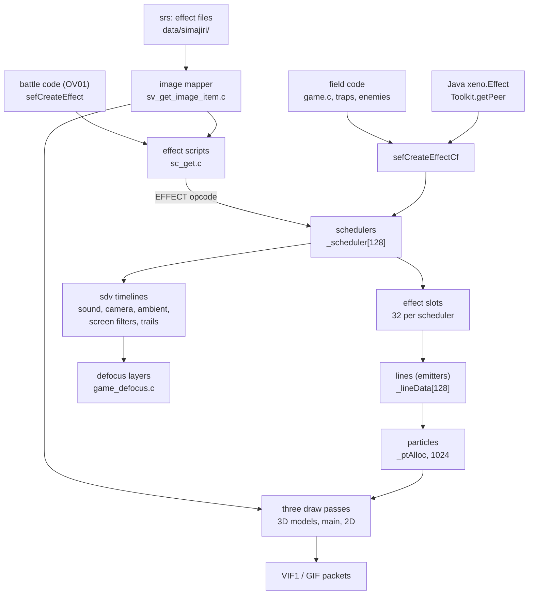

## What an effect is

An effect is a tree of four kinds of objects. Each level has a fixed-size table,
so the system never allocates memory while an effect runs.

1. A **scheduler** (`SchedulerState`) is one running instance of an effect.
   It has a position, rotation and scale, a caster and a target, a frame
   counter and 32 effect slots. There are 128 schedulers in `_scheduler`.
2. An **effect slot** (`EffectData`) is one track of the effect, such as "the
   flash", "the ring" or "the sparks". It owns a command list that says at which
   frame each line starts.
3. A **line** (`SefLineData`) is an emitter. It moves on its own keyframed path
   and spawns particles at a fixed rate. All effects share 128 lines in
   `_lineData`.
4. A **particle** is one sprite or one small model. All effects share 1024
   particle records of 640 bytes in `_ptAlloc`.

The diagram below shows the scheduler structure and the shared pools.

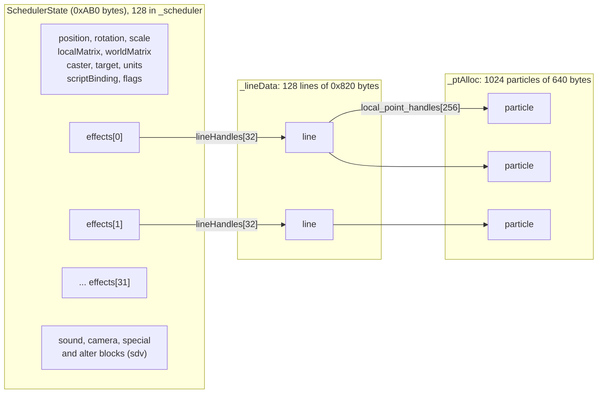

### Schedulers

`SchedulerState` (in `include/main/sef.h`) is 0xAB0 bytes. It is also the
"peer" of a Java `xeno.Effect` object, so a script holds a pointer to it. The
layout below lists the fields that matter for understanding the system.

```
SchedulerState (0xAB0 bytes)
+0x000  worldMatrix      parent matrix (caster or map unit), used when flag 0x2 is set
+0x040  localMatrix      built each frame from rotation, position and scale
+0x080  position         Vector4
+0x090  rotation         radians
+0x0A0  scale            starts at (1, 1, 1, 1)
+0x0B0  effects[32]      EffectData slots
+0x6B0  inUse            0 = free, else the effect's descriptor table address
+0x6B4  scriptAddress    effect script data table
+0x6B8  savedActive      the Java xeno.Effect object, for field effects
+0x6BC  caster, target   Actor pointers
+0x6C4  casterUnit, targetUnit   map units (MapUnitRecord)
+0x6CC  soundParameters, soundMode, soundId
+0x6E4  cameraChoice     filled by sdvSelectCamera
+0x730  special block    0x320 bytes, screen filter timeline (sdv)
+0xA50  alter block      0x14 bytes, trail timeline (sdv)
+0xA64  request          copy of the SefEffectRequest
+0xA88  effectSpeed      3.0 by default
+0xA8C  flags
+0xA90  scriptBinding    { state = frame counter, script_id, task_id, link_id }
+0xA98  category         resource category of the effect number
+0xA9A  display          1 = stepped and drawn, 0 = hidden
+0xA9C  delayFrames      frames to wait before the first step
+0xAA0  effectNumber, mapperIndex
```

The name `effectSpeed` comes from the recovered code, but the only reader
multiplies it into the sprite scale when drawing (`scaleMultiplier` in
`src/main/sv_get_image_item.c`). It therefore acts as a size factor.

The `flags` word holds the state bits. Some are set by the code that creates the
effect, some by Java natives and some by the effect data itself.

| Bit | Name in the code | Meaning |
| --- | --- | --- |
| 0x1 | `SEF_SCHEDULER_REWIND_FLAG` | Set by `sefRewindEffectCf` and cleared at the end of the frame |
| 0x2 | | Attached. The effect follows its caster through `worldMatrix`, and dies with the caster |
| 0x4 | | Draw without the Z test |
| 0x10 | `SEF_SCHED_CLIP` | Skip the effect when it is outside the view volume |
| 0x20 | `SEF_SCHED_FORCE_LOOP` | Restart the effect instead of freeing it when it ends |
| 0x40 | `SEF_SCHED_FINISHED` | The effect data reached its finish frame |
| 0x80 | `SEF_SCHED_MOTION` | Follow the caster's motion null joint instead of its root. Also set by the data |
| 0x200 | | Detached effect made by `sefCreateEffect2` |
| 0x400 | `SEF_SCHED_NO_ATTACH` | New lines get line flag 0x400. Their particles keep their own placement matrix and are drawn by `sefDrawParticleListCf` |
| 0x800 | | Lines update their parent point every frame (not for lines with flag 0x400) |
| 0x1000 | | Set by the data when an emitter follows a caster null. New particles copy the parent transform |
| 0x4000 | | The effect has hidden the battle map and must show it again when it ends |

Field effects get `flags |= 0x412`: attached, clipped and with particles that
keep their own placement. A scheduler with bit 0x2 or 0x200 is freed through
`sefFreeSchedulerCf`, which also stops its sound.

### Effect slots

An `EffectData` slot links the scheduler to one piece of the effect data. Its
`owner` field points to a command list of 12-byte `SefEffectCommand` records:
`start_time`, `frame`, `data_offset`, `link_index`, `count` and `flags`. Each
command starts one line. A start time of 1024 or more ends the list.

The slot's `category` word mixes a start frame with signal bits. The low 10 bits
are the frame at which the slot fires its signals.

| Bit | Meaning |
| --- | --- |
| 0x800 | Sound signal. Sets `_seSignal` and marks the target in the battle actor table |
| 0x1000 | Wait for the special flag of the battle request. The slot dies if the request has none |
| 0x2000 | Hit signal. Sets `_hitSignal` and marks the target as hit |
| 0x4000 | Finish. Sets `SEF_SCHED_FINISHED` on the scheduler at the start frame |

The slots are filled by `sefInitEffectTbl` from the effect's descriptor table
(`SefEffectDescriptor { category, script_offset, setting }`, see
[scheduler records](../formats/effects.md#scheduler-records) for the layout in
the files). The function stops after 32 descriptors, the size of the slot
table. A `setting` of 0 or more names another descriptor of the list. That
descriptor's `category` becomes the scheduler's loop target (`link_id`), the
frame at which the scheduler restarts when all its slots have ended (see
[scheduler lifecycle](#scheduler-lifecycle)). Three negative values have a
special meaning:

| Setting | Effect |
| --- | --- |
| -0x200 | Shows the battle map at the slot's start frame (`mapDispOn` in `src/ov01/map_disp.c`) |
| -0x201 | Hides the battle map at the start frame (`mapDispOff`) and sets scheduler flag 0x4000, so the map is shown again when the effect ends |
| -0x100 | The slot is filled only when bit 0 of the request's `initFlags` is set. Otherwise `sefInitEffectTbl` skips it, both when the scheduler is created and when it loops, and the slot stays empty |

The shipped data uses these values rarely: -0x100 appears in two descriptors,
-0x201 in one and -0x200 in none. All other descriptors use -1 (a normal slot)
or the index of another descriptor.

### Lines

A line (`SefLineData`, 0x820 bytes) is an emitter. It is made from keyed
tracks in two tables. The global table has ten tracks for the emitter: its
position, a start volume, the position the particles move toward, a target
volume, the particle direction and speed, a light position, the particle count
and interval of each emission, and the images. The local table has the
particle life and seven per-particle tracks: scale, rotation, colour, alpha,
size, a value for `sefMoveParticle` and a point light. A line also has gravity,
a ground height, a collision setting, a lifetime and a loop mode. Bit 1 of
`line_flags` marks it in use.

Three global tracks of `SefLineData` are positions.
`global_position_keys` (global track G0) is the emitter position,
`parent_position_keys` (G2) is the position the particles move toward, and
`light_position_keys` (G6) is the position of the line's light, which
`sefAddLightActor` receives. The full
list of tracks and their key formats is in
[global tracks](../formats/effects.md#global-tracks) and
[local tracks](../formats/effects.md#local-tracks).

`sefInitLineData` sets up a line from its script header (`table_indices[2]`,
`gravity`, `collision`, `height`). In the files the header is six words long
(see [line headers](../formats/effects.md#line-headers)). The code reads only
the first five, and the sixth is 0 in all 14 726 headers. `sefAllocEffectData`
takes a free line and stores its handle in the slot's `lineHandles`.

Each frame `sefExecLineData` runs two steps:

1. `sefExecLineGlobalData` moves the emitter along its tracks. Every
   `particle_count` frames it creates `emit_count` new particles with
   `sefCreateParticle`. A line linked to a parent line (`link_index`) instead
   emits one set of particles for each particle of the parent, so sparks can
   trail behind moving particles.
2. `sefExecLineLocalData` steps each particle. It reads the colour, size and
   light tracks, animates model particles (`sefAnimate`), moves the particle
   (`sefMoveParticle`) and builds its matrix (`sefCalcLocalMatrix`). A particle
   whose age passes its lifetime is freed. Light tracks call
   `sefAddLightActor`, which lights the battle actors in range.

When a line ends, `sefExecEffectData` frees it and every line linked to it.

### Particles

The particle pool is a ring buffer of free handles. `sevInitPtAllocator`
fills the ring, `sevAllocPtAllocator` takes the handle at the head and
`sevFreePtAllocator` puts a handle back at the tail. The pool, its ring and its
head and tail use 0xA0810 bytes.

A particle record has two views. The simulation view (`SefParticle`) holds the
position, speed, target, age, lifetime, colour and size. The draw view
(`SvModelDrawItem`) holds what the draw code needs: `renderType` at +0x188
(4 = textured quad sprite, 6 = model), alpha, blend mode, image, origin, scale
and angle.

`sefCreateParticle` gives each particle a start and target position, a random
spread on its lifetime, random rotation, scale and offset, a colour (64, 64, 64
by default) and a size. The random numbers come from the
effect system's own linear congruential generator (`sefRandSeed`, multiplier
1103515245, increment 12345, 15-bit result).

## Keyframes and interpolation

Every track in a line is a list of keys. Two key shapes appear:
`SefKey3 { frame, value, jump }` and `SefKey5 { end_frame, vector[3], jump }`.
The frame value 1024 marks the end of a list. When a key's `jump` is 0 or more,
the track loops back to that key, which makes repeating motion cheap to store.

The helpers below step through the keys and blend between them. All frame
counters clamp at 0x3FF.

| Function | Use |
| --- | --- |
| `sefProgressKey3`, `sefProgressKey5` | Move to the next key when the frame passes the current one |
| `sefLerpVector` | Blend two packed vectors. The 16-bit halves are unpacked with EE MMI instructions |
| `sefLerpVectorA` | Take the key value without blending |
| `sefLerpVectorSC` | Blend and scale by 0.1 |
| `sefLerpIVector`, `sefLerpIVector2` | Integer vector blend |
| `sefLerpFloat` | Blend a value stored in hundredths |
| `sefLerpInt`, `sefProgressInt` | Integer track blend and stepping |
| `sefLerpVectorB`, `sefLerpIVectorB` | Variants used by the colour and size tracks |

## Positions and attachment

Effect data does not store world positions. It stores **point codes** that name
a place on the caster, the target or the weapon. `sefGetPoint` turns a code into
a position, and `sefGetPosition` reads the code from the effect data first.

| Code | Place |
| --- | --- |
| 0 to 3 | No anchor. The offset is used as is |
| 4 | The parent particle (for linked lines) |
| 5 | A vector stored in the data |
| 256 | The caster's root |
| 257 + n | Caster null *n* (16 nulls) |
| 512 | The target's root |
| 513 + n | Target null *n* |
| 529 | A damage null on the target, chosen by the battle phase |
| 1024 + n | Weapon null *n* |
| 2048, 2049 + n | Alternative caster root and nulls |

A **null** is an accessory joint of the actor model. `sefGetNullPosition` reads
the joint matrix of accessory `index + 8` through the actor's joint table. When
the joint does not exist, the point falls back to a fixed point with y = 20.
While battle flag 2 is set, caster nulls switch to the alternative set.

An attached effect (flag 0x2) builds `worldMatrix` each frame with
`sefGetParentMatrix`. The parent is the caster's root matrix, or the caster's
motion null when flag 0x80 is set, or the caster map unit when there is no
caster actor. If the caster dies (`inUseId <= 0`) or the caster unit is removed
(`serial < 0`), the effect is freed.

`sefSetReverseDir` sets `_revDirZ` for ten effects listed in `revEft_3` when
the request's `param` word is 0x18 to 0x1F. This appears to mirror the effect
along Z for one side of the battle.

## Effect numbers

Every effect has a number from 1 to 0xBFF. The number decides which file holds
its data and which resource category it uses (see
[effect numbers and files](../formats/effects.md#effect-numbers-and-files) for
how the numbers map to the files on the disc). `srsAnalyzeEftNo` and
`srsGetEffectType` in `src/main/srs.c` do this mapping. `srsAnalyzeEftNo` also
returns the character number that owns the effect, and checks the ranges in
the order of the table.

| Numbers | Contents | Category |
| --- | --- | --- |
| 3042 and up | Debug effects, used by the effect viewer | `SRS_RES_BATTLE_IMAGE` (14) |
| 2600 to 2661 | Common battle effects in `esp/default.esp` | `SRS_RES_IMAGE` (0) |
| 2800 to 2999 | Weapon effects | `SRS_RES_WEAPON` (2 to 10) |
| 600 to 999 | Common field effects in `esp/cf_def.esp` | `SRS_RES_CF_IMAGE` (15) |
| 2200 to 2217 | Battle image effects of characters 2 and 5 | 14 |
| 1000 to 1999 | Field effects loaded one by one | `SRS_RES_EFFECT` (16 and up, 24 slots) |
| 2000 to 2218 | Battle image effects | 14 |
| ranges in `_srsChrEfTbl` | 12 party characters, four ranges each. Two ranges use the character's pack, two use the battle image | weapon or 14 |
| ranges in `_srsChrEfTbl2` | 161 ranges owned by one character or enemy | `SRS_RES_COMBO` (11 to 13), or 14 for boss effects below 2680 |
| anything else | Battle image, including the second range 2300 to 2481 | 14 |

The weapon lists appear to hold the packs of the three party members and the
combo lists the packs of the three enemy slots. Boss character ids start at
151. Bosses 151 to 186 have an idle effect listed in `_srsChrEfTbl3`. Weapon
effects 2900 to 2998 share their data with the effect 100 numbers lower, and
`srsGetEffect2Idx` picks one of the variants that share an `.esd` entry
(`_srsEffect2IndexTbl`, 117 rows).

Two placeholder numbers are replaced before an effect starts:

- `SEF_EFFECT_NO_DEATH` (0x4000) becomes a death effect. `sefCnvDeathEffectNo`
  uses `_sefBossDeathPrm_4` for bosses. Other characters get 2603 + kind × 3 +
  size offset, where the kind comes from the request flags and the size offset
  from the size class.
- `SEF_EFFECT_NO_WAIT` (0x4001) becomes the idle "wait" aura of a character.
  `sefCnvWaitEffectNo` uses `steftTbl` for characters 1 to 16 (effects 2502 to
  2526) and `srsGetBossWaitEftNo` for bosses.

A few battle effects come from fixed numbers in the code. The battle start
creates effects 2626 to 2628 for the encounter flags (`encountEffDisp` in
`src/ov01/entry_first_init.c`). Hits create **reaction effects** through
`sefCreateReactionEffect`: 2612 or 2615 plus a size offset, 2651 to 2658 for the
bits of the reaction mask, 2660 as a default and 2659 for a few characters.

## Effect files and memory

`srs.c` loads the effect files from `data/simajiri/` on the disc. The code can
also read the same files from a host PC (`host0:/home/xeno/work/` plus a view
path) or a USB drive (`usb0:/`). `srsLoadMode` picks the source: 0 for the
disc, 1 for the host and 2 for USB. Only the effect viewer switches it.

The table lists the files with the buffer the code reserves for each and the
real file size. The buffers are larger than the shipped files. The layouts of
the files are in [effects](../formats/effects.md#the-files).

| File | Buffer | File size | Contents |
| --- | --- | --- | --- |
| `esp/default.esp` | 0x25800 | 0x23500 | Common battle effects (2600 to 2661) |
| `seffect.esp` | 0xC800 | 0xC000 | [Name table](../formats/effects.md#the-name-table-seffectesp) `_loadEsdData`, 16 bytes per effect number |
| `esp/cf_def.esp` | 0x3E000 | 0x3CB80 | Common field effects (600 to 999) |
| `esd/NAME.esd` | | varies | One effect, named through `srsGetEffectName` |
| `esp/NAME.esp` | | varies | Character weapon and combo packs, named through `srsGetEffectName2` and `srsGetComboName` |

The combo pack names come from `_loadComboData` (195 rows). They are character
names such as `shion`, `kosmos`, `ziggy`, `momo`, `jr` and `chaos`, enemy groups
such as `guno_NNN`, `fema` or `utma`, and bosses `boss_001` to `boss_033`.

All effect data lives in one private pool, `_eftBuffer` (0xD4800 bytes), managed
by `smInitilize` and `smAlloc`. The structure `_srsMemRes` (`SrsMemRes`,
0x1A0 bytes) records what is loaded:

- `image` and `effectImage`, the common data
- `weaponData[3][3]` in a 0x12800-byte buffer (three player characters, three
  weapon effects each, stride 0x6000)
- `comboData[3]` in a 0x12000-byte buffer (three enemy slots)
- `battleImage`, a 0x40000-byte buffer made by `sefInitEffectBattle`
- `cfImage`, the common field data
- `effectData[24]` and `effectExtra[24]`, the field effects loaded one by one
- `pending[40]` and `no[40]`, the load state of each of the 40 categories

### Loading

All reads go through the xgl CD reader (see [xgl](xgl.md#cd-and-files)). When a
read completes, `srsCdReadCallback` calls `sresDataMapping`, which registers the
file's chunks in the image mapper with `svAddImageMapper`.

In battle the loads follow the party. `sefSetupPlayer(character, weapon1,
weapon2, weapon3)` puts a character in one of three player slots of
`_battlePrm`. `sefSetupEnemy(character)` does the same for three enemy slots and
notes a boss. Both then call `sefSetupEffect`, which runs
`sresLoadBattleData(&_battlePrm)` to load the missing packs. `sefReleaseID`
frees a slot again. The battle unit code calls these when units join or leave
(`src/ov01/unit_cmd.c`).

On the field, `sefLoadEffectCf(slot, number)` and `sefLoadEffectCfName(slot,
name)` load one field effect from disc. `sefLoadMemoryEffectCf` and
`sefLoadMemoryEffectCfName` register an effect that a script resource already
holds in memory. The name variants look the number up with
`srsEffectNameToID`. Java scripts reach these through the `loadeffect` resource
command (`command_loadeffect` in `src/main/res_get_path.c`).

`sefLoadEffect(number, character)` loads one effect through
`svFileLoadScript`. A field effect (category 16) goes to `srsFileLoadCf`. A
battle image effect goes to the single battle image buffer, because only one
battle image fits in memory. If the previous battle image is still running,
`svFileLoadScript` stores the new number with `sefSetLoadQue`, and
`sefExecLoadQue` retries the load each frame. `sefCheckLoad` returns 1 while a
load is queued or a CD read is still pending.

### The image mapper

The image mapper (`_imageMapper` in `src/main/sv_get_image_item.c`) is the index
of everything loaded. It has 40 type lists, one per resource category, so the
list index equals the `SrsResourceType` value. Each list has 256 entries
(`SvTypeListEntry`) with the data address, a use flag, the resource kind, the
image size and bit depth, and a name.

`svAnalyzeChunk` walks a file chunk by chunk (see
[the chunk container](../formats/effects.md#the-chunk-container) for the
64-byte chunk header). The table shows what it does with each chunk kind.

| Chunk kind | Handler | Contents |
| --- | --- | --- |
| 0 | | End of file |
| 1, 2 | | Skipped: the walk steps over the 0x40-byte header only. Kind 1 is the file header |
| 3 | `svAddClut` | Colour table (CLUT) |
| 4, 7 | `svAddImage` | Image |
| 5 | `svAddScript` | Effect script |
| 6 | `svAddModel` | LEX model |
| 9 | `svAddModel` | XTX texture set of the model before it |
| 10 | `svAddScript2` | A whole `.esd` file embedded in an `.esp` pack. Its script is registered like a kind-5 chunk |
| other | | Ends the walk |

The shipped files use kinds 0, 1, 3, 4, 5, 6, 7, 9 and 10. Kind 2 never
occurs. Kind 4 images appear only in `.esd` files and kind 7 images only in
`.esp` packs.

Each list owns a fixed region of GS video memory, set by the tables `top_1` and
`siz_0`. The regions start at word 917504 (byte 0x380000), which is the top
512 KiB of the 4 MiB of GS memory. Lists 14 to 39 share one base. The textures
are not uploaded at load time. The draw code uploads each list's images just
before it draws that list's particles (`svLoadImageList`).

Two lookups are used everywhere. `svGetScript(number)` finds the script chunk
of the effect. In list 14 (battle image effects) it returns the first entry
without a name test. In the other lists it compares the effect's `.esd` name
with `strncmp` over the length of that name, so a chunk whose name only starts
with it also matches (`bd00` would match `bd00b.esd`). In the shipped packs
the chunk with the exact name always comes first, so every lookup finds the
right script. `svGetImageListItem(type, flags)`
finds an image: flag 0x100 picks list 0, flag 0x800 picks list 15, flags 0x200,
0x400 and 0x1000 use `type`, and anything else uses list 14.

The diagram below shows how a file becomes drawable data.

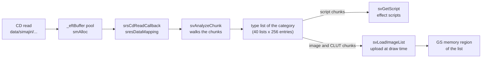

## Effect scripts

Battle effects are not started directly. Each effect number has a small script
in its data, and `sc_get.c` runs it. The script picks camera shots, waits for
hits, starts several schedulers in a row, plays movies and fires missiles.
This is a second script language of the game, much smaller than the Java
scripts (see [java-vm.md](../scripting/java-vm.md)) and unrelated to them. It
is a bytecode of 16-bit commands, and it is used mostly by battle effects (see
[battle-effects.md](../game/battle-effects.md)). The script tables sit in the
kind-5 chunks of the effect files and are described in
[the effect script table](../formats/effects.md#the-effect-script-table). The
interpreter is in
`src/main/sc_get.c` and its wait checks are in
`src/main/sc_wait_parse_script.c`.

### Script records and tasks

`_scriptWork` has 16 script records (`ScriptRecord`). A record belongs to one
effect number (`event`) and holds the script data table, 16 registers and 8
tasks of 0x80 bytes. Each task is one instance of the script with its own
program counter, a branch stack of depth 3 for `GOSUB`, its request
parameters, its start position, a wait mode with wait counters, and missile
state. The record layout is as follows.

```
ScriptRecord (0x450 bytes)
+0x000 tasks[8]     ScriptTask, 0x80 bytes each
+0x400 dataTable    bytecode table from svGetScript(effectNo)
+0x404 registers[16]
+0x444 dataIndex    effect data index (sefSearchMapperIndex)
+0x446 eventValue   value returned by REVE
+0x448 activeTasks  number of running tasks
+0x44A event        effect number of this script
```

The rest of the effect system reaches the interpreter through four entry
points.

| Function | Caller | Work |
| --- | --- | --- |
| `scInitScript` | `sefInitEffect` | Clear all records and tasks |
| `scCreateScript(info)` | `sefCreateEffect`, battle reaction effects | Find the effect's data, reuse a record with the same effect number or take a free one, and start a task at the table's entry address. Returns `task | (script << 8)` |
| `scExecEffect` | `sefExecEffect` | Run all tasks (`scExecScript`), then `sefExecScheduler` |
| `scDestroyScript`, `scDestroyScript2`, `scDestroyScriptAll` | Effect teardown | Stop scripts and their scheduler entries |

`scCreateScript(request)` first looks for a record that already runs the same
effect number and adds a task there. Otherwise it takes a free record, finds
the script with `svGetScript` and starts task 0. So when one Tech hits three
enemies, the three requests usually share one record with three tasks.

`scExecScript` runs every task of every record once per frame. A task runs up
to 2000 commands per frame. A handler returns 0 to end the task, 2 to wait
until the next frame, and any other value (normally 1) to go on with the next
command. A paused task also stops for the rest of the frame. A task that
waits is checked by `scWaitParseScript` on the following frames instead of
running commands. A record is destroyed when its count of active tasks and
schedulers drops to zero.

The flowchart below shows one frame of the effect script interpreter.

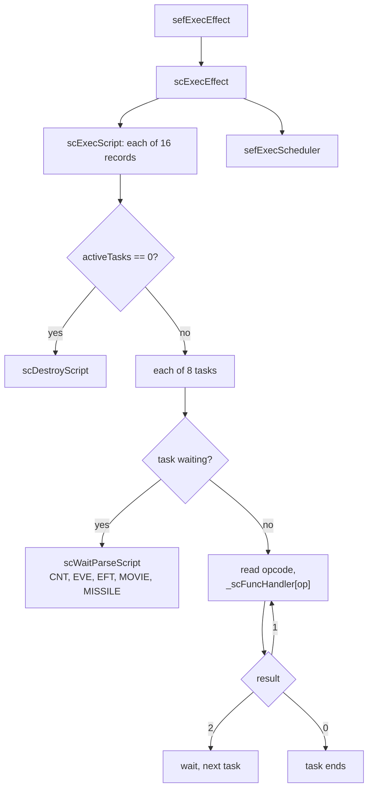

### Commands

Each command is a 16-bit opcode that indexes the 73-entry table
`_scFuncHandler`. The opcodes come in numbered groups, and the unused numbers
between the groups point at the `ERROR` handler. The operands of each command
are listed in [the bytecode](../formats/effects.md#the-bytecode).

| Opcodes | Group | Commands |
| --- | --- | --- |
| 0 to 7 | Flow | `ERROR`, `GO`, `GOSUB`, `BRA` (compare and branch with `EQ`, `NE`, `GT`, `GE`, `LT`, `LE`), `EXIT`, `RETURN`, `ONGO`, `ONGOSUB` |
| 10 to 15 | Debug and light | `PRINT`, `RPUT`, `RDUMP`, `CMDPUTON`, `CMDPUTOFF`, `FADEON` (dim the map during the effect) |
| 20 to 34 | Registers | `RSET`, `RINC`, `RDEC`, `RADD`, `RSUB`, `RMUL`, `RDIV`, `RMOD`, `R_AND`, `R_OR`, `R_XOR`, `R_NOT`, `R_NEG`, `RRND`, `REVE` |
| 40 to 42 | Control | `OBJEVE`, `ABORT`, `PAUSE` |
| 50 to 54 | Waits | `WAITCNT`, `WAITEVE`, `WAITEFT`, `WAITMOVIE`, `WAITMISSILE` |
| 60 to 62 | Effects | `EFFECT`, `EFFECT2`, `EFFECT3` |
| 70 to 72 | Movies and missiles | `MOVIE`, `MISSILE`, `MISSILE3` |

Operands are 16-bit words as well. A numeric operand with bit `0x8000` set is
an immediate value of 14 bits (`0x3FFF`), signed when bit `0x4000` is set.
Without `0x8000` it names one of the 16 registers. A register selector with
`0x8000` set names a register that holds the register number, which gives
the language a simple form of indirect addressing. `REVE` reads the record's
event value. `MOVIE` plays a file from `data\simajiri\movie\` through the
battle movie player `MMvPlay`, but only when no event scene runs (`_nowEvent`
is 0). That folder is not on the disc.

The shipped scripts use only nine of these commands: `EXIT`, `WAITEFT`,
`EFFECT`, `EFFECT2`, `EFFECT3`, `FADEON`, `MISSILE`, `MISSILE3` and
`WAITMISSILE`. No script branches, uses registers, prints or plays a movie.
The rest of the language is never exercised by the data.

The three effect commands create schedulers:

- `EFFECT` creates one scheduler from an address in the script table. It also
  rebuilds the battle actor table, dims the map for task 0 (`scSetAmbient`) and
  freezes the camera for effects 2000 to 2099 (`scFreezeCamera`).
- `EFFECT2` picks one of several addresses by the effect's variant index
  (`srsGetEffect2Idx`), so one script can serve related effects.
- `EFFECT3` creates a first scheduler only for task 0, then a second one for
  every task, delayed by `count × task index` frames. With one task per target,
  this staggers the impacts.

The wait handlers are in `sc_wait_parse_script.c`. `WAITCNT` counts frames,
`WAITEVE` waits until another task of the same script has ended, `WAITEFT` waits
until the task's last scheduler is gone (`sefIsDeadSchduler`) and then restores
the map light. `WAITEFT` reads its operand but ignores it, and `WAITMOVIE` waits for the battle movie player (`MMvIsPlaying`).
`MISSILE` and `WAITMISSILE` start hand-coded missile objects with `MEfCreate`
and wait for them (see [coded battle effects](#coded-battle-effects)).

## Creating effects

### From battle

The battle code in `OV01` fills a `SefEffectRequest` (0x24 bytes) and calls
`sefCreateEffect`.

| Field | Use |
| --- | --- |
| `source`, `target` | Caster and target actors |
| `parent` | A third object. The Tech code passes the weapon here |
| `size`, `size_copy` | Size class of the caster and target, for the size offsets |
| `character_id`, `character_id_copy` | Character ids of caster and target |
| `effect_no` | The effect number or a placeholder |
| `special`, `reaction_mask` | Reaction effects to make on a hit |
| `flags`, `reactionGate`, `initFlags`, `param` | Extra state from the battle code |

`sefCreateEffect` copies the request into `_battleData.request`, replaces a
death placeholder, and calls `scCreateScript`. Effect 55 also sets `special`,
and its hit result comes from `nusumeGet` in OV01, so it is probably the Steal
technique.

The main callers are `scenarioEffCall` in `src/ov01/battle_init.c` (the effect
of an attack or Tech, with a second effect 100 numbers higher for a second
weapon), `decoEffCallSub` in the same file and `encountEffDisp`. The battle code
asks `sefIsFinishEffect(number)` whether every scheduler of a number has
finished before it moves on. `sefIsFinishEffect` also returns 0 while a battle
movie plays. The hand-coded effects call `sefHitEffect` at a fixed frame of
their life, which sets `_hitFlag` for one frame.

The sequence below shows a battle effect from request to the first scheduler.

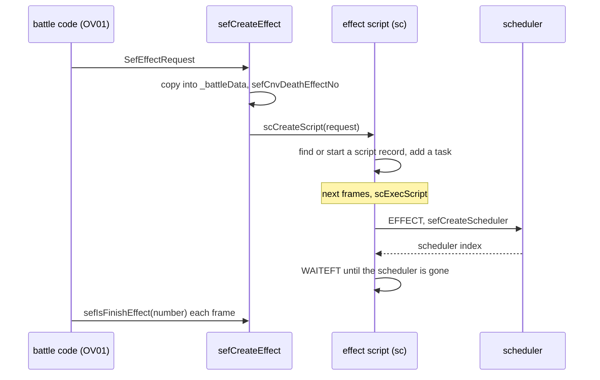

### Detached effects

`sefCreateEffect2(request)` starts an effect without a script record. It
replaces the wait placeholder, finds the effect's script table with
`scAnalyzeScriptCf`, creates a scheduler and sets flags 0x240 (detached and
finished, so it never blocks `sefIsFinishEffect`). Effects 2630 to 2636 take
their caster from the target and attach to it.

The battle code uses it for the idle auras of the units
(`src/ov01/data_unit_org_get.c`) and for status effect auras
(`src/ov01/battle_init.c`). `sefDeleteEffectWait(character)` removes a
character's aura again.

### On the field

Field effects (named "CF" in the code, as in `GameModeCfMain`) are created
directly, without a script record:

```c
SchedulerState *sefCreateEffectCf(int effectNo, const Vector4 *position,
                                  const Vector4 *orientation);
```

It finds the effect's tables with `scAnalyzeScriptCf`, creates a scheduler at
`position`, copies `orientation` into the rotation and sets flags 0x412. The
caller keeps the returned pointer. `sefDeleteEffectCf` frees it,
`sefRewindEffectCf` sets the rewind bit and `sefClearEffectCf` destroys its
lines without freeing the scheduler.

The field users are:

- `src/main/game.c`: the save point and shop symbols (`SYMBOL_EFFECT_SAVE_EVENT`
  728 and `SYMBOL_EFFECT_SHOP_RETURN` 729), kept in `saveEffe`, `shopEffe`,
  `evsEffe` and `retEffe`
- `src/main/init_map_trap.c`: traps
- `src/main/enemy_3.c`: field enemies
- `src/main/init_uwamono_sys.c`: the uwamono cursor and shots
- `src/main/look_at_player.c`: ground effects from `EfTab_Code`
- `src/main/init_drill.c`: the [Driller Game](../game/minigames/driller-game.md)
- `src/main/create_evt_item_get_task.c`: removes effects when items are taken

Map layouts can also place effects. `Layout.set(Object, int)` calls
`LAYOUT_mapID_setEffect` for an effect locator in the map layout
(`src/main/layout.c`).

### From a Java script

Event scripts use the Java class `xeno.Effect`. A script fills the fields `id`,
`px`, `py`, `pz` and `ry`, then asks for the peer with `Toolkit.getPeer`. The
native `getPeer_Effect` in `src/main/toolkit.c` loads the effect into field slot
0, creates it with `sefCreateEffectCf` and links the two objects both ways: the
scheduler's `savedActive` points to the Java object and the Java field `peer`
points to the scheduler.

The sequence below shows the creation of an effect from a Java script.

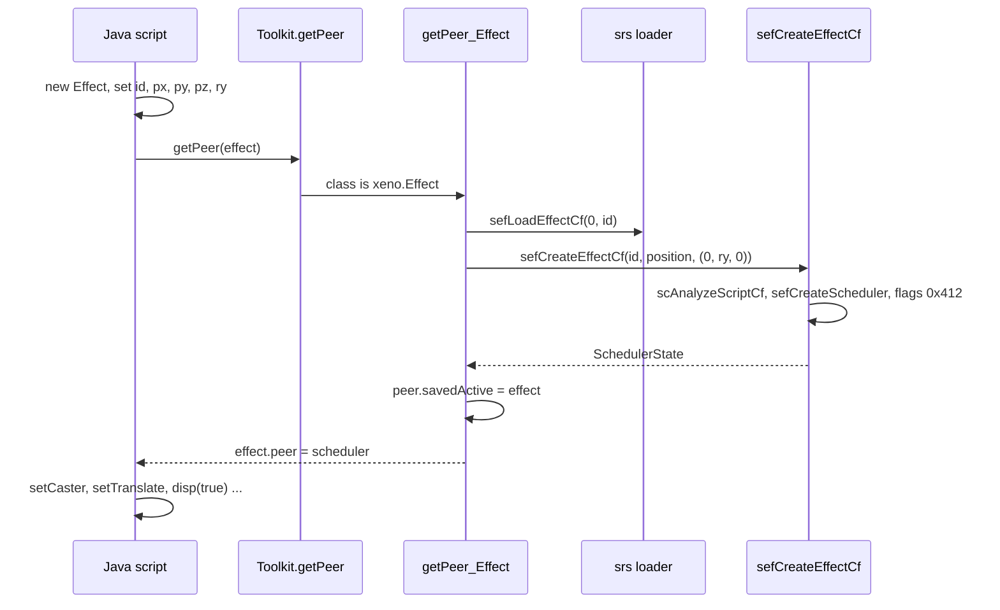

After that the script controls the effect through natives in
`src/main/effect.c`. They all read the `peer` field and change the scheduler.

| Native | Effect on the scheduler |
| --- | --- |
| `disp(boolean)` | True rewinds the effect and shows it, false hides it (`display`) |
| `setScale(FFF)`, `getScale()` | Scale |
| `setTranslate()`, `getTranslate()` | Copy between the Java fields `px`, `py`, `pz` and `position` |
| `setRotate()`, `getRotate()` | Copy between `rx`, `ry`, `rz` in degrees and `rotation` in radians |
| `setTransOffset(FFF)` | Add an offset to `position` |
| `setCaster(Chr)`, `setTarget(Chr)` | Caster and target actors |
| `setCaster(Unit)`, `setTarget(Unit)` | Caster and target map units. `setCaster(Unit)` also stores the effect in the unit's `effectCf[0]` |
| `setForceLoop(Z)`, `getForceLoop()` | Flag 0x20 |
| `setClip(Z)`, `getClip()` | Flag 0x10 |
| `setMotion(Z)` | Flag 0x80 |
| `noAttach(Z)` | Flag 0x400 |
| `clearEffect()` | `sefClearEffectCf` |
| `call(int)` | `FX_call` with the object's `id` and `args` (see [screen mask and fades](#screen-mask-and-fades)) |

Two `xeno.Runtime` natives also reach the effect system.
`Runtime.progressEffect(n)` calls `sefProgressEffect(n)`, which runs `n` effect
frames at once to skip an effect ahead. `setDefocus` and `setDefocusQuick` drive
the screen filters. The [natives page](../scripting/natives.md) lists all
classes.

## Scheduler lifecycle

A scheduler is created by `sefCreateScheduler2`. It reads four values from the
effect's script table: the sound, camera, special and alter timelines. It takes
a slot with `sefAllocScheduler`, which searches round-robin from the slot after
the last one used (`_schridx_1`), so a freed slot is not reused at once. Then it:

1. binds the slot to the current script and task (`_nowScript`, `_nowEvent`)
2. copies the request and sets caster, target and position (default origin
   (0, 0, 0, 1)), zero rotation and unit scale
3. clears the sound, camera, special and alter blocks and fills their first
   words, then picks a camera with `sdvSelectCamera`
4. sets `display = 1`, `effectSpeed = 3.0` and the start delay
5. increments the script record's active count
6. fills the 32 effect slots with `sefInitEffectTbl`
7. sets `effectNumber`, `category` (`srsAnalyzeEftNo`) and `mapperIndex`
   (`sefSearchMapperIndex`)

From then on `sefExecScheduler` steps it every frame until no slot is alive.
At that point the scheduler is freed, unless it has a loop target (`link_id`
of 0 or more) or the force-loop flag. A looping scheduler destroys its effect
data, sets its frame counter to the loop target, refills the slots and runs
again in the same frame.

`sefFreeScheduler(index)` destroys the effect data, decrements the script's
active count and clears the binding. Field and detached schedulers go through
`sefFreeSchedulerCf`, which also stops the sound. `sefDestroyScriptScheduler`
and `sefDestroyScriptScheduler2` free every scheduler of a script or a task.
`sefKillEffect(number)` frees all schedulers of a number, or all of them for a
negative number.

The state diagram below shows the life of a scheduler.

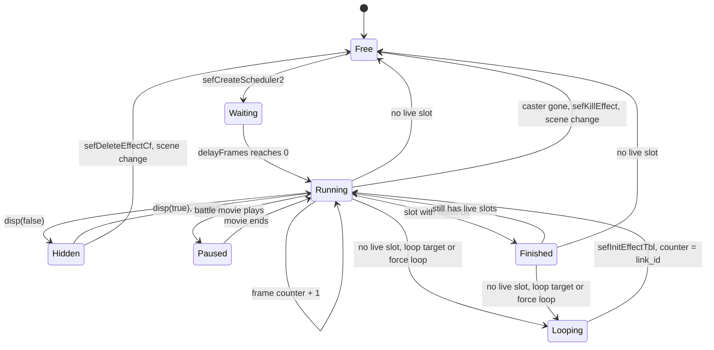

## Per-frame processing

The effects are stepped on the control thread. `GameDrawSync` in
`src/main/game.c` calls `sefExecEffect` once per frame, unless the U.M.N. screen
or the pause flag is active. During a battle, the battle loop `battleProc` in
`src/ov01/entry_first_init.c` does the same. `sefExecEffect` runs:

1. `scExecEffect`, which first runs every script task (`scExecScript`) and then
   every scheduler (`sefExecScheduler`)
2. `sdvExecAlters`, the trail ribbons
3. clearing of the one-frame signals `_hitFlag`, `_hitSignal` and `_seSignal`

`sefExecScheduler` does the real work:

1. It runs the shared steps first: `sdvExecAmbient` (map dimming),
   `sefInitBattlePrm`, `sdvClearSpecialWork` (screen filter slots) and
   `sefExecLoadQue` (queued loads).
2. For each in-use and displayed scheduler:
   - While a battle movie plays, it counts the scheduler as active and skips it.
   - While `delayFrames` is above 0, it decrements it and skips the scheduler.
   - An attached scheduler whose caster is gone is freed.
   - It copies the scheduler's request, actors, flags and effect number into
     `_battleData`, the global context the line code reads.
   - It sets `_nowScheduler` and the current script, task and effect.
   - It builds `localMatrix` from rotation, position and scale, and
     `worldMatrix` from the parent when the scheduler is attached.
   - It runs all 32 effect slots with `sefExecEffectData`.
   - It steps the sound, camera, special and alter timelines
     (`sdvScheduleSound`, `sdvScheduleCamera`, `sdvExecSpecial`,
     `sdvScheduleAlter`).
   - On the first hit it creates the reaction effects
     (`sefCreateReactionEffect`).
   - It turns the special timeline into screen filter layers (`sdvDrawSpecial`).
   - When no slot is alive, it frees or loops the scheduler. Otherwise it
     increments the frame counter (clamped to 0x3FE).
   - It clears the flags 0x1 (rewind) and 0x8.
3. After all schedulers, `sefSetLightFlag` updates the light flags of the battle
   actors.

The flowchart below shows the per-frame processing order.

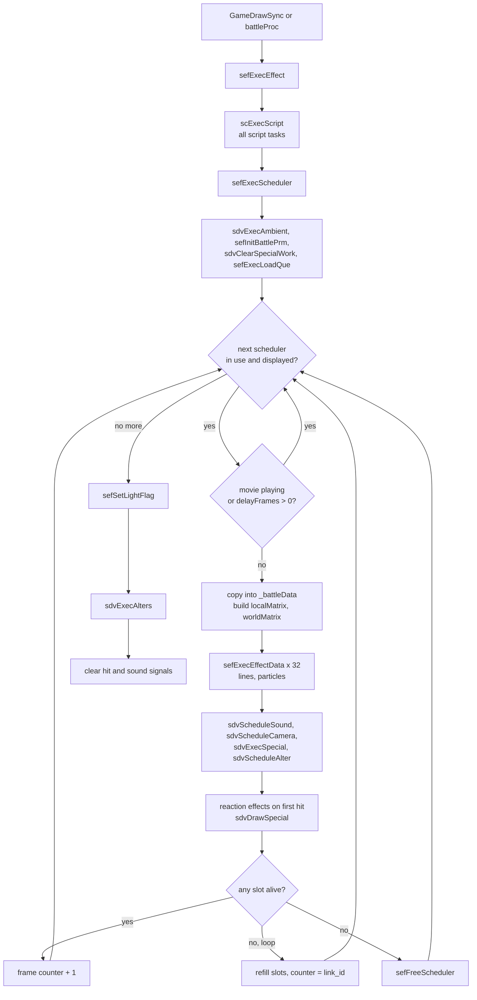

### One effect slot

`sefExecEffectData(effect, frame, &hit)` steps one slot. At its start frame it
fires the map hide or show call and the hit and sound signals. A slot that waits
for a special request dies when the request has none. Then it reads the command
list from the current command index. Every command whose `start_time` has
passed starts a new line with `sefInitLineData`. Finally it steps all live lines
with `sefExecLineData` and frees the ones that ended. The slot stays alive while
it has a running line or a command still waiting.

## Battle signals and lights

The battle actor table `_battleActor` lists up to 24 actors that take part in
the current effects, with a centre point. `sefCreateBattleActorTbl(number)`
rebuilds it from the casters and targets of the schedulers that run `number`.
It is rebuilt each time an effect command runs.

The table carries the hit and sound signals per actor. When a slot fires its hit
bit, `sefSetHitSignal` marks the target, and battle code can test it with
`sefIsHitActor`. `sefIsSeSignal` works the same way for sound cues.
`sefCaclAllTarget` returns the average position of the battle actors that are
not excluded, which probably serves effects that hit all targets.

Light tracks in lines call `sefAddLightActor`. It looks at every battle actor
within the light's range that has no effect light yet in this frame. The actor
gets a light set copied from `_defLight`, a light direction from the actor
toward the effect, and the light colour weighted by distance added to its
ambient term. The actor is marked with `SEF_ACTOR_LIGHT_FLAG` (0x8000).
`sefSetLightFlag` runs at the end of the frame. It keeps the flag on actors
that received a light and clears it on the others. This is how a fire spell
makes the characters near it glow.

## Drawing

The effects are drawn on the render thread in three passes. Each pass walks the
schedulers again and draws the particles of one kind. All passes do nothing
before `sefInitEffect` has run (`_initialize`) and while the U.M.N. flag
(`GAME_FLAG_UMN`, 0x04000000) is set in `GameLoopState.flags`.

1. **3D model pass.** `sefDrawEffect3D` is the first step of `xglRenderMove`
   (see [the render step](xgl.md#the-render-step)). It runs
   `svDrawScheduler3D` with `_draw3D = 2`. Model particles (render type 6) go
   to the model library through `svDrawModel` and `nmlModelEntryEffect`, so
   they are drawn later with the other models. The pass also counts the 2D
   particles and ends with `MEfObjExec1st`.
2. **Main pass.** `sefDrawEffect` runs inside `nmlModelFlush`, after the opaque
   models. When `s_nEffectWrite` is 0 it runs after the alpha groups of the main
   viewport, when it is 1 it runs right after `nmlModelFlushSub(0)`. Scripts
   switch this with `Stage.setEffectRender(int)`. The pass updates the inverse
   view matrix (`sefCalcInvView`) and runs `svDrawScheduler` with `_draw3D = 0`.
   Quad particles (render type 4) are projected with VU0 by `sefDrawParticle` or
   `sefDrawParticle2` and written as GS sprites. The Z test is GEQUAL, so
   effects hide behind models.
3. **2D pass.** `sefDrawEffect2D` is a final packet callback of the render step.
   It runs `svDrawScheduler2D` with `_draw3D = 1`, only when the first pass
   counted 2D particles (`_nEffect2D`). Screen-space particles are drawn by
   `sefDrawParticle2D`, centred on (256, 224) in the 512 × 448 screen.

The main pass draws by resource group so that each group's textures are
uploaded once. The order is the common image (list 0), the weapon lists (2 to
10), the combo lists (11 to 13), the battle image (14), the common field image
(15) and the loaded effects (16 to 39). For each group it uploads the images
(`svLoadImageList`, `SGsTexFlush`), then draws the matching schedulers. Trails
(`sdvDrawAlters`) and missiles (`MEfObjExec2nd`) are drawn inside their groups.

The particles are written as GIF packets on the scratchpad (`_packet`). Every 64
particles the buffer is sent as a VIF1 DIRECT transfer with `SGsSendPacket`.
`svDrawSchedulerBlk` turns the Z test off for schedulers with flag 0x4.

`sefDrawSchedulerEffect` draws one scheduler. Without flag 0x2 the lines are
drawn in place. With flag 0x2 it multiplies `worldMatrix` by `localMatrix` and,
when flag 0x10 is set, skips the scheduler if it lies outside the view volume
(`sefClipViewVolume`).

The diagram below shows where the passes run inside one render step.

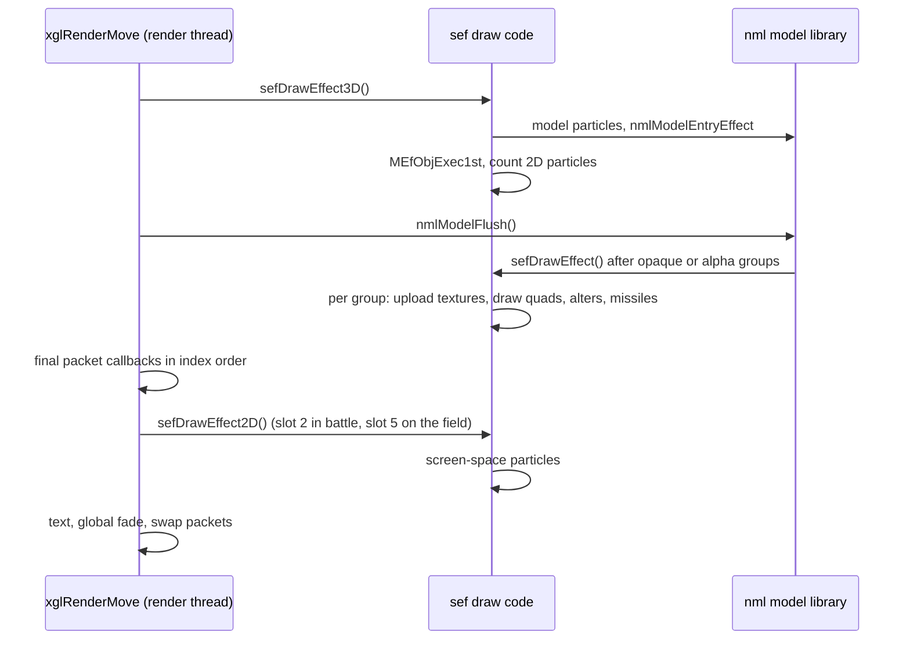

The 2D pass is installed by the mode functions. `sefInitEffectBattle` puts it
in final packet slot 2 (`sRender` +0x2C) and `sefInitEffectCf` in slot 5
(+0x38). The defocus filter uses slot 4, and the callbacks run in index order.
So in battle the screen filters cover the 2D effects, and on the field the 2D
effects are drawn on top of the filters.

## Timelines in sdv

`src/main/sdv.c` runs the parts of an effect that are not particles. Each
scheduler has a sound block, a camera block, a special block and an alter block.
`sefCreateScheduler2` fills their first words from the script table. The
timelines are lists of keys, read by `sdvExecSeqTbl` and `sdvProgressKey`.
Their rows are described in [timelines](../formats/effects.md#timelines). The
key frame 1024 ends a list. A key frame of 4096 waits for the hit signal
(`_hitFlag` or `_hitSignal`) when the special flag of the battle request
(byte 22 of the battle data) is set. When that flag is clear the row is
skipped without firing. The frame counter of a timeline stops at 1023, so a
row with a larger frame never fires.

### Sound

`sdvScheduleSound` plays the sound keys of the effect at their frames through
`sdvPlaySound`, which calls `xglSoundEffectNormalID`. The sound id holds a bank
slot in its high 16 bits and the sound number inside that bank in its low 16
bits, so 0x3008A is sound 0x8A of effect bank slot 3 (see
[xgl sound effects](xgl.md#sound-effects-and-the-command-queue)). The playing id is kept in `soundId`, so freeing a
field effect can stop it. Few effects use this timeline: only four effects of
the shipped data play a sound from it.

### Camera

`sdvSelectCamera` picks a camera shot when the scheduler is created. The script
table offers four shots with weights in percent, and a fifth one in battles
that start with a boss entry. The code also reads a weight for the fifth shot
but never uses it (see [camera tables](../formats/effects.md#camera-tables)). `sdvScheduleCamera` plays the chosen shot, only in battle
mode. `sdvProgressPrm` moves the battle camera through `MCamSet` and `MCamMove`
in `src/ov01/m_cam.c`.

### Ambient dimming

Large battle effects dim the map while they play. The script command `EFFECT`
calls `sdvSetAmbState(1, number)` for task 0, and `WAITEFT` calls it with
state 2 when the effect is gone. The request only applies to battle image
effects (category 14) and effect 2853, and never to effects 2300 to 2481. The
`FADEON` task flag forces it through `sdvSetAmbState2`.

`sdvExecAmbient` runs each frame. State 1 counts up to 20 frames and blends the
ambient light of studio light set 2 and the battle map colour (`mapMulSet`)
toward half of their saved values. State 2 counts back down to 0.
`sdvSaveAmbient` and `sdvRestoreAmbient` keep the original colours.

### Special timeline (screen filters)

The special block holds up to 7 slots. `sdvExecSpecial` interpolates their key
tracks (position, colour, size, intensity) each frame. The key rows are
described in [special tables](../formats/effects.md#special-tables). When it
blends the `z` offset between two keys, the code uses the next key's
intensity instead of its `z`, which matters only when two keys differ in
`z`. `sdvDrawSpecial` turns
each slot into a [defocus layer](#defocus-layers) with `GameDefocusSet`. The
slot's kind picks the layer type:

| Kind | Layer type |
| --- | --- |
| 1, 4 | 1, offset copies |
| 3 | 2 (frame copy) in layer 0, then 3 |
| 5 | 5, textured rectangle |
| 6 | 2 in layer 0, then 6, flat colour |
| 7 | 2 in layer 0, then 7, radial wave around a 3D point |
| 9 | 9, scan-line interpolation |

The layers come from a small pool (`_sdvSpecialBuf[8]`, `sdvAllocSpecialWork`)
that `sdvClearSpecialWork` empties each frame. So a filter exists only while its
effect keeps drawing it.

### Alters (trails)

An **alter** is a ribbon trail, such as the arc behind a sword swing. There are
16 alters (`SdvAlter`, 0x1280 bytes each). An alter records up to 128 samples of
two end points, chosen with the same actor, null and weapon selectors as the
point codes. It is drawn as a Hermite-smoothed textured strip with a life time
and an optional shrink. The `mode` word of the alter row sets how the texture
runs along the strip:

| Mode | Texture | Rows in the data |
| --- | --- | --- |
| 1 and other values | Fixed texture coordinates | 309 |
| 2 | The texture scrolls along the strip every frame | 40 |
| 3 | Each sample keeps the texture phase it had when it was recorded. Once the 128-sample ring has wrapped, new samples get a fixed phase. The texture is clamped instead of repeated | 16 |
| 4 | Each sample keeps its texture phase, which wraps at 20 | 130 |

The row layout is in [alter events](../formats/effects.md#alter-events).

`sdvCreateAlter` returns an id made of a serial number and the index
(`serial << 16 | index`). `sdvKillAlter` ends one. `sdvScheduleAlter` starts
alters from the alter timeline of a scheduler, `sdvExecAlters` adds a sample to
each live alter every frame and `sdvDrawAlters(category)` draws them inside the
main pass.

## Screen-wide effects

Three systems change the whole screen instead of drawing particles: the defocus
filter layers, the screen mask with the model fades, and the ambient dimming
described above. The diagram below shows where they act in a frame.

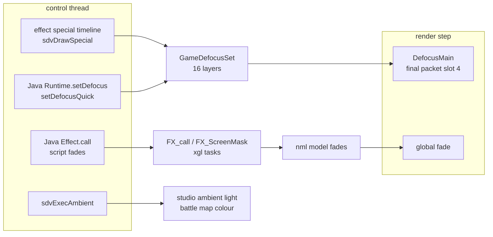

### Defocus layers

`src/main/game_defocus.c` keeps 16 filter layers in `GameDefocusParam`. A layer
(`DefocusLayer`) has a `type`, a `state`, an `index` and 16 parameter words. The
layers form four groups of four. `GameDefocusCheck` installs `DefocusMain` as
final packet callback 4 while any layer has a type, and removes it when all are
empty. `DefocusMain` then draws the layers in order into the frame's packet.

The layer types are drawn by `DefocusMainType01` to `DefocusMainType11`. Most
of them read a copy of the frame buffer as a texture.

| Type | Drawing |
| --- | --- |
| 1, 4 | Textured copy of the frame over a rectangle, repeated with offsets. This probably makes the blur that gives "defocus" its name |
| 2 | Frame copy, followed by a tinted or plain copy back |
| 3 | Offset textured copy, repeated |
| 5 | Textured rectangle with its own texture size |
| 6 | Flat colour rectangle |
| 7 | Radial wave around a point, 32 rings |
| 8 | Sparks at random places and a ring of strips |
| 9 | Scan-line interpolation through the display registers. `DefocusMainType09Final` restores them |
| 10 | After-image: a full-screen copy whose colour fades a little each frame |
| 11 | Sine-warped grid of 14 × 16 sprites |

`GameDefocusSet(index, type, settings)` sets one layer. An index of -1 clears
all layers. `GameDefocusQuickSet(group, preset, color, intensity)` fills the
four layers of a group from a preset (0 only clears them). Java scripts use the
natives `Runtime.setDefocus(II[I)` and `Runtime.setDefocusQuick(IIII)`.

Scene changes clear every layer with `GameDefocusSet(-1, 0, 0)`: at the start
and end of `Game()`, in the scene change of `sceneObserver` in
`src/main/script.c` and in the script jump of `src/main/runtime.c`.

### Screen mask and fades

`FX_ScreenMask(unused, color, duration, mode)` in `src/main/fx_screen_mask.c`
adds a `screenMask` task to the frame task list of `GameLoopState` (see
[tasks](xgl.md#tasks)). Each frame until `duration` the task calls
`nmlModelSetFadeDoit`, then it removes itself. The flag that this sets
(`s_nFadeDoit`) is only reset in `nmlFadePacketWrite` and never read in the
recovered code, so the mask probably has no visible effect in the final game.
The scene code in `src/main/script.c` and `src/main/runtime.c` calls it next to
the model fades `nmlModelSetFadeIn` and `nmlModelSetFadeOut`, with mode 2 for a
fade out and 3 for a fade in.

`FX_call(command, index, args, count)` is the target of the Java native
`Effect.call(int)`. It does two things:

1. It starts a model fade at once. Bit 0 of `args[2]` picks
   `nmlModelSetActiveFadeIn`, otherwise `nmlModelSetActiveFadeOut`. The duration
   is `args[1]`, the packed colour `args[0]` and the start delay `command`.
2. It queues an `fxAdapter` task that waits `command` frames and then schedules
   `fxFunction[index]` with the same four arguments. The table has one entry,
   `screenMask`, so only an `Effect` object with id 0 is valid here.

The fades themselves belong to the model library and are described on the
[rendering page](../architecture/rendering.md).

## Coded battle effects

Some battle effects are written in code instead of data. `src/main/m_ef_obj.c`
holds a pool of 96 effect objects (`MEfObj`, 0x420 bytes each). An object has
flags, two callbacks for the 3D pass (`exec1st`), two for the main pass
(`exec2nd`) and a 0x400-byte work area for its own state.

| Function | Use |
| --- | --- |
| `MEfObjInit()` | Clear the pool |
| `MEfObjEnabled(enabled)` | Turn the pool on or off |
| `MEfObjCreate()` | Take a free object from the pool. The caller fills its callbacks and work area |
| `MEfObjDestroy(object)` | Free an object |
| `MEfObjExec1st()` | Run the first callbacks, at the end of the 3D pass. Also fills `mefCamParams` from studio camera 0 |
| `MEfObjExec2nd()` | Run the second callbacks, inside the missile group of the main pass |

The pool only runs while it is both initialised and enabled. The battle code in
`src/ov01/m_battle.c` initialises and enables it. The objects themselves are
made by `MEfCreate` in `src/ov01/m_ef_create.c`, which knows 14 types: MSP00,
BP00, SMP01, EAC00, AMP02, MSP02, SOLB, ECM01, ECM02, GAMERA, EAD00, SO14, DORA
and KOSBW02. Many of them call `sefHitEffect` at a fixed frame of their life.
The effect script commands `MISSILE` and `WAITMISSILE` start them and wait for
them. The [battle effects page](../game/battle-effects.md) describes each type.

## Modes and scene changes

The effect system has two modes. `_sefBattleMode` is 1 in battle and 0 on the
field. Both mode functions first free every effect, so no effect survives a
mode switch.

| Function | What it does |
| --- | --- |
| `sefInitEffect()` | Once per session. Sets up the pools, the memory resources, the CD reader, the particle ring, the image mapper, the schedulers, the scripts, the battle blocks, the special work, the ambient state and the common data (`sresLoadCommonMemory`). Sets `_initialize` |
| `sefInitEffectBattle()` | Battle mode. Resets the alters, calls `sefDestroyEffect`, installs the 2D pass in slot 2 and allocates the battle image buffer |
| `sefInitEffectCf()` | Field mode. Calls `sefDestroyEffectCf`, loads the common field data (`sresLoadCfMemory`) and installs the 2D pass in slot 5 |
| `sefDestroyEffect()` | Frees all schedulers and scripts, resets ambient, frees the battle reloader memory and clears the battle blocks and alters |
| `sefDestroyEffectCf()` | The same, but keeps the battle reloader memory |

`sefInitEffect` is called by `entryFirstInit` in `src/ov01/entry_first_init.c`,
which `Game()` calls at the start of a session. The other functions are called
at these points:

- `Game()` calls `sefInitEffectCf` at its start and at its end.
- `InitCfSystem` in `src/main/game.c` calls `sefInitEffectCf` when the field
  systems are rebuilt.
- `sceneObserver` in `src/main/script.c` calls `sefInitEffectCf` on every scene
  change, together with the reset of units, actors, windows and messages.
- A battle runs inside the field loop. `GameModeCfMain` saves the field state,
  runs `battleProc` and restores the field state afterwards. In the battle,
  `entryPhase00` calls `sefInitEffectBattle`, `battleProc` runs
  `sefExecEffect` each frame and `battleProcEnd` calls `sefDestroyEffect`.

The field state is saved with `Game_Data_Push` and restored with
`Game_Data_Pop`, both in `src/main/game.c`. The save happens before a battle
(`GameModeCfMain`), before a minigame (`Runtime.minigameExec`) and in the main
menu (`MainMenu`). `Game_Data_Push` calls `sefPushEffect`, which copies the
state of all 128 schedulers into `_savePrm`: effect number, position, rotation,
scale, caster, target, units, flags, display and the Java object.
`Game_Data_Pop` calls `sefInitEffectCf` and then `sefPopEffect`. It creates
again only the effects that belong to a Java object, each one in its old
scheduler slot. The Java `peer` pointers therefore stay valid. It then runs
`sefProgressEffect(10)`, probably so that the effects do not visibly restart
from their first frame.

The diagram below shows the mode changes around a battle and a scene change.

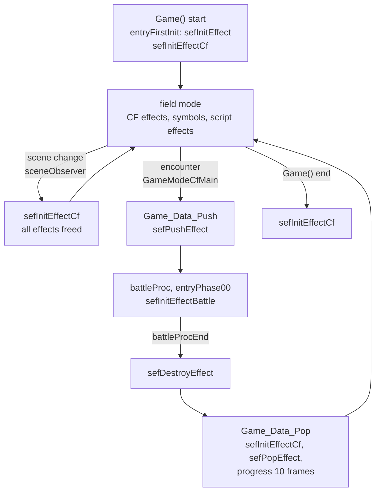

## Debug tools

`src/main/set_path.c` contains an effect viewer, `SimajiriTest`. It sets the
load mode to the host PC, runs a file selector and a mode menu, and then one of
four viewers: a battle test (`sbattleDebug`), a battle effect viewer
(`seffectDebugBattle`), a field effect viewer (`seffectDebugCf`) and a viewer
for the debug effects numbered from 3042 (`seffectDebugDb`). The viewers set up
dummy actors, load the chosen effect and start it with the circle button. In
the battle effect viewer, cross sends a hit (`sefHitEffect`). Start pauses and
select steps one frame (`sdbExecEffect`). No caller of `SimajiriTest` was found
in the recovered code, so it is probably reached from a debug menu table. The [debug tools page](../game/debug-tools.md) covers the
debug menus.

`src/main/sef_print.c` holds `tracePrint`, a `printf` wrapper the effect code
uses for warnings such as "no free line" or "effect data not loaded". The
functions `sefPrintVector` and `sefPrintMatrix` have empty bodies in the final
game. The same file stores the Java opcode name strings that `sdv.c`'s
`instructionCodeName` table points to, and the Java VM debug mask
`vmDebugMask`.

## Who uses sef

| User | Use |
| --- | --- |
| Battle (`src/ov01/`) | Tech Attack and item effects, auras, death and reaction effects, coded effects, camera shots |
| Field (`src/main/game.c` and the map code) | Save and shop symbols, traps, enemies, ground effects |
| Java scripts | `xeno.Effect`, `Layout.set`, `Runtime.progressEffect`, defocus natives |
| Minigames | The [Driller Game](../game/minigames/driller-game.md) |
| Render step | The three draw passes and the defocus callback |

Related pages: [xgl](xgl.md) for the render step and tasks,
[nml](nml.md) for the model library that draws model particles,
[actors](actors.md) for the null joints, [battle](../game/battle.md) and
[battle effects](../game/battle-effects.md) for the battle side,
[field](../game/field.md) and [map and units](../game/map-and-units.md) for the
field side, [natives](../scripting/natives.md) for the Java classes and
[memory](../architecture/memory.md) for the memory map.
