# User interface and windows

Xenosaga Episode I has two window toolkits. Field and event scripts use the
**TWSYS toolkit**. It has four component slots for dialogue windows, small
choice menus and number sliders, and it draws them through a tree of **EW
widgets**. The main menu, the battle windows, the U.M.N., the save screen and
the shops use the **e-widgets** instead. These are small immediate-mode
widgets named `eWindow`, `eCursol`, `eMessage`, `eNumber` and so on, and they
draw through the **endPrint** command layer.

Both toolkits end in the same place. Every letter, frame and sprite becomes a
record in the print queue of the `xglFont` module, and the render thread turns
that queue into GS primitives once per frame. Each record carries an order
key. The key picks one of 16 buckets and a GS depth, and together they decide
what appears in front.

[← Back to the overview](../README.md)

## Contents

- [Two window families](#two-window-families)
- [Text, fonts and encoding](#text-fonts-and-encoding)
- [Message text and buffers](#message-text-and-buffers)
- [Components (TWSYS)](#components-twsys)
- [EW widgets](#ew-widgets)
- [Text windows (TWIN)](#text-windows-twin)
- [Dialogue from a script](#dialogue-from-a-script)
- [Script menus (TMENU)](#script-menus-tmenu)
- [Sliders (TSLIDER)](#sliders-tslider)
- [The endPrint layer](#the-endprint-layer)
- [E-widgets](#e-widgets)
- [WindowDX and list windows](#windowdx-and-list-windows)
- [Drawing order](#drawing-order)
- [tya helpers](#tya-helpers)
- [Layout natives](#layout-natives)
- [Who uses the window system](#who-uses-the-window-system)

## Two window families

The two toolkits differ in who owns the state. A TWSYS component is
**retained**. Once a script creates a window, the slot keeps the window, its
text and its widgets until the window closes. The game loop steps every slot
with `TWSYS_update()` and draws them with `TWSYS_draw()`. The caller only
creates the window, feeds it text and waits for it.

An e-widget is **immediate**. The screen code owns the widget structure,
usually inside its own work area, and calls the widget's `*Main` function every
frame. Each call advances the widget's animation and queues its drawing for
that frame. Input is also the caller's job. A list window reports which row is
selected, and the screen decides what Circle or Cross means.

| Family | Files | Used by | Draws through |
| --- | --- | --- | --- |
| TWSYS | `src/main/twsys_init.c`, `src/main/tslider_create.c`, `src/main/ew_sprt_set_cursor_uv.c`, `src/main/msg_init.c` | Java `Window` and `Menu` objects, conversations, scene messages, item-get windows, script debug menus | EW widgets, `xglFontPrint` and font callbacks |
| e-widgets | `src/main/end_print.c`, `src/main/open_close_main.c`, `src/main/e_message.c`, `src/main/e_number_main.c`, `src/main/e_battle_win_open.c`, `src/main/window_tex_load.c` | main menu, shops, settlement, save and load, battle menus in OV01, U.M.N. screens in OV02 | the endPrint queue, run as one font callback |

The prefixes probably mark different authors. The `end` and `e` names likely
come from a programmer's name, because the window textures live in
`data\endou\` and the e-widget test screen is `src/main/endou_test.c`. The
`tya` helpers probably come from another programmer, whose data is in
`data\yajima\` and whose test screen is `src/main/yajima_test.c`. The TWSYS
names (`TComponent`, `TWIN`, `TMENU`, `TSLIDER`, `EW`) follow a third style.

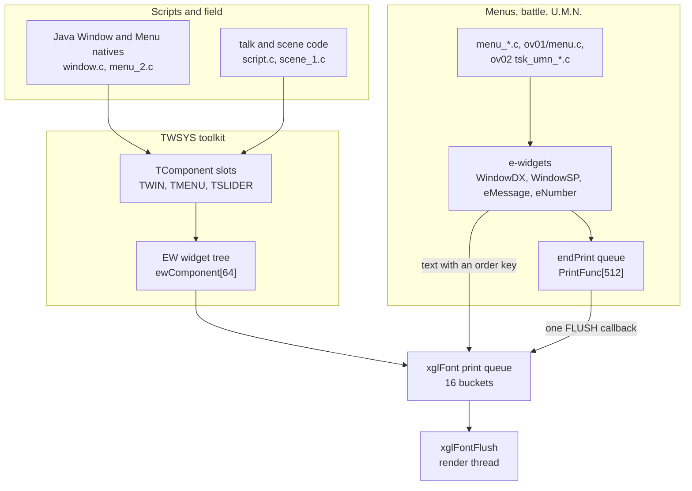

## Text, fonts and encoding

All on-screen text goes through the font module in `src/main/xgl_font.c`,
described in [xgl.md](xgl.md#text). This section adds the parts that
the windows rely on: the encoding, the control codes inside strings and the
order key.

### EUC text

Game text is stored in **EUC-JP**. A byte below 0x80 is ASCII. A byte with the
high bit set starts a two-byte character, and the font looks the pair up in
its kanji and kana texture. Full-width letters and digits use the lead byte
0xA3 (`EUC_FULLWIDTH_ALNUM_LEAD` in `src/main/twsys_init.c`). The encoding and
the conversion table are described in
[Character encoding](../formats/text-and-fonts.md#character-encoding).

Two helpers convert between the widths. `STRING_h2zEUC` in
`src/main/twsys_init.c` turns ASCII letters and digits into their full-width
EUC forms. The sliders use it to draw large digits. `xglFontAscii2Euc` in the
font module maps plain ASCII onto EUC glyphs when a string is printed. The
message queue converts every ASCII byte the same way before it measures a
line, and a converted character counts its proportional width. A character
that is already EUC counts 20 pixels, or its proportional width while the
style code 25 has switched the proportional flag on. The code also has an
8-pixel case for a single-byte character, but the conversion table never
produces one, so the shipped text does not reach it.

### Font control codes

Bytes below 32 are **control codes** for the font engine. Each one changes the
drawing state for the rest of the string, and some take parameter bytes. The
full table is in [xgl.md](xgl.md#control-codes), and the operand bytes of
each code are listed in
[Font control codes](../formats/text-and-fonts.md#font-control-codes). The
windows mostly use the style codes below, named after the `FONT_OP_*` values
in `src/main/xgl_font.c`.

| Code | Name | Parameters | Effect |
| --- | --- | --- | --- |
| 6 | `DEPTH` | depth | GS depth of the next glyphs |
| 10 | `NEWLINE` | none | next line |
| 11 | `RESET` | none | back to the default style |
| 12 | `COLOR` | r, g, b | text colour, 0x80 is neutral |
| 13 | `EFFECT_MODE` | mode | 1 plain, 2 shadow, 3 outline, 4 bold |
| 14 | `EFFECT_PARAMS` | x, y, r, g, b | offset and colour of the shadow or outline |
| 15 | `BLEND` | flags, mode, alpha | blend mode and alpha |
| 21 | `CONFIG` | sub, value | 1 line height, 2 default width, 3 wrap width, 4 proportional mode, 5 horizontal shift |
| 23 | `CALLBACK` | function, argument | call a function during the flush |
| 25 | `STYLE` | bits | proportional and wide ASCII |

The windows build their look from these codes. `TWSYS_draw()` prints
`twsysResetControl` (just code 11) and then a style string before each
component. The window style `TWSYS_DRAW_WINDOW_FONT` decodes like this.

```c
/* effect 2 (shadow)
   shadow offset (2, 3), shadow colour 0x18 0x18 0x18
   blend flags 0, mode 0, alpha 0x80
   colour 0x80 0x80 0x80 (neutral) */
#define TWSYS_DRAW_WINDOW_FONT "\x0d\x02\x0e\x02\x03\x18\x18\x18\x0f\x00\x00\x80\x0c\x80\x80\x80"
```

The scene style `TWSYS_DRAW_SCENE_FONT` is the same string with effect 3, an
outline, and an outline offset of (2, 2). Scene messages need the outline
because the scene window draws no frame, so its text sits over the moving 3D
scene with only a gradient behind it. Other style strings in
`src/main/twsys_init.c` follow the same pattern.
`twinStyleControl` is code 25 with style 0, and `twinFontParamControl` adds
style 3 to the window style for captions.

### Order keys and buckets

The third argument of `xglFontPrint(x, y, key, text)`,
`xglFontPrintDirectOT(key, text)` and `xglFontPrintExtFunc(key, function,
argument)` is an **order key**, as [xgl.md](xgl.md#the-print-queue)
explains. The font module splits it into two parts.

| Bits | Use |
| --- | --- |
| 24–27 | bucket, 0 to 15 (`set_ot` computes `((key >> 22) & 0x3C) / 4`) |
| 0–23 | GS depth of the record (`FONT_OP_DEPTH`) |

Each bucket is a linked list of records. `xglFontFlush()` walks the buckets
from 0 to 15 and each bucket's records in the order they were queued. All the
records share one drawing cursor, so a style string in one record still
applies to the next record unless that record resets it.

The depth is the second sorting tool. The font engine sets the GS depth test
to GREATER (TEST value 0x7000D) and endPrint sets GEQUAL (0x5000D), so a
glyph or sprite with a larger depth wins where two of them overlap. Almost all
UI keys live in bucket 0, and the low 24 bits do the real layering. A typical
pattern is a window at depth `d`, its shading at `d + 1` and its text at
`d + 2`. The TWSYS widgets use `EW_ORDER_FRAME` (0x00FFFFF0), `EW_ORDER_MASK`
(0x00FFFFF1) and `EW_ORDER_TEXT` (0x00FFFFFF), the highest depths in bucket 0.

`xglFontPrintExtFunc` queues a `FONT_OP_CALLBACK` record. During the flush,
the render thread calls `function(cursor, argument)` at that point of the
bucket, with the font cursor that holds the current packet. Both toolkits use
this hook to draw frames and sprites in the middle of the text stream.
`xglFontReloadTexture(cursor, 1)` uploads the kanji texture again afterwards,
and `xglFontReloadTexture(cursor, 2)` uploads the window texture images to GS
address 0xF0000 plus their offsets.

## Message text and buffers

Dialogue text arrives as **message script**: EUC text with tags written as
`/[name(argument)]`. The parser is the MIF2 message interface in
`src/main/msg_init.c`, documented with the event system in
[events.md](../scripting/events.md#message-text-and-the-mif2-interface). This
section covers the part the windows see.

### Message tags

`MSG_convert` rewrites each window tag as `/[` followed by one compact byte.
Later, `MSG_queuePop` hands the window one character at a time and reports a
compact tag in the queue's `last` field as a value of 128 or more. The other
tags turn into font control codes, as listed in
[events.md](../scripting/events.md#text-tags). The output bytes of every tag
and their counts in the scene scripts are given in
[MIF2 message tags](../formats/text-and-fonts.md#mif2-message-tags).

| Tag in the script | Compact byte | `last` value | Text window reaction |
| --- | --- | --- | --- |
| `/[waitkey(n)]` | 0x80, then n | `MSG_CTRL_WAITKEY` 128 | wait for Circle, then report n |
| `/[clear()]` | 0x81 | `MSG_CTRL_CLEAR` 129 | empty the lines |
| `/[signal()]` | none (`MIF2_dummy`) | none | ignored |
| `/[wait(n)]` | 0x83, then n | `MSG_CTRL_WAIT` 131 | wait n frames |
| `/[close()]` | 0x84 | `MSG_CTRL_CLOSE` 132 | close the window |
| `/[label(text)]` | 0x85, then the text | `MSG_CTRL_CAPTION` 133 | set the caption, probably the speaker's name |
| `/[color(rgb)]`, `/[font(text)]`, `/[ruby]`, `/[gaiji]`, `/[code(n)]` | font codes | none | change the text itself |
| `/[tips()]` | none (`MIF2_dummy`) | none | ignored |

The argument of `waitkey`, `wait` and `label` travels in `queue.label`, as
`label.value` or `label.text`.

### MBUF and the message queue

`MBUF` is a pool of eight **message buffers** (`msg_buffer[]`). Each buffer has
a 16-byte header (`active`, `capacity`, `entry_table`, `cursor`) and a 0x800
byte workspace. `MBUF_create2()` hands out a plain buffer, and
`MBUF_create(entry_size, count)` lays out a table of fixed-size entries in it.
`MBUF_dispose()` clears `active`. A text window owns up to two buffers in
`messageBuffer[2]` and frees them when it closes.

A `MsgQueue` is the reading side. It points at a converted text and keeps a
`head` and `tail`, the number of characters and the pixel `width` of the
current line, the wrap `limit` and the `last` code popped.
`MSG_queuePop(queue, out, n)` copies up to n characters into a line buffer. It
stops early at a tag, and when the line reaches `limit` pixels it sets `last`
to `'\n'`. `MSG_queueReset` restarts the line count after a wrap.

`MSG_print2(window, text, length)` is the usual entry point. It converts the
text into the window's message buffer and pushes it onto the window's queue at
offset 0xAC. From then on, the window's update function drains the queue at
its own speed.

## Components (TWSYS)

### Slots, kinds and groups

`src/main/twsys_init.c` keeps a fixed table `static TComponent tcomponent[4]`.
Each slot is 0x5B0 bytes and holds one window, menu or slider. The same record
is read through different views for each kind, which the header
`include/main/twsys_init.h` merges into one structure with unions.

The `kindAndGroup` halfword says what a slot is.

| Bits | Meaning |
| --- | --- |
| 0–3 | kind: 0 `TEXT`, 1 `MENU`, 2 `SLIDER`, 3 `TEXT_FIELD` (field conversation), 4 `TEXT_SCENE` |
| 4–5 | group, an index into `groupStatus[3]` |
| 8–15 | slot index, kept when the kind is replaced |

Groups let the game hide or freeze several components at once. Bit 1 of a
group's status turns updates off (`TWSYS_GROUP_UPDATE_OFF`) and bit 2 turns
drawing off (`TWSYS_GROUP_DRAW_OFF`). `TWSYS_setGRPStatus(group, status)` and
`TWSYS_getGRPStatus(group)` read and write them. The debug menus in
`src/main/script.c` set group 0 to 3, which freezes and hides the story
windows, and put their own menus in group 1 with `kindAndGroup |= 0x10`.

### Shared fields

| Offset | Field | Meaning |
| --- | --- | --- |
| +0x00 | `class_ref` | Java class pointer, so a script can hold the slot as an object |
| +0x0C, +0x0E | `pixelWidth`, `pixelHeight` | box size |
| +0x10 | `flags` | see below |
| +0x14 | `state` | see below |
| +0x16 | `kindAndGroup` | kind, group and slot |
| +0x20, +0x24 | `x`, `y` | screen position as floats |
| +0x30 | `waitFrames` | timer of the current state |
| +0x32 | `closeState` | result for the script: the `waitkey` value, or 255 after closing |
| +0x44 | `ownerPosition` | position of the speaker, set by `TW_setPos` |
| +0x54 | `rootWidget` (`ewHandle`) | root of the EW widget tree |

The text window, menu and slider views continue after these fields. They are
listed in their own sections below.

### Flags and states

| Flag | Value | Meaning |
| --- | --- | --- |
| `TCOMP_FLAG_OPEN` | 0x01 | the opening animation has finished |
| `TCOMP_FLAG_WAIT` | 0x02 | a state is armed, so text popping pauses |
| `TCOMP_FLAG_RUN` | 0x04 | the armed state's handler runs |
| `TCOMP_FLAG_ACTIVE` | 0x10 | the slot is in use |
| `TCOMP_FLAG_FOLLOW_OWNER` | 0x40 | place the box next to the window owner |
| `TCOMP_FLAG_PRESELECT` | 0x200 | a menu starts on `requestedSelection` |

| State | Value | Used by |
| --- | --- | --- |
| `IDLE` | 0 | all |
| `OPENING` | 1 | all, 11 frames (`TCOMP_OPEN_FRAMES`) |
| `CLOSING` | 2 | all, 10 frames (`TCOMP_CLOSE_FRAMES`) |
| `WAIT_RESULT` | 8 | text window, waits for Circle after `waitkey` |
| `CLEAR_TEXT` | 9 | text window |
| `SCROLL_LINE` | 10 | text window |
| `WAIT_CLEAR` | 11 | text window, never entered by the recovered code |
| `WAIT_SCENE` | 12 | scene window, page full |
| `WAIT_FRAMES` | 13 | text window and menu, timed wait |
| `INPUT` | 14 | menu and slider |
| `DONE` | 15 | menu and slider |
| `REVEAL` | 16 | menu, query text appears |
| `WAIT_SCROLL` | 17 | text window, last line full |

The update functions use the WAIT flag as a two-step handshake. When a state
is entered, the WAIT flag is clear. On the next frame the update function
"arms" the state: it sets WAIT and loads the timer, with 10 for `CLOSING` and
0 for most others. From then on, while WAIT and RUN are both set, the state's
handler runs every frame until it clears WAIT and moves on.

The following class diagram shows the TWSYS records and the widgets they own.

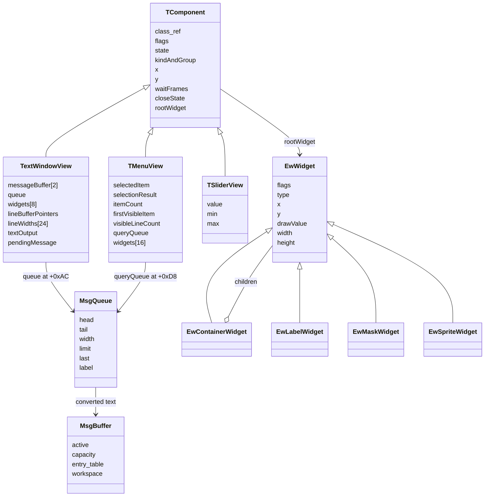

### Frame calls

`TWSYS_init()` clears every slot, the group bytes, the widget table
(`EW_init`) and the message buffers (`MBUF_init`). The game calls it when a
scene changes, from `src/main/game.c` and from several places in
`src/main/script.c`.

`TWSYS_update()` walks the four slots. For each active slot in a group whose
updates are on, it calls the update function of the slot's kind:
`TMENU_updateDefault`, `TSLIDER_updateDefault` or `TWIN_update2`. The field
loop in `src/main/game.c` calls it once per frame in each of its modes.

`TWSYS_draw()` walks the slots again. For each active slot in a group whose
drawing is on, it prints the reset string and the window or scene style at
`EW_ORDER_TEXT`, then calls `TMENU_drawDefault`, `TSLIDER_drawDefault`,
`TWIN_draw2` or `TWIN_drawScene2`. These functions only move and show the
widgets. At the end, one call to `EW_draw()` queues the drawing of the whole
widget table. `GameDrawSync()` in `src/main/game.c` calls `TWSYS_draw()` right
after the screen clear and before the map. The position in that list does not
matter for the picture, because the font queue is only drawn later by the
render thread.

`WIN_checkActiveWindow()` returns 1 when any slot in an update-enabled group
is active. The field loop uses it to block the pause menu while a window is
open, and `src/main/game_radar.c` hides the radar.

## EW widgets

The **EW widgets** are the drawing parts of the TWSYS toolkit. They live in
`src/main/ew_sprt_set_cursor_uv.c` and `include/main/ew_sprt_set_cursor_uv.h`.
The table `EwWidget ewComponent[64]` holds 64 slots of 0x28 bytes.
`EW_create(index, type)` claims a slot (the first free one for -1),
`EW_addComponent(container, index, child)` puts it into a container, and
`EW_dispose(container)` frees a container and its children.

Every widget starts with the same header: `flags`, `type`, `x`, `y`,
`drawValue` (its order key), `width` and `height`. The flags are
`EW_FLAG_ALLOCATED` (0x8000), `EW_FLAG_VISIBLE` (0x4000) and `EW_FLAG_CHILD`
(0x2000). A slot that is allocated and visible but not a child is a top-level
widget and gets drawn.

### Widget types

| Type | Value | Pass | Draws |
| --- | --- | --- | --- |
| `EW_TYPE_PANEL` | 0 | packet | textured panel with a border (`label_put`) |
| `EW_TYPE_FRAME` | 1 | packet | nine-patch window frame from `frameUV` (`frame_put`) |
| `EW_TYPE_CONTAINER` | 4 | both | its `children[]` in slot order |
| `EW_TYPE_SPRITE` | 5 | packet | one cell of the window texture (`sprt_put`) |
| `EW_TYPE_CLIP` | 6 | packet | scissor rectangle (`set_clip`) |
| `EW_TYPE_LABEL` | 7 | text | lines of text |
| `EW_TYPE_MASK` | 8 | packet | gradient quad (`mask_put`) |
| `EW_TYPE_CLIP_TEXT_PASS` | 9 | text | scissor, queued as a font callback |
| `EW_TYPE_MASK_TEXT_PASS` | 10 | text | gradient, queued as a font callback |

A **label** holds the text lines of a window or menu. Its fields are the line
pitch (24 by default), the line count (-1 means "up to the first NULL line"),
the first line to show, a colour scale (128 is neutral), optional line widths
for centring, a style string from `labelFontStyleTable` and the array of line
pointers. Drawing it prints the style string, a colour string when the scale
is not neutral, and then each line with `xglFontPrint` at the label's order
key.

A **mask** draws a four-vertex gradient. Its `fix` word holds two intensities,
in bits 16–23 and 8–15, and blend bit 0x100 (`EW_MASK_GRADIENT_HORIZONTAL`)
turns the gradient sideways. `EW_MASK_FIX_FULL` (0x00808000) sets both to
0x80, and `EW_MASK_FIX_NONE` (0x00010100) sets both to 1. The name `fix`
probably refers to the FIX field of the GS ALPHA register, which `mask_put`
would use as a fixed blend factor.

The screen is 512 by 448 pixels, and widget coordinates are screen pixels. The
GS drawing offset is (1792, 1824), which is 2048 − 256 and 2048 − 224, so the
GS centre sits in the middle of the screen.

### The two draw passes

`EW_draw()` draws the widget table in two passes, because frames and sprites
are GS primitives while text is font records.

First it queues `EW_sendPacket` as a font callback at `EW_ORDER_FRAME`. This
is the **packet pass**. When the render thread reaches it, it uploads the
window texture (`xglFontReloadTexture(cursor, 2)`), sets the draw environment,
draws the frames, sprites, clips, masks and panels of every visible top-level
widget, and uploads the kanji texture again (`xglFontReloadTexture(cursor,
1)`).

Then, still on the game thread, it runs the **text pass** over the same
widgets. Labels print their lines. Clip and mask widgets of the text-pass
types queue `set_clip` and `mask_put` as callbacks at their own keys, so they
land between the text records in the right order.

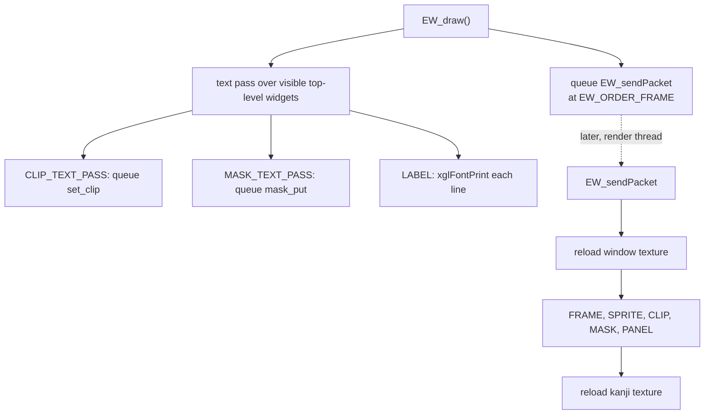

### Cursors and arrows

Cursor and arrow sprites are cells of the window texture.
`EW_sprtSetCursorUV(widget, mode, cell)` picks the cell.

| Mode | Sprite | Atlas origin (u, v) | Animation |
| --- | --- | --- | --- |
| 0 | menu cursor | 0, 0xC0 | 8 frames, cell index shifted by 1 |
| 1 | up arrow | 0x40, 0xA0 | none |
| 2 | down arrow | 0, 0xB0 | none |
| 3 | "more text" cursor | 0x40, 0xB0 | none |

## Text windows (TWIN)

A **text window** is a TWSYS slot of kind `TEXT`, `TEXT_FIELD` or
`TEXT_SCENE`. `TWIN_create2(slot)` claims a slot (the first free one for -1),
builds the widget tree, allocates a message buffer, sets the position to
(16, 305) and enters `OPENING` with the flags `FOLLOW_OWNER`, `ACTIVE` and
`RUN`. `TWIN_initCF(window)` or `TWIN_initScene(window)` then sets the size of
the kind. Both live in `src/main/tslider_create.c` and call `TWIN_init2`.

| Kind | Width | Height | Line pitch | Position | Use |
| --- | --- | --- | --- | --- | --- |
| field conversation (CF) | 0x1CC (460) | 0x50 (80) | 0x18 (24) | from `TWIN_create2` | talking to characters, item windows |
| scene | 0x1E0 (480) | 0x56 (86) | 0x1A (26) | x 0, y 324 | event scene subtitles |

### Text window fields

| Offset | Field | Meaning |
| --- | --- | --- |
| +0x50 | `textVerticalOffset` | scroll offset during a line scroll |
| +0x9C | `messageBuffer[2]` | MBUF buffers freed by `TWIN_dispose` |
| +0xA4 | `currentPage` | lines shown since the last clear |
| +0xA6 | `line_pitch` | pixels between lines |
| +0xA8 | `textOutput` | the caption buffer |
| +0xAC | `queue` | the `MsgQueue` of pending text |
| +0xCC | `frameCounter` | frames since creation |
| +0xD0 | `widgets[8]` | the widget slots below |
| +0x120 | `pendingMessage` | the `waitkey` value |
| +0x14C | `lineWidths[24]` | pixel width of each line |
| +0x17C | `lineBufferPointers` | one pointer per line |
| +0x184, +0x185 | `lineCharacterOffset`, `currentLineIndex` | write position |
| +0x186, +0x187 | `layout_offset`, `line_count` | layout values set by `setSize` |
| +0x188 | `lineData` | three 0xC0-byte lines and a 0x80-byte caption |

The widget slots are `CLIP` 0, `MASK` 1, `LABEL` 2, `SCREEN_CLIP` 3, `FRAME`
4 and `CURSOR` 5, all children of one container.

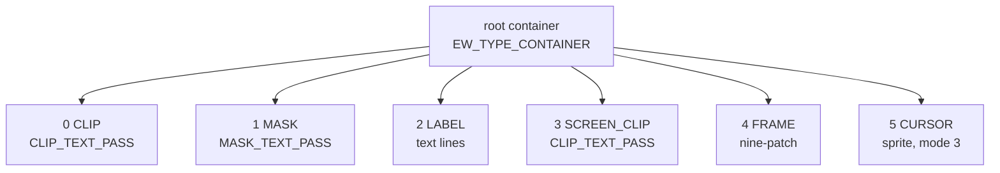

### The text window state machine

`TWIN_update2()` runs once per frame for each text window. It first counts the
frame. When the window is open, it lowers both mask intensities by 4 per frame
until they reach 1 and then sets the label's colour scale to neutral. This is
the box's opening fade.

Next it pops text, but only when the window is open and not waiting. A
conversation window uses `TWIN_popCF`, which pops **two characters per
frame**, giving the typewriter effect. A scene window uses `TWIN_popScene`,
which pops 24 characters at a time in a loop until the queue is empty or a
tag stops it, so the whole line appears at once. Both functions react to the
popped `last` code.

| Popped | New state |
| --- | --- |
| `MSG_CTRL_WAIT` | `WAIT_FRAMES`, with `waitFrames` = n |
| `MSG_CTRL_CLOSE` | `CLOSING` |
| `MSG_CTRL_CLEAR` | `CLEAR_TEXT` |
| `MSG_CTRL_WAITKEY` | `WAIT_RESULT`, with `pendingMessage` = n |
| `MSG_CTRL_CAPTION` | none, the text is copied to `textOutput` |
| line full or `'\n'` (CF) | `SCROLL_LINE`, or `WAIT_SCROLL` when the last line of the box is full |
| line full or `'\n'` (scene) | next line, or `WAIT_SCENE` when the box is full |

Then the state handler runs. The handlers wait for the Circle button
(`PadData[0].pressed & PAD_CIRCLE`) or for a timer.

- `WAIT_RESULT` waits for Circle, returns to `IDLE` and copies
  `pendingMessage` into `closeState`.
- `WAIT_SCENE` waits for Circle and empties the lines.
- `WAIT_FRAMES` counts `waitFrames` down to below zero.
- `CLEAR_TEXT` empties the lines at once.
- `WAIT_SCROLL` waits for Circle and moves to `SCROLL_LINE`.
- `SCROLL_LINE` moves the write position to the next line. On the last line,
  it scrolls the text up 6 pixels per frame for 5 frames, then rotates the
  line buffers so the oldest one becomes the new last line.
- `CLOSING` counts 10 frames, sets `closeState` to 255 and calls
  `TWIN_dispose`, which frees the widgets, the buffers and the slot.
- `OPENING` counts 11 frames, sets `OPEN` and moves to `IDLE`.

The following state diagram shows a conversation window.

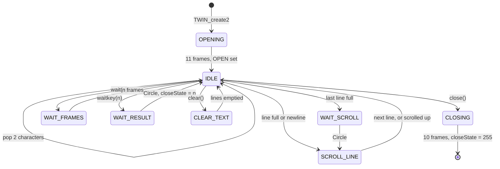

A scene window follows the same chart, except that it fills the whole box at
once and stops in `WAIT_SCENE` when the box is full. Circle then empties the
box for the next lines.

### Drawing a text window

`TWIN_draw2()` and `TWIN_drawScene2()` draw nothing while the window is
`OPENING` or `CLOSING`. Otherwise `TWIN_draw2()` places the mask and the frame
at the window position, sets their keys to `EW_ORDER_MASK` and
`EW_ORDER_FRAME`, places the clip and the label, and makes them visible. The
label sits 12 pixels in from the frame and 4 pixels down, plus
`textVerticalOffset` while a line scrolls. In `WAIT_RESULT`, `WAIT_SCROLL`
and `WAIT_CLEAR` the cursor sprite (mode 3) appears right after the text of
the current line, or at the start of the next line when it does not fit. A
caption in `textOutput` is printed at `EW_ORDER_FRAME` with
`twinFontParamControl`.

`TWIN_drawScene2()` shows only the mask, the clip, the label and the cursor.
A scene window has no frame. Its label uses a pitch of 26 pixels, the outline
style `twinLabelStyleControl` and the stored line widths, so every line is
centred. The cursor also shows in `WAIT_SCENE`.

### Following the speaker

`TW_setPos(component)` places a box next to the character who is speaking. It
returns at once unless a window owner is set (`XTK_getWindowOwner()`) and the
component has `TCOMP_FLAG_FOLLOW_OWNER`. Otherwise it takes the owner's
position 1.6 units above its origin and projects it through studio camera 0
with `transformVector`. It then measures the distance from the camera to the
owner, limits it to 2.5 and moves the box by half its size plus 16 pixels plus
`40 × (2.5 − distance)`. The box goes above the anchor and towards the screen
centre, so a speaker on the right gets the box to the left. Finally it clamps
the box between x 8 and `504 − width`, and between y 8 and 224.

Only `TMENU_updateDefault` calls it, in the menu's `OPENING` state. A menu
created during a conversation therefore appears near the speaker. The talk
window itself has `FOLLOW_OWNER` cleared when it is created, so it stays at
its fixed place at the bottom of the screen.

## Dialogue from a script

Story logic runs as Java code in the game's own VM, described in
[java-vm.md](../scripting/java-vm.md). Scripts reach the windows through the
`xeno.util.Window` and `xeno.util.Menu` classes. The full list of natives is in
[natives.md](../scripting/natives.md).

### Window natives

The `Window` natives are in `src/main/window.c`. A Java `Window` object is the
TWSYS slot itself, because `class_ref` at offset 0 makes the slot look like a
Java object to the VM.

| Native | Effect |
| --- | --- |
| `create(int kind)` | `TWIN_create2(-1)`, sets the class, then `TWIN_initCF` for kind 0 or `TWIN_initScene` for kind 1 |
| `print(String)`, `print(String[], int)` | `MSG_print2` with the text |
| `clear()` | prints `/[clear()]` |
| `close()` | prints `/[close()]` |
| `waitkey(int n)` | prints `/[waitkey(n)]` |
| `wait(int n)` | prints `/[wait(n)]` |
| `closeWaitKey()` | prints `waitkey(0)` and `close()` as one tag |
| `signal(int v)` | sets `closeState` |
| `getSignal()` | returns `closeState` and clears it |
| `setSize(int, int)` | sets `layout_offset` and `line_count`, then calls `TWIN_init2` |
| `setLocation(int x, int y)` | clears `FOLLOW_OWNER` and sets `x` and `y` |
| `setName(String)` | empty |

Every command is text. `clear`, `close`, `waitkey` and `wait` do not act at
once. They append a tag to the same queue as the dialogue, so the window
reaches them in order, after the text before them has appeared.

### Waiting for a window

A script waits for a window or menu with `System.waitFor(object)` in
`src/main/system.c`. For a `Window` or `Menu` object, the native marks the
thread with the wait reason `JTHREAD_WAIT_COMPONENT` (3). The scheduler in
`src/main/jthread.c` checks it each frame in `JTHREAD_waitFor` and wakes the
thread when the component's `state` is 2, which is `CLOSING`. The script
therefore continues while the box is still fading out.

A script can also poll `getSignal()`. It returns the value of the last
`waitkey(n)` the player confirmed, or 255 once the window has closed. Scripts
probably use it to wait for one particular page break without closing the
window.

The sequence below follows a conversation line from the script to the screen.
The Java calls on the left are a likely pattern rather than a quoted script.

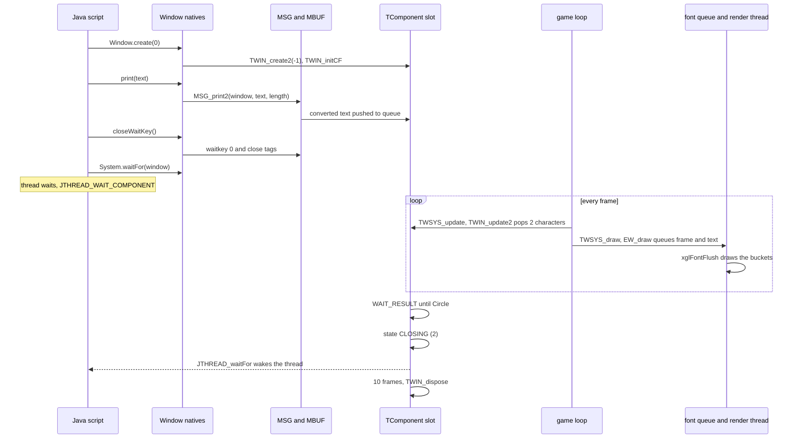

### Talking to a character

When the player talks to a character, `src/main/script.c` starts a talk
observer task. It first looks for a talk method with the signature
`(Lxeno/Enepc;)V`. If there is none, it looks for
`(Lxeno/Enepc;Lxeno/util/Window;)V` and creates a window for it with
`TWIN_create2(-1)`. The window gets the `xeno.util.Window` class, the
conversation size from `TWIN_initCF`, and flags 0x40 and 0x80 cleared. The
code sets the speaker as the window owner with `XTK_setWindowOwner(actor)`
and calls the method on the Stage object with the character's Java object and
the window as arguments.

While the talk runs, Cross cancels it when the script allows that (script flag
8). `talkCancel` then forces the window into `CLOSING`, disposes it and clears
the talk flags. When `stageVM` reports that the call is done, the observer clears the
window owner and the talk flags and removes itself. The rest of the talk
system is described in
[events.md](../scripting/events.md#talking-to-characters).

### Scene messages and item windows

`src/main/scene_1.c` gives every `xeno.Scene` object a `msg` field holding a
scene window (`TWIN_create2` and `TWIN_initScene`, class
`xeno/util/Window`). Event scripts print subtitles into it.

`createItemGetWin(text)` in `src/main/create_evt_item_get_task.c` opens a
conversation window for "item obtained" messages. It prints the text followed
by `waitkey(0)` and `close()` and returns a pointer to the window's `state`,
so the caller can watch for the close.

## Script menus (TMENU)

A **script menu** is a TWSYS slot of kind `MENU`. It shows an optional
question (the query) above a list of items and a cursor. `TMENU_create(slot)`
claims a slot, calls `TMENU_init` and moves the box to (48, 64). `TMENU_init`
builds the widget tree and enters `OPENING` with `FOLLOW_OWNER`, `ACTIVE`,
`RUN` and `OPEN`.

| Offset | Field | Meaning |
| --- | --- | --- |
| +0x50 | `closePolicy` | bit 0: close after a choice |
| +0x54 | `selectedItem` | row under the cursor |
| +0x55 | `selectionResult` | -1 after Cross |
| +0x56 | `itemCount` | number of items |
| +0x58 | `firstVisibleItem` | first row on screen |
| +0x5A | `visibleLineCount` | rows on screen, 4 by default |
| +0x60 | `msgBuffer` | text storage |
| +0x68 | `requestedSelection` | start row for `PRESELECT` |
| +0xD8 | `queryQueue` | `MsgQueue` of the question |
| +0xF8 | `frameCounter` | frames since creation |
| +0xFC | `rootWidget` | widget tree |
| +0x100 | `widgets[16]` | `CLIP` 0, `MASK` 1, `ITEMS` 2, `QUERY` 3, `SCREEN_CLIP` 4, `FRAME` 5, `ARROW_UP` 6, `ARROW_DOWN` 7, `CURSOR` 8 |
| +0x154 | `nextQueryId` | query bookkeeping |

A menu holds up to 16 items (`TMENU_ITEM_CAPACITY`) and 3 query lines, each 24
pixels high. Its height is `visibleLineCount × 24 + 4`, plus `lines × 24 + 12`
when there is a query.

The items and query come from text. `TMENU_addItem(menu, text)` converts the
text and splits it at newlines, one item per line. `TMENU_setItem(menu, index,
text)` stores one item (at the end for -1). `TMENU_addQuery(menu, text)`
converts a question and pushes it onto `queryQueue`.
`TMENU_addQuery2(menu, lines, count)` in `src/main/tslider_create.c` takes an
array of rows. An entry of three zero bytes marks where the question ends and
the items start.

### Menu input

`TMENU_updateDefault()` drives the menu.

- `OPENING` counts 11 frames and calls `TW_setPos` each frame. It then sets
  `OPEN` and moves to `REVEAL`. With `PRESELECT`, it copies
  `requestedSelection` into `selectedItem`.
- `REVEAL` fades the box in over 8 frames by lowering the mask intensities
  from 128, and pops the question **one character per frame**. A `wait(n)` in
  the question pauses in `WAIT_FRAMES`. When the question is complete and at
  least 9 frames have passed, the menu sets the mask to `EW_MASK_FIX_NONE` and
  moves to `INPUT`.
- `INPUT` reads the pad. Cross plays `SE_CANCEL`, sets `selectionResult` to
  -1 and moves to `DONE`. Circle plays `SE_DECIDE` and moves to `DONE`. Up
  and down with auto-repeat play `SE_CURSOR`, move `selectedItem` and scroll
  `firstVisibleItem` to keep the cursor in view.
- `DONE` moves to `CLOSING` when `closePolicy` bit 0 is set, otherwise to
  `IDLE`, which keeps the menu on screen.
- `CLOSING` hides the root widget at once, counts 10 frames and calls
  `TMENU_dispose`.

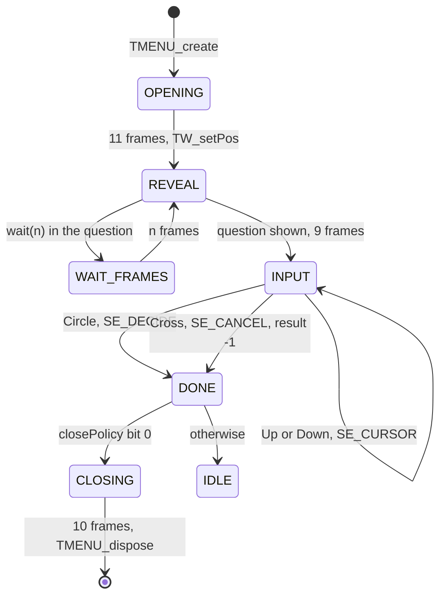

`TMENU_drawDefault()` places the mask, frame and clip, the query label, and
the items label 20 pixels in from the left edge. The items label starts at
`firstVisibleItem` and shows `visibleLineCount + 1` rows. The up and down
arrows (sprite modes 1 and 2) appear when rows are hidden above or below. The
cursor (mode 0) sits at row `(selectedItem − firstVisibleItem) × 24 + 12`.

### Menu natives

The `Menu` natives are in `src/main/menu_2.c`.

| Native | Effect |
| --- | --- |
| `create()` | `TMENU_create(-1)` |
| `addQuery(String)` | `TMENU_addQuery` |
| `addQuery(String[], int)` | `TMENU_addQuery2`, at most 32 rows |
| `addItem(String)` | `TMENU_addItem` |
| `getSelected()` | `selectionResult` when it is negative, otherwise `selectedItem` |
| `setCursor(int)` | sets `requestedSelection` and `PRESELECT` |
| `setLocation(int, int)`, `setVisible(boolean)` | empty |

A script builds the menu, waits for it with `System.waitFor(menu)` like a
window, and then reads the choice. `getSelected()` returns -1 after Cross and
the row number after Circle.

## Sliders (TSLIDER)

A **slider** is a TWSYS slot of kind `SLIDER` that edits a number. The code is
in `src/main/tslider_create.c`. `TSLIDER_create` sets a default of 4 digits,
a maximum of 100, a size of 0x60 by 0x28 and the position (48, 64).
`TSLIDER_init` clamps the value to the limits and sets the width to `digits ×
10 + 16`, or `digits × 20 + 16` for full-width digits. The value, minimum and
maximum sit at offsets 0x58 to 0x60.

In `INPUT`, left and right change the value by 10 and down and up by 1, using
the pad's auto-repeat. The value stays between the limits. Circle moves to
`DONE`. Cross also moves to `DONE` but sets the value to -1. `DONE` moves to
`CLOSING`, which clears `ACTIVE`.

`TSLIDER_drawDefault()` turns the value into text with `STRING_int`, widens it
with `STRING_h2zEUC` and prints it right-aligned with `xglFontPrintf`, padding
20 pixels per missing digit. The stage-select debug menu `DB_stageSelect` in
`src/main/script.c` is the known user.

### Text helpers

`src/main/twsys_init.c` also holds small string helpers.

| Function | Use |
| --- | --- |
| `PARSE_int(text, length, radix)` | parse a signed number, -1 length for a NUL-terminated string, 0 on overflow |
| `STRING_int` | number to text, two digits at a time with the `radixTenUnits` and `radixTenTenths` tables |
| `STRING_h2zEUC` | ASCII letters and digits to full-width EUC |
| `STRING_toUInt` | text to an unsigned number. Its one caller ignores the result |

## The endPrint layer

The e-widgets do not draw by themselves. They describe primitives to the
**endPrint** layer in `src/main/end_print.c` and `include/main/end_print.h`,
which draws them later on the render thread.

### Commands

`endPrintExtFunc(order, command, param)` is the entry point. `param` points at
an info structure that describes the primitive.

| Value | Command | Draws |
| --- | --- | --- |
| 0 | `END_PRINT_CMD_LINE` | line |
| 1 | `END_PRINT_CMD_WINDOW` | window: border plus interior tiles |
| 2 | `END_PRINT_CMD_SPRITE` | one sprite |
| 3 | `END_PRINT_CMD_RIBBON` | Gouraud-shaded strip |
| 4 | `END_PRINT_CMD_POINT` | point |
| 5, 6 | `SCISSOR_SET`, `SCISSOR_RESET` | clip rectangle on and off |
| 7 | `END_PRINT_CMD_TAG_FONT` | sprite-letter text |
| 8 | `END_PRINT_CMD_SPRITE_QUAD` | sprite with four corners |
| 9 | `END_PRINT_CMD_FRAME` | window border only |
| 10 | `END_PRINT_CMD_NUMBER` | number from digit sprites |
| 11 | `END_PRINT_CMD_LINE_RAW` | line, raw form |
| 12 | `END_PRINT_CMD_Z_SCISSOR` | depth-only rectangle |
| 13 | `END_PRINT_CMD_THUMBNAIL` | save thumbnail |
| 14, 15 | `FONT_TEX_CHANGE`, `FONT_TEX_RELOAD` | swap the window texture, restore it |
| 16 | `END_PRINT_CMD_ETHER_LINE` | glowing line |
| 17 | `END_PRINT_CMD_CIRCLE` | filled circle |
| 18, 19 | `DRAW_BACK_SET`, `DRAW_BACK_RESET` | switch the GS frame to a second buffer and back |
| 20 | `END_PRINT_CMD_SCREEN_CLEAR` | clear |
| 21, 22 | `BACK_SPRITE`, `BACK_SPRITE_RECT` | quads textured from that buffer |
| 100 + n | `END_PRINT_EXT_*` | queue a font callback right away |

The primitives are built in a few ways. `PrintWindow` draws a 3-pixel border
from `win_uv[0..7]` and fills the inside with tiles of up to 128 pixels.
`PrintFrame` draws only the border. `PrintNumber` builds digits from `num_uv`
sprites, with the style in the low nibble and right alignment at bit 0x10.
`PrintTagFont` is a sprite-letter font from `tag_uv`, where a leading `\x01`
right-aligns the text and code 3 sets a custom advance. `PrintRibbon` is a
Gouraud-shaded triangle strip whose point list ends with a zero-depth entry,
and `PrintCircle` is a triangle fan. `PrintEtherLine` draws a line with eight
glow ribbons whose alpha halves each time. `ScissorSet` clamps to the 512 by
448 screen. `ZScissor` writes a rectangle into the depth buffer without
touching colour, which probably keeps later primitives with a lower depth out
of that area. `DrawBackSet` points the GS frame at the buffer named in
`sRender.draw_back_value` with depth writes off, and `DrawBackReset` restores
it. `PrintBackSprite` draws a textured quad taken from that buffer.
`endPrintDirectFrameCopy(packet, from, to)` adds a GS local-to-local
transfer of a 512 by 448 area between two buffers. The main menu, the save
screen, the settlement screen and the U.M.N. use it to keep a still copy of
the picture behind their windows.

`endPrintInfoSet` loads the GS state for all of them: texture flush, alpha
blending (ALPHA 0x44), clamping, the texture and palette (TEX0 with the CLUT)
and TEST 0x5000D, which is alpha NOTEQUAL and depth GEQUAL. The functions
`endPrintDirectLine`, `endPrintDirectRibbon` and `endPrintDirectCircle` skip
the queue and write straight into the current packet through the scratchpad.

### Deferred queue and flush

There are two paths through `endPrintExtFunc`. A command below 23 ignores
`order` and calls `endPrintExtFuncPack(func_tbl_4[command], param)`, which
appends the pair to `PrintFunc[512]`. The queue starts over when it would
pass 511 entries. A command of 100 or more calls
`xglFontPrintExtFunc(order, func_tbl2_5[n], param)` at once, which places a
callback in the font queue at that order key.

| n | Extended command |
| --- | --- |
| 0 | `END_PRINT_EXT_FLUSH`, runs `PrintFlush` |
| 1, 2 | `SCISSOR_SET`, `SCISSOR_RESET` |
| 3, 4 | `FONT_TEX_CHANGE`, `FONT_TEX_RELOAD` |
| 5 | `Z_SCISSOR` |

Every screen that uses e-widgets ends its frame with `endPrintExtFunc(0, 100,
0)`. The menu loop in `src/main/window_tex_load.c`, the battle window mains,
`src/main/file.c`, the shops, the settlement screen and the U.M.N. tasks all
do it. During `xglFontFlush`, the render thread reaches that callback and runs
`PrintFlush`. It uploads the window texture, calls every queued function in
order, resets the queue with `endPrintInit`, uploads the kanji texture again
and resets the message icon sprites with `eMessageSpriteReset`.

Because the drawing happens later, the info structures must stay valid until
the render thread has used them. This is why the widgets keep separate
"render" copies of their state: `ESprite` has render coordinates, `eNumber`
has `render[4]` and `eWindow` has its own `primitive`.

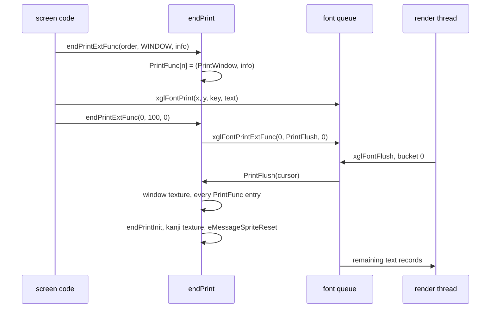

### Sprite ids and UV tables

Sprites are named by a 16-bit **sprite id**. The high byte selects a UV table
and the low byte an entry in it. Each table also names a palette address in
GS memory, such as 0xFDE00 or 0xFDB00. `PrintSpriteInfo` carries `x`, `y`,
`depth`, `width`, `height`, `color[4]`, `uv`, `column` and `row`.
`endSpriteSet(sprite, flags)` fills it from a table entry, with flags
`SIZE` 1, `COLOR` 2, `CELL` 4 or 255 for all.

| Index | Table | Index | Table |
| --- | --- | --- | --- |
| 0 | `END_PRINT_UV_CUR` cursors | 13–16 | `FACE01`–`FACE04` |
| 1 | `OTHERS` | 17 | `THUMNAIL` |
| 2 | `PAD` controller icons | 18 | `ETHER` |
| 3 | `ICOM` | 19 | `SEG` |
| 4 | `FACE_PUTI` | 20 | `UMN` |
| 5 | `TAG` letters | 21–23 | `BTL_MSG`, `BTL_MSG2`, `BTL_MSG3` |
| 6 | `WIN` window parts | 24 | `UMN2` |
| 7 | `NUM` digits | 25 | `UMN3` |
| 8 | `PAD2` | | |
| 9 | `FACE_AGWS` | | |
| 10 | `NAME` | | |
| 11 | `OTHERS2` | | |
| 12 | `FACE00` | | |

For example, sprite 0x0609 is entry 9 of the window table and 0x0704 is entry
4 of the digit table.

### Window textures

The UI art lives in three `.xtx` files in `data\endou\`, named in
`src/main/open_close_main.c`. `WindowTexLoad(buffer, request)` in
`src/main/window_tex_load.c` loads one of them.

| Slot | File | Destination | Use |
| --- | --- | --- | --- |
| 0 | `data\endou\cfwin.xtx` | `MenuWinAddr` | field windows, loaded at boot by `xglFontInitial` and again when the menu closes |
| 1 | `data\endou\menu01.xtx` | `MenuWinAddr` | main menu |
| 2 | `data\endou\menu02.xtx` | `Menu02Tex[0x40800]` | extra menu art |

Request bit 16 makes the load asynchronous through `MenuLoadFile`. A non-null
buffer becomes the new `MenuWinAddr`, and the call ends with `endPrintInit`.
`WindowTexAddrGet(slot)` returns the address of a loaded file. An `.xtx` file
is a small directory, described in
[XTX texture sets](../formats/models-and-textures.md#xtx-texture-sets). The
header has the entry count at +8 and the offset of the entries at +0xC. Each
entry gives the width and buffer width of one rectangle, its height, its
destination in GS memory, the length of its transfer packet and the packet's
offset. `src/main/end_print.c` names the first two words of an entry
`widthAndBufferFormat` and `height`: the low half of the first word is the
transfer width, its high half the buffer width and pixel format, and the
second word the transfer height. Each image is uploaded to GS word
address 0xF0000 plus its destination whenever a draw pass reloads the window
texture. The three menu sheets are 512 × 128 pixels each.

A screen can switch textures for part of a frame. `FONT_TEX_CHANGE` swaps in
another image set, for example `menu02` in the main menu's info window, and
`FONT_TEX_RELOAD` restores the normal one.

The main menu loop itself, which calls `WindowTexLoad` when it opens and
closes, is described in [main-menu.md](../game/main-menu.md).

## E-widgets

### Mode convention

Every e-widget has a one-byte **mode** with shared values from
`include/main/open_close_main.h`. Each phase has a `START` value that sets up
the phase and then falls into its `STEP` value, which runs every frame after
that.

| Mode | Value | Meaning |
| --- | --- | --- |
| `E_MODE_INIT` | 0x00 | not set up |
| `E_MODE_IDLE` | 0x01 | set up, hidden |
| `E_MODE_SHOW_START`, `STEP` | 0x20, 0x21 | appear at once |
| `E_MODE_OPEN_START`, `STEP` | 0x22, 0x23 | appear with an animation |
| `E_MODE_RUN_START`, `STEP` | 0x50, 0x51 | active |
| `E_MODE_HIDE_START`, `STEP` | 0x70, 0x71 | disappear |
| `E_MODE_END_START`, `STEP` | 0xF0, 0xF1 | finished |

### Open and close animation

`OpenCloseMain(controller)` animates a window opening or closing. Its phase
is 0 to start, 1 while running and -1 when done. Its subtype picks the
handler with `(subtype >> 4) × 2 + (subtype & 15)`, which selects
`OpenSubType00`, `OpenSubType01` or `CloseSubType00`.

`OpenSubType00` draws three `FRAME` rectangles each frame. They grow with a
cosine curve and wobble with a sine over 11 frames at alpha 0x40, then hold
for `frames × 5 + 10`. `OpenSubType01` grows the box vertically over 7
frames. `CloseSubType00` runs the opening curve with sine and cosine swapped.

### eWindow and eCursol

`eWindowMain()` is a plain window. `OPEN_START` runs the opening animation and
then shows the window. In `RUN` it copies the geometry into its `primitive`
copy. While it is visible it queues `END_PRINT_CMD_WINDOW` in grey at alpha
0x40. `eWindowSet()` resets a window to 16 by 16.

`eCursolMain(ECursolMainData *)` is a cursor sprite with the modes `SHOW`,
`OPEN`, `RUN` and `HIDE`. Opening grows the sprite while a timer runs from −4
to 8. The style (`cursol->width`) is an entry of the cursor UV table, and the
animation frame cycles as `(t >> 1) % 8` for style 0 and `(t >> 2) % 4` for
the others. It queues `END_PRINT_CMD_SPRITE`. `eCursolSet(cursol, style)` sets
it up, and `eCursolModeChange` refuses to start `SHOW` or `RUN` while the
cursor is already showing or running.

### eMessage

`eMessage` in `src/main/e_message.c` draws paged text inside menus and battle
windows. Its record is `EMessageParam`.

| Field | Meaning |
| --- | --- |
| `flags` | `HEADER` 1, `TYPEWRITER` 0x10, `LINE_TIMING` 0x20, `PAGE_DONE` 0x80 |
| `mode` | e-widget mode, plus `LINE` 0x24 and 0x25 |
| `visible` | drawn or not |
| `wrap_width_half` | half the wrap width, 240 by default |
| `x`, `y` | position |
| `draw_parameter` | order key, usually the window's depth plus 2 |
| `rgba` | colour that scales the text colour codes |
| `text_timer`, `frame` | typewriter timing |
| `text` | the string |
| `page_available`, `page_index`, `page_count` | paging |
| `cursor` | an embedded `ECursolMainData` for the page cursor |

The string uses font codes 1 to 25 as usual. Byte 30 is followed by an icon
id, and byte 31 ends a page and waits for a key. `SHOW` prints the page at
once, `OPEN` (0x22) types one glyph per frame, and `LINE` (0x24) reveals it
line by line.

`eMessageDrawType01()` does the work in two passes. It first prints a header
string: reset, line settings, the colour scaled by `rgba`, a shadow, a blend
with the scaled alpha, style 3, default width 4 and the wrap width. It skips
to the current page with `eMessageNextWaitKeySearch`. The first pass measures
widths and records up to 32 wrap points (`EMESSAGE_MAX_WRAPS`). The second
pass copies the visible text into `moji[4096]`, inserts the wraps and scales
every colour and alpha code by `rgba`. Icons become entries in `msg_spr[16]`
and are queued as sprites. Icons 0 to 3 map to entries 1, 0, 2 and 3 of the
`pad_uv` table, probably the controller buttons, and higher icons use the
battle message and `pad2` tables. The page text is printed with
`xglFontPrint(x + offset_x, y + offset_y − 1, draw_parameter, moji)`, and the
page-end cursor is an `eCursol` of style 3.

`eMessageNextPage()` shows the rest of a page that is still typing, or moves
to the next page. `eMessageTextChange()` sets new text and counts its pages.
`eMessageSet()` resets the defaults. `eMessageCpy` and `eMessageCat` build
strings, and `eMessageNextGyouMaxGet` counts lines.

### eNumber

`eNumberMain(ENumberMainData *)` in `src/main/e_number_main.c` draws numbers
from digit sprites. The record holds a position, an order key (`work`), a
colour, a mode (phase 3 draws), a format, the digit count, colour modes, the
alignment, a "first only" flag, the value, `render[4]` copies and two
separator sprites. `eNumberSet()` sets a neutral colour and phase 3.

| Format | Shows |
| --- | --- |
| 0, 1 | digits |
| 14 | digits followed by sprite 0x0506 |
| 2 | time: three 2-digit fields 32 pixels apart with 0x0704 separators |
| 11 | empty time |
| 3–6 | value pair with a separator, such as current and maximum |
| 12, 13 | value pair that turns red below one fifth |
| 7, 8 | signed value with a 0x0705 or 0x0706 sign sprite |
| 9 | dashes |
| 10 | text through `END_PRINT_CMD_TAG_FONT` |

### Sprites, ribbons, lines and tag fonts

The same file holds the smaller widgets.

- `eSpriteMain` and `eSpriteSet` draw one sprite id.
- `eRibbonMain` and `eRibbonSet` draw a six-point ribbon in one of four
  styles. `SHOW` sweeps its width open over 8 frames. It queues
  `END_PRINT_CMD_RIBBON`. Window title bars are ribbons.
- `eLineMain` and `eLineSet` draw a five-point line that eases into place over
  7 frames.
- `eTagFontMain` and `eTagFontSet` draw sprite-letter text. The colour bytes
  are stored with green and blue swapped.

`src/main/e_number_main.c` also holds the main menu's command strings, such as
`"Items\nEther\nTech Attack\nSkills\nCharacters\nA.G.W.S.\nBattle Formation\nU.M.N.\nGame Options"`,
and the help lines, such as `"Access the U.M.N. (Unus Mundus Network)."`.

## WindowDX and list windows

`src/main/e_battle_win_open.c` builds larger windows from the small widgets.
Despite the file name, these windows are used across the main menu, the
shops, the save screen and the U.M.N., as well as in battle.

### WindowDX

A **WindowDX** is a window with a title ribbon, an opening animation and a
content callback.

| Field | Meaning |
| --- | --- |
| `x`, `y`, `width`, `height` | geometry |
| `style` | order key, which is the window's depth |
| `tag_id` | title text |
| `state` | see below |
| `ribbon_initialized` | set to hide the bottom ribbon |
| `close_callback`, `close_callback_arg` | content callback, called in each state |
| `rect` | inner rectangle |
| `color_r`, `color_g`, `color_b`, `alpha` | 0x80 grey at alpha 0x60 by default |
| `frame` | `OpenCloseMain` controller |
| `title_font` | `ETagFontMainData` |
| `ribbon_top`, `ribbon_bottom` | `ERibbonMainData` |
| `sprite` | title icon, sprite 0x0609 |

Despite its name, `close_callback` is the window's content hook.
`WindowDXMain()` calls it in every state, so the menus draw their contents
through it. `MenuSelectWindow` and `MenuInfoWindow` in
`src/main/menu_top_command_check.c` are examples.

`WindowDXMain()` steps the states.

- `OPEN` (1) sets up the frame animation, the title font, the ribbons and the
  title sprite. It calls the callback twice, the first time with the state
  set to `CLOSED`, and moves to `OPENING`.
- `OPENING` (2) runs `OpenCloseMain` until it finishes, then moves to
  `READY`.
- `READY` (3) queues `END_PRINT_CMD_WINDOW`, the title ribbon 13 pixels above
  the box (14 pixels high), the title text at `style + 2` and, unless
  `ribbon_initialized` is set, the bottom ribbon. Then it calls the callback.
- `CLOSE` (4) sets the frame to closing mode, calls the callback and moves to
  `CLOSING` (5), which runs the animation and ends in `FINISHED` (-1).

`WindowDXFlagChange()` only allows legal transitions, and `WindowDXSet()`
resets a window to defaults.

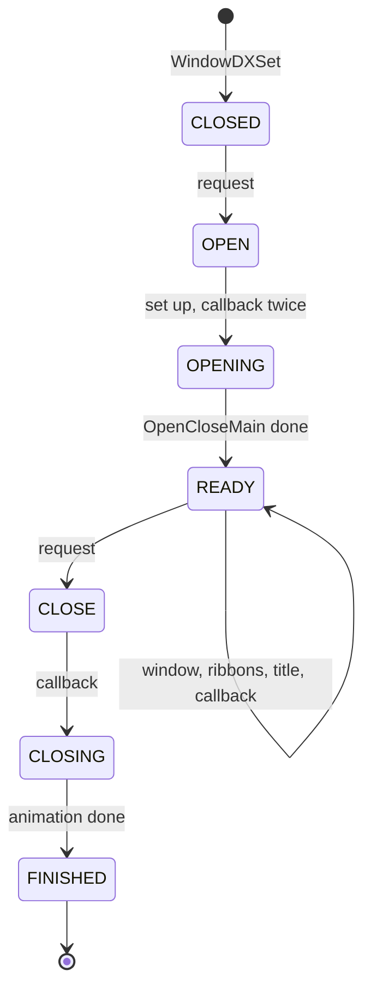

### WindowSP list menus

A **WindowSP** (`WindowSPCursor`) is a scrolling list inside a WindowDX. Item
lists, ether lists, tech lists, shops and U.M.N. lists are built from it.

| Field | Meaning |
| --- | --- |
| `state` | low nibble: `CLOSED` 0, `OPEN` 1, `OPEN_WAIT` 2, `ACTIVE` 3, `CLOSE` 4, `CLOSING` 5. High nibble 1: no animation |
| `draw_flags` | `WINDOWSP_DRAW_CURSORS` 1, `MESSAGES` 2, `NUMBERS` 4 |
| `x`, `y`, `width`, `height`, `style` | geometry and depth |
| `title` | window title |
| `columns`, `rows` | 1 or 2 columns, rows on screen |
| `buttons` | input flags |
| `items` | `MenuListEntry` array of name, amount and flag, ending with a NULL name |
| `visible_top`, `visible_bottom`, `visible_cols`, `visible_rows` | view |
| `current_row`, `max_scroll` | scroll |
| `mode` | digit count of the amounts |
| `selected_index`, `item_count` | selection |
| `window` | the embedded `WindowDX` |
| `cursors[3]` | select cursor, up arrow, down arrow |
| `messages[24]` | one `EMessageParam` per row |
| `numbers[26]` | one `ENumberMainData` per row, plus index + 1 (24) and count (25) |
| `rect` | clip rectangle |

`WindowSPSet()` and `WindowSPItemChange()` count the items.
`WindowSPMain()` opens the window, waits for `READY`, and then, while
`ACTIVE`, fills the rows (`subMWModeExSet`, which dims rows with a non-zero
flag to grey 0x30), places them 24 pixels apart (`subMWPosSet`) and draws
them (`subMWDraw`: window, cursors, scissor on, messages, numbers, scissor
off).

`WindowSPSelect(list, buttons)` reads the cursor keys only while the list is
`ACTIVE`. It calls `subMWControlType00` for one column (up and down, wrapping
on a fresh press) or `subMWControlType01` for two, plays `SE_CURSOR` and
returns `selected_index`. It does not handle Circle or Cross. The caller reads
those buttons and decides. `WindowSPKeepSelect` and `WindowSPSetSelect` save
and restore the 5-byte selection in `MenuKeepSelect`, so a list reopens on the
same row.

The following class diagram shows how the e-widgets nest.

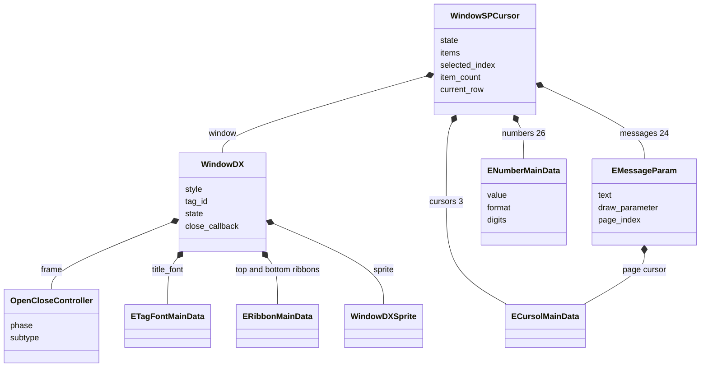

A list screen runs the same loop every frame.

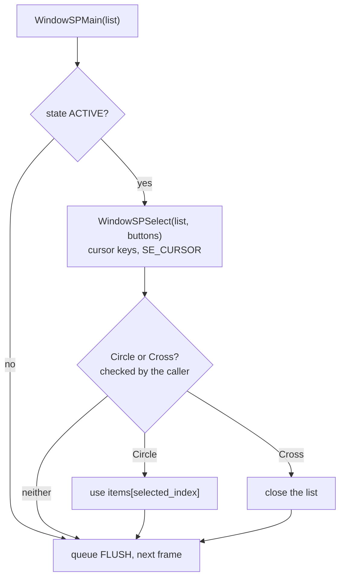

### Battle windows (eBattleWin)

Four ready-made windows serve the battle code and the U.M.N. database. Each
has an `Open`, a `Main` and a `Close` function. Each `Main` returns 0 when
inactive, 1 while animating and 2 when ready, and queues the endPrint flush.

| Window | Functions | Content | Users |
| --- | --- | --- | --- |
| BW | `eBattleWinOpen`, `Main`, `Close` | ether or item command list of 468 by 112 pixels, 2 columns by 4 rows, plus a 312 by 64 "Information" window with the description | `menuOpenEth`, `menuResultEth` and the item menu in `src/ov01/menu.c` |
| BW2 | `eBattleWinOpen2`, `Main2`, `Close2` | message window sized to its text | `battleMsgPut` in `src/ov01/cmd.c`, `src/ov01/menu.c` |
| BW3 | `eBattleWinOpen3`, `Main3`, `Close3` | analysis windows | `src/ov01/battle_init.c`, `src/ov02/umn_guno_data_base_get.c` |
| BW4 | `eBattleWinOpen4`, `Main4`, `Close4` | paged message window, Circle turns pages (`eBattleWinPageCheck4`) | `battleMsgPut2` in `src/ov01/cmd.c` |

`eBattleWinInit2(arena)` places BW, `BW_item[256]`, BW2, BW3 and BW4 one
after another in a work area. `eBattleWinInit()` does the same at
`MenuWorkEndGet()`, the 64 KiB at the end of the menu work area. The battle
code decides on input itself. In `menuResultEth`, Circle plays `SE_DECIDE` or
`SE_BUZZER` and Cross plays `SE_CANCEL`. The battle menus are described in
[battle.md](../game/battle.md).

### Main menu example

The main menu's command window shows how the parts fit.
`TopMenuWinMain` in `src/main/menu_top_command_check.c` uses a WindowDX with
`close_callback = MenuSelectWindow`. It opens it without animation (state
`OPEN`, one `WindowDXMain` call, state `READY`) and slides it with
`MoveSlide`. `MenuInfoWindow` is another callback. It switches to the
`menu02` texture with `FONT_TEX_CHANGE`, draws with `SPRITE_QUAD` and a
scissor, and shows paged help text with an `eMessage`. The menu loop calls
the current level function, queues the endPrint flush, runs the background
task and `nmlModelFlush`, and sleeps until the next frame, as described in
[main-menu.md](../game/main-menu.md#the-menu-frame).

## Drawing order

All UI drawing ends in `xglFontFlush()`, which the render thread runs in
`xglRenderMove()` after the 3D effects, the models and the final packet
callbacks (see [xgl.md](xgl.md#the-render-step)). The UI is therefore always
drawn after the 3D scene. The animated menu background is drawn as models
through `nmlModelDirectSend`, so it ends up behind the windows.

Inside the flush, three rules decide the order.

1. Buckets are drawn from 0 to 15. The bucket is bits 24–27 of the order key.
2. Inside a bucket, records are drawn in the order they were queued.
3. Where primitives overlap, the GS depth test keeps the one with the larger
   depth, which is the low 24 bits of the key or the depth in an endPrint
   info structure.

For the field windows, `EW_draw()` queues the packet pass first, so frames
and sprites are drawn before the text. The depths agree with that order: the
frame is at `EW_ORDER_FRAME`, the mask one step higher and the text at the
top. For the e-widgets, the whole endPrint queue runs inside one callback.
The text of the menus may be queued before that callback, but each text sits
at its window's depth plus 2, so the depth test keeps it in front of its own
window.

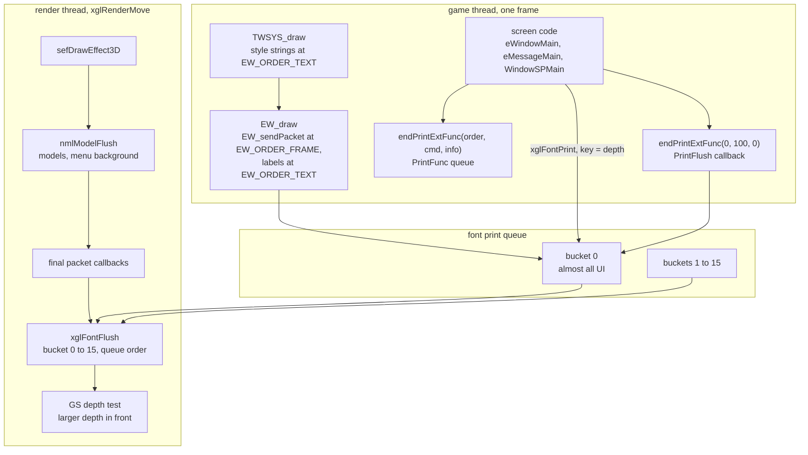

## tya helpers

The `tya` files hold helpers from one programmer that ended up in different
parts of the game.

| Function | File | What it does | Used by |
| --- | --- | --- | --- |
| `tyaDrawGauge(TyaGaugeArgs *)` | `src/main/tya_draw_gauge.c` | horizontal progress bar of a filled and an empty rectangle, sent with `nmlModelDirectSend` | save and load progress in `src/main/file.c` |
| `tyaDisplaySetting(fb_or_mode)` | `src/main/tya_display_setting.c` | screen position adjustment | `src/main/game.c`, the Game Options screen in `src/main/menu_system.c` |
| `tyaMenuBgEntry(scheduler, work)` | `src/main/tya_menu_bg_entry.c` | animated menu background | `src/main/window_tex_load.c` line 504 |
| `tyaElevatorTask` | `src/main/tya_elevator_task.c` | elevator state machine on maps | the `Unit.initElevatorFunc` native in `src/main/unit.c` |
| `tyaCaptureStart` and others | `src/main/tya.c` | screen capture to BMP or SiPic output | a debug native in `src/main/runtime.c` |
| `tyaUmlDispMain`, `tyaUmlDatabaseMain` | `src/ov02/tya_uml.c` | U.M.N. database page viewer for `data\umn\*.uml` with an A to Z index | the U.M.N. database |

`tyaDisplaySetting` has three uses. With NULL it applies the saved screen
offsets, which `src/main/game.c` does. With 1 it resets them. With a frame
buffer it runs the adjustment screen. It shows `data\yajima\mnt_set.jpg`
(see [the quantization tables of mnt_set.jpg](../formats/movies-images-and-icons.md#43-the-quantization-tables-of-mnt_setjpg)
for a decoder quirk that fades its colours) and
moves `DispEnv.display` in steps of ±20, 5 dot units at a time horizontally.
Square resets, Circle confirms and Cross cancels.

`tyaMenuBgEntry` creates 16 `task_menubg` row tasks with a random palette of
512 shades. The rows draw the moving wall pattern behind the main menu through
`nmlModelDirectSend`, and they shrink away when the menu closes.

The elevator task belongs to the map code and is described in
[map-and-units.md](../game/map-and-units.md). The capture tool is a debug
feature described in [debug-tools.md](../game/debug-tools.md). The U.M.N.
viewer is part of [umn.md](../game/umn.md).

## Layout natives

`src/main/layout.c` holds the `xeno.util.Layout` natives. They place objects
on a map, not on the screen. `Java_xeno_util_Layout_set(object, id)` reads a
position from the map's layout data
(`UnduDataGetHeader(locator_group + 0x200, unit_id | 0x8000)`) and writes `px`,
`py`, `pz` and `ry` into a `Chr`, `Unit` or `Effect` object.
`Layout.getManager(int)` stores the layout manager id. Map data is described
in [map-and-units.md](../game/map-and-units.md) and the natives in
[natives.md](../scripting/natives.md).

## Who uses the window system

| Consumer | Toolkit | Entry points | Page |
| --- | --- | --- | --- |
| Field conversations | TWSYS | `TWIN_create2`, `TWIN_initCF`, talk observer in `src/main/script.c` | [events.md](../scripting/events.md) |
| Event scene subtitles | TWSYS | scene `msg` window in `src/main/scene_1.c` | [scenes-and-timecharts.md](../scripting/scenes-and-timecharts.md) |
| Script choices and numbers | TWSYS | `Menu` natives, `TSLIDER_create` | [natives.md](../scripting/natives.md) |
| Item-get messages | TWSYS | `createItemGetWin` | [events.md](../scripting/events.md) |
| Script debug menus | TWSYS | group 1 menus and sliders in `src/main/script.c` | [debug-tools.md](../game/debug-tools.md) |
| Main menu | e-widgets | `src/main/window_tex_load.c`, `src/main/menu_*.c` | [main-menu.md](../game/main-menu.md) |
| Shops and settlement | e-widgets | `src/main/menu_shop.c`, `src/main/seisan_count_init1.c` | [character-growth.md](../game/character-growth.md) |
| Save and load | e-widgets, `tyaDrawGauge` | `src/main/file.c` | [save-data.md](../architecture/save-data.md) |
| Battle menus and messages | e-widgets | eBattleWin in `src/ov01/menu.c`, `src/ov01/cmd.c` | [battle.md](../game/battle.md) |
| U.M.N. | e-widgets | WindowDX, WindowSP, eMessage, BW3 in `src/ov02/` | [umn.md](../game/umn.md) |
| Minigames | font only | their own `xglFontPrint` drawing in OV10, OV11 and OV12 | [minigames](../game/minigames/) |

The minigames in OV10, OV11 and OV12 draw their screens with their own code
and call the font module directly. None of them uses TWSYS, endPrint or the
e-widgets.
