# xgl — the system library

`xgl` is the engine's own system library. It sits between the game and Sony's
SDK, and everything that touches the hardware goes through it: threads, file
reads, GPU packets, sound, controllers, memory cards and the hard disk. It also
contains the math, random number and memory-copy helpers used across the whole
game, which have their own page, [math.md](math.md).

All its functions start with `xgl`, apart from a few small helpers such as
`F2I` and `I2F`. The code is in `src/main/xgl_*.c`, and each file's public
declarations are in `include/main/xgl_*.h`. Every overlay calls into it, and
the A.G.W.S. Battle overlay adds its own thin wrapper layer on top
(see [Who uses xgl](#who-uses-xgl)).

[← Back to the overview](../README.md)

## Modules

The library is split into one source file per subsystem. Most files are
independent of each other. The few links between them are the ones you would
expect: the CD module calls the ARX decompressor, the HDD module reads through
the CD module, the render module drives the packet, font and DMA modules, and
the studio module drives the camera and light modules.

| Module | File | Purpose |
| --- | --- | --- |
| Threads | `xgl_thread.c` | The four system threads and the `xglSleep` rotation |
| Tasks | `xgl_task.c` | Lists of callbacks that run once per frame |
| CD and files | `xgl_cd.c` | File reads, archives, streaming, overlays, IOP modules, clock |
| HDD | `xgl_hdd.c` | HDD install, HDD archive reads, saves on the hard disk |
| Memory card | `xgl_mc.c` | Memory card request queue and save file layout |
| Render | `xgl_render.c` | Frame buffers, frame pacing, clear, fade, the per-frame render step |
| Packets | `xgl_packet.c` | Double-buffered VIF1 packet for the GPU |
| DMA | `xgl_dma.c` | DMA channel helpers and DMA chain buffers |
| Primitives | `xgl_prim_add.c` | Gouraud strips and line strips |
| Studio | `xgl_studio.c` | Studios: sets of cameras with one light set |
| Camera | `xgl_camera.c` | Camera movement, travel modes and view volume |
| Light | `xgl_light.c` | Ambient and parallel lights, light matrices |
| Font | `xgl_font.c` | Text drawing, kanji, proportional widths, debug print |
| Menu | `xgl_menu.c` | Small debug list menus |
| Sound | `xgl_sound.c` | Sound banks, music, sound effects, audio streams |
| Pad | `xgl_pad.c` | Controller reading, key repeat, vibration |
| Flags | `xgl_flags.c` | The packed bit-flag area of the save data |
| Movie | `xgl_1.c` | IPU movie streams and MPEG-2 movie playback |
| Math | `xgl_2.c` | Vectors, matrices, matrix stack, quaternions, random numbers, trigonometry, memory copy |
| JPEG | `xgl_jpeg.c` | JPEG encoder and decoder |
| Timer and ARX | `xgl_timer0.c` | Hardware timer 0 and the ARX decompressor |

## How the parts fit together

The game runs on the control thread and never talks to the hardware directly.
It only fills queues and buffers: the current GPU packet, the text print
queue, the file read queue and the sound command queue. The other system
threads empty them on their next turn. The render thread sends the packet,
the queued text and the sound commands, and reads the controllers. The CD
thread advances file reads and refills streams. The studio thread updates the
cameras, whose matrices the game then uses for drawing.

The diagram below shows these flows.

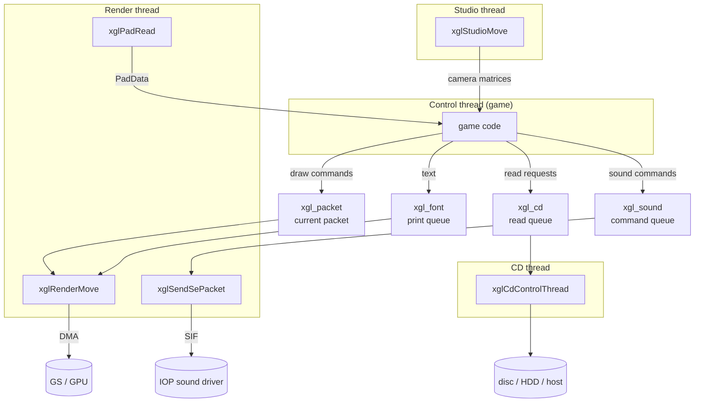

Because only one thread runs at a time (see [Threads](#threads)), none of
these queues needs a lock. A producer and its consumer can never run at the
same moment.

---

## Threads

File: `src/main/xgl_thread.c`

The engine runs four EE threads in a fixed order: render, CD, studio and
control. Each thread does its work, then calls `xglSleep()` to hand over to the
next one. The [overview](../README.md#5-the-four-system-threads) describes what
each thread does from the game's point of view. This section describes the
mechanism.

### The thread table

The four threads are described by a static table, `asSystemThreadList[4]`.
Each entry gives the entry function, the stack size and the priority. At start
the table is copied into `asActiveThreadList[20]`, an array of
`active_thread_t` records (`entry`, `stack`, `stack_size`, `priority`, `id`).
The array has room for 20 threads, but only the first four are ever used.

| Index | Thread | Entry | Stack | Priority |
| --- | --- | --- | --- | --- |
| 0 | Render | `xglRenderEntry` | 4 KiB, `0x001F7000`–`0x001F8000` | 9 |
| 1 | CD | `xglCdControlThread` | 4 KiB, `0x001F6000`–`0x001F7000` | 10 |
| 2 | Studio | `xglStudioEntry` | 4 KiB, `0x001F5000`–`0x001F6000` | 12 |
| 3 | Control | `ControlEntry` | 64 KiB, `0x001E5000`–`0x001F5000` | 11 |

The stacks are carved downward from `XGL_THREAD_STACK_TOP` (`0x001F8000`), in
table order. The priorities do not decide the run order. They only matter for
the EE kernel, and the rotation below wakes exactly one thread at a time
anyway.

### The rotation

`xglThreadInitial()` creates the four threads with `CreateThread` (with the
global pointer set to `_gp`) and starts them with `StartThread`. Each thread's
entry function begins by calling `xglSleep()`, so every thread goes to sleep at
once and waits for its first turn.

The boot thread then calls `xglThreadRotate()`, which never returns. The
rotation works with one semaphore, `iRotateSignal`, created with a count of 0
and a maximum of 1:

1. `xglThreadRotate` wakes thread *n* with `WakeupThread`.
2. It waits on the semaphore with `WaitSema`.
3. Thread *n* runs one turn of work and calls `xglSleep()`.
4. `xglSleep` cancels any pending wake-up request of the calling thread
   (`CancelWakeupThread`), signals the semaphore and calls `SleepThread`.
5. The rotate loop wakes up, sets `iCurrentThread` to `(n + 1) % 4` and starts
   again at step 1.

The sequence diagram below shows two consecutive turns.

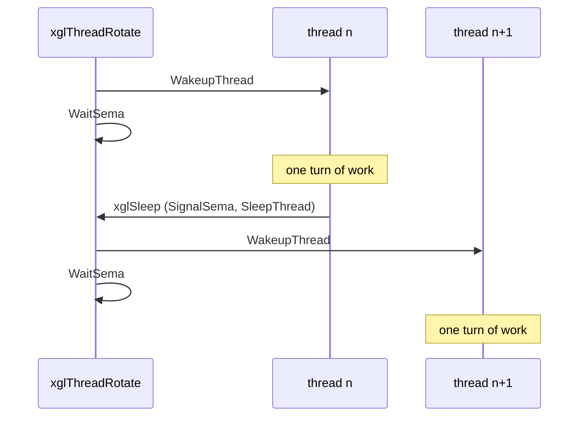

### What this means for game code

Only one thread runs at any moment, and each one gives up control on purpose.
This is cooperative multitasking. It has three consequences that shape the
rest of the engine.

- Shared data needs no locks. The game can append to a queue while the render
  thread is asleep, and the render thread empties it during its own turn.
- Game code can treat `xglSleep()` as "wait for the next frame". The render
  thread's turn includes the wait for vertical sync, so one full rotation is
  one frame.
- A thread that loops without calling `xglSleep()` stops the whole engine. No
  picture is sent, no file read advances and no controller is read.

A typical game loop on the control thread therefore looks like this:

```c
for (;;) {
    xglTaskExecute(scheduler);   /* run this screen's tasks */
    xglSleep();                  /* let render, CD and studio run: next frame */
}
```

## Tasks

File: `src/main/xgl_task.c`

A **task** is a callback that runs once per frame. Most of the game's screens
are built from tasks: a menu cursor, a background animation, a pop-up window
are each one task. Tasks are kept in a **scheduler**, which is one block of
memory with a small header followed by a fixed pool of 128-byte task slots
(`XGL_TASK_SLOT_SIZE`). There is no memory allocation after the scheduler is
created.

### Data structures

The scheduler header is `XglTaskScheduler`:

| Field | Meaning |
| --- | --- |
| `free_tasks` | Singly linked list of unused slots |
| `active_head`, `active_tail` | First and last task of the active list |
| `next_to_visit` | The cursor `xglTaskExecute` uses while it walks the list |

Each slot starts with the common header `XglTaskPrefix`:

| Field | Meaning |
| --- | --- |
| `scheduler` | The scheduler that owns the slot |
| `next`, `previous` | Links in the active list |
| `callback` | `int (*)(XglTaskPrefix *task)`, the function called each frame |

The rest of the 128 bytes belongs to the task. Game code defines its own task
structs that begin with an `XglTaskPrefix` (for example `TskObject` and
`ObjectTask`), so a task pointer can be cast to the full struct.

The layout of one slot is shown below.

```
slot (128 bytes)
+0x00  scheduler   XglTaskScheduler *
+0x04  next        XglTaskPrefix *
+0x08  previous    XglTaskPrefix *
+0x0C  callback    int (*)(XglTaskPrefix *)
+0x10  task data   (112 bytes, defined by the task's own struct)
```

### Creating a scheduler and adding tasks

`xglTaskInitial(block, capacity, flags)` turns a block of memory into a
scheduler. It writes the header at the start of the block, links all
`capacity` slots into the free list and returns the address just after the
pool, so the caller knows where the next free memory starts. It returns 0 when
`capacity` is 0. When `flags` is not zero it also calls
`sceGsResetGraph(1, 0, 0, 0)`, which resets the GS drawing path. That side
effect has nothing to do with tasks and is probably a leftover.

`xglTaskEntryNext(scheduler, callback, entry)` and
`xglTaskEntryPrev(scheduler, callback, entry)` take a slot from the free list,
store the callback and insert the new task after or before `entry`. When
`entry` is 0 the new task becomes the only task of an empty list. Both return
the new task, or 0 when the pool is full or the scheduler is null. Because the
list order is the execution order, a task can be placed exactly before or
after another one. A shadow drawn before its object, or a cursor drawn after
its window, uses this.

The diagram below shows a scheduler with three active tasks and two free
slots.

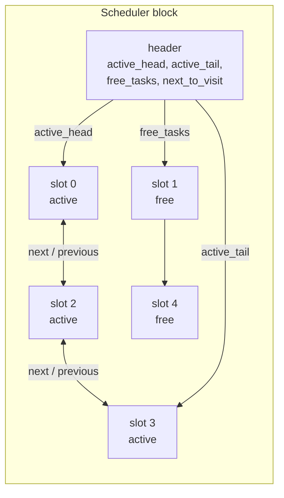

### Running and removing tasks

`xglTaskExecute(scheduler)` walks the active list from the head. Before it
calls a task's callback, it stores the following task in `next_to_visit`. This
is what makes it safe for a callback to remove itself or to add new tasks
during the walk.

There are two ways to remove a task:

- `xglTaskRemove(task)` unlinks the task at once and puts its slot back on the
  free list. If the task is the one stored in `next_to_visit`, the cursor is
  first moved to the following task, so the running walk does not land on a
  freed slot. The callback field is cleared.
- `xglTaskWaitRemove(task)` only replaces the task's callback with
  `xglTaskRemove`. The task is removed the next time the scheduler visits it.
  A task that marks itself is therefore removed on the next frame. Another
  task that has not been visited yet in the current walk is removed later in
  the same walk.

A short example of a self-removing task:

```c
static int FadeTask(XglTaskPrefix *task)
{
    FadeWork *work = (FadeWork *)task;
    if (--work->frames_left == 0)
        xglTaskWaitRemove(task);   /* gone on the next pass */
    return 0;
}

xglTaskEntryNext(scheduler, FadeTask, 0);
```

### Schedulers in the game

There is no single global scheduler. Each screen creates its own and runs it
from its own loop:

| Scheduler | Owner |
| --- | --- |
| `GameLoopState.scheduler` | field game, `src/main/game.c` |
| `MenuTask`, `MenuTask_XMX`, `MenuBgTask` | main menu, `src/main/window_tex_load.c` |
| `umn_task`, `task_xmx` | U.M.N. screens, `src/ov02/tsk_umn_object_task_main.c` |
| `FileTask` | save and load screen, `src/main/file.c` |
| `MenuShopTask` | shops, `src/main/menu_shop.c` |

The field game is described in [field.md](../game/field.md), the main menu in
[main-menu.md](../game/main-menu.md) and the U.M.N. screens in
[umn.md](../game/umn.md).

## CD and files

File: `src/main/xgl_cd.c`

All file access goes through this module. The game asks for a file by name,
for example `data\matumoto\spline.dat`, and the module finds where the file
really is: inside one of the disc archives, as a loose file on the disc, on
the hard disk after an install, or on a development PC. The read itself is
done by the CD thread, a little on each turn, so the game keeps running while
a file loads.

### The read control block

All state of the module is in one static struct, `LW` (type
`CdReadControl`). Its main fields are:

| Field | Meaning |
| --- | --- |
| `dispatch_state` | What the CD thread is doing: `CD_STATE_IDLE` (0), `SYNC_READ` (1), `ASYNC_READ` (2) or `STREAM` (3) |
| `read_poll_mode` | The source of the current read: disc (0), host (1) or HDD (2) |
| `active_file_descriptor`, `write_cursor`, `remaining_bytes` | Progress of a host or HDD read |
| `completion_callback` | Called with progress events and at the end |
| `extract_source`, `extract_destination`, `extract_byte_count` | Where the raw data lands and where the expanded data goes |
| `requests[32]`, `queue_cursor`, `queue_tail` | The ring of queued asynchronous requests |
| `spindle_control`, `search_layer`, `dual_layer_disc` | Drive settings and disc type |
| `power_off_pending` | Set by the power-off handler |

Each queued request (`CdRequestPartial`, 128 bytes) keeps a copy of the file
name (up to `0x70` bytes), the buffer, the offset, the length and the
callback.

### Reading files

| Function | Use |
| --- | --- |
| `xglCdReadFile(name, buffer, mode, notify)` | Read a whole file |
| `xglCdReadFilePart(name, buffer, mode, notify, offset, length)` | Read `length` bytes starting at `offset`. A length of -1 or 0 means "to the end" |
| `xglCdSync()` | Returns non-zero while a read is still running. It does not wait |
| `xglCdReadCancel()` | Stop the current read and empty the queue |
| `xglCdGetFileSize(path)` | Size of a file after expansion |
| `xglCdGetFileData(path, position)` | Fill a `CdFilePosition` (source, LBN, sizes, packed flag) without reading |
| `xglCdSetCallback(callback)` | Set the global progress callback |

The `mode` argument has two bits. Bit 0 makes the read asynchronous. Bit 1
asks for the raw bytes: a packed file is not expanded. The offset is counted
in whole 2048-byte sectors (`offset >> 11`), so a partial read must start on a
sector boundary.

The `notify` argument selects the progress callback. The values 0, 1 and 2
are special: 0 uses the global callback set with `xglCdSetCallback`, 1 and 2
use two built-in callbacks that do nothing. Any other value is taken as a
pointer to a `void callback(int event, int value)` function. The callback
receives these events:

| Event | Value | Meaning |
| --- | --- | --- |
| `CD_EVENT_LOOKUP` (0) | path | The name is being looked up |
| `CD_EVENT_SIZE` (1) | bytes | Size of the read, rounded up to whole sectors |
| `CD_EVENT_PROGRESS` (2), `PROGRESS_ASYNC` (3) | bytes so far | The read advanced |
| `CD_EVENT_DONE` (4) | requests left | The read finished |
| `CD_EVENT_NOT_FOUND` (-1) | | The file does not exist |
| `CD_EVENT_READ_ERROR` (-2) | error code | The drive reported an error, the read is retried |

The return value is the file size rounded up to whole sectors, 0 when an
asynchronous request was queued, -1 when the file was not found and -3 when
the drive is busy with a synchronous read or a stream. Only the debug scenes
(`src/main/karakama_test.c`, `src/main/endou_test.c`) install a global
callback, probably to show loading progress.

A synchronous read goes through these steps:

1. The name is looked up (see [Archives and lookup](#archives-and-lookup)).
2. The destination of the raw data is chosen. A packed file is read into the
   end of the buffer, so it can be expanded in place later (see
   [Packed files and ARX](#packed-files-and-arx)).
3. For the disc, `sceCdRead` starts the sector read and the caller polls
   `sceCdSync` until it ends. For the host or the HDD, the file is read with
   `sceRead` in pieces of at most 64 KiB.
4. The data is expanded or copied into place by `extract`.
5. `CD_EVENT_DONE` is reported and `dispatch_state` returns to idle.

An asynchronous read does steps 1 to 3 and returns at once. The CD thread
does the rest. If another read is already running, the request is copied
into the 32-entry ring and started later. When a read finishes, `queue_next`
reports `CD_EVENT_DONE` with the number of requests still waiting and starts
the next one. When the queue becomes empty, the drive is paused with
`sceCdPause`.

The sequence diagram below shows an asynchronous disc read.

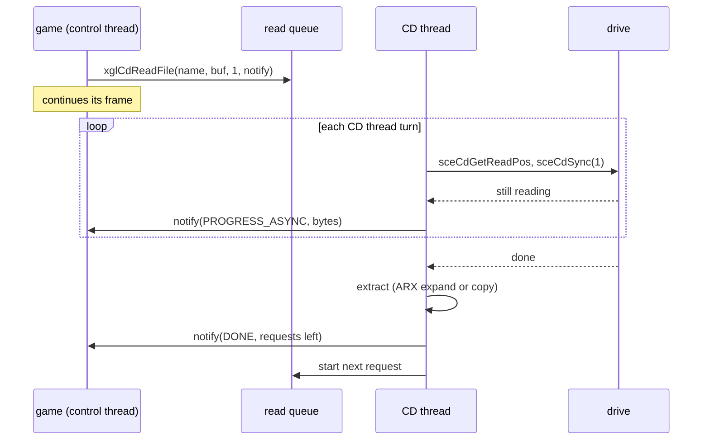

The game usually loads data into the shared work memory and moves the
`WorkEnd` pointer past it, as `Enemy_SystemInit` in
`src/main/enemy_system_init.c` does:

```c
AdrsEnemySpline = WorkEnd;
WorkEnd += xglCdReadFile(enemySplinePath, WorkEnd, 0, 0);   /* synchronous */
```

### Archives and lookup

Most files are stored inside the disc **archives**, the `XENOSAGA.nn` files.
Each archive begins with a directory that maps paths to positions inside the
archive. The archive formats themselves are described in
[files-and-resources.md](../architecture/files-and-resources.md). This section
describes how `xgl_cd` uses them.

The module keeps four archive slots in `ArcHeader[4]`. Each slot is a
`CdArchiveEntry`:

| Field | Meaning |
| --- | --- |
| `state` | `0xFF` when the slot is unused, otherwise the source of the archive (disc 0, host 1, HDD 2) |
| `destination` | Where the archive's directory was loaded in memory |
| `lbn` | First sector of the archive |
| `file_lbn_offset`, `stored_bytes`, `size_bytes`, `packed` | Filled for the file found by the last lookup |

`xglCdArcInit` fills the slots at start-up. Slot 0 is `xenosaga.00`, read
from `pfs0:/xenosaga.00` when the game is installed on the HDD (state 2),
otherwise from the disc. On a dual-layer disc, slot 1 is `xenosaga.10` and
slot 2 is `xenosaga.20` on the second layer (`search_layer` is set to 1 for
that lookup). On a single-layer disc, slot 1 takes the first of
`xenosaga.10`, `xenosaga.20` and `xenosaga.30` that exists, which probably
served development discs. Slot 3 is never filled. The directories are loaded
at `WorkEnd`, and `WorkEnd` is moved past them, so they stay in memory for
the whole game.

The directory starts in sector 0 of the archive. Its first byte is the number
of directory sectors. Records follow from byte 1 and end with a zero byte.
Each record begins with a flags byte whose low 6 bits are the record length,
including the flags byte. The layout of the two kinds of record is shown
below.

```
directory record (flags bit 7 set):
  [flags] [levels up] [name ...]            enter a directory, after leaving
                                            "levels up" levels
file record (flags bit 7 clear, bit 6 = packed):
  [flags] [name ...]
  [LBN offset: 3 bytes, little endian]      sectors from the archive start
  [stored size: 4 bytes, little endian]     bytes on disc
  [unpacked size: 3 bytes, little endian]   only when packed
```

The lookup walks the records and keeps the current directory path in a
buffer that starts with `data\`. For each file record it builds the full name
(for example `data\matumoto\spline.dat`) and compares it with the requested
path, byte for byte. Forward slashes in the requested path are first turned
into backslashes.

`xglCdGetFilePos` resolves a name in this order:

1. Search archive slots 0, 1, 2 and 3, skipping unused slots. On a match the
   file's sector is the archive's `lbn` plus the record's LBN offset, and the
   source is the archive's state.
2. A name that starts with `\` is an absolute host path. It is opened on the
   host as it is.
3. A name found in no archive is looked up as a loose disc file with
   `sceCdLayerSearchFile`, using the upper-case ISO 9660 form
   `\NAME.EXT;1`. Such a file is always treated as possibly packed.
4. For host and HDD sources the path gets a prefix, `host0:/home/xeno/vcd-u/`
   or `pfs0:/`, and is opened with `sceOpen`. When the file did not come from
   an archive, its first 16 bytes are read to detect the ARX signature.
5. Before an HDD read, `xglHddCheck` confirms that the HDD is still usable. If
   it is not, the HDD is switched off and the lookup runs again, so the read
   falls back to the disc.

The flowchart below shows this order.

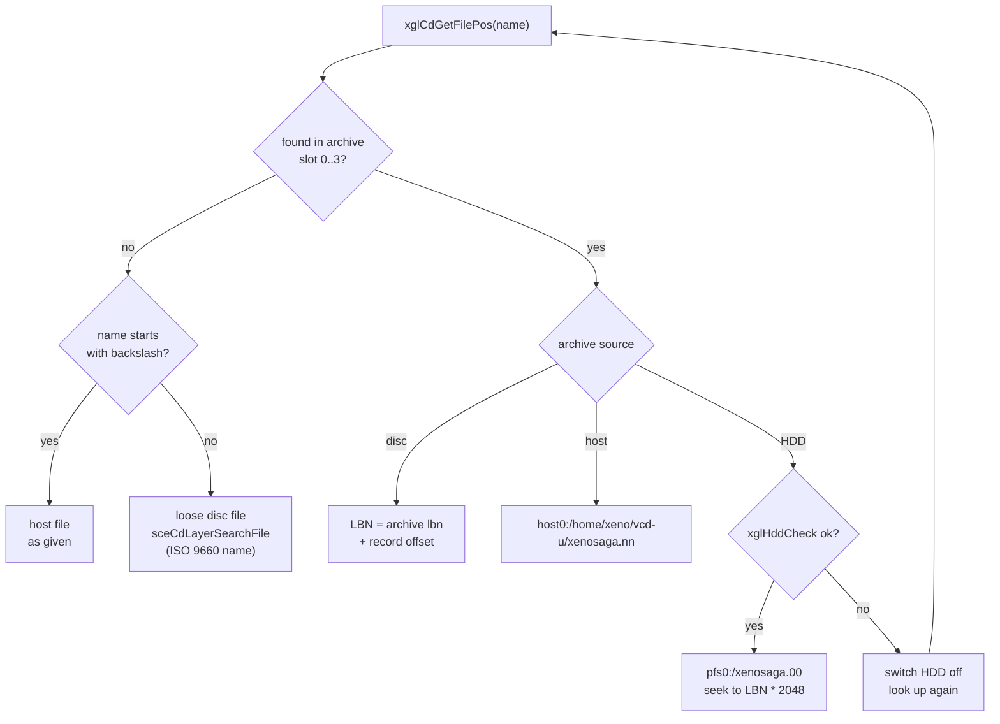

The host source exists for development kits, where the game could read its
files from a PC instead of a disc. The retail game normally reads from the
disc, or from the HDD after an install.

### Packed files and ARX

A packed file is stored compressed in the **ARX** format and must be expanded
after it is read. The expander is `xglArxExtract(dest, src)` in
`src/main/xgl_timer0.c`.

`xgl_cd` expands files in place, without a second buffer. The caller's buffer
must be large enough for the expanded file. The packed data is read into the
end of that buffer:

```
buffer                                                    buffer + expanded size
|-------------------------------------------|---------------------------------|
                                            ^ extract_source
                                              packed data is read here
<----------------- expanded data grows from the start ----------------------->
```

After the read, `extract(destination, source, bytes)` checks the first word of
the data. If it holds the ARX signature `0x00585241` (`"ARX"`) and the fourth
word is 0, the data is expanded with `xglArxExtract`. Otherwise the data is
not packed after all and is copied word by word to the start of the buffer, if
it is not already there. Bit 1 of the read mode skips this step and leaves the
raw bytes, which `src/main/res_get_path.c` uses before calling
`xglArxExtract` itself.

An ARX stream is made of 32-bit words:

| Word | Content |
| --- | --- |
| 0 | Signature `0x00585241` |
| 1 | Expanded size in bytes |
| 2 | Packed payload size in bytes |
| 3 | Flags, must be 0 |
| 4–33 | A table of 30 words |
| 34– | The coded data |

The coder works on whole 32-bit words. The 30-word table holds words that
appear often in the file, probably the 30 most frequent ones. The coded data
is one word stream that serves two purposes at once: a bit reader takes words
from it 32 bits at a time, and a literal takes a whole word from it directly.
Each output word is decoded like this:

1. Read one flag bit. If it is 0, the next word of the stream is a literal.
   Copy it to the output.
2. If the flag is 1, read a unary prefix: count the 1 bits up to the first 0.
   The count selects a group of table entries. Group 1 holds entries 0–1,
   group 2 entries 2–5, group 3 entries 6–13 and group 4 entries 14–29.
3. Read as many bits as the group number and use them as the index inside the
   group. Output that table word.
4. Repeat until the expanded size is reached.

A common word therefore costs 3 to 9 bits instead of 32. The flowchart below
shows the decoding of one word.

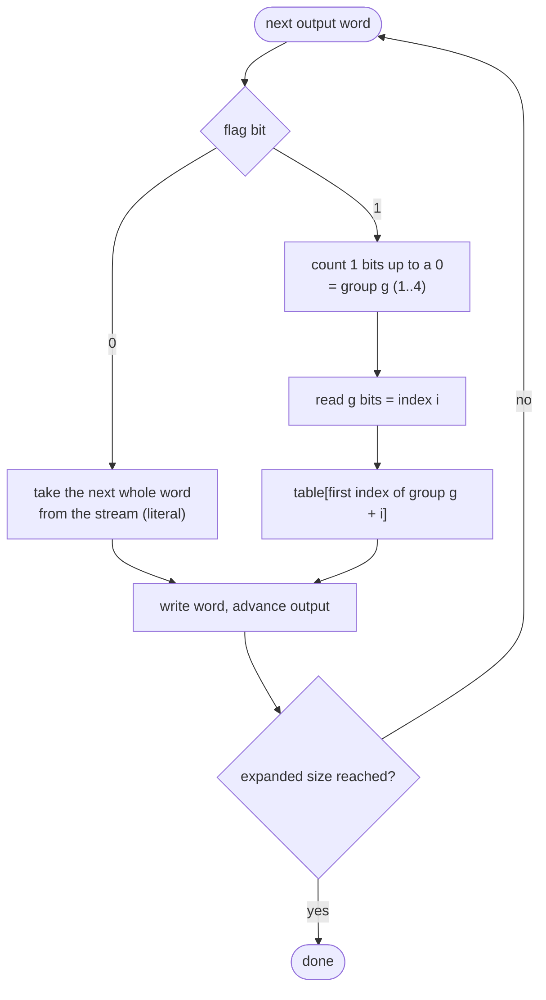

The table is copied to the first 64-byte-aligned address after `WorkEnd`
before decoding starts. Expanding in place has one danger: the output can
catch up with the input. When the output cursor reaches the read position,
`xglArxExtract` copies the unread rest of the stream into the free space just
after the table and continues reading from there.

### Read errors

The module never gives up on a disc read. When `sceCdGetError` reports an
error of level 2 or more, the callback receives `CD_EVENT_READ_ERROR` and the
read is started again, forever. A dirty or scratched disc therefore makes the
game wait, not crash.

A host or HDD read that fails calls `hdd_error`. It closes the file and
calls `xglHddErrorScreen` (see [The HDD error screen](#the-hdd-error-screen)),
then the read starts again from the lookup. If the HDD check now fails, the
HDD is switched off and the new attempt reads from the disc.

When a host or HDD read ends with a partial sector, the rest of that sector is
filled with descending byte values. Disc reads always deliver whole sectors.

### The CD thread

`xglCdControlThread` is the entry of thread 1. Each turn it does the
following:

1. Decrement `ReadClockInterval`, which paces the clock reads (see
   [Clock](#clock)).
2. If a power-off is pending, close all files on `pfs0:` and `pfs1:`, power
   down the HDD unit (`dev9`) and call `sceCdPowerOff`.
3. For an asynchronous disc read, report the progress with
   `sceCdGetReadPos`, test the drive with `sceCdSync(1)`, and when the read is
   done, expand the data and start the next queued request.
4. For an asynchronous host or HDD read, read one more piece of at most
   64 KiB.
5. When a stream is open, refill its ring buffer (see
   [Streaming](#streaming)).
6. Call `xglSleep()`.

The power-off handler `xglCdPowerOffCB` only sets `power_off_pending`. The
real work is done on the CD thread, where it cannot interrupt a file
operation half-way.

### Streaming

Music, voices and movies are too large to load whole. They are read through
**streams**. A stream is a ring buffer that the CD thread refills on each
turn while the consumer (the sound or movie code) takes data out of it.

A stream is described by `CdStreamParam`:

| Field | Meaning |
| --- | --- |
| `iop_buffer` | IOP memory used by the drive's streaming API (disc only) |
| `sector_count`, `block_count` | Size of that IOP buffer: 64 sectors in 16 blocks by default |
| `state` | Set to 1 when the end of the file has been reached |
| `mode`, `xss` | Normal or XSS stream (see below) |
| `descriptor` | File descriptor for host and HDD streams |
| `file_byte_count`, `remaining` | File size and bytes not yet delivered |
| `ring` | `buffer`, `capacity`, `write_position`, `read_position` |
| `alternate_ring` | Second ring, used only by XSS streams |

`xglCdStreamOpen(stream, path)` looks up the file. For a disc file it
allocates IOP memory (`sceSifAllocIopHeap`, `sectors * 2048 + 128` bytes) and
starts the drive's streaming mode with `sceCdStInit` and `sceCdStStart`. If
the stream has a ring buffer, it is registered in `StrList` so the CD thread
refills it. While a stream is open, `dispatch_state` is `STREAM` and ordinary
reads return -3. Only one stream can be open at a time, which is why the
sound and movie code never stream at the same moment.

The ring is filled by `StreamReadRingCoreNormal`. Each turn it computes the
free space between the write and read positions and fills as many sectors as
the drive has ready (`sceCdStStat`), or 32 sectors for host and HDD files. At
the end of the file, the rest is filled with zeros.

The consumer has two ways to take data:

- `xglCdStreamRead(stream, buffer, bytes)` reads straight into a buffer,
  without the ring.
- `xglCdStreamReadRing(stream, bytes)` marks `bytes` as consumed (rounded up
  to whole sectors) by moving `read_position`, then refills the ring until it
  is full.

The diagram below shows the ring and the two positions.

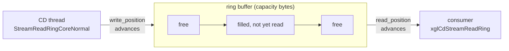

An **XSS** stream carries two interleaved data streams in one file,
probably audio and a second channel such as movie data. One bitmap sector
comes first, then a run of up to `0x4000` sectors. Each bit of the bitmap
says whether the matching sector goes to `ring` or to `alternate_ring`.
`StreamReadRingCoreXss` reads the bitmap and routes the sectors.

`xglCdStreamRewind` starts the stream again from the beginning,
`xglCdStreamClose` stops the drive's streaming mode with `sceCdStStop` and
frees the IOP memory, and `xglCdStreamParamInit` fills a `CdStreamParam` with
default values.

### Overlays and IOP modules

`xglCdLoadOverlay(n)` loads `cdrom0:\OVnn.OVL;1` into the overlay slot at
`0x00A00000` with `sceSifLoadElf`, after flushing the data cache. It remembers
the number in `loaded_overlay` and does nothing when that overlay is already
loaded. `xglCdInitial` sets `loaded_overlay` to 2, because OV02 is linked into
the main executable itself. The first call for OV02 at boot is therefore
skipped. The overlays are listed in the [overview](../README.md#2-overlays).

`xglCdSifLoadModule(name, args)` loads an IOP module from
`cdrom0:\IOP\NAME.IRX;1`. The IOP side is described in
[iop-sound-driver.md](../architecture/iop-sound-driver.md).

### Disc check

`xglCdDiskCheck()` reports which disc is in the drive:

| Result | Meaning |
| --- | --- |
| 127 | The dual-layer game disc |
| bits 0, 1, 2 | Single-layer disc with `xenosaga.10`, `.20` or `.30` |
| 0 | No disc |
| -1 | Unsupported disc |
| -2 | The tray is open |
| -3 | The drive is not ready |

### Clock

`xglClockRead(clock)` returns the console's real-time clock as an `XglClock`.
It calls `sceCdReadClock` only once every 10 CD thread turns
(`ReadClockInterval`) and otherwise returns the cached value. The clock chip
stores binary-coded decimal values, which `BCD2INT` converts. The year is
stored as an offset from 2000.

`xglClockDayTime2UInt` turns a date into seconds since 2000-01-01, using the
`monthday` table of month lengths. `xglClockUInt2DayTime` does the opposite.
Save files use these values as time stamps.

### Initialisation

`xglCdInitial` is called once at boot:

1. `sceCdInit`, then `sceCdMmode(2)` to select DVD media.
2. Reset the queue and the global callback.
3. `sceCdReadDvdDualInfo` to learn whether the disc has two layers.
4. Set `loaded_overlay` to 2.
5. Read the first 80 bytes of `system.cnf` into `system_cnf`. The HDD code
   later uses one byte of it.
6. Activate and mount the HDD (`xglHddActivate(0x100)`, `xglHddMount`).
7. Load the archive directories (`xglCdArcInit`).

`xglCdArcCheck` reloads the archive directories at the same address later, for
example after the HDD has been switched on or off.

### Debug file selector

`xglCdFileSelect(select)` is a small debug browser. It reads a file named
`.filelist` from a host directory and shows its lines on screen. Up and Down
move the cursor, Circle chooses a file and Cross goes back. It is used by the
debug script and path loaders in `src/main/script.c` and
`src/main/set_path.c`. Debug tools are described in
[debug-tools.md](../game/debug-tools.md).

## HDD

File: `src/main/xgl_hdd.c`

The executable can install the game's main archive on the PlayStation 2 hard
disk, so that most reads come from the faster hard disk instead of the DVD.
`xgl_hdd` performs that install, decides at boot whether the installed copy
can be used, and also stores saves on the hard disk. The partition name uses
the Japanese product code `SLPS-29002`, so this code probably comes from the
Japanese release.

### Names and partitions

The game's partition name is stored in the executable XOR-ed with `0x80`, so
it does not appear as plain text. `decrypt()` decodes it into
`hdd0:PP.SLPS-29002.XENOSAGA1.DISC1,xeno1d1,xeno1d1` and replaces byte 17 with
byte `0x1A` of `system_cnf`, probably to adapt the product code to the disc in
the drive. Other names used by the module:

| Name | Use |
| --- | --- |
| `pfs0:` | The game partition, mounted read-only after the install |
| `pfs0:/xenosaga.00` | The installed archive |
| `pfs0:/xenosaga.hdd` | A check file written at the end of the install |
| `hdd0:__common` mounted as `pfs1:` | The system's shared partition |
| `pfs1:/Your Saves` | The folder that holds HDD saves |

### Activation state

`HddActive` records whether the HDD may be used:

| Value | Meaning |
| --- | --- |
| 0 | Not in use. Reads go to the disc |
| 1 | In use. Archive slot 0 is read from `pfs0:/xenosaga.00` |
| 2 | Disabled for the rest of the session |
| 3 | An error that still has to be shown to the player |

`xglHddActivate(state)` sets the state, unless it is already 2, which is
final. With -1 it only returns the state (0 for the values 2 and 3). The low
byte of the argument is the new state. When the whole argument is below
`0x100`, the archive directories are also reloaded with `xglCdArcCheck`, so
the next lookup uses the disc or the HDD as appropriate. Values such as
`0x102` change the state without that reload.

`xglHddCheck` (built on `xglHddCheckCore` and `xglHddCheck2`) tests the drive
with `sceDevctl` status and flush calls before an HDD read. When the state is
3, or when the drive asks for a reset, it shows the error screen, sets the
state to 0 (which reloads the archives from the disc) and then to 2. A flush
failure while the HDD is not in use also disables it. From then on the CD
module reads everything from the disc.

### Mount

`xglHddMount()` decides at boot whether the installed copy is usable:

| Result | Meaning |
| --- | --- |
| 1 | Installed and valid. The first 36 bytes of `xenosaga.hdd` match the disc's record for `xenosaga.00` |
| 0 | Not installed, but there is enough free space for an install |
| -4 | Not enough free space |
| -5 | The check file does not match the disc |
| -2 | An HDD error |

The free-space test needs more than `0x37FFFF` free sectors in total
(about 1.75 GiB) and a largest free area of more than `0x7FFFF` sectors.

### Install

`xglHddInstall(callback, param)` runs the install from the title screen
(`src/ov02/title_hdd_install.c`). It reports each stage, the copy progress
and each failure through `callback`. The steps are:

1. Read `data\hdd.res` into memory at `0x01000000`. This install image
   receives a copy of the first bytes of `system_cnf`.
2. Create the partition with the spec `name,256M,PFS` and write the install
   image into it. The image is the partition header that the system's HDD
   browser shows: a `PS2ICON3D` header with a table of offsets and sizes, a
   `SYSTEM.CNF`, a text `icon.sys` and a 3D icon. The copy in step 1
   replaces the image's own Japanese `SYSTEM.CNF` with the disc's (see
   [hdd.res](../formats/movies-images-and-icons.md#7-hddres-the-hard-disk-icon)).
3. Extend the partition by six more 256 MiB parts, for about 1.75 GiB in
   total.
4. Format it with `sceFormat` and mount it read-write as `pfs0:`.
5. Copy `xenosaga.00`, then `xenosaga.01`, `xenosaga.02` and so on as long as
   such a file exists, one after the other into `pfs0:/xenosaga.00`. Each
   file is copied in pieces of 16 MiB read with `xglCdReadFilePart` (mode 2,
   raw), and the read callback `xglHddInstallReadCB` reports the progress.
   The player can cancel during this stage.
6. Write the check file `xenosaga.hdd`.
7. Unmount the partition and mount it again read-only.

Only the first archive is copied. The archives in slots 1 and 2 are still
read from the DVD after an install. The function returns 0 on success, 1 when
the player cancelled, and -1 on failure. Every failure path first reports a
failure code to the callback and calls `xglHddUninstall`, which removes the
partition again. The flowchart below shows the install.

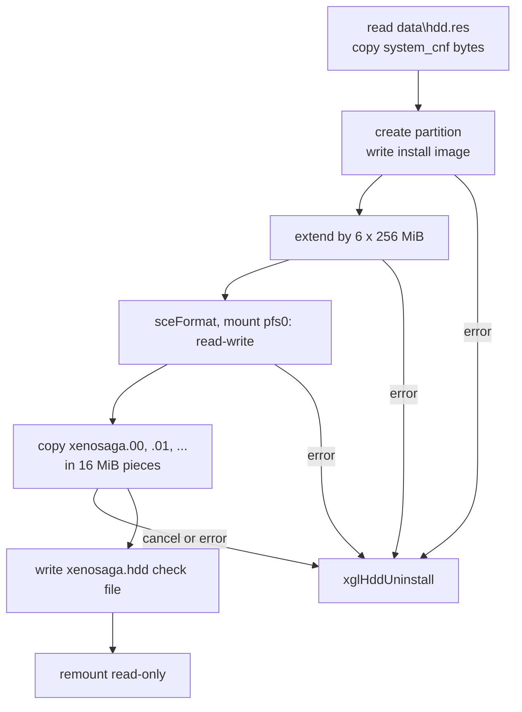

### Saves on the HDD

Saves can go to the HDD as well as to a memory card. They are stored in
`pfs1:/Your Saves`, with the same folder and file names as on a memory card
(built by `xglMcSetFullPath`, see [Memory card](#memory-card)). The functions
mirror the memory card ones:

| Function | Use |
| --- | --- |
| `xglHddMcExist(card, found)` | With `card >= 0`, test one save slot. With `card < 0`, scan the folder and mark `found[0..99]`, with the newest save's number in `found[100]` |
| `xglHddMcLoad`, `xglHddMcLoadCore` | Read a save |
| `xglHddMcSave` | Write the save data file |
| `xglHddMcCreate` | Create a save folder with its `icon.sys`, icon and data files. Adds a 1 GiB sub-partition to `__common` when needed |
| `xglHddMcCheck`, `xglHddMcGetFree` | Test the folder, report free space in KiB |

`Judge_MakeNewFolder` refuses a new folder when 256 already exist, and
`Judge_MakeNewSavedata` decides whether a new save can be made. The save and
load screen (`src/main/file.c`) has a complete code path for these functions,
chosen by `FileWork->use_hdd`. No recovered code sets that field to anything
but 0, and the device list of the screen only offers the two memory cards, so
HDD saves appear to be unreachable in the released game (see
[the icon files](../architecture/save-data.md#the-icon-files)). The save
format is described in [save-data.md](../architecture/save-data.md).

### The HDD error screen

`xglHddErrorScreen` is shown when an HDD read fails, or when the HDD check
finds the drive in a bad state. It runs its own small loop on the calling
thread while the other system threads keep running:

1. Set `sRender.errorScreenActive`.
2. Each frame, send a gray rectangle straight to the GS by DMA and queue
   `hddLoadErrorText` with `xglFontPrint(48, 64, 0xFFFFFF, ...)`, then call
   `xglSleep()`. The Japanese text says that the HDD data cannot be read,
   that the game will continue from the DVD, and to press Circle.
3. After 30 frames, leave the loop when Circle is pressed.
4. Play sound effect 1 at once and clear `sRender.errorScreenActive`.

When the screen was shown by `xglHddCheck`, the HDD is then disabled and the
game continues from the disc.

## Memory card

File: `src/main/xgl_mc.c`

Memory card calls in the Sony library are asynchronous: a call starts an
operation and `sceMcSync` reports when it ends. `xgl_mc` hides this behind a
request queue that is advanced one step per frame.

### Save files

The whole save is one buffer, `SaveData` (`0x163B0` bytes), defined in this
file. Each save slot is a folder on the card named
`/BASLUS-20469Xeno` plus a two-digit slot number. `xglMcSetFullPath` builds
the paths:

| Selector | Path |
| --- | --- |
| -1 | `/BASLUS-20469XenoNN`, the folder |
| 0 | `/BASLUS-20469XenoNN/BASLUS-20469XenoNN`, the save data |
| 1 | `/BASLUS-20469XenoNN/icon.sys`, the system icon description |
| 2 | `/BASLUS-20469XenoNN/xenosaga.ico`, the 3D icon |

A negative card number puts `*` in place of the number, for directory
listings.

### The request queue

Requests go into an 8-entry ring, `queue[]`. Each entry
(`McRequestEntry`) holds the card, the operation, a pointer to the caller's
result variable, the slot, a buffer, a size and a path of up to 108 bytes.
`xglMcRequest(card, operation, arguments, &result)` copies the arguments into
the next entry, clears `result` and returns at once.

| Operation | Value | Effect |
| --- | --- | --- |
| `MC_REQUEST_FREE_SPACE` | 1 | Free space on the card |
| `MC_REQUEST_DIRECTORY` | 2 | List the save folders. Slot -1 fills `found[]` with the slots present and the newest one by time stamp |
| `MC_REQUEST_PATH_EXISTS` | 3 | Test a path |
| `MC_REQUEST_LOAD`, `LOAD_PATH` | 4, 5 | Read a save slot, or any path |
| `MC_REQUEST_SAVE`, `SAVE_PATH` | 6, 7 | Write a save slot, or any path |
| `MC_REQUEST_CREATE` | 8 | Create a save folder with its icon files |
| `MC_REQUEST_FORMAT`, `UNFORMAT` | 9, 10 | Format or unformat the card |

### xglMcMain

The game calls `xglMcMain()` once per frame while a memory card screen is
open. Each call does the following:

1. Call `sceMcSync(1, ...)`. If the last operation is still running, return
   `MC_STATUS_BUSY_BOTH` (`0x00FF00FF`).
2. Handle the end of that operation according to the current phase: store the
   result, or start the next step of a multi-step request.
3. In the idle phase, take the next request from the queue, if any, and start
   its first card call.
4. With an empty queue, poll one card with `sceMcGetInfo`, alternating
   between ports 0 and 1 on each poll.

The phases are `IDLE`, `POLL_INFO`, `OPEN_CLOSE`, `WRITE`, `READ`, `CREATE`
and `DIRECTORY`. A load or a save is three card calls (open, read or write,
close), so it takes at least three frames. The state diagram below shows the
phases.

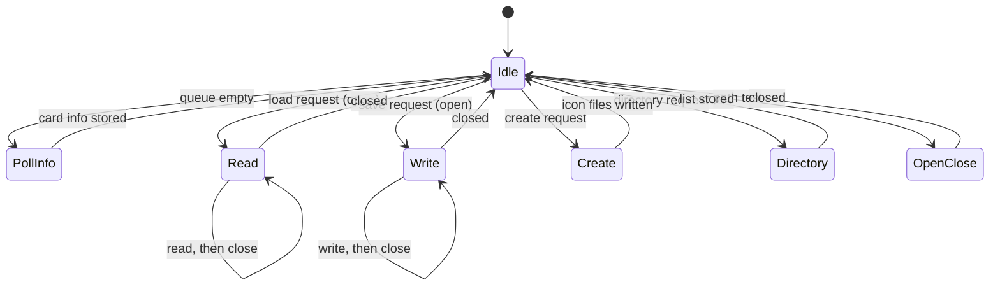

When nothing is queued and the last poll is done, `xglMcMain` returns the
status of both cards in one word: card 0 in the low half, card 1 in the high
half. The values are `MC_STATUS_NONE` (0), `READY` (1), `UNFORMATTED` (2),
`ERROR` (`0x80`), `PS1_CARD` (`0x81`), `POCKETSTATION` (`0x82`) and `BUSY`
(`0xFF`).

### Creating a save folder

`MC_REQUEST_CREATE` runs `create_sub2` step by step:

1. Create the folder (`sceMcMkdir`) and delete an old data file if one is
   there.
2. Write `icon.sys` (964 bytes). Its title is fixed text,
   "ＸｅｎｏｓａｇａＥＰＩＳＯＤＥ１−NN" in full-width characters.
   `xglMcWriteMapName` only replaces the second bytes of the two full-width
   digits NN (bytes 227 and 229), so the title carries the slot number plus
   1. Despite its name it writes no map name. `xglMcSetMapName` does convert
   the map's EUC-JP name to Shift-JIS with `xglMcEUC2SJIS`, but it stores
   the result in `mapNameBuffer`, which no code reads, so the map name never
   reaches the card.
3. Write `xenosaga.ico`. Before the write, one float near the end of the icon
   data is set to `(xglFRand() - 1.5) * 0.6 + 1`, a random value between 0.7
   and 1.3. It is the animation speed of the 3D icon (`McIconAnimation`),
   so each save's icon moves at a slightly different speed. The scale global
   keeps its original name, `checksumNoiseScale`. The HDD save path writes the icon without
   changing it (see [the 3D icon format](../formats/movies-images-and-icons.md#5-the-3d-icon-format)).

### Blocking helpers and users

`xglMcEasyLoad` and `xglMcEasySave` run a single load or save and wait for it.
Only the debug scene `src/main/yajima_test.c` uses `xglMcEasySave`. The
queue is used by the save and load screen (`src/main/file.c`) and by the boot
logo and title screens (`src/ov02/logo.c`, `src/ov02/title.c`), which check
the cards at start-up. The save contents are described in
[save-data.md](../architecture/save-data.md).

## Rendering

Files: `src/main/xgl_render.c`, `src/main/xgl_packet.c`, `src/main/xgl_dma.c`,
`src/main/xgl_prim_add.c`

The rendering part of `xgl` owns the frame buffers, the per-frame GPU packet
and the timing of the frame. The model and effect libraries draw into the
packet that `xgl` provides. The full rendering pipeline is described in
[rendering.md](../architecture/rendering.md), and the model library in
[nml.md](nml.md).

### The render state

All render state is in one struct, `sRender` (type `XglRenderState`). Its
main parts are:

| Field | Meaning |
| --- | --- |
| `reso` | Current resolution: depth and frame pixel formats, frame width and height |
| `vram` | VRAM page numbers of the depth buffer and the color buffers |
| `display_buffer_base`, `draw_buffer_base` | The buffer shown and the buffer drawn into, swapped every frame |
| `final_packet_callback[8]` | Functions that add packets after the models |
| `fade_callback` | Function called before the global fade |
| `frame_delta`, `frame_count`, `frame_status` | Frame pacing (see [Frame pacing](#frame-pacing)) |
| `scene_disabled` | When set, models are flushed without being drawn |

Six resolutions are available, all 448 lines high: 640, 512, 448, 384, 320
and 256 pixels wide (`asDispReso`). The frame buffers use 32-bit color
(`PSMCT32`) and a 24-bit depth buffer (`Z24`). The depth buffer starts at VRAM
page 0 and is followed by three color buffers. For 640 pixels they start at
pages `0x8C`, `0x118` and `0x1A4`. `xglRenderSetReso(index)` selects a row of
the table, rebuilds the draw, display and clear environments and
re-initialises the studios, because the camera projection depends on the
screen size.

`xglRenderInit` runs at the start of the render thread. It resets the GS path,
masks the VIF error interrupts, calls `sceGsResetGraph(0, 1, 2, 0)`
(interlaced NTSC, field mode), installs the vertical-sync callback, selects the
512-pixel resolution, sets the scan-line interpolation to mode 1, clears the
callbacks, sets up the fade and constructs the model library with
`nmlModelConstruct`.

### Packets

The game builds each frame's graphics as a **VIF1 packet**, a list of GPU
commands and data in main memory that DMA channel 1 sends to the VIF1 unit.
There are two packet buffers of 2 MiB each, at `0x00C00000` and
`0x00E00000`. While the game fills one, the other one is being sent to the
GPU.

The packet is an `XglPacket`. Its `write_cursor` moves forward from `start`
as commands are added. A second cursor, `cursor`, moves backward from `limit`
at the top of the buffer. It serves small allocations that must live for the
frame, such as the attribute data of models (`nmlPacketSetAttributeData`).
The two cursors grow toward each other.

```
0x00C00000                                                  0x00E00000
| start                                                             limit |
|==== commands (write_cursor ->) ====|....free....|<- cursor ==== data ===|
```

| Function | Use |
| --- | --- |
| `xglPacketInit()` | Set up both buffers |
| `xglPacketGetCurrent()` | The packet the game writes into during this frame |
| `xglPacketMove()` | Close the current packet, flush the cache, swap the two buffers and reset the new one |
| `xglPacketSend()` | Start the DMA transfer of the finished packet to VIF1 |
| `xglPacketTextureTrans(set)` | Add texture uploads to the current packet |
| `xglPacketInterpolate()` | Add the scan-line blend packet (mode 2) |

`xglPacketMove` ends the packet with `sceVif1PkEnd` and
`sceVif1PkTerminate`, flushes the data cache so the DMA sees the data, keeps
the finished packet in `pSendPacket`, swaps to the other buffer and resets it
with `sceVif1PkReset`. `xglPacketTextureTrans` adds, for each texture, a
`FLUSHE`, a GS image-load header and a DMA `REF` tag that points at the
texture data, so the texture is sent without being copied into the packet.

The diagram below shows the two buffers over two frames.

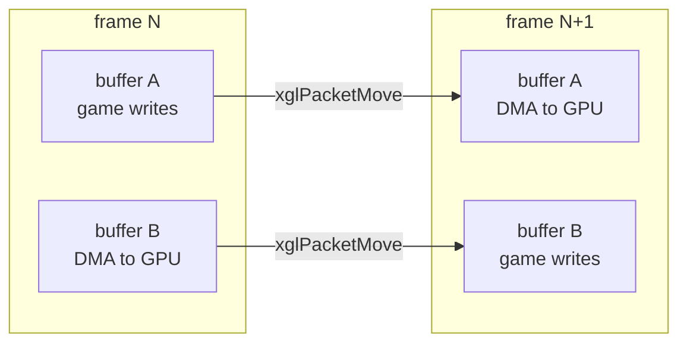

### The render step

The render thread's entry, `xglRenderEntry`, calls `xglRenderInit` once and
then loops: `xglRenderMove()`, `xglSendSePacket()`, `xglPadRead()`,
`xglSleep()`. `xglRenderMove` is the per-frame render step. It runs these
steps in order:

1. Clear the frame, if a clear was requested and the scene is enabled.
   `xglRenderClearOn` sets a counter to 2, and the clear happens when it has
   counted down to 1.
2. Draw the 3D effects with `sefDrawEffect3D` (see [sef.md](sef.md)).
3. Flush the models with `nmlModelFlush`, or with `nmlModelFlushClear` when
   `scene_disabled` is set (see [nml.md](nml.md)).
4. Call the final packet callbacks, unless the model library has asked for
   the back buffer (`nmlModelIsBackBufferRequest`).
5. Draw the queued text with `xglFontFlush` (see [Text](#text)).
6. Apply the global fade with `xglRenderGlobalFade`.
7. In scan-line mode 2, add the blend packet with `xglPacketInterpolate`.
8. Close the packet and swap the buffers with `xglPacketMove`.
9. Wait for vertical sync with `xglRenderSyncMove`.
10. Count the frame in `FrameCount` and `LoopCount`.
11. Wait for the GS to finish (`sceGsSyncPath`) and reset the drawing path.
12. Swap the display and draw buffers with `xglRenderSwapBase`.
13. Send the draw, display and clear environments to the GS.
14. Send the new packet with `xglPacketSend`.
15. Tell the model library the packet has changed
    (`nmlModelSendPacketChangeSignal`).

Steps 1 to 8 finish the frame the game built. Steps 9 to 14 show it and start
drawing it. The GPU draws frame N while the game builds frame N+1. The
flowchart below shows the same steps.

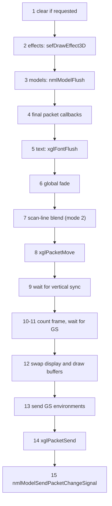

### Frame pacing

The game normally runs at **30 frames per second**, one frame every two
vertical syncs of the 60 Hz NTSC signal. The vertical-sync callback counts
syncs in `VSyncCount`. At the second sync it also checks whether the GIF or
VIF1 DMA channel is still busy, and sets `sRender.frame_status` to 1 if the
GPU has not finished the previous frame in time.

`xglRenderSyncMove` waits as follows. It first waits for a sync of the even
field (`sceGsSyncV` returns 0), probably so frames always start on the same
interlace field. Then it waits until `VSyncCount` is at least 2. If the count
has reached 3 or more, the frame was late, and `frame_delta` is set to 1.
`xglRenderSwapBase` adds `frame_delta` to `frame_count` and resets the
per-frame values, so `frame_count` is the number of late frames since start.
Nothing outside the renderer appears to read it.

When the global `FLAG_FRAME_60` is 1, the wait is a single `sceGsSyncV`, and
the game runs at 60 frames per second.

### Clear, fade and scan-line blend

The per-frame clear draws a full-screen sprite with the clear color and
depth (`xglRenderClearColor`, `xglRenderClearDepth`, `xglRenderClearFrame`).
It is only needed when the scene does not cover the whole screen.

`xglRenderGlobalFadeSet(r, g, b, a)` sets a color and an opacity between 0
and 1. Each frame, `xglRenderGlobalFade` first calls `fade_callback`, then,
when the opacity is not zero, draws a full-screen sprite of that color with
alpha blending. This is how the screen fades to black or white between
scenes. The card game uses it too (`src/ov10/card_play_sound1.c`).

The game draws an interlaced picture. `ScanLineInterpolate` selects how the
two fields are blended to reduce flicker:

| Mode | Effect |
| --- | --- |
| 0 | Off |
| 1 | The display circuit blends: the second read circuit is shifted by one line and mixed at alpha `0x80` |
| 2 | A packet blends the lines (`xglPacketInterpolate`) |

Mode 1 is the default.

### Other render functions

| Function | Use |
| --- | --- |
| `xglRenderDispOn()`, `xglRenderDispOff()` | Show or hide the picture (the `PMODE` circuit enable bit) |
| `xglRenderClearOn()`, `xglRenderClearOff()` | Turn the per-frame clear on or off |
| `xglRenderClearColor(color)` | Set the clear color |
| `xglRenderSetReso(index)` | Select a resolution |
| `xglRenderCopyDisp2Draw()` | Copy the displayed frame (512 x 448) into the draw buffer |
| `xglRenderDrawFlip()` | Swap the display buffer with the third (flip) buffer and send the new frame registers to the GS |
| `xglRenderDrawFlipPk(packet)` | Copy the draw buffer into the flip buffer, as part of a packet |

The draw environment uses a depth test of `GEQUAL` (larger Z is in front),
no dithering and color clamping. `scene_disabled` is set by the field movie
player (`src/main/game_movie.c`) and the script loader (`src/main/script.c`)
while the 3D scene must not be drawn. The main menu's
`final_packet_callback` use is in `src/main/window_tex_load.c`.

### DMA

`xgl_dma` wraps the DMA controller. It knows the ten channels of the EE, but
its direct transfer functions only accept channels 0 to 2 (VIF0, VIF1 and
GIF):

| Function | Use |
| --- | --- |
| `xglDmaDirectNormal(channel, address, qwords)` | A normal transfer from one block of memory |
| `xglDmaDirectSrcChain(channel, address)` | A source-chain transfer that follows DMA tags |

Both wait until the channel is free. An address in the scratchpad
(`0x70000000`, 16 KiB of fast on-chip memory) is translated into the form the
DMA controller expects (offset with bit 31 set). The file also contains DMA
chain builders (`xglDmaBufferReset`, `xglDmaBufferCnt`, `xglDmaBufferRef`,
`xglDmaBufferCall`, `xglDmaBufferRequest`) and MFIFO helpers
(`xglDmaMFIFOSetup`, `xglDmaMFIFOKick`, `xglDmaMFIFOLeave`), but nothing
outside `xgl_dma.c` calls them. The controller state `PadData[2]` is also
defined in this file. `xglDmaInitial` is empty.

### Primitives

`xgl_prim_add` adds simple primitives to a packet through an `XglPrim`
description:

| Field | Meaning |
| --- | --- |
| `packet`, `output_buffer` | Where the primitive goes |
| `flags` | Index mode (8-bit, 16-bit or direct), `0x10` adds `position_offset`, `0x20` flushes the open direct block |
| `positions`, `colors` | Vertex arrays |
| `position_indices`, `color_indices` | Index arrays for the indexed modes |
| `tag_control`, `direct_count`, `data` | State of the open GIF direct block |

`xglPrimAddGifTagDirect` opens a GIF direct block or reuses the open one.
`xglPrimAddGouraudStripN` and `xglPrimAddLineStripN` add Gouraud-shaded
triangle strips and line strips. They are used by debug drawing
(`src/main/db_light_write.c`, `src/main/karakama_test.c`), by
`src/main/end_print.c`, `src/main/init_uwamono_sys.c` and the cursor of the
window system (`src/main/ew_sprt_set_cursor_uv.c`).

## Studios, cameras and lights

Files: `src/main/xgl_studio.c`, `src/main/xgl_camera.c`, `src/main/xgl_light.c`

A **studio** is one complete 3D setup: a set of cameras and one set of
lights. The name comes from a film studio. There are four studios in
`asStudioSource[4]`. Each `Studio` holds one `StudioLight` and eight
`StudioCamera` records. `pCurrentStudio` points at the current one.

### Studios

Most functions work on the current studio:

| Function | Use |
| --- | --- |
| `xglStudioChange(i)` | Make studio `i` current |
| `xglStudioGetCamera2(i)`, `xglStudioGetCamera(&camera, i)` | Camera `i` of the current studio |
| `xglStudioGetLight2()`, `xglStudioGetLight(&light)` | The light set of the current studio |
| `xglStudioGetActiveCamera()` | The first active camera of the current studio, or 0 |
| `xglStudioSelectGetActiveCamera(s)` | The first active camera of studio `s` |
| `xglStudioFlushActiveCamera()` | Run `xglCameraMove` on the active camera of each studio |
| `xglStudioMainCameraInit()` | Make camera 0 of every studio active |
| `xglStudioMainCameraMove()` | Select studio 0 and return its camera 0 |
| `xglStudioInit()` | Initialise all lights and cameras |
| `xglStudioMove()` | Update every active camera of every studio |

A camera with `active` equal to 1 is updated every frame. The diagram below
shows the four studios.

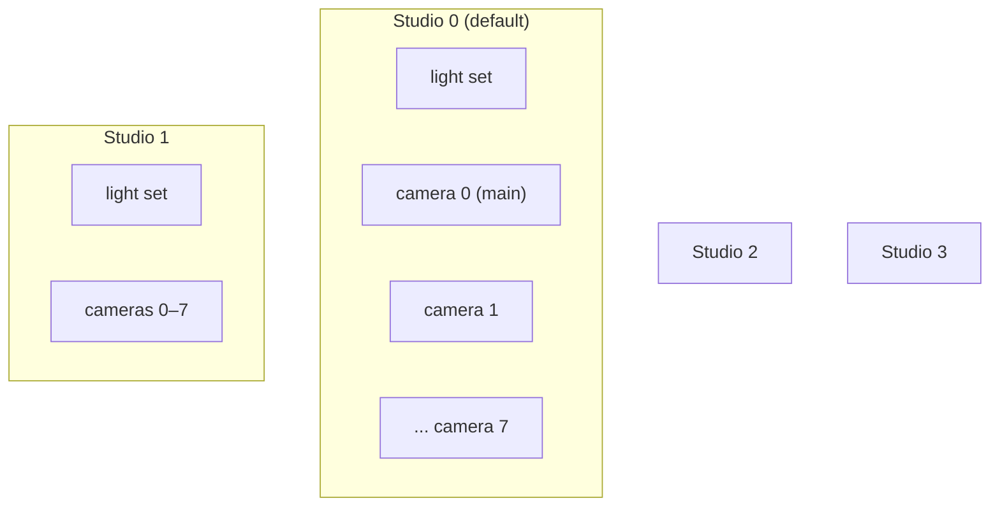

The studio thread's entry, `xglStudioEntry`, calls `xglStudioInit` and
`xglStudioMainCameraInit`, then loops. Each turn it calls
`xglStudioMainCameraMove()` and `xglStudioMove()`, unless the global
`StudioEntrySkip` is set. The field game sets `StudioEntrySkip` and updates
the cameras itself from `GameDrawSync()` in `src/main/game.c`, so the camera
update happens at a fixed point of its own frame. After `xglStudioMove`,
studio 0 is current again.

### Camera data

A camera (`StudioCamera`, viewed internally as `XglCamera`) holds everything
needed to draw from one viewpoint:

| Part | Content |
| --- | --- |
| `active`, `state` | Whether it is updated, and its travel mode |
| `screen` | Projection setup: clip range (default near 0.01, far 99000), depth range (`0xFFFFFF` maximum), window, resolution, screen offset and scale |
| `travel` | Viewpoint: `position` (default (0, 1, 4)), `rotation`, `fov` (default 0.698 rad, 40 degrees), `focus`, velocities, chase settings |
| `transform`, `inverseTransform` | Camera-to-world and world-to-camera matrices |
| `volume` | View volume: 16 corner points, 12 planes, the view matrix and packed clip planes |

The game reads several of these fields directly: `viewMatrix` (world to
screen), `screenScale` and `screenOffset` (to place a projected point on the
GS drawing area) and `clipMatrices[2]`, which the model library loads into
VU0 registers for clipping. The math helpers that project points through a
camera are described in [math.md](math.md#projection-to-the-screen).

### The camera update

`xglStudioMove` calls two functions for each active camera:
`xglCameraTravelProc` moves the viewpoint, and `xglCameraMove` rebuilds the
matrices.

`xglCameraTravelProc` depends on `state`:

| State | Behaviour |
| --- | --- |
| 0, 1, 4 | Nothing. The game sets the position and rotation itself |
| 2 (`CAMERA_STATE_TRAVEL_MANUAL`) | Free flight with controller 2 |
| 3 (`CAMERA_STATE_TRAVEL_CHASE`) | Follow `chase_reference` at `chase_distance` |

The manual mode is a debug camera driven by the controller in port 2
(`PadData[1]`). The sticks turn and move the camera, L1 and L2 move it up and
down, R1 and R2 change the field of view, Circle and Square change the focus
and Cross makes every move four times faster. Velocities are damped by 0.8 per
frame. In both travel modes, holding Select and pressing Triangle resets the
camera. The chase mode keeps the camera between 0.4 and 100 units from its
target, limits its height, moves 20 percent of the remaining distance per
frame and turns it toward the target with `atan2f`.

The state diagram below shows the travel modes.

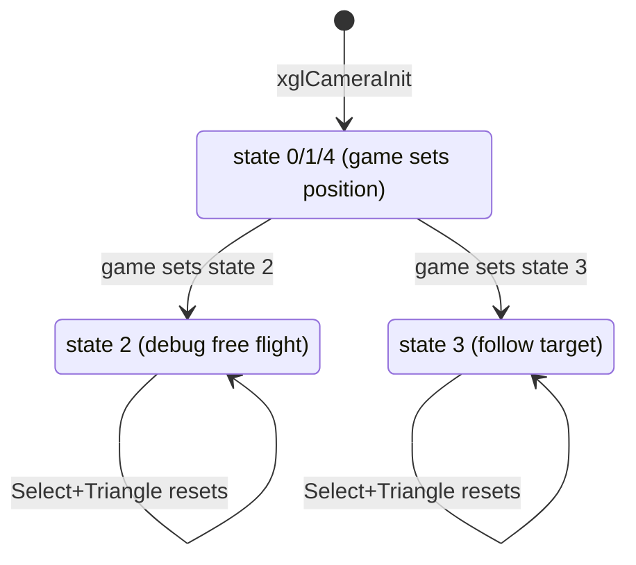

`xglCameraMove(camera)` then runs three steps:

1. `xglCameraViewScreen` computes the projection from the window and the
   resolution. It centers the screen offset on the GS drawing area, whose
   coordinates run from 0 to 4096 with the center at 2048, and computes the
   screen scale and the depth range. The Y scale is negative because screen Y
   grows downward while world Y grows upward.
2. `xglCameraViewTravel` builds the camera matrix from the travel values: a
   translation to `position` followed by rotations about Y, X and Z. The
   inverse of that matrix is the view matrix. It also computes the frustum
   size from `tan(fov / 2)`.
3. `xglCameraViewVolume` multiplies a frustum projection
   (`xglMatrixStackFrustum`) with the inverse camera matrix into `viewMatrix`,
   computes the eight corners of the view volume (for two clip sets), and
   derives the six side planes with `xglPlaneParameter`.

The flowchart below shows the whole per-frame camera update.

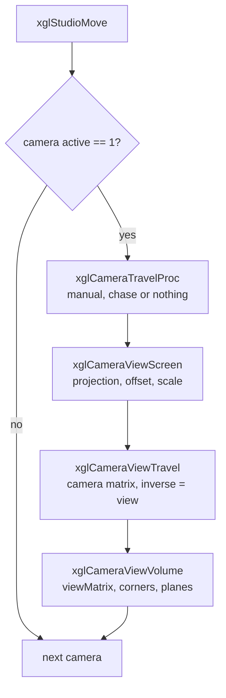

`xglCameraMoveOffset` does the same with an extra screen offset.
`xglCameraSetWindow(camera, left, top, right, bottom)` limits drawing to a
rectangle of the screen. The main menu's 3D character view
(`src/main/menu_model.c`) and the A.G.W.S. Battle drawing code
(`src/ov12/rg_draw.c`) use it. `xglCameraClipRangeDefault` restores the
default clip range.

### Lights

A light set (`StudioLight`, `0xF0` bytes) has one ambient light and three
parallel (directional) lights:

| Field | Meaning |
| --- | --- |
| `ambient_color` | Color of the ambient light |
| `lights[3]` | Each with a `color` and a unit `direction` |
| `normal_matrix` (+`0x70`) | The three light directions, as a matrix applied to vertex normals |
| `color_modifier_matrix` (+`0xB0`) | The three light colors and the ambient color, as a matrix |

| Function | Use |
| --- | --- |
| `xglLightInit(light)` | Ambient 1, parallel lights off, directions (1, 1, 1) normalized |
| `xglLightSetDefault(light)` | Ambient 0.25, lights 0.8, 0.5 and 0.5 from fixed angles |
| `xglLightIntensityAmbient(light, color)` | Set the ambient color |
| `xglLightIntensityParallel(light, i, color)` | Set the color of light `i` |
| `xglLightDirection(light, i, direction)` | Set the direction of light `i`. It is normalized |
| `xglLightAngle(light, i, angles)` | Set the direction from rotation angles about Z, Y and X |
| `xglLightCalcMatrix(light)` | Build the two light matrices |

`xglLightCalcMatrix` runs the VU0 microprogram routine
`Vu0CallLightCalcMatrix`. The light vectors are loaded into VU0 registers
`vf4` to `vf10`, and the routine returns two matrices: the directions
arranged so that one matrix product gives the three diffuse terms of a
normal, and the colors with the ambient color in the fourth column. Vertex
lighting is then two matrix products per vertex. The VU0 microprogram is
described in [math.md](math.md#the-resident-vu0-microprogram).

Every actor also embeds its own `StudioLight` (at offset `0x510` of the actor
struct, see [actors.md](actors.md)). Scripts change the studio light through
the `JS_classLight_*` natives (`src/main/js_class_light_get_peer.c`, see
[natives.md](../scripting/natives.md)), and the map code reads the light
matrices in `MapDrawLight` (`src/main/map_1.c`).

## Text

Files: `src/main/xgl_font.c`, `src/main/xgl_menu.c`

Text is drawn in two steps. During the frame, game code calls
`xglFontPrint(x, y, order, text)` or `xglFontPrintf`, which only add the text
to a print queue. Once per frame, the render thread calls `xglFontFlush()`,
which turns the whole queue into GPU sprites. This way text from any thread
and any part of the game is drawn in one batch, after the 3D scene.

### The print queue

The font state is `FS` (type `FontState`):

| Field | Meaning |
| --- | --- |
| `font_image`, `window_image` | The loaded font and window textures |
| `flags` | 1 enabled, 2 debug print allowed, 8 clip to the screen |
| `line_height` | Default 8 |
| `character_spacing` | Width at which lines wrap |
| `default_width` | Default 4 |
| `proportional_mode`, `horizontal_shift` | Current text style |
| `queue_cursor`, `queue_reset_flag` | Write position in the queue |

The queue is the buffer `fontPrintQueueBuffer` (`0x2860` bytes). It is divided
into 16 **buckets** (`FontQueueSlot`), and each bucket is a chain of print
records linked by 16-bit offsets. The buckets decide the drawing order.

The third argument of `xglFontPrint` is not a color. Its bits 24 to 27 select
the bucket, and its low 24 bits become the Z depth of the glyphs. With the
depth test of the renderer (larger Z in front), a larger value draws on top.
The HDD error screen, for example, prints with `0xFFFFFF`: bucket 0, front-most
depth. The text color is set with a control code inside the string.

```c
xglFontPrint(48, 64, 0xFFFFFF, hddLoadErrorText);       /* bucket 0, in front */
xglFontPrintf(x, y, (3 << 24) | depth, "%d", value);    /* bucket 3 */
```

`xglFontPrintDirect` prints into a given order slot directly.
`xglFontPrintExtFunc(order, function, argument)` queues a callback (control
code 23) that is called during the flush. The pause screen's credit display
(`DrawCredit` in `src/main/game_pause_disp.c`) and the U.M.N. interface
(`src/main/umn_interface2.c`) use it to draw their own graphics in the text
order.

### Control codes

Strings can contain control codes, byte values below 32. Each takes a fixed
number of parameter bytes. The printing functions also insert some of them
themselves, for example the position codes.

| Code | Effect |
| --- | --- |
| 1–3 | Set X (compact forms) |
| 4–5 | Set Y (compact forms) |
| 6 | Set the depth |
| 7 | No operation |
| 8 | Set the position (full form, with flags) |
| 9 | Tab to the next multiple of 64 |
| 10 | New line |
| 11 | Reset the style |
| 12 | Set the color (r, g, b) |
| 13 | Effect mode: 1 plain, 2 shadow, 3 outline, 4 bold |
| 14 | Effect parameters (x, y, r, g, b) |
| 15 | Blend mode (`ALPHA_1` register) |
| 16 | Hex digits |
| 17 | A number (`%b`, `%d`, `%x` or `%f` style) |
| 18 | Scale (16 = 1.0). Scaled text uses bilinear filtering |
| 19 | Effect packet: repeats screen regions with random offsets (`CLAMP_1` region repeat), probably a glitch effect |
| 21 | Configuration: 1 line height, 2 default width, 3 wrap width, 4 proportional mode, 5 horizontal shift (italic slant) |
| 23 | Callback |
| 24 | Compact 8-pixel kana |
| 25 | Style: proportional, wide ASCII |
| 27 | A raw glyph number |

The free codes 20, 22, 26 and 28 to 31 have an empty case in the draw loop
`xglFontFlushCore` that does not step past the byte, so a string that
reached the font with one of them would never finish drawing. Paged text
uses codes 30 and 31 for icons and page ends, but `eMessage` consumes them
before the text is printed (see
[ui-windows.md](ui-windows.md#emessage)). The operand layout of every code is
given in [Font control codes](../formats/text-and-fonts.md#font-control-codes).

The position is written with the shortest code that fits: codes 1 to 5 store
X plus `0x100` and Y plus `0x400` in fewer bytes when X is below 768 and Y is
between 0 and 511, and code 8 is used otherwise. `xglFontPrintf` supports
`%d`, `%x`, `%b`, `%f`, `%s`, `%c` and `%%`, with a field width.

### Glyphs and fonts

The font textures are loaded with `xglFontLoad(index, flags)` from
`data\font0.tex` or `data\font1.tex` into `FontImage` (`0x78800` bytes). Each
file holds two kanji textures of `0x3C020` bytes and a table of 256
proportional widths. A "kanji texture" is a ready GS upload packet: one VIF
quadword (three `NOP` codes and a `DIRECTHL` of 15,361 quadwords), one GIF
`IMAGE` tag and 320 × 192 pixels in 32-bit colour (`PSMCT32`). The glyph
sprites read the same video memory back as a 4-bit indexed texture
(`PSMT4`). Each 4-bit texel holds two 2-bit pixels of two glyph sheets, and
two 16-entry colour tables select the low or the high bit pair, so the two
blocks hold four sheets of 1,024 cells with four grey levels each. The cell
layout, the code mapping and the metrics are described in
[Kanji fonts](../formats/text-and-fonts.md#kanji-fonts). `xglFontInitial`
loads font 1 and the window texture (`WindowTexLoad`, into `WindowImage`),
and enables the font with clipping. `InitCfSystem` later loads font 1 for
the field and font 0, the bolder font, for the story scenes.

Japanese text is stored in EUC-JP. Kanji and kana use 20 x 24 cells. An
ASCII character is drawn as an 8 x 8 glyph, doubled to 16 x 16 outside debug
mode, only while the wide ASCII style (code 25) is off. With the style on,
`xglFontAscii2Euc` converts it through the table `ascii2euc` to an EUC code,
and the character is drawn from a font cell. The converter also understands
the escape `#xx`, which selects glyph `xx` of the block of 256 proportional
Latin glyphs that the English release added to the fonts (see
[The hash escape](../formats/text-and-fonts.md#the-hash-escape)).
`xglFontGetStringWidth` and `xglFontGetStringWidth2` measure a string: 16
pixels per ASCII character, 20 per kanji, 8 per compact kana, or the table
width in proportional mode. A table entry whose left edge is 0 counts as "no
metrics" and gives the default width instead. Three inked glyphs have such an
entry in both fonts, the em dash (`#86`), a long bar (`#6F`) and the
underscore (`#70`), so in proportional text only their left 5 pixels are
drawn.

### The flush

`xglFontFlush()` runs on the render thread at step 5 of the render step. It
works like this:

1. Build the drawing state (`FontDrawCursor`) in the scratchpad at
   `0x70000000`. The glyph sprites are assembled at `+0x100`.
2. Set the text origin. Outside debug mode it is `(0x700, 0x720)` in GS
   coordinates, which centers a 512 x 448 area on the GS drawing area.
3. Re-upload both kanji textures and their color table to the GS with
   `xglFontReloadTexture`. This happens every frame, because the model
   textures may have overwritten that part of VRAM.
4. Walk the buckets 0 to 15. For each record in a bucket, decode the string
   and its control codes into sprites with `xglFontFlushCore`.
5. Reset the queue for the next frame.

The flowchart below shows the flush.

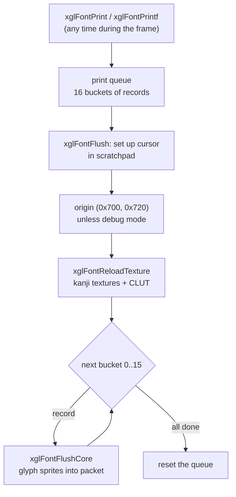

### Debug print

`xglFontDebugPrintf` and `xglFontDebugHex` print only when both the enabled
flag and the debug-print flag are set. `xglFontSetFlags` always clears the
debug-print bit, so debug text is off in normal play. The sound stream code
uses `xglFontDebugPrintf` to show a spinning character while a stream plays.

### Debug menus

`xgl_menu` is a small table of 16 debug menus (`menutbl[16]`, 128 bytes per
entry). `xglMenuOpen(slot, params)` opens a menu. Type 1 is a list menu.
Type 0, a sprite menu, only deactivates the slot. `xglMenuDraw` animates the
opening and closing of each list, reads controller 1 (Up and Down with
auto-repeat, Circle to choose, Cross to go back) and prints the rows with
`xglFontDebugPrintf`. The selected row is drawn in dark red and disabled rows
are dimmed. A chosen value below `0x100000` is returned as the result,
otherwise it points at a child menu. The only user is the debug scene
`src/main/yajima_test.c`. The game's real menus use the window system
described in [ui-windows.md](ui-windows.md).

## Sound

File: `src/main/xgl_sound.c`

The sound driver runs on the IOP (`src/audio/`, see
[iop-sound-driver.md](../architecture/iop-sound-driver.md)). The EE talks to
it through the `Ssd*` client functions in `src/main/ssd_*.c`. `xgl_sound` is
the layer the game uses on top of them. It loads banks, starts music, queues
sound effects and runs the audio streams. The overall audio design is in
[audio.md](../architecture/audio.md).

### The sound work area

All state is in `SoundWork`:

| Field | Meaning |
| --- | --- |
| `channels[8]` | Music channels: the wave bank handle and the sequence of each |
| `effect_banks[16]` | Sound effect banks: the wave bank `handle` and the `file_handle` of the effect table |
| `stream` | The audio stream state, overlaid on a `CdStreamParam` |
| `packet_count`, `packets[64]` | The sound command queue |

A handle of `0xFFFF` means "nothing loaded". A sound effect is named by a
32-bit ID: the bank number in the high 16 bits and the effect index in the
low 16 bits. The four most common interface sounds have fixed IDs in bank 0:
`SE_DECIDE` (1), `SE_CANCEL` (2), `SE_CURSOR` (3) and `SE_BUZZER` (5).

### Banks

Sound data comes in three kinds of file. A `.SWD` file holds wave data
(samples), a `.SED` file holds a table of sound effects and a `.SMD` file
holds a music sequence. The way the game uses them is described in
[audio.md](../architecture/audio.md), and the byte layouts in
[SWD wave banks](../formats/sound.md#swd-wave-banks),
[SED effect files](../formats/sound.md#sed-effect-files) and
[SMD music files](../formats/sound.md#smd-music-files).

| Function | Use |
| --- | --- |
| `xglSoundLoadSwd(name, buffer)` | Read `data\sound\NAME.SWD` |
| `xglSoundLoadEffect(name, buffer, bank)` | Read `sed\NAME.SWD` and `.SED` and send them as effect bank `bank` |
| `xglSoundLoadRequestSmd(name, buffer)` | Read `smd\NAME.SWD` and `.SMD` into music channel 0 and start it at volume 127 |
| `xglSoundSendSwd(swd, bank)` | Send wave data to the driver. A negative bank means music channel `-1 - bank` |
| `xglSoundSendSmd`, `xglSoundSendSmd2`, `xglSoundSendSed`, `xglSoundSendEffect` | Send sequence and effect data |

Each send function waits for the driver's answer in a loop
(`SsdGetResultValue`) and for the end of the sample upload
(`SsdSpuDmaCompleted`), so it blocks the calling thread for a short time. The
boot code in `src/main/control_entry.c` loads the resident banks this way.

### Music

Music channel 0 is the normal background music. The other channels hold
extra sequences.

| Function | Use |
| --- | --- |
| `xglSoundSequenceNormal(volume)` | Start the sequence of channel 0 |
| `xglSoundSequenceNormal2(channel, volume)` | Start the sequence of any channel |
| `xglSoundSequenceNormal3(channel, volume, time)` | The same, with a time argument, probably a fade-in |
| `xglSoundSequenceFadeOut(time)`, `FadeOut2(channel, time)` | Fade the sequence out and pause it (`SsdPauseSequence`) |
| `xglSoundSequenceStop()`, `Stop2(channel)` | Stop the sequence at once |

The volume is clamped to 127. Every time argument is halved before it is
passed to the driver. Each call waits for the driver's answer. The fade-out
and stop functions do nothing when the channel has no sequence loaded.

### Sound effects and the command queue

Starting a sound effect is a message to the IOP. Sending one message per
effect would cost a SIF call each time, so `xgl_sound` collects them. The
queued functions do not talk to the driver. They call `xglMakeSePacket`, which
appends a 32-byte `SePacket` (a command and four arguments) to
`SoundWork.packets`. Once per frame, right after `xglRenderMove`, the render
thread calls `xglSendSePacket()`, which sends the whole queue in one call
(`SsdSendFuncPacket`) and empties it. All the sound effects of a frame
therefore cost a single EE-to-IOP call.

| Function | Queued | Use |
| --- | --- | --- |
| `xglSoundEffectNormalID(id, pitch)` | yes | Play an effect (command 112) |
| `xglSoundEffectParamID(id, volume, pan, pitch)` | yes | Play with volume and pan (command 113) |
| `xglSoundEffectPosID(id, position, mode, source)` | yes | Play at a 3D position (see below) |
| `xglSoundEffectStopID(id, source)` | yes | Stop an effect (command 121) |
| `xglSoundEffectNormalDirect(id)`, `ParamDirect` | no | Play at once with `SsdPlayEffectNormal` |
| `xglSoundEffectStopDirect`, `xglSoundEffectStopBank(bank)` | no | Stop at once |
| `xglSoundEffectCheckID(id)` | no | Ask whether an effect is playing |

For the interface sounds 1, 2, 3 and 5, a second argument of 0 is replaced by
a random 15-bit value from `xglSRand`, probably to vary the pitch slightly
each time. A typical call from a menu is:

```c
xglSoundEffectNormalID(SE_CURSOR, 0);
```

`xglMakeSePacket` accepts a packet while `packet_count` is below 65, but the
array has 64 entries. A 65th effect in one frame would be written past the
end of the array.

The diagram below shows the path of a queued effect and of the other sound
calls.

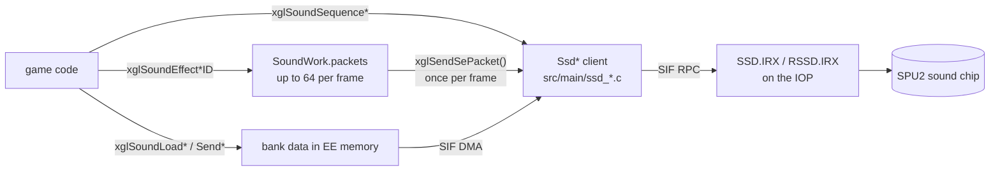

### Positioned effects

`xglSoundEffectPosID` plays an effect from a point in the world, relative to
the player character (the actor stored at `GameLoopState[1]`, position at
`+0x10`):

1. Compute the distance from the player. Beyond 6 units the effect is stopped
   instead.
2. Compute an attenuation of `distance squared / 13`, at least 1.
3. Set the volume to `127 / attenuation`.
4. Compute the pan, from 0 to 127, from the angle given by `atan2` of the
   offset.
5. Queue the effect with command 124, or as a `ParamID` effect, depending on
   the mode argument.

### Audio streams

Long voices and streamed music are played from a CD stream. Only stream 0
exists. The open functions are `xglSoundStreamOpenPcm`,
`xglSoundStreamOpenVagStereo`, `xglSoundStreamOpenVagMulti` and the `...Param`
versions that also take pitch, volume and pan. The stream files are described
in [VAG streams](../formats/sound.md#vag-streams). Opening a stream goes
through these steps:

1. Open the file as a CD stream (`xglCdStreamOpen`) with a 4 KiB ring.
2. Pre-fill 8 KiB of data.
3. Initialise the driver's stream with four chunks of 4 KiB in the 16 KiB
   `StreamBuffer`.
4. Start playback.

Then the game calls `xglSoundStreamMain()` every frame while the stream plays
(the field loop in `src/main/game.c`, `src/main/set_path.c` and
`src/main/game_over.c` do this). Each call shows a small spinning character at
(244, 8) with the debug print, asks the driver which chunks it has finished,
and sends the next chunk from the CD stream. After the end of the file it
sends six chunks of silence, then returns -1 and the stream is stopped.
`xglSoundStreamStop` stops it early and `xglSoundStreamMute` silences it.

The sequence diagram below shows one frame of a playing stream.

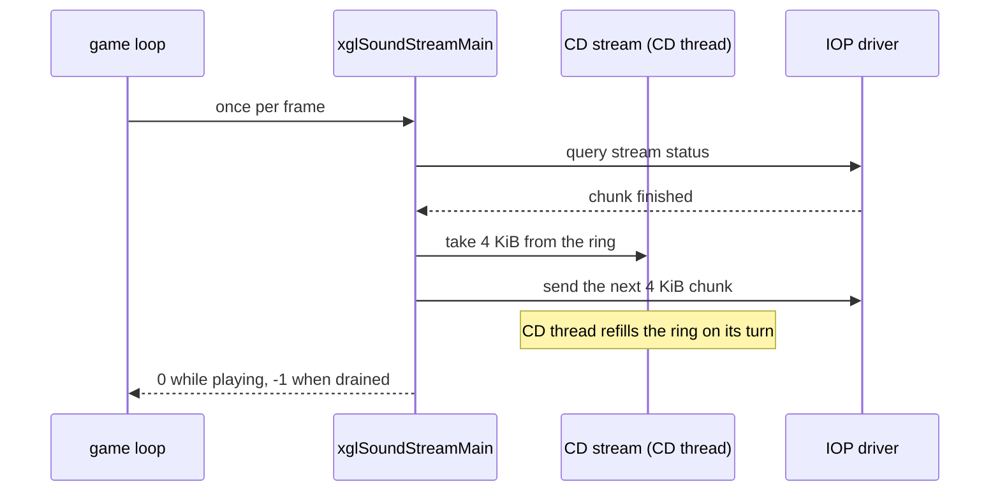

`xglSoundInitial` starts the client with `SsdInit(0x20000)`, marks all
handles empty and resets the driver with `xglSoundReset`.

## Controllers

File: `src/main/xgl_pad.c`

`xglPadRead()` runs once per frame on the render thread and handles both
controller ports. The result is the `PadData[2]` array, one record per port,
which the game reads during its own turn.

### The pad record

Each port has an `XglPadRecord` (`0x68` bytes):

| Field | Meaning |
| --- | --- |
| `packet[0x20]` | Raw data from `scePadRead` |
| `mode`, `mode_id`, `connection_state`, `setup_state` | Controller type and setup progress |
| `buttons`, `pressed`, `repeated`, `released` | Buttons held, newly pressed, auto-repeated, released |
| `directions`, `direction_pressed`, `direction_repeated`, `direction_released` | The same for directions, including the left stick |
| `position[4]` | Analog sticks: 0 and 1 the right stick, 2 and 3 the left stick |
| `horizontal_dead_zone`, `vertical_dead_zone` | Stick dead zone for directions (64) |
| `pressure[8]` | Pressure of the pressure-sensitive buttons |
| `repeat_delay`, `repeat_interval`, `repeat_mask`, `repeat_wait`, `repeat_count` | Auto-repeat settings and state |
| `actuator[6]`, `actuator_count`, `actuator_pending` | Vibration motors |
| `button_map[8]` | Remapping of the low 8 buttons |
| `axis_dead_zone[4]`, `axis[4]` | Per-axis dead zone (32) and adjusted axis values |

The button masks (`PAD_CIRCLE`, `PAD_SELECT` and so on) are defined in
`include/shared.h`.

### Setup

Each port goes through a small setup state machine before it is read. A
DualShock in digital mode is first switched to analog mode. Then its
vibration motors are enabled and, when the controller supports it,
pressure-sensitive buttons are turned on. The states are `PROBE` (0),
`QUERY` (`0x40`), `SET_MAIN_MODE` (`0x41`), `WAIT` (`0x42`),
`ACTUATOR_ALIGN` (`0x70`), `WAIT_ALIGN` (`0x71`), `PRESSURE_INFO` (`0x80`),
`ENTER` (`0x81`), `WAIT` (`0x82`) and `READY` (`0xFF`). Each step sends one
request to the controller and waits for it to finish on the following frames.
When a controller is removed, the port goes back to the probe state.

The state diagram below shows the setup.

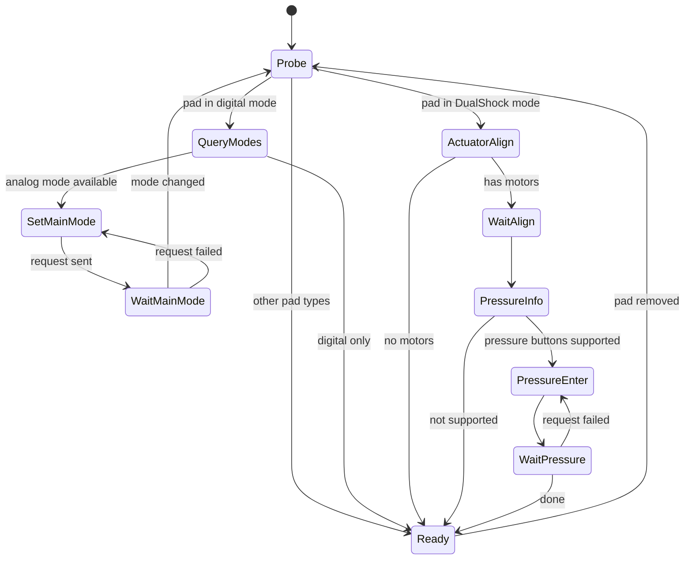

### Reading

Once a port is ready, each frame `xglPadRead`:

1. Reads the raw packet and decodes it according to the controller type. The
   code knows the mouse, the NeGcon, a light-gun-like type (`0x60`), type
   `0xE0`, digital pads and analog pads.
2. Applies `button_map` to the low 8 buttons.
3. Turns a left stick pushed past the dead zone into direction bits, so menus
   can be used with the stick.
4. Computes the pressed, released and repeated bits by comparing with the last
   frame.
5. Derives pressure values from the digital buttons when the pad is not in
   pressure mode, so code that reads pressure always gets a value.
6. Sends the vibration values with `scePadSetActDirect`, then clears them.

Because the vibration values are cleared every frame, game code must set
them every frame for as long as the motor should run. Setting
`actuator_pending` forces the motors to zero.

Auto-repeat makes a held button fire again after a delay. The default mask is
`0xF00C` (the four directions and L1, R1), with a delay of 8 frames and an
interval of 1 frame. `xglPadSetRepeat(port, mask, delay, interval)` changes
it, with a port of -1 for both ports. The main menu uses it
(`src/main/window_tex_load.c`).

## Flags

File: `src/main/xgl_flags.c`

The story and event state is one large packed bit array of 64 KiB inside the
save data, starting at `SaveData + 0x74`. A flag is addressed by its **bit
offset** and its width in bits, so one byte can hold several small flags and
a counter can span several bytes. Because the flags live in the save data,
saving the game saves them too.

```c
old   = xglFlagsSet(bit_offset, bit_count, value);   /* returns the old value */
value = xglFlagsGet(bit_offset, bit_count);
```

`xglFlagsSet` builds a mask of `bit_count` bits, shifts it to the bit offset,
clears those bits and stores the new value. There are fixed-width versions
for 1, 2, 4, 8, 16, 32 and 64 bits (`xglFlagsSet8`, `xglFlagsGet16`, ...).
`xglFlagsInitial` clears the whole area for a new game.

The 32-bit and 64-bit versions do not work. The mask is built with a shift
by the width, and the EE's variable shift instruction only uses the low 5
bits of the shift amount. A shift by 32 becomes a shift by 0, and the mask
ends up as 0. `xglFlagsGet32` therefore always returns 0 and `xglFlagsSet32`
changes nothing, and the same goes for 64. The game appears not to rely on
them.

The flags are used by the script natives `Runtime.getFlags` and
`Runtime.setFlags` (`src/main/runtime.c`, see
[natives.md](../scripting/natives.md)), by the item pick-up events
(`src/main/create_evt_item_get_task.c`, which marks collected items from
`ITEM_COLLECTED_FLAG_BASE`), by the Driller Game setup
(`src/main/init_drill.c`) and by the Network Casino (`src/ov11/mini_g.c`).

## Math

File: `src/main/xgl_2.c`

`xgl_2.c` holds the engine's vector and matrix library. It includes vector
arithmetic, 4 x 4 matrices, a matrix stack kept inside the VU0 vector unit,
quaternions, projection of points to the screen, random numbers, sine,
cosine and arctangent, and fast memory copies. Many of these functions run on
VU0 through inline assembly.

| Area | Functions |
| --- | --- |
| Vectors | `xglVectorScale`, `xglVectorInner`, `xglVectorOuter`, `xglVectorLength`, `xglVectorNormal`, `xglPointLength` |
| Matrices | `xglMatrixUnit`, `xglMatrixMul`, `xglMatrixInverse`, `xglMatrixRotX/Y/Z` |
| Matrix stack | `xglMatrixStackPush`, `xglMatrixStackPop`, `xglMatrixStackMul`, `xglMatrixStackTrans`, `xglMatrixStackRotX/Y/Z` |
| Projection | `xglRotTransPers`, `xglMatrixStackRTPS` |
| Quaternions | `xglMatrix2Quaternion`, `xglQuaternion2Matrix`, `xglQuaternionInterpolateLinear` |
| Random numbers | `xglSRand`, `xglLRand`, `xglFRand`, `xglFSrand` |
| Trigonometry | `xglSin`, `xglCos`, `xglAtan2` |
| Memory copy | `xglMemCopy64/16/8/4/2`, and `...b` versions that copy backwards |

All of it, together with the other math helpers of the game, is described in
[math.md](math.md).

## Movies

File: `src/main/xgl_1.c`

The file contains two separate movie players. Both use the IPU, the PS2's
image decoding unit, which decodes MPEG-2 style compressed pictures in
hardware.

### IPU movies (`xglMovie*`)

The first player plays **ipum** files, a simple stream of compressed frames
that the IPU decodes directly. These are short clips used as moving
textures, for example on screens inside a map (`src/main/unit6003.c`), in
battle (`src/ov01/m_mv.c`), in the boot logo (`src/ov02/logo.c`) and in the
field movie code (`src/main/game_movie.c`). The file layout is described in
[IPU movies](../formats/movies-images-and-icons.md#3-ipu-movies).

The file starts with a header: the signature `0x6D757069` (`"ipum"`), the
width, the height and the frame count. `xglMovieInfoInit` fills an info
struct, and `xglMovieOpen(info, stream)` prepares the source. The data can
come from a CD stream, with a ring of twice the source size and a 4-entry DMA
`REF` chain that points into it, or from memory.

Each call to `xglMoviePlay` decodes one frame:

1. Reset the IPU, set its thresholds (`SETTH`) and restore the bit position
   saved at the end of the last frame.
2. Start a DMA from the source to the IPU input channel. If the source has
   run dry, print "frame drop" and return -1.
3. Send the `FDEC` command to read the frame header, then `IDEC` to decode an
   intra picture with quantizer scale 1.
4. For each strip of 16 pixel rows, take the decoded macroblocks from the IPU
   output channel into a buffer, then upload them to the GS as 16 x 16 blocks
   (`make_gstrans`). The transfer mode chooses the destination: the frame
   buffers (modes 0 and 1), a custom `BITBLTBUF` (mode 2) or a copy to memory
   (`0xFF`).
5. Save the IPU bit position (`IPU_BP`) so the next frame continues there.
   Loop back to the start of the file when looping is enabled.

The flowchart below shows the decode loop of one frame.

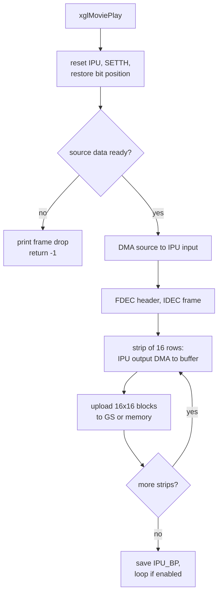

`xglMovieMakeXtxHeader` builds an XTX texture header for the decoded image,
so a movie frame can be used as a model texture. `xglMovieClose` ends
playback. `xglMovieInit` initialises the IPU with `sceIpuInit` at boot
(`src/main/control_entry.c`).

### MPEG-2 movies (`xglMpeg2*`)

The second player plays the full-motion video cut-scenes, MPEG-2 program
streams (PSS) with interleaved video and audio, through Sony's `sceMpeg`
library. It is used by the field movie player (`src/main/game_movie.c`) and
by battle movies (`src/ov01/m_mv2.c`, with its arena at `0x01B9E000` and a
CD stream ring of `0x80000` bytes). The files themselves are described in
[PSS movies](../formats/movies-images-and-icons.md#2-pss-movies).

`xglMpeg2InfoInit` and `xglMpeg2InfoInit2(info, arena, ring_size)` divide
one memory arena into the buffers the player needs. The third parameter,
`ring_size`, sets `ringCapacity`, the size of the CD stream ring. The sound
ring always has `0x20000` bytes.

| Buffer | Size |
| --- | --- |
| `sceMpeg` work area | `0xFD768` |
| Video output | `0xE0000` |
| Packets | `0x15040` |
| Read buffer | `0x4000` |
| DMA ring | `0x80000` |
| Sound ring | `0x20000` |
| CD ring | 1 MiB with `xglMpeg2InfoInit`, or the size given to `xglMpeg2InfoInit2` (`0x40000` for `GameMpeg2Play`, `0x80000` for battle movies) |

`xglMpeg2Open` opens the file as a CD stream, pre-fills half of the CD ring,
creates the decoder with `sceMpegCreate` and installs four callbacks. The
video callback copies demultiplexed video data into the DMA ring. The audio
callback takes the audio packets, and reads the sample rate from the first
one (a `0x2C`-byte header with the rate at `+0x10`). The no-data callback
feeds the IPU in 4 KiB pieces and sends filler data after 65 misses in a row.
The error callback handles decoder errors. The audio plays through a
stereo VAG stream of the sound driver (`SsdInitVagStreamStereo`, four
4 KiB chunks).

Each call to `xglMpeg2Play` then:

1. Asks for the next picture with `sceMpegGetPicture` into the video buffer.
   The size passed is 896 macroblocks of 16 × 16 pixels (32 × 28 for a
   512 × 448 picture). At 1024 bytes per RGBA macroblock this fills exactly
   the `0xE0000`-byte buffer.
2. Tracks I-frames. On the first frame it builds the GS upload tags and
   starts the audio stream at `rate << 12 / 48000`, the driver's pitch for
   that sample rate.
3. Passes new audio chunks to the driver and refills the buffers (up to 16
   fills per frame).
4. Uploads the picture to the GS with a GIF chain and draws it with
   `nmlModelDirectSend`.

The sequence diagram below shows one frame of playback.

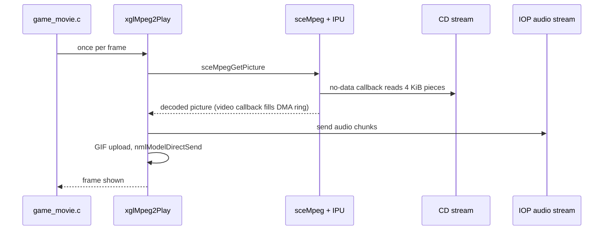

`xglMpeg2Close` stops the decoder and the streams. The cut-scene system that
decides when a movie plays is described in
[scenes-and-timecharts.md](../scripting/scenes-and-timecharts.md).

## JPEG

File: `src/main/xgl_jpeg.c`

A software baseline JPEG encoder and decoder. The encoder makes the
snapshots and the small pictures stored in save files. The decoder shows
those pictures again, and also decodes title and ending images stored as
JPEG. The pictures on the disc, and the limits of the decoder that they
respect, are described in
[JPEG pictures](../formats/movies-images-and-icons.md#4-jpeg-pictures).

### Work area

The codec keeps its work area `sw` (type `JpegWork`) in the scratchpad at
`0x70000000`, and stages pixel data at `0x70003000`. The scratchpad is fast,
and the GS image transfers can read from and write to it. The main fields
are:

| Field | Meaning |
| --- | --- |
| `luminanceQuantization`, `chrominanceQuantization` | 64 quantizer values each, as floats |
| `luminanceDcCodes`, `chrominanceDcCodes`, `luminanceAcCodes`, `chrominanceAcCodes` | Huffman tables, written as code lists for the encoder or as decode tables for the decoder |
| `buffer`, `outputPosition`, `bitsRemaining`, `bufferedByte` | The bit reader or writer |
| `samplingMode`, `imageWidth`, `imageHeight`, `maximumX`, `maximumY` | Image geometry and crop limit |
| `dcPredictors[3]` | Last DC value of Y, Cb and Cr |
| `decodedMcuPlanes`, `decodedYuvPixels` | Six 8 x 8 float blocks of one MCU, and the pixel buffer |
| `restart_interval` | Restart interval from a `DRI` marker |

Three chroma sampling modes are supported: 4:4:4 (MCU of 8 x 8 pixels),
4:2:2 (16 x 8) and 4:2:0 (16 x 16). An **MCU** (minimum coded unit) is the
group of blocks coded together: up to four luminance blocks, then one Cb and
one Cr block.

### Decoding

`xglJpegDecode(request)` takes a `JpegDecodeControl`:

| Field | Meaning |
| --- | --- |
| `source` | The JPEG data |
| `destination` | Output buffer, or 0 to upload straight to the GS frame buffer |
| `frameBufferBase`, `frameBufferWidth`, `originX`, `originY` | GS destination when `destination` is 0 |
| `imageLimits` | Crop size on input (0 for none), image size on output |
| `pixelFormat` | Bit 0 selects 16-bit RGB555 output instead of 32-bit RGBA |
| `scaleMode` and the percentage fields | Color scale settings |

The decoder walks the markers of the file. Each marker handler returns the
position where parsing continues:

1. `SOI` starts the image. `DRI` sets the restart interval.
2. `DQT` reads a quantization table (ID 0 luminance, 1 chrominance).
3. `SOF0` reads the image size and the sampling factors of the first
   component, which select the sampling mode.
4. `DHT` builds a Huffman decode table.
5. `SOS` decodes the scan in `StartOfScan`. Parsing stops at `EOI` or at an
   `RST0` marker found between segments. Unknown segments are skipped by
   their length.
6. The real image size is written back to `imageLimits`.

`StartOfScan` decodes MCU by MCU, left to right and top to bottom:

1. Load the IDCT constants and the YCbCr-to-RGB matrix into VU0 registers.
   They stay there for the whole scan.
2. At each restart interval, step over the `RSTn` marker and reset the bit
   reader and the DC predictors.
3. Huffman-decode each block of the MCU (`HuffmanDecode`). The DC value is a
   difference from the component's last DC value. The coefficients are
   dequantized and stored in zigzag order.
4. Skip MCUs that start beyond the crop limit. For the others, run the
   inverse DCT on VU0 (`FFIDCT`).
5. Spread the blocks into pixels, repeating subsampled chroma
   (`ConvertMCU2YUV`).
6. Convert to RGB (`ConvertYUV2RGB`). VU0 applies the color matrix, then the
   EE's 128-bit multimedia instructions clamp each channel to 0..255
   (`pmaxw`, `pminw`) and pack it into bytes (`ppach`, `ppacb`).
7. Store the MCU: upload it to the GS with `sceGsExecLoadImage`, pack it into
   RGB555, or copy it into the 32-bit destination, clipped to the image
   width.

The flowchart below shows the decoding of one image.

```mermaid
flowchart TD
    A["xglJpegDecode"] --> B{next marker}
    B -->|DQT, DHT, SOF0, DRI| C[read table or header]
    C --> B
    B -->|SOS| D["StartOfScan:<br/>load VU0 constants"]
    D --> E{restart due?}
    E -->|yes| F["skip RSTn, reset<br/>bit reader and DC"]
    E -->|no| G
    F --> G["HuffmanDecode<br/>each block of the MCU"]
    G --> H{inside crop?}
    H -->|no| K
    H -->|yes| I["FFIDCT, ConvertMCU2YUV,<br/>ConvertYUV2RGB"]
    I --> J["store: GS upload,<br/>RGB555 or RGBA copy"]
    J --> K{more MCUs?}
    K -->|yes| E
    K -->|no| B
    B -->|EOI| Z["write image size<br/>to imageLimits"]
```

The decoder stores the color scale percentages of the request in the work
area (`luminanceScale`, `redScale` and so on), but no code in the file reads
them back. The feature appears to be unused or unfinished.

### Encoding

`xglJpegEncode(request)` takes a `JpegEncodeRequest`: an output buffer, a
rectangle of the GS frame buffer (source and destination position, width and
height), a quality for luminance, a quality for chrominance and a sampling
mode. It writes the JPEG into the output buffer and stores its size in
`outputSize`.

1. Scale the standard luminance and chrominance quantization tables by the
   quality values, IJG style (quality 50 is the standard table), and keep
   their reciprocals as floats.
2. Build the Huffman code tables from the standard tables inside the canned
   header `headerALL`.
3. Copy `headerALL` (JFIF, `DQT`, `SOF0`, `DHT` and `SOS` segments) to the
   output and patch in the quantization tables, the image size, the sampling
   factors and a pixel density.
4. For each MCU, read the pixels back from the GS frame buffer into the
   scratchpad with `sceGsExecStoreImage`, convert RGB to YCbCr with the JFIF
   matrix, run the forward DCT (`FFDCT`), quantize and Huffman-encode each
   block.
5. Flush the last partial byte and write `EOI`.

The snapshot code (`src/main/game_snap_shot.c`) uses the encoder for full
screenshots and for the 128 x 112 thumbnail stored in a save file. Its third
quality byte (named `cr_quality` there) is the field the encoder reads as the
sampling mode. With a plain quality value the snapshot code sets it to 0,
which selects 4:4:4 sampling. With a preset from its quality table the value
comes from the table.

### Users

| Use | Files |
| --- | --- |
| Save thumbnails, decoded on the save and load screen | `src/main/file.c` |
| Snapshots and thumbnails, encoded | `src/main/game_snap_shot.c` |
| Title screen and HDD install screen images | `src/ov02/title.c`, `src/ov02/title_hdd_install.c` |
| U.M.N. images | `src/ov02/tya_uml.c` |
| Game over and ending screens | `src/main/game_over.c`, `src/main/end_print.c` |
| Display settings screen | `src/main/tya_display_setting.c` |
| Debug scene | `src/main/endou_test.c` |

## Timer 0

File: `src/main/xgl_timer0.c`

The EE has four hardware timers. `xgl` uses timer 0 as a free-running counter
for timing measurements:

| Function | Use |
| --- | --- |
| `xglTimer0Reset(mode)` | Clear the counter (`T0_COUNT`, `0x10000000`) and start it with `mode` plus the count-enable bit (`0x80`) in `T0_MODE` |
| `xglTimer0Get()` | Read the 16-bit count |

The same file holds the ARX decompressor `xglArxExtract`, described in
[Packed files and ARX](#packed-files-and-arx).

## Who uses xgl

Number of source files in each unit that call each module, not counting the
module itself:

| Module | main | OV01 | OV02 | OV10 | OV11 | OV12 |
| --- | --- | --- | --- | --- | --- | --- |
| math (`xgl_2`) | 73 | 10 | 6 | 9 | 1 | 3 |
| font | 54 | 3 | 13 | 7 | 1 | 5 |
| studio | 46 | 4 | 3 | 2 | 1 | 2 |
| sound | 40 | 2 | 11 | 9 | 1 | 1 |
| cd | 34 | 3 | 5 | 5 | 1 | 3 |
| thread | 27 | 4 | 4 | 1 | 1 | 3 |
| render | 20 | 3 | 2 | 2 | 1 | 1 |
| packet | 19 | 5 | 3 | 0 | 1 | 0 |
| camera | 19 | 4 | 1 | 0 | 0 | 2 |
| light | 18 | 2 | 3 | 2 | 1 | 3 |
| task | 14 | 1 | 2 | 0 | 0 | 0 |

Math, font, studio and sound are used almost everywhere. The low-level
modules (DMA, pad, primitives, timer) are used mostly inside the main
executable.

The A.G.W.S. Battle overlay (OV12) calls `xgl` directly only in a few places.
It has its own wrapper layer, `xrg_*` (`src/ov12/xrg_pad.c`,
`src/ov12/xrg_sound.c`, `src/ov12/xrg_cdread.c` and others), built on top of
`xgl`. That layer is described in
[agws-battle-engine.md](../game/minigames/agws-battle-engine.md).
