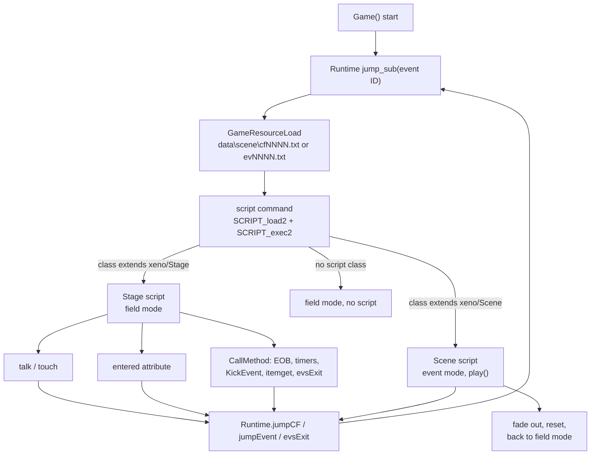
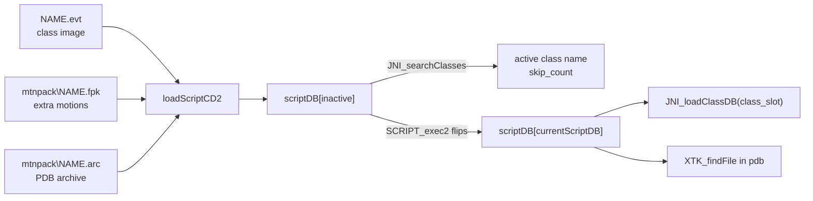
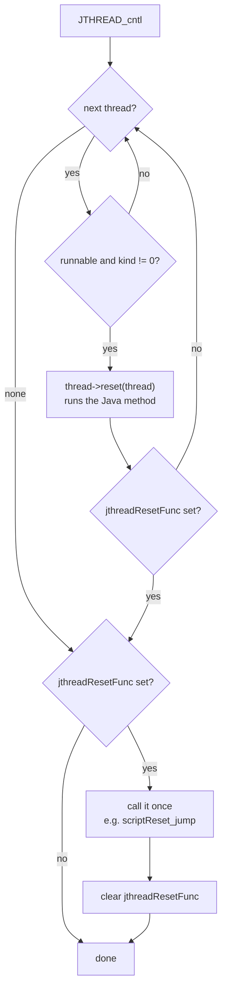
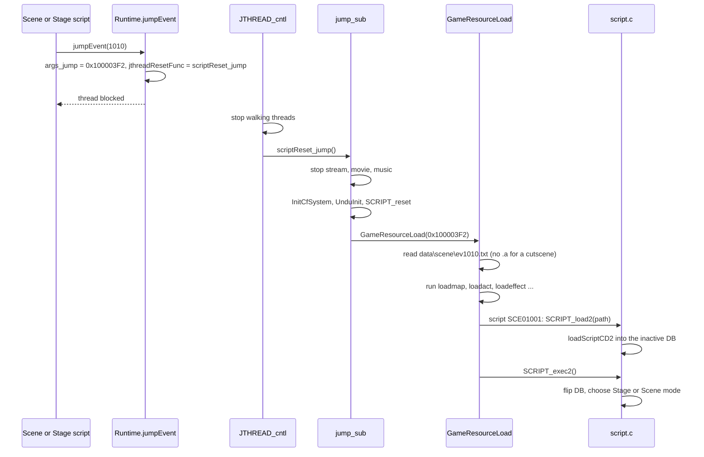
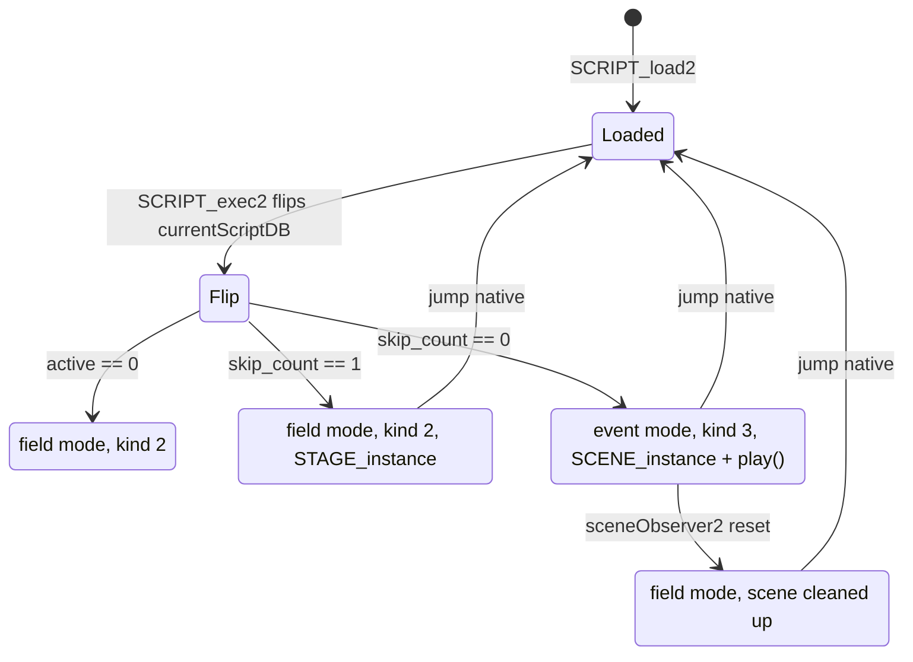
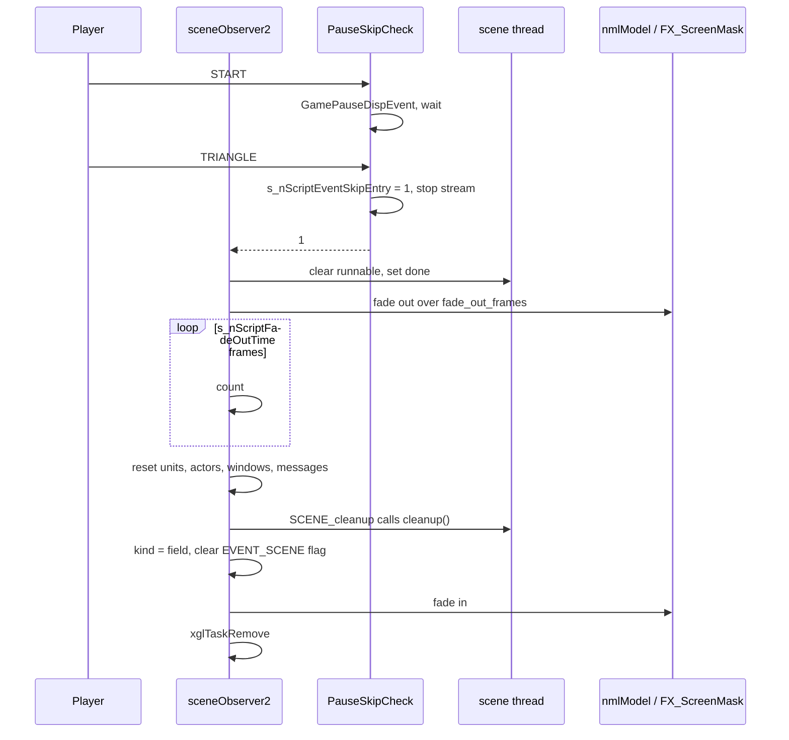
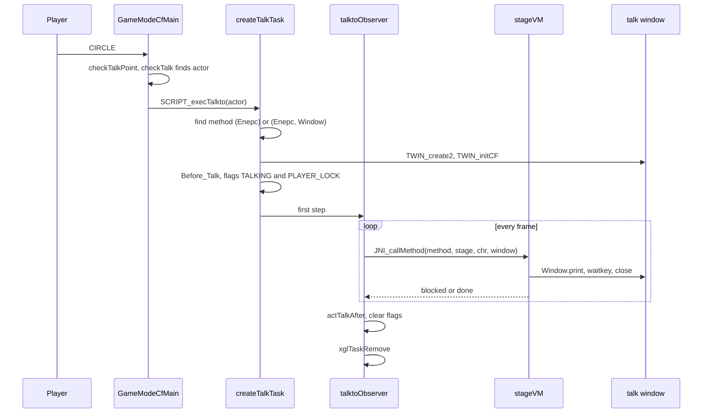
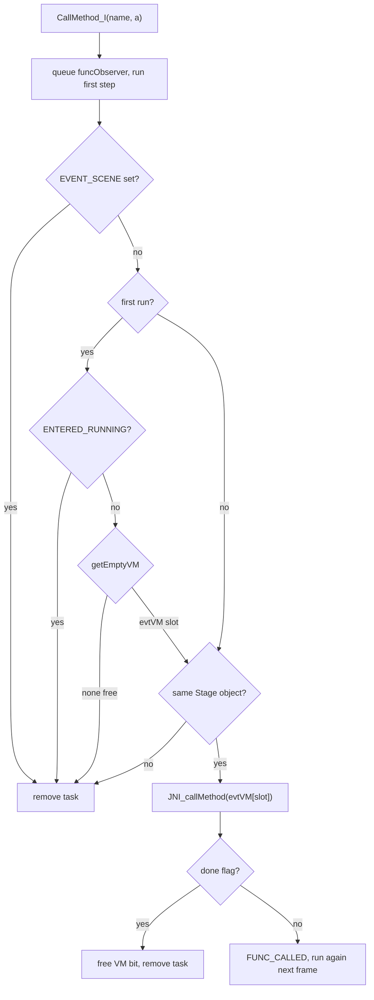
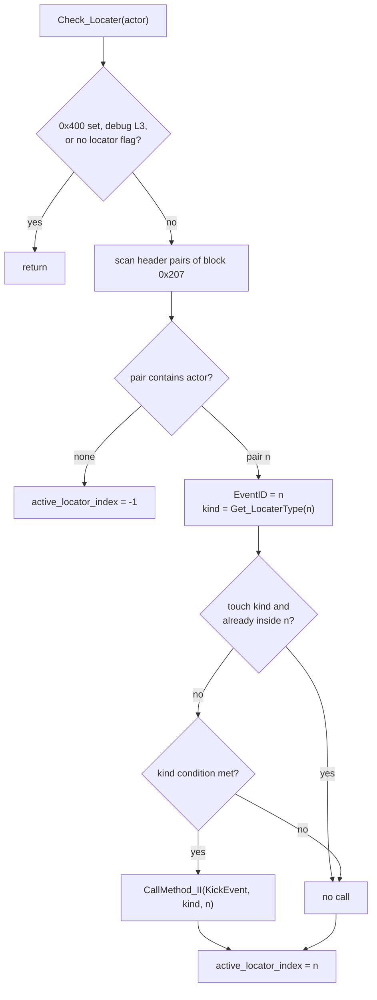
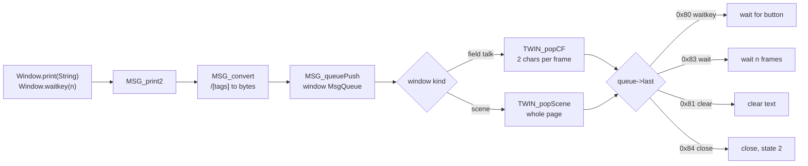

# Events and cutscenes

Almost every story moment in Xenosaga Episode I is driven by a Java script.
A script decides what happens when the player talks to someone, walks into a
trigger area, wins a battle or reaches a story point. It also plays the
cutscenes. The C code in `src/main/script.c` loads these scripts, starts them
in the right mode, gives them threads to run on and cleans up when they end.
Around it sit the triggers in the field code, the message system that turns
script text into window text (`src/main/msg_init.c`), and the jump natives in
`src/main/runtime.c` that move the game from one scene to the next.

The sections below follow an event from its trigger to its end. The Java
virtual machine itself is described in [java-vm.md](java-vm.md) and the native
methods in [natives.md](natives.md). Cutscene playback (scenes, time charts, event
cameras and actor movement) has its own page,
[scenes-and-timecharts.md](scenes-and-timecharts.md). A second, unrelated
script language, the effect scripts of `src/main/sc_get.c`, is described at the
end of this page.

[← Back to the overview](../README.md)

## Overview

The game has two kinds of top-level script, and both are Java classes compiled
into an event file (`.evt`). A **Stage** script is a class that extends
`xeno/Stage`. It is the script of a field area. It stays loaded while the
player walks around and it answers the field triggers: talking to a
character, touching one, stepping on a trigger area, or the end of a battle. A
**Scene** script is a class that extends `xeno/Scene`. It is a cutscene. It
takes over the game, runs its `play()` method from start to end and then gives
control back.

Both kinds are loaded the same way. Every place in the game has an **event
ID**, stored in `GameLoopState.current_event_id`. The jump natives of the
script (`Runtime.jumpCF`, `Runtime.jumpEvent`, `Runtime.evsExit`) change the
event ID and reload everything. A small text file for that ID, the **scene
resource script**, lists the map, models, motions, sounds and the script file
to load. The `script` command of that file loads the `.evt` and starts it.

Small pieces of Stage script also run in the middle of field play. The C code
calls a named method of the Stage object when the player talks to someone
(`createTalkTask`), touches someone (`SCRIPT_execTouchto`), enters an
attribute area (`SCRIPT_execEntered`), or when C code wants to notify the
script (`CallMethod`, used for battle results, event timers, map event
locators and item boxes). Each call runs on a separate VM thread under a
small observer task, so the field keeps running while the method executes.

| Script activity | Started by | Runs on | Ends when |
| --- | --- | --- | --- |
| Stage script `init()` | `script` command, `SCRIPT_exec2` | `defaultVM` | `init()` returns |
| Stage background method | `Stage.start(1, name)` from the script | the thread of the Stage's `peer` | `Stage.stop()` or the method returns |
| Scene `play()` | `script` command, `SCRIPT_exec2` | the scene object thread | `play()` returns, skip, or movie skip |
| Talk method | CIRCLE near a character, `createTalkTask` | `stageVM` | the method returns or CROSS cancels |
| Touch method | walking into a character, `SCRIPT_execTouchto` | `stageVM` | the method returns |
| `entered(int)` | attribute area under the player, `SCRIPT_execEntered` | a free `evtVM` | the method returns |
| Named method | `CallMethod`, `CallMethod_I`, `CallMethod_II` | a free `evtVM` | the method returns |

The diagram below shows how the triggers, the jump natives and the scene
resource script lead to the two kinds of top-level script.



## Script files and script databases

An event file is a class database image. The Java VM reads the classes
directly from it (see [java-vm.md](java-vm.md) for the format and for
`JNI_loadClassDB`). On the disc it is a PDB volume with one entry per class
file, laid out as described in
[Scripts and scene archives](../formats/scripts-and-archives.md#pdb-volumes).
Two shared event files are loaded once when `Game()` calls `SCRIPT_init`.
`data\system.evt` holds the library classes, among them `xeno/Chr`,
`xeno/Unit`, `xeno/Stage`, `xeno/Scene` and the other classes that declare
the native methods. `data\base.evt` holds the game's own base classes
`xeno/Enepc`, `xeno/MAPUnit`, `xeno/Monitor` and `xeno/Uwamono`, the small
class `xeno/plan/Base` and 24 empty stubs of constant interfaces. They stay
in class slots 0 and 1 for the whole session. Both volumes are listed class
by class in
[The library volumes](../formats/scripts-and-archives.md#the-library-volumes).

The place scripts come in two kinds. A field stage is `data\scene\STnnnn.evt`
(386 files) and a story event is `data\scene\SCEnnnnn.evt` (181 files). Only
story events can have companion files, and they sit in `data\mtnpack\` with
the same base name. Of the 181 events, 77 have both an `.fpk` and an `.arc`
file, 30 have only the `.fpk` file and 74 have neither. No stage has one.
The `.fpk` file is an additional motion pack that `ACT_initExMotion`
installs for the actors of the scene. The `.arc` file is a PDB volume,
ARX-packed on the disc, that holds the event's camera curves (`.cam`) and
face motion packs, plus a few build leftovers (see
[Resource volumes](../formats/scripts-and-archives.md#resource-volumes-arc)).
Scripts find their data files in it by name with
`Toolkit.loadResource(String)`, which calls `XTK_findFile` and then
`PDB_findFile` on the current PDB.

Each place volume holds exactly one main class, a subclass of `xeno/Stage`
or `xeno/Scene`, plus its inner classes. In 158 volumes the main class is not
named after the file. 68 stage volumes are copies of another stage that keep
its class name (`ST0239.evt` holds the class `ST0231`), and 17 `ST90xx`
stages share the class `JumpBattle`. 72 story events use the same small
placeholder scene `SCEDummy`, which sets the event's flag and jumps to the
next event. Every one of them is started by a cutscene script that plays a
pre-rendered movie first, so these events were probably replaced by movies
late in development (see
[Scene volumes](../formats/scripts-and-archives.md#scene-volumes)).

`src/main/script.c` keeps two script databases, `scriptDB[2]`, and the index
`currentScriptDB` of the active one. A new script is always loaded into the
inactive slot, `scriptDB[(currentScriptDB + 1) & 1]`. Starting it flips
`currentScriptDB` and unloads the class slot of the old one. The old script
keeps running until the moment of the flip, so a scene can load its successor
while it still plays. Each entry is a `ScriptDbEntry`:

```
ScriptDbEntry (0x1C bytes)
+0x00 class_image   class database image read from the .evt file
+0x04 motion_data   additional motion pack (.fpk)
+0x08 pdb           PDB archive (.arc), searched by XTK_findFile
+0x0C active        name of the Scene or Stage class, 0 when none
+0x10 thread        VM thread of the scene or stage object
+0x14 class_slot    class database slot (2 for scriptDB[0], 3 for scriptDB[1])
+0x18 skip_count    0 = Scene class, 1 = Stage class
```

The loader finds the main class with
`JNI_searchClasses(image, "xeno/Scene:xeno/Stage", 2, &skip_count)`. It
returns the name of the first class whose superclass is one of the two names
and reports which one matched. `skip_count` 0 means a Scene and 1 means a
Stage. When nothing matches, `active` is 0 and the script is treated as "no
script".

There are three loaders. `loadScriptCD2` is the one the game uses. It reads
the class image from the path in the `script` command, then reads the `.fpk`
and `.arc` files from the `mtnpack\` folder with the same base name through
`RES_loadFile(RES_LOAD_ANY_BLOCK, RES_TYPE_FILE, ...)`. `loadScriptCD` reads
the same three files next to a map path (`MAP_getPath()`) into the fixed
addresses stored in the entry. `loadScript` reads them from the host file
system with `sceOpen` and is used by the debug menu. The fixed addresses
(`0x05000000`, `0x06100000`, `0x06500000`, `0x06900000`) lie above the 32 MB of
a retail console, so these two loaders probably only worked on a 128 MB
development kit. The disc also has no `.evt`, `.fpk` or `.arc` file in
`data\map\`, the folder that `MAP_getPath()` gives, so `loadScriptCD` (used by
`SCRIPT_load` in `src/main/disp_on.c`) would find nothing there.

`SCRIPT_init(heap)` lays out the script memory at the current `WorkEnd` and
returns the new end:

```
heap_base
+0x00000  JNI heap (0x40000 bytes, JNI_initSystem)
+0x40000  data\system.evt buffer (0x8000), class slot 0
+0x48000  data\base.evt buffer (0x8000), class slot 1
+0x50000  scriptDB[0].class_image (0x2D000)
+0x7D000  scriptDB[1].class_image (0x2D000)
+0xAA000  returned as the new WorkEnd
```

The diagram below shows how a script file and its companions reach a script
database slot.



## Script threads

The VM runs many Java threads (`JThread`, see [java-vm.md](java-vm.md)). The
script layer creates a fixed set of them in `SCRIPT_init` and again in
`SCRIPT_reset`, which every jump calls:

| Thread | Frame words | Used for |
| --- | --- | --- |
| `defaultVM` | 0x80 | object construction and `init()` of Scenes and Stages |
| `stageVM` | 0x46 | talk and touch methods, time chart observers, `SCENE_cleanup` |
| `evtVM[0]`, `evtVM[1]` | 0x40 each | `entered(int)` and `CallMethod` calls |
| scene or stage object thread | 0x46 | created by `SCRIPT_exec2` for the script object and kept in `entry->thread`, runs `play()` of a Scene |

`UseVMFlag` is a bit mask of the event VMs that are busy. `getEmptyVM` takes
the first free one, initialises it with `JNI_initThread`, sets its bit and
stores the slot in the observer task. So at most two `entered` or
`CallMethod` calls run at the same time. A third one is dropped.

Each thread has a kind (system 0, character 1, stage 2, scene 3, default 4,
unit 5) and an update hook in `thread->reset`. The source names these hooks
"algorithms" (`JTHREAD_ALG_SCENE`, `JTHREAD_ALG_STAGE` and so on). Every frame
`JTHREAD_cntl` walks the thread list and calls the hook of every runnable
thread (flag 0x10). A scene thread uses `JTHREAD_defaultScene`, which resumes
the thread's method and clears the runnable flag once the method has
returned.

A native can stop the current thread for a while. It stores the current frame
depth in `resume_frames` and sets the waiting flag. It can also name a wait
kind in `wait_kind` (frames, another thread, a window, an actor, a signal, or
the game state). The thread then sleeps until the condition holds. The waits
are explained in [java-vm.md](java-vm.md). The ones events use most are
listed in [Synchronising text, voices and actions](#synchronising-text-voices-and-actions).

A jump cannot happen in the middle of a thread walk, because it rebuilds the
VM. The jump natives therefore only store a function pointer in
`jthreadResetFunc` and block their own thread. `JTHREAD_cntl` stops walking
the list as soon as that pointer is set, calls it once and clears it. The
diagram below shows this per-frame flow.



## Event IDs and the jump natives

`GameLoopState.current_event_id` names the current place or cutscene. Field
places are plain numbers. Cutscenes have bit 28 set (`0x10000000`), which is
what `Runtime.jumpEvent` adds. `InitCfSystem` also uses those high bits to
choose the font. Event IDs 9998 and 9999 set the flags `0x88000000` when they
load. The bits `0xF0000` of a destination are option bits that are removed
before the ID is stored. Bit `0x10000` (`RUNTIME_JUMP_KEEP_SEQUENCES`) keeps
the background music playing across the jump.

The script has three jump natives:

- `Runtime.jumpCF(int destination, int entrance)` jumps to a field place and
  entrance.
- `Runtime.jumpEvent(int)` jumps to cutscene `0x10000000 + n`. It also reads
  the next argument word as the entrance.
- `Runtime.evsExit()` jumps back to the event saved by
  `Runtime.evsSetRetPoint()`, which records `active_event_id` and the player
  position. After the jump, `scriptReset_evsExit` puts the player back at the
  saved position.

Each native stores its arguments in `args_jump`, sets `jthreadResetFunc` and
blocks its thread. `jumpCF` and `jumpEvent` also call
`SCRIPT_talkIgnoreSet()`, so that no talk can start in the meantime. The jump itself is `Java_xeno_util_Runtime_jump_sub`, run
from `JTHREAD_cntl`. `Game()` also calls it directly at the start of a session
with the saved event ID. It works in this order:

1. Stop U.M.N. capture (`tyaCaptureEnd`), the voice stream
   (`xglSoundStreamStop(0)`), any movie (`GameMovieStop`) and the defocus
   filter.
2. Fade out the eight sound sequences (`xglSoundSequenceFadeOut2` with a fade
   time of 1000), unless the keep bit is set.
3. Store the entrance in `GameLoopState.entrance` when it is not negative.
4. Store the new event ID without the option bits.
5. Call `InitCfSystem()`. It resets the actors, map units, the field camera,
   the effects, the field flags, `UseVMFlag` and the window owner.
6. Call `UnduInit(0)` to reset the ground data and `SCRIPT_reset()` to rebuild
   the VM threads.
7. Call `GameResourceLoad(current_event_id)`, which reads and runs the scene
   resource script.

## Scene resource scripts

`RES_getScenePath` builds the path of the resource script of an event ID. The
path is the scene folder from `RES_getPath()`, then `cf` for a field place or
`ev` for a cutscene (any ID above `0x0FFFFFFF`), the last four decimal digits
of the ID and `.txt`. The scene folder is `data\scene\` in the game. The table
behind `RES_getPath` also lists `data\scene\test\`, `data\scene\cf\`,
`data\scene\event\` and one folder per staff member (`gash`, `fuji`, `kojima`
and others), which the debug menu can select through `ScenePath`. None of
these other folders exists on the disc. For example ID 120 gives
`data\scene\cf0120.txt`, and the cutscene with ID `0x100003F2` gives
`data\scene\ev1010.txt`. The disc holds 387 field scripts and 181 cutscene
scripts, whose numbers run from `ev1000` to `ev3583`. An optional scene
archive with the same name and the extension `.a` (for example `cf0120.a`)
holds copies of the files the script loads, in the order the script loads
them. Only 112 field scenes have one, and no cutscene does.
`GameResourceLoad` reads it at the top of EE RAM.
`GameResourcePreLoad` can read both files ahead of time, and
`GameResourceLoad` then uses the preloaded archive. The script syntax, every
command and the archive layout are described byte by byte in
[Scene resource scripts](../formats/scripts-and-archives.md#scene-resource-scripts-txt)
and [Scene archives](../formats/scripts-and-archives.md#scene-archives-a).

The file must start with the signature `#scn`. Each following line holds a
resource number, a command name and the command's arguments. The file ends at
`#end`. `GameResourceLoad` matches the command name against the table
`command[]` in `src/main/res_get_path.c` and calls its handler with the
resource number and the rest of the line. The resource and loading commands
(`loadmap`, `loadact`, `loadtex` and the others) are described in
[files-and-resources.md](../architecture/files-and-resources.md) and
[map-and-units.md](../game/map-and-units.md). The commands that matter for
events are:

| Command | Handler action |
| --- | --- |
| `reset N` | `GameResourceReset(N)`, frees the resource block |
| `script NAME` | loads `RES_getPath()` + NAME + `.evt` with `SCRIPT_load2`, then starts it with `SCRIPT_exec2`. Skipped while `GameLoopState.flags & 0x40` is set |
| `mpeg2 NAME` | plays `data\movie\mpeg2\NAME.pss` with `GameMpeg2Play(path, 2)` |
| `mpeg2_btl NAME` | calls `SCRIPT_fade(2)`, then plays the movie in mode 1 (battle) |
| `mpeg2_nofade NAME` | plays the movie in mode 5 (no fade) |
| `event_btl` | `SCRIPT_frameLock2Battle()`, so the event ends straight into a battle |
| `player_lock` | sets `GAME_LOOP_FLAG_PLAYER_LOCK` (`0x8000`) |
| `save N` | `Intermission(N)`, the save prompt between story parts |
| `disk N` | `GameDiskChange`, the disc change screen |

The sequence below shows a cutscene jump from the Java call to the start of
the new script.



## Starting a script

`SCRIPT_exec2` starts the script that `SCRIPT_load2` has just loaded. It first
clears the window owner, flips `currentScriptDB`, unloads the class slot of the
previous script and resets the time chart player with
`PLAY_setupDefault`. Then it chooses one of three cases from the new entry.

**No script class.** When `active` is 0 the game goes to field mode
(`GameLoopState.kind = 2`, `XTK_setResourceID(1)`) with no script. The event
cameras, windows and message state are reset (`TCAMERA_init`, `TWSYS_init`,
`MSG_init`).

**A Stage class** (`skip_count` 1). The game goes to field mode. Studio camera
0 is made the active game camera (state 4) and the other seven are switched
off. The event cameras, windows and message state are reset. Then the class
database is loaded into its slot, an object of the Stage class is created, a
thread of kind 2 is created for it and stored in `entry->thread`, and
`STAGE_instance(defaultVM, object)` runs its constructor, creates its
character fields and calls its `init()` method. The Stage script now waits for
triggers. It can also run a background method on the thread of its `peer`
with `Stage.start`.
These steps are detailed in
[scenes-and-timecharts.md](scenes-and-timecharts.md#scene-and-stage-classes).

**A Scene class** (`skip_count` 0). The game goes to event mode
(`GameLoopState.kind = 3`, `XTK_setResourceID(2)`). The flag
`GAME_LOOP_FLAG_EVENT_SCENE` (`0x800`) is set and `s_nScriptEventActive`
becomes 1. A fade-in starts with `nmlModelSetFadeIn` and `FX_ScreenMask` in the
colour and length stored in `GameLoopState.fade_*`. The class is loaded, an
object and a thread of kind 2 are created, and a `sceneObserver2` task is
queued. Then `SCENE_instance` creates the scene's window and fields and calls
`init()`, and `SCENE_start(defaultVM, object, 8, "play")` attaches the
`play()` method to the scene thread. From the next frame on, `JTHREAD_cntl`
runs `play()` step by step.

In all three cases `s_nScriptChangeTime` is set to 25. `SCRIPT_sceneChangeTimeDec`
counts it down once per frame and the field code does not open the menu or
start a talk while it is not zero.

`SCRIPT_exec` is an older form of the same function. It is used with
`SCRIPT_load` by the debug paths: the map loader task of
`src/main/disp_on.c` (`LoadMap`, `LoadMap2`, used by the debug stage select)
and `Stage.play(String)`. In the Scene case it queues `sceneObserver`, which
creates the scene object on its first run. When that scene ends,
`sceneObserver` also reloads the map and the previous Stage script.

The state diagram below shows the modes a script start can lead to.



## The end of a cutscene

The `sceneObserver2` task watches a running cutscene. It is an ordinary task
of the game scheduler (`xglTaskExecute`), so it runs once per frame after the
game mode. It ends the scene in three situations:

1. `play()` has returned. The scene thread then has the done flag (`0x08`,
   `SCENE_THREAD_CALL_PENDING`).
2. The player skipped the scene. `PauseSkipCheck` runs every frame. When
   START is pressed it shows the event pause screen (`GamePauseDispEvent`)
   and waits for START to resume or TRIANGLE to skip. A skip sets
   `s_nScriptEventSkipEntry`, stops the voice stream and returns 1. The flags
   `0x90000000` also count as a skip.
3. Something set `s_nScriptEventFin`. The movie player sets it through
   `SCRIPT_sendMovieSkipSignal` when the player skips a movie during an event.
   `SCRIPT_eventFinish` also sets it, but no caller was found in the recovered
   source.

In cases 2 and 3 the observer clears the scene thread's runnable flag and sets
its done flag, so `play()` stops where it is. Then, once:

1. It starts a fade-out with `nmlModelSetFadeOut` and
   `FX_ScreenMask(..., mode 2)` in the colour and length stored in
   `GameLoopState.fade_out_*`. When `event_btl` asked for a battle frame lock,
   it sets `frame_lock_wait` instead. It also sets `s_nScriptChangeTime`.
2. It counts frames until `s_nScriptFadeOutTime` (30 by default, changed by
   `Stage.setFade` through `SCRIPT_fade`) has passed.
3. It resets the scene state. It calls `nmlModelSendSignalEventFinish` after a
   skip, restores the default fade time, clears the event, frame lock, fade
   and talk lock statics, and reinitialises map units (`MAP_initUnit`),
   actors (`ACT_initScene`, `ACT_initMTNResource`), windows (`TWSYS_init`) and
   messages (`MSG_init`).
4. It sets `GameLoopState.kind` back to field mode, resets the lights and
   calls `SCENE_cleanup(stageVM, object)`, which runs the scene's `cleanup()`
   method when it has one.
5. It clears `GAME_LOOP_FLAG_EVENT_SCENE`, restores the default clip range of
   all studio cameras, starts a fade-in (`FX_ScreenMask` mode 3) and removes
   itself.

After this the game is in field mode. A cutscene normally decides where the
story continues by calling a jump native itself, so the next place or
cutscene is probably loaded by the scene's own `play()` method before it
returns. The sequence below shows a skipped cutscene.



## Field triggers

In field mode `GameModeCfMain` (see [field.md](../game/field.md)) checks the
triggers once per frame after moving the player. In order, it calls
`checkTalkPoint` (only when CIRCLE was pressed), `checkAttr` and
`SCRIPT_execEntered`, turns the talk window owner towards the player,
`checkTouch` and `SCRIPT_execTouchto`, and `CheckGameSymbol`. Then it runs
`TWSYS_update`, `JTHREAD_cntl` and `TCAMERA_update`. The map event locators
are checked separately in the player update (`look_at_player.c`) and the
enemy update (`enemy_1.c`).

Several `GameLoopState.flags` bits block the triggers. The table lists the
ones `src/main/script.c` and `src/main/game.c` use. Some bits have two names in
the source because each file named them by its own use.

| Bit | Name in script.c | Name in game.c | Meaning for events |
| --- | --- | --- | --- |
| `0x20` | `GAME_LOOP_FLAG_TALK_BLOCKED` | | no new talk task, running talk tasks stop |
| `0x400` | `GAME_LOOP_FLAG_ENTERED_RUNNING` | `GAME_FLAG_NO_TALK` | an `entered` call runs, talk, touch and locators are off |
| `0x800` | `GAME_LOOP_FLAG_EVENT_SCENE` | | a cutscene runs, talk and call tasks remove themselves |
| `0x1000` | `GAME_LOOP_FLAG_TALKING` | `GAME_FLAG_TALKING` | a talk method runs |
| `0x2000` | | | blocks talk and touch, meaning not recovered |
| `0x8000` | `GAME_LOOP_FLAG_PLAYER_LOCK` | | the player cannot move |
| `0x100000` | `GAME_LOOP_FLAG_ENTERED_PENDING` | `GAME_FLAG_ENTERED_SCRIPT` | an `entered` call is queued or running |
| `0x200000` | `GAME_LOOP_FLAG_FUNC_CALLED` | `GAME_FLAG_SCRIPT_END` | set each frame a `CallMethod` call is still running, cleared by `GameModeCfMain` each frame, blocks the pause and main menu |

The script can set and clear any of these bits with `Runtime.enable(int)` and
`Runtime.disable(int)`, and read them with `Runtime.getGameState()`.

### Talking to characters

A character can be talked to when its actor has a talk method name and the
`SCRIPT_FLAG_TALK` bit (`0x10000`) in its script flags. The script sets the
name with `Chr.talkto(String)`. When the player presses CIRCLE,
`checkTalkPoint` first checks the save, event, return and shop symbols (see
[Event symbols](#event-symbols)). If none applies it calls `checkTalk`, which
looks for the nearest actor that:

- is within 2 units of the player's height,
- has a talk method and `SCRIPT_FLAG_TALK`, is in use and is not the player,
- is closer than 1.25 in squared ground distance (about 1.1 units),
- lies within 60 degrees of the player's facing (`nearDir` of the direction
  and `rotation.y`).

`checkTalk` returns nothing while `GAME_FLAG_NO_TALK`, `0x2000` or
`GAME_FLAG_TALKING` is set, while an event VM is busy (`UseVMFlag`), or while
another actor owns the talk window. When no actor is found, CIRCLE opens an
item box instead (`checkItemBox`).

`SCRIPT_execTalkto(actor)` checks that a script is active, that no jump is
pending (`s_nScriptTalkLock`), that the actor's Java object is a `xeno/Chr`
and that the current script object is a Stage. Then `createTalkTask` does the
work:

1. It looks up the talk method on the Stage class with the signature
   `(Lxeno/Enepc;)V`. If it does not exist it tries
   `(Lxeno/Enepc;Lxeno/util/Window;)V`. For the second form it creates a
   field talk window with `TWIN_create2(-1)` and `TWIN_initCF`, gives it the
   Java class `xeno/util/Window` and will pass it as the second argument.
2. It queues a `talktoObserver` task and stores the receiver (the Stage
   object), the method, the actor and the window in it.
3. It calls `Before_Talk(actor)`, sets `GAME_LOOP_FLAG_TALKING` and
   `GAME_LOOP_FLAG_PLAYER_LOCK`, makes the actor the window owner
   (`XTK_setWindowOwner`) and initialises `stageVM`.
4. It runs the first step of `talktoObserver` at once.

Each frame `talktoObserver` calls `JNI_callMethod(stageVM, method, {stage,
actor's Chr object, window})`. The call runs the method until it blocks, for
example on a window wait, and later calls continue it (see
[java-vm.md](java-vm.md)). When `stageVM` reports the done flag, the observer
clears the window owner, calls `actTalkAfter` (which runs `After_Talk` and the
post-talk flags of the actor), clears the talking, player lock and `0x10000`
flags and removes itself. The window owner turns to face the player during the
talk when its script flags have `SCRIPT_FLAG_FACE_PLAYER` (`2`).

A talk with a window can be cancelled when the actor's script flags have bit
`8`. If the player presses CROSS, or an event VM becomes busy, `talkCancel`
closes the window (state 2, `TWIN_dispose`), clears the same flags and removes
the task. The task also removes itself when a cutscene starts or talks become
blocked.

The sequence below shows a talk with a window, from the button press to the
end of the talk method.



### Touching characters

A touch is a talk that starts by walking into a character. Every frame
`checkTouch` looks for the nearest actor with a touch method name and
`SCRIPT_FLAG_TOUCH` (`0x20000`), within the same height band and closer than
0.74 in squared distance (about 0.86 units). There is no facing test. When the
found actor differs from the one found last frame (`prevTouch`),
`SCRIPT_execTouchto` starts `createTalkTask` with the actor's touch method
name (set by `Chr.touchto(String)`). So a touch fires once per approach.
`SCRIPT_execTouchto` checks the talk method name rather than the touch one
before it starts, so a character needs both names set.

### Entered attributes

The ground under the player carries attribute bits (see
[map-and-units.md](../game/map-and-units.md)). `checkAttr` reads the
attribute ID from `actor->attribute_flags` (`ACTOR_ATTR_ID_MASK`) and returns
0 when a block bit is set. A nonzero ID calls `SCRIPT_execEntered(id - 1)`.

`SCRIPT_execEntered` queues an `attrObserver` task when the script object is a
Stage and no entered call runs yet. It sets `GAME_LOOP_FLAG_ENTERED_PENDING`.
On its first run the observer sets `GAME_LOOP_FLAG_ENTERED_RUNNING` and takes a
free event VM. Then each frame it calls the Stage method `entered` with the
signature `(I)V` and the attribute number. When the call is done it catches
any Java exception (`JNI_catchException`), frees the VM and clears both flags.
While it runs, the shared `0x400` bit keeps talks, touches and locators off.

### Calling Stage methods from C

`CallMethod(name)`, `CallMethod_I(name, a)` and `CallMethod_II(name, a, b)`
run a named Stage method with no, one or two `int` arguments (signatures
`()V`, `(I)V`, `(II)V`). Each queues a `funcObserver` task and runs its first
step at once. The observer:

1. Prints the EUC-JP debug text "イベント実行中" ("event in progress") at the
   top of the screen while it lives.
2. Removes itself when a cutscene starts.
3. On the first run, removes itself if an `entered` call runs, else takes a
   free event VM with `getEmptyVM` or removes itself when none is free.
4. Removes itself when the current Stage object is not the one it was queued
   for, so a call never runs on the script of a different place.
5. Looks up the method and calls `JNI_callMethod` on its event VM. A missing
   method frees the VM and ends the task.
6. On the done flag, catches exceptions, frees the VM and removes itself.
   Otherwise it sets `GAME_LOOP_FLAG_FUNC_CALLED`, which keeps the pause
   and main menu closed for that frame.

The C code uses these calls for every notification it sends to the Stage
script:

| Method | Called from | Arguments |
| --- | --- | --- |
| `EOB_Always`, then `EOB` or `EOB_Escape` | `GameModeCfMain` after a field battle (win or escape) | enemy ID |
| `KickEvent` | `Call_JavaMethod`, map event locators | kind (100 for the player), locator index |
| the timer method | `EventTimerTask` | none |
| `itemget` | `taskItemGet` after an item box window closes | the box's item-get method number |
| `evsExit` | `checkTalkPoint` on a return symbol | none |

The flowchart below shows the decisions of one `funcObserver` step.



### Event locators

An event locator is a trigger area stored in the map's ground data, not in the
script. `Check_Locater(actor)` in `src/main/call_java_method.c` checks them.
It runs for the player in `look_at_player.c` (unless input is disabled) and
for field enemies in `enemy_1.c`. It does nothing while the `0x400` bit is
set, while the L3 debug button is held on a 60-frame debug build, or when the
actor's `locator_flags` lack bit `0x40000`.

The locators are pairs of headers in ground data block `0x207`
(`UnduDataGetHeader(0x207, i)`), with at most 50 pairs. `Check_Locater` scans
the pairs for the first one that contains the actor (`Check_InsideID`). The
pair number becomes `EventID`. The kind of a locator is encoded in the `w`
component (an angle) of its first header. `Get_LocaterType` compares it with
the `LocaterAngle` ranges:

| Kind | Name | Fires when |
| --- | --- | --- |
| 1 | `EVENT_LOCATOR_LINE_BUTTON` | a button is pressed while the actor crosses the line |
| 2 | `EVENT_LOCATOR_LINE_TOUCH` | the actor crosses the line, once per entry |
| 3 | `EVENT_LOCATOR_CIRCLE_BUTTON` | CIRCLE inside the circle |
| 4 | `EVENT_LOCATOR_SQUARE_BUTTON_CENTER` | CIRCLE inside the box while the centre lies in a 50 to 60 degree fan in front of the actor (`Check_InsideFan`) |
| 5 | `EVENT_LOCATOR_SQUARE_BUTTON` | CIRCLE inside the box |
| 6 | `EVENT_LOCATOR_SQUARE_TOUCH` | the actor enters the box, once per entry |

The "once per entry" kinds use `active_locator_index` of the actor's enemy
record. It holds the locator the actor is in and is reset to -1 when the actor
is outside all of them. A hit calls `Call_JavaMethod`, which runs
`CallMethod_II("KickEvent", kind, EventID)` with kind 100 for the active
player actor or the enemy record's `kick_event_type` for others, and sets
`FlagExEvent`. When an enemy record has locator mode 10, the test point moves
forward along the actor's facing by a distance interpolated over frames.

The flowchart below shows one call of `Check_Locater`.



### Event symbols

Some map units are symbols, marked with `MAPUNIT_FLAG_SYMBOL`.
`CheckGameSymbol` sets one of the flags `GAME_FLAG_ON_SAVE_SYMBOL`,
`GAME_FLAG_ON_SHOP_SYMBOL`, `GAME_FLAG_ON_EVENT_SYMBOL` or
`GAME_FLAG_ON_RETURN_SYMBOL` while the player is within the trigger radius,
shows a symbol effect and plays the symbol sound. With CIRCLE,
`checkTalkPoint` opens the save screen (`MenuFileMain(0)`) on a save or event
symbol, calls the Stage method `evsExit` on a return symbol and opens the shop
(`MenuShopMain`) on a shop symbol. The symbols are part of the map units, see
[map-and-units.md](../game/map-and-units.md).

### Event timer

`Runtime.setEventTimer(String name, int frames)` queues an `EventTimerTask`
(`setEventTimerTaskEntry`, in `src/main/disp_on.c`). The task counts down one
per frame and does not count while `GAME_FLAG_PAUSE` (bit 0 of
`GameLoopState.flags`) is set. It removes itself without a call when one of
the flags `0x80000030` is set. When
the count reaches zero it runs `CallMethod(name)` and removes itself. A field
script could use it to run a method after a delay without blocking its own
thread, but no script on the disc calls `setEventTimer`, so the timer stays
unused in the released game.

## Event flags and registers

Story progress is kept in the bit flag area of the save data (see
[save-data.md](../architecture/save-data.md)). `Runtime.getFlags(int offset,
int count)` returns `xglFlagsGet(offset, count)` and `Runtime.setFlags(int
offset, int count, int value)` calls `xglFlagsSet`. A flag is a bit field of
`count` bits starting at bit `offset`, so the same natives handle on/off
flags and small counters. Because the flags live in the save data, they
survive saves and jumps.

The VM also has 32 integer registers, `VMRegister[32]`, read and written with
`Runtime.getRegister` and `Runtime.setRegister`. They are not part of the
script objects that a jump discards, so they could pass values between
scripts across a jump. The scripts on the disc write them 492 times with
`setRegister` but never call `getRegister`. The only reader is the debug
output of `System.println`, which expands `#n` references to register `n`
(see [natives.md](natives.md#xenovmsystem)). The registers were therefore
probably used to watch script values during development.

Other `Runtime` natives that events use:

| Native | Effect |
| --- | --- |
| `enable(int)`, `disable(int)` | set or clear `GameLoopState.flags` bits |
| `getGameState()` | read `GameLoopState.flags` |
| `setPlayerControl(boolean)` | give or take control of the player |
| `getEntrance()` | the entrance number of the current place |
| `setLocation(int, int, int)` | change the map without a script change, at once (`MapChange2`) or, when the third argument is nonzero, through the `LoadMapOnly` task while the thread is blocked |
| `setMap(int, int)` | change the map through `MapChangeResource` |
| `setMenuLock()` | block the menu for 62 frames (`SCRIPT_sceneChangeTimeSet`) |
| `execBattle(int, int)` | run a scripted battle and come back (see [Battles started by events](#battles-started-by-events)) |
| `minigameExec(int)` | start a minigame |
| `addItemWin(int, int)` | give an event item and show its window |

Four natives of this table, `getGameState`, `setMap`, `execBattle` and
`minigameExec`, are implemented but never called by any script on the disc.
They are among the 115 natives of the table that no script reaches (see
[Native methods](../formats/scripts-and-archives.md#native-methods)).

## Event item get

`Runtime.addItemWin(int item, int count)` calls `CreateEvtItemGetTask` in
`src/main/create_evt_item_get_task.c`. It adds the item with `dataBoxInc` and,
when that succeeds, queues a `taskEvtItemGet` task and sets the item window
flag in `GameLoopState`. On its first run the task builds the text "Obtained
NAME" (event items in a highlight colour) and opens a window with
`createItemGetWin`. When the window reaches state 2 (closed) it clears the
flag and removes itself. Field item boxes use the sibling task `taskItemGet`,
which also calls the Stage method `itemget` when the box defines one. Both
tasks and the item tables are part of [main-menu.md](../game/main-menu.md).

## Message text and the MIF2 interface

Event text is shown in windows of the window system (see
[ui-windows.md](../libraries/ui-windows.md)). The script reaches them through
the `xeno.util.Window` natives in `src/main/window.c`. A talk method gets its
window as an argument. A Scene gets one in its `msg` field from
`SCENE_instance`. A script can create more with `Window.create(int kind)`,
where kind 0 gives a field talk window (`TWIN_initCF`) and kind 1 a scene
window (`TWIN_initScene`).

All text goes through `MSG_print2(window, text, length)` in
`src/main/msg_init.c`, the message interface called MIF2 in the source. It
converts the script's text into the binary form the windows read and pushes
it into the window's message queue. The window natives build their commands
as text tags and send them the same way:

| Window native | Text sent |
| --- | --- |
| `print(String)`, `print(String[], int)` | the string |
| `clear()` | `/[clear()]` |
| `close()` | `/[close()]` |
| `waitkey(int n)` | `/[waitkey(n)]` |
| `wait(int n)` | `/[wait(n)]` |
| `closeWaitKey()` | `/[waitkey(0);close()]` |

### Text tags

Script text can contain tags of the form `/[name(args);name2(args)]`.
`MSG_convert` copies plain characters, keeps two-byte (EUC) characters
together and copies control bytes below 32 with their operands. Its operand
table `_copyCTRLCode` knows only part of the font control codes, and for code
8 it reads the flag byte without copying it, but the scripts contain no raw
control byte other than newline and TAB, so this never matters. When it
meets `/[`, it finds the closing bracket, splits the inside at `,`, `(`, `)`
and `;` and looks each name up in the table `mfunc[]`. `MSG_setArgs` turns
each argument into a number (decimal, or hexadecimal with `0x`, a leading `$`
is skipped) or keeps it as text. A name with no table row is copied as text,
so the slip `/[closelear()]` in `ST2160` prints the word "closelear" in the
window. Each row's handler writes the binary form, and
[MIF2 message tags](../formats/text-and-fonts.md#mif2-message-tags) counts how
often the scripts use each tag:

| Tag | Output | Meaning |
| --- | --- | --- |
| `waitkey(n)` | `/[` `0x80` n `]` | stop until the player presses a button |
| `clear()` | `/[` `0x81` `]` | clear the window text |
| `signal()` | nothing | accepted and ignored |
| `wait(n)` | `/[` `0x83` n `]` | stop for n frames |
| `close()` | `/[` `0x84` `]` | close the window |
| `label(text)` | `/[` `0x85` text `]` | copy the text into the window's caption output, probably the speaker name |
| `color(0xRRGGBB)` | `0x0C` R G B | change the text colour |
| `font(text)` | `0x19 0x01`, the text, `0x19 0x00` | the text drawn in style 1 (proportional, wide ASCII off), used 4 times (`A.G.W.S.` in `ST0621`, `KOS-MOS` in `ST1210`) |
| `ruby(base, reading)` | `0x17` callbacks and `0x18` | small reading text above a word |
| `gaiji(n)` | `0xAD` and `160 + n` | a custom glyph from the game font |
| `code(n)` | the byte n | any raw byte |
| `tips()` | nothing | accepted and ignored |

The `0x17` control byte is a callback. It is followed by a three-byte code
address and a four-byte parameter. `MIF2_ruby` uses it to call `rubyFont` in
three phases (begin, body, end), which draw the reading 4 pixels above the
base text.

### The message queue

Each window owns a `MsgQueue`. `MSG_queuePush` appends the converted text.
The window update pops it with `MSG_queuePop`. Each pop copies characters
into the current line buffer, tracks the line width and stops at the queue's
width limit, at a line break or at a tag. An ASCII byte is turned into its EUC
code with `xglFontAscii2Euc` on the way, so the `#xx` escape of the font works
in script text, and it counts with its proportional width from
`xglFontGetProportionalSize`. A character that is already EUC counts 20
pixels, or its proportional width while the style byte `0x19` has switched
the proportional flag on. The encoding and the escape are described in
[Character encoding](../formats/text-and-fonts.md#character-encoding). The
pop records the tag in `queue->last` and its operand in `queue->label`.

The two window kinds pop at different speeds. `TWIN_popCF` (field talk
windows) pops two characters per frame, so field text types out.
`TWIN_popScene` (scene windows) pops up to 24 characters per step and loops
until a tag or the end, so a scene page appears at once. On a tag both set
the window state. `waitkey` waits for a button with the operand as a message
number, `wait` waits for frames, `clear` clears the text, `close` closes the
window, and `label` copies its text to the window's caption. These states are
part of [ui-windows.md](../libraries/ui-windows.md).

`MSG_init` clears the proportional font flag. `MBUF_create` and
`MBUF_create2` hand out message buffers from `msg_buffer[]`, each with a
0x800-byte workspace, for windows that keep several messages.

The flowchart below shows the path of a line of text from a `Window` native to
the window state that makes the script wait.



## Synchronising text, voices and actions

A script line of dialogue is usually a print followed by a wait. The script
prints into a window, usually ending the text with
`/[waitkey(64)]/[close()]`, and then calls `System.waitFor(window)`. That native sets the thread's wait
kind to the component wait (`JTHREAD_WAIT_COMPONENT`). The thread sleeps
until the window's state is 2, which happens when the player has pressed a
button and the window has closed. So text and script flow stay in step
without any timer.

The other waits come from the same mechanism:

| Java call | Wait | Wakes when |
| --- | --- | --- |
| `System.sleep(n)` | frames | n frames have passed |
| `System.waitFor(window or menu)` | component | the window or menu state is 2 |
| `System.waitFor(Chr or Stage)` | thread | that object's thread reports the done flag, so its method has returned |
| `Chr.move(..., true)` and other actor natives with wait | actor | the actor's sequence busy flag (`2`) is clear |
| `Stage.play(String)` (debug) | game | `GAME_LOOP_FLAG_EVENT_SCENE` is clear |

The VM also has a signal wait that wakes when `actor->signal` equals a value
(`Chr.signal(int)` sets it). `System_waitFor` supports it, but the only
`System.waitFor` native always asks for the thread wait, so the signal wait
appears unused. Scripts can still poll `Chr.getSignal()`, and a window can
carry a value with `Window.signal(int)` and `Window.getSignal()`, which reads
and clears it.

Voices are not tied to the text. The script starts a voice with
`Sound.streamPlay(int id, int pitch, int volume, int pan)`. The native builds
the path `data\sound\vda\sNNNNNN.vdm` (mono, IDs below 1000000) or `.vds`
(stereo) from the six low digits of the ID, stops the running stream and
opens the new one with the pitch scaled from 48 kHz. The scripts mostly call
the shorter Java overloads of `xeno/Sound`, which fill in a rate of 44,100,
volume 127 and pan 64. 165 of the 166 two-argument calls pass a rate of
48,000, so the shipped streams play at their recorded speed. Thirteen
cutscenes also hold 371 calls for per-line mono voice files that are not on
the disc, all behind a `snd_chk` test that can never pass, so they never
run (see [Ids and file names](../formats/sound.md#ids-and-file-names)). The
script then waits by frames, by window or by time chart. Every jump, every
skip and the event pause stop or mute the stream. The stream system itself is
described in [audio.md](../architecture/audio.md). Cutscene timing with the
time chart player is described in
[scenes-and-timecharts.md](scenes-and-timecharts.md#keeping-everything-in-sync).

## Movies inside events

`Runtime.mpeg2(String name)` plays `data\movie\mpeg2\NAME.pss`, an MPEG-2
program stream with its sound (see
[PSS movies](../formats/movies-images-and-icons.md#2-pss-movies)). The mode
passed to `GameMpeg2Play` is 3, or 2 while a script fade is requested
(`SCRIPT_fadeGet`), or 4 after `Runtime.mpeg2AfterCrossFade(int)` reserved a
cross-fade. The scene resource commands `mpeg2`, `mpeg2_btl` and
`mpeg2_nofade` play movies the same way.

`GameMpeg2Play` in `src/main/game_movie.c` plays the whole movie before it
returns, so the calling script thread does not continue until the movie
ends. It also tries to load a caption file with the same name and the
extension `.cap`. Each caption line starts with a time stamp in minutes,
seconds and frames, and the player would print the caption that is due at the
current movie frame. No `.cap` file exists on the disc, so the read fails and
the movies always play without these captions (see
[Caption files](../formats/movies-images-and-icons.md#27-caption-files)).
START pauses the movie and the skip button ends it. When a movie is
skipped during a cutscene, `movie_skip` calls `SCRIPT_sendMovieSkipSignal`,
which sets `s_nScriptEventFin`, so the scene observer ends the whole
cutscene. The movie player belongs to [field.md](../game/field.md).

## Battles started by events

There are three ways an event leads into a battle.

`Runtime.execBattle(int, int)` runs a scripted battle inside the current
script. It saves the field state (`GameStateSave`), runs the battle in OV01,
recreates the actors, fades back in and restores the state. The script
thread continues after the call. No script on the disc calls this native, so
the released game uses only the two ways below.

The resource commands `event_btl` and `mpeg2_btl` mark a cutscene that ends in
a battle. `SCRIPT_frameLock2Battle` sets `s_nScriptFrameLockEntry`. The scene
observer then holds the last frame (`frame_lock_wait`) instead of fading out,
and later copies the back buffer for the battle transition
(`nmlModelSetBackBufferToBattle`).

Field encounters are not started by scripts. `GameModeCfMain` starts them
from `event_sub_id` and afterwards notifies the Stage script with
`EOB_Always` and `EOB` or `EOB_Escape`. The two calls run at the same time on
the two event VMs. Battles are described in
[battle.md](../game/battle.md) and encounters in
[field-enemies.md](../game/field-enemies.md).

## Effect scripts

The files `src/main/sc_get.c` and `src/main/sc_wait_parse_script.c` contain a
second, much smaller script language. It is a bytecode for effect sequences
and has nothing to do with the Java scripts. Each effect number of the effect
system can have such a script, which starts sub-effects, movies and missiles
in a timed order. Events reach it only indirectly, when a Java script or the
field starts an effect. The language, its records, commands and wait modes
are described with the effect system in
[sef.md](../libraries/sef.md#effect-scripts), and its use in battle in
[battle-effects.md](../game/battle-effects.md). The scripts are stored in the
`.esd` effect files. The language can also branch, use registers and play
movies, but the shipped scripts use only nine of its commands and never do
any of these (see
[The effect script table](../formats/effects.md#the-effect-script-table)).

## Debug tools for events

`src/main/script.c` also holds the event debug menu (`SCRIPT_debugMenu`, with
the items ScriptExec, BgChange, VirtualM, Tool, Light, MemoryInfo and Wind), a
script file selector that runs `.evt` files from the host
(`DB_scriptFileSelect`), a stage selector (`DB_stageSelect`) and a VM monitor
that prints the running methods, actors and units (`DB_vmSwitch`,
`DB_evtMonitor`). The event debug and tool game modes (6 and 7) use them. They
are described in [debug-tools.md](../game/debug-tools.md).

## Source files

| File | Contents |
| --- | --- |
| `src/main/script.c` | script databases, loaders, `SCRIPT_exec`/`SCRIPT_exec2`, scene observers, talk, entered and call observers, fades, debug menu |
| `src/main/runtime.c` | `Runtime` natives: jumps, flags, registers, timers, movies, battles |
| `src/main/res_get_path.c` | scene resource scripts and their commands |
| `src/main/game.c` | `Game()`, field triggers (`checkTalk`, `checkTouch`, `checkAttr`, `checkTalkPoint`), event mode frame |
| `src/main/call_java_method.c` | event locators and `KickEvent` |
| `src/main/msg_init.c` | MIF2 text conversion, message queues, message buffers |
| `src/main/window.c`, `src/main/system.c` | `Window` natives, `System.waitFor` and `System.sleep` |
| `src/main/create_evt_item_get_task.c` | item get windows |
| `src/main/sound.c` | `Sound` natives, voice streams |
| `src/main/game_movie.c` | movie playback and captions |
| `src/main/sc_get.c`, `src/main/sc_wait_parse_script.c` | effect scripts |
| `src/main/disp_on.c` | the debug map and script loader task |
