# The Java virtual machine

Most of the story, the event scenes and the behaviour of each map in
Xenosaga Episode I are not written in C. They are Java programs. The main
executable contains a small Java virtual machine (VM) that loads standard Java
class files from the disc, interprets their bytecode and lets them drive the
engine through **native methods**: C functions that a Java class declares and
the VM calls by name.

The VM is a compact, game-specific design. It has its own class loader, an
interning table for names, a bump heap without a garbage collector, cooperative
script threads that advance once per game frame, and a mechanism that lets a
native method suspend its Java caller until a motion, a window or a number of
frames has finished. The code lives in `src/main/`, mostly in `init_vm.c`,
`init_class_db.c`, `find_native_method.c`, `jni.c`, `jthread.c` and `xheap.c`.
The catalogue of native methods has its own page,
[Native methods](natives.md).

[← Back to the overview](../README.md)

## Why Java

The source does not state the reason, but the design makes the benefits clear.
Event logic changes far more often than engine code. Writing it in Java probably let
the planners compile and test scripts without rebuilding the executable. Each
map and each event scene is its own small archive of classes that is loaded
when needed and dropped afterwards, so only the scripts of the current place
use memory. Java bytecode is also compact and the class file format is simple
to parse, which suits a console with 32 MiB of main memory.

The scripts were compiled with an ordinary Java compiler. The class files on
the disc carry version 45.3 (the format of JDK 1.0 and 1.1), a `SourceFile`
attribute such as `ST0010.java` and line number tables. One detail shows that
they were post-processed before they were packed: the UTF-8 constants on the
disc include a terminating NUL byte inside their declared length (242,954 of
the 242,956). The loader relies on this and uses the bytes in place as C
strings. A standard `javac` does not do that, so a conversion tool probably
ran over the class files. The two exceptions are empty string literals (`""`)
in `ST0210.evt` and `ST2230.evt`. Their length is 0, so the loader measures
them with `strlen` and probably reads the next constant's tag byte, which
turns each into the one-character string `0x01`. Every file format detail of
the script volumes is described in
[Scripts and scene archives](../formats/scripts-and-archives.md#java-class-files).

The VM implements only what the scripts need. There are no `long` or `double`
operations, no exceptions, no monitors and no garbage collection. One script
method still contains three `double` instructions, which the interpreter
skips (see [Instruction set](#instruction-set)). Everything the scripts can do
to the game goes through about four hundred native methods of a fixed set of
`xeno.*` classes.

## Source files

| File | Contents |
| --- | --- |
| `src/main/init_vm.c` | `initVM`, the interpreter `virtualMachine`, primitive and base classes |
| `src/main/init_class_db.c` | The class database `classDB`, `findClass`, the class file parser (`readClass` and helpers) |
| `src/main/find_native_method.c` | Linking (`processClass`), the class cache (`loadClass`), arrays, objects, dispatch tables, native lookup (`resolveNativeMethod`) |
| `src/main/get_method_signature_class.c` | Resolution of method, field and class references (`getMethodSignatureClass`, `getField`, `getClass`) |
| `src/main/string_utf_get_hash.c` | The constant string table (`loadConstString`) |
| `src/main/xheap.c` | The VM heap (`xmalloc`, `xheap_push`, `xheap_pop`) |
| `src/main/jni.c` | The `JNI_*` interface used by the rest of the game: threads, calls, class archives |
| `src/main/jthread.c` | Per-frame thread control (`JTHREAD_cntl`), thread hooks and wait checks |
| `src/main/pdb.c`, `src/main/data_buffer.c` | The `FL00` archive format and the big-endian byte reader |
| `src/main/runtime.c` | The native table `default_native` and the script registers `VMRegister` |
| `src/main/script.c` | Loading scripts per map and per event, and the C-to-Java observer tasks (see [Events](events.md)) |
| `src/main/scene_1.c`, `src/main/stage_1.c` | Building a `Scene` or `Stage` object and its members (see [Scenes and time charts](scenes-and-timecharts.md)) |
| `src/main/call_java_method.c` | Map locators that call the `KickEvent` script method |

The shared declarations are in `include/main/jni.h` (the `JThread`
structure and its flags) and `include/shared.h` (`JavaClass`, `JavaMethod`,
`SceneField`, `ConstantPoolEntry`, `DispatchTable`).

The diagram below shows how the parts depend on each other, from the archives
on the disc to the engine.

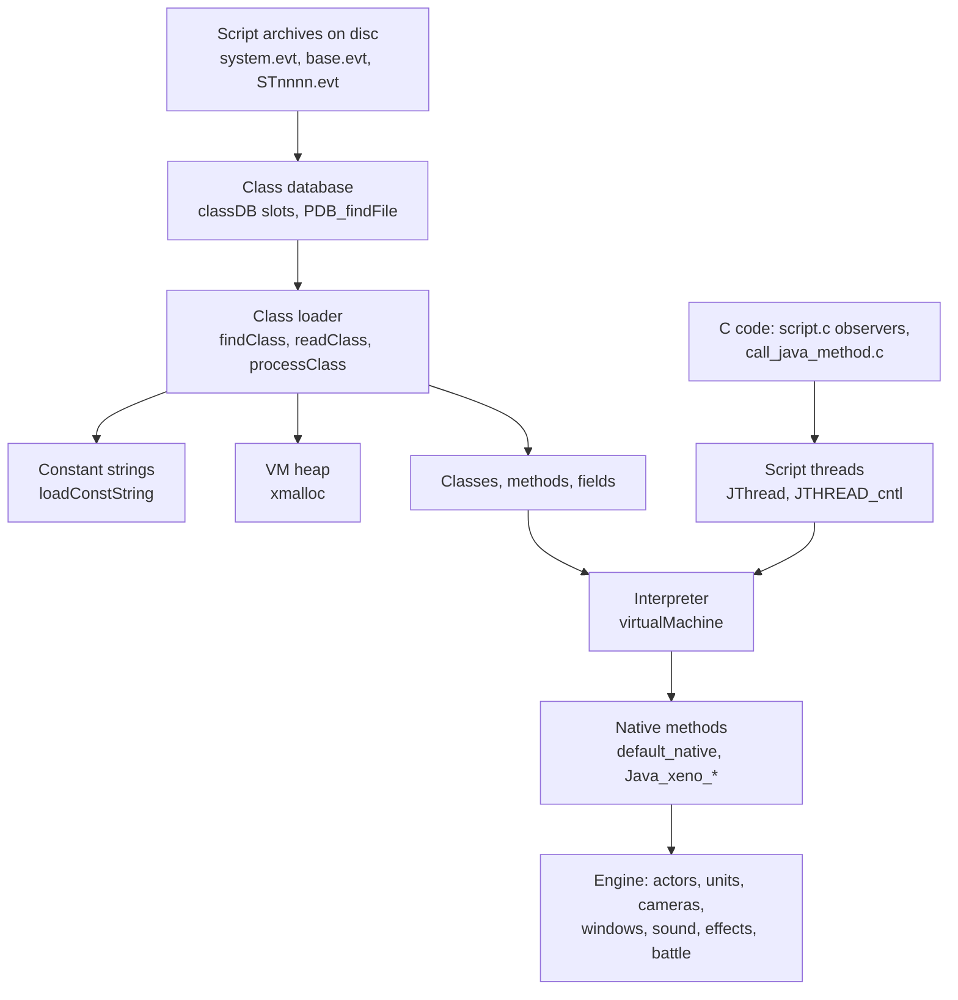

## Where the classes come from

Classes are stored in script archives with the extension `.evt`. Each `.evt`
file is a PDB archive, the simple package format described in
[Files and resources](../architecture/files-and-resources.md) and byte by
byte in [PDB volumes](../formats/scripts-and-archives.md#pdb-volumes). The VM
reads it with `PDB_getEntry` and `PDB_findFile` from `src/main/pdb.c`.

A PDB archive starts with the magic `FL00` (`PDB_MAGIC`, `0x30304C46`), a
16-bit version and a 16-bit group count. Each group is a directory: a name,
a count and a list of entries. Each entry is a file: a name, a data offset and
a data length. On disc the name and data fields are offsets from the start of
the archive. The first time `PDB_getEntry` touches the archive it turns them
into real pointers and sets the version to 1, so the archive must stay at the
same address while it is in use. `PDB_findFile(pdb, path)` splits the path at
its last `/`, uses `.` as the directory when there is no slash, and compares
the group name and then the entry name.

```
FL00 archive (all offsets relative to the start, relocated in place)
+0x00  u32  magic "FL00"
+0x04  u16  version (1 after relocation)
+0x06  u16  group count
+0x08  u32  total size of the archive in bytes
+0x0C  groups[]:
       char *name, u16 name_length, u16 entry_count,
       entries[entry_count]:   (16 bytes each)
           char *name, u16 name_length, u16 (0, never read),
           void *data, int data_length
```

The size field equals the file size in every one of the 646 PDB archives on
the disc. `PDB_getEntry` ignores it, but the debug loader `loadScript` reads
the first 12 bytes of an `.evt` file and then the remaining `size - 12`
bytes. The u16 after the entry name length is 0 in all 3,878 entries.

The game uses three kinds of script archive:

| Archive | Contents |
| --- | --- |
| `data\system.evt` | The VM library, with `java/lang` (`Object`, `String`, `StringBuffer`), `xeno/vm` (`System`, `Thread`, `Math`), `xeno/util` (`Format`, `Input`, `Layout`, `Menu`, `Runtime`, `Spline`, `TCHParams`, `Toolkit`, `Vector4f`, `Window`) and `xeno` (`Camera`, `Chr`, `Effect`, `Light`, `Movie`, `PlayControl`, `Scene`, `Sound`, `Stage`, `Unit`, `XenoConstants`) |
| `data\base.evt` | Shared game classes: the `xeno` classes `Enepc`, `MAPUnit`, `Monitor` and `Uwamono`, the small class `xeno/plan/Base`, and 24 empty stubs of `xeno/plan` constant interfaces (`CfConstants`, `ChrNo`, `EneNo`, `EventConstants`, `FlagNo`, `MapNo`, `MtnNo`, `SceneNo`, `PartyData`, the joint name interfaces and others) |
| `data\scene\STnnnn.evt` and `SCEnnnnn.evt` | One field stage (386 files) or story event (181 files) each. The archive for map `ST0010` holds `ST0010.class` and inner classes such as `ST0010$Player`, `ST0010$NPC_NORMAL` and `ST0010$Obj` |

The disc index of `XENOSAGA.00` names `system.evt`, `base.evt` and the 386
`STnnnn.evt` files, and the indexes of the other two archive groups name the
181 `SCEnnnnn.evt` files. The library classes listed above come from the two
named library files.

Every `xeno/plan` entry except `Base` is a 24-byte stub with an empty constant
pool. These were Java interfaces that only declared constants. The Java
compiler copies such constants into every class that uses them, so the
interfaces are not needed at run time, and the build tool cut them down to a
bare header. The loader skips them, and a class that lists one as an
interface gets an empty class for it (see
[Empty stub classes](../formats/scripts-and-archives.md#empty-stub-classes)).
The stubs `F_Fuji`, `F_Gash`, `F_Koji`, `F_Kojima`, `F_Konishi`,
`F_Nakahara`, `F_Sakisako` and `F_Yone` carry the names of staff members, the
same names as the per-developer scene folders of the debug menu, so they
probably held the numbers of individual event designers.

A scene archive is a complete Java program for one place or one event. The
archive of `ST0010` contains English dialogue strings directly in its constant
pool, methods such as `msg0001` to `msg0019`, `KickEvent` and `entered`, and
calls into `xeno/util/Runtime`, `Window` and `Menu`. Its main class is a
subclass of `xeno.Stage` or `xeno.Scene`. The loader in `script.c` finds the
main class by searching the archive for a class whose superclass is one of
those two (see [How a scene script starts and ends](#how-a-scene-script-starts-and-ends)).
A story event archive can come with two separate files of the same base name
in `data\mtnpack\`: a motion pack (`.fpk`) and a resource volume (`.arc`),
which `script.c` loads next to the classes and hands to the actor and
resource systems. Only 107 of the 181 events have the motion pack and 77 the
resource volume (see [Events](events.md#script-files-and-script-databases)).

The class files themselves are read with a `DataBuffer` (`src/main/data_buffer.c`).
It is a cursor over a byte range with a fixed byte order. `DataBuffer_init`
selects big-endian access for class files, and `DataBuffer_getUByteAt`,
`DataBuffer_getUShortAt` and `DataBuffer_getUIntAt` read and advance.

## Memory used by the VM

`SCRIPT_init` in `src/main/script.c` reserves all VM memory once, at the start
of `Game()`, from the game's `WorkEnd` bump pointer (see
[Memory](../architecture/memory.md)). The layout is fixed:

```
SCRIPT_init(heap_base)                    sizes
+---------------------------------------+
| VM heap (JNI_initSystem / xheap)      |  0x40000  (256 KiB)
+---------------------------------------+
| data\system.evt image                 |  0x8000   (32 KiB)
+---------------------------------------+
| data\base.evt image                   |  0x8000   (32 KiB)
+---------------------------------------+
| scene archive image, scriptDB[0]      |  0x2D000  (180 KiB)
+---------------------------------------+
| scene archive image, scriptDB[1]      |  0x2D000  (180 KiB)
+---------------------------------------+
returns the new WorkEnd
```

The two scene images form a double buffer. The next map or event is loaded
into the inactive slot while the current one still runs, and `SCRIPT_exec`
then swaps them. Each slot is a `ScriptDbEntry` with the archive image, the
name of the main class (`active`), the thread that runs it and the class
database slot it uses. The archives stay in memory while they are in use
because class records point directly into them: method bytecode and UTF-8
names are never copied.

## The xheap object heap

Every structure the VM creates lives in one heap managed by `src/main/xheap.c`:
class records, constant pools, method and field tables, objects, arrays,
strings and the script threads themselves. The heap is a bump allocator with
**mark frames** instead of a garbage collector.

`xheap_init(keep, heap, size)` clears the heap and resets it to empty. With
`keep` set to zero it first installs a new memory range, otherwise it clears
the existing range in place. Each block has a 12-byte header (`xheap_block`)
with a pointer to the next block, a 16-bit category and the size in words.
`freeBlock` is the last allocated block, and its `next` field is the address
where the next block will start.

`xmalloc(size, category)` rounds the size up to a whole word, writes a header at
`freeBlock->next`, links it and returns the payload. There is no limit check.
`xfree(payload)` only sets the block's category to zero. The space is never
reused. Memory is recovered only by dropping everything allocated after a mark.

The category is an accounting tag. `xheap_info` adds up the bytes per category
for the debug memory display (`DB_memory`, "MEM %3d / %d K", see
[Debug tools](../game/debug-tools.md)). The VM uses these categories:

| Category | Contents |
| --- | --- |
| 2 | Lookup tables (the constant string table and the class cache) |
| 8 | Script threads (`JThread` with its frames and stack) |
| 10 | Field tables and static field storage |
| 11 | Method tables |
| 12 | Interface lists |
| 14 | Objects, arrays, class records, constant pools, string values |
| 15 | Dispatch tables |
| 20 | Constant strings |

Marks work like a stack. `xheap_push` saves `freeBlock` and the current tail of
the thread list (`jthreadCurrent`) on a small frame stack that grows down from
the end of the heap. `xheap_pop` restores both. It also calls
`reloadConstString` and `reloadClassEntry` with the restored allocation point,
which unlink every interned string and every cached class that lived above the
mark. `JNI_pushFrame` is `xheap_push`, and `JNI_popFrame` is `xheap_pop`
followed by `xheap_current_clear`, which zeroes the free space.

This is how scripts are unloaded. `SCRIPT_init` pushes two marks right after
it has created the fixed threads, and only then loads the library classes that
the natives need. Each time new scripts are loaded, `script.c` pops the top
mark and pushes it again, which drops every class, object and thread of the
previous scene at once. It then calls `JNI_loadNativeClass` again, so those
library classes are parsed again from the `system.evt` image together with
every new scene, and their static fields start fresh. Only what `initVM` loads
before the marks (the primitive classes, `Object`, `String` and `StringBuffer`)
survives a scene change.

Threads that were created above the mark are still reachable from the tail of
the thread list after a pop, but their memory has just been zeroed. The list
walk therefore sees one node with no flags and a null `next` and stops there.
The code appears to rely on this.

The layout below shows the heap of a running game.

```
VM heap (256 KiB at the start of the SCRIPT_init block)
+-----------------------------------------------+ <- end of heap
| mark stack (8 bytes per mark, grows down)     |
+-----------------------------------------------+
| free space (zeroed by JNI_popFrame)           |
+-----------------------------------------------+ <- freeBlock->next
| scene classes and objects, the threads of     |
| their Chr, Unit and Stage peers               |
| library classes loaded by JNI_loadNativeClass |
+-----------------------------------------------+ <- the two marks of SCRIPT_init
| fixed threads defaultVM, stageVM, evtVM       |    (the top one is popped and
| Object, StringBuffer, String, primitive       |    pushed again on every load)
| classes, initVMThread, string table           |
+-----------------------------------------------+ <- start of heap
```

## Constant strings

All names inside the VM are **interned**: the same bytes always give the same
pointer. Class names, method names, descriptors, field names and attribute
names are compared by pointer, never with `strcmp`. The table is
`constStringTable` in `src/main/string_utf_get_hash.c`, an array of 512 bucket
lists created on first use. The hash is Java's `String.hashCode` over bytes
(`h = h * 31 + byte`), masked to 9 bits.

```
ConstString (12-byte header, then optional bytes)
+0x00  ConstString *next     bucket chain
+0x04  u16 hash              bucket index
+0x06  u16 length
+0x08  char *bytes           the characters, not always NUL-terminated
+0x0C  char data[]           only for copied strings
```

`loadConstString(bytes, length)` returns the existing entry or adds a new one.
It does not copy the bytes. The entry points into the class file or into a C
string in the executable. A negative length means "use `strlen`", and length
zero returns null. `loadConstString2` does the same but copies the bytes into
the entry, for strings that do not live long enough. `findConstString` only
looks up. When a heap mark is popped, `reloadConstString` removes the entries
above the mark from the front of each bucket. This works because a bucket
always has its newest entries first.

Natives use this table all the time. A typical native looks up a Java field by
calling `loadConstString("peer", -1)` and then searching the class's field table
for that exact pointer.

Java `String` objects are different from these entries. A `java.lang.String`
object holds a pointer to a small value record with the length at offset 4
and a pointer to the bytes at offset 8. `Const2JavaString` builds one from a constant
string. Strings are byte strings, not UTF-16. Natives that take a `String`
argument read its bytes and length through this record.

## The class database

The VM does not know file names. It searches a small table of loaded archives,
`classDB[8]` in `src/main/init_class_db.c`. Each slot holds the address of a
PDB image or zero. `initClassDB` clears the table and `JNI_loadClassDB(slot,
image)` in `jni.c` fills one slot. A negative slot number picks the first free
slot. A slot number of `0x100` or more does not store anything and returns the
current content of slot `number & 0xFF`.

`script.c` uses the slots like this:

| Slot | Archive |
| --- | --- |
| 0 | `data\system.evt` |
| 1 | `data\base.evt` |
| 2, 3 | The two scene buffers `scriptDB[0]` and `scriptDB[1]` |

`findClass(entry)` turns a class name such as `xeno/Chr` into a file name
`xeno/Chr.class`, asks `PDB_findFile` in each non-empty slot in order and,
when a slot has the file, allocates a class record with `newClass` and parses
the file with `readClass`. Because the library slots come first, a scene
cannot replace a library class.

## Reading a class file

`readClass(buffer, class, loader)` follows the class file format of the Java
Virtual Machine specification. It checks the magic `0xCAFEBABE`, skips the
version numbers and then reads the constant pool, the access flags, the `this`
and `super` indices, the interfaces, the fields, the methods and the class
attributes.

`readConstantPool` allocates one block that holds `count` four-byte entries
followed by `count` tag bytes. Entry 0 is unused by the class file format, so
the VM stores the pointer to the tag bytes there. The entries are then filled
by tag:

| Tag | Stored value |
| --- | --- |
| UTF-8 | An interned constant string, built with `loadConstString(bytes, length - 1)` so the disc NUL is not part of the name |
| Integer, Float | The 32-bit value |
| Long, Double | The raw value in two slots (the interpreter never uses them) |
| Class, String | The UTF-8 entry's string object, after a second pass replaces the index |
| Field, Method, Interface method, Name and type | Two 16-bit indices packed into one word |

```
constant pool block (count entries)
+-----------------------+ entry 0: pointer to the tag bytes
| entries[1..count-1]   | 4 bytes each: value, object or two u16 indices
+-----------------------+
| tags[0..count-1]      | 1 byte each: the tag of each entry,
+-----------------------+ later rewritten to 0x17 (resolved class)
                          or 0x18 (resolved string)
```

`setupClass` records the class name, the super class index, the access flags
and the loader, and sets the class state to 0. `readFields` builds the
`SceneField` table. Static fields are placed from the front of the table and
instance fields from the back, so `lookupClassField` can search only one part.
A field whose type is a class or an array keeps its descriptor and is flagged
`0x8000` with a size of 4. Other fields get their primitive class from
`getClassFromSignature`.

`readMethods` calls `addMethod` for each method. `addMethod` stores the interned
name and descriptor, the owner class and the access flags, sets the dispatch
index to `0xFFFF` and marks constructors (`<init>`) with the extra flag
`0x800`. `methodDescripter` walks the descriptor and computes the number of
argument slots (`J` and `D` count two, everything else one) and the number of
result slots (zero for `V`).

The attribute readers handle only what the VM needs. A `Code` attribute is
passed to `addCode`, which records `max_stack`, `max_locals`, the code length
and a pointer to the bytecode inside the archive, and skips the exception
table. A `ConstantValue` attribute sets the initial value of a static field
through `setFieldValue`. `Exceptions`, `LineNumberTable`, `SourceFile` and all
other attributes are skipped. (The attribute name string for `Exceptions` is
misspelled `Exceotions` in `init_vm.c`, which changes nothing because the
default case skips it too.) The skipped data is not small. The line number
tables alone take 2.7 MB, 19 percent of all `.evt` bytes on the disc, and
together with the `SourceFile`, `InnerClasses` and `Synthetic` attributes
about 2.8 MB of the script volumes is compiler debug data that the game loads
with the classes but never reads (see
[Attributes and debug data](../formats/scripts-and-archives.md#attributes-and-debug-data)).

The diagram below shows the whole path from a class name to a class record.

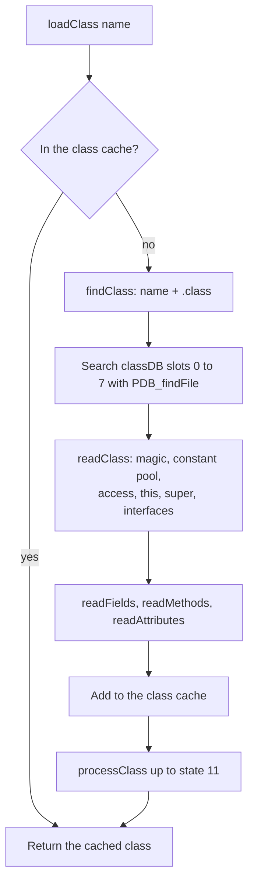

## Class records

Classes, methods and fields have fixed layouts that the interpreter and the
natives read directly. Natives most often use `JavaClass.classPointer`,
`JavaClass.fields` and `SceneField.location.offset`.

```
JavaClass (0x40 bytes, newClass)
+0x00 header            +0x20 methods            +0x30 fieldCount
+0x04 name              +0x24 interfaces         +0x32 staticFieldCount
+0x08 accessFlags       +0x28 constantCount      +0x34 declaredInterfaceCount
+0x0A flags (0x100 = primitive)                  +0x36 state
+0x0C classLoader       +0x2A dispatchSize       +0x38 instanceSize
+0x10 superClass        +0x2C methodCount              (primitive: typeCode,
+0x14 constants         +0x2E interfaceCount            elementSize)
+0x18 classPointer      (the DispatchTable that heads every instance)
+0x1C fields            +0x3C elementClass (arrays)

JavaMethod (0x20 bytes)
+0x00 name              +0x0C owner              +0x14 code or native
+0x04 descriptor        +0x10 accessFlags        +0x18 maxStack
+0x08 parameterSize     +0x12 dispatchIndex      +0x1A maxLocals
+0x0A returnSize                                 +0x1C codeLength (16 bits)

SceneField (0x14 bytes)
+0x00 name   +0x04 flags   +0x08 type (descriptor or class)
+0x0C size or constant     +0x10 offset (instance) or address (static)
```

`JavaMethod.code` and `JavaMethod.native` share one word. For a Java method it
points to the bytecode. For a method declared `native` it starts at zero and
receives the C function on the first call.

## Linking and initialization

A class read from disc is not yet usable. `processClass(class, target)` in
`find_native_method.c` moves it through a series of states until it reaches the
target state. `loadClass` always asks for state 11, so every class is fully
initialized the first time it is named.

| State | Work done to reach it |
| --- | --- |
| 4, members resolved | Allocate one block for all static fields. Load and link the super class, inherit its instance size, count the interfaces, lay out the instance fields after the super class's fields, assign static field addresses, build the dispatch table (not for interfaces) |
| 5 | An intermediate step with no extra work |
| 6, constants resolved | `resolveConstants` turns every String constant into a `java.lang.String` object (`Const2JavaString`) and retags it `0x18` |
| 8, prepared | An intermediate step with no extra work |
| 11, initialized | If the class has a `<clinit>()V` static initializer, run it on the VM's private thread `initVMThread` |

Instance fields of a subclass always come after the fields of its super class.
This is what lets natives find a field such as `peer` with the offset taken
from the base class `xeno.Chr` even when the object is a script subclass of
`Chr`. The first field starts at offset 4 at least, after the object header.

The diagram below shows the states a class goes through.

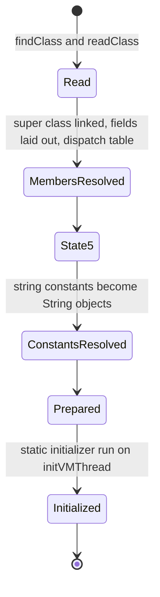

`loadClass(name, loader)` first looks in the class cache, a hash table of 512
buckets (`classEntryPool`) with `ClassCacheEntry` records holding the name,
the loader and the resolved class. On a miss it calls `findClass`, adds the
result to the cache and runs `processClass`. `loadStaticClass(slot, name)` is
the convenience form used at start-up: it loads a class by C string and stores
the result in a global such as `classJava_xeno_Chr`.

Array classes are made on demand by `lookupArray` and `loadArray`. Their names
follow the Java descriptor style (`[I`, `[Lxeno/Chr;`), they are public, final
and abstract, and their super class is `java/lang/Object`. Primitive types are
classes too. `initPrimitiveTypes` creates `boolean`, `byte`, `char`, `short`,
`int`, `long`, `float` and `double` with their descriptor letter and byte size,
and fills `primitiveClassTable` so that the `newarray` instruction can index it
by its type code.

Objects and arrays are allocated from the heap. The first word of every
object is its class's `classPointer`, which points to the class's dispatch
table, and the first word of the dispatch table points back to the class. So
`((ObjectHeader *)object)->classPointer->clazz` gives the class of any object.

```
object (newObject, instanceSize bytes)     array (newArray)
+0x00 classPointer -> DispatchTable        +0x00 classPointer
+0x04 first field (super class first)      +0x04 length
...                                        +0x08 data pointer
                                           +0x0C elements
DispatchTable
+0x00 clazz -> JavaClass
+0x04 methods[dispatchSize]
```

`buildDispatchMethodTable` fills `methods[]` with virtual methods. As
recovered, its loops do not advance their method pointers, so only the first
entry receives an index. This has no visible effect because the interpreter
never uses the table for calls (see
[Method calls and field access](#method-calls-and-field-access)). The table's
real job is to give every object a way back to its class.

`instanceOf(from, to)` answers the `instanceof` question. It accepts the same
class, compatible arrays, any interface in the class's interface list and any
class on the super class chain. `JNI_isInstanceOf(object, class)` wraps it for
natives and returns 0 for a null object.

## Starting the VM

`SCRIPT_init` starts the VM once per `Game()` session. The steps are:

1. Read `data\system.evt` and `data\base.evt` from the disc into their buffers
   with `xglCdReadFile`.
2. `JNI_initSystem(heap, 0x40000)` clears the class database and installs the
   heap with `xheap_init(0, heap, size)`.
3. `JNI_loadClassDB(0, system)` and `JNI_loadClassDB(1, base)` register the two
   library archives.
4. `initVM` resets the heap in place, clears the class cache and the string
   table, and interns the names the VM needs: `<clinit>` (`NAME_Init`),
   `<init>` (`NAME_Constructor`), the descriptors `()V` and `(I)V`, and the
   attribute names. It creates `initVMThread`, the thread that runs static
   initializers, and calls `initBaseClasses`, which builds the primitive
   classes and loads `java/lang/Object`, `java/lang/StringBuffer` and
   `java/lang/String`.
5. `script.c` creates the fixed threads: `defaultVM` (128 stack slots),
   `stageVM` (70 slots) and two event threads `evtVM[0]` and `evtVM[1]`
   (64 slots each), all of kind 0 with 8 frames.
6. Two heap marks are pushed with `JNI_pushFrame`.
7. `JNI_loadNativeClass` loads the 22 library classes that natives need and
   stores them in globals: `xeno/vm/System`, the `xeno/util` classes `Format`,
   `Menu`, `Window`, `Input`, `Layout`, `Runtime`, `Toolkit`, `TCHParams`,
   `Spline` and `Vector4f`, and the `xeno` classes `Camera`, `Effect`, `Light`,
   `Chr`, `Enepc`, `Unit`, `Uwamono`, `Stage`, `Scene`, `PlayControl` and
   `Movie`.

`SCRIPT_reset` repeats steps 2 to 7 without reading the files again. It is the
full VM reset used after a map jump. Because `initVM` clears the heap, every
class, object and thread from before the reset is gone.

The sequence below shows the start-up calls in order.

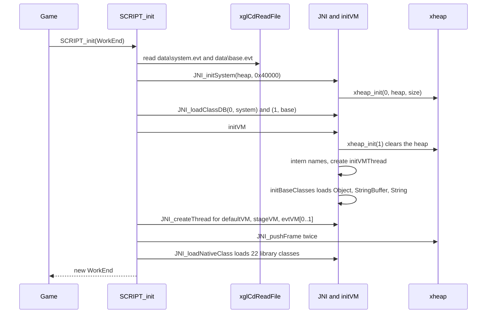

## The interpreter

`virtualMachine(thread, method, arguments, result)` in `src/main/init_vm.c`
runs one method on one script thread. It is a classic switch interpreter over
the bytecode, but with two special features: it can stop in the middle of a
method and continue there later, and native methods go through the same entry
point as Java methods.

### Entering a method

If the method is `native`, the function resolves it on first use (see
[Native methods](#native-methods)), calls the C function with the thread, the
argument slots and the result slot, and returns. When the thread is being
resumed (flag `WOKEN`, see [Waiting and resuming](#waiting-and-resuming)), the
native is not run again. The flag is cleared and the function returns at once.

For a Java method the interpreter opens a new frame. Each thread owns an array
of frames and one array of 4-byte slots. The new frame is
`frames[frame_depth]`. Its locals start at the current `stack_offset` of the
slot array, and its operand stack follows the locals. The thread's
`stack_offset` grows by `maxLocals + maxStack + 1`. The extra slot exists
because the operand stack is used from index 1 upward: `top` is 0 when the
stack is empty and `STACK(0)` is always the top value. The arguments are copied
into the first locals, with the receiver (`this`) first for non-static methods.

```
JThread slot array (stack, 4-byte VMSlot each)
             stack_offset before the call
             v
... caller | locals[0..maxLocals-1] | unused | operand stack ... | next frame
             ^ this, arg1, arg2 ...    slot 0   top = 1, 2, ...
             <------------- maxLocals + maxStack + 1 ----------->

VMFrame (0x18 bytes)
+0x00 u16 pc          +0x04 callee (the method being invoked, kept for resume)
+0x02 u16 nextPc      +0x08 locals: top, size, base
                      +0x10 stack:  top, size, base
```

A `VMSlot` is a union of an `int`, a `float`, an object reference and the
narrow types. If `stack_offset` passes the thread's `stack_limit`, the
interpreter calls `JNI_threadException`, which is an empty function, so an
overflow is not caught. The frame count (`frame_limit`) is stored but never
checked.

### The main loop

The loop runs while `pc` is inside the method. For each instruction it sets
`nextPc` to the next byte, executes the opcode (which may change `nextPc`) and
then checks the thread flags:

- If `WAITING` or `CALL_RUNNING` is set, a native has suspended the thread.
  The interpreter returns immediately and keeps the frame as it is.
- If `DONE` or `FRAME_RETURNED` is set, the method has returned. The interpreter
  clears `FRAME_RETURNED` and leaves the loop.
- Otherwise `pc` becomes `nextPc` and the loop continues.

When the loop ends, the frame's slots are released by lowering `stack_offset`
again, and the frame's `pc` is reset to 0. A return instruction writes its
value to `*result` and sets `DONE` when it returns from the outermost frame
(`frame_depth` 0) or `FRAME_RETURNED` otherwise. That is why `DONE` means "the
whole call has finished" everywhere else in the game.

The flowchart below shows one call of `virtualMachine`.

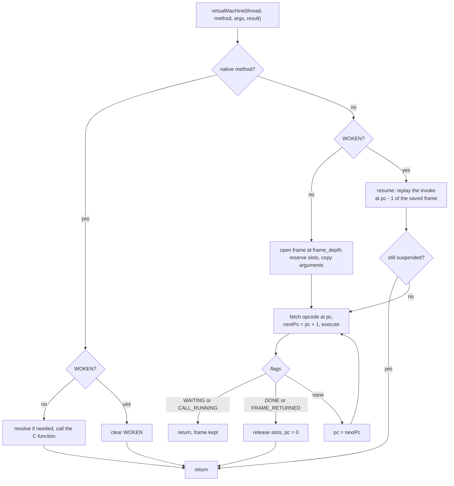

### Instruction set

The interpreter implements the 32-bit subset of the Java instruction set. The
table lists what is present and what is missing.

| Group | Implemented | Missing |
| --- | --- | --- |
| Constants | `nop`, `aconst_null`, `iconst_m1` to `iconst_5`, `fconst_0` to `fconst_2`, `bipush`, `sipush`, `ldc`, `ldc_w` | `lconst`, `dconst`, `ldc2_w` |
| Locals | `iload`, `fload`, `aload`, `istore`, `fstore`, `astore` and their `_0` to `_3` forms, `iinc` | all `l` and `d` forms |
| Arrays | `iaload`, `faload`, `aaload`, `baload`, `caload`, `saload` and the matching stores, `newarray`, `anewarray`, `arraylength` | `laload`, `daload`, the matching stores, `multianewarray` |
| Stack | `pop`, `pop2`, `dup`, `dup_x1`, `dup_x2`, `dup2`, `dup2_x1`, `dup2_x2`, `swap` | |
| Arithmetic | `iadd`, `isub`, `imul`, `idiv`, `irem`, `ineg`, `ishl`, `ishr`, `iushr`, `iand`, `ior`, `ixor` and `fadd`, `fsub`, `fmul`, `fdiv`, `frem`, `fneg` | all `l` and `d` arithmetic |
| Conversions | `i2f`, `f2i`, `i2c`, `i2s` | `i2b` and every conversion to or from `long` and `double` |
| Compare and branch | `fcmpl`, `fcmpg`, `ifeq` to `ifle`, `if_icmpeq` to `if_icmple`, `if_acmpeq`, `if_acmpne`, `ifnull`, `ifnonnull`, `goto`, `goto_w`, `jsr`, `jsr_w`, `ret`, `tableswitch`, `lookupswitch` | `lcmp`, `dcmpl`, `dcmpg` |
| Fields | `getstatic`, `putstatic`, `getfield`, `putfield` | |
| Calls and returns | `invokevirtual`, `invokespecial`, `invokestatic`, `invokeinterface`, `ireturn`, `freturn`, `areturn`, `return` | `lreturn`, `dreturn` |
| Objects | `new`, `checkcast` (no check is made), `instanceof` | `athrow`, `monitorenter`, `monitorexit` |

An unknown opcode does nothing and the interpreter moves on by one byte. The
interpreter's `switch` has no default case, so the skip happens without any
warning. There are no null checks and no array bounds checks. Field access
reads or writes 1, 2 or 4 bytes according to the field's primitive type. A
`byte` or `boolean` field is read as an unsigned byte.

The scripts on the disc use 116 different opcodes, and three of them are
missing from the interpreter: `f2d`, `dconst_1` and `dcmpl`. They occur once,
in the method `idle` of the class `ST1480$Mapunits`, which exists in
`ST1480.evt` and in its copy `ST1489.evt`. The source compared a float with
the double literal `1.0`:

```
fload 5      push the float
f2d          skipped
dconst_1     skipped
dcmpl        skipped
iflt +40     tests the float itself as an int
```

All three are one byte long, so the stack stays balanced, and `iflt` tests
the bit pattern of the float. It jumps only when the sign bit is set, so the
guarded code probably runs for every value that is not negative instead of
only for values of at least 1.0 (see
[Bytecode](../formats/scripts-and-archives.md#bytecode)).

A few instructions behave differently from the specification:

- `frem` converts both values to integers and takes the integer remainder.
- `fcmpl` and `fcmpg` are the same code, so a NaN compares the same way in both.
- `tableswitch` reads only the low 16 bits of each 32-bit jump offset, and
  `goto_w` and `jsr_w` also use 16-bit offsets. Script methods are small
  enough that the offsets fit.
- `wide` switches on its own opcode instead of the widened one, so none of its
  cases match. The widened instruction then runs with a one-byte index. Scripts
  would need more than 256 locals or an `iinc` step outside -128 to 127 to
  produce `wide`, and no script on the disc contains it.
- `ldc` and `ldc_w` push resolved strings, integers and floats. For any other
  constant kind the new stack slot keeps whatever value it held before.

Exception tables are skipped at load time and `athrow` is missing, so a script
cannot throw or catch an exception. The scripts were written to stay inside
this subset, apart from the one float compare above. The VM library classes in `system.evt` are the VM's own small
versions of `Object`, `String` and `StringBuffer`, not the standard library.

## Method calls and field access

The four `invoke` instructions share one pattern. The interpreter resolves the
callee with `getMethodSignatureClass(index, method->owner)`, stores it in
`frame->callee`, increments `frame_depth` and calls `JNI_callMethod` with a
pointer into its own operand stack. The arguments are already on the stack in
order, so that pointer is the argument array of the callee (the receiver comes
first for instance calls). The same address is passed as the result pointer,
so the callee's return value lands where the receiver or first argument was.

When the call comes back, the interpreter checks the flags. If the callee
suspended the thread (flags `WAITING` or `CALL_RUNNING`), it returns at once
and leaves `frame_depth` raised. Otherwise it lowers `frame_depth`, pops the
arguments and the receiver, pushes the return slots and continues after the
instruction. `invokespecial` does not add the return slots, which is correct
for constructors and private `void` methods, the usual targets of that
instruction. A `super.method()` call or a private method that returns a value
would lose its result, so the scripts probably never use one.

Resolution is entirely static. `getMethodSignatureClass` takes the class named
in the constant pool entry, loads it with `getClass` and searches it and then
its super classes with `findMethodLocal` for the exact interned name and
descriptor. The receiver's real class is never examined. A call through a
reference typed as a base class therefore runs the base class's method even if
the object belongs to a subclass that overrides it. The result is not cached
either: every execution of an `invoke` instruction searches again. Java code
written for this VM must keep this in mind. C code avoids the issue because it
always looks methods up on the object's own class (see
[Calling Java from C](#calling-java-from-c)).

Field instructions use `getField(index, owner, is_static, &ref)`, which loads the
class named in the field reference and searches only that class's own field
table with `lookupClassField`. It does not search super classes. Older Java
compilers named the declaring class in each field reference, so this probably
works for every field the scripts use.

`getClass(index, owner)` loads the class named by a class constant on first
use, stores the class pointer in the constant pool and changes the tag to
`0x17`, so later uses are direct. Array class names (starting with `[`) go to
`loadArray`.

## Script threads

A **script thread** is a `JThread`, declared in `include/main/jni.h`. It is not
an operating system thread. It is a record that holds the Java call stack of
one script activity: its frames, its slots, the method it runs, the object it
belongs to and the state of any wait. All script threads run on the game's
main thread, one after the other.

```
JThread (0x44-byte header, then frames, then slots)
+0x04 previous, +0x08 next     doubly linked list from jthreadTop
+0x0C u8 kind                  0 SYSTEM, 1 CHR, 2 STAGE, 3 SCENE, 4 DEFAULT, 5 UNIT
+0x0D u8 wait_kind             low nibble selects the wait test
+0x10 object                   the Java object (or peer) the thread belongs to
+0x14 reset                    per-frame hook called by JTHREAD_cntl
+0x18 method                   the method the hook runs
+0x24 flags                    see the table below
+0x28 stack                    VMSlot array
+0x2C frames                   VMFrame array
+0x30 wait_target              elapsed frame count, object or thread
+0x34 wait_parameter           frame count or signal value
+0x38 stack_offset   +0x3A stack_limit   +0x3C resume_frames
+0x3E frame_depth    +0x40 frame_limit
```

`JNI_createThread(kind, frames, slots)` allocates the header, the frame array
and the slot array in one heap block of category 8 and appends the thread to
the list (`jthreadTop` is the head, `jthreadCurrent` the tail). The slot array
starts six slots after the end of the frame array, although the allocation
size does not include those six slots. A thread with a nearly full stack would
therefore write past its block. This has probably never happened in practice.
`JNI_initThread` clears the flags and resets `frame_depth`, `stack_offset` and
`resume_frames`, so the thread can run a new call from the beginning.

The thread kind decides whether the per-frame scheduler drives the thread. The
names come from the debug string table `JTHREAD_ALG_*` in `jthread.c`.

| Kind | Created by | Driven by |
| --- | --- | --- |
| 0 SYSTEM | `initVM` (`initVMThread`), `SCRIPT_init` (`defaultVM`, `stageVM`, `evtVM`) | C code calling `JNI_callMethod` directly |
| 1 CHR | `Toolkit.getPeer` for a `Chr` or `Enepc` | `JTHREAD_cntl` through `JTHREAD_defaultChr` |
| 2 STAGE | `SCRIPT_exec` for the scene's main object, `Toolkit.getPeer` for a `Stage` | `JTHREAD_cntl` through `JTHREAD_defaultScene` or `JTHREAD_defaultStage` |
| 3 SCENE | Named in the table, no creator found in the recovered code | |
| 4 DEFAULT | `Thread.create` from Java | `JTHREAD_cntl` through `JTHREAD_default` |
| 5 UNIT | `Toolkit.getPeer` for a `Unit` or `Uwamono` | `JTHREAD_cntl` through `JTHREAD_defaultUnit` |

The flags describe the thread's state:

| Flag | Name | Meaning |
| --- | --- | --- |
| `0x01` | `WAITING` | Suspended. Cleared only by a thread hook or a wait test |
| `0x02` | `WOKEN` | A wait has ended. The next call replays the suspended frames |
| `0x04` | `CALL_RUNNING` | Suspended on a wait that `JTHREAD_waitFor` tests on every call |
| `0x08` | `DONE` | The outermost method has returned |
| `0x10` | `RUNNABLE` | `JTHREAD_cntl` runs this thread's hook every frame |
| `0x20` | `STALE_CALL` | The next `JNI_callMethod` discards all frames and starts over |
| `0x40` | `CAN_WAIT` | Lets a non-actor thread wait for an actor's motion (set nowhere in the recovered code) |
| `0x80` | `FRAME_RETURNED` | An inner frame has returned. Used only inside the interpreter |

`JNI_callMethod(thread, method, args, result)` in `jni.c` is the only way into
the interpreter. It first handles the special states. With `STALE_CALL` it
throws the old call away by zeroing `frame_depth` and `stack_offset` and
clearing `STALE_CALL`, `WOKEN` and `WAITING`. With `CALL_RUNNING` it calls
`JTHREAD_waitFor` and returns if the wait is not over yet. If `WAITING` or
`CALL_RUNNING` is still set after that, it returns without running anything.
Only then does it call `virtualMachine`.

Java code can create its own threads with the `xeno.vm.Thread` natives
(`create`, `setTarget`, `start`, `stop`). `Thread.create` returns the raw
`JThread` pointer as an object, `setTarget(object, name)` stores the object and
looks up the method `name()V` on the object's class, and `start` and `stop` set
and clear `RUNNABLE`. See [Native methods](natives.md#xenovmthread).

## Waiting and resuming

A script often has to wait: until a character has finished walking, until the
player has closed a dialogue window, or for a number of frames. A Java thread
cannot block the game, because all script threads run inside the game's main
loop. The VM solves this with **suspension by unwinding**. A native that wants
to wait marks the thread as suspended and returns. Every interpreter level
then returns at once, so the C stack unwinds completely, but the Java frames
stay in the `JThread`. On a later frame the call is made again and the
interpreter replays its way back down to the point after the native.

A native suspends its thread in four steps:

1. It stores what to wait for in `wait_kind`, `wait_target` and
   `wait_parameter`.
2. It copies `frame_depth` into `resume_frames`. This is the number of frames
   the replay must walk through.
3. It sets `CALL_RUNNING` (a wait that `JTHREAD_waitFor` checks), `WAITING`
   (a wait that a thread hook ends), or both.
4. It returns normally.

`JTHREAD_waitFor(thread)` checks the wait each time `JNI_callMethod` is called
on a thread with `CALL_RUNNING`. When the condition holds it clears
`CALL_RUNNING` (for some kinds also `WAITING`) and sets `WOKEN`.

| Wait kind | Set by | Ends when |
| --- | --- | --- |
| 1 FRAMES | `System.sleep(n)` | The counter in `wait_target` reaches `n`. It counts one per call, so one per frame |
| 2 THREAD | `System.waitFor(chr or stage)` | The target object's thread has `DONE`. The test clears that `DONE` |
| 3 COMPONENT | `System.waitFor(window or menu)` | The window or menu component's `state` is 2 (see [UI and windows](../libraries/ui-windows.md)) |
| 4 ACTOR_IDLE | `Chr` motion and movement natives with `wait` | The actor's busy flag `0x2` is clear |
| 5 SIGNAL | Prepared in `System_waitFor`, not reached from Java in the recovered code | The actor's `signal` equals `wait_parameter` |
| 6 ACTOR_IDLE_2 | `Unit` motion and movement natives with `wait` | Same test as kind 4 |
| 7 GAME | `Stage.play(name)` | The game state flag `0x800` is clear |

When the thread is called again and `WOKEN` is set, `virtualMachine` takes the
resume path. It selects the frame `frames[frame_depth - resume_frames]`,
decrements `resume_frames` and re-executes the `invoke` instruction just
before that frame's `pc`, with the `callee` saved in the frame. If the callee
is a Java method, the same thing happens one level deeper. At the bottom the
callee is the native that suspended. The native path sees `WOKEN`, clears it
and returns without running the native again. Every level then finishes its
`invoke` normally, pops the arguments, pushes the result that the native wrote
before it suspended, and continues with the next instruction.

The sequence below shows `System.sleep(30)` called from a method `run` that was
itself called from the thread's main method.

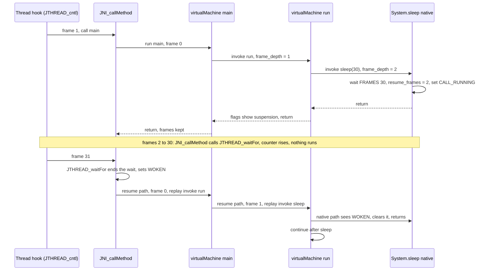

The state diagram below summarizes the life of a scheduled script thread.

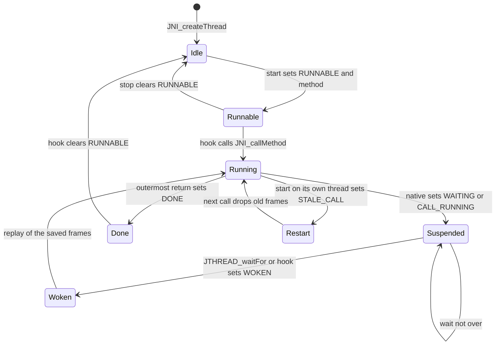

Actor waits work a little differently. When a `Chr` motion or movement native
is called with its `wait` argument true, it marks the actor busy (flag `0x2`
of the actor). If the calling thread is the character's own thread (kind
`CHR`), the native sets `WAITING`. The thread hook `JTHREAD_defaultChr` does
not run the thread while the actor is busy, and once the actor is idle again
it turns `WAITING` into `WOKEN` and calls the method, which replays the frames.
If the calling thread belongs to something else (the stage or an event), the
native only marks the actor busy and the script continues at once. Such a
script waits for a character with `System.waitFor` on the character's object,
which waits for that character's thread to finish. `Unit` natives follow the
same rules with kind `UNIT`.

Some natives never return to the script at all. `Runtime.jumpCF`,
`Runtime.jumpEvent`, `Runtime.evsExit` and `Runtime.setLocation` set `DONE`
and `WAITING` together, so the thread stops for good, and the jump natives
store a function in `jthreadResetFunc` that performs the map change later (see
[Running once per frame](#running-once-per-frame)).

## Running once per frame

Script threads advance once per game frame. `JTHREAD_cntl` in `jthread.c`
walks the thread list from `jthreadTop`. For every thread that is `RUNNABLE`
and not of kind 0 it calls the thread's `reset` hook. If a hook has set
`jthreadResetFunc`, the walk stops early. At the end, a pending
`jthreadResetFunc` is called once and cleared.

The hooks connect a thread with its object:

| Hook | Installed by | Behaviour |
| --- | --- | --- |
| `JTHREAD_defaultChr` | `Chr.start(1, name)` | Reads the `peer` field of the `Chr` object. Skips the frame while the actor is busy. Otherwise wakes a `WAITING` thread and calls `method(this)`. Clears `RUNNABLE` on `DONE` |
| `JTHREAD_defaultUnit` | `Unit.start(1, name)` | The same for `Unit` objects |
| `JTHREAD_default` | `Thread.setTarget` | Calls `method(object)`. Clears `RUNNABLE` on `DONE` |
| `JTHREAD_defaultScene` | `SCENE_start` and `Scene.start` | The same as `JTHREAD_default`, for scene objects |
| `JTHREAD_defaultStage` | `Stage.start(1, name)` | Prints `Class.method` on the debug font and calls the method on the stage object found at offset `0x2C` of the thread's object |

`JTHREAD_cntl` is called from the field game modes in `src/main/game.c`.
`GameModeCfMain` calls it after the window system update `TWSYS_update` and
before the camera and actor updates. `GameModeCfEvent` calls it in the same
place, followed by `PLAY_ctrl`, `TCAMERA_update`, `ACT_update` and
`MAP_updateUnit`. After the mode function, the game loop runs its task
scheduler (`xglTaskExecute`), where the script observer tasks of `script.c`
make their own calls into the VM, and then `GameDrawSync`, which ends the
frame with `xglSleep` (see [xgl threads](../libraries/xgl.md#threads)).

The flowchart below shows where the VM runs inside one field frame.

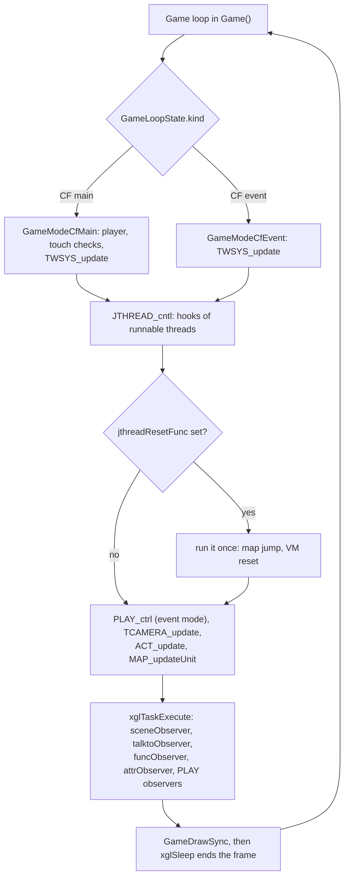

There is no time slicing. A script method runs until it returns or a native
suspends it, all within the current frame. A Java loop that never calls a
waiting native would freeze the game. The scripts never call `xglSleep`
themselves.

A few natives run a whole screen before they return: `Runtime.enterShop` runs
the shop menu, `Runtime.mailExec` runs the U.M.N. mail screen,
`Runtime.minigameExec` runs a minigame overlay and `Runtime.execBattle` runs a
complete battle. These natives contain their own loops that call `xglSleep`,
so the script thread simply sees one long native call. `Runtime.setPartyData`
also calls `xglSleep` twice when it has to reload a character model.

`jthreadResetFunc` holds work that must not run while the interpreter is
active. A map jump replaces all scripts and resets the VM, which would destroy
the thread that asked for it. So `Runtime.jumpCF` and the other jump natives
only store `scriptReset_jump` or `scriptReset_evsExit` in `jthreadResetFunc`
and stop the thread. The function runs later from `JTHREAD_cntl`, or from
`JNI_catchException` when the jump came from an observer task. It ends in
`Java_xeno_util_Runtime_jump_sub`, which stops the capture, streams and
movies, turns off the defocus, fades out the music, sets the destination as the current event or map,
re-initializes the field systems, calls `SCRIPT_reset` and starts the
resource load for the destination (see [Native methods](natives.md#map-changes-and-jumps)).

## Native methods

A Java method declared `native` has no bytecode. The VM binds it to a C
function the first time it is called. `resolveNativeMethod(method)` in
`find_native_method.c` builds a name from the class name, the method name and
the argument descriptor, and `findNativeMethod(name)` searches the table
`default_native` in `src/main/runtime.c` for that name with `strcmp`. The table
is an array of `RuntimeNativeBinding` records (`name`, `function`) ending with a
null name, and it lists 401 natives.

The name is built like this:

1. Start with `Java_`.
2. Append the class name with `/` replaced by `_`.
3. Append `_` and the method name.
4. Append `__` and the argument part of the descriptor (the text between `(`
   and `)`), with `/`, `;` and `(` replaced by `_` and `[` replaced by `a`. The
   return type is not part of the name.
5. If no entry matches and the descriptor contains an array, try again with
   `[` replaced by `_` instead of `a`.

So `Chr.move(int, float, float, boolean)` with the descriptor `(IFFZ)V`
becomes `Java_xeno_Chr_move__IFFZ`, and `Window.print(String[], int)` becomes
`Java_xeno_util_Window_print__aLjava_lang_String_I`. The only table entry that
needs the second form is `Java_xeno_Stage_setCFBG__II_F` for `(II[F)V`. If no
entry matches at all, the method's function pointer stays null and the call
would jump to address zero, so every native that a script calls must be in
the table.

The table and the declarations do not match exactly. The library classes of
`system.evt` declare 401 natives, and the table has 401 rows, but three
declarations have no row: `Chr.invalidate()`, `Chr.validate()` and
`vm.System.exit(int)`. No script references them, so their null pointers are
never called. In the other direction three rows match no declaration and can
never be bound: `Chr.rotCNS(int, Object)`, `Unit.move(Object, float,
boolean)` and `Toolkit.call(Object, String)`. Of the 401 rows, the scripts on
the disc reach 286. The other 115 are never called (see
[Native methods](../formats/scripts-and-archives.md#native-methods) for the
counts).

The call itself is `method->native(thread, arguments, result)`. The sequence
below shows the round trip from bytecode to the engine and back.

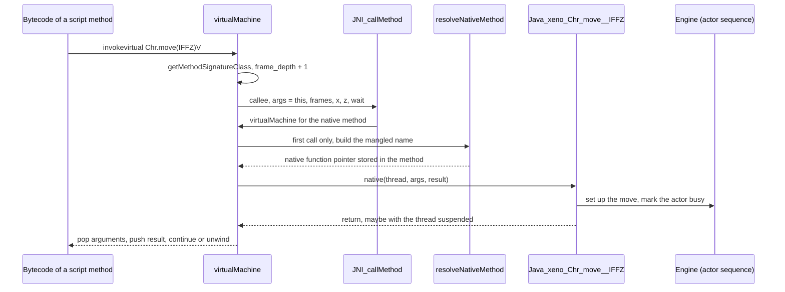

The calling convention, the peer objects that link Java objects to engine
objects and the catalogue of all natives by class are on the
[Native methods](natives.md) page.

## Calling Java from C

C code starts Java work in three ways: by calling a method directly on a fixed
system thread, by giving a scheduled thread a method to run, and by queueing an
observer task that calls a method every frame until it has finished.

### Fixed system threads

Five threads have kind 0, so `JTHREAD_cntl` never touches them. `script.c`
creates four of them and `initVM` the fifth. C code calls them with
`JNI_callMethod` whenever it needs to, usually after `JNI_initThread` has
cleared the previous call.

| Thread | Used for |
| --- | --- |
| `defaultVM` | Constructors and `init` methods while a scene is built (`SCENE_instance`, `STAGE_instance`), `SCENE_start`, `SCENE_cleanup` |
| `stageVM` | Talk and touch methods of the map script (`talktoObserver`), time chart observers (`SCRIPT_test` from `PLAY_ctrl`) |
| `evtVM[0]`, `evtVM[1]` | Methods called by name from C (`CallMethod`, `CallMethod_I`, `CallMethod_II`) and the `entered` handler. `UseVMFlag` marks which of the two is in use |
| `initVMThread` | Static initializers, created by `initVM` |

### Starting a method on a scheduled thread

`SCENE_start(vm, object, mode, name)` in `scene_1.c` looks up the method
`name()V` on the object's class and gives it to the thread whose `object` is
that object (`JTHREAD_get`). It sets the thread's `reset` hook to
`JTHREAD_defaultScene` and sets `RUNNABLE`. If the calling thread is the target
thread itself, it also sets `STALE_CALL` and `WAITING`. The running call then
stops at once, and the next call discards the old frames and starts the new
method from the beginning. The event scene loader starts every scene with the method name
`play` this way. The natives `Scene.start`, `Stage.start`, `Chr.start` and
`Unit.start` do the same from Java.

### Observer tasks

An observer is an xgl task (see [xgl tasks](../libraries/xgl.md#tasks)) that
calls a Java method on a system thread once per frame until the thread reports
`DONE`. The first step usually runs immediately when the task is created.
Every observer looks the method up by name on the class of the current script
object, so the subclass's own method is found.

| C entry point | Observer | Java method called | Thread |
| --- | --- | --- | --- |
| `SCRIPT_execTalkto`, `SCRIPT_execTouchto` via `createTalkTask` | `talktoObserver` | The method named by `Chr.talkto` or `Chr.touchto`, with signature `(Lxeno/Enepc;)V`, or `(Lxeno/Enepc;Lxeno/util/Window;)V` with a new window | `stageVM` |
| `SCRIPT_execEntered(attribute)` | `attrObserver` | `entered(I)V` | an `evtVM` |
| `CallMethod(name)`, `CallMethod_I`, `CallMethod_II` | `funcObserver` | `name()V`, `name(I)V`, `name(II)V` | an `evtVM` |
| `Runtime.setEventTimer` through `EventTimerTask` (`src/main/disp_on.c`) | `funcObserver` | The named `()V` method, when the frame countdown reaches zero (`CallMethod`) | an `evtVM` |
| Time chart callbacks in `src/main/play.c` | (direct) | Observers registered with `PlayControl.setObserver` | `stageVM` through `SCRIPT_test` |
| Event scene start | `sceneObserver`, `sceneObserver2` | `play()V` of the `Scene` subclass | the scene thread |

The talk, entered and call-by-name observers work only while the current
script is a `Stage` subclass, that is, while the player walks on a map. During
an event scene they remove themselves. When an `evtVM` call finishes,
`funcObserver` calls `JNI_catchException`, which runs any pending
`jthreadResetFunc`, frees the event thread and removes the task. The details of
talk handling and the event flow are on the [Events](events.md) page.

### Map locators and KickEvent

`src/main/call_java_method.c` connects map trigger areas to the scripts. Each
map has a list of **locators** (pairs of points from the map data, read with
`UnduDataGetHeader(0x207, i)`). The angle stored with a locator selects its
type: a line or circle that reacts to the action button, a line or square that
reacts to touch, or a square button area. `Check_Locater(actor)` tests the
controlled actor against every locator with the matching `EventCheck_*`
function, which combines the pad state with a geometric test in
`Check_InsideID` (line crossing, circle distance or box). On a hit,
`Call_JavaMethod(actor, id)` calls

```c
CallMethod_II("KickEvent", kind, EventID);
```

where `kind` is 100 for the player's actor and the enemy's event type
otherwise. The map script's `KickEvent(int, int)` then decides what happens,
for example by starting a dialogue or jumping to an event. The locator data and
the map side of this are described in [Maps and units](../game/map-and-units.md).

The flowchart below shows the path from the player's position to a script
method.

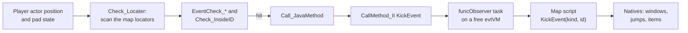

## How a scene script starts and ends

Each map and each event scene has its own archive. Loading and running it is
the job of `script.c` and is described in full on the [Events](events.md) and
[Scenes and time charts](scenes-and-timecharts.md) pages. The VM side of it is
short.

1. A loader reads the archive into the inactive `scriptDB` slot:
   `SCRIPT_load` on map changes (`MapGetName(map) + ".evt"`, from the loader
   task in `src/main/disp_on.c`), `SCRIPT_load2` from the resource list keyword
   `script` (`src/main/res_get_path.c`), or `SCRIPT_load_DBG` from
   `Stage.play` (a development loader that reads the files with `sceOpen`
   into fixed addresses above 32 MiB, so probably usable only on a
   development kit).
2. The loader calls `JNI_searchClasses(image, "xeno/Scene:xeno/Stage", 2,
   &skip)`. This walks the archive's class files without loading them,
   compares each super class name with the two candidates, and returns the
   name of the first match. `skip` tells which one matched: 0 for a `Scene`
   subclass (an event scene) and 1 for a `Stage` subclass (a map).
3. `SCRIPT_exec` (or `SCRIPT_exec2`) makes the loaded slot current and unloads
   the other one. Before the new scripts are loaded, the heap mark of the
   previous scripts is popped and a new mark is pushed. Then
   `JNI_loadNativeClass` runs again and `JNI_loadClassDB` registers the archive
   in its class database slot.
4. For a `Stage` subclass (a map), `SCRIPT_exec` creates the main object with
   `newObject(loadClass(active))` and a thread of kind 2 with 6 frames for it,
   and calls `STAGE_instance(defaultVM, object)`. That runs the constructor,
   creates the camera field `cam0` and the `Chr` members, and runs `init()`.
   The map then runs in the normal field mode. Its methods are called through
   talk, touch, `entered`, `KickEvent` and the threads its `init` started.
5. For a `Scene` subclass (an event), the game switches to the event mode and
   a `sceneObserver` task is started (`sceneObserver2` for `SCRIPT_exec2`). The
   main object and its kind 2 thread are created the same way, by the task's
   first step or directly by `SCRIPT_exec2`. `SCENE_instance` runs the
   constructor, creates the message window `msg` and the `Chr` and `Unit`
   members (each constructed with the scene as argument, then `init()`), and
   runs the scene's `init()`. Then `SCENE_start(defaultVM, object, 8, "play")`
   schedules `play()`.
6. Each frame `JTHREAD_cntl` advances `play()`. When the scene thread reports
   `DONE` (or the player skips the scene), the observer fades out, calls the
   scene's `cleanup()` through `SCENE_cleanup` and restores the field systems.
   When the next scripts are loaded, the scene's heap mark is popped, which
   deletes every class and object of the scene at once.

The sequence below shows an event scene from load to unload.

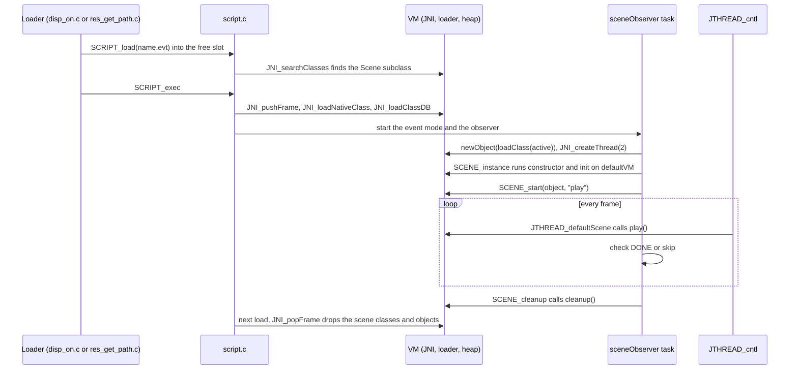

## Debug helpers

Several pieces of debug code in the executable look into the VM. They are
covered on the [Debug tools](../game/debug-tools.md) page.

- `DB_evtMonitor` in `script.c` prints the class and method of the current
  scene thread and, for every frame on its stack, the `pc` and the callee name
  (`%04x: %s`).
- `DB_memory` prints the heap use per category from `xheap_info`.
- `System.println` parses `/[...]` markers and formats `VMRegister` values, but
  the final output call is missing, so nothing is printed in the retail game.
- `src/main/sdv.c` holds a table of 240 opcode names (`instructionCodeName`)
  with names such as `checkcast_fast` and `breakpoint`. No code uses it. It
  appears to be the leftover of a bytecode disassembler, and the extra names
  resemble the quick opcodes of Sun's reference VM.
- `JTHREAD_defaultStage` prints `Class.method` on the debug font each frame.

The executable also contains a second, unrelated script language. The "JS"
interpreter in `src/main/js_init.c` and `src/main/js_class_light_get_peer.c`
reads text files of statements ending in `;`, with `//` and `#` comments. Its
only class is `light`, with the methods `setColor` and `setDirection2`. It is
used by the debug light editor, which saves and loads `lgtNN.rc` files. It has
nothing to do with the Java VM apart from the name.

## Limits and quirks

The VM is small and trusts its scripts. These are the main limits found in the
recovered code:

- No `long` or `double` support, no `i2b`, no `multianewarray`, no exceptions,
  no monitors. Missing opcodes are silently skipped, which changes the
  meaning of one float compare in `ST1480$Mapunits.idle`.
- No null checks, bounds checks or cast checks. A bad script would corrupt
  memory instead of failing.
- Method calls are resolved from the static type, without virtual dispatch,
  and the lookup is repeated on every call.
- Fields are found only in the class named by the field reference.
- No garbage collector. Objects live until the heap mark below them is popped.
  A script that allocates every frame (for example by building strings in a
  loop) would fill the 256 KiB heap. Several natives avoid this by returning
  shared static objects, such as the `Vector4f` from `Spline.getValue` and the
  string from `Format.toString`.
- No preemption. A script runs until it returns or waits.
- Stack overflow is detected but not handled (`JNI_threadException` is empty),
  and the frame limit is never checked.
- `wide`, `frem`, `tableswitch` offsets and `goto_w` behave as described in
  [Instruction set](#instruction-set).
- A missing native leaves a null function pointer, which crashes on the first
  call. Three declared natives are missing, but no script calls them.
