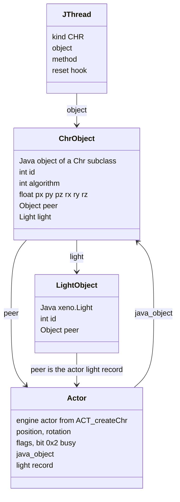
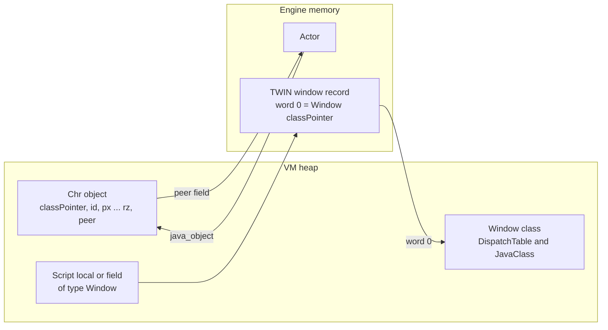
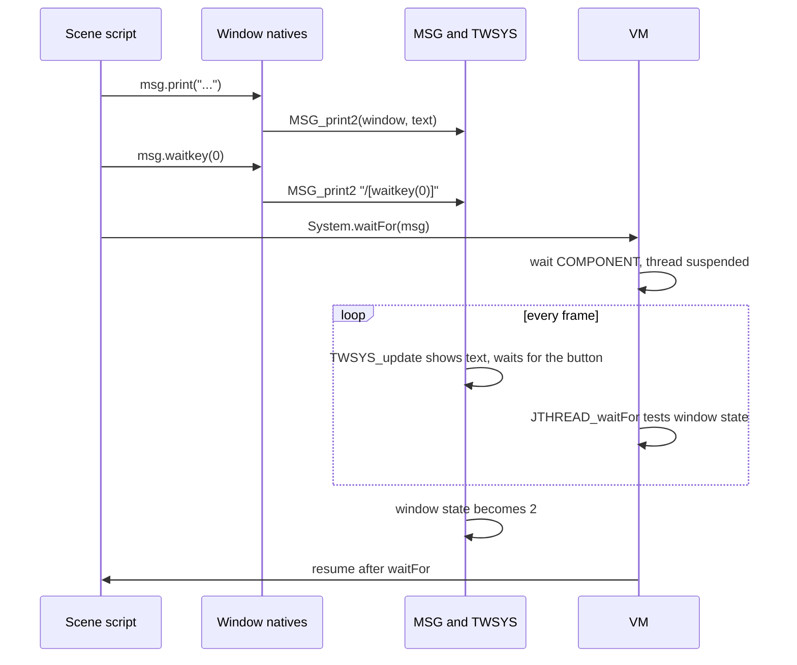
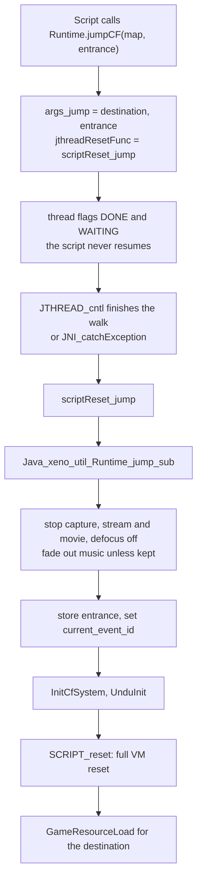
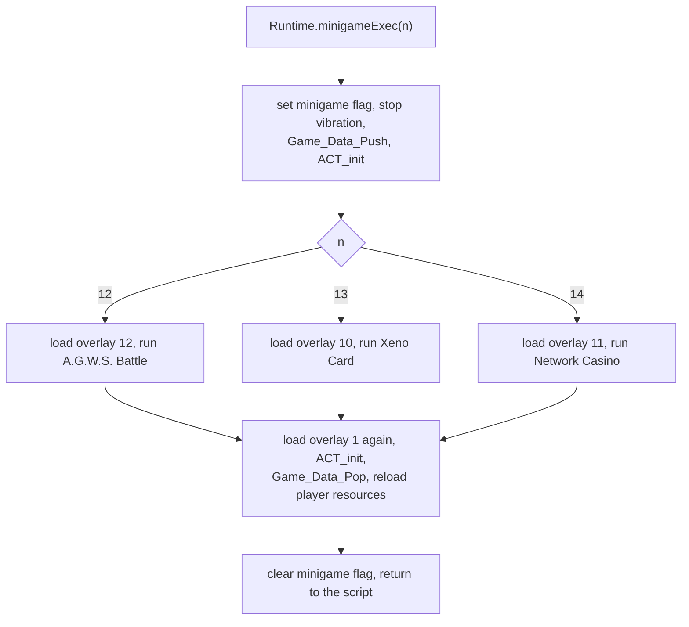

# Native methods

The Java scripts of Xenosaga Episode I cannot touch the engine directly. Every
effect they have on the game, from moving a character to starting a battle,
goes through a **native method**: a method that a library class such as
`xeno.Chr` declares with the `native` keyword and that the main executable
implements as a C function. The executable has 401 of them, spread over 21
Java classes. This page explains how a native is called, how Java objects are
tied to engine objects, and what each class's natives do.

How the VM loads classes, runs bytecode and schedules script threads is
explained on the [Java virtual machine](java-vm.md) page.

[← Back to the overview](../README.md)

## Overview

All natives are listed in one table, `default_native` in
`src/main/runtime.c`. Each entry is a `RuntimeNativeBinding` with the mangled
method name and the C function. The VM looks a native up by name the first
time it is called (see [Native methods in the VM](java-vm.md#native-methods)).
The C functions live in one source file per Java class:

| Java class | Natives | Source file | Purpose |
| --- | --- | --- | --- |
| `xeno.Chr` | 98 | `src/main/chr.c` | Characters: movement, rotation, scale, motion, look-at, shadows, filters |
| `xeno.Unit` | 71 | `src/main/unit.c` | Map units (doors, lifts, props): movement, rotation, motion, visibility |
| `xeno.util.Runtime` | 68 | `src/main/runtime.c` | Game flow: flags, map jumps, battles, party, items, money, movies, mail, minigames, shops |
| `xeno.Camera` | 39 | `src/main/camera.c` | Event cameras and the field camera definitions |
| `xeno.Effect` | 20 | `src/main/effect.c` | Effects of the sef library placed in the scene |
| `xeno.Stage` | 17 | `src/main/stage_2.c` | The map as a whole: fades, background, model parts, starting a script on the stage |
| `xeno.util.Window` | 13 | `src/main/window.c` | Dialogue windows |
| `xeno.PlayControl` | 12 | `src/main/playcontrol.c` | Time chart playback |
| `xeno.util.Menu` | 8 | `src/main/menu_2.c` | Choice menus inside dialogue |
| `xeno.util.Toolkit` | 7 | `src/main/toolkit.c` | Creating peers, loading resources |
| `xeno.util.Format` | 7 | `src/main/format.c` | Number and text conversion |
| `xeno.Sound` | 7 | `src/main/sound.c` | Music sequences, sound effects, streams |
| `xeno.Light` | 6 | `src/main/light.c` | Studio lights and global point lights |
| `xeno.vm.System` | 5 | `src/main/system.c` | Sleep, wait, array copy, debug print |
| `xeno.vm.Thread` | 4 | `src/main/thread_2.c` | Extra script threads |
| `xeno.vm.Math` | 4 | `src/main/math.c` | Random numbers and trigonometry |
| `xeno.util.Input` | 4 | `src/main/input.c` | Controller state |
| `xeno.Movie` | 4 | `src/main/movie.c` | Full-screen movies |
| `xeno.util.Spline` | 3 | `src/main/spline.c` | Spline curves for paths |
| `xeno.util.Layout` | 2 | `src/main/layout.c` | Placing objects from map layout data |
| `xeno.Scene` | 2 | `src/main/scene_2.c` | Starting a method on an event scene |

`runtime.c` contains one more function with a native-style name,
`Java_xeno_util_Runtime_jump_sub`. It is not in the table. It is the shared
helper that performs a map or event jump after the jump natives have stopped
the script.

The counts above are table rows. The declarations in the library classes of
`data\system.evt` differ by three in each direction. `Chr.invalidate()`,
`Chr.validate()` and `vm.System.exit(int)` are declared but have no row, so a
call would jump to address zero, but no script calls them. `Chr.rotCNS(int,
Object)`, `Unit.move(Object, float, boolean)` and `Toolkit.call(Object,
String)` have rows but no declaration, so no script can reach them. The
scripts on the disc call 286 of the 401 rows. The other 115 are never used,
among them `Runtime.addGold`, `Runtime.execBattle`, `Runtime.minigameExec`,
`Runtime.getRegister`, `Movie.start`, `Movie.stop`, `Sound.sequencePlay(int)`,
`Window.closeWaitKey` and most of the `rotX`, `rotY`, `rotZ` and scale forms
of `Chr` and `Unit` (see
[Native methods](../formats/scripts-and-archives.md#native-methods)).

Eighteen natives are empty functions that accept their arguments and do
nothing: `Chr.rotCNS(int, Object)`, `Chr.resetHand`, `Chr.resetEnv`,
`Unit.invalidate`, `Unit.validate`, the eight `Unit` movement and rotation
forms that follow another object, `Window.setName`, `Menu.setVisible`,
`Toolkit.call`, `Format.toInt` and `Scene.stop`. The Java library still
declares all of them except `Chr.rotCNS(int, Object)`, `Toolkit.call` and
`Unit.move(Object, float, boolean)`, so they probably did something in an
earlier version of the engine or were never needed on the PS2.

## Calling convention

Every native has the same C signature:

```c
void Java_<mangled name>(JThread *thread, VMSlot *arguments, VMSlot *result);
```

`thread` is the script thread that made the call (see
[Script threads](java-vm.md#script-threads)). Natives use it only when they
want to suspend that thread or compare it with another one. `arguments`
points to the caller's operand stack, where the arguments already lie in
order, one 4-byte slot each. For an instance method `arguments[0]` is the
object (`this`) and the declared parameters follow. For a static method the
parameters start at `arguments[0]`. All natives of `Runtime`, `Toolkit`,
`Format`, `Sound`, `System` and `Math` are static, and so are the factory
methods such as `Window.create`, `Menu.create`, `Input.create`,
`Spline.create`, `PlayControl.create` and `Thread.create`.

```
operand stack of the caller, for chr.move(30, 1.0f, 2.0f, true)

                arguments == result
                     |
                     v
... caller slots | this (Chr) | 30 (int) | 1.0f (float) | 2.0f (float) | 0x01 (boolean) |
                   [0]          [1]        [2]            [3]            [4]

after the call the five slots are popped and the result slots (none for a
void method) are pushed at the position of [0]
```

The slots are a union (`VMSlot`) of `int`, `float` and object reference. A
`boolean`, `byte`, `char` or `short` still takes a whole slot, and natives often
read a `boolean` as the first byte of its slot. `result` points to the same
address as `arguments`. The interpreter pops the arguments after the call and
pushes as many result slots as the descriptor says, so the value a native
writes to `result[0]` becomes the return value. A native must therefore read
its arguments before it writes the result. The C return value of a native is
ignored. Some natives declare `int` and return a value (for example the
`Toolkit.loadResource` overloads) without any effect on Java.

Many instance natives first check the class of the object with
`JNI_isInstanceOf` and, when it does not match, store 0 in the result slot and
return. The parameter that receives this zero is often named
`failure_result` in the recovered code.

Natives reach the fields of a Java object by name. They intern the field
name, search the class's field table for it and use the field's offset:

```c
field = lookupClassField(classJava_xeno_Chr, loadConstString("peer", -1), 0);
actor = *(Actor **)((char *)object + field->location.offset);
```

The class used for the search is always the library class (`xeno.Chr` here),
not the object's own class. This works for script subclasses because the VM
lays out a subclass's fields after those of its super class, so the offset is
the same (see [Linking and initialization](java-vm.md#linking-and-initialization)).
The fields that natives rely on are:

| Field | Classes | Contents |
| --- | --- | --- |
| `peer` | `Chr`, `Unit`, `Effect`, `Stage`, `Light` | Pointer to the engine object |
| `id` | `Chr`, `Unit`, `Effect`, `Stage`, `Light`, `Input` | Character, unit, effect, stage, light or controller number |
| `algorithm` | `Chr`, `Unit` | Behaviour bits that choose how the peer is set up and updated |
| `px`, `py`, `pz`, `rx`, `ry`, `rz` | `Chr`, `Unit`, `Effect` | Position and rotation (degrees) copied to and from the peer |
| `light` | `Chr` | The character's own `xeno.Light` object |
| `cam0`, `msg` | `Stage`, `Scene` | Default camera and message window, filled when the scene is built |
| `frame`, `transparent`, `alpha` | `Movie` | Movie playback state exchanged with `GameMovie*` |

## Name mangling

The C name of a native is built from the Java class, the method name and the
argument types. The rules (from `resolveNativeMethod` in
`src/main/find_native_method.c`) are:

1. `Java_`, then the class name with `/` replaced by `_`.
2. `_` and the method name.
3. `__` and the parameter part of the descriptor. In it, `/`, `;` and `(` become
   `_`, and `[` becomes `a`. The return type is left out.
4. If no table entry has that name and the descriptor has an array, the lookup
   is repeated with `[` turned into `_`.

| Java method | Descriptor | C function |
| --- | --- | --- |
| `Chr.move(int, float, float, boolean)` | `(IFFZ)V` | `Java_xeno_Chr_move__IFFZ` |
| `Chr.look_char(Object)` | `(Ljava/lang/Object;)V` | `Java_xeno_Chr_look_char__Ljava_lang_Object_` |
| `Runtime.getFlags(int, int)` | `(II)I` | `Java_xeno_util_Runtime_getFlags__II` |
| `Camera.fovSPL(float[], int)` | `([FI)V` | `Java_xeno_Camera_fovSPL__aFI` |
| `Window.print(String[], int)` | `([Ljava/lang/String;I)V` | `Java_xeno_util_Window_print__aLjava_lang_String_I` |
| `Stage.setCFBG(int, int, float[])` | `(II[F)V` | `Java_xeno_Stage_setCFBG__II_F` (second form) |
| `Thread.create()` | `()Lxeno/vm/Thread;` | `Java_xeno_vm_Thread_create__` |

Because the return type is not part of the name, two overloads that differ
only in their return type would collide. The library has none. `setCFBG` is
the only native that needs the second form, which suggests that the table was
written by hand or by an older tool with a different rule for arrays.

## Peers

Most script objects stand for something in the engine: a character, a door,
an effect, a camera. The link between the two is called the **peer**. The Java
object holds a pointer to the engine object in its `peer` field, and the engine
object usually holds a pointer back to the Java object (`java_object`). Natives
follow the `peer` field to find what to change.

There are two kinds of peers in the game.

### Peers created by Toolkit.getPeer

`Toolkit.getPeer(Object)` creates the engine object for a `Chr`, `Unit`,
`Effect` or `Stage` object and stores it in the object's `peer` field. The
scripts probably call it from the `init` methods of these classes, which
`SCENE_instance` and `STAGE_instance` run for every member of a scene (see
[Scenes and time charts](scenes-and-timecharts.md)). The native checks the
class of the object, most specific first:

| Java class | Function | Engine object | Thread |
| --- | --- | --- | --- |
| `xeno.Enepc` (a `Chr`) | `getPeer_Enepc` | An enemy actor from `ACT_createEnemy` | kind CHR, 4 frames, 48 slots |
| `xeno.Chr` | `getPeer_Chr` | An actor from `ACT_createChr(-1, id)`, with motion data initialized | kind CHR, 4 frames, 48 slots |
| `xeno.Uwamono` (a `Unit`) | `getPeer_Uwamono` | An overlay object from `Unit_CreateUwamono` | kind UNIT |
| `xeno.Unit` | `getPeer_Unit` | A map unit from `MAP_createUnitPeer(-1, id)` | kind UNIT, 4 frames, 48 slots |
| `xeno.Effect` | `getPeer_Effect` | An effect from `sefLoadEffectCf` and `sefCreateEffectCf` at the object's position | none |
| `xeno.Stage` | `getPeer_Stage` | The stage record from `STAGE_create(id)` | kind STAGE, 8 frames, 48 slots |

Each of these peers (apart from effects) also gets its own script thread,
created with `JNI_createThread` and tied to the Java object. That thread stays
idle until the script calls `start(1, "methodName")` on the object, which makes
the object run that method in parallel with the rest of the scene (see
[Running once per frame](java-vm.md#running-once-per-frame)).

`getPeer_Chr` shows the general pattern. It reads `id` and `algorithm`,
creates the actor, creates the thread, copies `px`, `py`, `pz` and `rx`, `ry`,
`rz` into the actor (converting degrees to radians), and stores the actor in
`peer`. If the algorithm has any of the bits `0xF00` set, the actor gets the
NPC update function `ACT_updateNPC` and remembers its start position as an
anchor. Finally it creates a new `xeno.Light` object for the character's own
light set, stores it in the `light` field and points that light's `peer` at
the actor's light record.

`getPeer_Unit` follows the same steps for map units. The unit's sequence slot
joins the group set earlier with `Toolkit.peerSetGroup`. The `algorithm` field
selects where the start transform comes from: algorithm `0x300` copies the
whole transform of the matching part of the map model, `0x100` copies only its
position, and any other value uses the Java fields. In the first two cases the
position is written back into `px`, `py` and `pz`.

The class diagram below shows the objects around a character after
`Toolkit.getPeer`.



### Native-backed objects

Some Java objects are not separate Java objects at all. The native allocates
or picks an engine record and writes the class's `classPointer` into the
record's first word. From then on the VM treats the record as an instance of
that Java class, and the script can call its natives with it. The record must
have room for the header word at offset 0, which these engine structures have
by design.

| Java class | Created by | Engine record |
| --- | --- | --- |
| `xeno.util.Window` | `Window.create`, `SCENE_instance` (field `msg`), talk tasks | A text window from `TWIN_create2` |
| `xeno.util.Menu` | `Menu.create` | A menu from `TMENU_create(-1)` |
| `xeno.Camera` | `Camera.create(id)`, `STAGE_instance` (field `cam0`) | `CameraWork` entry `tcamera[id]` |
| `xeno.PlayControl` | `PlayControl.create` | The current playback controller from `PLAY_getCurrent` |
| `xeno.util.Layout` | `Layout.getManager` | The static `defaultLayout` record |
| `xeno.util.Vector4f` | `Spline.getValue`, `Effect.getScale` and others | A static vector reused by every call |
| `xeno.util.Spline` | `Spline.create` | A spline record from `xmalloc` |
| `xeno.vm.Thread` | `Thread.create` | The `JThread` itself |

The records behind `Window`, `Menu`, `Camera` and `PlayControl` live in engine
pools, not in the VM heap. Their lifetime is controlled by the engine, not by
the heap marks. For example, `SCRIPT_exec` calls `TWSYS_init` and
`TCAMERA_init` before it starts a new map script, which resets all windows and
event cameras. The static `Vector4f` and the shared `String` of
`Format.toString` are overwritten by the next call, so a script must copy the
values it wants to keep.

The diagram below contrasts the two kinds of objects. A peer-based object is a
real Java object in the VM heap that points to its engine object. A
native-backed object is the engine record itself, which points to the Java
class through its first word.



## Natives that wait

A native can make its script wait without blocking the game. It records what
the thread waits for, sets a flag and returns, and the VM resumes the script
later at the instruction after the call. The mechanism is described in
[Waiting and resuming](java-vm.md#waiting-and-resuming). These natives use it:

| Native | Waits for |
| --- | --- |
| `System.sleep(int)` | A number of frames |
| `System.waitFor(Object)` | A `Window` or `Menu` to reach state 2, or a `Chr` or `Stage` thread to finish |
| `Chr` and `Unit` motion, move, rotate and scale natives with `wait` true | The actor or unit to finish the sequence (only on the object's own thread) |
| `Stage.play(String)` | The game state flag `0x800` to clear after the named script has been loaded |
| `Runtime.setLocation(int, int, int)` with a non-zero third argument | Never resumes: the map change replaces the scripts |
| `Runtime.jumpCF`, `Runtime.jumpEvent`, `Runtime.evsExit` | Never resume: the jump resets the VM |

A typical dialogue uses this pattern: print text into a window, then wait for
the window. The sequence below shows it with the scene's `msg` window.



## xeno.vm.System

`xeno.vm.System` is the VM's own version of `java.lang.System`. All five
methods of the table are static. The class also declares a sixth native,
`exit(int)`, which has no row in the table and is never called.

| Method | What it does |
| --- | --- |
| `arraycopy(Object, int, Object, int, int)` | Copies array elements with `memcpy`. The element size comes from the destination array's class |
| `sleep(int)` | Suspends the thread for the given number of frames (negative counts as 0) |
| `println(String)` | Expands `/[...]` markers and `#n` register references (`VMRegister[n]` printed as a float) into a buffer. The final output call is missing, so nothing appears |
| `waitFor(Object)` | Suspends until a `Window` or `Menu` reaches state 2, or until the thread of a `Chr` or `Stage` has finished (not when that thread is the caller) |
| `methodSignal(int)` | Sets or clears a script signal through `SCRIPT_methodClearSet`. `Chr.start` reads it to decide whether to clear the character's running sequences |

`waitFor` on a `Chr` waits for the character's own script thread, the one
started with `chr.start(1, "name")`. The test also clears that thread's `DONE`
flag, so the next `waitFor` on the same character waits for its next method.

## xeno.vm.Thread

`xeno.vm.Thread` lets a script run a method of any object in parallel. The
Java `Thread` object is the `JThread` record itself.

| Method | What it does |
| --- | --- |
| `create()` (static) | Creates a thread of kind DEFAULT with 4 frames and 64 slots and returns it |
| `setTarget(Object, String)` | Stores the object and looks up the method `name()V` on the object's class. Sets the hook `JTHREAD_default` |
| `start()` | Resets the thread and sets `RUNNABLE`, so `JTHREAD_cntl` runs the method from the next frame |
| `stop()` | Clears `RUNNABLE` |

## xeno.vm.Math

| Method | What it does |
| --- | --- |
| `random()` | A random number from `xglLRand` |
| `atan2(float, float)` | `atan2f` |
| `sin(float)` | Calls `xglCos` |
| `cos(float)` | Calls `xglSin` |

As recovered, `sin` and `cos` call each other's xgl function. Either the
natives or the xgl names are swapped. `xglSin` in `src/main/xgl_2.c` uses the
VU0 sine routine, so the natives probably return the cosine for `sin` and the
sine for `cos`, and the scripts were written against that behaviour. The xgl
math helpers are described in [Math](../libraries/math.md).

## xeno.util.Runtime

`xeno.util.Runtime` is the script's view of the whole game. Its natives read
and write the save data, move the player between maps and events, and run
other parts of the game such as battles and minigames. All of them are static.

### Flags, registers and game state

| Method | What it does |
| --- | --- |
| `getFlags(int, int)`, `setFlags(int, int, int)` | Read and write the story flags with `xglFlagsGet` and `xglFlagsSet` (see [Save data](../architecture/save-data.md)) |
| `getRegister(int)`, `setRegister(int, int)` | Read and write `VMRegister[n & 31]`, 32 integers shared by all scripts |
| `getGameState()` | Returns the game state word |
| `disable(int)`, `enable(int)` | Set and clear bits of `GameLoopState.flags` |
| `setMenuLock()` | Blocks the main menu for 62 frames through `SCRIPT_sceneChangeTimeSet` |
| `setEventTimer(String, int)` | Starts a timer task (`setEventTimerTaskEntry`, `src/main/disp_on.c`) that counts the frames down and then calls the named method of the map script through `CallMethod` |

`VMRegister` lives outside the VM heap, so its values survive scene changes and
VM resets. It is probably the way scripts pass small values from one scene to
the next.

### Map changes and jumps

Leaving the current map or event always goes through one of these natives:

| Method | What it does |
| --- | --- |
| `jumpCF(int, int)` | Jumps to a field map (destination, entrance) |
| `jumpEvent(int)` | Jumps to an event scene. The destination gets the event base `0x10000000` added |
| `evsSetRetPoint()` | Remembers the current event and the player's position |
| `evsExit()` | Returns to the point saved by `evsSetRetPoint` |
| `setLocation(int, int, int)` | Changes the map at once (`MapChange2`), or with a non-zero third argument loads it with `LoadMapOnly` and stops the script |
| `getLocation()`, `getEntrance()` | The current map number (`MapGetNo`) and entrance |
| `setMap(int, int)` | Changes the map resource with `MapChangeResource` |

The jump natives cannot do their work while the script is running, because the
jump resets the VM and would delete the running thread. They store the
destination in `args_jump`, set `jthreadResetFunc` to `scriptReset_jump` or
`scriptReset_evsExit`, block further talk with `SCRIPT_talkIgnoreSet` and stop
the thread for good with the flags `DONE` and `WAITING`. `jumpEvent` reads a
second argument slot as the entrance even though its descriptor has only one
`int`, so the entrance comes from whatever the caller's operand stack holds
above the argument (probably a leftover of an older two-argument version).

The reset function runs at the end of `JTHREAD_cntl`, or from
`JNI_catchException` when the jump came from an observer task. It ends in
`Java_xeno_util_Runtime_jump_sub`, which does the actual change.



### Field control

| Method | What it does |
| --- | --- |
| `setPlayerControl(boolean)` | Gives or takes control of the player character |
| `setPlayerMoveParam(float, float, float)` | Sets the player's movement parameters (`GameCfPlayerMoveParamSet`) |
| `setShootFlag`, `setShootHeightCheck`, `setShootIDCheck`, `setShootUwaCheck` (boolean), `setShootRange(float)` | Configure `GameLoopState.shoot_control`, the field shooting check |
| `setDefocusQuick(int, int, int, int)`, `setDefocus(int, int, int[])`, `setDefocusParam(int, int, int)` | Depth-of-field blur through `GameDefocusQuickSet`, `GameDefocusSet` and the `GameDefocusParam` table |
| `setIdLightCol`, `setIdLightDir`, `setIdLightVec` (int, int, float, float, float) | Colour, angle or direction of light `n` of a light slot. Light 0 is the ambient light |
| `setWindParam(int, float, float, float, float)` | Wind for hair and cloth (EXM): 0 stops it, 1 sets shake, 2 directional wind, 3 point wind (see [Animation](../libraries/animation.md)) |
| `CaptureStart(String, int)`, `CaptureEnd()` | Start and stop a screen capture (`tyaCaptureStart`, `tyaCaptureEnd`) |
| `progressEffect(int)` | Advances the field effects with `sefProgressEffect` |

### Party, items and money

| Method | What it does |
| --- | --- |
| `getLeader()` | The party leader's battle id, read from the save data |
| `getPartyData(int)`, `setPartyData(int, int)` | Read or write one field of the party data. Bits 24 to 31 of the selector give the width, bits 16 to 23 the base record, the low 16 bits the offset |
| `setFriend`, `resetFriend`, `checkFriend` (int) | Party membership of a character (`PartyFriendOn`, `PartyFriendOff`, `PartyFriendCheck`) |
| `setLockParty`, `resetLockParty`, `checkLockParty` (int) | Locks a character in the party |
| `setOutFriend`, `resetOutFriend`, `checkOutFriend` (int) | Marks a character as away from the party |
| `setTakeAgws`, `resetTakeAgws`, `checkTakeAgws` (int) | Whether a character brings an A.G.W.S. |
| `battleChangeParty(int)` | Changes the battle party (`PartyBattleChange`) |
| `addItem(int, int)`, `removeItem(int, int)`, `checkItem(int, int)` | Item counts through `dataBoxInc`, `dataBoxDec`, `dataBoxChk` |
| `addItemWin(int, int)` | Adds an item and shows the "item obtained" window (`CreateEvtItemGetTask`) |
| `getItemName(int, int)` | Returns the item's name as a new `String` |
| `addGold`, `removeGold` (int), `checkGold()` | Money through the `dataMoneyBox*` functions |
| `etherTecSet(int)` | Sets an Ether or Tech Attack entry in the save data (`dataEtherTecSet`), probably to make it available |
| `charAllRecovery()`, `AGWSAllRecovery()` | Fully heal the characters or the A.G.W.S. |

When `setPartyData` changes the model id of the active player character, it
reloads the model and calls `xglSleep` twice so the load can finish. These
systems are described in [Character growth](../game/character-growth.md) and
[Save data](../architecture/save-data.md).

### Running other parts of the game

Some natives run a complete screen and return only when it has ended. The
script thread sees one long native call, while the screen's own loop calls
`xglSleep` every frame.

| Method | What it does |
| --- | --- |
| `execBattle(int, int)` | Saves the game state, passes the two arguments to the battle overlay (`func_00A0B728`, `func_00A0B708`) and runs the battle (`func_A22668`), then rebuilds the actors and the scene, fades in and restores the state (see [Battle](../game/battle.md)) |
| `enterShop(int)` | Saves the camera and light, runs `MenuShopMain` and restores them |
| `mailExec(int)` | Runs the U.M.N. mail screen `UmnMailMain` (see [U.M.N.](../game/umn.md)) |
| `mailFlag(int)` | Queries or changes one mail. The high byte selects the action, the low 24 bits the mail id. Action 4 marks it received with a sound and vibration |
| `minigameExec(int)` | Runs a minigame between `Game_Data_Push` and `Game_Data_Pop`: 12 loads overlay 12 (A.G.W.S. Battle), 13 overlay 10 (Xeno Card), 14 overlay 11 (Network Casino). Overlay 1 is loaded again afterwards |
| `mpeg2(String)`, `mpeg2AfterCrossFade(int)` | Plays a movie with `GameMpeg2Play`, optionally with a cross-fade into it |

The flowchart below shows `minigameExec` as an example of such a native.



The minigames themselves are described in
[Xeno Card](../game/minigames/xeno-card.md),
[Network Casino](../game/minigames/network-casino.md) and
[A.G.W.S. Battle](../game/minigames/agws-battle.md).

## xeno.Chr

`xeno.Chr` is a character on the map or in an event: party members, NPCs and
(through the subclass `xeno.Enepc`) field enemies. Its peer is an `Actor` (see
[Actors](../libraries/actors.md)). The 98 natives fall into a few groups.

Movement, rotation and scaling do not change the actor at once. They fill one
channel of the actor's sequence record `actSequence[actor->number]` with a
handler (`SEQ_moveXZ`, `SEQ_moveChr`, `SEQ_moveSPL`, `SEQ_rotate`,
`SEQ_rotateSPL`, `SEQ_scale`, `SEQ_scaleSPL` or `SEQ_motion`) and a target, and
the actor update then interpolates over the following frames. Rates given in
units per second are divided by 30, because the sequences step once per frame.
Move targets are absolute map coordinates, unless bit 0 of the object's
`algorithm` field is set, in which case they are relative to the current
position.
The channels are independent, so a character can move, turn and play a motion
at the same time. The handlers are described in
[Scenes and time charts](scenes-and-timecharts.md).

Most of these natives end with a `boolean wait`. When it is true the actor is
marked busy (actor flag `0x2`) until the channel finishes. If the caller is the
character's own thread, that thread also waits (see
[Natives that wait](#natives-that-wait)).

| Group | Methods | What they do |
| --- | --- | --- |
| Move | `move(int, float, float, boolean)`, `move(float, float, float, boolean)`, `move(int, Object, boolean)`, `move(Object, float, boolean)`, `move(Spline, int, boolean)` | Walk to an X/Z point over a number of frames or at a rate, walk to another character, or follow a spline |
| Rotate | `rotX`, `rotY`, `rotZ` in four forms each, `rotate(Spline, int, boolean)`, `rotCNS(int, float, float, float)`, `setRotCNSParam` | Turn about one axis to an angle over frames or at a rate, or to face another object |
| Scale | `sclX`, `sclY`, `sclZ` in two forms each, `scale(Spline, int, boolean)` | Change the size over frames or at a rate |
| Motion | `mtn(int, int, float, boolean)`, `mtn(int, int, int, int, int, float, boolean)`, `mtnGetRoot`, `setMotionFlags`, `setMotNoUpdate` | Play a motion (1-based number unless the top byte is set), with an optional loop range and blend |
| Control | `start(int, Object)`, `stop()`, `relax(int, int)` | Choose the actor's update mode, run a script method on the character's thread, stop and copy the actor's position back into the Java fields |
| Transform | `setTranslate()`, `getTranslate()`, `setRotate()`, `getRotate()`, `setScale`, `getScale` | Copy between the Java fields `px`..`rz` and the actor |
| State | `signal(int)`, `getSignal()`, `getState()`, `getSerial()`, `getFlags()`, `setFlags(int)`, `setArgs`, `getArgs` | Signal word, state, flags and a small argument area of the actor |
| Player | `getPlayer()`, `setPlayer()` | Bind the object to the player actor, or make the character the player |
| Appearance | `setVisible`, `setScale`, `setFilter`, `setFilterParam`, `setClip`, `setSymmetryY`, `setSortOffset`, `pixelAlpha`, `pixelAlphaParts`, `pixelAlphaPartsReset`, `renderCommand`, `ignoreShape` | Visibility, draw filters (such as `ACT_filterGuno` and `ACT_filterStealth`), clipping, transparency |
| Shadows and lights | `setShadow(int, int)`, `setShadow(byte[])`, `shadow_clip_scale`, `shadow_map_id`, `shadow_map_reset`, `setPointLightCol`, `setPointLightPos`, `setPointLightReset` | Drop shadow definitions (`DropShadowDefineTable`) and up to three point lights on the character |
| Look-at | `look_camera()`, `look_char(Object)`, `look_unit(Object)`, `look_point(float, float, float)`, `look_default()`, `look_speed`, `look_eye_set`, `look_eye_control`, `look_eye_speed` | Turn the head and eyes toward a target (see [Animation](../libraries/animation.md)) |
| Attachments | `setParent(Chr, int, int, int)`, `setHand(int)`, `setWeaponR(Chr)`, `resetWeaponR(Chr)`, `hairStop(int, int)`, `childGetPeer(int, int)`, `setPeer(Object)` | Attach to another actor's joint (`ACT_setParent`, `ACT_setRelation`), weapons (`ACT_setArms`), hair physics |
| Field | `setCollision(boolean)`, `setEdgeFall(int)`, `setElevatorMode(int)`, `setID(int)`, `dispRadar(boolean)` | Collision, falling off edges, riding lifts, the walk floor of the map's `.id` file that the character follows (`UnduDataGetHeader(0, id)`, see [The direct and second lists](../formats/maps-and-field-data.md#the-direct-and-second-lists)), radar display |
| Talk | `talkto(String)`, `touchto(String)` | Name the stage method to call when the player talks to or touches this character |

`Chr.start(int mode, Object)` selects how the actor is updated each frame:

| Mode | Update | Meaning |
| --- | --- | --- |
| 0 | `ACT_updateDefault` | Normal update, no script control |
| 1 | `ACT_updateSequence` | The second argument is a method name. The method runs on the character's own thread through `JTHREAD_defaultChr` |
| 2 | `ACT_updatePlayer` | Player control |
| 4 | `ACT_updateSequence` | Sequence channels only, no script method |
| 5 | `ACT_updateMPack` | Motion pack playback |

`talkto` and `touchto` only store a method name in the actor. When the player
later presses the action button next to the character or touches it, the
field code calls `SCRIPT_execTalkto` or `SCRIPT_execTouchto`, which runs that
method of the map script with the character as argument (see
[Calling Java from C](java-vm.md#calling-java-from-c) and
[Events](events.md)).

## xeno.Unit

`xeno.Unit` is a map unit: a door, a lift, a switch, a moving part of the map
model. Its peer is a map unit record created by `MAP_createUnitPeer`, and its
sequences live in `unitSequence[]`. The subclass `xeno.Uwamono` is used for
objects created through `Unit_CreateUwamono`. Map units and uwamono objects
are described in [Maps and units](../game/map-and-units.md).

`Unit` mirrors most of `Chr`: the same `move`, `rotX/Y/Z`, `sclX/Y/Z`, `rotate`,
`scale`, `mtn` and transform natives, using the `SEQ_*Unit*` handlers. The
eight forms that follow another object (`move(int, Object, boolean)`,
`rotY(Object, float, boolean)` and so on) are empty. Following is done instead
with `transCNS(Object, int, float, float, float)` and
`rotYCNS(Object, int, float, float, float)`, which keep the unit at an offset
from a `Chr`.

| Group | Methods | What they do |
| --- | --- | --- |
| Control | `start(int, Object)`, `stop()`, `suspend(int)`, `resume(int)` | Update mode 0 `MAP_updateUnitDefault`, 1 script method on the unit's thread, 4 algorithm update (`UNIT_setUpdate`), 5 `MAP_updateUnitMPack`. `suspend` and `resume` act on a whole unit group with `MAP_callUnitGroup` |
| Shape | `setPivot(float, float, float)`, `getPivot(Vector4f)`, `setAxis(float, float, float, float)`, `getAxis(Vector4f)` | Pivot point and rotation axis of the unit |
| Motion | `mtn` (two forms), `mtnSetMask(int)`, `mtnGetRoot` | Motion playback and the channel mask |
| State | `signal`, `getSignal`, `getState`, `getSerial`, `setArgs` (three forms), `getArgs` | As for `Chr`, with an extra row form of `setArgs` |
| Appearance | `setVisible(boolean)` (a peer flag), `setVisible(int, boolean)` (`MDL_setVisible`), `setFilter`, `setFilterParam`, `setClip`, `setSortOffset`, `renderCommand`, `map_shadow(int)`, shadow natives, `setMonitorPrio(int)` | Display of the unit |
| Field | `setCollision(boolean)`, `setParent(Object, int)`, `initElevatorFunc()` | Collision, attachment to a character's joint or accessory, lift behaviour (`tyaElevatorTask`) |

## xeno.Camera

A Java `Camera` is a native-backed object: the record `tcamera[id]` of the
event camera system (see [Events](events.md) for `TCAMERA`). `Camera.create(id)`
returns it, and `STAGE_instance` puts camera 0 into the stage's `cam0` field.
The natives come in three groups.

The first group drives the camera during events. Each camera has channels for
translation, view point (look-at), roll and field of view. A channel can be
constant (`setTranslate`, `setView`, `setRoll`, `setFov`, `setRotate`), follow
an object (`transCNS(Object, float, float, float)` and
`viewCNS(Object, float, float, float)` keep an offset from a `Chr` or `Unit`)
or follow a spline (`transSPL`, `viewSPL`, `rotateSPL`, `rollSPL`, `fovSPL`
with a `float[]` of keys, set up with `SPL_init`). `getRotateX/Y/Z`,
`getTranslateX/Y/Z` and `getFov` read the current values, rotations in degrees.
`change()` makes the camera the only active studio camera, `setActive`,
`start(int, Object)` and `changeID(int, int, int)` switch cameras and states.

The second group changes the field camera ("CF" camera, see
[Field](../game/field.md)). `setCFAngle`, `setCFAnglePers`, `setCFHokan`,
`setCFLock`, `setCFOffset`, `setCFPedestal` and `setCFPedestalHokan` set the
angles, interpolation times, lock point, offsets and pedestal of one camera
definition, or of all of them when the index is negative. `setMode(int)` and
`getMode()` select the field camera mode in `GameLoopState`.

The third group sets fog and clipping: `setFog(int, ...)`, `resetFog(int)` and
`setClipRange(float, float)`.

## xeno.Effect

A `Effect` object stands for one effect of the sef library (see
[Effects](../libraries/sef.md)). Its peer comes from `Toolkit.getPeer`, which
loads the effect data for the object's `id` and creates the effect at the
object's position.

| Method | What it does |
| --- | --- |
| `call(int)` | Sends a command to the effect with `FX_call` |
| `disp(boolean)` | Rewinds and shows the effect, or hides it (`sefRewindEffectCf`) |
| `clearEffect()` | Removes the effect (`sefClearEffectCf`) |
| `setTranslate()`, `getTranslate()`, `setRotate()`, `getRotate()`, `setTransOffset(float, float, float)` | Copy the position and rotation between the Java fields and the effect, or move it by an offset |
| `setScale(float, float, float)`, `getScale()` | Scale, returned as the shared `Vector4f` |
| `setCaster(Chr)`, `setCaster(Unit)`, `setTarget(Chr)`, `setTarget(Unit)` | Attach the effect to a character or unit as caster or target |
| `setForceLoop`, `getForceLoop`, `setClip`, `getClip`, `setMotion`, `noAttach` | Effect playback options |

## xeno.Stage

The `Stage` is the map as a whole. A map script is a subclass of `xeno.Stage`,
and its object is created when the map's scripts are loaded (see
[How a scene script starts and ends](java-vm.md#how-a-scene-script-starts-and-ends)).

| Method | What it does |
| --- | --- |
| `start(int, Object)` | With mode 1, runs the named method on the stage thread through `JTHREAD_defaultStage` |
| `stop()` | Stops the stage thread |
| `play(String)` | Loads the named scene archive with the development loader `SCRIPT_load_DBG`, starts it with `SCRIPT_exec` and waits until the game state flag `0x800` is clear. The loader reads with `sceOpen` into fixed addresses above 32 MiB, so this native probably works only on a development kit |
| `setFade(int, int, float, float, float)`, `setEventFade(...)`, `setFadeCancel(int)` | Screen fades through `GameLoopState` and `SCRIPT_fade`, or model fades with `nmlModelSetFadeInInterrupt` and the fade cancel functions |
| `setColor(float, float, float)`, `setBgColor(float, float, float)` | A colour stored in `GameLoopState` (probably a tint for the map), and the clear colour (`xglRenderClearColor`) |
| `setBgClip(int)`, `setCFBG(int, int, float[])`, `clrBackBuffer()`, `setFrameRender(int, int)` | Background drawing: clip, field background draw type (`GameBgDrawType1Entry`, `GameBgDrawType2Entry`), back buffer use (`nmlModelSetBackBuffer`) |
| `setVisible(int, boolean)`, `setPartsLast(int)`, `setPartsLastReset()` | Show or hide map model parts and draw some parts last (`nmlModelSetPartsVisible`, `nmlModelSetMapLast*`) |
| `setEffectRender(int)`, `renderCommand(int)` | Effect drawing mode and a render command word for the game loop |

The model functions are in [nml](../libraries/nml.md) and the fades and
background drawing are explained in [Rendering](../architecture/rendering.md).

## xeno.Scene

An event scene is a subclass of `xeno.Scene`. The class has two natives.
`start(int, Object)` calls `SCENE_start` to run the named method of a scene
object on its thread, the same way the loader starts `play()` (see
[Calling Java from C](java-vm.md#calling-java-from-c)). `stop()` is empty.

## xeno.Light

A `Light` object stands for one light of a light set: `id` 0 is the ambient
light and `id` 1 to 3 are the parallel lights. Its `peer` points to a light
record. For the light of a character it is the actor's own light record, and
when `peer` is null the current studio light from `xglStudioGetLight2` is used.

| Method | What it does |
| --- | --- |
| `setColor(float, float, float)` | Ambient or parallel light intensity (`xglLightIntensityAmbient`, `xglLightIntensityParallel`) |
| `setDirection(float, float, float)` | Parallel light angle in degrees (`xglLightAngle`) |
| `setDirection2(float, float, float)` | Parallel light direction vector (`xglLightDirection`) |
| `setGlobalPointLightCol(int, float, float, float)`, `setGlobalPointLightPos(int, float, float, float)`, `setGlobalPointLightReset()` | The global point lights of the model library |

The xgl light functions are described in
[xgl studios, cameras and lights](../libraries/xgl.md#studios-cameras-and-lights).

## xeno.Movie

| Method | What it does |
| --- | --- |
| `init(int)` | Prepares movie playback with a buffer of the given size in KiB (`GameMovieInit`) |
| `start(int)` | Plays `data\movie\full\mvNNNN.ipu` with the given number (`GameMoviePlay`) |
| `stop()` | Stops it |
| `update()` | Writes the current movie frame into the field `frame` and reads `transparent` and `alpha` back into the movie globals |

No script on the disc calls `Movie.start` or `Movie.stop`, and the folder
`data\movie\full\` does not exist on the disc, so this full-screen IPU player
is unused in the released game (see
[Files and paths that nothing uses](../formats/movies-images-and-icons.md#10-files-and-paths-that-nothing-uses)).
`Runtime.mpeg2` is the other way to play a movie from a script, and it is
the one the scripts use.

## xeno.Sound

All `Sound` methods are static. The sound system is described in
[Audio](../architecture/audio.md).

| Method | What it does |
| --- | --- |
| `sequencePlay(int)`, `sequencePlay(int, int)` | Starts a music sequence (`xglSoundSequenceNormal`), optionally with a volume |
| `sequenceStop(int)`, `sequenceStop(int, int)` | Fades a sequence out (`xglSoundSequenceFadeOut`), optionally with a time |
| `effectPlay(int, int, int)` | Plays a sound effect with volume and pan (`xglSoundEffectParamID`) |
| `effectStop(int)` | Stops a sound effect |
| `streamPlay(int, int, int, int)` | Plays a streamed sound `data\sound\vda\sNNNNNN.vdm` (ids below 1,000,000) or `.vds` (larger ids, stereo). The pitch argument is a sample rate and is converted to the driver's 4.12 format with 48 kHz as 1.0 |

The class `xeno/Sound` in `system.evt` also has plain Java overloads that
fill in default arguments and call these natives. `effectPlay(int)` calls
`effectPlay(id, 127, 64)`. `streamPlay(int)`, `streamPlay(int, int)` and
`streamPlay(int, int, int)` call the four-argument native with a rate of
44,100, volume 127 and pan 64 where an argument is left out. The scripts use
the overloads: 165 of the 166 two-argument stream calls pass a rate of
48,000. How a stream id becomes a file name, and which ids have no file, is
described in [Ids and file names](../formats/sound.md#ids-and-file-names).

## xeno.util.Window

A `Window` is a text window of the window system (see
[UI and windows](../libraries/ui-windows.md)). Most natives send a text
command to the window through `MSG_print2`. The message system interprets the
commands inside its own text stream, so the script only queues text and
commands and then waits for the window.

| Method | What it does |
| --- | --- |
| `create(int)` (static) | Creates a window with `TWIN_create2`. Kind 0 uses the field layout (`TWIN_initCF`), kind 1 the event layout (`TWIN_initScene`) |
| `print(String)`, `print(String[], int)` | Adds text to the window |
| `clear()`, `close()`, `waitkey(int)`, `wait(int)`, `closeWaitKey()` | Send `/[clear()]`, `/[close()]`, `/[waitkey(n)]`, `/[wait(n)]` or `/[waitkey(0);close()]` |
| `setSize(int, int)`, `setLocation(int, int)` | Line count and layout, and screen position (this also stops the window following its owner) |
| `signal(int)`, `getSignal()` | Write and read-and-clear the window's close state |
| `setName(String)` | Empty |

## xeno.util.Menu

A `Menu` is a choice list shown in the window system (`TMENU_create`).

| Method | What it does |
| --- | --- |
| `create()` (static) | Creates the menu |
| `addQuery(String)`, `addQuery(String[], int)` | Adds the question text (`TMENU_addQuery`) |
| `addItem(String)` | Adds a choice (`TMENU_addItem`) |
| `getSelected()` | The selected index, or the negative state while no choice has been made |
| `setCursor(int)`, `setLocation(int, int)` | Initial cursor and screen position |
| `setVisible(boolean)` | Empty |

A script typically builds the menu, calls `System.waitFor(menu)` and then reads
`getSelected()`.

## xeno.PlayControl

`PlayControl` gives scripts access to the event player of `src/main/play.c`.
The player runs an event's camera curves, which come from a separate CAM
file, and can also run a time chart, a block of curves whose keys fire script
methods. No retail script uses time charts. The details are on the
[Scenes and time charts](scenes-and-timecharts.md) page.

| Method | What it does |
| --- | --- |
| `create()` (static) | Returns the current playback controller (`PLAY_getCurrent`) as a Java object |
| `init(int, int)`, `init(int, int, int, int, float)` | Sets up playback (`PLAY_setup`). Frame counts are converted to seconds |
| `loadCamera(Object)`, `loadTimeChart(Object)` | Give the controller its camera data (stored as the play's `source`) and its time chart (`PLAY_setTimeChart`). `system.evt` has the Java wrappers `loadCamera(String)` and `loadTimeChart(String)`, which fetch the file with `Toolkit.loadResource(String)` first. The event scripts call `loadCamera`, but none calls `loadTimeChart` |
| `start()`, `stop()` | Set and clear `PLAY_FLAG_ENABLED` |
| `setObserver(...)` (two forms) | Register a method of a script object to be called at a time chart event (`PLAY_setObserver`). `PLAY_ctrl` later calls it through `SCRIPT_test` on `stageVM` |
| `signal(int)`, `getSignal()`, `getParams()` | Signal word and the parameter object passed to observers |

## xeno.util.Toolkit

All `Toolkit` methods are static.

| Method | What it does |
| --- | --- |
| `getPeer(Object)` | Creates the peer of a `Chr`, `Unit`, `Effect` or `Stage` (see [Peers](#peers)) |
| `peerSetGroup(int, int)` | Sets an entry of `XTK_peerGroup`. Entry 1 is the group new units join |
| `loadResource(Object, int)` | Loads model and motion resources for a `Chr` (`ACT_loadResource`, `ACT_loadMotion`) or a `Unit` (`MAP_loadUnitResource`) |
| `loadResource(Object, int, int)` | The same with an explicit motion slot |
| `loadResource(Object, Object, int)` | Stores a resource value in a slot of the peer |
| `loadResource(String)` | Returns the address of a file inside the resource volume of the current script (`XTK_findFile`), or 0 |
| `call(Object, String)` | Empty, and declared by no class |

`loadResource(String)` is how a story event reaches its own data files. They
are not inside the `.evt` class volume but in a separate resource volume,
`data\mtnpack\NAME.arc`, which `loadScriptCD2` loads next to the classes. The
77 volumes on the disc hold the event's camera curves (`.cam`), its face
motion packs (`.fpk`) and a few build leftovers. Camera curves reach the
event player through the Java wrapper `PlayControl.loadCamera(String)`. The
matching `PlayControl.loadTimeChart(String)` exists, but no retail script
calls it.
Both formats are described in
[Resource volumes](../formats/scripts-and-archives.md#resource-volumes-arc)
and [Camera curves](../formats/scripts-and-archives.md#camera-curves-cam).
The resource system itself is described in
[Files and resources](../architecture/files-and-resources.md).

## xeno.util.Format

| Method | What it does |
| --- | --- |
| `floatToIntBits(float)` | Returns the raw bits of the float |
| `intBitsToFloat(int)` | As recovered, converts the integer to a float numerically instead of reinterpreting the bits |
| `toString(char)` | Formats the character code as a decimal number in a new `String` |
| `toString(float)`, `toString(int)`, `toString(boolean)` | Format the value into one shared `String` and return it |
| `toInt(String)` | Empty, returns nothing |

## xeno.util.Input

`Input.create(int)` creates an `Input` object and stores the controller number
in its `id` field. `getButton()`, `getEdge()` and `getRepeat()` return the held,
newly pressed and auto-repeat button masks of that controller from `PadData`
(see [xgl controllers](../libraries/xgl.md#controllers)).

## xeno.util.Spline

`Spline.create()` allocates a spline record. `setCtrlVertex(float[], int, int,
int)` fills it from an array of control points (three floats per point), an
order, a weight mode and a duration in frames (`SPL_init2`).
`getValue(int)` evaluates the spline at a frame with `SPL_getValueXYZ` and
returns the point as the shared `Vector4f` with `w` set to 1. `Chr.move`,
`Chr.rotate`, `Chr.scale` and their `Unit` versions accept a `Spline` to drive
a channel. The spline maths is described in [Math](../libraries/math.md).

## xeno.util.Layout

`Layout.getManager(int)` is static. It stores a number in the static
`defaultLayout` record and returns that record as a Java object (a
native-backed object). The number (`locator_group` in `layout.c`) is a
locator group of the current map's collision and layout file (`.id`), for
example 1 for the entrances, 4 for character placement points or 6 for
effect positions. `set(Object, int n)` is then called on this manager. It
reads locator `n` of that group by index, with
`UnduDataGetHeader(0x200 + group, n + 0x8000)`, and places a `Chr`, `Unit`
or `Effect` there. It sets the peer's position and yaw and writes the same
values into the object's `px`, `py`, `pz` and `ry` fields
(`LAYOUT_mapID_setChr`, `LAYOUT_mapID_setUnit`, `LAYOUT_mapID_setEffect`).
Other classes are ignored. The scripts reach these natives through the Java
method `setLocation(int group, int number)` of `Chr`, `Unit` and `Effect`.
This lets map scripts place characters and props at positions stored in the
map data instead of hard-coding them. The locator groups and their use are
described in
[Locator groups](../formats/maps-and-field-data.md#locator-groups).
