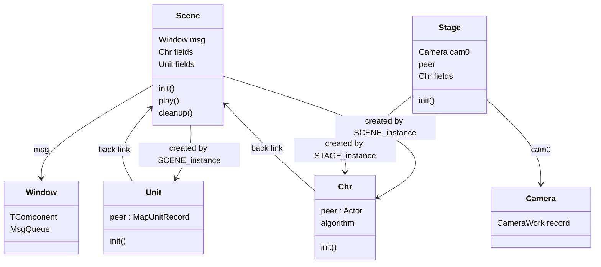
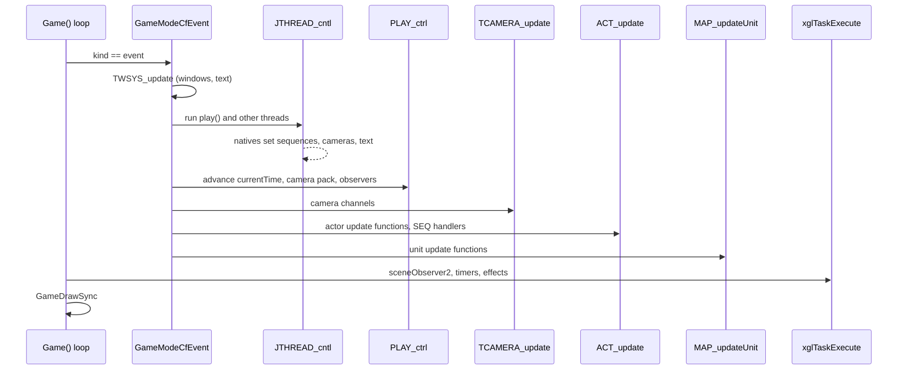
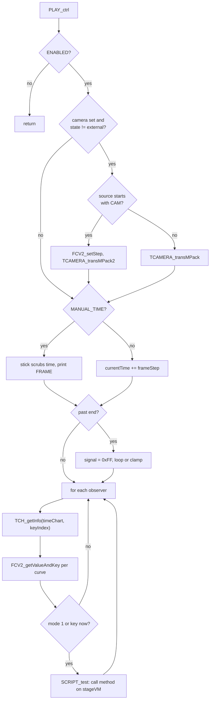
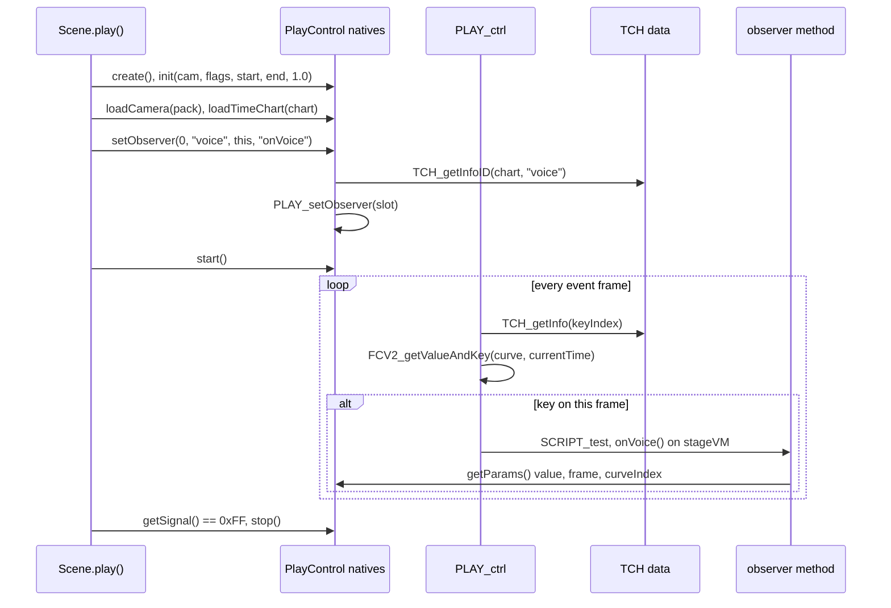
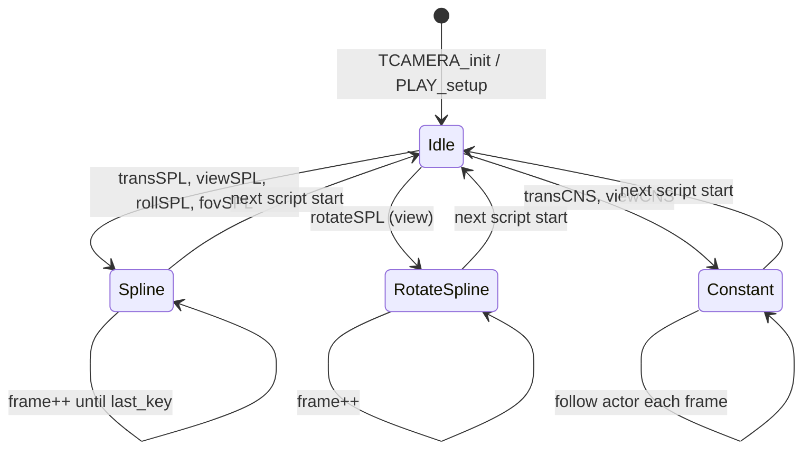
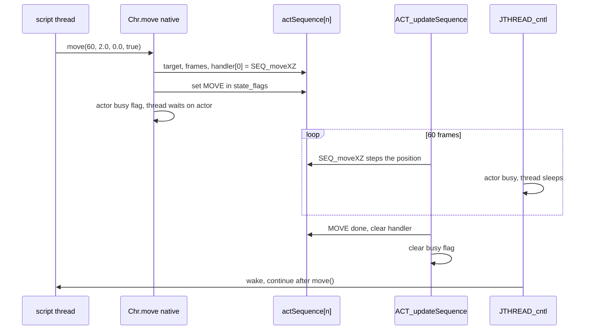
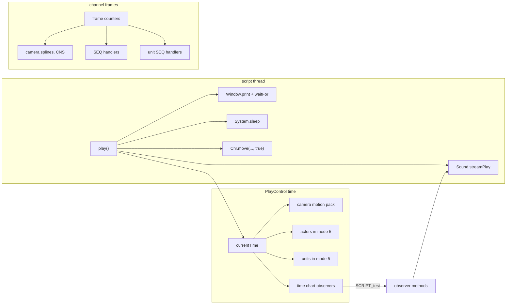
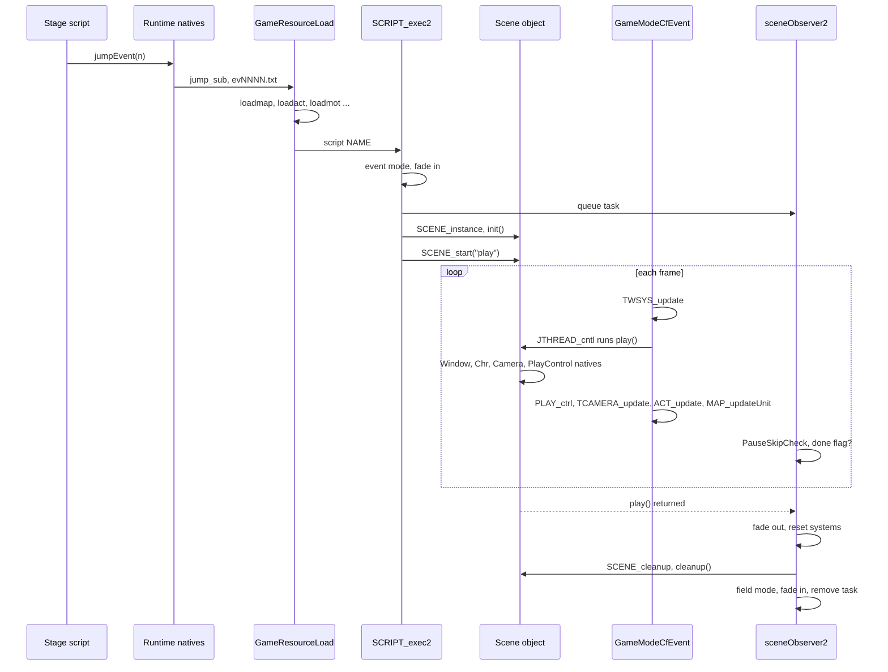

# Scenes, stages and time charts

A cutscene in Xenosaga Episode I is a Java object of a class that extends
`xeno/Scene`. A field area has an object of a class that extends `xeno/Stage`.
The C side creates these objects, fills in their character, unit, window and
camera fields, and runs their methods on VM threads (`src/main/scene_1.c`,
`src/main/stage_1.c`, `src/main/stage_2.c`). While a scene plays, a set of
small per-frame players moves everything on screen. The time chart player
`PlayControl` (`src/main/play.c`, `src/main/playcontrol.c`, `src/main/tch.c`)
keeps a clock and calls script methods at keyed times. The event cameras
(`src/main/tcamera.c`, `src/main/camera.c`) play camera curve files, follow
splines or follow actors. The sequence players (`src/main/near_dir.c` for
actors, `src/main/map_create_unit_peer.c` for map units) interpolate positions,
rotations, scales and motions over a number of frames.

How a cutscene is triggered, loaded and ended is described in
[events.md](events.md). The sections below cover what happens while it plays.
The VM threads and waits are described in [java-vm.md](java-vm.md) and every
native in [natives.md](natives.md).

[← Back to the overview](../README.md)

## Scene and stage classes

The two script base classes live in `data\base.evt`. A class that extends
`xeno/Scene` is a cutscene and its entry point is the method `play()`. A
class that extends `xeno/Stage` is the script of a field area. It has no
entry point and reacts to field triggers instead (see
[events.md](events.md#field-triggers)). `SCRIPT_exec2` tells them apart with
`JNI_searchClasses` and the `skip_count` it reports (see
[events.md](events.md#starting-a-script)).

Both kinds are built by a C function that walks the instance fields of the
class and creates the objects they need. This lets a script declare its cast
as fields and have them ready when its `init()` runs.

`SCENE_instance(vm, scene)` builds a Scene in this order:

1. It runs the scene's constructor `<init>()V` on `vm` (`defaultVM`).
2. It creates a scene window with `TWIN_create2(-1)` and `TWIN_initScene`,
   gives it the Java class `xeno/util/Window` and stores it in the `msg` field
   of `xeno/Scene`. All scene text goes to this window unless the script
   creates others.
3. It walks the instance fields of the scene class. For each field whose type
   is a `xeno/Chr` or `xeno/Unit` subclass with an `init()V` method, it creates
   an object of that type, runs its constructor with the signature
   `(L<scene class>;)V` and the scene as argument, then runs its `init()`, and
   stores it in the field.
4. In each new object it looks for fields whose type is the scene class and
   points them back at the scene. A character class can therefore call its
   scene's methods.
5. It runs the scene's `init()V`.

`STAGE_instance(vm, stage)` does the same for a Stage, with two differences.
It stores the event camera table `tcamera` as a `xeno/Camera` object in the
Stage field `cam0`, and it only creates `xeno/Chr` fields, running their
`init()` without a constructor call. `STAGE_create(id)` returns the native
peer of a Stage. It is a single static block of 24 halfwords
(`defaultStage`) with the stage ID at index 2, so every Stage shares one peer.

`SCENE_dispose` only tests whether an object is a Scene. `SCENE_cleanup(vm,
scene)` runs the scene's `cleanup()V` method on `vm` when it has one. The
scene observer calls it on `stageVM` when the cutscene ends.

The class diagram below shows the objects a running scene owns and the C
records behind them.



## Starting and stopping script methods

A Scene does not run `play()` directly. `SCENE_start(vm, scene, mode,
name)` attaches a method to the thread that belongs to the scene object
(`JTHREAD_get(scene)`). Mode 8 takes the name as a C string. Mode 1 takes a
Java string, which is what the native `Scene.start(int, Object)` passes.
`SCRIPT_exec2` calls it with mode 8 and the name `play`. `SCENE_start` stores
the method in `thread->method`, sets the update hook to
`JTHREAD_defaultScene` and sets the runnable flag (`0x10`). When the scene
starts itself from its own thread it also sets a start-self bit. From then on
`JTHREAD_cntl` calls the hook every frame and the hook resumes `play()` until
the method returns. `Scene.stop()` does nothing.

A Stage can run a long method in the background with `Stage.start(1,
"name")`. The native reads the Stage's `peer` field, finds the thread of the
peer, sets its method and its hook `JTHREAD_defaultStage` and marks it
runnable. `JTHREAD_defaultStage` prints the class and method name as debug
text and calls the method with the stage object. `Stage.stop()` clears the
runnable flag. Characters and units have the same pattern with `Chr.start(1,
"name")` and `Unit.start(1, "name")` and the hooks `JTHREAD_defaultChr` and
`JTHREAD_defaultUnit` (see [Moving actors](#moving-actors)).

The Stage natives also control fades and rendering during an event:

| Native | Effect |
| --- | --- |
| `setFade(int mode, int frames, float r, float g, float b)` | stores the fade mode, length and colour in `GameLoopState` (colour clamped to 0..1, at least one frame), stops enemy sounds and calls `SCRIPT_fade(frames)`, which also sets the fade-out time of the scene end |
| `setEventFade(IFFFIFFF)` | starts `nmlModelSetFadeInInterrupt` with the first four values and sets a fade from the last four |
| `setFadeCancel(int)` | cancels the fade-in (2), fade-out (1) or both (0) over 60 frames |
| `setColor(FFF)`, `setBgColor(FFF)` | sets a colour in `GameLoopState`, or the render clear colour |
| `setVisible(int part, boolean)` | shows or hides a part of the current model, or all parts |
| `setCFBG` | chooses a field background draw type (0 off, 1 or 2) |
| `setPartsLast(int)`, `setFrameRender(II)`, `setEffectRender(int)`, `renderCommand(int)`, `setBgClip(int)`, `clrBackBuffer()` | render options of the nml model library, see [nml.md](../libraries/nml.md) |
| `play(String)` | debug: loads and runs another script file and waits until its scene ends |

## The event frame

While a cutscene plays, `Game()` runs `GameModeCfEvent` once per frame (see
[field.md](../game/field.md) for the main loop). It clears the pause bit, lets
START with the quit combination leave the game, and then updates the event
systems in a fixed order:

1. `TWSYS_update` advances all windows. Text is popped from the message
   queues and the waits of the windows are counted (see
   [events.md](events.md#message-text-and-the-mif2-interface)).
2. `JTHREAD_cntl` runs every runnable script thread one step. `play()` and
   any character or unit methods run here until they block.
3. `PLAY_ctrl` advances the time chart clock, drives its camera and calls the
   time chart observers.
4. `TCAMERA_update` advances the channels of the event cameras.
5. `ACT_update` runs the update function of every actor, which includes the
   sequence players.
6. `MAP_updateUnit` runs the update function of every map unit.

After the mode function, the game scheduler runs its tasks. The
`sceneObserver2` task is one of them and checks for the end of the scene and
for the pause screen. Then `GameDrawSync` draws the frame. Field mode
(`GameModeCfMain`) runs the same window, thread and camera steps but has no
`PLAY_ctrl`, so time charts only advance during cutscenes.

The sequence below shows one event frame.



## PlayControl and the time chart player

A cutscene often needs things to happen at exact times: a camera cut at frame
120, a sound at frame 300, a character turning at frame 410. The time chart
player keeps a clock for this. There is a single player, the global
`Play playControl`, returned by `PLAY_getCurrent()`. The Java class
`xeno.PlayControl` wraps it and its 12 natives in
`src/main/playcontrol.c` all act on this one object. `SCRIPT_exec` and
`SCRIPT_exec2` reset it with `PLAY_setupDefault` whenever a new script starts.

The player counts time in seconds at 30 frames per second
(`PLAY_SECONDS_PER_FRAME`). Its record is:

```
Play (0x1DC bytes)
+0x000 class_ref       class reference so Java can use it as an object
+0x004 signal          set to 0xFF when the clock passes the end
+0x008 timeChart       time chart data (TCH)
+0x00C source          camera motion pack, PlaySource
+0x02C flags           1 ENABLED, 2 MANUAL_TIME, 4 LOOP
+0x030 cameraIndex     studio camera driven by source, -1 for none
+0x034 startTime       seconds
+0x038 endTime         seconds, default 10/3
+0x03C frameStep       seconds per frame, default 1/30
+0x044 currentTime     seconds
+0x04C observers[32]   {argument, method, chartIndex, keyIndex}
+0x1CC callbackParams  TCHParams {class_ref, value, frame, curveIndex}
```

`PLAY_setupDefault` sets the camera index to -1, the end time to 10/3
seconds, the step to one frame, clears the clock, flags and source and empties
all observers. `PLAY_setup` prepares a run. When a camera index is set, it
switches off all eight studio cameras except that one and sets the
translation, view and roll channels of its event camera to idle, so only the
player moves it. When a source is loaded, the start and end times come from
the source's `startFrame` and `endFrame`.

### The player natives

A script sets up the player with these natives:

| Native | Effect |
| --- | --- |
| `create()` | returns `&playControl` with a class reference |
| `init(int camera, int flags)` | stores the camera index and flags and calls `PLAY_setup` |
| `init(int camera, int flags, int startFrame, int endFrame, float step)` | the same, then sets the start, end and current time from the frames and the step as a multiple of one frame |
| `loadCamera(Object)` | stores a camera motion pack in `source` |
| `loadTimeChart(Object)` | stores a time chart in `timeChart` |
| `start()`, `stop()` | set or clear `PLAY_FLAG_ENABLED` |
| `getSignal()`, `signal(int)` | read or write `signal` |
| `setObserver(int mode, int key, Object, String)` | registers a method of the object for a time chart record by index |
| `setObserver(int mode, String chart, Object, String)` | the same, finding the record by name with `TCH_getInfoID`. Nothing is registered when the name is missing |
| `getParams()` | returns `callbackParams` as a `xeno.util.TCHParams` object |

The objects given to `loadCamera` and `loadTimeChart` are raw data blocks.
They come from the script's resource volume `data\mtnpack\SCExxxxx.arc`
through `Toolkit.loadResource(String)`, which returns the data of a named
member (see [events.md](events.md#script-files-and-script-databases)). All
307 camera files are members of 27 of these volumes. Their format is
described in
[Camera motion packs (CAM)](../formats/skeletons-and-motion.md#camera-motion-packs-cam)
and the volumes in
[Script resource volumes](../formats/skeletons-and-motion.md#script-resource-volumes).

### One step of the clock

`PLAY_ctrl` runs once per event frame and does nothing until `start()` set
the enabled flag. A step works like this:

1. If a camera index is set and that studio camera is not in the external
   state (2), it moves the camera from the source at `currentTime`. A source
   whose first four bytes are `CAM\0` (`formatTag` `0x004D4143`, named
   `PLAY_SOURCE_FORMAT_MAC` in the code) is read with
   `TCAMERA_transMPack2` after `FCV2_setStep(frameStep)`. Any other source is
   read with `TCAMERA_transMPack`, but every camera file on the disc has the
   `CAM\0` tag.
2. It advances the clock. Normally `currentTime += frameStep`. With
   `PLAY_FLAG_MANUAL_TIME` the left stick scrubs the clock forward or
   backward instead (ten times faster with a shoulder button), and a debug
   line prints `FRAME current (start, end)`. This is a tool for tuning
   cutscenes.
3. Past `endTime` it sets `signal` to `0xFF` and either wraps to `startTime`
   (`PLAY_FLAG_LOOP`) or stops at the end. Before `startTime` it wraps to the
   end or stops at the start.
4. For each used observer, it samples the observer's curves at
   `currentTime` (see the next section). For every curve it stores the curve
   index and value in `callbackParams` and, when the observer's mode is 1 or a
   key falls on this time, calls the observer's method through
   `SCRIPT_test(argument, method)`. That initialises `stageVM` and calls the
   method with the observer object as `this`.

The script usually waits for the end with `getSignal()` in a loop, or lets the
observers drive the whole scene. The flowchart below shows the step.



## Time chart data

A time chart (TCH) is a block of named records. Each record is a list of
curves in the FCV2 curve format of the animation system (see
[animation.md](../libraries/animation.md)). A curve has keys, and sampling it
with `FCV2_getValueAndKey` returns the value at a time and tells whether a key
lies on that time. The time chart therefore marks moments (keys) and carries
values (the curve value at the key) for each named track.

The data is stored with offsets instead of pointers. `getInfoAddr` relocates
it in place the first time it is used: it adds the chart's own address to the
name offset and to every pointer offset of every record, then sets
`relocated`. The layout is:

```
TimeChart
+0x00 (3 bytes)    not used by the code
+0x03 relocated    0 until getInfoAddr has run
+0x04 recordCount
+0x20 records[]    TchEntry, variable length, one after another

TchEntry (also read as PlayTCHCurveSet)
+0x00 wordCount          number of curve pointers that follow
+0x04 nameOffset / name  record name, relocated to a pointer
+0x08 pointerOffsets[]   curve offsets, relocated to FCV2 curve pointers
```

`TCH_getInfoID(chart, name, length)` returns the index of the first record
whose name matches, or -1. `TCH_getInfo(chart, index)` returns the record as
a `PlayTCHCurveSet`, whose `count` is the word count and whose `curves[]` are
the relocated pointers. `PLAY_checkTCH(result, set, stop_after_first, frame)`
is a helper that samples a set and reports the first curve with a key.

An observer slot holds the object, the method (looked up with the signature
`()V`), the record index (`keyIndex`) and a mode (`chartIndex`). Mode 1 calls
the method every frame for every curve. Any other value calls it only at keys.
Inside the callback the script reads `PlayControl.getParams()`, a `TCHParams`
object with the sampled `value`, the current `frame` and the `curveIndex`. One
time chart record can thus fire one method at many keyed moments, and the
method can use the curve value to decide what to do, for example which line
to show or which motion to play.

The sequence below shows how a script registers an observer and how the
player calls it back.



The names `voice` and `onVoice` in this sequence are examples. The retail
scripts do not use time charts. The names `loadTimeChart` and `setObserver`
occur only in the class library `system.evt`, which declares the natives, and
in no event script. The only time chart on the disc, `c01s42.tch` in the
resource volume `SCE01042.arc`, is a 32-byte header with a record count of 0
(see [Members](../formats/skeletons-and-motion.md#members)).

## Event cameras

The event cameras are eight records `CameraWork tcamera[8]` (`0x12C0` bytes
each), one per studio camera of the rendering library (see
[xgl.md](../libraries/xgl.md)). The Java object of `xeno.Camera` is the record
itself. `Camera.create(int id)` returns `&tcamera[id]`, sets its class
reference and camera ID, and sets `fov_scale` to 1.2. A Stage also gets
`tcamera` in its `cam0` field.

A camera is driven by four independent channels: translation (the camera
position), view (the look-at point, or the angles directly), roll and field of
view. Each channel has a mode in `mode[4]`, a frame counter in `frame[4]` and
a payload of `0x4A0` bytes:

```
CameraWork (0x12C0 bytes)
+0x000 object_header    class reference
+0x004 camera_id        studio camera 0..7
+0x00C mode[4]          channel modes, translate/view/roll/fov
+0x01C frame[4]         frames played in each channel
+0x030 translate        CameraChannelPayload
+0x4D0 view             CameraChannelPayload
+0x970 roll             CameraChannelPayload
+0xE10 fov              CameraChannelPayload
+0x12B0 peer            actor followed in the peer state
+0x12B4 fov_scale

CameraChannelPayload (union)
  spline   CameraSpline {weight_mode, first_key, last_key, sample_count,
                         component_count, samples}
  constant CameraConstantChannel {offset, reference_mode, reference_position}
  packed   CameraMotionPackChannel {source, frame}
```

| Mode | Value | Set by | What drives the channel |
| --- | --- | --- | --- |
| `CAMERA_MODE_IDLE` | `0x10` | `TCAMERA_init`, `PLAY_setup` | nothing, values stay as set |
| `CAMERA_MODE_MOTION_PACK` | `0x11` | nothing in the code | an FCV motion pack, one frame per update |
| `CAMERA_MODE_SPLINE` | `0x12` | `transSPL`, `viewSPL`, `rollSPL`, `fovSPL` | a spline of keys, one frame per update |
| `CAMERA_MODE_ROTATE_SPLINE` | `0x13` | `rotateSPL` | a spline of angles on the view channel |
| `CAMERA_MODE_CONSTANT` | `0x14` | `transCNS`, `viewCNS` | an actor or unit position plus an offset (CNS) |
| `CAMERA_MODE_MOTION_PACK2` | `0x15` | nothing in the code | an FCV2 motion pack |

`TCAMERA_update` runs once per frame in both field and event mode. For each
studio camera whose state is not external (2) it runs the handler of each
channel and advances that channel's frame. For spline channels with a key
range (`first_key >= 0`, set by the `aFIII` natives), the frame stops at
`last_key`. Otherwise it keeps counting. The constant mode reads the reference
position each frame, so the camera follows a moving character. L1 with SELECT
toggles a debug readout of the active camera's position, angles and field of
view. `TCAMERA_init` sets all channels of all cameras to idle and runs at
every script start.

`TCAMERA_update` still has handlers for the two motion pack modes, but no
native or other code sets a channel to them, so a camera channel never plays
a pack on its own. Camera curve files are played only by the time chart
player: `PlayControl.loadCamera` stores the file, and `PLAY_ctrl` calls
`TCAMERA_transMPack2` with its own clock.

A camera file holds eight curves: position x, y, z, look-at x, y, z, roll and
field of view. `TCAMERA_transMPack` reads them with the FCV reader, scales the
positions by 0.1, converts roll and field of view from degrees and derives the
yaw and pitch from the vector between position and look-at.
`TCAMERA_transMPack2` reads an FCV2 pack without scaling and also keeps the
look-at point in `mpack_interest`. All 307 camera files on the disc are FCV2
files with the `CAM\0` tag, so only `TCAMERA_transMPack2` is used. Their
layout is in
[Camera motion packs (CAM)](../formats/skeletons-and-motion.md#camera-motion-packs-cam).

The script chooses which camera is shown. `Camera.change()` makes this camera
the only active studio camera and records it in
`GameLoopState.activeCameraIndex`. `Camera.setActive(boolean)` switches one
camera on or off. `Camera.start(int state, Object peer)` sets the studio
camera state: 2 external (the event camera code leaves it alone), 3 peer (with
a `Chr` peer stored in `peer`, probably so the camera follows that actor), or
4 game (the field camera callback drives it). The direct setters
`setTranslate`, `setRotate`, `setRoll`, `setFov` and `setView` place a camera
at once, and the getters read it back. The `setCF*` natives
(`setCFAngle`, `setCFOffset`, `setCFPedestal` and others) and `setMode`
change the field camera definitions instead and belong to
[field.md](../game/field.md). `setFog`, `resetFog` and `setClipRange` change
fog and clipping.

The state diagram below shows how the channel modes change.



## Moving actors

Characters are actors (see [actors.md](../libraries/actors.md)). Every actor
slot has a sequence record `actSequence[64]` (`ActSequenceEntry`, `0x260`
bytes) that holds up to four running interpolations: a move, a rotation, a
motion and a scale. The `Chr` natives fill a channel and set a handler, and
the actor's update function `ACT_updateSequence` runs the handlers every
frame.

```
ActSequenceEntry (0x260 bytes)
+0x000 state             SequenceState
         flags           start flags, bit 0x100 = use channel_mask
         state_flags     channels still running
         channel_mask    channels that count for "busy"
         cleared_on_init start mode of Chr.start
         cleared_on_init_run[4]  method of Chr.start mode 1
         handler[4]      move, rotate, motion, scale or other
+0x034 frame_counter
+0x038 move_channel      SplineTrack or MoveTrack {target_actor, frames,
                         start, target (w = step)}
+0x0B8 rotation_channel  SplineTrack or RotationTrack {target, duration[3],
                         face_flags, start[3], goal[3], step[3]}
+0x138 motion            MotionTrack {time, motion, loop_start, loop_end,
                         blend, flags, speed}
+0x1B8 scale_channel     SplineTrack or ScaleTrack
+0x238 idle_roll
+0x240 anchor
```

The channel bits are `SEQ_CHANNEL_MOVE` (`0x1`), `SEQ_CHANNEL_ROTATE_X/Y/Z`
(`0x2`, `0x4`, `0x8`), `SEQ_CHANNEL_MOTION` (`0x10`) and
`SEQ_CHANNEL_SCALE_X/Y/Z` (`0x20`, `0x40`, `0x80`). A native sets the bit in
`state_flags` when it starts a channel. The handler clears it when the
channel is done.

`ACT_updateSequence(actor)` works in four steps:

1. It calls each of the four handlers whose address is a valid code address.
2. It clears the handlers of finished channels. With `SEQ_USE_CHANNEL_MASK`
   it does this per channel and clears the actor's busy flag
   (`ACTOR_FLAG_SEQUENCE_ACTIVE`, `0x2`) once no channel in `channel_mask`
   runs. Without it, it clears all handlers and the busy flag when every
   channel has finished.
3. When the actor has `ACTOR_FLAG_FOLLOW_GROUND`, it sets the height from the
   ground data (`UnduGet`).
4. It updates the actor's motion (`ACT_updateMotion`).

The handlers are:

| Handler | Started by | Work per frame |
| --- | --- | --- |
| `SEQ_moveXZ` | `Chr.move(int frames, float x, float z, boolean wait)`, `Chr.move(float x, float z, float speed, boolean wait)` | walks toward a point in the XZ plane, over a number of frames or at a speed per second |
| `SEQ_moveChr` | `Chr.move(int frames, Chr target, boolean)`, `Chr.move(Chr target, float speed, boolean)` | walks toward another actor and turns to face it, until within one step plus 0.5, choosing a walk or run motion |
| `SEQ_moveSPL` | `Chr.move(Spline, int frames, boolean)` | sets the position from a spline, one frame per call, optionally facing the direction of travel |
| `SEQ_rotate` | `Chr.rotX`, `rotY`, `rotZ` | turns each axis by a fixed step (`nearDir(start, goal) / duration`), or toward a target actor for axes in `face_flags` |
| `SEQ_rotateSPL` | `Chr.rotate(Spline, int, boolean)` | sets the rotation from a spline of angles in degrees |
| `SEQ_scale`, `SEQ_scaleSPL` | `Chr.sclX`, `sclY`, `sclZ`, `Chr.scale(Spline, ...)` | scales over frames or along a spline |
| `SEQ_motion` | `Chr.mtn(...)` | starts a motion with `ACT_setMotion2` and a blend time, plays it at a speed and loop range, ends when the animation reports its end (flag `0x1000`) |
| `SEQ_setMotion`, `SEQ_setPositionRAND`, `SEQ_moveNPC_XZ`, `SEQ_setRotY2Player` | `ACT_updateNPC` | idle behaviour of NPCs: a random idle motion, a short random walk, turning to the player |

`nearDir(from, to)` returns the signed shortest turn from one angle to
another, so rotations never take the long way round. The talk check uses it
too.

In the move natives, the target point is relative to the actor's position
when bit 0 of the `Chr` field `algorithm` is set, and absolute otherwise. The
speed forms store the speed divided by 30 as the step per frame.

### Waiting for an actor

Most actor natives end with a `boolean wait` argument. With `wait` true the
native sets the actor's busy flag (`CHR_ACTOR_BUSY`, `0x2`). What happens to
the calling thread depends on the thread:

- On a character's own thread (kind 1), the native marks the thread as
  waiting. `JTHREAD_defaultChr` does not resume a character thread while its
  actor is busy, so the method continues once the move has finished.
- On a thread with flag `0x40`, the native sets the wait kind to the actor
  wait (`JTHREAD_WAIT_ACTOR`) on that actor. The thread sleeps until the busy
  flag is clear.
- On any other thread the native does not block, and the script continues
  while the actor moves.

The sequence below shows a scene method that walks a character and waits.



### Actor update modes

`Chr.start(int mode, Object)` chooses the update function of the actor:

| Mode | Update function | Use |
| --- | --- | --- |
| 0 | `ACT_updateDefault` | stand still, follow the ground, play the current motion |
| 1 | `ACT_updateSequence` and a script method | runs the named method of the `Chr` object on its own thread with `JTHREAD_defaultChr`. Clears the old handlers when `System.methodSignal` asked for it |
| 2 | `ACT_updatePlayer` | the pad moves the actor relative to the camera |
| 4 | `ACT_updateSequence` | sequence handlers only |
| 5 | `ACT_updateMPack` | the motion frame is set to `PlayControl` time every frame |

`Chr.stop()` stops the character thread and copies the actor's position and
rotation into the Java fields. `ACT_createChr` creates script actors with
`ACT_updateSequence`, and `ACT_createNPC` creates wandering NPCs with
`ACT_updateNPC`. `ACT_initScene` and `ACT_initSequence` clear all actors and
sequence records between scenes.

## Moving map units

Map units (doors, lifts, props, see
[map-and-units.md](../game/map-and-units.md)) have the same system in
`src/main/map_create_unit_peer.c`. `unitSequence[64]` holds one sequence
record per unit with a group number, flags, a running state, a pivot and an
axis, four update callbacks and move, rotation, scale and motion tracks. The
bit layout matches the actor channels.

The `Unit` natives in `src/main/unit.c` start the handlers `SEQ_moveUnitXZ`,
`SEQ_moveUnitChr`, `SEQ_moveUnitSPL`, `SEQ_rotateUnit`, `SEQ_rotateUnitSPL`,
`SEQ_scaleUnit`, `SEQ_scaleUnitSPL` and `SEQ_motionUnit`, and they wait on the
unit the same way the `Chr` natives wait on an actor. Two extra handlers tie a
unit to a character: `SEQ_transCNSUnitChr` places the unit at a bone matrix
of an actor plus an offset, and `SEQ_rotYCNSUnitChr` turns it with the actor.
A character can carry an object this way.

`Unit.start(int mode, Object)` has the same modes as `Chr.start`: 0
`MAP_updateUnitDefault`, 1 a script method on the unit's thread with
`JTHREAD_defaultUnit`, 4 the sequence, 5 `MAP_updateUnitMPack`.
`MAP_updateUnitSequence` runs the four callbacks, clears them and the unit's
busy flag when the state reaches 0, follows the ground when flagged and
rebuilds the unit matrix. `MAP_updateUnitMPack` sets the unit's
`motionTime` to `PlayControl` time. `MAP_updateUnitPartsSequence` and its
variant write the result into one part of the map display model around the
pivot and axis, so a part of the map itself can move. `MAP_callUnitGroup`
calls a function for every unit of a group, and `MAP_initUnitSequance` resets
all 64 records.

## Splines in events

Events use splines for smooth paths of cameras, characters and units. A
spline is a list of keys. Each key is one weight followed by the components,
so a position key is four floats (weight, x, y, z) and a single value key is
two floats (weight, value).

The camera natives take the keys directly as a `float[]`.
`Camera.transSPL(float[], int weight_mode)` calls `SPL_init(spline,
weight_mode, samples, length / 4, 3)` on the translation channel. The
`aFIII` forms add a first and last key that limit the channel frame. The roll
and field of view forms use one component.

Characters and units take a `xeno.util.Spline` object. `Spline.create()`
allocates a native spline of `0x494` bytes with `xmalloc` (heap category
`0xE`). `Spline.setCtrlVertex(float[] keys, int order, int weight_mode, int
duration)` stores the weight mode and duration and calls `SPL_init2` with
three components. `Spline.getValue(int frame)` evaluates it with
`SPL_getValueXYZ` and returns a shared static `Vector4f`, so the result must
be read before the next call. The spline math (`SPL_init`, `SPL_init2`, the
weight schemes and the evaluation) is described in
[math.md](../libraries/math.md).

## Keeping everything in sync

A cutscene has no single master timeline. It uses three clocks that the
script ties together.

The first clock is the **script thread**. `play()` runs its statements in
order and blocks on waits: a window waiting for a button, a number of frames
(`System.sleep`), an actor finishing its move, or another thread finishing
(see [events.md](events.md#synchronising-text-voices-and-actions)). This is
how dialogue, camera cuts and simple movements follow each other.

The second clock is the **PlayControl time**. Everything that must stay
frame-exact with a pre-made animation follows `playControl.currentTime`:

- the camera given to `PlayControl.init` reads its motion pack at that time,
- actors in `Chr.start(5, ..)` set their motion frame to it
  (`ACT_updateMPack`),
- units in `Unit.start(5, ..)` set their motion time to it
  (`MAP_updateUnitMPack`),
- time chart observers fire script methods at the keys of their records.

The cutscene's camera work and character animation can therefore be authored
together as packs and played in lockstep. Pausing the clock (`stop()`) or
scrubbing it in manual mode moves all of them together.

The third clock is the **channel frame counter** of each event camera and
each actor or unit sequence. These run on their own from the moment a native
starts them.

Voices are started by the script with `Sound.streamPlay` (see
[events.md](events.md#synchronising-text-voices-and-actions)). The code has no
link between the stream and the time chart. Lines are probably started from
time chart observers or right after a window print, and the script then waits
with the same mechanisms as for text.

The flowchart below shows what each clock drives.



## A cutscene from start to finish

This walkthrough follows a cutscene through all the systems on this page and
on [events.md](events.md). The Java side is described by the natives it
calls, since the bytecode itself is data on the disc.

1. **Trigger.** A Stage method runs, for example a `KickEvent` from an event
   locator. It calls `Runtime.jumpEvent(n)`. The native schedules
   `scriptReset_jump` in `jthreadResetFunc` and blocks its thread.
2. **Jump.** At the end of the thread walk, `jump_sub` stops sound and
   movies, resets the field systems and the VM, and calls
   `GameResourceLoad(0x10000000 + n)`.
3. **Load.** `data\scene\evNNNN.txt` is read. Cutscene scripts have no scene
   archive: the 112 archives on the disc (`cfNNNN.a`) all belong to field
   scripts. The commands load the map, the character models, motions and
   effects, and finally the `script` command loads the `.evt` into the
   inactive script database, together with its motion pack and resource
   volume from `data\mtnpack` when they exist (107 and 77 of the 181 event
   scripts have them).
4. **Start.** `SCRIPT_exec2` finds a Scene class. It switches to event mode,
   sets `GAME_LOOP_FLAG_EVENT_SCENE`, starts the fade-in, resets the cameras,
   windows and messages, creates the scene object and its thread, queues
   `sceneObserver2`, runs `SCENE_instance` (constructor, `msg` window, cast
   fields, `init()`) and attaches `play()` with `SCENE_start`.
5. **Set-up.** In its first steps `play()` probably places the cast with
   `Chr` natives, creates or selects cameras with `Camera.create` and
   `Camera.change`, finds its data with `Toolkit.loadResource`, and, for a
   camera file, prepares the time chart player with `PlayControl.init`,
   `loadCamera` and `start`. No retail script calls `loadTimeChart` or
   `setObserver`.
6. **Play.** Each frame `GameModeCfEvent` updates windows, runs `play()` one
   step, advances the time chart, the cameras, the actors and the units. Text
   appears in the `msg` window and the thread waits for the player's button.
   Voices start from `Sound.streamPlay`.
7. **End.** `play()` returns, or the player skips with START and TRIANGLE.
   `sceneObserver2` fades out over `s_nScriptFadeOutTime` frames, resets
   units, actors, windows and messages, returns to field mode, calls
   `cleanup()`, clears the event flag and fades in.
8. **Return.** The next place comes from a jump. A cutscene probably calls
   `Runtime.jumpCF` (or `jumpEvent` for the next cutscene) itself near the
   end of `play()`, which loads the next field area and its Stage script.

The sequence diagram below shows the whole flow.



## Source files

| File | Contents |
| --- | --- |
| `src/main/scene_1.c` | `SCENE_instance`, `SCENE_cleanup`, `SCENE_start`, `SCENE_dispose` |
| `src/main/scene_2.c` | `Scene.start` and `Scene.stop` natives |
| `src/main/stage_1.c` | `STAGE_create`, `STAGE_instance` |
| `src/main/stage_2.c` | `Stage` natives: start, stop, fades, render options, debug `play` |
| `src/main/play.c` | the time chart player `playControl`, `PLAY_setup`, `PLAY_ctrl`, observers |
| `src/main/playcontrol.c` | `PlayControl` natives |
| `src/main/tch.c` | time chart relocation and lookup |
| `src/main/tcamera.c` | event camera update, motion pack readers, channel handlers |
| `src/main/camera.c` | `Camera` natives |
| `src/main/near_dir.c` | `nearDir`, actor `SEQ_*` handlers, actor update functions |
| `src/main/chr.c` | `Chr` natives |
| `src/main/map_create_unit_peer.c` | unit `SEQ_*` handlers and unit update functions |
| `src/main/unit.c` | `Unit` natives |
| `src/main/spline.c` | `Spline` natives |
